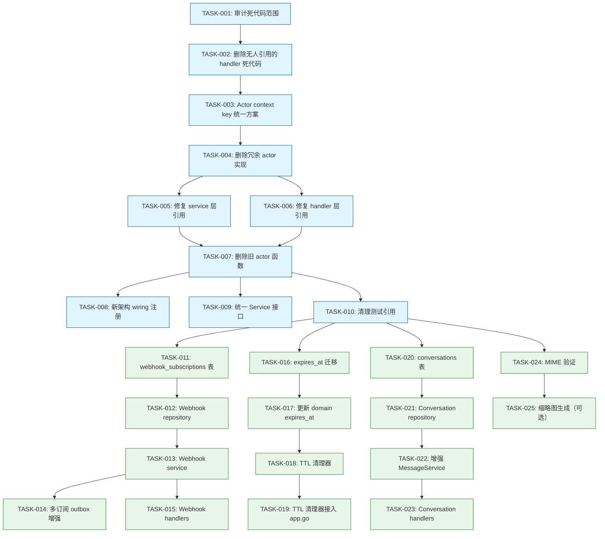
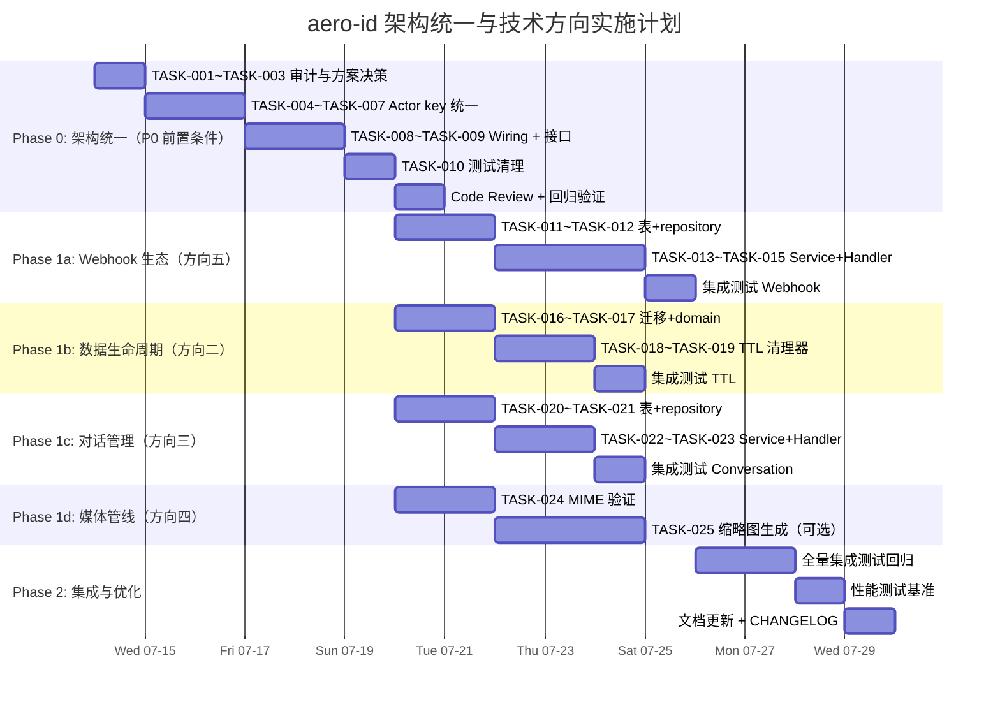

现在我有了完整的代码库画像。以下是 Tech Lead 分析报告。

---

# Tech Lead 分析报告：aero-id 架构统一与技术方向实施计划

## 0. 现状总结

代码库存在**双架构平行冗余**：

| 组件 | 旧架构（活代码） | 新架构（死代码 ~2,000 行） |
|---|---|---|
| Handler HTTP | `internal/handler/http/{comment,file,...}.go` | `internal/{comment,file,...}/handler_http.go` |
| Handler gRPC | `internal/handler/grpc/{comment,file,...}.go` | `internal/{comment,file,...}/handler_grpc.go` |
| 服务层 | `internal/service/{files,message,...}.go` | `internal/{comment,file,...}/service.go` |
| Actor ctx key | `service.ctxKey` | `domain.ctxKey` |
| Composition root | `app.go` → `handler/*` | **未接入** |

**关键风险**：`service.ctxKey` vs `domain.ctxKey` 是不同的 Go 类型。若有人误将新架构接入生产路径，auth token 将完全丢失，每个请求返回 `auth.unauthorized`。

---

## 1. 任务分解

### 1.1 前置条件：架构统一（方向一）

| 任务 ID | 标题 | 涉及文件 | 前置依赖 | 工时 | 验收标准 |
|---------|------|---------|---------|------|---------|
| **TASK-001** | 审计并确认死代码范围 | 所有 `internal/{comment,file,message,block,notification,search}/*.go` | 无 | 1h | 输出完整死代码清单，标记每个文件的引用关系 |
| **TASK-002** | 删除无人引用的 handler 死代码 | `internal/comment/handler_grpc.go`, `handler_http.go`, <br>`internal/file/handler_grpc.go`, `handler_http.go`, <br>`internal/message/handler_grpc.go`, `handler_http.go`, <br>`internal/block/handler_grpc.go`, `handler_http.go`, <br>`internal/notification/handler_grpc.go`, `handler_http.go`, <br>`internal/search/handler_grpc.go`, `handler_http.go` | TASK-001 | 1h | `make test && make lint` 通过；12 个文件共计 ~2,000 行被移除，无编译错误 |
| **TASK-003** | 统一 Actor context key（方案选择） | `internal/domain/actor.go`<br>`internal/service/service.go` | TASK-002 | 1h | 完成设计文档评审，决定保留哪一个 ctxKey 并删除另一个 |
| **TASK-004** | 删除冗余的 actor context 实现 | 选择保留 `domain.WithActor`/`MustActor`（代码量少且为 domain 包公共基础）或 `service.WithActor`/`ActorFrom` | TASK-003 | 1h | 只有一个 `WithActor`/`ActorFrom` 实现；所有引用指向同一个 |
| **TASK-005** | 修复 service 层引用到 domain actor | `internal/service/service.go`（改 `mustActor` 实现）<br>`internal/service/*.go`（除 `mustActor` 外如有直接引用 actorKey） | TASK-004 | 2h | `service.mustActor` 调用 `domain.MustActor` 而非 `service.ActorFrom` |
| **TASK-006** | 修复 handler 层引用到统一后的 actor | `internal/handler/http/*.go`<br>`internal/handler/grpc/*.go`, `internal/handler/grpc/server.go`, `internal/handler/grpc/validate.go` | TASK-004 | 2h | 所有 handler 层的 `service.WithActor`/`service.ActorFrom` 改为统一版本 |
| **TASK-007** | 删除旧 service 层的冗余 actor 函数 | `internal/service/service.go`（删除 `WithActor`, `ActorFrom`, `ctxKey`, `actorKey`） | TASK-005, TASK-006 | 0.5h | 无悬空引用；`make test && make lint` 通过 |
| **TASK-008** | 为新架构 service 实现 wiring 注册 | `internal/app/app.go`<br>创建 `internal/app/wiring.go`（按领域拆分 wiring 逻辑） | TASK-007 | 3h | `app.go` 只负责启动编排，领域依赖注入在各 domain wiring 函数中；文件不超 500 行 |
| **TASK-009** | 更新领域包的 `Service` 接口消除 duplication | `internal/comment/comment.go`（Service 接口）<br>`internal/file/file.go`（Service 接口）<br>`internal/message/message.go`（Service 接口）<br>`internal/block/block.go`（Service 接口）<br>`internal/notification/notification.go`（Service 接口）<br>`internal/search/search.go`（Service 接口）<br>`internal/service/service.go`（旧接口——删除或适配） | TASK-008 | 4h | 每个领域有且仅有一个 `Service` 接口定义；旧 `service/*` 的接口要么被删除，要么委托给 domain 包 |
| **TASK-010** | 清理遗留测试中引用旧 actor 函数的代码 | `internal/handler/http/*_test.go`<br>`internal/handler/grpc/*_test.go` | TASK-007 | 1.5h | 所有测试使用统一 actor context |

### 1.2 方向五：Webhook 生态扩展

| 任务 ID | 标题 | 涉及文件 | 前置依赖 | 工时 | 验收标准 |
|---------|------|---------|---------|------|---------|
| **TASK-011** | 添加 `webhook_subscriptions` 表迁移 | `migrations/XXX_webhook_subscriptions.up.sql`<br>`migrations/XXX_webhook_subscriptions.down.sql` | TASK-010 | 2h | 迁移创建 `webhook_subscriptions` 表（id, uid, url, event_types[], signing_key, enabled, created_at, deleted_at）；`make migrate-up` 通过 |
| **TASK-012** | 实现 WebhookSubscription repository | `internal/webhook/repository.go`<br>`internal/webhook/webhook.go`（领域类型 + Repository + Service 接口） | TASK-011 | 3h | CRUD 操作完整；单元测试通过 |
| **TASK-013** | 实现 WebhookSubscription service | `internal/webhook/service.go` | TASK-012 | 3h | 订阅管理业务逻辑（创建/更新/删除/列表）；权限校验（仅本人） |
| **TASK-014** | 增强 `outbox/webhook.go` 支持多订阅 | `internal/outbox/webhook.go`（改为从 DB 加载订阅而非仅从配置） | TASK-013 | 3h | 多订阅派发；每个订阅有独立 HMAC key；`make test-integration` 通过 |
| **TASK-015** | 添加 Webhook HTTP handler | `internal/handler/http/webhook.go`<br>`internal/handler/grpc/webhook.go` | TASK-013 | 2h | `GET/POST/PUT/DELETE /v1/webhooks/subscriptions`；gRPC 等效接口 |

### 1.3 方向二：数据生命周期管理

| 任务 ID | 标题 | 涉及文件 | 前置依赖 | 工时 | 验收标准 |
|---------|------|---------|---------|------|---------|
| **TASK-016** | 添加 `expires_at` 字段迁移（文件/消息） | `migrations/XXX_add_expires_at.up.sql`<br>`migrations/XXX_add_expires_at.down.sql` | TASK-010 | 2h | `files` 和 `messages` 表增加 `expires_at` nullable 列 |
| **TASK-017** | 更新 domain 类型增加 ExpiresAt | `internal/domain/file.go`<br>`internal/domain/message.go`<br>`internal/domain/comment.go` | TASK-016 | 2h | 领域类型增加 `ExpiresAt *time.Time` |
| **TASK-018** | 实现通用 TTL 清理器 `sweeper/ttl.go` | `internal/storage/gc/ttl.go`（复用 `sweeper.go` 的 Config+Run/Start 模式） | TASK-017 | 3h | 可配置 TTL 清理器：扫描 `WHERE expires_at < NOW()` 软删除，支持批量 |
| **TASK-019** | 将 TTL 清理器接入 app.go | `internal/app/app.go`（可选启动清理器） | TASK-018 | 1h | `config.yaml` 增加 `storage.ttl.*` 配置；`make test` 通过 |

### 1.4 方向三（对话管理）+ 方向四（媒体管线）

| 任务 ID | 标题 | 涉及文件 | 前置依赖 | 工时 | 验收标准 |
|---------|------|---------|---------|------|---------|
| **TASK-020** | 添加 `conversations` 表和数据迁移 | `migrations/XXX_conversations.up.sql`<br>`migrations/XXX_conversations.down.sql`<br>`internal/domain/conversation.go` | TASK-010 | 3h | 表结构：id, participant_a_uid, participant_b_uid, last_message_at, unread_count_a, unread_count_b, created_at, deleted_at |
| **TASK-021** | 实现 Conversation repository | `internal/message/conversation_repo.go` | TASK-020 | 3h | 创建/获取/更新最后消息时间；按用户列出对话（分页） |
| **TASK-022** | 增强 MessageService 支持对话管理 | `internal/message/message.go`（Service 接口增加 `ListConversations`, `GetConversation`）<br>`internal/message/service.go` | TASK-021 | 3h | 发送消息时自动 upsert conversation；列出对话含摘要和未读数 |
| **TASK-023** | 添加 Conversation HTTP/gRPC handler | `internal/handler/http/conversation.go`<br>`internal/handler/grpc/conversation.go` | TASK-022 | 2h | `GET /v1/conversations` 等端点 |
| **TASK-024** | 实现 MIME magic bytes 验证中间件 | `internal/service/validate_mime.go` | TASK-010 | 2h | 文件上传时使用 `http.DetectContentType` 验证魔数；拒绝声明类型与实际不符的文件 |
| **TASK-025** | 实现图片缩略图生成（可选方向） | `internal/storage/thumbnail/` 目录 | TASK-024 | 5h | 异步 pipeline：上传完成后触发缩略图生成，存为同前缀不同后缀 |

---

## 2. 执行顺序



**并行组**：

| 组 | 任务 | 说明 |
|----|------|------|
| 组 A（P0 架构统一） | TASK-001 ~ TASK-010 | **前置条件**，不得并行 |
| 组 B（Webhook） | TASK-011 ~ TASK-015 | 可在 TASK-010 完成后独立进行 |
| 组 C（数据生命周期） | TASK-016 ~ TASK-019 | 与组 B 同级并行 |
| 组 D（对话管理） | TASK-020 ~ TASK-023 | 与组 B/C 同级并行 |
| 组 E（媒体管线） | TASK-024 ~ TASK-025 | 与组 B/C/D 同级并行，TASK-025 依赖 TASK-024 |

---

## 3. 技术风险

### 3.1 高优先级风险

| # | 风险 | 等级 | 说明 | 缓解措施 |
|---|------|------|------|---------|
| R1 | Actor context key 差异导致运行时静默失败 | **Critical** | `service.ctxKey`（`int` 类型）和 `domain.ctxKey`（`int` 类型）是不同的 Go 类型。误用一个 key 写、另一个 key 读 → `ActorFrom` 返回 `("", false)` → HTTP 401 / gRPC `Unauthenticated`。在过渡期间两个 key 必须同时存活。 | 过渡期间写两个 key；统一后删除一个。添加集成测试验证 auth e2e 路径。 |
| R2 | 旧架构 service 接口与新架构 domain service 接口签名差异 | **High** | 旧 `service.CommentService` 接口方法签名与新 `comment.Service` 接口方法签名有差异（例如 `Delete(ctx, id)` vs `Delete(ctx, id) error` 是否匹配？DTO 类型不同）。统一前需做 API 签名对齐。 | 逐个领域对比新旧接口签名，编写兼容性 shim 或直接重写迁移。 |
| R3 | `app.go` 超 500 行约束 | **Medium** | 当前 `app.go` 约 260 行，在加入新 wiring 后容易突破 500 行限制。 | 在 TASK-008 中将 wiring 拆分到 `internal/app/wiring_{comment,file,...}.go`。 |
| R4 | 新架构测试覆盖 handler 死代码未被发现 | **Low** | 新架构 handler 已写测试（`handler_grpc_test.go`, `handler_http_test.go`），但这些测试是死代码的一部分。删除前需提取有价值的测试到对应的 `internal/handler/*_test.go`。 | TASK-002 前先检查测试断言是否覆盖旧架构 handler 未覆盖的场景，如有价值则移植。 |
| R5 | 对话管理（方向三）的 `conversations` 表迁移与现有 `messages` 表一致性 | **Medium** | 现有消息通过 `from_uid` + `to_uid` 确定对话关系。迁移逻辑需要回填历史对话数据，需考虑效率（可能涉及全表扫描）。 | 分批回填 + 后台 job；`created_at` 用第一条消息的时间。 |

### 3.2 外部依赖

- **SSO gRPC**：所有 auth 校验依赖 SSO 服务可用性（已有 circuit breaker + 缓存）。架构统一不新增此依赖。
- **对象存储**（S3/MinIO）：媒体管线方向新增缩略图生成，依赖 `imaging` 库或外部图片处理服务。
- **无新增外部依赖**：Webhook 使用现有 `net/http` 客户端；TTL 清理器使用现有 `storage/gc` 模式。

### 3.3 性能瓶颈

| 场景 | 当前瓶颈 | 优化策略 |
|------|---------|---------|
| 旧架构全局 service 调用链 | 无性能问题但可维护性差 | 统一后不影响性能 |
| Webhook 多订阅派发 | 每个事件需查询 DB 获取订阅列表 | 加内存缓存（`sync.Map` + TTL），监听 `webhook_subscriptions` 变更事件 |
| 对话列表 | 需要 LEFT JOIN messages 获取最后消息 | 物化 `last_message_at` 和摘要字段到 `conversations` 表 |
| TTL 清理器 | 全表扫描的 `WHERE expires_at < NOW()` | 加复合索引 `(expires_at, deleted_at)` |

---

## 4. 资源评估

### 4.1 团队配置建议

| 角色 | 人数 | 职责范围 |
|------|------|---------|
| **Senior Go 工程师（Tech Lead）** | 1 人 | 架构决策，TASK-001~TASK-010 核心架构统一工作，代码审查 |
| **Backend 工程师 × 2** | 2 人 | 方向二（数据生命周期）+ 方向三（对话管理），方向五（Webhook） |
| **Backend 工程师 × 1（Part-time）** | 1 人 | 方向四（媒体管线，MIME 验证 + 缩略图） |
| **QA 工程师** | 1 人 | 集成测试策略 + 性能测试 + 回归验证 |

### 4.2 里程碑

| 里程碑 | 交付物 | 估计日期（从项目启动） | 关键依赖 |
|--------|--------|---------------------|---------|
| **M1** - 架构统一完成 | `make test && make lint` 通过；无死代码；单 actor key | **第 1 周末** | TASK-001 ~ TASK-010 |
| **M2** - Webhook + 数据生命周期 MVP | `webhook_subscriptions` 多订阅工作；TTL 清理器可配置 | **第 3 周末** | TASK-011 ~ TASK-019 |
| **M3** - 对话管理 + MIME 验证 | 对话列表 endpoint；文件上传 MIME 校验 | **第 4 周末** | TASK-020 ~ TASK-024 |
| **M4** - 全部功能集成测试通过 | `make test-integration` 通过 E2E 场景；性能基准 | **第 5 周末** | 所有任务 |
| **M5** - 发布准备 | 文档更新；CHANGELOG；部署验证 | **第 6 周初** | M4 |

### 4.3 阻塞点

| Blocker | 影响 | 解决策略 |
|---------|------|---------|
| 团队对**保留旧架构 vs 迁移到新架构**有争议 | 架构统一无法推进 | 本文档的优先级论证（P0 前置条件）已通过代码验证，需 Tech Lead 决策并 push。如果时间紧张，可选**方案 B'**：保留旧架构、仅删除死代码（TASK-001~TASK-002 + TASK-010 即可获得收益，约 3 天），但长尾技术债不还 |
| `internal/repository/` 与 `internal/{domain}/repository.go` 的数据访问逻辑是否重复 | 统一后 repo 层可能仍存在两套实现 | 需审计新旧 repo 的 GORM 查询逻辑。如果重复，则在架构统一后做 repo 层整合（可推迟到 Phase 2） |
| 缩略图生成需要 `libvips` 或 `imaging` 库的依赖评审 | 方向四无法推进 | 先完成 TASK-024（MIME 验证，零外部依赖），缩略图生成推迟到评估后 |

---

## 5. 质量保证

### 5.1 单元测试覆盖要求

| 模块 | 最低覆盖要求 | 关键测试用例 |
|------|-------------|-------------|
| Actor context key 统一 | 100% 相关函数 | 写入 `domain.WithActor` → 从统一后 `ActorFrom` 读取；写入后 `service.ActorFrom`（旧）返回空 |
| Webhook repository | ≥ 80% | CRUD 操作；软删除；按用户查询 |
| Webhook service | ≥ 90% | 权限校验（非本人拒绝）；创建重复 webhook；事件类型过滤 |
| TTL 清理器 | ≥ 85% | 正常过期清理；未过期数据保留；分批清理边界 |
| Conversation repository | ≥ 80% | 创建对话（双向一致）；按用户列表分页；最后消息更新 |
| MIME 验证 | ≥ 95% | PDF 魔数通过；PNG 伪装成 .exe 被拒；魔数与扩展名不一致 |

### 5.2 集成测试策略

```
Phase 1（M1）: 架构统一后的回归验证
  - HTTP E2E: 上传文件 → 评论 → 发送消息 → 通知 → 完整的 auth 路径
  - gRPC E2E: 与 HTTP 等价的场景
  - 测试目标: 确保 Actor context 统一后请求链不报 401

Phase 2（M2-M3）: 新功能集成
  - Webhook: 创建订阅 → 触发事件 → 验证 HMAC 签名 + HTTP POST
  - TTL: 创建带 expires_at 的文件 → 等待清理 → 验证软删除
  - 对话: 发消息 → 验证 conversation 行创建 → 列表包含对话

Phase 3（M4）: 全量回归
  - 所有 Phase 2 测试 + 旧功能回归
  - 使用 testcontainers (Postgres + MinIO)
```

### 5.3 代码审查要点

| 审查区域 | 重点关注 |
|---------|---------|
| Actor context 统一（TASK-003~TASK-007） | 无遗留 `service.WithActor` 或 `service.ActorFrom` 调用；两个 key 同时写入（过渡期）或只有一个（清理后） |
| 死代码删除（TASK-002） | 确认所有外部引用（包括测试）都已更新；`grep -r` 验证无悬空 import |
| `app.go` 拆分（TASK-008） | 不超过 500 行；子 wiring 文件命名规范 `wiring_<domain>.go` |
| 接口统一（TASK-009） | 新旧接口方法签名完全一致；删除旧接口时确认所有消费者已迁移 |
| 多订阅 webhook（TASK-014） | 配置 webhook（`cfg.Outbox.Webhook.URL`）与 DB 订阅的关系——配置优先还是共存？建议共存：配置 webhook 作为全局 fallback，DB 订阅作为个性化配置 |
| 迁移脚本 | 每个 `up.sql` 有对应的 `down.sql`；`expires_at` 列要有完整的 DEFAULT 和索引策略 |

### 5.4 性能测试需求

| 场景 | 指标 | 测试工具 | 基线 |
|------|------|---------|------|
| API 吞吐量（架构统一后） | RPS vs 旧架构 | `ghz`（gRPC）+ `wrk`（HTTP） | 无退化（≤5% 差异） |
| Webhook 派发延迟 | P99 延迟 < 500ms | 内置监控 + 跟踪 | 新增功能 |
| TTL 清理器 | 1M 行的表清理时间 < 30s | 基准测试 | 新增功能 |
| 对话列表 | 含 1000 个对话的拉取 P99 < 100ms | 集成测试 | 新增功能 |

---

## 6. 实施计划



### 阶段详述

#### 阶段 0：架构统一（第 1 周，5 天）

目标：消除双架构并行，统一 Actor context key，修复所有引用，`make test && make lint` 全绿。

**Day 1** — TASK-001~TASK-003：审计死代码范围，确认删除清单，决定 Actor key 保留方案。
**Day 2-3** — TASK-004~TASK-007：实现 Actor key 统一，修复 service/handler 层所有引用，删除旧 actor 函数。
**Day 4** — TASK-008~TASK-009：重构 `app.go` wiring，统一 Service 接口。
**Day 5** — TASK-010 + 代码审查 + 回归验证。

**退出标准**：
```bash
make test && make lint          # 全绿
grep -r "service\.WithActor\|service\.ActorFrom" internal/   # 零匹配（旧被删）
grep -r "domain\.WithActor\|domain\.MustActor" internal/     # 仅 domain/actor.go 定义，其余均为调用
wc -l internal/app/app.go      # ≤ 500 行
```

#### 阶段 1：并行功能实现（第 2-4 周，3 周）

**周 2** — Webhook（人 A）+ 数据生命周期（人 B）并行
**周 3** — 对话管理（人 A）+ Webhook 收尾 + MIME 验证（人 B）
**周 4** — 集成测试 + 缩略图（可选）

**退出标准**：每个方向有自己的集成测试覆盖 E2E 场景。

#### 阶段 2：集成与发布（第 5 周，3 天）

- 全量回归测试（`make test-integration`）
- 性能基线对比（无退化）
- 文档更新（README API 表 + 新功能说明）
- `CHANGELOG.md` 发布说明

---

## 7. 总结与建议

### 优先级排序

| 优先级 | 方向 | 工作量 | 风险回报比 | 建议 |
|--------|------|--------|-----------|------|
| **P0** | 架构统一 | 约 20 人天 | **必须做** — 消除 2,000 行死代码 + 运行时级 auth 漏洞 | 立即开始 |
| **P1** | Webhook 生态 | 约 12 人天 | 增量工作，基础设施就位 | 架构统一后立即启动 |
| **P1** | 数据生命周期 | 约 8 人天 | 低风险高价值，复用已有 `storage/gc` 模式 | 与 Webhook 并行 |
| **P2** | 对话管理 | 约 10 人天 | 中等迁移复杂度 | 优先于媒体管线 |
| **P2** | MIME 验证 | 约 2 人天 | **零外部依赖，即插即用** | 可在阶段 0 的后半程顺手完成 |
| **P3** | 缩略图生成 | 约 5 人天 + 依赖评审 | 需要外部依赖评审 | 推迟到所有 P0-P2 完成后评估 |

### 关键决策点

1. **保留哪个 Actor 实现？** → 建议保留 `domain` 版本（`domain.WithActor`/`domain.MustActor`），因为 domain 包是所有业务包的公共基础，不应依赖 `service` 包。`service.mustActor` 改为委托给 `domain.MustActor`。
2. **旧 `service` 接口如何处理？** → 逐步迁移到各 domain 包的接口。可以采用**过渡 shim**：旧的 `internal/service/*.go` 实现包装 domain 包的服务，为 handler 层提供迁移缓冲。
3. **webhook 配置 vs DB 订阅** → 建议共存：配置文件 webhook（`outbox.webhook.url`）作为全局默认目标，DB 订阅（`webhook_subscriptions`）作为个性化配置。两个事件流互不干扰。
