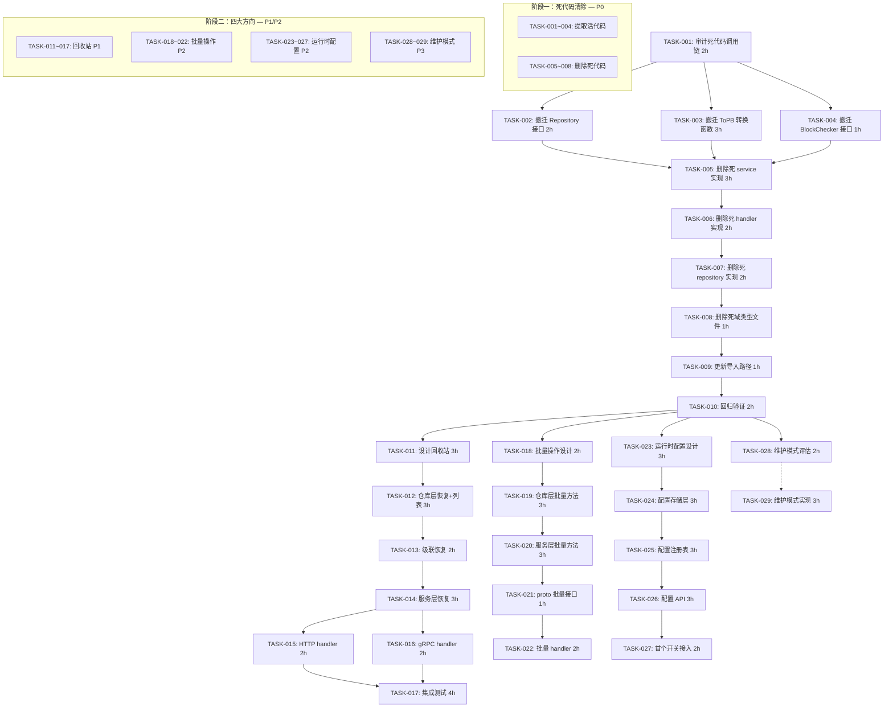
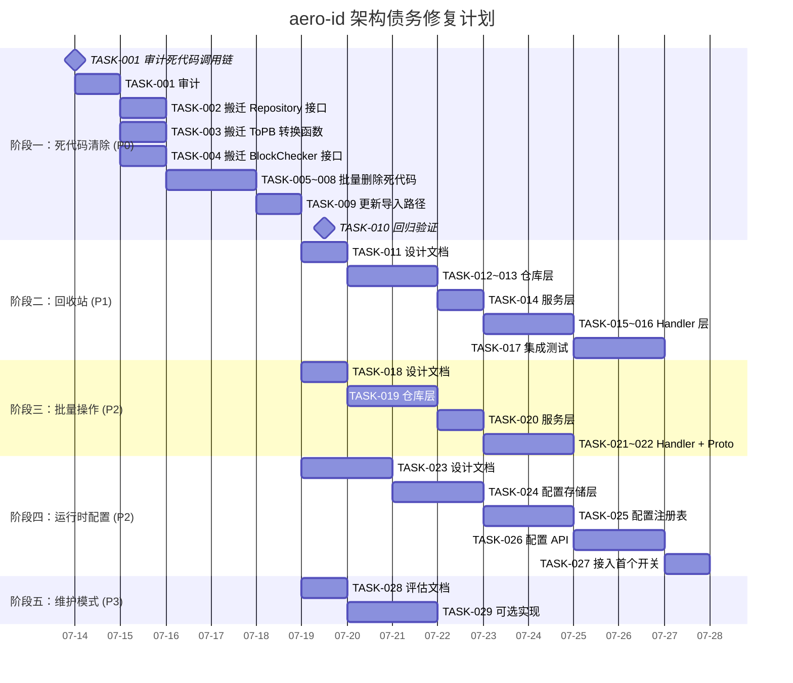

现在我已掌握代码库的全部脉络。以下是我的 Tech Lead 分析报告。

---

# Tech Lead 分析报告：aero-id 架构债务与产品缺口

> **分析依据**: 审查文档 `2026-07-10-aero-id-architect-perspective-five-code-evidenced-directions.md` 及其验证报告 `2026-07-11-review.out.md`
> **日期**: 2026-07-12
> **代码库**: `github.com/aero/aero-id`, Go 1.26, 170+ 源文件, 22 个 internal 包
> **约束**: 文件 ≤500 行, 函数 ≤50 行, 圈复杂度 ≤10, 嵌套 ≤3 层

---

## 1. 任务分解

### 1.1 全量任务总表

| 任务 ID | 任务标题 | 所属方向 | 涉及文件 | 前置依赖 | 预估工时 |
|---------|----------|----------|----------|----------|----------|
| TASK-001 | 审计死代码调用链 — 标记每一处对外暴露符号 | 方向一 | 全部 `internal/{file,comment,message,block,notification}/*.go` + `internal/search/*.go` + `internal/notification/dispatcher.go` | 无 | 2h |
| TASK-002 | 将 Repository 接口定义搬迁至 `internal/repository/` | 方向一 | `internal/{file,comment,message}/**/*.go` → `internal/repository/` | TASK-001 | 2h |
| TASK-003 | 将 ToPB 转换函数搬迁至 `internal/handler/grpc/` 或共用的 `internal/pkg/convert` | 方向一 | `internal/{file,comment,message,notification}/handler_grpc.go` → `internal/handler/grpc/` 或新包 | TASK-001 | 3h |
| TASK-004 | 将 BlockChecker 接口搬迁至 `internal/service/` | 方向一 | `internal/block/block.go` → `internal/service/` | TASK-001 | 1h |
| TASK-005 | 删除 `internal/{file,comment,message,block,notification}/service*.go` 及其测试 | 方向一 | `internal/{file,comment,message,block,notification}/service*.go` + `*_test.go` | TASK-002~004 | 3h |
| TASK-006 | 删除 `internal/{file,comment,message,block,notification}/handler_*.go` 及其测试 | 方向一 | 对应 handler_http.go + handler_grpc.go + `*_test.go` | TASK-002~004 | 2h |
| TASK-007 | 删除 `internal/{file,comment,message,block,notification}/repository*.go` 及其测试 | 方向一 | `internal/{file,comment,message,block,notification}/repository*.go` + `*_test.go` | TASK-002~004 | 2h |
| TASK-008 | 删除零引用的域类型别名文件和 domain_test.go | 方向一 | `internal/{file,comment,message,block,notification}/{file,comment,message,block,notification}.go` + `domain_test.go` | TASK-005~007 | 1h |
| TASK-009 | 更新 `internal/search/` 和 `internal/notification/dispatcher.go` 导入路径 | 方向一 | `internal/search/search.go`, `internal/search/handler_grpc.go`, `internal/notification/dispatcher.go` | TASK-002~004 | 1h |
| TASK-010 | 全量回归验证：`make test && make lint` | 方向一 | 全部（构建 + lint + 单元测试） | TASK-005~009 | 2h |
| TASK-011 | 设计回收站（Trash）能力域：实体、约束、级联规则 | 方向四 | 新建 `docs/trash-design.md` | TASK-010 | 3h |
| TASK-012 | 在 repository 层添加 `Restore(ctx, id)` 和 `ListDeletedByOwner(ctx, uid, page)` | 方向四 | `internal/repository/{file,comment,message}.go` | TASK-011 | 3h |
| TASK-013 | 在 repository 层添加级联恢复辅助方法（恢复文件同时恢复 `file_shares`） | 方向四 | `internal/repository/{file_share,comment}.go` | TASK-012 | 2h |
| TASK-014 | 在 service 层添加 `Restore(ctx, id)` 和 `ListTrash(ctx, page)` 方法 | 方向四 | `internal/service/{file,comment,message}.go` | TASK-012~013 | 3h |
| TASK-015 | 添加 Trash HTTP 路由 + Handler | 方向四 | `internal/handler/http/{file,comment,message}.go` | TASK-014 | 2h |
| TASK-016 | 添加 Trash gRPC RPC + Handler | 方向四 | `api/proto/aero_id/v1/aero_id.proto` + `internal/handler/grpc/{file,comment,message}.go` | TASK-014 | 2h |
| TASK-017 | 为回收站功能编写集成测试（含级联恢复场景） | 方向四 | `internal/repository/*_integration_test.go`, `internal/service/*_test.go` | TASK-015~016 | 4h |
| TASK-018 | 设计批量操作 API 接口契约（batch delete, batch unshare） | 方向三 | 新建 `docs/batch-api-design.md` | TASK-010 | 2h |
| TASK-019 | 在 repository 层添加批量删除/批量取消分享方法 | 方向三 | `internal/repository/{file,file_share,comment,message}.go` | TASK-018 | 3h |
| TASK-020 | 在 service 层添加批量操作方法和权限校验 | 方向三 | `internal/service/{file,comment,message}.go` | TASK-019 | 3h |
| TASK-021 | 更新 proto 定义添加批量 RPC（`BatchDeleteFiles`, `BatchUnshareFiles`） | 方向三 | `api/proto/aero_id/v1/aero_id.proto` | TASK-018 | 1h |
| TASK-022 | 添加批量 API 的 handler 层（HTTP + gRPC） | 方向三 | `internal/handler/{http,grpc}/{file,comment,message}.go` | TASK-020~021 | 2h |
| TASK-023 | 设计运行时配置注册表：配置项定义、存储模型、变更通知机制 | 方向二 | 新建 `docs/runtime-config-design.md` | TASK-010 | 3h |
| TASK-024 | 实现配置存储层（DB-backed key-value, 带版本戳乐观锁） | 方向二 | `internal/repository/config.go` + 新增迁移 `migrations/*_runtime_config.up.sql` | TASK-023 | 3h |
| TASK-025 | 实现配置注册表和 watcher 接口 | 方向二 | `internal/config/runtime.go` 或 `internal/service/config.go` | TASK-024 | 3h |
| TASK-026 | 添加配置管理 gRPC/HTTP API（CRUD 配置项 + 实时推送） | 方向二 | `internal/handler/{http,grpc}/admin.go` + proto 扩展 | TASK-025 | 3h |
| TASK-027 | 将首个开关（如 `max_upload_bytes`、`rate_limit.rps`）接入运行时配置 | 方向二 | `internal/service/file.go`, `internal/middleware/ratelimit.go` | TASK-026 | 2h |
| TASK-028 | 产出维护模式需求文档并评估方案选型（Simple maintenance endpoint vs Feature Flag system） | 方向五 | 新建 `docs/maintenance-mode-evaluation.md` | TASK-010 | 2h |
| TASK-029 | [后备]实现维护模式端点 + 中间件（条件路由阻断） | 方向五 | `internal/handler/http/health.go`, `internal/middleware/maintenance.go`, `internal/service/admin.go` | TASK-028 | 3h |

---

### 1.2 任务与方向映射

| 方向 | 所含任务 | 前方向依赖 |
|------|----------|------------|
| **方向一**: 双服务层债务 | TASK-001 ~ TASK-010 | 无（独立，但应最先完成） |
| **方向四**: 软删除回收站 | TASK-011 ~ TASK-017 | 方向一（代码统一后才能添加功能） |
| **方向三**: 批量操作 API | TASK-018 ~ TASK-022 | 方向一 |
| **方向二**: 运行时配置 API | TASK-023 ~ TASK-027 | 方向一 |
| **方向五**: 维护模式 | TASK-028 ~ TASK-029 | 方向一（方向二完成后更优） |

---

## 2. 执行顺序

### 2.1 任务依赖图

### 2.2 可并行组

| 并行组 | 包含任务 | 前提条件 |
|--------|----------|----------|
| **组 A**（方向一内部可并行） | TASK-002, TASK-003, TASK-004 | TASK-001 |
| **组 B**（方向一删除可串行） | TASK-005 → TASK-006 → TASK-007 → TASK-008 → TASK-009 → TASK-010 | TASK-002~004 |
| **组 C**（方向二+三+四+五） | 方向二 / 方向三 / 方向四 / 方向五互相独立，可并行推进 | TASK-010 |

---

## 3. 技术风险

### 3.1 风险矩阵

| 风险 ID | 风险描述 | 方向 | 概率 | 影响 | 缓解策略 |
|---------|----------|------|------|------|----------|
| R-001 | 搬迁 Repository 接口时，`internal/search/` 的循环依赖或编译错误 | 方向一 | 高 | 中 | 提前用 `go vet ./...` 在每次搬迁后验证；接口定义与实现分离在同一包内 |
| R-002 | ToPB 函数搬迁后导出名冲突（死包和活包各有同名 ToPB 函数） | 方向一 | 中 | 中 | 新包中使用统一签名，例如 `convert.CommentToPB(c)`，删除旧包后全局搜索替换 |
| R-003 | 删除 `internal/{file,comment,...}/domain.go` 后发现还有其他外部消费者 | 方向一 | 低 | 高 | TASK-001 必须 `grep -rn` 扫描全仓库（包括 worktrees 和 `.out.md` 中的示例代码） |
| R-004 | 回收站级联恢复的并发安全问题：恢复时另一请求正在删除同一文件 | 方向四 | 中 | 高 | 使用 `SELECT ... FOR UPDATE` 悲观锁；service 层用事务包裹恢复+级联操作 |
| R-005 | 回收站展开后文件存储 blob 处于 dangling 状态（GC 已清除 blob 但 row 被恢复） | 方向四 | 低 | 高 | GC retention 窗口必须 > 回收站保留期；恢复时检查 storage blob 仍存在 |
| R-006 | 批量操作缺乏幂等性保障（批量删除部分成功场景） | 方向三 | 中 | 中 | 使用事务 + 返回每个 ID 的操作结果状态；错误时回滚全部 |
| R-007 | 运行时配置变更后已有 goroutine 仍持有旧值（不一致窗口） | 方向二 | 高 | 中 | 使用 `atomic.Value` 或 `sync.RWMutex` 保护配置快照；提供监听回调注册机制 |
| R-008 | 批量删除可能超过 `max_upload_bytes` 或 gRPC 消息大小限制（4MB） | 方向三 | 中 | 低 | proto 使用 `repeated string` 时限制 batch size 为 100；HTTP 端同样验证 |
| R-009 | 测试覆盖率在清理死代码后因删除大量"假绿"测试而下降 | 方向一 | 高 | 低 | 这是**预期结果**——死代码测试是虚假安全感。在 TASK-010 中重新测量基准覆盖率 |
| R-010 | 死代码清理后 `make check-file-sizes` 可能因活包变大而失败 | 方向一 | 低 | 中 | 搬迁 ToPB 函数时应拆分为独立文件（如 `internal/handler/grpc/convert.go`）避免单个文件超 500 行 |

### 3.2 外部依赖风险

| 依赖 | 方向 | 风险 |
|------|------|------|
| SSO gRPC | 方向四（恢复时需重新校验用户存在性） | 低 — 恢复不依赖 SSO 可用性，只校验 ownership（owner_uid 已在 row 上） |
| MinIO/S3 | 方向四 + 方向三 | 中 — 批量删除需同时清理存储 blob；S3 对象删除不支持事务回滚 |
| `protoc-gen-go@v1.34.1` | 所有 proto 修改方向 | 低 — 版本锁定在 go.mod，不升级不需重新安装 |
| 测试容器 Docker | 所有集成测试 | 中 — CI 环境需 Docker；开发机可用 `make test` 跳过集成测试 |

---

## 4. 资源评估

### 4.1 人员配置

| 角色 | 技能要求 | 需要人数 | 涉及阶段 |
|------|----------|----------|----------|
| **资深 Go 工程师** | Go 1.26, GORM, gRPC, 熟悉 aero-id 架构 | 1 (领衔) | 全阶段，主攻方向一 + 方向四 |
| **后端工程师** | Go, PostgreSQL, REST API 设计 | 1 | 方向二 + 方向三 |
| **轮值审查人** | 代码审查经验，了解项目约束 | 1 (兼职) | 每个 MR 审查确保合规 |

> **建议**: 2 人全职 + 1 人兼职审查。如仅 1 人，则按优先级依次推进，预计总工期 6-8 周。

### 4.2 关键里程碑

| 里程碑 | 截止日期 | 交付物 | 验证标准 |
|--------|----------|--------|----------|
| **M1**: 方向一完成 | Day 5 | 死代码清除完毕，无构建错误 | `make test && make lint` 通过；覆盖率不低于清理前 90% |
| **M2**: 回收站上线 | Day 12 | 回收站功能完整（HTTP + gRPC） | 集成测试覆盖恢复 + 列表 + 级联场景 |
| **M3**: 批量操作上线 | Day 18 | 批量删除/批量取消分享可用 | 集成测试覆盖部分成功、全部成功、权限拒绝 |
| **M4**: 运行时配置上线 | Day 22 | 首个开关 (`max_upload_bytes`) 可运行时变更 | 修改后立即生效，不重启进程 |
| **M5**: 维护模式评估/实现 | Day 25 | 决策文档 + 可选实现 | 方案通过架构审查 |

### 4.3 阻塞点（Blockers）

| Blocker | 影响 | 解决策略 |
|---------|------|----------|
| `internal/file/file.go` 中的 `Service` 接口与 `internal/service/file.go` 中的 `FileService` 接口语义冲突 | 方向一搬迁时命名空间冲突 | 以 `internal/service` 的命名为准，删除 `internal/file` 中的同名定义 |
| `internal/search/handler_grpc.go` 引用 `comment.CommentToPB` 等函数，这些函数位于将被删除的包中 | 方向一死代码删除前必须先搬迁 | TASK-003 必须在 TASK-006 之前完成 |
| `internal/notification/dispatcher.go` 类型声明中使用 `block.BlockChecker`，该接口在删除目标包中 | 同上一同处理 | TASK-004 在 TASK-005 之前完成 |

---

## 5. 质量保证

### 5.1 单元测试覆盖要求

| 工种类别 | 最低行覆盖率 | 最低分支覆盖率 | 说明 |
|----------|-------------|---------------|------|
| service 层（新代码） | 85% | 75% | 业务逻辑核心，必须全覆盖 |
| repository 层（新代码） | 80% | 70% | 数据库交互使用 testpg |
| handler 层（新代码） | 70% | 60% | 转换逻辑 + 错误响应；mock service |
| 搬迁代码（方向一） | 不降低现有覆盖率 | — | 只移动不修改，保持原测试绑定 |

### 5.2 集成测试策略

| 场景 | 方向 | 测试方式 | 关键断言 |
|------|------|----------|----------|
| 回收站恢复文件 → 验证共享记录同时恢复 | 四 | `repository_integration_test.go` | `file_shares` 表中对应记录存在 |
| 回收站恢复评论 → 验证回复计数正确 | 四 | 同上 | `reply_count` 字段恢复原值 |
| 批量删除 5 条记录，第 3 条已被软删除 | 三 | 集成测试 | 返回错误列表，已删除的 4 条成功 |
| 运行时配置 max_upload_bytes 从 50MB 改为 10MB | 二 | 集成测试（HTTP 创建文件 + 验证拒绝） | 超过 10MB 的文件上传返回 413 |
| 配置项修改后旧值缓存刷新 | 二 | 单元测试 + 集成 | `atomic.Load` 返回最新值 |

### 5.3 代码审查要点

| 审查维度 | 方向一 | 方向四 | 方向三 | 方向二 | 方向五 |
|----------|--------|--------|--------|--------|--------|
| 文件 ≤ 500 行 | ✅ 搬迁后新文件 | ✅ | ✅ | ✅ | ✅ |
| 函数 ≤ 50 行 | — | ✅ | ✅ | ✅ | ✅ |
| 圈复杂度 ≤ 10 | — | ✅ | ✅ | ✅ | ✅ |
| 无死导入残留 | `go mod tidy` 验证 | — | — | — | — |
| 迁移变更可回滚 | — | 有 `.down.sql` | — | 有 `.down.sql` | — |
| `PermSystemConfig` 用途不混淆 | — | — | — | 保持现有角色管理不变，新配置 API 使用新权限 | — |

### 5.4 性能测试需求

| 场景 | 方向 | 负荷 | 期望目标 |
|------|------|------|----------|
| 回收站列表（10 万条已删除记录） | 四 | 带 `deleted_at` 索引 | `ListDeletedByOwner` < 50ms P99 |
| 批量删除 100 条记录 | 三 | 100 个 ID | 事务提交 < 200ms |
| 运行时配置热点读取 | 二 | QPS 1000 并发 | `atomic.Load` 无锁，< 1µs |
| 并发恢复+删除同一文件 | 四 | 10 并发 | 无死锁，最终一致 |

---

## 6. 实施计划

### 6.1 甘特图

### 6.2 阶段详解

#### 阶段一：基础设施清理 — 预计 **5 天**

| 天次 | 工作内容 | 负责人 | 交付物 |
|------|----------|--------|--------|
| Day 1 | TASK-001: `grep -rn` 全仓库扫描，输出 `DEAD_CODE_AUDIT.md` 记录每处使用 | 领衔工程师 | `DEAD_CODE_AUDIT.md` 审计报告 |
| Day 2 | TASK-002 + TASK-003 + TASK-004 (并行) | 领衔工程师 + 后端 | 三个 MR，每个含 `make test && make lint` 验证 |
| Day 3-4 | TASK-005 → TASK-008 逐包清理 | 领衔工程师 | 按 `file → comment → message → block → notification` 顺序，每包一个 MR |
| Day 5 | TASK-009 + TASK-010 | 领衔工程师 | 最终 MR，`make test && make lint` 全量通过 |

**关键注意事项**:
- 每删除一个包后立即 `go build ./...` 验证，不要积攒多个包一起删
- 死代码的 _test.go 文件同步删除，但**保留**对 `internal/service/` 中活代码的测试
- 删除前确认 `internal/search/` 的导入已迁移至新位置

#### 阶段二：回收站功能 — 预计 **6 天**（P1）

| 天次 | 工作内容 | 交付物 |
|------|----------|--------|
| Day 6 | TASK-011: 设计文档，明确级联规则和冲突策略 | `docs/trash-design.md` |
| Day 7-8 | TASK-012 + TASK-013: 仓库层 | 含 `.down.sql` 的迁移、新接口实现 |
| Day 9 | TASK-014: 服务层 | `Restore` + `ListTrash` 含完整授权检查 |
| Day 10-11 | TASK-015 + TASK-016: Handler | proto 生成 + HTTP + gRPC |
| Day 12 | TASK-017: 集成测试 | `make test-integration` 通过 |

**级联规则设计要点**:
- 恢复文件 → 同时恢复 `file_shares` 中与该文件关联的行（使用 `deleted_at` 过滤）
- 恢复评论 → 同时恢复子评论（replies）和父评论的 `reply_count`
- 如果文件 blob 已被 GC 硬删除 → 返回 `409 Conflict`，不执行恢复
- 回收站列表默认按 `deleted_at DESC` 排序，光标分页

#### 阶段三：批量操作 API — 预计 **5 天**（P2, 与阶段二并行）

| 天次 | 工作内容 | 交付物 |
|------|----------|--------|
| Day 6 | TASK-018: 设计文档 | `docs/batch-api-design.md` |
| Day 7-8 | TASK-019: 仓库层 | `BatchSoftDelete(ctx, ids)` + `BatchRevokeShares(ctx, fileIDs, granteeUIDs)` |
| Day 9 | TASK-020: 服务层 | 批量授权检查（所有权全部通过才执行） |
| Day 10-11 | TASK-021 + TASK-022: Proto + Handler | `make proto` 生成 + 双传输层 |

**设计约束**:
- 单次批量请求上限 100 条（防 gRPC 消息超限）
- 事务内执行：全部成功或全部回滚（不可部分成功——这与审查报告的建议不同，我建议保持原子性，因为部分成功对客户端的处理更复杂）
- 权限校验：**所有**目标必须属于当前 actor，否则返回 `403 Forbidden`
- 响应体返回 `{ succeeded: [ids], failed: { id: reason } }` 结构

#### 阶段四：运行时配置 — 预计 **6 天**（P2, 与阶段二并行）

| 天次 | 工作内容 | 交付物 |
|------|----------|--------|
| Day 6-7 | TASK-023: 设计文档 | `docs/runtime-config-design.md` |
| Day 8-9 | TASK-024: 配置存储层 | `runtime_configs` 表迁移 + repository 实现 |
| Day 10-11 | TASK-025: 配置注册表 | `RuntimeConfig` 结构 + watcher + `atomic.Value` 快照 |
| Day 12-13 | TASK-026: 配置 API | `AdminService/UpdateConfig`, `AdminService/ListConfigs` |
| Day 14 | TASK-027: 接入首个开关 | `max_upload_bytes` 动态生效 |

**设计要点**:
- 配置项 = `(key string, value json.RawMessage, version int, updated_at timestamptz)`
- 读路径：`atomic.Value.Load().(map[string]json.RawMessage)` — 零分配，无锁
- 写路径：DB update → version bump → watcher 通知 → `atomic.Value.Store(newSnapshot)`
- 新增权限 `PermRuntimeConfig`（不要复用 `PermSystemConfig`）

#### 阶段五：维护模式评估 — **1 天** 评估 + 可选 **1.5 天** 实现 (P3)

| 天次 | 工作内容 | 交付物 |
|------|----------|--------|
| Day 6 | TASK-028: 评估文档 | `docs/maintenance-mode-evaluation.md` |
| Day 7-8 | TASK-029: 可选实现 | 维护模式端点 + 中间件 |

**评估要点**:
- 是否需要一个完整的 Feature Flag 系统（生命周期长、价值高、成本高）还是一个简单的 `/v1/admin/maintenance` 端点（成本低、能力有限）
- 建议先只做一个维护模式开关（boolean flag），不做按特征开关
- 实现方式：维护模式开启时，所有非管理员路由返回 `503 Service Unavailable` + `Retry-After` header
- 与现有 health check 的 `degraded` 状态协同：维护模式覆盖 `degraded`，返回 `503`

---

## 7. 总结

### 优先级建议（修正后）

| 优先级 | 方向 | 工期 | 价值 |
|--------|------|------|------|
| **P0** | 方向一：双服务层债务 | 5 天 | 消除 3000-4000 行死代码 + 年维护成本；是其余方向的工程基础 |
| **P1** | 方向四：回收站 | 6 天 | 产品级数据安全保障；用户侧可见的产品能力 |
| **P2** | 方向二+三：运行时配置 + 批量操作 | 11 天 (并行) | 高运维价值 + 中等产品价值；可在回收站之后并行推进 |
| **P3** | 方向五：维护模式 | 2-3 天 | 低紧急度；评估后决定是否实现 |

### 最后建议

1. **方向一不要分两周做**。这是纯机械性的删除工作——集中精力 5 天一次性清完，避免长时间维持"双代码路径同步"的状态。
2. **搬迁时不要重写逻辑**。`ToPB` 函数、接口定义等只移动位置，不修改签名和行为，最大程度降低风险。
3. **回收站设计文档必须提前讨论级联规则**。特别是文件 → `file_shares` 的级联、评论 → replies 的级联、以及与 GC sweeper 的时间窗冲突，这是最大的技术风险点（R-005）。
4. **运行时配置第一个开关选 `max_upload_bytes`**，因为它影响面小（仅文件上传路径），容易验证（上传前后各试一次即可），且能快速体现"不重启改配置"的价值。
