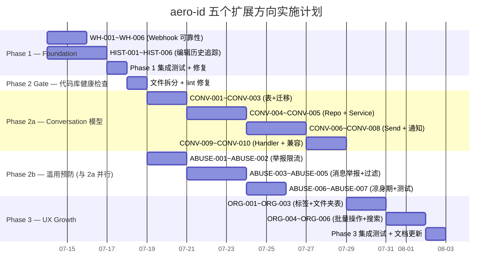

Now I have full context on the codebase. Let me produce the Tech Lead analysis.

---

# Tech Lead 分析报告：五个高价值扩展方向

**分析日期**: 2026-07-12  
**分析人**: Tech Lead  
**输入**: `docs/requirements/2026-07-11-aero-id-genuine-five-high-value-extensions.md`  
**代码库**: aero-id (Go 1.26, GORM, Gin, gRPC, Postgres, transactional outbox)  
**工程约束**: 文件 ≤500 行, 函数 ≤50 行, 圈复杂度 ≤10, if 嵌套 ≤3 层

---

## 1. 任务分解

### 1.1 全局概要

五个方向按 **依赖关系** 和 **风险等级** 分为两个工作流：

| 方向 | 缩写 | 类型 | 代码复杂度 | 外部依赖 | 风险 | 建议阶段 |
|------|------|------|-----------|---------|------|---------|
| D1: Conversation 模型升级 | CONV | 数据模型重构 | ★★★★★ | 无 | 高（模型升级影响现有消息查询） | Phase 2 |
| D2: Webhook 投递可靠性 | WH | 平台增强 | ★★☆ | 无 | 低（增量修改，不影响现有流程） | Phase 1 |
| D3: 内容编辑历史追踪 | HIST | 合规增强 | ★★☆ | 无 | 低（增量添加，不回滚） | Phase 1 |
| D4: 用户数据组织原语 | ORG | 产品新功能 | ★★★ | 无 | 中（新表+搜索索引） | Phase 3 |
| D5: 滥用预防管道 | ABUSE | 信任安全 | ★★★ | 无 | 中（策略配置粒度） | Phase 2 并⾏ |

---

### 1.2 详细任务列表

#### D2: Webhook 投递可靠性（Phase 1 — 独立可交付）

| Task ID | 标题 | 涉及文件 | 前置 | 预估(h) | 验收标准 |
|---------|------|---------|------|--------|---------|
| WH-001 | 在 webhook payload 中添加 `Idempotency-Key` 头 | `internal/outbox/webhook.go` | 无 | 2 | Webhook POST 请求携带 `Idempotency-Key: <event-id>` 头；消费者可按此键安全重试 |
| WH-002 | 为事件添加 `sequence_number` 按 aggregate 单调递增 | `migrations/000024_outbox_sequence.up.sql`, `internal/outbox/repository.go`, `internal/outbox/outbox.go` | WH-001 | 3 | 每个 aggregate 有独立 seq 计数器（用 `CREATE SEQUENCE` 或 `SELECT COALESCE(MAX(seq),0)+1`），写入事件时赋值，payload 中暴露 |
| WH-003 | 死信事件管理 API（HTTP + gRPC） | `internal/handler/http/admin.go`, `internal/handler/grpc/ops.go`, `internal/outbox/repository.go`, `internal/service/admin.go` | 无 | 4 | `GET /v1/admin/outbox/dead-letters`, `POST /v1/admin/outbox/retry/:id`, `DELETE /v1/admin/outbox/dead-letters/:id` 三端点实现 + 权限检查 |
| WH-004 | Config 中 `event_types` 合法性校验 | `internal/config/config.go` | 无 | 1 | 启动时验证所有 `EventTypes` 是否在事件注册表中；非法值拒绝启动并打印诊断 |
| WH-005 | Webhook 配置支持独立 `max_retries` | `internal/config/config.go`, `internal/outbox/webhook.go`, `internal/outbox/relay.go` | WH-003 | 2 | 每个 webhook 目标可配置独立 `max_retries`，覆盖全局默认值 |
| WH-006 | 死信投递重试触发器：支持管理员手动重试单个死信 | `internal/service/admin.go`, `internal/outbox/repository.go` | WH-003 | 2 | 重试时清除 `dead_letter=false` + 重置 `retry_count=0`，下一次 relay tick 重新投递 |

**D2 小计**: 6 个任务, 14 小时 (≈2 人天)

#### D3: 内容编辑历史追踪（Phase 1 — 独立可交付）

| Task ID | 标题 | 涉及文件 | 前置 | 预估(h) | 验收标准 |
|---------|------|---------|------|--------|---------|
| HIST-001 | 新增 `message_revisions` 表+迁移 | `migrations/000025_message_revisions.up.sql`, `internal/domain/message.go` | 无 | 2 | 表结构: id, message_id, content, created_at, edited_by；下迁脚本存在 |
| HIST-002 | 新增 `comment_revisions` 表+迁移 | `migrations/000026_comment_revisions.up.sql`, `internal/domain/comment.go` | 无 | 2 | 表结构: id, comment_id, content, created_at, edited_by；下迁脚本存在 |
| HIST-003 | Message Edit 时保存旧内容到 revision 表 | `internal/service/message.go` (Edit), `internal/repository/message.go` | HIST-001 | 3 | 调用 `UpdateContent` 前，当前内容 INSERT 到 `message_revisions`；使用同一事务 |
| HIST-004 | Comment Edit 时保存旧内容到 revision 表 | `internal/service/comment.go` (Edit), `internal/repository/comment.go` | HIST-002 | 3 | 同 HIST-003，但针对 comment |
| HIST-005 | 新增审计事件 `AuditMessageEdit` 和 `AuditCommentEdit` | `internal/domain/audit.go`, `internal/service/message.go`, `internal/service/comment.go` | HIST-003, HIST-004 | 2 | 编辑操作写入审计日志，包含 revision_id 和内容摘要（可选 hash） |
| HIST-006 | (可选) 查看修订版 API | `api/proto/aero_id/v1/aero_id.proto`, `internal/handler/http/message.go`, `internal/handler/grpc/comment.go` | HIST-005 | 4 | `GET /v1/messages/:id/revisions` 和 `GET /v1/comments/:id/revisions`，仅管理员和作者可访问 |

> **注**: HIST-006 可作为 P2+ 延后，核心是 HIST-001~005 确保数据不丢失。

**D3 小计**: 6 个任务, 16 小时 (≈2 人天)

#### D1: Conversation 模型升级（Phase 2 — 核心平台）

| Task ID | 标题 | 涉及文件 | 前置 | 预估(h) | 验收标准 |
|---------|------|---------|------|--------|---------|
| CONV-001 | 新增 `conversations` 表 + domain entity | `migrations/000027_conversations.up.sql`, `internal/domain/conversation.go` | 无 | 3 | 表结构: id, type(1:1|group), name, avatar, created_by, created_at, updated_at, deleted_at |
| CONV-002 | 新增 `conversation_members` 表 + domain entity | `migrations/000028_conversation_members.up.sql`, `internal/domain/conversation.go` | CONV-001 | 2 | 表结构: conversation_id, uid, role, joined_at, last_read_at, notification_pref_override；唯一约束(conversation_id, uid) |
| CONV-003 | Message 表增加 `conversation_id` 列（可为 NULL） | `migrations/000029_message_conversation_id.up.sql` | CONV-001 | 2 | 新增可空列 + 索引 `(conversation_id)`；已有消息 `conversation_id=NULL` |
| CONV-004 | 新增 Conversation repository | `internal/repository/conversation.go` | CONV-001, CONV-002 | 4 | `Create`, `Get`, `UpdateMetadata`, `AddMember`, `RemoveMember`, `ListByUID`, `ListMembers` |
| CONV-005 | 新增 Conversation service（创建/元数据/成员管理） | `internal/service/conversation.go` (新建文件) | CONV-004 | 4 | 创建对话（含自动加入 creator）、列出用户对话列表、更新名称/头像、添加/移除成员、退出对话 |
| CONV-006 | 修改 Message.Send: 支持 `conversation_id` 入参 | `internal/service/message.go`, `internal/repository/message.go` | CONV-003 | 4 | 消息可发送到 conversation；权限校验：发送者必须是 conversation 成员；1:1 未指定 conversation 时自动创建隐式对话 |
| CONV-007 | 隐式对话创建逻辑：首次 1:1 消息时自动创建 | `internal/service/message.go`, `internal/repository/conversation.go` | CONV-006 | 3 | 向前兼容：`conversation_id` 为空时，自动查找或创建 (uidA, uidB) 隐式对话 |
| CONV-008 | 群组消息多参与者通知 | `internal/service/message.go`, outbox event | CONV-005, CONV-006 | 4 | 群组消息发送后，对每个成员（除 sender）生成 notification；使用 outbox 事务 |
| CONV-009 | Proto + gRPC/HTTP handlers for Conversation | `api/proto/aero_id/v1/aero_id.proto`, `internal/handler/http/message.go`, `internal/handler/grpc/message.go` | CONV-005 | 4 | `CreateConversation`, `ListConversations`, `AddMember`, `RemoveMember`, `GetConversation` RPC + endpoint |
| CONV-010 | 向下兼容：旧 `ListConversation` / `Inbox` 升级为按 conversation 分组 | `internal/service/message.go`, `internal/handler/http/message.go` | CONV-006 | 3 | `Inbox` 改为按 conversation_id 分组返回；`Conversation` 支持 `conversation_id` 查询 |

> **风险缓冲**: CONV-010 是兼容层，允许旧客户端继续工作。

**D1 小计**: 10 个任务, 33 小时 (≈4 人天)

#### D5: 滥用预防管道（Phase 2 — 与 D1 并行）

| Task ID | 标题 | 涉及文件 | 前置 | 预估(h) | 验收标准 |
|---------|------|---------|------|--------|---------|
| ABUSE-001 | 举报速率限制（per reporter, per time window） | `internal/service/comment.go` (Report), `internal/config/config.go` | 无 | 3 | Reporter 在 N 分钟内最多创建 M 条举报；超限返回 `429 Too Many Requests` |
| ABUSE-002 | 自动隐藏阈值：评论被 ≥K 个不同用户举报时自动屏蔽 | `internal/service/comment.go`, `internal/repository/comment.go`, `internal/domain/comment.go` | ABUSE-001 | 4 | 配置 `auto_hide_threshold`（默认 3）；达到阈值自动设置 `status=CommentStatusHidden`；记录审计事件 |
| ABUSE-003 | 新增 `message_reports` 表 + 举报端点 | `migrations/000030_message_reports.up.sql`, `internal/domain/message.go`, `internal/repository/message.go`, `internal/service/message.go` | 无 | 4 | 消息举报表+创建/列表/处理端到端 |
| ABUSE-004 | 分层速率限制：针对不同操作类型不同 token bucket | `internal/middleware/ratelimit.go`, `internal/config/config.go` | 无 | 4 | 全局 RPS 保持不变，新增 `per_action` 限速：`report: 10/h`，`comment: 100/min`，`message: 30/min` |
| ABUSE-005 | 敏感词过滤（配置驱动，字符串/正则模式） | `internal/moderation/filter.go` (新建包), `internal/comment/service.go`, `internal/message/service.go` | 无 | 4 | 配置 `sensitive_patterns`；命中时：可选拒绝或标记（`comment.moderated=true`）+ 审计 |
| ABUSE-006 | 新用户"凉身期"：内容在审核前仅作者可见 | `internal/domain/actor.go`, `internal/service/comment.go`, `internal/repository/comment.go`, `internal/config/config.go` | ABUSE-005 | 4 | 配置 `new_user_quarantine_period`（如 24h）；新用户评论设为 `CommentStatusQuarantined` |
| ABUSE-007 | 滥用预防端到端集成测试 | `internal/service/message_test.go`, `internal/service/comment_test.go` | ABUSE-001~006 | 4 | 覆盖：举报超限、自动隐藏、敏感词拦截、凉身期逻辑 |

> **注**: ABUSE-005 的 sensitive pattern 匹配放在新的 `internal/moderation/` 包中，避免 comment/message service 膨胀违反 500 行文件限制。

**D5 小计**: 7 个任务, 27 小时 (≈3.5 人天)

#### D4: 用户数据组织原语（Phase 3 — 产品增长）

| Task ID | 标题 | 涉及文件 | 前置 | 预估(h) | 验收标准 |
|---------|------|---------|------|--------|---------|
| ORG-001 | 新增 `labels` 表 + `file_labels` 连接表 | `migrations/000031_labels.up.sql`, `migrations/000032_file_labels.up.sql`, `internal/domain/file.go` | 无 | 3 | labels(id, owner_uid, name, color, created_at), file_labels(file_id, label_id) 唯一约束 |
| ORG-002 | Labels CRUD repository + service | `internal/repository/label.go` (新建), `internal/service/label.go` (新建) | ORG-001 | 4 | Create, List, Update, Delete label；按 owner_uid 和 name 去重 |
| ORG-003 | File 增加 `parent_folder_id`（自引用，NULL=root） | `migrations/000033_file_parent_folder.up.sql`, `internal/domain/file.go` | 无 | 2 | 可空列 + 索引；无独立文件夹表（简化） |
| ORG-004 | 批量删除端点 | `api/proto/aero_id/v1/aero_id.proto`, `internal/handler/http/file.go`, `internal/service/file.go` | ORG-001 | 3 | `POST /v1/files/batch/delete` 接受 id 数组；事务内批量软删除 |
| ORG-005 | 标签作为搜索过滤器 | `internal/search/search.go`, `internal/handler/http/search.go` | ORG-002 | 3 | `SearchRequest` 增加 `label_ids` 字段；SQL 中 JOIN file_labels 过滤 |
| ORG-006 | 文件收藏/星标（`files.starred` boolean） | `migrations/000034_file_starred.up.sql`, `internal/domain/file.go`, `internal/service/file.go` | 无 | 2 | `PATCH /v1/files/:id` 支持 `starred` 字段 |

> **注**: D4 是 P3，因为其价值在有重度用户后才显现。但 `starred`（ORG-006） 用户价值高、实现简单，可提前到 Phase 2。

**D4 小计**: 6 个任务, 17 小时 (≈2 人天)

---

### 1.3 任务汇总

| Phase | 方向 | 任务数 | 总工时 | 人天 (8h) | 并行度 |
|-------|------|--------|-------|-----------|-------|
| Phase 1 | D2 (Webhook) + D3 (History) | 12 | 30h | 3.75 | D2 + D3 完全并行 |
| Phase 2a | D1 (Conversation) | 10 | 33h | 4.125 | 依赖链条 |
| Phase 2b | D5 (Abuse Prevention) | 7 | 27h | 3.375 | 与 D1 完全并行 |
| Phase 3 | D4 (Organization) | 6 | 17h | 2.125 | 独立 |
| **合计** | | **35** | **107h** | **13.4** | |

---

## 2. 执行顺序

### 2.1 任务依赖图

```mermaid
graph TD
    subgraph "Phase 1 — Foundation (Week 1-2)"
        WH-001[WH-001: Idempotency-Key header]
        WH-002[WH-002: Sequence number]
        WH-003[WH-003: Dead letter API]
        WH-004[WH-004: Event type validation]
        WH-005[WH-005: Per-webhook max_retries]
        WH-006[WH-006: Dead letter retry trigger]
        
        HIST-001[HIST-001: message_revisions table]
        HIST-002[HIST-002: comment_revisions table]
        HIST-003[HIST-003: Save message old content]
        HIST-004[HIST-004: Save comment old content]
        HIST-005[HIST-005: Audit events]
        HIST-006[HIST-006: Revisions API]
        
        WH-001 --> WH-002
        WH-003 --> WH-005
        WH-003 --> WH-006
        
        HIST-001 --> HIST-003
        HIST-002 --> HIST-004
        HIST-003 --> HIST-005
        HIST-004 --> HIST-005
        HIST-005 --> HIST-006
    end

    subgraph "Phase 2 — Core Platform (Week 3-5)"
        CONV-001[CONV-001: conversations table]
        CONV-002[CONV-002: conversation_members table]
        CONV-003[CONV-003: message.conversation_id]
        CONV-004[CONV-004: Conversation repo]
        CONV-005[CONV-005: Conversation service]
        CONV-006[CONV-006: Send to conversation]
        CONV-007[CONV-007: Implicit conversation]
        CONV-008[CONV-008: Group notification]
        CONV-009[CONV-009: Proto + handlers]
        CONV-010[CONV-010: Compatibility layer]
        
        ABUSE-001[ABUSE-001: Report rate limit]
        ABUSE-002[ABUSE-002: Auto-hide threshold]
        ABUSE-003[ABUSE-003: Message reports]
        ABUSE-004[ABUSE-004: Per-action rate limit]
        ABUSE-005[ABUSE-005: Sensitive word filter]
        ABUSE-006[ABUSE-006: New user quarantine]
        ABUSE-007[ABUSE-007: E2E tests]
        
        CONV-001 --> CONV-002
        CONV-001 --> CONV-003
        CONV-002 --> CONV-004
        CONV-003 --> CONV-004
        CONV-004 --> CONV-005
        CONV-005 --> CONV-006
        CONV-006 --> CONV-007
        CONV-006 --> CONV-008
        CONV-005 --> CONV-009
        CONV-006 --> CONV-010
        
        ABUSE-001 --> ABUSE-002
        ABUSE-003 --> ABUSE-002
        ABUSE-004 --> ABUSE-001
        ABUSE-005 --> ABUSE-006
        ABUSE-002 --> ABUSE-007
        ABUSE-003 --> ABUSE-007
        ABUSE-005 --> ABUSE-007
        ABUSE-006 --> ABUSE-007
    end

    subgraph "Phase 3 — UX Growth (Week 6-7)"
        ORG-001[ORG-001: labels table]
        ORG-002[ORG-002: Labels CRUD]
        ORG-003[ORG-003: parent_folder_id]
        ORG-004[ORG-004: Batch delete]
        ORG-005[ORG-005: Label search filter]
        ORG-006[ORG-006: Starred]
        
        ORG-001 --> ORG-002
        ORG-001 --> ORG-005
        ORG-002 --> ORG-005
        ORG-003 --> ORG-004
    end
```



### 2.2 并行执行组

| 并行组 | 包含任务 | 说明 |
|--------|---------|------|
| **G1** | WH-001~WH-006 | D2 全量 |
| **G2** | HIST-001~HIST-006 | D3 全量 |
| **G3** | CONV-001~CONV-010 | D1 全量（串行依赖链） |
| **G4** | ABUSE-001~ABUSE-007 | D5 全量（与 G3 完全并行） |
| **G5** | ORG-001~ORG-006 | D4 全量（需 G3/G4 交付后启动） |

> **关键依赖**: G1+G2 与 G3+G4 在 Phase 边界有 **代码库健康检查** — Phase 1 交付后必须 `make test && make lint && make check-file-sizes` 全部通过，确认没有文件超限或圈复杂度回归后，再启动 Phase 2。

---

## 3. 技术风险

### 3.1 风险矩阵

| # | 风险描述 | 方向 | 概率 | 影响 | 缓解措施 |
|---|---------|------|------|------|---------|
| R1 | **Conversation 模型变更导致现有消息查询退化和兼容问题** | D1 | 中 | 高 | 使用可空 `conversation_id` + 旧查询路径保留；分两阶段迁移（先双写，后切换）；`CONV-010` 兼容层确保旧 API 不变 |
| R2 | **隐式对话创建的性能爆炸** — 大量 1:1 消息在没有 conversation 的情况下触发自动创建，可能产生竞态 | D1 | 中 | 中 | 使用 `ON CONFLICT DO NOTHING` + 唯一约束(LEAST(from_uid, to_uid), GREATEST(from_uid, to_uid))；应用层先 SELECT 再 INSERT 带冲突处理 |
| R3 | **群组消息通知放大** — 50 人群聊每条消息产生 49 条 notification | D1 | 高 | 中 | 群组消息不生成逐人 notification，改用"单条群组通知"（collapsed），或者采用 fanout on read 模式 |
| R4 | **Webhook 顺序保证的精度不足** — `sequence_number` 使用 `SELECT MAX+1` 在并发写入时可能产生空洞或重复 | D2 | 中 | 中 | 使用 DB sequence（`CREATE SEQUENCE`）+ `nextval()` + per-aggregate 隔离；或接受"大致有序"（没有序列号保证的消费者本来就不该依赖顺序） |
| R5 | **死信重试触发后，手动重试事件被后续 relay tick 重复处理** | D2 | 低 | 低 | 死信重试时，事件先重置为非死信并重置 retry_count=0，然后由 relay 正常处理；不存在重复 |
| R6 | **编辑历史表快速膨胀** — 频繁编辑场景下 revision 表无上限增长 | D3 | 中 | 中 | 可配置保留策略：每个消息保留最近 N 个 revision（默认 10），超限时删除最旧的；或仅保留 30 天 |
| R7 | **敏感词过滤的性能** — 每条评论/消息都做 O(N) 模式匹配 | D5 | 中 | 低 | 模式数量有限（<100 条），使用 `ahocorasick` 算法（`github.com/cloudflare/ahocorasick`）实现 O(n) 匹配；或提前编译到 Trie |
| R8 | **新用户凉身期影响正常用户体验** | D5 | 中 | 中 | 凉身期不可见内容在创建接口中提示；可通过 SSO 账户注册时间判断；管理员可绕过 |
| R9 | **文件 500 行限制被突破** — 多个 service 文件可能在添加新功能后超限 | 全局 | 高 | 高 | 每个新方向都规划新文件（如 `internal/service/conversation.go`、`internal/service/label.go`、`internal/moderation/filter.go`）；现有大文件（message.go、comment.go）在 Phase 1 完成后先拆分 |
| R10 | **工程约束被潜移默化违反** — 函数长度、圈复杂度在新增逻辑中退化 | 全局 | 中 | 高 | PR review checklist 增加：每个新函数标注 `funlen` 和 `cyclop` 建议；CI 中添加 `golangci-lint` run |

### 3.2 需关注的超限文件

| 当前文件 | 行数（估） | 风险方向 | 建议动作 |
|---------|-----------|---------|---------|
| `internal/service/message.go` | ~300+ | D1 新增逻辑 | 提前拆分为 `service/message_send.go`, `service/message_edit.go`, `service/message_conversation.go` |
| `internal/repository/message.go` | ~300+ | D1 + D5 | 拆分 `repository/message_read.go`, `repository/message_search.go` |
| `internal/service/comment.go` | ~350+ | D3 + D5 | 拆分 `service/comment_moderation.go`, `service/comment_edit.go` |
| `handler/http/admin.go` | ~100 | D2 | 可保持但 D2 死信端点会扩展；考虑 `handler/http/admin_outbox.go` |

---

## 4. 资源评估

### 4.1 团队配置建议

#### 方案 A：2 人全职（推荐）

| 角色 | 技能要求 | 职责 |
|------|---------|------|
| **Dev A**（Senior） | Go + GORM + PostgreSQL, 分布式系统经验, 熟悉 outbox pattern | D1（Conversation 模型）主导 + D5（滥用预防）部分 |
| **Dev B**（Mid） | Go + REST/gRPC, SQL, 单元测试 | D2（Webhook）+ D3（编辑历史）+ D4（标签系统）主导 |

**优势**: 两人在 Phase 2 可完全并行（A 做 D1, B 做 D5）；Phase 1 完全可 1 人完成，另一人做代码审查或预研。

#### 方案 B：1 人全职 + 1 人半职

如果只有 1 个全职后端，则按以下顺序串行：
1. **Weeks 1-2**: 完成 D2 + D3（最快见效，低风险）
2. **Weeks 3-5**: 完成 D5（滥用预防——安全刚需）
3. **Weeks 6-9**: 完成 D1（Conversation——核心平台升级）
4. **Weeks 10-11**: 完成 D4（标签系统——UX 增强）

### 4.2 里程碑

| 里程碑 | 时间 | 交付物 | 验收门禁 |
|--------|------|--------|---------|
| **M1: Phase 1 Release** | Week 2 end | D2 + D3 全部任务完成 | `make test && make lint && make test-integration` 通过；死信 API 可调用；编辑历史不丢数据 |
| **M2: Phase 2 Gate** | Week 3 start | 代码库健康检查 | 所有文件 <500 行；圈复杂度 ≤10；无 lint warning；Phase 1 已合并到 main |
| **M3: Phase 2a Release** | Week 5 end | D1 Conversation 完成 | 群组聊天端到端可用；隐式创建向前兼容；旧 API 测试通过 |
| **M4: Phase 2b Release** | Week 5 end | D5 Abuse Prevention 完成 | 举报自动隐藏生效；消息可举报；敏感词过滤拒绝/标记内容 |
| **M5: Phase 3 Release** | Week 7 end | D4 Labels/Folders 完成 | 标签 CRUD + 文件搜索过滤 + 批量删除可用 |

### 4.3 阻塞点（Blockers）

| 阻塞点 | 影响范围 | 解决策略 |
|--------|---------|---------|
| **隐式对话唯一约束设计** — 1:1 对话需要确定性 ID 避免重复创建 | D1 CONV-007 | 使用 `SipHash(uidA, uidB)` 或 `UUIDv5(namespace, sorted(uidA, uidB))` 作为隐式对话 ID；`ON CONFLICT DO NOTHING` 处理竞态 |
| **敏感词过滤模式管理** — 配置热加载 vs 重启 | D5 ABUSE-005 | 初期采用启动时加载 + 配置文件；后续可考虑 `viper.WatchConfig` 热加载（但需评估 Aero 稳定要求） |
| **Proto 兼容性** — 向现有 Message proto 添加 `conversation_id` 字段 | D1 CONV-009 | proto3 可向后兼容：新增字段使用新 field number，老客户端忽略未知字段；gRPC gateway 同理 |
| **SSO 账户注册时间** — 凉身期需要知道用户注册时间，但 aero-id 没有 accounts 表 | D5 ABUSE-006 | 方案 A：SSO 添加 gRPC 接口 `GetAccountInfo(uid) → created_at`；方案 B：aero-id 本地缓存该信息（首次用户访问时从 SSO 获取并缓存） |

---

## 5. 质量保证

### 5.1 单元测试策略

| 层次 | 要求 | 覆盖目标 |
|------|------|---------|
| **Domain 实体** | 100% 语句覆盖 | `domain.NewConversation()`, `ValidateConversationMember()`, `NewMessageRevision()` 等新实体工厂+校验函数 |
| **Service 逻辑** | 每条分支 ≥1 个 case | 编辑历史保存、举报限流、自动隐藏阈值、隐式对话创建、权限校验 |
| **Repository 层** | 集成测试（testcontainers） | 新表 CRUD、seq 单调递增、事务一致性 |
| **Handler 层** | HTTP + gRPC 端到端 | 死信 API 端点、Conversation 端点、标签 CRUD 端点 |

### 5.2 关键测试场景

| 测试场景 | 方向 | 类型 | 说明 |
|---------|------|------|------|
| Webhook 幂等投递：同一事件重复投递两次，消费者收到相同 Idempotency-Key | D2 | Unit/Integration | `WH-001` 验收条件 |
| 死信重试流程：事件超限 → dead_letter → 管理员手动重试 → 重新投递 | D2 | Integration | `WH-006` 验收条件 |
| 消息编辑保存历史：编辑后 GET revisions 返回旧版本 | D3 | Integration | `HIST-003` 验收条件 |
| 群组消息权限：非 member 发消息 → Forbidden | D1 | Unit | `CONV-006` 验收条件 |
| 隐式对话幂等：两条消息同时从 A→B，只创建一次 implicit conversation | D1 | Integration | `CONV-007` 验收条件 |
| 举报自动隐藏：同一评论收到 3 个不同用户举报后自动屏蔽 | D5 | Integration | `ABUSE-002` 验收条件 |
| 敏感词拦截：包含配置中敏感词的消息被拒绝 | D5 | Unit | `ABUSE-005` 验收条件 |

### 5.3 代码审查要点

每个 PR 必须检查：

1. **文件大小**: 新增或修改的文件 ≤500 行（非 test，非 generated）。如果接近 400 行 → 标记早期拆分
2. **函数长度**: 新增函数 ≤50 行。Review diff 中是否有超过 40 行的函数 → 建议提前分解
3. **圈复杂度**: 新代码中 `<function> cyclomatic complexity > 10` 的，要求重构
4. **事务边界**: 所有涉及 outbox 的操作必须确保 `outbox.Append` 在同一个 `gorm.DB.Transaction` 中
5. **向后兼容**: D1 中所有旧 API 签名/行为不变；新字段用 `optional` 或 pointer 保持 wire 兼容
6. **认证授权**: 每个新端点都有 auth 检查和合适的 permission 中间件

### 5.4 性能测试需求

| 测试场景 | 方向 | 指标 | 方法 |
|---------|------|------|------|
| 群组消息发送吞吐（50 人群） | D1 | P99 < 500ms | k6 脚本：并发 100 用户，每个发送群组消息，观察 notification fanout 延迟 |
| 隐式对话创建并发（1000 对用户同时首次发消息） | D1 | 无死锁，无重复 | 并发测试 unique constraint 冲突下的行为 |
| 编辑历史写入（100 TPS 编辑） | D3 | P99 写入延迟 < 200ms | 批量 INSERT revision 表性能 |
| 敏感词过滤（1000 词库，100 TPS 内容） | D5 | P99 < 10ms 额外延迟 | benchmark 对比 `strings.Contains` vs Trie |

---

## 6. 实施计划

### 6.1 甘特图



### 6.2 周级时间表

| 周 | 日期范围 | Dev A | Dev B | 交付物 |
|---|---------|-------|-------|--------|
| **W1** | 7/14—7/18 | WH-001~WH-003 | HIST-001~HIST-003 | Idempotency-Key 头 + `message_revisions` 表创建 |
| **W2** | 7/21—7/25 | WH-004~WH-006 + Phase 1 集成测试 | HIST-004~HIST-006 + Phase 1 集成测试 | 死信 API 可调用 + 编辑历史不丢数据 |
| **W3** | 7/28—8/1 | **文件拆分**：`service/message.go` > `message_send.go` + `message_edit.go` + `message_conversation.go` | **D5**: ABUSE-001~ABUSE-003 | 代码库健康 + 举报限流/自动隐藏/消息举报 |
| **W4** | 8/4—8/8 | CONV-001~CONV-005 | ABUSE-004~ABUSE-006 | conversations 表 + repo + service；分层限流 + 敏感词 + 凉身期 |
| **W5** | 8/11—8/15 | CONV-006~CONV-010 | ABUSE-007 + D5 集成测试 | Conversation 全功能；滥用预防全功能 + 端到端测试 |
| **W6** | 8/18—8/22 | ORG-001~ORG-004 | 文档更新 + README 更新 | 标签 CRUD + 文件夹 + 批量删除 |
| **W7** | 8/25—8/29 | ORG-005~ORG-006 + 最终集成测试 | Bug 修复 + 性能压测 | 搜索过滤 + 星标；全量集成测试通过 |

### 6.3 阶段门禁

#### Phase 1 → Phase 2 Gate

```
□ make check-file-siles     # 所有文件 ≤500 行
□ make lint                  # 零 warning
□ make test                  # 全部通过
□ make test-integration      # Docker 下全部通过
□ 代码审查: file sizes 图表 (超过 300 行的文件列表)
□ 决定: 是否需要额外的文件拆分 (重点关注 service/message.go, service/comment.go, repository/message.go)
```

#### Phase 2 → Phase 3 Gate

```
□ D1 + D5 端到端测试全部通过
□ 性能基准: 群组消息 P99 延迟 < 500ms | 隐式对话无死锁
□ 安全审查: 所有新端点 auth 覆盖
□ proto 兼容性检查: 旧客户端可正常连接
```

---

## 7. 风险-价值决策建议

### 7.1 建议执行优先级

根据 **工程风险 × 产品价值 × 市场时机** 三维评估：

```
        高风险
          │
          │     D1 (Conversation)
          │       ⚠ 高价值但需谨慎
          │
          │     D5 (Abuse)     D4 (Labels)
          │       ║              ║
   低价值──┼─────────────────────── 高价值
          │       ║              ║
          │     D3 (History)    
          │       ║
          │     D2 (Webhook)
          │
        低风险
```

**执行建议**:

1. **立即启动**（Week 1）: D2 (Webhook) + D3 (Edit History)
   - 低风险、高确定性、独立交付
   - 建立团队节奏和 CI/CD 模式

2. **并行推进**（Week 3）: D1 (Conversation) + D5 (Abuse Prevention)
   - 两个 Senior 开发者并行
   - D5 的核心（举报限流+消息举报）风险低于 D1，可作为 D1 的缓冲区

3. **收尾增强**（Week 6）: D4 (Labels/Folders)
   - 依赖 D1 完成后的代码库稳定
   - 功能相对独立，可外包给 Junior 开发者

### 7.2 快速获胜项（Quick Wins）

以下子任务可以提前到 Phase 1 之前或之中，因为它们独立、用户感知度高：

| 子任务 | 预估(h) | 理由 |
|--------|---------|------|
| `WH-004` event_types 校验 | 1h | 2 行代码，防止配置错误 |
| `ABUSE-003` 消息举报 | 4h | 用户安全刚需，表结构简单 |
| `ORG-006` 文件星标 | 2h | 1 列 + 1 handler，用户价值高 |
| `HIST-001` + `HIST-002` 表创建 | 4h | 数据保护，先建表后接逻辑 |

---

## 8. 总结

| 维度 | 结论 |
|------|------|
| **总工作量** | ~107 小时 / ~13 人天（2 人并行 5 周可完成） |
| **高风险项** | D1 Conversation 模型升级（数据模型变更，兼容性） |
| **低风险高价值** | D2 Webhook 可靠性 + D3 编辑历史（Phase 1 优先） |
| **推荐团队** | 2 人全职（1 Senior + 1 Mid） |
| **最大阻塞点** | 现有文件超限风险（`service/message.go`, `service/comment.go` 必须先拆分） |
| **关键决策** | 隐式对话唯一约束方案需在 Phase 2 Gate 前确定 |
| **核心原则** | 每个方向都遵循 AGENTS.md 约束：文件 ≤500 行，函数 ≤50 行，圈复杂度 ≤10 |
