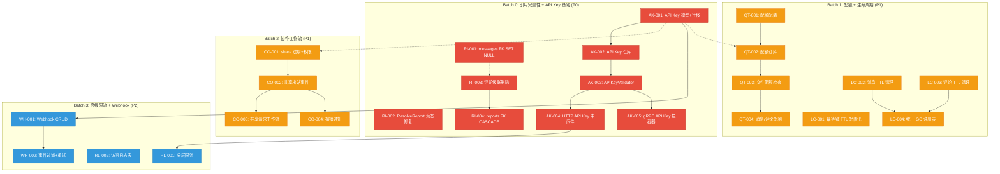
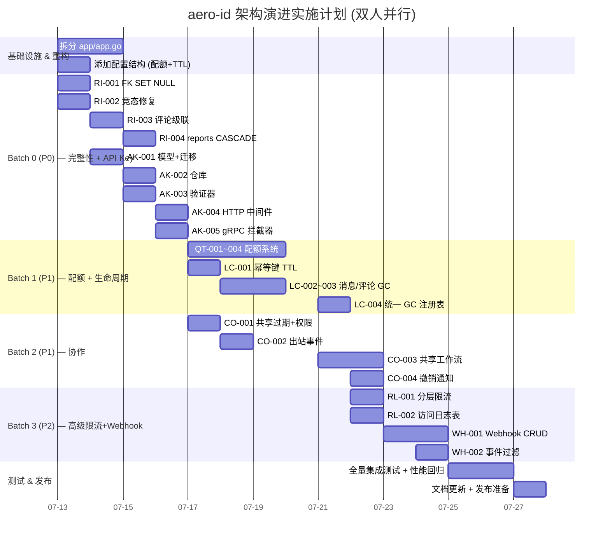

现在我已经掌握了完整的代码基线。以下是我的综合技术负责人分析报告：

---

# Tech Lead 分析报告：aero-id 架构演进计划

## 0. 代码基线快速评估

在分解任务之前，以下几个观察值决定了整个计划的约束条件：

| 指标 | 当前值 | 限制值 | 风险 |
|---|---|---|---|
| `app/app.go` 行数 | **516** | 500 | ⚠️ 略微超标，新基础设施应在启动前重构 |
| `service/comment.go` | 472 | 500 | 接近限制，新功能需拆分 |
| `repository/comment.go` | 408 | 500 | 安全 |
| 包平均复杂度 | 待 lint | ≤ 5.0 | 需关注新代码 |
| 函数嵌套深度 | 当前 ≤ 3 层 | 3 | 严格遵守 |

**一个事实修正**：分析文档的"补充发现"称"文件软删除时 `storage_refs` 没有递减"。仔细阅读 `internal/repository/storage_ref.go:74-100` 确认：`Decrement` 方法在原子事务中递减 `ref_count`，当计数归零时该行会被删除。**该能力已经正确实现**，无需新增任务。

---

## 1. 任务分解

将五个方向拆解为 **25 个可执行任务**，每个 2-4 小时。所有文件路径相对于 `/home/u1/aero-id`。

### 批次 0 — 引用完整性修复 (P0) + API Key Phase 0 (P0)

#### 方向二：引用完整性

| 任务 ID | 任务标题 | 涉及文件 | 前置依赖 | 预估工时 |
|---|---|---|---|---|
| **RI-001** | 修复 `messages.file_id` FK 为 `ON DELETE SET NULL` | `migrations/000024_fix_message_file_fk.{up,down}.sql`, `internal/repository/message_test.go` | 无 | 2h |
| **RI-002** | 修复 `ResolveReport` + `SetStatus` 竞态条件 | `internal/service/comment.go` (拆分至 `comment_moderation.go`), `internal/repository/comment.go` | 无 | 3h |
| **RI-003** | 评论目标删除时级联软删除评论 | `internal/service/comment_cascade.go` (新), `internal/repository/comment.go`, `migrations/000025` | RI-001 | 4h |
| **RI-004** | `comment_reports` FK 添加 `ON DELETE CASCADE` | `migrations/000026`, `internal/repository/comment_test.go` | RI-003 | 2h |

**RI-001 详述**：
- 当前 SQL：`file_id UUID REFERENCES files(id)`（默认 NO ACTION）
- 改为：`file_id UUID REFERENCES files(id) ON DELETE SET NULL`
- 同时添加 `file_id` 上可为空时的读路径兼容处理
- 验收标准：删除文件后，引用该文件的消息的 `file_id` 列被置为 NULL，且旧测试全部通过

**RI-002 详述**：
- 根因：`ResolveReport` 先调用 `Get` 读取 `c.Status`，再单独调用 `SetStatus`—两者之间可能发生软删除
- 解决方案：在 `ResolveReport` 内使用原子事务同时更新 report 状态和 comment 状态（或者检查 `ErrNotFound` 返回时回滚）
- 验收标准：`ResolveReport` + 并发 `Delete` 不会产生 500 错误

#### 方向四 Phase 0：API Key 认证扩展

| 任务 ID | 任务标题 | 涉及文件 | 前置依赖 | 预估工时 |
|---|---|---|---|---|
| **AK-001** | 定义 API Key 领域模型 + 迁移 | `internal/domain/api_key.go` (新), `migrations/000027_create_api_keys.{up,down}.sql` | 无 | 2h |
| **AK-002** | 实现 API Key 仓库 | `internal/repository/api_key.go` (新), `internal/repository/api_key_test.go` (新) | AK-001 | 3h |
| **AK-003** | 实现 `APIKeyValidator`（实现 `TokenValidator` 接口） | `internal/middleware/auth.go` | AK-002 | 2h |
| **AK-004** | 添加 `X-API-Key` 认证中间件 | `internal/middleware/api_key.go` (新), `internal/handler/http/router.go` | AK-003 | 2h |
| **AK-005** | gRPC 拦截器中的 API Key 支持 | `internal/handler/grpc/server.go`, `internal/handler/grpc/auth_interceptor.go` (新) | AK-003, AK-004 | 3h |

**AK-001 详述**：
- API Key 模型：`ID(uuidv7)`, `OwnerUID`, `Name`（人类可读标签）, `KeyHash`（bcrypt 或 SHA-256）, `Permissions []string`, `RateLimitTier`, `ExpiresAt`, `LastUsedAt`, `CreatedAt`
- 仅存储 Key 的哈希，原始 Key 只在创建时展示一次
- 验收标准：`make migrate-up` 后 API keys 表存在

**AK-003 详述**：
- `TokenValidator` 接口已定义（`middleware/auth.go:13-15`）：`ValidateToken(ctx, token) (string, error)`
- `APIKeyValidator` 查找 `key_hash = SHA256(token)` 的行，检查过期时间，返回 `owner_uid`
- 验收标准：有效 API Key 返回关联的 uid，无效 Key 返回错误

---

### 批次 1 — 配额 (P1) + 生命周期 (P1)

#### 方向三：配额系统

| 任务 ID | 任务标题 | 涉及文件 | 前置依赖 | 预估工时 |
|---|---|---|---|---|
| **QT-001** | 添加 per-user 配额配置结构 | `internal/config/config.go` | 无 | 1.5h |
| **QT-002** | 实现配额仓库接口 + 查询 | `internal/repository/quota.go` (新), `internal/domain/quota.go` (新) | QT-001 | 3h |
| **QT-003** | 在 `fileService.Create` 中添加配额检查 | `internal/service/file.go` (拆分至 `file_quota.go`) | QT-002 | 2h |
| **QT-004** | 在消息/评论创建中添加配额检查 | `internal/service/message_quota.go` (新), `internal/service/comment_quota.go` (新) | QT-003 | 3h |

**QT-001 详述**：
```yaml
# config.yaml 新增
storage:
  quota:
    enabled: true
    default_max_files: 1000        # per-user file count cap (0 = unlimited)
    default_max_storage_bytes: 1073741824  # 1GB per user
    default_max_messages_per_day: 500
```

**QT-003** 需要在 `internal/service/file.go` 中将文件数检查（现已 297 行）拆分为 `file_quota.go`。这同时解决了文件大小约束——当前 `file.go` 为 297 行，加上配额逻辑后会接近 400+，拆分是必要的。

#### 方向五：生命周期管理

| 任务 ID | 任务标题 | 涉及文件 | 前置依赖 | 预估工时 |
|---|---|---|---|---|
| **LC-001** | 将幂等键 TTL 提取到配置中 | `internal/config/config.go`, `internal/app/app.go` | 无 | 2h |
| **LC-002** | 实现消息 TTL 生命周期清理器 | `internal/storage/gc/message_sweeper.go` (新), `internal/domain/message_lifecycle.go` (新) | 无 | 4h |
| **LC-003** | 实现评论 TTL 生命周期清理器 | `internal/storage/gc/comment_sweeper.go` (新) | LC-002 | 3h |
| **LC-004** | 统一 GC 注册表 (Resource Registry) | `internal/domain/resource.go` (新), `internal/storage/gc/registry.go` (新) | LC-002, LC-003 | 4h |

**LC-001 详述**：
- 当前 `app/app.go` 第 210 行：`stopIdemClean := idemStore.RunCleaner(time.Hour)` — TTL硬编码
- 改为从 `config.Server.HTTP.IdempotencyTTL` 读取
- 验收标准：配置中的 `idempotency_ttl` 变更后，清理周期相应变化

**LC-004** 是分析文档建议的"声明式资源依赖注册表"的 MVP 实现：
```go
// internal/domain/resource.go
type ResourceKind string

const (
    ResourceFile    ResourceKind = "file"
    ResourceMessage ResourceKind = "message"
    ResourceComment ResourceKind = "comment"
)

type ResourceLifecycle struct {
    Kind         ResourceKind
    TTL          time.Duration       // 软删除后的保留期
    Cascade      CascadePolicy       // 级联策略
    GCCollector  func(ctx, before, limit) ([]ID, error)
    GCPurger     func(ctx, []ID) error
}
```

---

### 批次 2 — 协作工作流 (P1)

#### 方向一：协作

| 任务 ID | 任务标题 | 涉及文件 | 前置依赖 | 预估工时 |
|---|---|---|---|---|
| **CO-001** | 向 `file_shares` 添加过期时间 + 权限列 | `migrations/000028`, `internal/domain/file_share.go` (新), `internal/repository/file_share.go` | AK-001 (用于权限枚举) | 3h |
| **CO-002** | 添加共享创建/撤销的出站事件 | `internal/service/file_share.go`, `internal/service/file.go` | CO-001 | 2h |
| **CO-003** | 实现共享请求工作流 | `internal/service/share_request.go` (新), `internal/repository/share_request.go` (新), `migrations/000029` | CO-002 | 4h |
| **CO-004** | 共享访问撤销时通知受让人 | `internal/service/notification.go` (扩展), `internal/outbox/handler.go` | CO-002 | 2h |

**CO-001 详述**：
- 当前架构：`file_shares(file_id, grantee_uid, owner_uid, created_at)` — 不可变、无过期
- 新列：`expires_at TIMESTAMPTZ` (nullable), `permissions TEXT[]` (如 `{"read", "comment"}`)
- 后端保持向后兼容：现有行 `expires_at IS NULL` 表示永不过期
- 验收标准：共享时间到期后 `canRead` 返回 false

---

### 批次 3 — 分层限流 + Webhook 管理 (P2)

#### 方向四 Phase 1-2

| 任务 ID | 任务标题 | 涉及文件 | 前置依赖 | 预估工时 |
|---|---|---|---|---|
| **RL-001** | 添加分 endpoint 限流层级 | `internal/middleware/ratelimit.go`, `internal/config/config.go` | AK-004 | 3h |
| **RL-002** | 实现结构化 API 访问日志表 | `migrations/000030`, `internal/repository/access_log.go` (新) | 无 | 3h |
| **WH-001** | 实现 Webhook CRUD 管理 API | `internal/service/webhook.go` (新), `internal/repository/webhook.go` (新), `migrations/000031` | AK-001 | 4h |
| **WH-002** | 添加 per-webhook 事件过滤 + 重试 | `internal/outbox/webhook.go`, `internal/config/config.go` | WH-001 | 3h |

---

## 2. 执行顺序 — 依赖图



### 可并行执行的任务组

| 并行组 | 任务 | 说明 |
|---|---|---|
| **G0-A** | RI-001, RI-002, AK-001 | 无依赖的三个独立任务 |
| **G0-B** | RI-003, AK-002 | 可并行（AK-002 只依赖 AK-001，RI-003 只依赖 RI-001） |
| **G1-A** | QT-001, LC-001 | 均为纯配置任务 |
| **G1-B** | QT-002, LC-002 | 可并行（QT-002 依赖 QT-001，LC-002 无依赖） |
| **G2** | CO-001, RL-002 | 可并行（CO-001 只依赖 AK-001 的权限枚举，RL-002 无依赖） |

---

## 3. 技术风险

### 3.1 高风险项

| 风险 | 等级 | 说明 | 缓解策略 |
|---|---|---|---|
| **RI-003：级联删除性能** | 🔴 中 | 文件有 10 万条评论时，级联软删除可能导致事务过长或锁竞争 | 使用分批 + gorm `Delete` 的 `WHERE IN`；或使用 DB 级 `ON DELETE CASCADE` + `deleted_at` 触发器 |
| **AK-001：API Key 安全** | 🔴 高 | 密钥管理（存储哈希、首次展示、轮换、泄漏检测）是安全敏感操作 | 使用 SHA-256 哈希而非 bcrypt（查性能）；创建时仅展示一次 raw key；添加 `last_used_at` 审计；强制轮换周期 |
| **QT-003：配额检查的一致性** | 🟡 中 | 并发创建时 `COUNT` 可能不准确导致超配 | 使用 `SELECT ... FOR UPDATE` 或乐观锁；每次创建操作前在事务内重新计数 |
| **LC-002/003：GC 不会误删** | 🟡 中 | TTL 清理器可能在消息/评论仍活跃时误删 | 清理器只清理状态标记为 "ephemeral" 或超过配置 TTL 的行；使用 `WHERE deleted_at IS NOT NULL AND deleted_at < ?` 模式（同现有 file GC） |
| **CO-003：共享请求通知** | 🟡 低 | 共享请求需要通知到 SSO 用户，但 aero-id 只能通过出站事件 + 消息 | 使用现有 `outbox` + `notification` 管道，给目标用户发送系统消息/通知 |
| **`app/app.go` 超过 500 行** | 🟡 中 | 当前 516 行，Batch 0 到 Batch 3 的新基础设施会继续增加 | 在 Batch 0 开始前重构 `app/app.go`：将 `New()` 中独立的子图（API Key、配额、webhook）提取到 `app/app_init_*.go` 文件中 |

### 3.2 外部依赖

| 依赖 | 影响的任务 | 说明 |
|---|---|---|
| SSO gRPC 服务 | 所有 | 认证、用户解析均通过 SSO。开发时需 SSO stub。当前已有 `sso.Client` 和 `TokenValidator` 接口，新增 `APIKeyValidator` 只需实现该接口而无新 SSO 依赖 |
| testcontainers (Docker) | 集成测试 | `make test-integration` 需要 Docker。CI 环境需确保 Docker socket 可用 |
| `protoc` + protoc-gen-go | AK-005 | 如果 gRPC API 需要新增 RPC（如 webhook CRUD），需生成 .pb.go 文件 |

### 3.3 性能瓶颈

| 场景 | 评估 | 优化策略 |
|---|---|---|
| 配额计数查询（`COUNT(*)` on large table） | 频繁写入时 `COUNT` 慢 | 使用 Redis 计数器 / 物化列（类似 `reply_count` 的方式） |
| 消息 TTL 清理器 | 全表扫描 `WHERE deleted_at IS NULL AND created_at < ?` | 在 `created_at` 上建索引（已有 `idx_messages_inbox` 是 `(to_uid, created_at DESC)`，加上 `created_at` 独立索引） |
| API Key 认证（哈希查询） | 每次请求需查询 DB | 添加 LRU 内存在 `APIKeyValidator`；`KeyHash` 上有唯一索引 |

---

## 4. 资源评估

### 4.1 团队建议

| 角色 | 数量 | 技能要求 | 负责方向 |
|---|---|---|---|
| **Senior Go Backend Engineer** | 1 | GORM, Postgres, gRPC, 并发安全、安全编码 | Batch 0（API Key + 完整性），Batch 1（配额），架构审核 |
| **Mid-Level Backend Engineer** | 1 | Go, SQL, 测试、CI/CD | Batch 1（生命周期），Batch 2（协作），Batch 3（限流+Webhook） |

两人可并行工作于不同批次（参考并行组 G0-A/G0-B）。

### 4.2 里程碑时间节点

**假设**：1 Senior + 1 Mid，全职投入（每人 6 有效工时/天）

| 里程碑 | 时间 | 交付物 | 验收标准 |
|---|---|---|---|
| **M0** | Day 1-2 | 重构 `app/app.go`(拆分) + RI-001, RI-002 | `app/app.go` < 500 行；`make test && make lint` 通过 |
| **M1** | Day 3-5 | RI-003, RI-004, AK-001, AK-002, AK-003 | 引用完整性修复完成；API Key 模型+仓库+验证器完成 |
| **M2** | Day 6-7 | AK-004, AK-005 (Phase P0 完成) | HTTP + gRPC 均支持 X-API-Key 认证 |
| **M3** | Day 8-10 | QT-001~004, LC-001~003 | 配额系统：文件上传/daily消息超过限制时拒绝；
生命周期：幂等键 TTL 可配置，消息/评论 GC 清理 |
| **M4** | Day 11-13 | CO-001~004, LC-004 | 共享过期+权限、共享请求工作流、统一 GC 注册表 |
| **M5** | Day 14-16 | RL-001~002, WH-001~002 | 分层限流、访问日志表、Webhook CRUD |
| **M6** | Day 17-18 | 全量集成测试 + 性能调优 | `make test && make test-integration && make lint` 全部通过；性能回归 ≤ 5% |

### 4.3 阻塞点（Blockers）与解决策略

| 阻塞点 | 影响 | 解决策略 |
|---|---|---|
| Docker 不可用于集成测试 | RI-001, RI-004（需要验证 FK 行为） | 使用 `psql` 直接连接测试 DB 验证约束生效；或使用 SQLite 测试 |
| SSO 不可用 | 所有 API Key 集成测试 | 使用 `internal/service/mocks` 目录中的已有 mock |
| 生产环境无法停机迁移 | 所有 DB 迁移 | 所有迁移均为向后兼容（ADD COLUMN IF NOT EXISTS、ALTER TABLE ... SET NULL 非阻塞）；计划蓝绿部署窗口 |

---

## 5. 质量保证

### 5.1 单元测试覆盖要求

| 包 | 当前覆盖 | 目标覆盖 | 新增测试重点 |
|---|---|---|---|
| `internal/service/` | ~80% (核心) | ≥85% | API Key 认证、配额拒绝、级联删除、共享过期 |
| `internal/repository/` | ~70% | ≥80% | FK 约束行为、原子事务、配额 COUNT |
| `internal/middleware/` | ~65% | ≥80% | API Key 中间件、分层限流、访问日志 |
| `internal/storage/gc/` | ~60% | ≥80% | 消息/评论清理器、统一 GC 注册表 |
| `internal/domain/` | ~90% | ≥90% | 新增模型（APIKey, ShareRequest）的校验逻辑 |

### 5.2 集成测试策略

| 测试类别 | 执行条件 | 范围 |
|---|---|---|
| **Batch 0 迁移测试** | `make test-integration` | 验证 FK ON DELETE SET NULL 实际生效；验证 CASCADE 在批量删除时行为正确 |
| **API Key 认证流水线** | `make test-integration` | 创建 Key → 使用 Key 认证请求 → 过期 Key 被拒绝 SSO token 和 API Key 共存 |
| **配额集成测试** | `make test-integration` | 达到配额上限后 Create 返回 429/Conflict；释放后恢复 |
| **生命周期清理** | `make test-integration` | 消息/评论超过 TTL 后被 GC 清理；仍在 TTL 内的不受影响 |
| **共享工作流 e2e** | `make test-integration` | 请求共享 → 批准 → 访问文件 → 过期 → 拒绝访问 |

### 5.3 代码审查要点

| 方向 | 审查关注点 |
|---|---|
| **所有 DB 迁移** | 是否有对应 `.down.sql`？向后兼容性？是否同时修改了 GORM 模型？ |
| **RI-001** | `messages.file_id` 可为 NULL 后，消息 handler 的读路径是否能处理 `file_id = nil`？返回 nil file 信息还是跳过？ |
| **RI-002** | 事务是否覆盖了 `ResolveReport` + `SetStatus`？`FOR UPDATE` 锁是否用在正确的行？ |
| **AK-003** | `KeyHash` 的哈希算法（SHA-256 vs bcrypt）的选择理由。原始 Key 是否在日志中泄漏？ |
| **QT-003** | `COUNT` 和 `INSERT` 之间是否存在竞态窗口？是否使用了 `SELECT ... FOR UPDATE`？ |
| **LC-004** | 注册表是否足够通用以被 file/message/comment GC 复用？TTL 默认值是否安全？ |
| **CO-001** | 列变更后 `IsSharedWith` 查询是否需要过滤 `expires_at`？ |

### 5.4 性能测试需求

| 测试场景 | 指标 | 方法 |
|---|---|---|
| 并发文件创建（配额检查） | P99 < 200ms | `wrk` / `ghz` 对 Create endpoint 加压 100 QPS |
| 消息生命周期清理 | 100K 消息清理 < 30s | `go test -bench=BenchmarkGCMessageSweep` |
| API Key 认证吞吐 | > 5000 RPS | 对比 Bearer token vs API Key 的认证延迟 |
| 带 10 万评论的级联删除 | < 5s | 分批删除 + 性能监控 |

---

## 6. 实施计划

### 整体甘特图



### 各阶段详细计划

#### 阶段 1：基础设施搭建 (Day 1-2)

**目标**：清理架构债务，打下 Batch 0 基础

| 天 | 工作 |
|---|---|
| Day 1 AM | Senior: 拆分 `app/app.go` → `app_init_core.go`(DB+SSO+storage)、`app_init_services.go`(service wiring)、`app_init_transport.go`(server setup)。保持 `app.go` 只有 `Run`/`shutdown`/`Close` 方法 |
| Day 1 PM | Senior: RI-001 (FK SET NULL 迁移 + 兼容测试)。Mid: 添加配额/TTL 配置结构到 `config.go` + 验证逻辑 |
| Day 2 AM | Senior: RI-002 (ResolveReport 竞态修复 + 事务化)。Mid: AK-001 (API Key 模型 + 迁移) |
| Day 2 PM | Senior: RI-003 (评论级联删除设计 + 迁移)。Mid: AK-002 (API Key 仓库 + 单元测试) |

**里程碑 M0 验收**：`make test && make lint` 全部通过；`app/app.go` ≤ 400 行。

#### 阶段 2：核心功能实现 (Day 3-9)

**目标**：Batch 0 + Batch 1 核心功能

| 天 | 工作 |
|---|---|
| Day 3 | Senior: AK-003 (APIKeyValidator) + AK-004 (HTTP 中间件)。Mid: RI-003 实现 + RI-004 |
| Day 4 | Senior: AK-005 (gRPC 拦截器)。Mid: QT-002 (配额仓库方法: CountByOwner, SumStorageByOwner) |
| Day 5 | Senior: QT-003 (文件配额检查, 需要拆分 `file.go` → `file_quota.go`)。Mid: QT-004 (消息/评论配额) |
| Day 6 | Senior: LC-001 (幂等键 TTL 配置化) + LC-002 (消息 TTL 清理器)。Mid: LC-003 (评论 TTL 清理器) |
| Day 7 | Senior+Mid: 共同设计 LC-004 (统一 GC 注册表)。实现注册表 + 将 file/message/comment GC 接入 |
| Day 8 | Senior: CO-001 (共享过期+权限列迁移 + 仓库方法)。Mid: CO-002 (共享出站事件) |
| Day 9 | Senior: CO-003 (共享请求工作流: 模型、仓库、服务)。Mid: CO-004 (撤销通知) |

**里程碑 M2/M3/M4 验收**：所有 Batch 0-2 的 `make test` 和 `make test-integration` 通过。

#### 阶段 3：集成测试和优化 (Day 10-14)

**目标**：Batch 3 + 全量集成测试 + 性能回归

| 天 | 工作 |
|---|---|
| Day 10 | Senior: RL-001 (分层限流: 每 endpoint 的限流配置 + 中间件)。Mid: RL-002 (访问日志表) |
| Day 11 | Senior: WH-001 (Webhook CRUD: 模型、仓库、服务、HTTP handler)。Mid: WH-002 (事件过滤 + 重试策略) |
| Day 12 | Senior+Mid: 全量集成测试覆盖。重点：API Key 认证流水线、配额边界、级联删除、共享生命周期 |
| Day 13 | 性能调优：对配额 COUNT 查询加索引、API Key 认证加 LRU 缓存、GC 清理器加压测试 |
| Day 14 | 安全审查：API Key 哈希算法、日志中无敏感信息泄露、token 缓存 TTL 合理性 |

**里程碑 M5 验收**：`make test && make test-integration && make lint` 全量通过。

#### 阶段 4：发布准备 (Day 15-16)

**目标**：文档、CHANGELOG、配置检查、发布

| 天 | 工作 |
|---|---|
| Day 15 | 更新 `README.md`（新增 API endpoint 文档）、更新 `AGENTS.md`（新增工程约束）、更新 `configs/config.yaml`（新增所有配置项及默认值） |
| Day 16 | 生成 CHANGELOG、在 staging 环境做冒烟测试、准备回滚计划、标记发布 tag |

---

## 7. 总结建议

### 推荐的实施顺序（作为授权决策）

**立即启动 (Week 1)**：
1. ✂️ 拆分 `app/app.go`（减少后续所有 PR 的冲突）
2. 🔧 RI-001 + RI-002（最紧急的完整性修复——当前生产环境存在竞态 bug 和 FK 阻塞问题）
3. 🔑 AK-001~003（API Key 模型层——配额和协作都依赖它区分客户端）

**Week 2**：
4. 🔗 RI-003 + RI-004（完成完整性修复系列）
5. 🔧 AK-004 + AK-005（API Key 认证上线——让配额 Phase 可以在生产环境工作）
6. 💾 QT-001~004（配额上线——基础设施已就位）

**Week 3**：
7. 🧹 LC-001~004（生命周期管理——配额生效后需要清理策略）
8. 🤝 CO-001~004（协作工作流——配额和认证已就位）

**Week 4**：
9. 📊 RL-001 + RL-002（高级限流——API Key 层已就位）
10. 🔌 WH-001 + WH-002（Webhook 管理——最后一个功能）

### 关键决策点

| 决策 | 选项 | 建议 |
|---|---|---|
| API Key 哈希算法 | SHA-256 vs bcrypt vs argon2 | **SHA-256**（查询性能优先；如果 Key 泄漏，泄漏的是已安全的哈希值）。bcrypt/argon2 的慢哈希对每次 API 请求来说代价过高。 |
| 配额计数一致性 | 事务内 `SELECT ... FOR UPDATE` vs 应用层乐观锁 | **事务内 `FOR UPDATE`**（简单可靠，且在合理 QPS 下锁竞争可接受）；支持水平扩展时可迁移至 Redis 计数器。 |
| 共享请求通知方式 | 出站事件 + 通知表 vs 直接系统消息 | **出站事件 + 通知表**（复用已有基础设施，解耦发送和通知） |
| 统一 GC 注册表 | 配置驱动 vs 代码注册 | **代码注册**（每个资源类型显式注册其 `GCConsumer`；可单元测试，无运行时动态配置的复杂性） |
