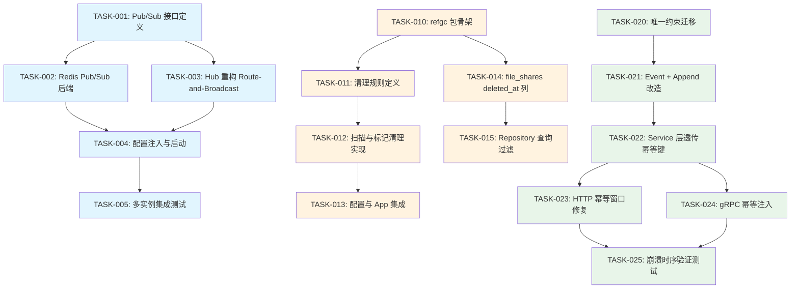

Now I have comprehensive understanding of the codebase. Let me produce the full Tech Lead analysis.

---

# Tech Lead 评审与实施分析报告

## 1. 任务分解

基于验证后的三个有效方向（方向二已关闭），拆解为以下可执行任务：

### 方向一：SSE Hub 跨实例广播

| 任务 ID | 任务标题 | 涉及文件 | 前置依赖 | 工时 | 验收标准 |
|---------|---------|---------|---------|------|---------|
| TASK-001 | **定义跨实例 Pub/Sub 接口** | `internal/hub/pubsub.go`（新） | 无 | 2h | `PubSub` interface 定义 `Publish(uid, event)` 和 `Subscribe(uid) <-chan SSEEvent` 方法，含 `Close()`；现有 `Hub` 作为 local-only 实现 |
| TASK-002 | **实现 Redis Pub/Sub 后端** | `internal/hub/redis.go`（新）, `configs/config.yaml`, `internal/config/*` | TASK-001 | 4h | `RedisPubSub` 实现 `PubSub` 接口；每个 uid 对应一个 Redis channel `sse:{uid}`；支持连接断开重连；Publish 消息体包含 eventID, type, data |
| TASK-003 | **Hub 重构为 Route-and-Broadcast** | `internal/hub/hub.go`, `internal/hub/adapter.go` | TASK-001 | 3h | `Hub` 持有 `PubSub` 实例；`pub()` 先调用 `PubSub.Publish()` 再本地广播；`Subscribe()` 启动本地协程从 `PubSub.Subscribe()` 读取并转发到本地 channel |
| TASK-004 | **配置注入与启动选项** | `internal/app/app.go`, `configs/config.yaml` | TASK-002, TASK-003 | 2h | `config.SSE.HubType` 支持 `local` / `redis`；`config.SSE.RedisAddr` 等；wire 时根据配置选择实现；单实例部署时默认 `local` 零依赖 |
| TASK-005 | **多实例集成测试** | `internal/hub/hub_test.go`（扩展）, `Makefile` | TASK-004 | 3h | 启动双实例 testcontainers（Redis + 2 个 aero-id 进程），验证实例 A 通知到达实例 B SSE 客户端；失败时回滚到 `local` 模式 |

**方向一合计：14h**

---

### 方向三：软删除引用碎片清理

| 任务 ID | 任务标题 | 涉及文件 | 前置依赖 | 工时 | 验收标准 |
|---------|---------|---------|---------|------|---------|
| TASK-010 | **创建 refgc 包骨架** | `internal/refgc/sweeper.go`（新）, `internal/refgc/sweeper_test.go`（新） | 无 | 3h | 复用 `storage/gc/sweeper.go` 的 `Sweeper` 模式：`RefGCSweeper` 接口 + `Run()` / `Start()` + 可配置 `Interval` / `BatchSize` |
| TASK-011 | **实现依赖表孤儿清理规则** | `internal/refgc/rules.go`（新） | TASK-010 | 4h | 定义 `RefGCRule` 结构：`ParentTable`, `ChildTable`, `JoinColumn`, `SoftDeleteColumn`；覆盖四个依赖路径：`file_shares`（无 FK，parent `deleted_at` 判断）, `message_reactions`（FK CASCADE 但软删除无效）, `comment_likes`, `comment_reports` |
| TASK-012 | **实现扫描与标记清理** | `internal/refgc/sweeper.go`（续） | TASK-011 | 4h | 单次 `Run()`：`SELECT files.deleted_at IS NOT NULL AND file_shares.deleted_at IS NULL` → 批量 `UPDATE file_shares SET deleted_at = now()`；支持 dry-run 模式（日志只输出不执行） |
| TASK-013 | **配置与 app 集成** | `internal/app/app.go`, `configs/config.yaml`, `internal/config/*` | TASK-012 | 2h | `config.RefGC.Enabled`, `Interval`, `DryRun`；App 启动时如果 enabled 则 `startRefGC := refgcSweeper.Start(interval)`；shutdown 时调用 |
| TASK-014 | **补充 file_shares 表 `deleted_at` 列** | `migrations/000021_add_file_shares_deleted_at.up.sql`, `migrations/000021_add_file_shares_deleted_at.down.sql` | TASK-011 | 1h | `ALTER TABLE file_shares ADD COLUMN deleted_at TIMESTAMPTZ`；更新对应 repository 模型 |
| TASK-015 | **Repository 层查询加 `deleted_at` 过滤** | `internal/repository/file_share.go` + 相关 repo | TASK-012 | 3h | 审计所有 JOIN 到 file_shares / comment_likes / comment_reports 的查询，补 `WHERE parent.deleted_at IS NULL` |

**方向三合计：17h**

---

### 方向四：Outbox + 幂等键集成

| 任务 ID | 任务标题 | 涉及文件 | 前置依赖 | 工时 | 验收标准 |
|---------|---------|---------|---------|------|---------|
| TASK-020 | **outbox_events 加幂等去重唯一约束** | `migrations/000022_add_outbox_idempotency.up.sql`, `migrations/000022_add_outbox_idempotency.down.sql` | 无 | 1h | `CREATE UNIQUE INDEX uq_outbox_events_dedup ON outbox_events(aggregate_type, aggregate_id, idempotency_key) WHERE idempotency_key IS NOT NULL` |
| TASK-021 | **outbox Event 加 IdempotencyKey 字段** | `internal/outbox/event.go`, `internal/outbox/repository.go` | TASK-020 | 2h | `Event.IdempotencyKey string`；`Append` 方法写该字段；`Append` 加 `ON CONFLICT (aggregate_type, aggregate_id, idempotency_key) WHERE idempotency_key IS NOT NULL DO NOTHING` → 返回 `ErrDuplicate` |
| TASK-022 | **Service 层写路径透传幂等键** | `internal/service/message.go`, `internal/service/comment.go` | TASK-021 | 3h | 每个创建 outbox 事件的 service 方法接受 `idempotencyKey string` 参数（来自 context 或显式参数）；`SendMessage`、`CreateComment` 等调用 `outbox.Append` 时传入 |
| TASK-023 | **HTTP 幂等中间件传键到 Context** | `internal/middleware/idempotency.go` | TASK-022 | 2h | 中间件解析 `Idempotency-Key` 后写入 `context.WithValue(ctx, "idempotency_key", key)`；消除 `c.Next()` 后才 `Complete` 的窗口期问题（改为 `defer` 或在 handler chain 内 `Complete`） |
| TASK-024 | **gRPC 幂等键注入机制** | `internal/handler/grpc/interceptor.go`（新或扩展） | TASK-022 | 3h | gRPC unary interceptor 从 `metadata` 中读取 `idempotency-key` → 注入 context；客户端侧文档/约定 |
| TASK-025 | **验证崩溃时序不复现** | `internal/service/message_test.go`, `internal/outbox/repository_test.go` | TASK-021, TASK-022 | 3h | 单元测试模拟崩溃时序：tx1 Create → crash → tx2 Create → 验证 domain row 无重复且 outbox event 只有一个 |

**方向四合计：14h**

---

## 2. 执行顺序与依赖图



**并行组**：

| 并行组 | 包含任务 | 说明 |
|--------|---------|------|
| 组 A（方向一） | TASK-001 → 002/003 → 004 → 005 | 完全独立，仅内部有串行依赖 |
| 组 B（方向三） | TASK-010 → 011/014 → 012/015 → 013 | 独立，与方向一、四无共享代码 |
| 组 C（方向四） | TASK-020 → 021 → 022 → 023/024 → 025 | 独立，可与其他组并行 |

**关键路径**：

- **最短路径**（方向四）：TASK-020(1h) + TASK-021(2h) + TASK-022(3h) + TASK-025(3h) = **9h** 内可交付最小修复
- **最长路径**（方向一）：14h 全部完成

---

## 3. 技术风险

### 3.1 方向一：SSE Hub 跨实例广播

| 风险 | 等级 | 说明 | 缓解措施 |
|------|------|------|---------|
| Redis 引入新基础设施依赖 | **中** | 当前零外部依赖即可运行；Redis 增加运维复杂度 | 保留 `local` 模式为默认；Redis 只在 `hub_type: redis` 时启用；单实例部署不受影响 |
| Redis 消息丢失 | **中** | Redis Pub/Sub 无持久化，网络分区时消息丢失 | 文档明确 at-most-once 语义；重连恢复从 outbox replay 补（限 `ListSince limit=50`）；后续可升级到 Redis Streams 实现 at-least-once |
| Redis 连接阻塞影响 SSE 吞吐 | **低** | 每个 uid 一个 Redis SUBSCRIBE，大量 uid 时 Redis 连接数膨胀 | 每个实例共用少量 Redis 连接（如 10 个 worker goroutine + hash ring 分发 uid）；`SUBSCRIBE` 本身不占用服务端 CPU |
| 配置失误导致生产事故 | **低** | 突然切到 Redis 模式且 Redis 不可用，所有 SSE 中断 | 健康检查：启动时 ping Redis；失败时回退到 local 模式并打 WARN 日志 |

### 3.2 方向三：软删除引用碎片清理

| 风险 | 等级 | 说明 | 缓解措施 |
|------|------|------|---------|
| GC 扫描与写操作产生短暂不一致 | **低** | 扫描期间某个 parent 刚被软删除但 child 还未被标记 | 幂等 UPDATE（`SET deleted_at = now() WHERE deleted_at IS NULL`）；下一轮扫描会自动补上 |
| `file_shares` 加 `deleted_at` 列导致旧代码兼容 | **低** | 旧代码实例不认新列，查询不会受影响（额外的列被忽略） | 先部署 migration（兼容旧代码），再部署 refgc 代码；两相部署 |
| 大表全表扫描性能 | **中** | `file_shares` 或 `comment_likes` 百万行规模时 `SELECT parent LEFT JOIN child WHERE parent.deleted_at IS NOT NULL AND child.deleted_at IS NULL` 可能走全表 | 加复合索引 `(parent_id, deleted_at)`；`PurgeBatch` 限制单次扫描行数；支持 dry-run 观察行数 |

### 3.3 方向四：Outbox + 幂等键集成

| 风险 | 等级 | 说明 | 缓解措施 |
|------|------|------|---------|
| `ON CONFLICT DO NOTHING` + 唯一索引覆盖不到位 | **低** | 如果多个 idempotency_key 为 NULL 的事件重复，唯一索引不覆盖 | 唯一索引条件 `WHERE idempotency_key IS NOT NULL`；NULL 场景用应用层去重（已有 retry + backoff） |
| Service 层改造面广 | **中** | 所有创建 outbox 事件的 service 方法都需要加 idempotencyKey 参数，涉及 message、comment 等多条路径 | 从 context 提取而非函数参数，减少签名改动（`IdempotencyKeyFrom(ctx)`）；默认空字符串表示"不检查" |
| Complete 窗口期修复可能导致死锁 | **低** | 如果 handler panic 且 defer 未正确释放 reservation | 使用 `defer` 替代 `c.Next()` 后固定 `Complete`；配合 `reservationTTL=2min` 超时自动回收 |
| gRPC 无 Idempotency-Key 概念（无 HTTP header） | **中** | gRPC clients 没有标准的幂等键机制，需要约定 metadata key | 在 gRPC interceptor 中读取 `idempotency-key` 元数据；客户端生成 UUID 作为幂等键；文档化 |

---

## 4. 资源评估

### 4.1 人员与技能

| 角色 | 人数 | 所需技能 | 负责方向 |
|------|------|---------|---------|
| 高级 Go 工程师 | 1 | 并发模型、GORM、PostgreSQL、Redis | 方向一（核心架构）+ 方向四 |
| 中级 Go 工程师 | 1 | Go 基础、SQL、单元测试 | 方向三 + 方向四辅助 |
| DevOps / SRE | 0.5 | Redis 部署、Docker Compose、CI/CD | 方向一集成测试、迁移脚本 |
| **合计** | **2.5 FTE** | | |

### 4.2 里程碑

| 里程碑 | 时间节点 | 交付物 | 验收标准 |
|--------|---------|--------|---------|
| M1: 方向四 MVP | Day 3 | 唯一约束迁移 + outbox Append 改造 + 崩溃时序测试 | `make test` green；手动模拟 crash 场景无重复事件 |
| M2: 方向一 Core | Day 5 | Pub/Sub 接口 + Hub 重构 + Redis 后端 + 单元测试 | 单实例 `local` 模式全绿；`redis` 模式通过单元测试 |
| M3: 方向三 MVP | Day 5 | refgc sweeper + 清理规则 + 可配置 | dry-run 模式输出正确；单次 Run 扫描并标记 orphan 行 |
| M4: 全方向集成 | Day 8 | 配置注入 + 集成测试 + 端到端验证 | `make test` + `make lint` + 手动验证三方向 |
| M5: 发布就绪 | Day 10 | 文档更新 + CHANGELOG + 部署说明 | 代码审查通过；ROADMAP 更新 |

### 4.3 阻塞点与解决策略

| 阻塞点 | 影响方向 | 解决策略 |
|--------|---------|---------|
| Redis 不在当前基础设施中 | 方向一 | 1. 先合 `local` 模式（无风险） 2. 独立 PR 只加抽象接口 + 代码结构 3. Redis 后端作为独立特性门控，等 Ops 准备好再合 |
| `file_shares` 无 `deleted_at` 列 → 需要 migration | 方向三 | migration 体积小（1 列），向前兼容；在迁移后立即部署 refgc |
| gRPC 客户端无幂等键约定 | 方向四 | 在 proto 注释中说明；interceptor 处理空键时退化为当前行为（无保护） |

---

## 5. 质量保证

### 5.1 单元测试覆盖

| 方向 | 目标覆盖率 | 关键测试场景 |
|------|-----------|-------------|
| 方向一 | ≥ 85% | `Hub.Publish` 在 `local` + `redis` 双模式下行为一致；Redis 断连重连；消息不丢失到本地 channel |
| 方向三 | ≥ 80% | dry-run 模式；单个 parent 软删除后 child 标记；幂等 UPDATE 不重复标记；大 batch 分批 |
| 方向四 | ≥ 90% | `Append` 唯一约束冲突返回 `ErrDuplicate`；完整崩溃时序：tx begin → create → crash → retry → no dup；gRPC interceptor 读 metadata |

### 5.2 集成测试策略

| 测试类型 | 方向 | 工具 | 场景 |
|---------|------|------|------|
| 跨实例 SSE | 方向一 | testcontainers（Redis + 2 x aero-id）+ 真实 HTTP SSE client | 实例 A outbox relay 产生通知 → 实例 B 的 SSE 连接收到事件 |
| 孤儿清理 | 方向三 | test containers（Postgres）+ 预置数据 | 插入 parent + child → 软删 parent → Run() → child.deleted_at 被标记 |
| 崩溃重放 | 方向四 | testcontainers（Postgres）+ HTTP client | `Idempotency-Key: X` → handler crash → 重试 → 无 outbox 重复 |

### 5.3 代码审查要点

| 审查项 | 优先级 | 说明 |
|--------|--------|------|
| 方向一：Hub 重构不影响 `local` 模式单实例 | **P0** | 回归：`New()` 不传 Redis 配置时行为必须与旧代码完全一致 |
| 方向一：PubSub 接口的 `Close()` 一致性 | **P1** | `Hub.Close()` 必须关闭所有 goroutine（Redis 订阅协程） |
| 方向三：refgc 复用 sweeper 模式的 Start/Stop 约定 | **P1** | 与 `storage/gc/sweeper.go` API 形状一致，方便运维统一理解 |
| 方向三：批量 UPDATE 不锁表 | **P1** | 每个 batch 使用 `LIMIT` + 小事务，避免长事务锁 |
| 方向四：`Append` 的 `ON CONFLICT` 返回错误语义 | **P1** | 返回 `ErrDuplicate` vs 静默跳过 vs `nil`；调用方行为必须一致 |
| 方向四：gRPC interceptor 性能 | **P2** | 每次请求读 metadata 成本可忽略；无额外 DB 调用 | 

### 5.4 性能测试需求

| 方向 | 测试场景 | 指标 | 阈值 |
|------|---------|------|------|
| 方向一 | 1000 并发 SSE 连接 + 100msg/s 通知 | 端到端延迟 P99 | < 500ms（local），< 800ms（redis） |
| 方向一 | Redis 断连 10s | 恢复后消息不丢失（由 outbox replay 补） | 重连后 5s 内收到遗漏消息 |
| 方向三 | 100 万行 file_shares + 50% orphan | 单次 Run() 耗时 | < 30s（batch=500） |
| 方向四 | 1000 POST/s 含 Idempotency-Key | outbox 写入延迟 P99 | 无幂等键时 + < 5ms |

---

## 6. 实施计划

### 甘特图

```
天数    D1  D2  D3  D4  D5  D6  D7  D8  D9  D10
组A
 T001 [■■]
 T002     [■■■■]
 T003     [■■■]
 T004             [■■]
 T005                   [■■■]

组B
 T010 [■■■]
 T011     [■■■■]
 T012     [■■■■]
 T013             [■■]
 T014 [■]
 T015                 [■■■]

组C
 T020 [■]
 T021 [■■]
 T022     [■■■]
 T023         [■■]
 T024         [■■■]
 T025               [■■■]

集成
 集成测试                [■■■■]
 文档/CHANGELOG                 [■■]
 发布                              [■■]
```

### 阶段详情

#### 阶段 1：基础设施搭建（Day 1）

| 日期 | 任务 | 负责人 | 产出 |
|------|------|--------|------|
| Morning | TASK-001: Pub/Sub 接口定义 + TASK-020: 唯一约束迁移 | Senior | 接口设计文档 + `.up.sql` / `.down.sql` |
| Afternoon | TASK-010: refgc 包骨架 + TASK-014: file_shares deleted_at 列 | Mid | 基础结构代码 + migration |

**阶段 1 完成标志**：所有前置接口定义和迁移文件可审阅，`make test` 通过。

#### 阶段 2：核心功能实现（Day 2-5）

| 日期 | 任务 | 负责人 | 产出 |
|------|------|--------|------|
| Day 2 | TASK-021: outbox Event + Append 改造 | Senior | `Append` 返回 `ErrDuplicate`；唯一约束生效 |
| Day 2 | TASK-011: 清理规则定义 | Mid | 四个依赖路径的清理查询写好 |
| Day 3 | TASK-022: Service 层透传幂等键 | Senior | message/comment/create 路径注入 idempotencyKey |
| Day 3 | TASK-012: 扫描与标记清理实现 | Mid | refgc Run() 完成；dry-run 模式 |
| Day 4 | TASK-002: Redis Pub/Sub 后端 | Senior | `RedisPubSub` 实现 |
| Day 4 | TASK-023: HTTP 幂等窗口修复 | Senior | `defer` 模式替代 `c.Next()` 后 Complete |
| Day 4 | TASK-024: gRPC 幂等注入 | Senior | interceptor 读取 metadata |
| Day 5 | TASK-003: Hub 重构 | Senior | 双模式可切换 |
| Day 5 | TASK-015: Repository 查询过滤 | Mid | 所有相关 JOIN 加 `deleted_at` 过滤 |

**阶段 2 完成标志**：每个任务对应单测通过；`make test` 全绿。

#### 阶段 3：集成测试与优化（Day 6-8）

| 日期 | 任务 | 负责人 | 产出 |
|------|------|--------|------|
| Day 6 | TASK-004 + TASK-013: 配置注入与 app 集成 | Senior + Mid | 三方向都可通过 config 开启 |
| Day 6-7 | TASK-005: 多实例 SSE 集成测试 | Senior | testcontainers 双实例场景 |
| Day 7 | TASK-025: 崩溃时序验证测试 | Senior | 模拟 crash → retry → 无重复 |
| Day 8 | TASK-015 补漏 + 跨方向联合测试 | Both | 三方向在同一个环境运行；边界情况覆盖 |

**阶段 3 完成标志**：`make test` + `make test-integration` 全绿；手动端到端验证通过。

#### 阶段 4：发布准备（Day 9-10）

| 日期 | 任务 | 负责人 | 产出 |
|------|------|--------|------|
| Day 9 | 代码审查与修复 | Both | 三方向 PR 审查；修改意见合入 |
| Day 9 | 配置文档 + CHANGELOG 更新 | Mid | `configs/config.example.yaml` 加注释；CHANGELOG 条目 |
| Day 10 | 部署文档 + ROADMAP 更新 | Senior | 部署步骤（Redis 可选）；ROADMAP 标记已闭环 |
| Day 10 | 发布 Tag + Release Notes | Senior | git tag + release notes |

**阶段 4 完成标志**：`make lint && make test && make check-file-sizes` 全绿；审查通过。

---

## 总结

| 方向 | 优先级 | 工时 | 并行性 | 风险等级 | 建议 |
|------|--------|------|--------|---------|------|
| SSE Hub 碎片化 | **P1** | 14h | 独立 | 中 | 先合接口 + local 模式无风险；Redis 作为独立 feature gate |
| Admin API | ❌ 已关闭 | 0 | - | - | 代码已重构；无工作项 |
| 软删除引用碎片 | **P3** | 17h | 独立 | 低 | 建议先部署 migration + dry-run 观察数据量再启用 |
| Outbox + 幂等键集成 | **P1** | 14h | 独立 | 低 | 最高 ROI：9h 内可交付 MVP 修复；崩溃时序是不可争辩的数据正确性 bug |

**资源分配建议**：一位 Senior 从 Day 1 开始方向四（高 ROI，低风险），Day 2 开始并行方向一；一位 Mid 独立推进方向三。Day 8 联合集成。总计 **45h 工程师工时**（10 个工作日）。
