现在我已经全面验证了代码库。以下是基于分析文档的综合性 Tech Lead 分析。

---

# Tech Lead 分析：aero-id 方向规划与执行计划

## 验证摘要

在撰写此分析前，我已阅读并验证了代码库中的 20+ 个关键文件。分析文档总体准确，但有**三处关键修正**：

1. **盲区 A（gRPC 权限拦截器）—— 部分不准确**：`PermissionInterceptor` 确实存在于 `internal/handler/grpc/server.go:136-154`，并已通过 `WithPermissionChecker` 接入。但 `requiredPermForMethod()` 映射**仅覆盖了 3 个 Admin RPC**（`ListAudit`、`GrantRole`、`RevokeRole`）。问题是**映射不完整**，而非完全缺失——且有 HTTP 端的统一保护是通过 Gin 中间件实现的，而 gRPC 端用的是逐个方法映射。**建议保留此方向，但要将修正案文从"缺失拦截器"改为"权限映射不完整且无统一拦截器"**。

2. **方向三（Admin）**：分析文档正确指出角色 CRUD 已完成。已验证文件——`admin.go:30-37` 中的 HTTP 路由已包含 `PermAuditRead` 和 `PermSystemConfig`。gRPC 对等服务（`grpc/admin.go`）已经实现并可通过 `ListRoles`/`GrantRole`/`RevokeRole`/`ListUserRoles`/`ListAudit` 访问。未实现的功能（`PermContentModerate`、`PermUserBan`）是剩余工作。

3. **消息域名**：确认 `domain/message.go` 没有 `ConversationID` 或 `GroupID`。`repository/message.go:143` 中的对话查询使用的是 `(uidA, uidB) OR (uidB, uidA)` 二元组模式。

---

## 1. 任务分解

### 1.1 P0 — 安全缺口（立即修复）

#### TASK-001：完成 gRPC 权限映射
| 字段 | 值 |
|---|---|
| **方向** | 盲区 A：gRPC 权限 |
| **涉及文件** | `internal/handler/grpc/server.go`（`requiredPermForMethod()` 映射表） |
| **前置依赖** | 无 |
| **预估工时** | 1 小时 |
| **验收标准** | `RequiredPermForMethod()` 为所有管理方法（包括 `ListRoles`、`ListUserRoles`，以及未来新增的 `ModerateComment`、`BanUser`）提供权限映射。权限检查失败的 RPC 返回 `PermissionDenied`。 |

#### TASK-002：为未来所有 RPC 添加 gRPC 权限注册模式文档
| 字段 | 值 |
|---|---|
| **方向** | 盲区 A：gRPC 权限 |
| **涉及文件** | `internal/handler/grpc/server.go` + 开发者文档（`docs/`） |
| **前置依赖** | TASK-001 |
| **预估工时** | 0.5 小时 |
| **验收标准** | 新增的每个需要权限的 gRPC 方法都必须在 `requiredPermForMethod` 中有对应的条目。开发者可以在指南中找到"添加新的受保护 gRPC RPC"的步骤说明。 |

### 1.2 P0（修正后）— Admin 控制平面（剩余部分）

#### TASK-003：域名 — 添加用户封禁实体
| 字段 | 值 |
|---|---|
| **方向** | 方向三：Admin 控制平面 |
| **涉及文件** | `internal/domain/admin.go`（新增 `Ban` 结构体、`BanStatus` 类型）、`migrations/`（`*.up.sql` / `*.down.sql`） |
| **前置依赖** | 无 |
| **预估工时** | 2 小时 |
| **验收标准** | 定义 `type BanStatus int16`（`BanStatusActive` / `BanStatusExpired` / `BanStatusRevoked`）、`type Ban struct { ID; TargetUID; BannedBy; Reason; ExpiresAt *time.Time; CreatedAt }`。迁移脚本创建 `user_bans` 表。 |

#### TASK-004：仓库 — 用户封禁 CRUD
| 字段 | 值 |
|---|---|
| **方向** | 方向三：Admin 控制平面 |
| **涉及文件** | `internal/repository/admin.go`（新增 `BanUser`、`UnbanUser`、`IsBanned`、`ListBans`）、`internal/repository/admin.go` 接口 |
| **前置依赖** | TASK-003 |
| **预估工时** | 2 小时 |
| **验收标准** | `AdminRepository` 接口有 `BanUser(ctx, targetUID, bannedBy, reason, expiresAt) error`、`UnbanUser(ctx, targetUID) error`、`IsBanned(ctx, uid) (bool, *Ban, error)`。`IsBanned` 检查活跃（未过期/未撤销）的封禁。仓库层返回原始 GORM 错误。 |

#### TASK-005：服务 — 封禁/解封业务逻辑 & 拦截器
| 字段 | 值 |
|---|---|
| **方向** | 方向三：Admin 控制平面 |
| **涉及文件** | `internal/service/admin.go`（新增 `BanUser`、`UnbanUser`、`IsBanned`）、`internal/service/interface.go`（`AdminService` 接口）、`internal/service/mocks/` |
| **前置依赖** | TASK-004 |
| **预估工时** | 3 小时 |
| **验收标准** | `BanUser` 验证 `actor` ≠ `target`，检查 `PermUserBan`，记录审计事件，返回 `AppError`。`IsBanned` 被消息/评论/文件服务调用，在创建时拦截被封禁用户的操作。在 `internal/middleware/` 中添加可选的 `RequireNotBanned` Gin 中间件。 |

#### TASK-006：HTTP + gRPC — 封禁/解禁端点
| 字段 | 值 |
|---|---|
| **方向** | 方向三：Admin 控制平面 |
| **涉及文件** | `internal/handler/http/admin.go`（`POST /admin/users/ban`、`POST /admin/users/unban`、`GET /admin/users/bans`）、`api/proto/aero_id/v1/admin.proto`、`internal/handler/grpc/admin.go`（`BanUser`、`UnbanUser`、`ListBans` RPC） |
| **前置依赖** | TASK-005 |
| **预估工时** | 3 小时 |
| **验收标准** | 具有 `PermUserBan` 的管理员可以通过 HTTP 和 gRPC 封禁/解禁用户。封禁用户收到 `Forbidden("user.banned")` 响应，无法发送消息、评论或上传文件。 |

#### TASK-007：域名 — 全局审核队列添加
| 字段 | 值 |
|---|---|
| **方向** | 方向三：Admin 控制平面 |
| **涉及文件** | `internal/domain/comment.go`（添加 `AdminCommentAction` 类型、`CommentReviewStatus`）、`internal/domain/admin.go`（添加审核事件类型常量） |
| **前置依赖** | 无 |
| **预估工时** | 1 小时 |
| **验收标准** | `Comment` 获取一个 `ReviewStatus` 字段（`ReviewPending` / `ReviewApproved` / `ReviewRejected`）。`CommentReport` 的 `Status` 字段扩展为包含 `ReportStatusAwaitingAdmin`。新增域名常量 `AuditAdminHideComment`、`AuditAdminUnhideComment`。 |

#### TASK-008：仓库 — 审计列表所有举报（ListAllReports）+ 按目标统计
| 字段 | 值 |
|---|---|
| **方向** | 方向三：Admin 控制平面 |
| **涉及文件** | `internal/repository/comment.go`（新增 `ListAllReports`、`GetCommentByID`）、`internal/repository/admin.go` 接口 |
| **前置依赖** | TASK-007 |
| **预估工时** | 2 小时 |
| **验收标准** | `ListAllReports(ctx, statusFilter, page)` 返回跨所有用户的、按最新优先排序的 `CommentReport` 列表，支持游标分页。 |

#### TASK-009：服务 — 审核业务逻辑（ListAllReports + AdminHide + AdminUnhide）
| 字段 | 值 |
|---|---|
| **方向** | 方向三：Admin 控制平面 |
| **涉及文件** | `internal/service/comment.go`（新增 `ListAllReports`、`AdminHideComment`、`AdminUnhideComment`）、`internal/service/interface.go` |
| **前置依赖** | TASK-008 |
| **预估工时** | 3 小时 |
| **验收标准** | `AdminHideComment` 将评论的 `Status` 设为 `CommentStatusHidden`（通过 `PERMCONTENTMODERATE` 检查）。隐藏的评论对其作者外的所有人都不可见。操作会写入审计日志。 |

#### TASK-010：HTTP + gRPC — 审核端点
| 字段 | 值 |
|---|---|
| **方向** | 方向三：Admin 控制平面 |
| **涉及文件** | `internal/handler/http/comment.go`（`GET /admin/reports`、`POST /admin/comments/:id/hide`、`POST /admin/comments/:id/unhide`）、`api/proto/aero_id/v1/comment.proto`、`internal/handler/grpc/comment.go` |
| **前置依赖** | TASK-009 |
| **预估工时** | 3 小时 |
| **验收标准** | 管理员可以在一个统一队列中查看所有举报，并全局隐藏/取消隐藏评论。端点受 `PermContentModerate` 保护。HTTP 和 gRPC 行为一致。 |

#### TASK-011：消息/评论/文件发送拦截器中的封禁检查
| 字段 | 值 |
|---|---|
| **方向** | 方向三：Admin 控制平面 |
| **涉及文件** | `internal/service/message.go`（`Send` 方法中添加封禁检查）、`internal/service/comment.go`（`Create` 方法中添加封禁检查）、`internal/service/file.go`（`Create` 方法中添加封禁检查） |
| **前置依赖** | TASK-005 |
| **预估工时** | 2 小时 |
| **验收标准** | 被封禁的用户调用 `SendMessage`、`CreateComment` 或 `UploadFile` 时返回 `Forbidden("user.banned")`。现有封禁后通过积分测试验证拦截。 |

### 1.3 P1 — 群组消息（方向一）

#### TASK-012：域名 — 添加 Conversation/Group 类型
| 字段 | 值 |
|---|---|
| **方向** | 方向一：群组消息 |
| **涉及文件** | `internal/domain/message.go`（新增 `Conversation`、`ConversationType`）、`internal/domain/shared.go`（新增 `ConversationMember` 角色）、`migrations/` |
| **前置依赖** | 无 |
| **预估工时** | 3 小时 |
| **验收标准** | `Conversation` 域名包含 `ID`、`Type`（`ConversationTypePair`/`ConversationTypeGroup`）、`CreatedAt`。`Message` 获得一个 `ConversationID` 字段。`MessageKindIsValid()` 支持新的群组消息种类。迁移脚本创建 `conversations` 和 `conversation_members` 表。 |

#### TASK-013：仓库 — 对话消息的持久化
| 字段 | 值 |
|---|---|
| **方向** | 方向一：群组消息 |
| **涉及文件** | `internal/repository/message.go`（新增 `CreateConversation`、`AddMember`、`ListConversations`、按 `ConversationID` 查询消息）、`internal/repository/conversation.go` |
| **前置依赖** | TASK-012 |
| **预估工时** | 4 小时 |
| **验收标准** | 可以在事务中创建 `Conversation` 并添加成员。现有消息的对话查询按 `ConversationID` 过滤。新接口 `ListConversations(ctx, uid, page)` 返回用户所属的对话。 |

#### TASK-014：服务 — 群组消息业务逻辑
| 字段 | 值 |
|---|---|
| **方向** | 方向一：群组消息 |
| **涉及文件** | `internal/service/message.go`（新增 `CreateGroupConversation`、`SendGroupMessage`、`ListGroupConversations`）、`internal/service/interface.go` |
| **前置依赖** | TASK-013 |
| **预估工时** | 4 小时 |
| **验收标准** | `SendGroupMessage` 验证发送者是否为对话成员。创建消息时通过 outbox 为所有成员（除发送者外）触发通知。`ListGroupConversations` 支持游标分页。 |

#### TASK-015：HTTP + gRPC — 群组消息端点
| 字段 | 值 |
|---|---|
| **方向** | 方向一：群组消息 |
| **涉及文件** | `internal/handler/http/message.go`、`api/proto/aero_id/v1/message.proto`、`internal/handler/grpc/message.go` |
| **前置依赖** | TASK-014 |
| **预估工时** | 3 小时 |
| **验收标准** | 客户端可以创建群组对话、发送群组消息、列出对话。端点同时暴露于 HTTP 和 gRPC。 |

#### TASK-016：通知分发器 — 群组消息通知
| 字段 | 值 |
|---|---|
| **方向** | 方向一：群组消息 |
| **涉及文件** | `internal/notification/dispatcher.go`（新增 `notificationGroupMessageSent` 处理函数） |
| **前置依赖** | TASK-014 |
| **预估工时** | 2 小时 |
| **验收标准** | 发送群组消息会为对话中的每个成员创建一条 `"group.message.received"` 通知（通过 outbox 事务一次性处理）。 |

### 1.4 P1 — 数据生命周期（方向四）

#### TASK-017：域名 — 数据导出请求实体
| 字段 | 值 |
|---|---|
| **方向** | 方向四：数据生命周期 |
| **涉及文件** | `internal/domain/export.go`（新增 `ExportRequest`）、`migrations/` |
| **前置依赖** | 无 |
| **预估工时** | 1 小时 |
| **验收标准** | `ExportRequest` 包含 `ID`、`RequesterUID`、`Status`（`pending`/`processing`/`ready`/`failed`）、`ExpiresAt`、`ArchivePath`。迁移脚本创建 `export_requests` 表。 |

#### TASK-018：服务 — 数据导出编排
| 字段 | 值 |
|---|---|
| **方向** | 方向四：数据生命周期 |
| **涉及文件** | `internal/service/export.go`、`internal/service/interface.go` |
| **前置依赖** | TASK-017 |
| **预估工时** | 4 小时 |
| **验收标准** | `RequestExport(ctx, uid)` 创建导出请求，启动后台任务。后台任务将用户的消息、评论、文件元数据收集到 JSON 中，打包为 zip 文件，存入存储层。状态更新后通过 SSE 通知用户。 |

#### TASK-019：HTTP + gRPC — 数据导出端点
| 字段 | 值 |
|---|---|
| **方向** | 方向四：数据生命周期 |
| **涉及文件** | `internal/handler/http/export.go`、`api/proto/aero_id/v1/export.proto`、`internal/handler/grpc/export.go` |
| **前置依赖** | TASK-018 |
| **预估工时** | 2 小时 |
| **验收标准** | `POST /v1/export` 触发导出。`GET /v1/export/:id` 返回导出状态。`GET /v1/export/:id/download`（仅在就绪时）返回已签名的下载链接。 |

#### TASK-020：Outbox GC — 已发布事件的定期清理
| 字段 | 值 |
|---|---|
| **方向** | 方向四：数据生命周期 |
| **涉及文件** | `internal/outbox/repository.go`（新增 `RunCleaner`、`purgePublishedBefore`）、`internal/app/app.go`（在启动时接入清理器） |
| **前置依赖** | 无 |
| **预估工时** | 1.5 小时 |
| **验收标准** | 遵循 `idempotency/store.go:146` 中已建立的 `purgeExpired()` 模式。`RunCleaner(interval, retention)` 删除 `published_at` 早于 `retention` 的已发布事件。可通过配置启用。 |

#### TASK-021：通知 GC — 已读通知的定期清理
| 字段 | 值 |
|---|---|
| **方向** | 方向四：数据生命周期 |
| **涉及文件** | `internal/notification/repository.go`（新增 `RunCleaner`、`purgeReadBefore`）、`internal/app/app.go` |
| **前置依赖** | 无 |
| **预估工时** | 1.5 小时 |
| **验收标准** | 定期清理器删除 `read_at IS NOT NULL AND read_at < cutoff` 的通知。可通过 `config.go` 配置保留期。 |

### 1.5 P1 — SSE 限流（盲区 B）

#### TASK-022：Hub — 添加连接限制
| 字段 | 值 |
|---|---|
| **方向** | 盲区 B：SSE 限流 |
| **涉及文件** | `internal/hub/hub.go`（在 `Subscribe` 中添加全局 `MaxConns`、逐 uid `MaxConnsPerUID`、`ActiveCount()`） |
| **前置依赖** | 无 |
| **预估工时** | 2 小时 |
| **验收标准** | `New(opts...)` 接受 `WithMaxConns(1000)` 和 `WithMaxConnsPerUID(5)`。当任一限制达到时，`Subscribe` 返回错误。`Close()` 正确清理。单元测试验证限制行为。 |

#### TASK-023：EventStream — 添加空闲超时
| 字段 | 值 |
|---|---|
| **方向** | 盲区 B：SSE 限流 |
| **涉及文件** | `internal/handler/http/events.go`（在 `Stream` 中添加 `select` + `context.WithTimeout` + 空闲超时） |
| **前置依赖** | TASK-022 |
| **预估工时** | 1 小时 |
| **验收标准** | 30 秒内未收到客户端消息的 SSE 连接自动断开。此项可作为 `EventsHandler` 的配置项实现。 |

### 1.6 P1 — SSO 合约进化（方向二）

#### TASK-024：处理 SSO 用户孤立引用的策略文档
| 字段 | 值 |
|---|---|
| **方向** | 方向二：SSO 合约 |
| **涉及文件** | `docs/`（设计文档） |
| **前置依赖** | 无 |
| **预估工时** | 1 小时 |
| **验收标准** | 文档识别出 SSO 删除用户的影响：`user_roles` 中的孤立 `uid` 引用、消息中引用已删除发件人的 `from_uid`。提出解决方案（软删除标记、SSO 推送 webhook、定期数据对账）。 |

#### TASK-025：批量用户解析的 SSO 缓存优化
| 字段 | 值 |
|---|---|
| **方向** | 方向二：SSO 合约 |
| **涉及文件** | `internal/sso/` |
| **前置依赖** | TASK-024 |
| **预估工时** | 3 小时 |
| **验收标准** | 批量端点（如 `ListMessages`）上的 `enrichUsers()` 调用通过可配置的 TTL 缓存进行合并。向 SSO 的 gRPC 调用数量减少。 |

### 1.7 P2+ — 长期改进

#### TASK-026：搜索分页添加（盲区 C）
| 字段 | 值 |
|---|---|
| **方向** | 盲区 C：搜索分页 |
| **涉及文件** | `internal/service/search.go`、`internal/domain/search.go`（在 `SearchHit` 中添加游标字段） |
| **前置依赖** | 无 |
| **预估工时** | 3 小时 |
| **验收标准** | `Search()` 返回 `next_cursor`。仓库层的搜索查询支持 `WHERE id < cursor` 模式。HTTP 和 gRPC 响应中都包含游标。 |

#### TASK-027：批量操作的 POST /bulk 模式设计（盲区 D）
| 字段 | 值 |
|---|---|
| **方向** | 盲区 D：批量操作 |
| **涉及文件** | `docs/`（批量端点设计文档） |
| **前置依赖** | 无 |
| **预估工时** | 2 小时 |
| **验收标准** | 设计文档定义了跨实体的统一 `POST /v1/{entity}/bulk` 模式。描述了 `{"ids": ["..."]}` 请求体和批量响应格式。按 P3 优先级排序。 |

#### TASK-028：本地后端预签名上传支持（盲区 E）
| 字段 | 值 |
|---|---|
| **方向** | 盲区 E：Local presigned |
| **涉及文件** | `internal/storage/local.go`（实现 `PresignPut`） |
| **前置依赖** | 无 |
| **预估工时** | 2 小时 |
| **验收标准** | `local` 存储后端支持 `PresignPut`，返回一个本地文件系统路径作为"URL"。流式上传（`io.Copy`）直接写入目标文件。开发环境可以测试完整的预签名上传流程。 |

---

## 2. 执行顺序（依赖关系图）

```mermaid
graph TD
    %% P0 — Security
    T001[TASK-001: Complete gRPC permission mapping]
    T002[TASK-002: gRPC permission documentation]
    T001 --> T002

    %% P0 — Admin: User Ban
    T003[TASK-003: Domain - UserBan entities]
    T004[TASK-004: Repository - UserBan CRUD]
    T005[TASK-005: Service - Ban business logic]
    T006[TASK-006: HTTP+gRPC - Ban endpoints]
    T011[TASK-011: Ban checks in send interceptors]
    T003 --> T004 --> T005 --> T006
    T005 --> T011

    %% P0 — Admin: Moderation Queue
    T007[TASK-007: Domain - Review queue entities]
    T008[TASK-008: Repository - ListAllReports]
    T009[TASK-009: Service - Moderation logic]
    T010[TASK-010: HTTP+gRPC - Moderation endpoints]
    T007 --> T008 --> T009 --> T010

    %% P1 — SSE Rate Limiting
    T022[TASK-022: Hub - Connection limits]
    T023[TASK-023: EventStream - Idle timeout]
    T022 --> T023

    %% P1 — Group Messaging
    T012[TASK-012: Domain - Conversation types]
    T013[TASK-013: Repository - Conversation persistence]
    T014[TASK-014: Service - Group messaging logic]
    T015[TASK-015: HTTP+gRPC - Group message endpoints]
    T016[TASK-016: Notification dispatcher - Group messages]
    T012 --> T013 --> T014 --> T015
    T014 --> T016

    %% P1 — Data Lifecycle
    T017[TASK-017: Domain - ExportRequest entity]
    T018[TASK-018: Service - Export orchestration]
    T019[TASK-019: HTTP+gRPC - Export endpoints]
    T020[TASK-020: Outbox GC - periodic cleanup]
    T021[TASK-021: Notification GC - periodic cleanup]
    T017 --> T018 --> T019

    %% P1 — SSO
    T024[TASK-024: SSO orphan strategy document]
    T025[TASK-025: SSO cache optimization]

    %% P2+
    T026[TASK-026: Search pagination]
    T027[TASK-027: Bulk operations design]
    T028[TASK-028: Local presigned upload]

    %% Dependency groups - parallel execution tracks
    subgraph Track_A[Track A: gRPC Security]
        T001
        T002
    end

    subgraph Track_B[Track B: Admin - Ban]
        T003
        T004
        T005
        T006
        T011
    end

    subgraph Track_C[Track C: Admin - Moderation]
        T007
        T008
        T009
        T010
    end

    subgraph Track_D[Track D: SSE Stability]
        T022
        T023
    end

    subgraph Track_E[Track E: Group Messaging]
        T012
        T013
        T014
        T015
        T016
    end

    subgraph Track_F[Track F: Data Lifecycle]
        T017
        T018
        T019
        T020
        T021
    end

    subgraph Track_G[Track G: SSO Evolution]
        T024
        T025
    end
```

### 并行执行组

| 组 | 方向 | 可并行 | 预计总工时 |
|---|---|---|---|
| **Track A** | gRPC 安全 | 独立 | 1.5 小时 |
| **Track B** | Admin 封禁 | 独立 | 11 小时 |
| **Track C** | Admin 审核 | 独立 | 9 小时 |
| **Track D** | SSE 稳定性 | 独立 | 3 小时 |
| **Track E** | 群组消息 | 依赖 Track A（权限映射） | 16 小时 |
| **Track F** | 数据生命周期 | 独立 | 9 小时 |
| **Track G** | SSO 合约 | 独立 | 4 小时 |

**关键依赖**：Track E（群组消息）在最终合并前应等待 Track A，以确保新 RPC 拥有正确的权限映射。其他所有 Track 可以完全并行开发。

---

## 3. 技术风险

### 3.1 高风险项

| 风险 | 方向 | 概率 | 影响 | 缓解策略 |
|---|---|---|---|---|
| **群组消息通知的 N+1 问题** | 方向一 | 中 | 高 | 创建一个批量的 outbox 事件 `group.message.sent`，包含成员列表，让分发器迭代生成成员通知。避免为每个成员生成一个独立事件。 |
| **SSO 用户枚举** | 方向二 | 低 | 高 | `enrichUsers()` 在批量端点中为不存在的 SSO 用户返回空数据。前端应优雅处理缺失头像/昵称。考虑在 aero-id 端添加本地展示名称缓存。 |
| **导出的临时文件存储清理** | 方向四 | 中 | 中 | 为导出工件使用专用的可配置删除 TTL。遵循 `storage/gc/sweeper.go` 中已有的 GC 模式。将导出对象存储在单独的存储键前缀下。 |
| **群组对话的向后兼容性** | 方向一 | 中 | 中 | 现有消息的 `conversation_id` 列为 NULL。所有现有的双人消息查询必须继续工作。仓库层的 `ListConversation` 方法应回退到双人查询，并用自动创建的 `Conversation` 记录支持新查询。 |

### 3.2 外部依赖

| 依赖 | 涉及方向 | 备注 |
|---|---|---|
| **SSO gRPC 服务** | 方向二 | SSO 的 `ValidateToken` 和 `BatchResolveUsers` 端点必须保持稳定。如果 SSO 团队修改了 proto，aero-id 需要重新生成并协调部署。 |
| **PostgreSQL（tsvector）** | 盲区 C | 搜索分页依赖 PostgreSQL 的 FTS 能力。排名游标（`ts_rank` + `id` 组合 cursor）在 `LIMIT` 边界处可能有同分问题——使用 `(rank, id)` 组合游标以确保唯一排序。 |
| **MinIO / S3** | 盲区 E | 本地后端预签名上传需要完整的 `PresignPut` 实现。对于本地后端，最简单的方案是生成一个一次性写入令牌（UUID），客户端可以直接 PUT 到 `/local-upload/<token>` 端点。 |

### 3.3 性能瓶颈

| 瓶颈 | 方向 | 策略 |
|---|---|---|
| **群组消息的通知传播** | 方向一 | 对于大型群组（超过 100 名成员），考虑在分发器中添加异步批处理，使用工作池。最初对群组大小设置合理上限（如 500 名成员）。 |
| **导出的全表扫描** | 方向四 | 导出扫描需要为单个用户查询消息、评论和文件。所有三个表上都有 `(owner_uid, created_at)` 索引，确保最佳性能。对于大型用户，导出可能需要超过 30 秒——使用后台 worker + SSE 进度报告。 |
| **SSE 连接数** | 盲区 B | 1000 个并发 SSE 连接意味着每个 uid 一个缓冲 channel。每个 channel 有 16 个事件的缓冲，内存开销大约为 16 * 1KB = 16KB 每连接，即 1000 个连接至少需要 16MB。加上 goroutine 栈（~8KB），大约 24MB。完全可以接受。真正的风险在于数千个空闲连接——设置硬性上限（如 5000）和每 uid 上限。 |

### 3.4 测试难度

| 方向 | 测试难点 | 策略 |
|---|---|---|
| **群组消息** | 多成员群组中的并发消息发送 | 对 `service` 使用基于模拟的测试（`internal/service/mocks/`）。`MessageRepository` 模拟确保对话成员检查。 |
| **Admin 封禁** | 端到端封禁拦截流 | 封禁检查作为 `service.CreateMessage()` 中的一行 `if banned { return Forbidden }`。使用模拟的 `BlockChecker` 接口（已存在！）进行隔离测试。集成测试验证真实 Postgres 中的完整封禁→拦截流。 |
| **数据导出** | 后台 worker 状态管理 | 使用内存中的 `ExportStore` 模拟进行导出的服务层测试。集成测试验证实际文件打包（使用本地临时目录）。 |

---

## 4. 资源评估

### 4.1 团队规模与技能

| 角色 | 人数 | 技能要求 |
|---|---|---|
| **高级 Go 后端工程师（TL）** | 1 | 架构设计、代码审查、gRPC、PostgreSQL、权限系统 |
| **Go 后端工程师** | 2 | 实现任务、并发、API 设计 |
| **可选：DevOps 工程师** | 0.5 | MinIO/S3 配置、CDN 集成、SSO 协调 |

**跨 Track 分配建议**：
- 工程师 A（高级）：Track A + Track B + Track C（安全与管理）
- 工程师 B（中级）：Track E + Track D（群组消息 + SSE）
- 工程师 C（中级）：Track F + Track G（数据生命周期 + SSO）

### 4.2 关键里程碑

| 里程碑 | 时间线 | 可交付物 |
|---|---|---|
| **M1：安全基线** | 第 1 天 | Track A 完成。gRPC 权限映射完成。 |
| **M2：管理能力** | 第 1 周 | Track B + C 完成。管理员可以封禁用户和管理审核。 |
| **M3：平台稳定性** | 第 1 周 | Track D 完成。SSE 连接受限制，空闲超时生效。 |
| **M4：群组消息 MVP** | 第 2 周 | Track E 完成。创建群组对话、发送群组消息、接收通知。 |
| **M5：数据合规** | 第 2 周 | Track F 完成。用户可以导出数据。自动清理已发布的事件和通知。 |
| **M6：SSO 一致性** | 第 3 周 | Track G 完成。孤立引用已记录在案并得到缓解。文档完成。 |

### 4.3 阻塞点与解决策略

| 阻塞点 | 方向 | 解决策略 |
|---|---|---|
| **SSO 团队可用性** | 方向二/S | 早期工作完全是 aero-id 范围内的（文件记录孤立引用问题、添加本地缓存）。在 SSO API 变更方面，在整个 sprint 期间无需 SSO 配合。 |
| **Postgres tsvector 性能** | 盲区 C | 添加 `GIN` 索引。在限制为 50 的情况下，即使没有索引，500 万条消息的 FTS 也应在 50ms 内完成。如果性能受损，在 `(owner_uid)` 上使用部分索引。 |
| **群组消息的 outbox 事务大小** | 方向一 | 大型群组（500 名成员）意味着单个 `SendGroupMessage` 调用会生成 499 条 outbox 事件。将所有事件批量写入单个 `Create` 语句。Postgres 可以轻松处理一个包含 500 行的 INSERT。 |

---

## 5. 质量保证

### 5.1 单元测试覆盖要求

| 层 | 目标覆盖率 | 重点领域 |
|---|---|---|
| **Domain** | >= 90% | 验证逻辑、枚举正确性、边缘情况（空值、零值） |
| **Service** | >= 80% | 权限检查、错误转换、审计日志记录、封禁拦截 |
| **Repository** | >= 70% | SQL 查询、分页游标、事务行为（通过 testpg 进行集成测试） |
| **Handler** | >= 70% | 输入验证、响应格式、错误返回、传输层一致性（HTTP vs gRPC） |

**每个新服务函数的强制测试**：
- 成功路径
- 权限不足（Forbidden）
- 未认证（Unauthorized）
- 无效输入（BadRequest）
- 底层错误（Internal → 原始错误不泄露）

### 5.2 集成测试策略

| 测试类型 | 运行方式 | 覆盖范围 |
|---|---|---|
| **单元测试** | `make test` | 所有 `_test.go` 文件。在 service 层使用模拟 |
| **集成测试** | `make test-integration`（需要 Docker） | 实际 Postgres（testpg）+ MinIO 的仓库层测试。端到端存储流。 |
| **传输层测试** | `make test`（使用 `httptest` 和 `grpc.Testing`） | HTTP 和 gRPC 处理器使用模拟的服务调用。验证传输层一致性。 |
| **端到端漫游** | 手动 + 脚本 | 创建用户→发送消息→创建评论→报告→管理员隐藏→封禁用户→验证拦截。通过 `scripts/e2e.sh` 自动化。 |

### 5.3 代码审查要点

| 方向 | 审查重点 |
|---|---|
| **Track A: gRPC 权限** | `requiredPermForMethod` 映射是否覆盖了所有新 RPC？拦截器链顺序是否正确（Recovery → Auth → RateLimit → Permission → Handler）？ |
| **Track B/C: Admin** | 封禁检查是在 service 层完成的吗（而不是 handler 层）？`IsBanned` 是否检查了过期/撤销？审计事件是否写入了正确的 `AuditAction` 类型？ |
| **Track E: 群组消息** | `CreateConversation` 是否在事务中创建了成员？`SendGroupMessage` 是否通过 outbox 为每个成员发送了一条通知？大型群组的消息是否有大小限制？ |
| **Track F: 数据生命周期** | 后台 worker 的 `context.Context` 是否正确处理了取消？临时导出文件是否在 `server.Shutdown()` 时被清理？清理器是否遵循了 `idempotency.RunCleaner` 的现有模式？ |

### 5.4 性能测试需求

| 场景 | 工具 | 目标 |
|---|---|---|
| **群组消息压力** | `ghz`（gRPC 负载测试） | 500 个并发用户，50 个成员的群组。P99 延迟 < 200ms。 |
| **SSE 连接风暴** | 自定义（打开 2000 个 SSE 连接） | 内存 < 200MB。无崩溃。hub 限制在 1000 个全局连接时优雅拒绝。 |
| **导出并发** | `curl` + `time` | 导出 1000 条消息 + 500 条评论的 50MB json 文件 < 10 秒。 |
| **搜索 FTS** | `pgbench` | `WHERE id < cursor` 模式在 100 万条消息的表中 < 50ms（带 GIN 索引）。 |

---

## 6. 实施计划

### 阶段 1：安全与管理基线（第 1-3 天）

| 天 | 任务 | 负责人 |
|---|---|---|
| **第 1 天上午** | TASK-001：完成 gRPC 权限映射 | 工程师 A |
| **第 1 天下午** | TASK-002：权限文档 + TASK-003：封禁域名 | 工程师 A |
| **第 2 天** | TASK-004：封禁仓库 + TASK-005：封禁服务 | 工程师 A |
| **第 3 天上午** | TASK-006：封禁端点（HTTP+gRPC） | 工程师 A |
| **第 3 天下午** | TASK-011：在消息/评论/文件中添加封禁拦截 + TASK-022：Hub 连接限制 | 工程师 A + B |
| **第 3 天结束** | **里程碑 M1+M2：安全基线 + 管理封禁完成** | |

### 阶段 2：审核 + SSE 稳定性（第 4-6 天）

| 天 | 任务 | 负责人 |
|---|---|---|
| **第 4 天** | TASK-007：审核域名 + TASK-008：举报仓库 | 工程师 A |
| **第 5 天** | TASK-009：审核服务 + TASK-010：审核端点 | 工程师 A |
| **第 6 天** | TASK-023：SSE 空闲超时 | 工程师 B |
| **第 6 天结束** | **里程碑 M2+M3：管理审核 + SSE 稳定性完成** | |

### 阶段 3：群组消息（第 7-11 天）

| 天 | 任务 | 负责人 |
|---|---|---|
| **第 7 天** | TASK-012：对话域名 + TASK-013：对话仓库 | 工程师 B |
| **第 8-9 天** | TASK-014：群组消息服务 | 工程师 B |
| **第 10 天** | TASK-015：群组消息端点 | 工程师 B |
| **第 11 天** | TASK-016：群组通知分发器 | 工程师 B |
| **第 11 天结束** | **里程碑 M4：群组消息 MVP 完成** | |

### 阶段 4：数据生命周期 + GC（第 12-15 天）

| 天 | 任务 | 负责人 |
|---|---|---|
| **第 12 天** | TASK-017：导出域名 + TASK-018：导出服务 | 工程师 C |
| **第 13 天** | TASK-019：导出端点 | 工程师 C |
| **第 14 天** | TASK-020：Outbox GC + TASK-021：通知 GC | 工程师 C |
| **第 15 天** | 集成测试 + 端到端漫游 | 所有 |
| **第 15 天结束** | **里程碑 M5：数据合规完成** | |

### 阶段 5：SSO + 收尾（第 16-18 天）

| 天 | 任务 | 负责人 |
|---|---|---|
| **第 16 天** | TASK-024：SSO 孤立引用文档 + TASK-025：SSO 缓存 | 工程师 A |
| **第 17 天** | 代码审查 + 性能测试 | 所有 |
| **第 18 天** | 生产发布准备 + 部署 | 所有 |
| **第 18 天结束** | **里程碑 M6：全面发布** | |

### 阶段 6：长期改进（P2+，安排在下一个 sprint）

| 任务 | 预计开始时间 | 备注 |
|---|---|---|
| TASK-026：搜索分页 | 下一 sprint | 低风险，2-3 天 |
| TASK-027：批量操作设计 | 下一 sprint | 仅为设计文档，1 天 |
| TASK-028：Local presigned | 下一 sprint | 开发者体验，2 天 |

---

## 总结与建议

1. **立即执行**（第 1 天）：Track A（gRPC 权限映射）。这是安全缺口，修复成本极低（1 小时）。

2. **并行执行 Track B 和 C**（Admin 封禁 + 审核）。两者都针对管理控制平面，但涉及不同的域名实体（封禁 vs 评论），文件无重叠。可以由同一工程师在不同时间完成。

3. **群组消息（Track E）是该版本中最大的功能**（16 小时，约 4 天）。通知分发器的架构已经支持多接收方分发（`Handle()` 的现有模式），但添加群组通知则需要新的 outbox 事件类型。利用 `"message.sent"` 的现有模式，但使用 `"group.message.sent"` 事件类型和包含 `member_uids` 数组的负载。

4. **数据导出（Track F）可以复用现有的后台 worker 模式**。`internal/outbox` 包中的 relay worker 已经是生产就绪的 `for { select { case <-ticker: ... } }` 循环模式，`export.go` 中的导出 worker 可以照搬此模式。

5. **不必完美，先做对**。管理封禁的目的是防止被封禁用户写入。最初可以在 service 层的每条写入路径中简单检查 `IsBanned`，而不是实现全功能的用户封禁管理系统。更完善的用户管理 UI 可以在后续迭代中处理。

6. **在进入 Sprint 之前，先编写 SSO 孤立引用文档（TASK-024）**。这是高影响力的低风险任务（仅文档），为与 SSO 团队的所有后续讨论奠定基础。
