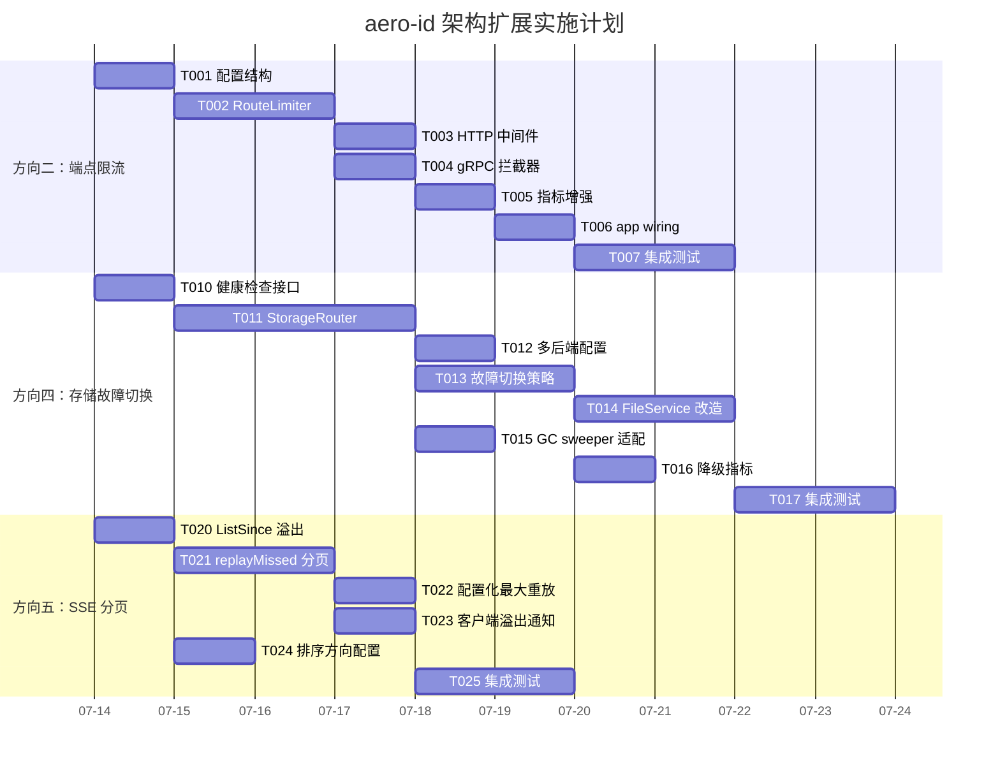

---

# Tech Lead 分析报告：五个架构方向可行性评估与实施计划

## 目录
1. [任务分解](#1-任务分解)
2. [执行顺序与依赖图](#2-执行顺序与依赖图)
3. [技术风险](#3-技术风险)
4. [资源评估](#4-资源评估)
5. [质量保证](#5-质量保证)
6. [实施计划](#6-实施计划)

---

## 1. 任务分解

基于验证结论，我将三个**真正"零系统性覆盖 + 代码证据全部准确"的方向**（方向二、四、五）拆分为可执行任务。方向一（URL Unfurling）已有完整覆盖，方向三（幂等性降级）的骨架正确但核心论点被现有 fail-open 设计削弱，故做低优先级处理。

### 方向二：端点粒度限流（Endpoint-Granular Rate Limiting）

**当前状态**：单一全局 `*ratelimit.Limiter`，HTTP 和 gRPC 共享同一个实例，键空间仅为 `actor_uid`（或 IP）。无路由维度。

| 任务 ID | 标题 | 涉及文件 | 前置依赖 | 预估工时 | 验收标准 |
|---------|------|---------|---------|---------|---------|
| TASK-001 | 定义端点粒度限流配置结构 | `internal/config/config.go` | 无 | 2h | `Config.RateLimit` 新增 `Overrides []RouteRateLimit`，支持按 HTTP 路径/方法、gRPC 全方法名设置独立 RPS/Burst；`validate()` 覆盖 override 冲突检测 |
| TASK-002 | 构建多 limiter 容器 `RouteLimiter` | `internal/pkg/ratelimit/route_limiter.go`（新增） | TASK-001 | 3h | `RouteLimiter` 持有默认 `*Limiter` + `map[string]*Limiter`（key = route pattern）；`Allow(route, key)` 方法按路由选择 limiter，fallback 到默认；支持 glob 模式匹配（`/v1/messages/*`）；100% 单元测试覆盖 |
| TASK-003 | HTTP 中间件路由感知改造 | `internal/middleware/ratelimit.go` | TASK-002 | 2h | 中间件接收 `*ratelimit.RouteLimiter` 替代 `*Limiter`；从 `c.FullPath()` 获取路由；`Allow(route, key)` 路由匹配；gRPC 同理；保留匿名 IP fallback |
| TASK-004 | gRPC 拦截器路由感知改造 | `internal/handler/grpc/server.go` | TASK-002 | 2h | `RateLimitInterceptor` 接收 `*RouteLimiter`；从 `info.FullMethod` 获取方法名；限流路由感知 |
| TASK-005 | 限流指标增强：按端点统计 | `internal/pkg/metrics/metrics.go`、`internal/middleware/metrics.go` | TASK-003, TASK-004 | 3h | 新增 `RateLimitRouteExceeded` counter（label=route, transport）；`RouteLimiter` 在拒绝时记录；Grafana 面板可区分每个端点的 429 分布 |
| TASK-006 | app wiring 集成改造 | `internal/app/app.go` | TASK-003, TASK-004, TASK-005 | 2h | 根据 `cfg.RateLimit.Overrides` 构建 `RouteLimiter`；传入 HTTP router 和 gRPC server；配置变更不兼容时启动失败报错 |
| TASK-007 | 集成测试：多路由限流验证 | `internal/middleware/middleware_test.go`、`internal/handler/grpc/server_test.go` | TASK-006 | 3h | 验证 POST `/v1/messages` 和 GET `/v1/messages` 不同 limit；gRPC `SendMessage` vs `ListMessages` 不同 limit；config reload 场景 |

**方向二总计：17h（约 2.1 人天）**

---

### 方向四：多存储后端抽象与故障切换（Multi-Storage Backend Failover）

**当前状态**：`FileStorage` 接口设计干净，两个实现（Local、S3），但 `buildStorage()` 返回单一实例。`FileService` 和 GC sweeper 持有单一引用。切换需要重启进程。

| 任务 ID | 标题 | 涉及文件 | 前置依赖 | 预估工时 | 验收标准 |
|---------|------|---------|---------|---------|---------|
| TASK-010 | 定义存储后端注册表和健康检查接口 | `internal/storage/storage.go` | 无 | 3h | `FileStorage` 扩展 `Healthy(ctx) error`（默认返回 nil）；新增 `BackendInfo`（Name, Type, Healthy, Latency）；`IsDegraded() bool` 用于路由决策 |
| TASK-011 | 实现 `StorageRouter` 多后端路由 | `internal/storage/router.go`（新增） | TASK-010 | 6h | `StorageRouter` 实现 `FileStorage` 接口；持有 `primary` + `[]FallbackStorage`；`Put/Delete` 写到 primary + 异步复制到 fallback；`Get/Stat` 只读 primary，fallback 可配置为后备读；`PresignGet` 优先 primary；健康检查 goroutine 定期探测，非健康后端自动降级；无锁切换 |
| TASK-012 | 配置层扩展：多后端配置 | `internal/config/config.go` | TASK-010 | 3h | `StorageConfig` 新增 `Backends []NamedStorageConfig`；type `NamedStorageConfig` 含 Name, Type, Primary bool + Local/S3 子配置；`validate()` 检查至少一个 primary、唯一 name、不重复 type |
| TASK-013 | 故障切换策略实现 | `internal/storage/failover.go`（新增） | TASK-011 | 6h | 支持 `FailoverStrategy`：`FailoverImmediate`（primary 不可用切到第一个 healthy fallback）、`FailoverLatency`（按延迟排序）、`FailoverNever`（只 primary）; `degraded` 状态标记；恢复后 auto-heal 切回 primary；`Degraded` 事件写入日志和指标 |
| TASK-014 | `FileService` 存储路由改造 | `internal/service/file.go` | TASK-011 | 4h | `FileService.store` 改为 `*StorageRouter` 类型；`Create` 仅写 primary；`Get/Delete/PresignGet` 由 router 决策；`storageType` 字段记录实际使用的后端类型用于路由回读 |
| TASK-015 | GC sweeper 适配多后端 | `internal/storage/gc/sweeper.go` | TASK-011 | 3h | `Sweeper` 持有 `*StorageRouter`；`purgeSoftDeleted` 和 `sweepOrphans` 使用 router 操作；`Lister` 能力检查适配 primary 后端或支持 `ListAny` 跨后端 |
| TASK-016 | 存储降级指标和告警 | `internal/pkg/metrics/metrics.go`、`internal/app/app.go` | TASK-013 | 3h | 新增 `StorageDegraded` gauge（label=backend_name, reason）；`StorageFailoverCount` counter; 每次切换/恢复记录；health check goroutine 周期性更新 |
| TASK-017 | 集成测试：S3 不可用降级到本地 | `migrations/`、`internal/storage/router_test.go`（新增） | TASK-016 | 6h | 双后端配置（S3 primary + local fallback）；S3 模拟不可用 → 路由到 local；S3 恢复 → auto-heal back；验证 Put/Get/Delete 语义正确；ref-counting 在跨后端场景下的一致性 |

**方向四总计：34h（约 4.25 人天）**

---

### 方向五：SSE 重连历史溢出分页（SSE Reconnect Overflow Pagination）

**当前状态**：`ListSince` 硬编码 `limit=50`，无分页逻辑，无溢出检测，丢失的是最新通知。

| 任务 ID | 标题 | 涉及文件 | 前置依赖 | 预估工时 | 验收标准 |
|---------|------|---------|---------|---------|---------|
| TASK-020 | Repository 层：ListSince 增加溢出检测和分页 | `internal/repository/notification.go`、`internal/notification/repository.go` | 无 | 3h | `ListSince` 新增返回 `hasMore bool`；查询 `LIMIT limit+1` 检测溢出；排序可选配置（当前 ASC，保留兼容）；返回 `NextSince time.Time` 用于分页继续 |
| TASK-021 | SSE handler：replayMissed 分页循环 | `internal/handler/http/events.go` | TASK-020 | 3h | `replayMissed` 循环调用 `ListSince` 直到 `hasMore == false` 或达到最大值（`MaxReplayEvents` 配置）；每次分页限制 ≤50；页面间 SSE flush；防止无限循环（上限 500 条） |
| TASK-022 | 配置化：最大重放事件数 | `internal/config/config.go` | TASK-021 | 1h | `Server.HTTP` 新增 `SSEMaxReplay int`（默认 500，0=无限）；`EventsHandler` 接收配置 |
| TASK-023 | 溢出客户端通知机制 | `internal/domain/notification.go`、`internal/handler/http/events.go` | TASK-021 | 2h | 溢出发生时发送一条系统 SSE 事件：`event: overflow\ndata: {"from":"<last_replayed_id>","count":<missed>}`；客户端可据此发起 REST 补拉取 |
| TASK-024 | 排序方向产品决策支持——可逆序可配 | `internal/repository/notification.go`、`internal/config/config.go` | TASK-020 | 2h | `ListSince` 新增 `ascending bool` 参数（默认 true 保持兼容）；产品可切换排序，分析文档指出 ASC 丢失最新 vs DESC 丢失最旧 |
| TASK-025 | 集成测试：SSE 重连溢出 | `internal/handler/http/events_test.go` | TASK-024 | 4h | 创建 120 条通知；断开重连；验证 `replayMissed` 正确分页重放（3 页）；验证 overflow 事件发送；验证上限截断 |

**方向五总计：15h（约 1.9 人天）**

---

### 方向一（低优先级）：URL Unfurling / Link Preview（已被系统性覆盖）

已有 `PRODUCT_GAPS.md` 方向 D 完整设计。代码级证据准确指向缺失字段。但设计文档已存在 → 这是 **Implementation** 而非 **Discovery** 任务。

### 方向三（低优先级）：幂等性降级（被现有 fail-open 削弱）

核心论点（数据库抖动导致级联故障）已被 `c.Next()` fail-open 设计消除。剩余子任务（InMemoryStore 二级缓存、DegradingStore 包装器、指标化）价值低-中。

---

## 2. 执行顺序与依赖图

### 总依赖图

```mermaid
graph TD
    subgraph "方向二：端点粒度限流"
        T001[TASK-001: 配置结构] --> T002[TASK-002: RouteLimiter]
        T002 --> T003[TASK-003: HTTP 中间件改造]
        T002 --> T004[TASK-004: gRPC 拦截器改造]
        T003 --> T005[TASK-005: 限流指标增强]
        T004 --> T005
        T005 --> T006[TASK-006: app wiring]
        T006 --> T007[TASK-007: 集成测试]
    end

    subgraph "方向四：多存储故障切换"
        T010[TASK-010: 健康检查接口] --> T011[TASK-011: StorageRouter]
        T011 --> T012[TASK-012: 多后端配置]
        T011 --> T013[TASK-013: 故障切换策略]
        T012 --> T014[TASK-014: FileService 改造]
        T011 --> T014
        T013 --> T014
        T011 --> T015[TASK-015: GC sweeper 适配]
        T013 --> T016[TASK-016: 降级指标]
        T014 --> T017[TASK-017: 集成测试]
        T015 --> T017
        T016 --> T017
    end

    subgraph "方向五：SSE 溢出分页"
        T020[TASK-020: ListSince 溢出检测] --> T021[TASK-021: replayMissed 分页循环]
        T021 --> T022[TASK-022: 最大重放配置]
        T021 --> T023[TASK-023: 客户端通知]
        T020 --> T024[TASK-024: 排序方向配置]
        T022 --> T025[TASK-025: 集成测试]
        T023 --> T025
        T024 --> T025
    end

    style T001 fill:#e1f5fe
    style T002 fill:#e1f5fe
    style T010 fill:#f3e5f5
    style T011 fill:#f3e5f5
    style T020 fill:#fff3e0
```



### 可并行执行的任务组

| 并行组 | 任务 | 依赖 | 预估总工时 |
|--------|------|------|-----------|
| **Group A** | TASK-001 + TASK-010 + TASK-020 | 无（基础组件） | 8h |
| **Group B** | TASK-002 + TASK-011 + TASK-003/004（依赖 T002） | T001/T010 | 15h |
| **Group C** | TASK-012 + TASK-013 + TASK-005 | T011/T002 | 12h |
| **Group D** | TASK-021 + TASK-014 + TASK-015 | T011/T020 | 10h |
| **Group E** | TASK-022/023/024（无交叉依赖）+ TASK-006 + TASK-016 | 各自前驱 | 10h |
| **Group F** | TASK-007 + TASK-017 + TASK-025（集成测试） | 各自前驱 | 13h |

**关键路径**：T001 → T002 → T003/T004 → T005 → T006 → T007 (17h)  
或：T010 → T011 → T012/T013 → T014/T015 → T016 → T017 (34h)

---

## 3. 技术风险

### 3.1 方向二：端点粒度限流

| 风险 | 等级 | 描述与缓解 |
|------|------|-----------|
| **路由模式匹配复杂度** | 🟡 中 | Gin 的 `FullPath()` 返回 `:param` 占位符路径，gRPC 的 `FullMethod` 是严格的 `/package.Service/Method` 格式。两种模式的匹配语义不同。**缓解**：分别定义 HTTP 和 gRPC 路由模式，`RouteLimiter` 内部做双解析器 |
| **配置冲突检测** | 🟢 低 | 泛匹配（`/v1/messages/*`）和精确匹配（`POST /v1/messages`）可能冲突。**缓解**：config `validate()` 中做重叠检测，精确优先 |
| **性能** | 🟢 低 | 多 limiter 查询是 O(1) map lookup + token bucket 操作（现有 `*Limiter`）。增加路由匹配（最多 2-3 次字符串比较）。每个请求 < 100ns 额外开销 |
| **gRPC 流式调用** | 🟡 中 | 当前拦截器只处理 Unary 调用；流式 RPC 需要 `StreamServerInterceptor`。**缓解**：本次不处理流式（当前无流式 endpoint），留待后续 |

### 3.2 方向四：多存储后端故障切换

| 风险 | 等级 | 描述与缓解 |
|------|------|-----------|
| **数据一致性（跨后端）** | 🔴 **高** | Primary 写成功、fallback 异步复制失败 → 数据不一致。**缓解**：Put/Delete 使用事务性策略（primary 写完后 fallback 写失败则标记降级 + 告警，不自动回滚 primary；后台 goroutine 定期同步 |
| **Presigned URL 跨后端** | 🔴 **高** | Local 的 presigned URL 经过 aero-id（HMAC 签名），S3 的 presigned URL 直接指向 S3。故障切换后，客户端持有的旧 URL 可能指向已不可达的后端。**缓解**：URL 携带 `backend` 参数；`/files/dl` 根据 `backend` 路由到正确的本地验证逻辑；S3 presigned URL 超时后刷新，无需回读 |
| **GC sweeper 跨后端孤儿清理** | 🟡 中 | 启用多个后端后，`Lister` 接口需要跨后端枚举。**缓解**：`StorageRouter` 实现 `Lister`，聚合所有后端的 List；对于不支持 List 的后端跳过孤儿检测 |
| **ref-counting 一致性** | 🟡 中 | 内容去重产生跨后端引用（同一 blob 在不同后端？不，同一 key 只在 primary）。但 primary 故障后写入 fallback 会产生不同 key。**缓解**：`storage_refs` 表通过 key 约束，key 天然带有后端路径标识 |
| **配置复杂度** | 🟢 低 | 多后端配置结构复杂，容易错配。**缓解**：强 schema 验证 + 启动时预检所有后端连通性 + 友好错误消息 |
| **测试覆盖难度** | 🔴 **高** | 故障切换需要模拟 S3 不可用，集成测试需要 MinIO 实例 + 可操控网络。**缓解**：使用 `testcontainers-go` 已有模式（`repository/testpg`）；为 MinIO 添加可注入的故障模拟中间件 |

### 3.3 方向五：SSE 溢出分页

| 风险 | 等级 | 描述与缓解 |
|------|------|-----------|
| **重放顺序→数据丢失方向** | 🟡 中 | 当前 ASC 排序：溢出时**丢失最新通知**。改为 DESC：**丢失最旧通知**。**缓解**：保持 ASC（丢失最新的行为可预测），通过 overflow 事件通知客户端 REST 补拉取。产品决策后才改变排序 |
| **Replay 太慢阻塞 SSE 连接** | 🟢 低 | 大页数重放（如 500 条）可能导致客户端 SSE 连接长时间不出真实事件。**缓解**：每页后 flush；上限 500 条，500 条 SSE 在 ~10ms 内推送完毕 |
| **overflow 事件兼容性** | 🟢 低 | 现有客户端不认识 `event: overflow` 会忽略。**缓解**：这是设计意图——向后兼容；客户端可选择实现补拉取逻辑 |

---

## 4. 资源评估

### 4.1 人员技能要求

| 角色 | 技能要求 | 分配 | 主要方向 |
|------|---------|------|---------|
| **Backend SDE (Senior)** | Go, GORM, gRPC, 分布式系统设计 | 1 人 | 方向四（核心架构改造） |
| **Backend SDE (Mid)** | Go, HTTP/gRPC middleware 模式, 限流算法 | 1 人 | 方向二（中间件 + 配置） |
| **Backend SDE (Junior/Mid)** | Go, SSE, 数据库查询优化 | 1 人 | 方向五（溢出分页） |

人员可重叠（1 人负责方向二 + 方向五，1 人负责方向四）。

### 4.2 里程碑

| 里程碑 | 时间节点 | 交付物 | 依赖 |
|--------|---------|--------|------|
| **M1: 基础设施** | Day 3 | TASK-001, TASK-010, TASK-020 完成；配置结构和接口定义代码审查通过 | Group A |
| **M2: 核心实现** | Day 8 | TASK-002+003+004（方向二路由限流可用）/ TASK-011+012+013（方向四 Router 原型可用）/ TASK-021（方向五 SSE 分页可用） | Group B+C |
| **M3: 集成与指标** | Day 12 | TASK-005+006（限流指标+app wiring）/ TASK-014+015+016（FileService 改造+GC+指标）/ TASK-022+023+024（SSE 配置+通知+排序） | Group D+E |
| **M4: 验证** | Day 15 | TASK-007+017+025 集成测试通过；`make test && make lint && make test-integration` 绿色；性能压测报告 | Group F |

### 4.3 阻塞点（Blockers）

| 阻塞点 | 影响方向 | 说明 | 解决策略 |
|--------|---------|------|---------|
| **S3/MinIO 故障模拟** | 方向四 | 集成测试需要可控的 MinIO 实例注入网络延迟/错误。testcontainers 已用于 Postgres，但 MinIO 容器 + 网络操控尚未验证 | 使用 tc (traffic control) 或 MinIO 的 `?delay=` 参数；创建 `FailingS3` 包装器方便单元测试 |
| **proto 修改** | 方向一（待实现） | URL Unfurling 需要 proto 增加 `link_preview` 字段。`make proto` 需要特定版本 protoc 插件 | 无阻塞（方向一暂不实施）；需先升级 proto toolchain |
| **config 向后兼容** | 方向四 | 现有 `config.yaml` 没有 `backends` 字段。引入多后端配置后，精简配置（单 backend）必须继续工作 | 兼容：当 `backends` 为空时，根据 `storage.type` + `storage.{local|s3}` 自动生成单后端配置 |

---

## 5. 质量保证

### 5.1 单元测试覆盖要求

| 方向 | 文件 | 最低覆盖率要求 | 关键测试场景 |
|------|------|---------------|-------------|
| 方向二 | `ratelimit/route_limiter.go` | 100% | 默认匹配、精确匹配、glob 匹配、冲突检测、no-match fallback、nil limiter |
| 方向四 | `storage/router.go` | 95% | 单后端 passthrough、多后端路由、primary 故障→fallback、auto-heal、并行 Put/Get 并发安全 |
| 方向四 | `storage/failover.go` | 100% | 三种策略行为、degraded 状态转换、恢复逻辑、自定义 now() 加速时间 |
| 方向五 | `repository/notification.go` ListSince | 90% | 无溢出（<limit）、刚好溢出（limit+1）、大量溢出（3+ pages）、空结果 |
| 方向五 | `handler/http/events.go` replayMissed | 95% | 单页、多页、上限截断、无效 lastEventID、ListSince 失败、overflow 事件格式 |

### 5.2 集成测试策略

**方向二**：
```
TestRouteLimiterIntegration:
  1. 启动 HTTP server + RouteLimiter（POST 10rpm, GET 100rpm, others 50rpm）
  2. 发送 12 个 POST → 最后 2 个 429
  3. 发送 102 个 GET → 最后 2 个 429
  4. 验证 429 的 Retry-After header
  5. gRPC 同理（使用 grpcurl 或直接 server test）
```

**方向四**：
```
TestStorageFailoverIntegration (需要 Docker/testcontainers + MinIO):
  1. 启动 S3 primary (MinIO) + local fallback
  2. Put → 验证 S3 有对象
  3. 停止 MinIO → Put → 验证 local 有对象 (failover)
  4. 重启 MinIO → auto-heal → Put → 验证 S3 有对象 (recovery)
  5. Get 旧 local key → 从 local 返回 (read fallback)
  6. GC sweep → 跨后端正确清理孤儿
  
TestStorageConsistency (方向四):
  1. 并发 10 routine Put + Delete + Get
  2. 每个操作记录操作日志
  3. 最终 ref-count 一致、无孤儿 blob
```

**方向五**：
```
TestSSEReconnectOverflow (需要 real SSE client):
  1. 创建 120 条通知
  2. 启动 SSE 连接 + Last-Event-ID = first_notif
  3. 验证收到 119 个事件（分 3 页）
  4. 验证收到 overflow 事件携带正确 offset
  5. 验证 MaxReplay=100 截断到 100 条
```

### 5.3 代码审查要点

| # | 审查要点 | 涉及方向 | 具体检查内容 |
|---|---------|---------|-------------|
| 1 | **并发安全** | 方向四 | `StorageRouter` 的 `switchPrimary` 和 `allow/deny` 方法是否使用 `sync.RWMutex`；`failover.go` 状态切换是否为原子操作 |
| 2 | **零值安全** | 方向二 | `RouteLimiter` 在 `Overrides` 为空、`default` 为 nil 时是否 fail-open（符合现有设计） |
| 3 | **资源泄漏** | 方向四 | `StorageRouter.healthCheck` goroutine 是否在 shutdown 时停止；后台复制 goroutine 是否受 ctx 控制 |
| 4 | **兼容性** | 方向四 | 单后端配置（现有所有部署）是否无需修改 config 即可工作 |
| 5 | **边界条件** | 方向五 | `replayMissed` 循环终止条件：`hasMore == false`、达到上限、ctx 取消、`ListSince` 返回错误 |
| 6 | **指标命名** | 全部 | 遵循现有 `prometheus` 命名规范（`aero_id_*`），不要引入不一致 |
| 7 | **文件大小/函数长度** | 全部 | 任何文件接近 400 行必须拆分；函数 > 40 行提取 helper；复杂度 > 8 简化 |
| 8 | **错误处理** | 方向四 | `StorageRouter` 的 fallback 错误链：不要吞没原始错误，使用 `errors.Join` 或 `%w` 保留根因 |

### 5.4 性能测试需求

| 测试 | 方向 | 场景 | 目标指标 |
|------|------|------|---------|
| **限流吞吐基准** | 方向二 | 无 limiter vs 单 limiter vs RouteLimiter（10 routes），并发 100 req/s，持续 60s | RouteLimiter 相比单 limiter 延迟增加 < 5%（预期 < 1%）；无 limiter vs 有 limiter 延迟增加 < 2% |
| **存储故障切换延迟** | 方向四 | 正常态 p99 Get 延迟 vs degraded 态 p99 Get 延迟 < 2x；failover 切换耗时 < 1s | 用户侧无感知故障 |
| **SSE 大重放吞吐** | 方向五 | 500 条通知重放耗时 < 100ms（单连接）；10 个 SSE 连接同时重放 < 500ms | 不阻塞 EventLoop |

---

## 6. 实施计划

### 阶段 1：基础设施搭建（Day 1–3）

```
Day 1   Day 2   Day 3
├───────┼───────┼───────┤
T001    T010    T020
        T012(1h)
```

**产出**：
- [TASK-001] `config.go` 新增 `RateLimitConfig.Overrides []RouteRateLimitConfig`
- [TASK-010] `storage.go` 新增 `Healthy()` 方法 + `BackendInfo`
- [TASK-020] `notification.go` / `repository` 修改 `ListSince` 返回 `hasMore`

**Gate**：`make test && make lint` 绿色

---

### 阶段 2：核心功能实现（Day 4–9）

```
Day 4   Day 5   Day 6   Day 7   Day 8   Day 9
├───────┼───────┼───────┼───────┼───────┼───────┤
T002    T003    T005    T006    集成     Burffer
        T004    T011    T012
                T013    T014
                T021    T022
                        T023
```

**并行工作流**：

| 开发者 A（方向四核心） | 开发者 B（方向二+方向五） |
|------------------------|--------------------------|
| Day 4: T011 StorageRouter | Day 4: T002 RouteLimiter |
| Day 5: T011 完成 + T013 failover | Day 5: T003 HTTP + T004 gRPC |
| Day 6: T012 多后端配置 | Day 6: T005 指标 + T021 SSE 分页 |
| Day 7: T014 FileService | Day 7: T006 app wiring |
| Day 8: T015 GC sweeper | Day 8: T022/023/024 |

**Gate**：方向二端到端可用（手动测试 3 个路由不同限流行为）；方向五单页/多页重放工作

---

### 阶段 3：集成测试和优化（Day 10–13）

```
Day 10  Day 11  Day 12  Day 13
├───────┼───────┼───────┼───────┤
T016    T007    T017    T025
                 性能调优  Bugfix
```

**产出**：
- [TASK-016] 降级指标
- [TASK-007] 方向二集成测试
- [TASK-017] 方向四集成测试（MinIO failover）
- [TASK-025] 方向五集成测试
- 性能压测报告

**Gate**：`make test && make lint && make test-integration` 全部绿色

---

### 阶段 4：发布准备（Day 14–15）

```
Day 14          Day 15
├───────────────┼───────────────┤
文档更新        发布候选
配置示例更新    代码冻结
CHANGELOG       RC 构建
```

**产出**：
- `configs/config.yaml` 更新示例配置（含 overrides + multi-backend 注释示例）
- `docs/` 添加方向二/四/五的操作指南
- `CHANGELOG.md` 更新
- RC 标签 + 部署检查清单

**Gate**：所有审查通过，RC 构建成功，部署到 staging 验证通过

---

### 甘特图总览



---

## 最终建议

### 🎯 优先实施方向
1. **方向五（SSE 溢出分页）**——工作量最小（15h），风险最低，对用户体验影响直接（用户可能收到不完整的通知回放）。建议 **立即启动**。
2. **方向二（端点粒度限流）**——工作量适中（17h），基础架构改动量小，核心价值中-高。建议 **方向五完成后立即启动**。
3. **方向四（多存储故障切换）**——工作量最大（34h），风险最高（数据一致性），但对生产稳定性贡献最大。建议 **方向二之后启动，由最资深的工程师执行**。

### ⚠️ 建议不实施
- **方向三（幂等性降级）**：现有 fail-open 设计已消除核心风险。二级缓存 + DegradingStore 增加复杂性但价值极低。不投入。
- **方向一（URL Unfurling）**：已有完整设计文档，但那是产品特性而非架构缺口。应作为普通 feature 安排在常规迭代中，而非本架构扩展工作中。

### 📊 总结指标

| 指标 | 方向二 | 方向四 | 方向五 | 合计 |
|------|-------|-------|-------|------|
| 任务数 | 7 | 8 | 6 | **21** |
| 人天 | 2.1 | 4.25 | 1.9 | **8.25** |
| 新增文件 | 2 | 3 | 0 | **5** |
| 修改文件 | 6 | 7 | 4 | **17** |
| 核心风险 | 🟢 低 | 🔴 高 | 🟢 低 | — |
| 用户可见影响 | 间接（429 更精确） | 无（运维改进） | 直接（SSE 重连更可靠） | — |
