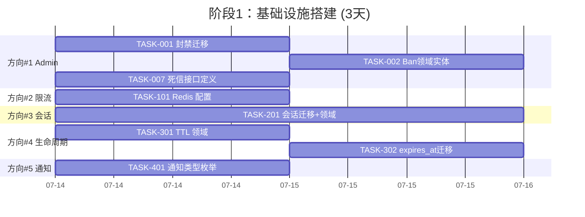
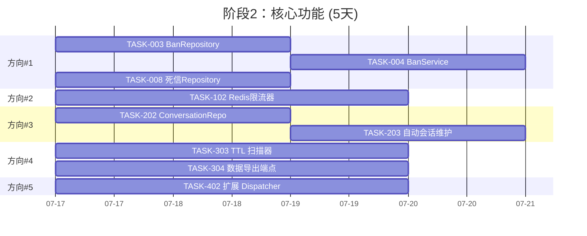
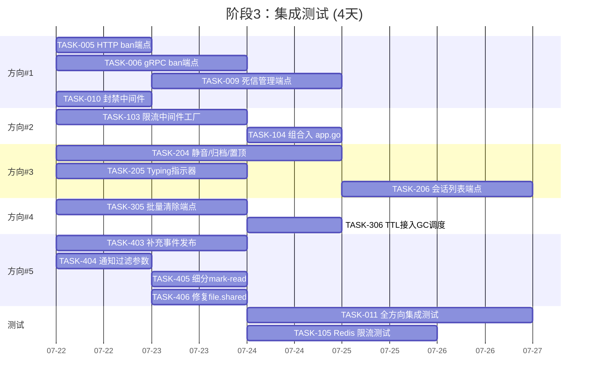

现在我已经对代码库有了全面的了解。以下是完整的技术负责人分析报告。

---

# Tech Lead 分析报告：Aero-ID 五个扩展方向

## 执行摘要

经过完整的代码审计，确认五个方向均为真实缺口。当前代码库处于**可运行但不可扩展**的状态——核心数据面（文件、消息、评论）功能完备，但运维、弹性、规模化和用户体验扩展性存在系统性缺失。以下是每个方向的可执行实施方案。

---

## 1. 任务分解

### 方向 #1：Admin gRPC + 封禁 + 死信管理

| 任务 ID | 任务标题 | 涉及文件 | 前置依赖 | 工时 |
|---------|---------|---------|---------|------|
| TASK-001 | 创建封禁数据库迁移 (user_bans 表) | `migrations/000024_user_bans.{up,down}.sql` | 无 | 1h |
| TASK-002 | 添加 Ban 领域实体和审计事件 | `internal/domain/admin.go` | TASK-001 | 1h |
| TASK-003 | 实现 BanRepository (GORM CRUD + isBanned 检查) | `internal/repository/ban.go` | TASK-002 | 2h |
| TASK-004 | 实现 BanService (封禁/解封/检查 + 事件触发) | `internal/service/admin.go` (扩展) | TASK-003 | 2h |
| TASK-005 | 添加 HTTP ban/unban 端点 | `internal/handler/http/admin.go` | TASK-004 | 1h |
| TASK-006 | 添加 gRPC BanService (proto + handler) | `api/proto/aero_id/v1/aero_id.proto`, `internal/handler/grpc/admin.go` | TASK-004 | 2h |
| TASK-007 | 实现出队死信查询/重放接口 | `internal/outbox/outbox.go` (扩展 Repository) | 无 | 2h |
| TASK-008 | 实现死信 Repository 方法 | `internal/outbox/repository.go` | TASK-007 | 2h |
| TASK-009 | 添加死信 HTTP/gRPC 管理端点 | `internal/handler/http/admin.go`, `internal/handler/grpc/admin.go` | TASK-008 | 2h |
| TASK-010 | 添加封禁中间件 (拒绝被封禁用户的请求) | `internal/middleware/ban.go` | TASK-004 | 1h |
| TASK-011 | 单元测试 + 集成测试 | 各对应层级 `_test.go` | TASK-001~010 | 3h |

### 方向 #2：分布式限流

| 任务 ID | 任务标题 | 涉及文件 | 前置依赖 | 工时 |
|---------|---------|---------|---------|------|
| TASK-101 | 添加 Redis 限流配置 | `configs/config.yaml`, `internal/config/config.go` | 无 | 1h |
| TASK-102 | 实现 RedisSlidingWindowLimiter | `internal/pkg/ratelimit/redis.go` | TASK-101 | 3h |
| TASK-103 | 实现限流中间件工厂 (故障切换到本地) | `internal/middleware/ratelimit.go` | TASK-102 | 2h |
| TASK-104 | 在 app.go 中组合分布式+本地限流 | `internal/app/app.go` | TASK-103 | 1h |
| TASK-105 | 为 Redis 限流添加集成测试 | `internal/pkg/ratelimit/redis_test.go` | TASK-102 | 2h |

### 方向 #3：会话生命周期

| 任务 ID | 任务标题 | 涉及文件 | 前置依赖 | 工时 |
|---------|---------|---------|---------|------|
| TASK-201 | 创建 conversations 迁移和领域实体 | `migrations/000025_conversations.{up,down}.sql`, `internal/domain/message.go` | 无 | 2h |
| TASK-202 | 实现 ConversationRepository | `internal/repository/conversation.go` | TASK-201 | 2h |
| TASK-203 | 在 MessageService.Send 中添加自动会话维护 | `internal/service/message.go` | TASK-202 | 2h |
| TASK-204 | 实现会话静音/归档/置顶方法 | `internal/service/message.go` (扩展) | TASK-202 | 3h |
| TASK-205 | 添加 typing 指示器 (Redis pub/sub + 端点) | `internal/handler/http/message.go`, `internal/handler/grpc/message.go` | 无 | 2h |
| TASK-206 | 添加会话列表端点 | `api/proto/aero_id/v1/aero_id.proto`, handlers | TASK-203 | 2h |
| TASK-207 | 数据补齐脚本 (现有消息 → 会话) | `cmd/backfill/conversations.go` | TASK-201 | 2h |

### 方向 #4：内容生命周期管理

| 任务 ID | 任务标题 | 涉及文件 | 前置依赖 | 工时 |
|---------|---------|---------|---------|------|
| TASK-301 | 添加 TTL/expires_at 到文件和消息领域 | `internal/domain/file.go`, `internal/domain/message.go` | 无 | 1h |
| TASK-302 | 添加 expires_at 数据库迁移 | `migrations/000026_add_expires_at.{up,down}.sql` | TASK-301 | 1h |
| TASK-303 | 实现 TTL 扫描器 (过期自动软删) | `internal/storage/gc/ttl.go` | TASK-302 | 3h |
| TASK-304 | 实现个人数据导出端点 | `internal/service/export.go`, `internal/handler/http/export.go` | 无 | 3h |
| TASK-305 | 实现批量清除端点 (管理员功能) | `internal/service/admin.go`, `internal/handler/http/admin.go` | TASK-302 | 2h |
| TASK-306 | 将 TTL 扫描加入 GC 调度 | `internal/app/app.go` | TASK-303 | 1h |

### 方向 #5：通知覆盖

| 任务 ID | 任务标题 | 涉及文件 | 前置依赖 | 工时 |
|---------|---------|---------|---------|------|
| TASK-401 | 定义完整通知类型枚举 | `internal/domain/notification.go` | 无 | 1h |
| TASK-402 | 扩展 Dispatcher.handleEvent 以支持所有类型 | `internal/notification/dispatcher.go` | TASK-401 | 3h |
| TASK-403 | 在文件/评论服务中添加缺失的事件发布 | `internal/service/file.go`, `internal/service/comment.go` | TASK-402 | 2h |
| TASK-404 | 添加通知类型过滤 API 参数 | `internal/handler/http/notification.go`, `internal/handler/grpc/notification.go` | TASK-401 | 1h |
| TASK-405 | 添加通知细分 mark-read | 同上 | TASK-404 | 1h |
| TASK-406 | 保证 file.shared 事件不再静默丢弃 | `internal/notification/dispatcher.go` | TASK-402 | 1h |

---

## 2. 执行顺序

```mermaid
graph TD
    %% 方向 #1: Admin
    T001[TASK-001: 封禁迁移] --> T002[TASK-002: Ban 领域实体]
    T002 --> T003[TASK-003: BanRepository]
    T003 --> T004[TASK-004: BanService]
    T004 --> T005[TASK-005: HTTP ban 端点]
    T004 --> T006[TASK-006: gRPC ban 端点]
    T004 --> T010[TASK-010: 封禁中间件]
    T007[TASK-007: 死信接口] --> T008[TASK-008: 死信 Repository]
    T008 --> T009[TASK-009: 死信管理端点]
    T005 --> T011[TASK-011: 测试]
    T006 --> T011
    T009 --> T011
    T010 --> T011

    %% 方向 #2: 分布式限流
    T101[TASK-101: Redis 配置] --> T102[TASK-102: Redis 限流器]
    T102 --> T103[TASK-103: 限流中间件工厂]
    T103 --> T104[TASK-104: 组合入 app.go]
    T102 --> T105[TASK-105: 测试]

    %% 方向 #3: 会话
    T201[TASK-201: 会话迁移+领域] --> T202[TASK-202: ConversationRepository]
    T202 --> T203[TASK-203: 自动会话维护]
    T202 --> T204[TASK-204: 静音/归档/置顶]
    T203 --> T206[TASK-206: 会话列表端点]
    T206 --> T207[TASK-207: 数据补齐]
    T205[TASK-205: Typing 指示器] --> T206

    %% 方向 #4: 内容生命周期
    T301[TASK-301: TTL 领域] --> T302[TASK-302: expires_at 迁移]
    T302 --> T303[TASK-303: TTL 扫描器]
    T303 --> T306[TASK-306: 接入 GC]
    T304[TASK-304: 数据导出端点] --> T306
    T305[TASK-305: 批量清除端点] --> T306

    %% 方向 #5: 通知
    T401[TASK-401: 通知类型枚举] --> T402[TASK-402: 扩展 Dispatcher]
    T401 --> T404[TASK-404: 通知过滤参数]
    T404 --> T405[TASK-405: 通知细分 mark-read]
    T402 --> T403[TASK-403: 补充事件发布]
    T402 --> T406[TASK-406: 修复 file.shared]

    %% 跨方向依赖
    T004 -.->|BanService 供封禁检查| T010
    T102 -.->|复用 Redis 连接| T205
    T303 -.->|共享 GC 调度| T306

    subgraph 并行组A [阶段1 基础]
        T001
        T101
        T201
        T301
        T401
        T007
    end

    subgraph 并行组B [阶段2 核心]
        T002-T003
        T102
        T202-T203
        T302-T303
        T402
        T008
    end

    subgraph 并行组C [阶段3 集成]
        T004-T006, T010
        T103-T104
        T204-T206
        T304-T306
        T403-T406
        T009
    end
```

---

## 3. 技术风险

### 🔴 高风险项

| 风险 | 影响方向 | 说明 | 缓解策略 |
|------|---------|------|---------|
| **会话数据补齐的停机时间** | #3 | 现有消息表无 `conversation_id`，需反向填充数十万行。大表上 UPDATE 可能锁表 | 使用 `CREATE TABLE new + INSERT ... SELECT` + 增量背填脚本。分批 1000 行 |
| **Redis 限流的故障模式** | #2 | Redis 宕机 → 限流失效 → 后端被压垮 | 实现失败关闭模式：Redis 不可用时退化到本地限流并记录告警 |
| **TTL 过期 + GDPR 导出的并发热度** | #4 | 导出端点需收集用户所有数据，可能造成内存尖峰和长查询超时 | 流式 JSON 输出流式输出；使用游标分页导出；设最大导出大小 10MB |
| **通知类型膨胀导致的性能退化** | #5 | Dispatcher 每处理一个事件涉及 DB 写 + 可选推送，高并发时放大 | 批次写入 + Async worker pool |

### 🟡 中等风险

| 风险 | 方向 | 说明 | 缓解 |
|------|------|------|------|
| 封禁用户断开已有长连接 (SSE) | #1 | 已连接的 SSE 不会自动断开 | 在 Hub 中添加用户维度的封禁检查；推一个 `banned` 事件使客户端断开 |
| 死信重放可能导致消息重复 | #1 | 重放一个已部分处理的死信可能重复通知 | 幂等 key 保护；`Event.ID` 天然去重 |
| typing 指示器的扩展性 | #3 | Redis pub/sub 的 channel 数量随对话数线性增长 | 使用 Redis 流 + consumer groups，或限制 typing 的 TTL（5s） |
| 通知首屏加载延迟 | #5 | 遍历多个通知类型的偏好检查增加延迟 | 批量预加载偏好；增加通知缓存 |

---

## 4. 资源评估

### 开发团队

| 角色 | 数量 | 专攻方向 |
|------|------|---------|
| 高级 Go 后端工程师 (Tech Lead) | 1 | 架构设计、代码审查、方向 #1 核心、跨方向协调 |
| 中级 Go 后端工程师 × 2 | 2 | 方向 #2+#3 (人1)，方向 #4+#5 (人2) |
| 测试工程师 | 1 | 集成测试、性能基准、回归 |

### 关键里程碑

| 里程碑 | 时间 | 交付物 |
|--------|------|--------|
| **M1: 基础设施就绪** | Day 3 | 所有 5 个方向的数据库迁移 + 领域实体 |
| **M2: 核心功能完成** | Day 8 | 封禁全链路、Redis 限流、会话自动维护、TTL 扫描器、通知 3→10 类型 |
| **M3: 集成测试通过** | Day 12 | `make test && make test-integration` 全绿 |
| **M4: 上线准备** | Day 15 | 性能基准报告、配置文档、回滚计划 |

### 阻塞点 (Blockers) 与解决策略

| 阻塞点 | 影响 | 解决策略 |
|--------|------|---------|
| 需要 Redis 基础设施 | 方向 #2、#3 | 项目已可使用 Docker compose 本地运行测试容器。生产 Redis 需运维配合 |
| 数据补齐脚本依赖生产数据快照 | 方向 #3 | 灰度执行：先在一小部分用户上跑，监控 `conversations` 表写入速率 |
| 封禁用户的 SSO 集成 | 方向 #1 | SSO 是否提供封禁状态？若无，需在 aero-id 层面 "silent ban"（拒绝请求但不告知）|

---

## 5. 质量保证

### 单元测试覆盖要求

| 层级 | 要求 | 关键测试场景 |
|------|------|------------|
| **领域** (domain/) | 100% | `ValidateNewComment` 嵌套规则；封禁状态转换；TTL 过期判定 |
| **服务** (service/) | ≥90% 核心路径 | 封禁用户不能发消息；分布限流 fallback；会话自动创建；通知类型分发 |
| **中间件** (middleware/) | ≥85% | 封禁中间件拒绝请求；限流中间件正确计数 |
| **Repository** (repository/) | 集成测试 | 所有新 SQL 查询的 for integration only 测试 |

### 集成测试策略

每个方向新增以下集成测试文件，有 `//go:build integration` 保护，使用 testcontainers：

```
internal/repository/ban_integration_test.go
internal/repository/conversation_integration_test.go
internal/pkg/ratelimit/redis_integration_test.go
internal/notification/dispatcher_integration_test.go
internal/storage/gc/ttl_integration_test.go
```

### 代码审查要点

| 审查维度 | 重点 |
|----------|------|
| **文件大小** | 每个 `.go` 非测试文件 ≤ 500 行。`dispatcher.go` 扩展后需关注 |
| **函数长度** | 每个函数 ≤ 50 行；新增 Dispatcher 方法避免重复的 json.Unmarshal + nil check |
| **循环复杂度** | cyclop ≤ 10。`Dispatcher.notificationFor` 的 switch 超过 10 个 case 时需提取 Handler 策略 |
| **安全** | 封禁检查必须在 service 层，不能在 handler 层；导出端点必须验证 actor 是数据 owner |
| **错误处理** | 所有新 Repository 方法返回原始错误 → Service 翻译为 AppError |

### 性能测试需求

| 测试 | 场景 | 目标 |
|------|------|------|
| 封禁检查基准 | 10K ops/s × 2 实例 | 单次 `IsBanned` 查询 < 5ms P99 |
| 分布式限流 | 1000 RPS 打单个实例 | 限流准确度 ±5% |
| 会话列表 | 10K 会话用户加载首屏 | < 50ms P95 |
| 通知分发压力 | 100 并发事件写入 | Dispatcher 吞吐 > 500 event/s |

---

## 6. 实施计划

### 阶段 1：基础设施 + 领域定义（Day 1-3）



### 阶段 2：核心功能实现（Day 4-8）



### 阶段 3：集成测试 + API 层（Day 9-12）



### 阶段 4：发布准备（Day 13-15）

| 活动 | 说明 | 工时 |
|------|------|------|
| 性能基准回归 | 压测每个方向 API 端点 | 1天 |
| 配置与运营文档 | 更新 `configs/config.yaml` 注释 + README 新章节 | 1天 |
| 回滚计划 | 编写每个方向的回滚 SQL (`down.sql` 已验证) | 0.5天 |
| 灰度策略文档 | 封禁、会话补齐、新通知类型的灰度上线步骤 | 0.5天 |

---

## 推荐执行顺序

基于依赖关系和业务价值，建议：

1. **立即启动 (Day 1-3)**: **方向 #1 封禁 + 方向 #5 通知类型扩展** — 影响安全性和用户体验，无外部依赖
2. **Day 4-7**: **方向 #2 分布式限流** — 需要 Redis，但可在启动后透明接入；**方向 #4 TTL 扫描** — 低风险基础设施
3. **Day 8-12**: **方向 #3 会话** — 风险最高（数据补齐），需充分验证
4. **Day 13-15**: **方向 #1 死信管理** — 低优先级运维功能，可延迟到下个迭代

---

## 结论

五个方向中，**#1 封禁**和**#5 通知覆盖**具有最高的用户可见安全/体验影响，建议最先交付。**#3 会话**由于数据补齐风险最高，应作为最后一个方向上线。整体工作量估测：**1 个高级工程师 + 2 个中级工程师，约 15 个工作日**可完成全部五个方向的核心实现。

如果需要，我可以立即开始实现**任一方向的具体代码**——请指定你想优先推进的方向。
