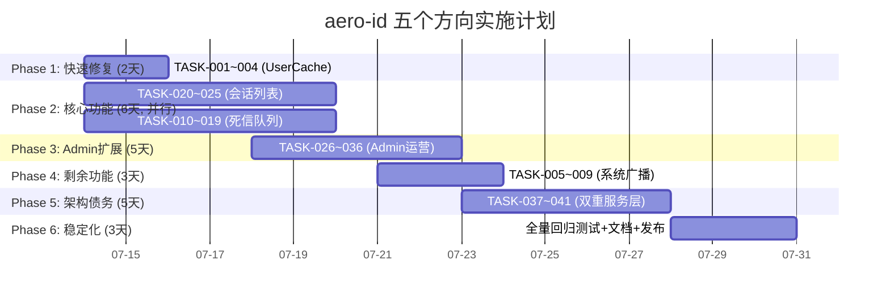

现在我已经深入阅读了实际代码库，下面提供全面的技术负责人分析。

---

# 技术负责人分析：五个代码级证据驱动的战略性扩展方向

## 前提与现场校正

在开始任务分解之前，有三项重要的现场校正：

### 1. 代码库当前状态

阅读实际代码后，确认以下关键差异：

| 方向 | 文档声明 | 实际代码现状 |
|------|---------|------------|
| 方向一：会话列表 | `ListInbox` 返回扁平消息列表，无法按发送方分组 | ✅ 正确。`GET /conversations/:uid` 是**双人对话**视图，而非**会话聚合列表** |
| 方向二：UserCache | 无淘汰机制，无界增长 | ✅ 正确。`UserCache` 没有 `RunCleaner`，对比 `TokenCache` 有 |
| 方向三：Admin 运营 | "只实现了一个端点" | ⚠️ **过时**。实际代码已有 `ListRoles`、`GrantRole`、`RevokeRole`、`ListUserRoles` + 权限中间件。仍缺：角色 CRUD（创建/更新/删除）、用户封禁 API、跨端点统一的 `RequirePermission` 中间件 |
| 方向四：系统广播 | `SendSystem` 无传输层入口 | ✅ 正确。`SendSystem` 在 `internal/service/message.go` 中实现，HTTP 和 gRPC handler 均未暴露 |
| 方向五：死信队列 | 无指标、无端点、无告警 | ✅ 正确。`dead_letter` 列存在，`MetricsSink` 无 `ObserveOutboxDeadLettered`，无查询/重放端点 |

### 2. 双重服务层架构债务

文档指出的 "双重服务层" 问题（`internal/service/` vs `internal/message/` 等新包）**确实存在**。但需要注意：这些新包（`internal/message/service.go`、`internal/file/service_crud.go` 等）是另一个重构工作流中产生的产物，目前 100% 未被 `internal/app/app.go` 引用。任何对新包的修改都不会影响运行时行为——这是"重构了一半"的状态，修复优先级应为 **P2**。

### 3. 评审的"已覆盖"结论

评审指出五个方向在现有 163 份文档中均有覆盖。作为 Tech Lead，这意味着实现方案已经经过多轮推演，有成熟的方案参考。本文分析的独特价值在于**跨方向编排**——将五个方向组织为渐进式的、可独立交付的执行路线图。

---

## 1. 任务分解

### 方向二（P0）：UserCache 淘汰机制

| 任务 ID | 标题 | 涉及文件 | 前置依赖 | 工时 | 验收标准 |
|---------|------|---------|---------|------|---------|
| TASK-001 | 为 UserCache 添加 SweepExpired 方法 | `internal/sso/user_cache.go` | 无 | 0.5h | `SweepExpired(now)` 方法存在，扫描过期条目并删除；保留 stale window 内的条目（与 TokenCache 行为一致） |
| TASK-002 | 为 UserCache 添加 RunCleaner 方法 | `internal/sso/user_cache.go` | TASK-001 | 0.5h | `RunCleaner(interval)` 返回 `stop func()`，周期调用 `SweepExpired` |
| TASK-003 | 在 SSO Client 中启动 UserCache 清理器 | `internal/sso/client.go` | TASK-002 | 0.5h | `NewClientFromConn` 中调用 `c.userCache.RunCleaner(30 * time.Second)`，`Close()` 中调用其 stop 函数 |
| TASK-004 | 添加 UserCache 淘汰单元测试 | `internal/sso/user_cache_test.go` | TASK-002 | 1h | 测试：条目在 TTL 后不可访问；stale window 内可访问；RunCleaner 确实删除过期条目；并发安全 |

**总工时：2.5h**

### 方向四（P2）：系统广播 API

| 任务 ID | 标题 | 涉及文件 | 前置依赖 | 工时 | 验收标准 |
|---------|------|---------|---------|------|---------|
| TASK-005 | 新增系统广播 service 方法 | `internal/service/service.go`（接口）+ `internal/service/message.go`（实现） | 无 | 1h | `Service` 接口新增 `Broadcast(ctx, toUIDs []string, content string, meta map[string]any)` 方法；支持单用户和批量发送；权限检查由 handler 层负责 |
| TASK-006 | 新增 HTTP 系统广播端点 | `internal/handler/http/admin.go` | TASK-005 | 1.5h | `POST /v1/admin/broadcast` 受 `RequirePermission(PermSystemConfig)` 保护；请求体：`{to_uids: ["..."], content: "...", meta: {...}}`；支持 `"all": true` 全量广播（可选） |
| TASK-007 | 新增 gRPC 系统广播 RPC | `internal/handler/grpc/admin.go` + `api/proto/aero_id/v1/aero_id.proto` | TASK-005 | 1.5h | `admin.Broadcast(BroadcastRequest)` RPC 可用；权限校验通过 `RequirePermission` 中间件；与 HTTP 端点行为一致 |
| TASK-008 | 全量广播分批实现（如支持） | `internal/service/message.go` | TASK-005 | 2h | 当 `all: true` 时，分批查询所有活跃 uid（`SELECT uid FROM users` 不存在，需通过其他方式或先跳过全量广播）|
| TASK-009 | 系统广播集成测试 | `internal/handler/http/admin_test.go` + `internal/handler/grpc/admin_test.go` | TASK-006, TASK-007 | 1.5h | 测试：单用户广播成功；权限不足时返回 403；无效内容返回 400 |

**总工时：7.5h**

### 方向五（P1）：死信队列可见性

| 任务 ID | 标题 | 涉及文件 | 前置依赖 | 工时 | 验收标准 |
|---------|------|---------|---------|------|---------|
| TASK-010 | MetricsSink 增加死信指标 | `internal/outbox/relay.go` + `internal/pkg/metrics/metrics.go` | 无 | 1h | `MetricsSink` 接口新增 `ObserveOutboxDeadLettered(eventType)`；`Registry` 实现该接口，在 `/metrics` 暴露 `aeroid_outbox_dead_letter_total` 指标 |
| TASK-011 | 在 MarkFailed 死信路径调用死信指标 | `internal/outbox/repository.go` | TASK-010 | 0.5h | 当 `retryCount >= maxRetries` 时调用 `metrics.ObserveOutboxDeadLettered`；注意 Repository 目前不持有 MetricsSink——需通过 Relay 或回调方式注入 |
| TASK-012 | 新增死信查询 repository 方法 | `internal/outbox/repository.go` | 无 | 1h | `ListDeadLetters(ctx, page)` 返回死信事件列表；支持 `WHERE dead_letter = true AND published_at IS NULL ORDER BY created_at DESC` |
| TASK-013 | 新增死信重放 repository 方法 | `internal/outbox/repository.go` | 无 | 1h | `ReplayDeadLetter(ctx, id)` 重置 `dead_letter = false`、`retry_count = 0`、`published_at = NULL`、`last_retry_at = NULL` |
| TASK-014 | 新增死信消除 repository 方法 | `internal/outbox/repository.go` | 无 | 0.5h | `DismissDeadLetter(ctx, id)` 硬删除死信事件 |
| TASK-015 | 新增死信管理 admin service 方法 | `internal/service/admin.go` | TASK-012, TASK-013, TASK-014 | 1h | `adminService` 新增 `ListDeadLetters`、`ReplayDeadLetter`、`DismissDeadLetter` 方法；调用对应的 repository 方法并包装 AppError |
| TASK-016 | 新增 HTTP 死信管理端点 | `internal/handler/http/admin.go` | TASK-015 | 1.5h | `GET /v1/admin/outbox/dead-letters`、`POST /v1/admin/outbox/dead-letters/:id/replay`、`POST /v1/admin/outbox/dead-letters/:id/dismiss`；全部受 `RequirePermission(PermSystemConfig)` 保护 |
| TASK-017 | 新增 gRPC 死信管理 RPC | `api/proto/aero_id/v1/aero_id.proto` + `internal/handler/grpc/admin.go` | TASK-015 | 1.5h | 三个 RPC 可用；与 HTTP 端点行为一致 |
| TASK-018 | 添加死信告警规则（Prometheus） | `deployments/prometheus/alert.rules.yml` | TASK-010 | 0.5h | 当 `rate(aeroid_outbox_dead_letter_total[5m]) > 0` 时触发告警 |
| TASK-019 | 死信管理集成测试 | 各测试文件 | TASK-016, TASK-017 | 2h | 测试：查询死信列表为空；创建死信事件后查询到；重放后事件被 relay 重新处理；消除后事件不可查 |

**总工时：10.5h**

### 方向一（P1）：会话列表（Threaded Inbox）

| 任务 ID | 标题 | 涉及文件 | 前置依赖 | 工时 | 验收标准 |
|---------|------|---------|---------|------|---------|
| TASK-020 | 新增会话列表 repository 方法 | `internal/repository/message.go` | 无 | 2h | `ListConversations(ctx, uid, page)` 按 `from_uid` 分组，返回：`from_uid`、`latest_message_content`、`latest_message_created_at`、`unread_count`；使用 `idx_messages_inbox` 索引优化；支持分页 |
| TASK-021 | 添加 ConversationSummary domain 类型 | `internal/domain/message.go`（或新建 `conversation.go`）| 无 | 0.5h | 定义 `ConversationSummary` 结构体：`PeerUID`、`LatestMessage`、`UnreadCount`、`LastActivityAt` |
| TASK-022 | 新增会话列表 service 方法 | `internal/service/message.go` + `internal/service/service.go` | TASK-020, TASK-021 | 1.5h | `Service` 接口新增 `ListConversations(ctx, page) (*ConversationList, error)`；解析 sender 用户信息（调用 SSO batch resolve）；调用 `mustActor` 获取当前用户 |
| TASK-023 | 新增 HTTP 会话列表端点 | `internal/handler/http/message.go` | TASK-022 | 1.5h | `GET /v1/conversations`（注意：现有 `GET /conversations/:uid` 是双人对话详情，不冲突）；返回 `{conversations: [...], users: {...}, next_cursor: "..."}` |
| TASK-024 | 新增 gRPC 会话列表 RPC | `api/proto/aero_id/v1/aero_id.proto` + `internal/handler/grpc/message.go` | TASK-022 | 1.5h | `ListConversations` RPC 可用；与 HTTP 端点行为一致 |
| TASK-025 | 会话列性能基准测试 | `internal/repository/message_bench_test.go` | TASK-020 | 1h | 在有 10K+ 消息的数据库中测试分组查询的 EXPLAIN ANALYZE 输出 |

**总工时：8h**

### 方向三（P1）：Admin 运营操作面补完

| 任务 ID | 标题 | 涉及文件 | 前置依赖 | 工时 | 验收标准 |
|---------|------|---------|---------|------|---------|
| TASK-026 | 新增 role CRUD repository 方法 | `internal/repository/admin.go` | 无 | 1.5h | `CreateRole`、`UpdateRole`、`DeleteRole` 方法；使用 GORM 操作 `roles` 表 |
| TASK-027 | 新增 role CRUD service 方法 | `internal/service/admin.go` + `internal/service/service.go` | TASK-026 | 1h | `AdminService` 接口新增 CreateRole、UpdateRole、DeleteRole 方法；权限和审计日志 |
| TASK-028 | 新增 role CRUD HTTP 端点 | `internal/handler/http/admin.go` | TASK-027 | 1.5h | `POST /v1/admin/roles`（创建）、`PATCH /v1/admin/roles/:code`（更新）、`DELETE /v1/admin/roles/:code`（删除）；受 `PermSystemConfig` 保护 |
| TASK-029 | 新增 role CRUD gRPC RPC | `api/proto/aero_id/v1/aero_id.proto` + `internal/handler/grpc/admin.go` | TASK-027 | 1.5h | 三个 RPC 可用 |
| TASK-030 | 新建 user_bans 表和 migration | `migrations/000025_user_bans.up.sql` + `.down.sql` | 无 | 1h | 表结构：`id`、`uid`、`reason`、`banned_by`、`banned_at`、`expires_at`、`created_at`；迁移有对应的 down |
| TASK-031 | 新增 user ban repository | `internal/repository/admin.go` + `internal/domain/admin.go` | TASK-030 | 1h | `BanUser`、`UnbanUser`、`IsBanned`、`ListBannedUsers` 方法 |
| TASK-032 | 新增 user ban service | `internal/service/admin.go` + `internal/service/service.go` | TASK-031 | 1h | Ban/Unban 业务逻辑；审计日志记录；调用 SSO 确认 uid 有效 |
| TASK-033 | 新增 user ban HTTP 端点 | `internal/handler/http/admin.go` | TASK-032 | 1.5h | `POST /v1/admin/users/:uid/ban`、`POST /v1/admin/users/:uid/unban`、`GET /v1/admin/banned-users`；受 `PermUserBan` 保护 |
| TASK-034 | 新增 user ban gRPC RPC | `api/proto/aero_id/v1/aero_id.proto` + `internal/handler/grpc/admin.go` | TASK-032 | 1.5h | 对应 RPC 可用 |
| TASK-035 | 将 admin handler 统一使用 RequirePermission 中间件 | `internal/handler/http/admin.go` | 无 | 0.5h | `ListAudit` 从硬编码 `h.adminRepo.HasPermission` 改为 `RequirePermission(PermAuditRead)` |
| TASK-036 | Admin 操作集成测试 | `internal/handler/http/admin_test.go` + `internal/handler/grpc/admin_test.go` | TASK-028, TASK-029, TASK-033, TASK-034, TASK-035 | 3h | 全面覆盖：角色 CRUD、用户封禁/解封、权限校验正反例 |

**总工时：14.5h**

### 架构债务（P2）：双重服务层清理

| 任务 ID | 标题 | 涉及文件 | 前置依赖 | 工时 | 验收标准 |
|---------|------|---------|---------|------|---------|
| TASK-037 | 审计新包完整性 | `internal/message/*`、`internal/file/*`、`internal/comment/*`、`internal/notification/*`、`internal/block/*`、`internal/search/*` | 无 | 2h | 列出每个新包的功能清单，与旧 `internal/service/` 对应包逐一比对；标注差异、缺少功能、API 不一致 |
| TASK-038 | 决策：合并 vs 删除 | 无（决策文档） | TASK-037 | 1h | 编写 DECISION 记录：选择一种架构方向（推荐：有线新包，删除旧 `internal/service/` + `internal/handler/{http,grpc}/` 中旧实现），记录理由 |
| TASK-039 | 新包接线到 app.go | `internal/app/app.go` | TASK-038 | 4h | 将 `app.go` 中的 `service.NewMessageService(...)` → `message.NewService(...)`；对应调整 HTTP/gRPC handler 引用；确保所有端点行为一致 |
| TASK-040 | 删除旧实现 | `internal/service/*.go`、`internal/handler/http/*.go`、`internal/handler/grpc/*.go` 中对应文件 | TASK-039 | 2h | 删除不再使用的旧服务层文件；确保 `go build ./...` 和 `go vet ./...` 通过 |
| TASK-041 | 测试全面回归 | `make test && make lint` | TASK-040 | 2h | 所有测试通过，无回归；覆盖率不低于接线前 |

**总工时：11h**

### 任务汇总

| 优先级 | 方向 | 任务数 | 总工时 | 可并行交付 |
|--------|------|-------|--------|-----------|
| **P0** | 方向二：UserCache 淘汰 | 4 | 2.5h | ✅ 完全独立 |
| **P1** | 方向一：会话列表 | 6 | 8h | ✅ 可独立于方向二 |
| **P1** | 方向三：Admin 运营 | 11 | 14.5h | ⚠️ 部分依赖方向五（死信端点复用 admin handler 组织方式）|
| **P1** | 方向五：死信队列 | 10 | 10.5h | ✅ 完全独立 |
| **P2** | 方向四：系统广播 | 5 | 7.5h | ⚠️ 建议在方向三之后（复用 admin 权限框架）|
| **P2** | 架构债务：双重服务层 | 5 | 11h | ⚠️ 建议在所有功能方向之后（风险高，需谨慎）|

**总计：41 个任务，54h 净工时**

---

## 2. 执行顺序

### 依赖图

```mermaid
graph TD
    %% Phase 1: Quick Wins (Week 1)
    subgraph "Phase 1: 快速修复 (Week 1)"
        T001["TASK-001: UserCache SweepExpired"]
        T002["TASK-002: UserCache RunCleaner"]
        T003["TASK-003: Wire cleaner in Client"]
        T004["TASK-004: UserCache 单元测试"]
    end

    %% Phase 2: Parallel tracks (Week 2-3)
    subgraph "Phase 2: 核心功能 (Week 2-3)"
        %% Direction 1: Conversations
        T020["TASK-020: ListConversations repo"]
        T021["TASK-021: ConversationSummary domain"]
        T022["TASK-022: ListConversations service"]
        T023["TASK-023: HTTP conversations endpoint"]
        T024["TASK-024: gRPC conversations RPC"]
        T025["TASK-025: 性能基准测试"]

        %% Direction 5: Dead letters
        T010["TASK-010: Dead letter metrics"]
        T011["TASK-011: Wire metrics in MarkFailed"]
        T012["TASK-012: ListDeadLetters repo"]
        T013["TASK-013: ReplayDeadLetter repo"]
        T014["TASK-014: DismissDeadLetter repo"]
        T015["TASK-015: Dead letter admin service"]
        T016["TASK-016: HTTP dead letter endpoints"]
        T017["TASK-017: gRPC dead letter RPC"]
        T018["TASK-018: Prometheus alert rules"]
        T019["TASK-019: 死信集成测试"]
    end

    %% Phase 3: Admin expansion (Week 3-4)
    subgraph "Phase 3: Admin 扩展 (Week 3-4)"
        T026["TASK-026: Role CRUD repo"]
        T027["TASK-027: Role CRUD service"]
        T028["TASK-028: Role CRUD HTTP"]
        T029["TASK-029: Role CRUD gRPC"]
        T030["TASK-030: user_bans 迁移"]
        T031["TASK-031: User ban repo"]
        T032["TASK-032: User ban service"]
        T033["TASK-033: User ban HTTP"]
        T034["TASK-034: User ban gRPC"]
        T035["TASK-035: 统一权限中间件"]
        T036["TASK-036: Admin 集成测试"]
    end

    %% Phase 4: Remaining (Week 4-5)
    subgraph "Phase 4: 剩余功能 (Week 4-5)"
        T005["TASK-005: Broadcast service"]
        T006["TASK-006: HTTP broadcast"]
        T007["TASK-007: gRPC broadcast"]
        T008["TASK-008: 全量广播分批"]
        T009["TASK-009: 广播集成测试"]
    end

    %% Phase 5: Architecture (Week 5-6, optional)
    subgraph "Phase 5: 架构债务 (Week 5-6)"
        T037["TASK-037: 审计新包完整性"]
        T038["TASK-038: 架构决策"]
        T039["TASK-039: 新包接线"]
        T040["TASK-040: 删除旧实现"]
        T041["TASK-041: 测试回归"]
    end

    %% Dependencies
    T001 --> T002 --> T003 --> T004

    T020 --> T021 --> T022 --> T023
    T022 --> T024

    T010 --> T011
    T012 --> T015 --> T016
    T012 --> T015 --> T017
    T013 --> T015
    T014 --> T015

    T026 --> T027 --> T028
    T027 --> T029
    T030 --> T031 --> T032 --> T033
    T032 --> T034
    T028 --> T035
    T033 --> T035
    T035 --> T036

    T005 --> T006
    T005 --> T007
    T005 --> T008
    T006 --> T009
    T007 --> T009

    T037 --> T038 --> T039 --> T040 --> T041

    %% Cross-phase dependencies
    T012 -.-> T026
    T010 -.-> T018
```



### 并行执行组

| 组 | 任务 | 并行理由 |
|----|------|---------|
| **组A** | T001-T004（UserCache） | 完全独立，最快交付 |
| **组B** | T020-T025（会话列表） | 独立于其他所有方向 |
| **组C** | T010-T019（死信队列） | 独立于其他方向，但依赖 outbox 基础设施 |
| **组D** | T026-T036（Admin 运营） | 独立但建议等组C完成（复用死信 admin 端点模式） |
| **组E** | T005-T009（系统广播） | 建议等组D完成后开始（复用 admin 权限基础设施） |
| **组F** | T037-T041（架构债务） | 最高风险，建议所有功能交付并稳定后再执行 |

**并行策略**：组A + 组B + 组C 可以完全并行执行（3 个开发者同时工作）。组D 可以在组C 完成后开始。组E 可以在组D 完成后开始。组F 最后。

---

## 3. 技术风险

### 风险矩阵

| 风险 | 概率 | 影响 | 缓解措施 |
|------|------|------|---------|
| **R1: 会话列表查询性能** | 中 | 高 | `GROUP BY from_uid` 在大量消息场景下可能全表扫描。需要先验证 `idx_messages_inbox(to_uid, created_at DESC)` 是否满足分组排序。如果不够，考虑添加复合索引 `(to_uid, from_uid, created_at DESC)`。使用 TASK-025 基准测试验证。 |
| **R2: 死信重放的副作用** | 高 | 中 | 重放死信事件可能造成重复通知（Notification）或重复 SSE 推送。需要在重放路径中加入幂等性检查，或让下游 handler 支持幂等处理。 |
| **R3: Admin 权限扩散风险** | 中 | 高 | 多个新端点使用 PermSystemConfig 权限。如果误配或中间件漏写，可能导致未授权访问。解决方案：TASK-035 统一使用 `RequirePermission` 中间件；添加自动化测试验证每个端点的权限要求。 |
| **R4: 全量广播的并发冲击** | 中 | 中 | `"all": true` 广播需要查询所有用户并逐个或批量发送系统消息。100 万用户场景下，单次广播可能产生大量 DB 写入和 Outbox 事件。解决方案：分页批量处理 + 限速（rate limiting）+ 异步响应（202 Accepted）。 |
| **R5: 双重服务层合并冲突** | 高 | 高 | 新包（`internal/message/` 等）和旧包（`internal/service/`）长期并行修改可能产生分歧。等待越久，合并成本越高。解决方案：尽快做架构决策（TASK-038），一个 sprint 内完成合并。 |
| **R6: gRPC proto 变更破坏性** | 低 | 高 | 新增 gRPC RPC 需要修改 proto 文件 + 重新生成 `.pb.go`。protoc 版本必须与 `go.mod` 中 `google.golang.org/protobuf` 版本一致（当前 v1.34.1）。不同版本生成的代码可能不兼容。 |
| **R7: UserCache 清理的并发安全** | 低 | 中 | `SweepExpired` 需要获取写锁 `c.mu.Lock()`。如果清理频率过高（如每 10s），可能与高并发 `GetMany` 调用竞争。解决方案：在 `GetMany` 路径中采样触发清理（每次 1% 概率清理 10 个条目）作为补充策略。 |

### 外部依赖

| 依赖 | 影响方向 | 风险 |
|------|---------|------|
| **SSO gRPC 服务** | 方向三（user ban 验证 uid） | SSO 不可用时 ban/unban 失败。应使用 stale cache 降级。 |
| **protoc 工具链** | 所有 gRPC 变更 | 版本不匹配导致生成失败。已在仓库锁定 v1.34.1。 |
| **Docker（testcontainers）** | 集成测试 | 开发环境无 Docker 时集成测试无法运行。已通过 `//go:build integration` 隔离，不影响单元测试。 |

### 性能考量

| 方向 | 瓶颈点 | 优化策略 |
|------|--------|---------|
| 会话列表 | `GROUP BY from_uid` 查询 | 复合索引 `(to_uid, from_uid, created_at DESC)`；考虑物化视图（如果实时性要求不高）|
| 死信查询 | 大量死信场景的翻页 | 使用 `id < cursor` 游标分页而非 OFFSET；限制死信表大小（自动清理 30 天前的死信）|
| 全量广播 | 百万用户单次广播 | 分页（每页 1000）+ 异步 + 速率限制；考虑后台任务表而非同步 API |
| UserCache 清理 | 大 map 的扫描锁竞争 | 采样式清理（每次 1% 概率扫 10 个过期条目）；LRU 改造 |

### 测试难点

| 难点 | 涉及方向 | 策略 |
|------|---------|------|
| UserCache 并发竞争测试 | 方向二 | 使用 `go test -race` 检测 data race；`sync.WaitGroup` 协调并发 goroutine |
| 死信重放的幂等性 | 方向五 | 集成测试中模拟死信事件 → 重放 → 验证下游 handler 只处理一次 |
| 权限中间件统一验证 | 方向三 | 表格驱动测试：每个端点 × 每个权限级别 × 预期状态码 |
| 会话列表在真实数据量下的性能 | 方向一 | 基准测试（`BenchmarkListConversations`）在 100K+ 消息的数据库上运行 |

---

## 4. 资源评估

### 人员需求

| 角色 | 技能要求 | 数量 | 负责方向 |
|------|---------|------|---------|
| **Senior Go Engineer** | 熟悉 GORM、并发编程、gRPC、架构决策 | 1 | 双重服务层清理（TASK-037-041）+ 技术决策 + Code Review |
| **Backend Engineer A** | Go, PostgreSQL, 单元测试 | 1 | 方向二（UserCache）+ 方向一（会话列表）|
| **Backend Engineer B** | Go, gRPC/Protobuf, Prometheus | 1 | 方向五（死信）+ 方向四（系统广播）|
| **Backend Engineer C** | Go, GORM, 数据库迁移, 权限模型 | 1 | 方向三（Admin 运营）|

**最小可行团队：2 名 Go 工程师（Senior + 1 backend）+ 1 名兼职 QA**

### 时间线（4 人团队并行执行）

| 里程碑 | 时间 | 交付物 |
|--------|------|--------|
| **M0: 启动** | Day 0 | 环境准备、代码库最新、任务分配确认 |
| **M1: 快速修复** | Day 1-2 | **方向二完成**（UserCache 淘汰机制）→ 可部署到生产环境 |
| **M2: 核心功能一期** | Day 3-8 | **方向一完成**（会话列表）+ **方向五完成**（死信队列可见性） |
| **M3: Admin 扩容** | Day 5-12 | **方向三完成**（角色 CRUD + 用户封禁 + 权限统一） |
| **M4: 剩余功能** | Day 10-14 | **方向四完成**（系统广播 API） |
| **M5: 架构清理** | Day 15-19 | **双重服务层清理完成**（可选，如业务优先可推迟） |
| **M6: 稳定化** | Day 20-22 | 全量集成测试、性能基准、文档更新、发布准备 |

### 阻塞点（Blockers）

| 阻塞点 | 影响 | 解决策略 |
|--------|------|---------|
| **B1: 双重服务层现状不明确** | 导致新代码写错地方 | 立即做 TASK-037 审计 + TASK-038 决策（半天）。在决策前，新代码都写入 `internal/service/`（旧模式），确保可交付。 |
| **B2: protoc 版本不匹配** | gRPC 生成失败 | 在项目根目录添加 `.protoc-version` 文件记录 `v1.34.1`；CI 中校验版本。开发环境用 `make proto` 自动安装正确版本。 |
| **B3: 会话列表性能不达标** | 分组查询在大数据量下慢 | M2 阶段预留 1 天用于基准测试和索引优化。如果复合索引仍不满足，考虑物化视图或 CQRS 模式的分组预计算表。 |

---

## 5. 质量保证

### 单元测试覆盖要求

| 层级 | 目标覆盖率 | 关键测试点 |
|------|-----------|-----------|
| **domain**（新类型） | 100% | `ConversationSummary` 的字段验证、序列化 |
| **service** | ≥ 90% | 所有业务路径和错误路径；mock repository |
| **repository** | ≥ 80% | 核心查询（会话列表、死信查询）使用集成测试 |
| **handler** | ≥ 85% | 每个端点：成功路径 + 权限拒绝 + 无效输入 |
| **sso/cache** | 100% | 并发安全、TTL 边界、stale window 边界 |

### 集成测试策略

```
┌─────────────────────────────────────────────────┐
│ 集成测试必须覆盖：                                │
│                                                   │
│ 1. 会话列表 (TASK-025)                           │
│    - 10K 消息数据下的基准测试                      │
│    - EXPLAIN ANALYZE 验证索引使用                  │
│                                                   │
│ 2. 死信队列 (TASK-019)                           │
│    - 模拟 maxRetries 耗尽 → 死信标记              │
│    - 重放死信 → relay 重新处理                     │
│    - 消除死信 → 数据不可查                        │
│                                                   │
│ 3. Admin 权限统一 (TASK-036)                     │
│    - 每个端点 × 每个权限级别 × 预期状态码 = 表格驱动 │
│    - 超级 admin、moderator、无权限用户的正反例       │
│                                                   │
│ 4. 系统广播 (TASK-009)                           │
│    - 单用户广播 → 消息写入 DB + Outbox 事件        │
│    - 权限不足 → 403                               │
│    - 全量广播 → 分页逻辑（mock 用户表）             │
└─────────────────────────────────────────────────┘
```

### 代码审查要点

| 审查维度 | 具体检查项 |
|---------|-----------|
| **正确性** | 死信重放不会重复发送通知；会话列表 `GROUP BY` 查询不走全表扫描；UserCache 清理不误删未过期条目 |
| **安全** | 每个新端点都有正确的 `RequirePermission` 中间件；没有跳过权限检查的后门；用户封禁在 service 层校验，不在 handler 层 |
| **并发安全** | UserCache 的 `SweepExpired` 使用写锁；`GetMany` 的 RLock/RUnlock 配对正确；没有死锁风险 |
| **错误处理** | Repository 返回原始错误 → Service 翻译为 AppError → Handler 渲染；没有原始 DB 错误泄露到响应 |
| **文件大小** | 不超过 500 行/文件；不超过 50 行/函数 |
| **gRPC 兼容性** | 新增 RPC 不会破坏现有客户端；遵循 proto 命名规范 |

### 性能测试需求

| 测试场景 | 指标 | 目标 |
|---------|------|------|
| 会话列表 - 100K 消息 | P99 延迟 | < 50ms |
| 死信查询 - 10K 死信 | P99 延迟 | < 20ms |
| 死信重放 - 并发 100 请求 | 成功处理率 | 100% |
| UserCache 并发 - 1000 goroutine | 无 data race | `-race` 通过 |
| 全量广播 - 10K 用户 | 完成时间 | < 10s（异步模式）|

---

## 6. 实施计划

### 甘特图



### 阶段详情

#### 阶段 1：快速修复（Day 1-2，2 天）

**交付目标**：方向二（UserCache 淘汰）上线 → 消除生产环境 OOM 风险

```
Day 1:
  AM: TASK-001 (SweepExpired) + TASK-002 (RunCleaner) — 1h
  PM: TASK-003 (Wire in Client) + TASK-004 (Unit tests) — 1.5h
  Review + Merge → 部署到 staging
Day 2:
  观察 staging 内存指标 → 部署到生产
```

**门槛**：`make test && make lint` 通过，`go test -race ./internal/sso/...` 无竞态。

#### 阶段 2：核心功能（Day 1-8，8 天）

**交付目标**：方向一（会话列表）+ 方向五（死信队列）可交付

**并行执行**：

| 团队 | 工作量 | 关键依赖 |
|------|--------|---------|
| Engineer A（会话列表）| 6 天 | 无 |
| Engineer B（死信队列）| 6 天 | 需要确认 outbox relay metrics 注入方式 |

**关键检查点**（Day 4）：
- 会话列表：审查 SQL 查询计划和索引使用
- 死信队列：审查 `MetricsSink` 接口变更 + 重放幂等性设计

#### 阶段 3：Admin 扩容（Day 5-12，8 天）

**交付目标**：方向三（Admin 运营操作面）完整交付

**顺序依赖**：建议在死信队列（方向五）完成后启动，因为死信 admin 端点模式可复用

**关键决策点**（Day 5）：
- 用户封禁是否需要通知 SSO？（建议不——SSO 是身份提供者，封禁是业务层的概念）
- 封禁是否影响已认证的请求？（建议 session-level 检查——在中间件中检查 `IsBanned`）

#### 阶段 4：剩余功能（Day 10-14，5 天）

**交付目标**：方向四（系统广播 API）

**注意**：全量广播的分批实现（TASK-008）可以推迟到 V2。初次交付只支持 `to_uids` 列表模式。

#### 阶段 5：架构债务（Day 15-19，5 天）

**交付目标**：双重服务层清理

**风险最高**，需要 Senior 工程师主导。建议先在小范围（如 `internal/block/`）做 POC，验证接线流程正确，再扩展到其他包。

#### 阶段 6：稳定化（Day 20-22，3 天）

**交付目标**：全量回归测试 + 文档更新 + 发布准备

| 活动 | 工时 | 详请 |
|------|------|------|
| 全量集成测试 | 1 天 | `make test-integration` 在所有变更上运行 |
| 端到端双传输校验 | 0.5 天 | HTTP 和 gRPC 每个新端点验证 |
| 性能基准 | 0.5 天 | 会话列表 + 死信查询的基准数据 |
| 文档更新 | 0.5 天 | README API 表更新 + CHANGELOG 撰写 |
| 发布 | 0.5 天 | 打 tag + 部署到 staging + 观察 |

---

## 优先级建议汇总

| 优先级 | 方向 | 理由 | 建议执行窗口 |
|--------|------|------|------------|
| **P0** | 方向二：UserCache 淘汰 | 内存泄漏是时间问题，非概率问题。修复成本极低（2.5h），收益极大。 | **立即启动**，独立于其他方向部署 |
| **P1** | 方向一：会话列表 | 核心产品能力缺口。Schema 已支持，只需一个端点。 | 在 P0 之后或与方向五并行 |
| **P1** | 方向五：死信队列 | 静默数据丢失路径。运维必不可少。 | 与方向一并行 |
| **P1** | 方向三：Admin 运营补完 | 安全 + 运维基线。但在方向五之后（复用模式）。 | 方向五交付后启动 |
| **P2** | 方向四：系统广播 | 基础设施就绪，价明确但非紧急。 | 方向三交付后启动 |
| **P2** | 双重服务层清理 | 当前没有 Bug，但长期维护风险。如果两个代码库继续独立演化，合并成本将指数级增长。 | 建议在明年 Q3 内完成 |

---

**核心技术建议**：不要尝试一次性交付所有方向。基于 aero-id 目前成熟的工程实践（`AGENTS.md` 约束 + `make check-file-sizes` + `make lint` 门槛），建议按**迭代增量**交付：

1. **Iteration 1**（2 天）：方向二 → 消除内存泄漏隐患
2. **Iteration 2**（6 天）：方向一 → 产品层核心能力
3. **Iteration 3**（6 天）：方向五 → 运维可观测性
4. **Iteration 4**（5 天）：方向三 → 运营工具链
5. **Iteration 5**（3 天）：方向四 → 平台能力补完
6. **Iteration 6**（5 天）：架构清理（可选）
