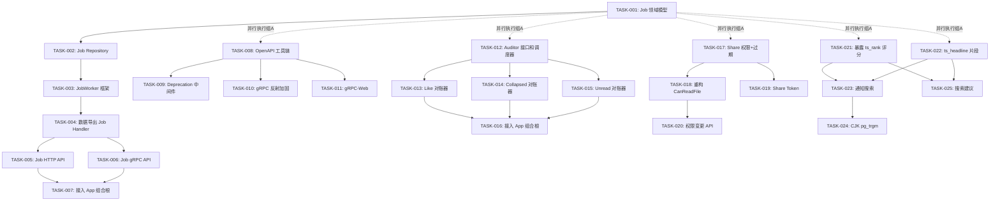
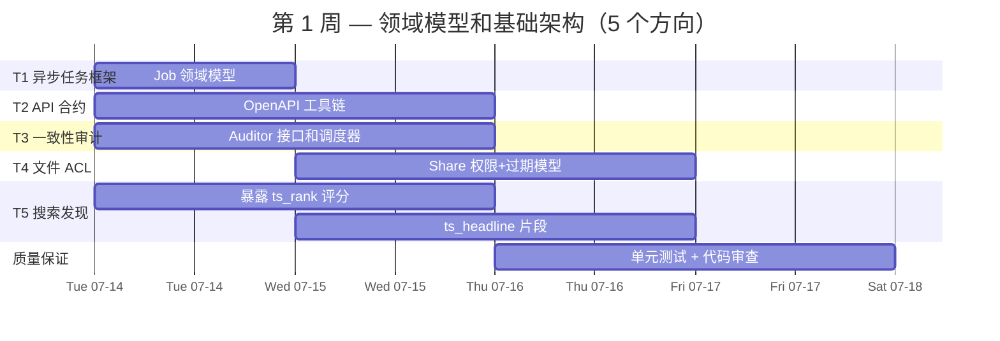
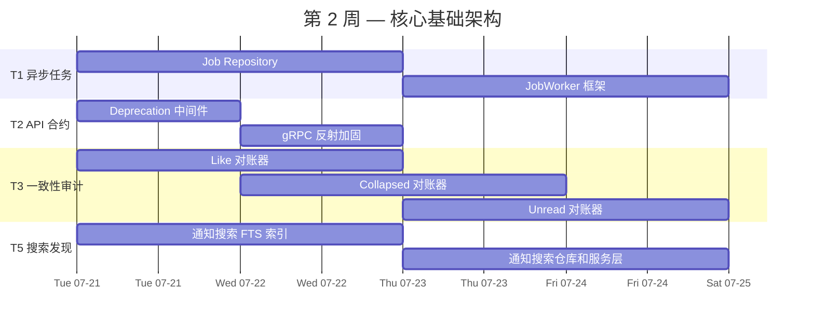
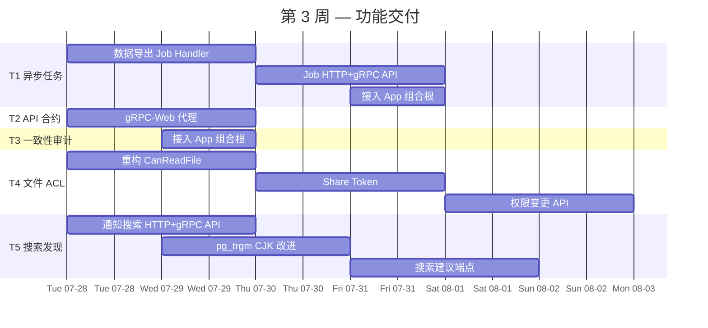
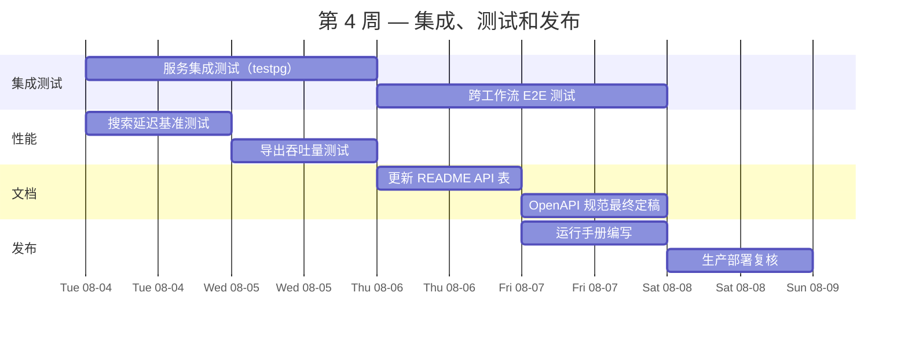

现在我已对代码库有全面了解，可以进行完整的 Tech Lead 分析。以下是详细规划。

---

# Tech Lead 分析：aero-id 五位技术方向实施计划

## 1. 任务分解

### 方向一：异步长任务框架（P0）

| 任务 ID | 任务标题 | 涉及文件 | 前置依赖 | 预估工时 | 验收标准 |
|---|---|---|---|---|---|
| TASK-001 | 设计 Job 领域模型 | `internal/domain/job.go`（新建） | 无 | 2h | `Job` 结构体含 `ID`、`Type`、`Status`（pending/running/completed/failed）、`Payload`、`Result`、`Progress`、`ErrorMsg`、`CreatedAt`、`StartedAt`、`CompletedAt`；`JobType` 类型常量 |
| TASK-002 | 创建 Job Repository | `internal/repository/job.go`（新建）、`migrations/000024_create_jobs.up.sql` + `.down.sql` | TASK-001 | 4h | CRUD 方法：`Create`、`Get`、`ListByStatus`、`UpdateProgress`、`MarkCompleted`、`MarkFailed`。迁移含 `status` 索引和 `deadline` 列 |
| TASK-003 | 实现 JobWorker 框架（Run/Start 模式） | `internal/job/worker.go`（新建包） | TASK-001, TASK-002 | 4h | `Worker` 接口含 `Run(ctx) (Stats, error)` + `Start(interval) func()`；`Registry` 按 `JobType` 映射 handler；一次传递可观察、间隔循环可停止（与 `gc.Sweeper` 模式一致） |
| TASK-004 | 实现数据导出 Job Handler | `internal/job/export.go`（新建） | TASK-003 | 4h | 处理 `JobTypeDataExport`：流式查询用户文件/消息/评论、打包 ZIP、上传至临时存储、将结果 URL 写回 `Job.Result` |
| TASK-005 | 创建 Job HTTP API | `internal/handler/http/job.go`（新建） | TASK-004 | 3h | `POST /v1/jobs`（创建导出任务）、`GET /v1/jobs/:id`（轮询状态/进度）、`GET /v1/jobs`（列出我的任务） |
| TASK-006 | 创建 Job gRPC API | `internal/handler/grpc/job.go`（新建）、`api/proto/aero-id/v1/job.proto`（新建） | TASK-004 | 3h | gRPC 服务 `JobService` 含 `CreateJob`、`GetJob`、`ListJobs`。`make proto` 生成桩代码 |
| TASK-007 | 将 Job Worker 接入应用组合根 | `internal/app/app.go` | TASK-005, TASK-006 | 2h | `New()` 中启动 worker 后台循环；配置 `job.poll_interval`；优雅关闭时停止 worker |

### 方向二：API 合约表面与开发者体验（P1）

| 任务 ID | 任务标题 | 涉及文件 | 前置依赖 | 预估工时 | 验收标准 |
|---|---|---|---|---|---|
| TASK-008 | 添加 OpenAPI/swagger 注解工具链 | 所有 HTTP handler 文件；`internal/handler/http/router.go`；`Taskfile.yml` / `Makefile` | 无 | 4h | 在 `Makefile` 中添加 `make swagger` 目标；所有路由均标记 `Summary`、`Description`、`Params`、`Response` 注解（gin-swagger 或 manual `openapi.yaml`） |
| TASK-009 | 实现 Deprecation 中间件 | `internal/middleware/deprecation.go`（新建） | 无 | 2h | `Deprecation(sunsetDate, deprecationDate, link)` 中间件设置 `Sunset`、`Deprecation`、`Link` header；可通过路由分组或元数据开关启用 |
| TASK-010 | 启用并加固 gRPC 反射 | `internal/handler/grpc/server.go`、`configs/config.yaml` | 无 | 2h | `reflection_enabled` 变为 `true`（默认值改为 true）；添加基于已认证用户角色的反射保护（仅有 `system.config` 权限的用户可调用） |
| TASK-011 | 添加 gRPC-Web 代理支持 | `internal/app/app.go`（添加 `envoy` sidecar 或内置 `grpcweb.WrapServer`） | 无 | 4h | gRPC-Web 端点在 `http://host:port/api/v1/grpc` 可用；从浏览器测试调用通过 |

### 方向三：数据一致性审计框架（P2）

| 任务 ID | 任务标题 | 涉及文件 | 前置依赖 | 预估工时 | 验收标准 |
|---|---|---|---|---|---|
| TASK-012 | 设计 Auditor 接口和调度器 | `internal/audit/auditor.go`（新建） | 无 | 3h | `Auditor` 接口含 `Audit(ctx) ([]Discrepancy, error)`；`AuditScheduler` 使用 `Run/Start` 模式；`Discrepancy` 模型含 `EntityType`、`EntityID`、`ExpectedValue`、`ActualValue` |
| TASK-013 | 实现 comment_likes ↔ like_count 对账器 | `internal/audit/like_reconciler.go`（新建） | TASK-012 | 3h | SQL：`SELECT id, like_count, (SELECT count(*) FROM comment_likes WHERE comment_id = id) AS actual FROM comments`；报告不匹配项；自动修复选项 |
| TASK-014 | 实现 collapsed_count 对账器 | `internal/audit/notification_reconciler.go`（新建） | TASK-012 | 3h | 验证 `notifications.collapsed_count` 与同一折叠窗口内实际子通知数匹配；报告差异行 |
| TASK-015 | 实现 unread_count 对账器 | `internal/audit/unread_reconciler.go`（新建） | TASK-012 | 3h | 验证 `unread_counts` 表与消息/通知表中 `read_at IS NULL` 的实际数量匹配；报告不匹配项 |
| TASK-016 | 将 Auditor 接入应用组合根 | `internal/app/app.go` | TASK-013, TASK-014, TASK-015 | 2h | 调度器以配置间隔运行（例如 `audit.interval: 24h`）；日志记录所有不匹配项；可选告警 webhook |

### 方向四：文件访问控制增强（P2）

| 任务 ID | 任务标题 | 涉及文件 | 前置依赖 | 预估工时 | 验收标准 |
|---|---|---|---|---|---|
| TASK-017 | 添加权限和过期字段至 file_shares | `migrations/000025_add_share_permissions.up.sql` + `.down.sql`、`internal/domain/file_share.go`（新建） | 无 | 3h | `file_shares` 表获得 `permission TEXT NOT NULL DEFAULT 'read'`、`expires_at TIMESTAMPTZ`、`share_token UUID`；域模型添加相应字段；约束：`permission IN ('read', 'write', 'admin')` |
| TASK-018 | 重构 CanReadFile 以支持分级权限 | `internal/domain/access.go`、`internal/service/service.go`（`canReadFile`）、`internal/service/file_share.go` | TASK-017 | 4h | `CanReadFile(actor, f) bool` 变为 `CheckFileAccess(actor, f, required Permission) bool`；`canRead` 路径使用分层检查（公开→所有共享→写/管理员写→管理员删除） |
| TASK-019 | 添加 share_token 生成和链接下载 | `internal/service/file_share.go`、`internal/handler/http/router.go`（公共路由 `GET /dl/:token`） | TASK-017, TASK-018 | 4h | `POST /v1/files/:id/share-token` 生成带可选过期时间的 token；`GET /dl/:token` 无需凭据即可解析 token → 文件并流式传输 |
| TASK-020 | 添加共享权限变更 API | `internal/handler/http/file_share.go`、`internal/handler/grpc/file_share.go` | TASK-018 | 3h | `PATCH /v1/shares/:grantee_uid` 更新权限；`DELETE /v1/shares/:grantee_uid` 撤销，支持可选软删除 |

### 方向五：消息搜索与发现增强（P1，修正范围）

| 任务 ID | 任务标题 | 涉及文件 | 前置依赖 | 预估工时 | 验收标准 |
|---|---|---|---|---|---|
| TASK-021 | 在 SearchHit 中暴露 ts_rank 评分 | `internal/domain/search.go`（添加 `Score float64`）、`internal/handler/http/search.go`（DTO 添加 `score`）、所有 `Search*` 仓库查询（SELECT 添加 `ts_rank(...) AS score`） | 无 | 3h | `SearchHit` 和 `searchHitResponse` 均包含 `score`；前端可按评分显示或过滤 |
| TASK-022 | 添加 ts_headline 高亮片段 | 所有 `Search*` 仓库查询（SELECT 添加 `ts_headline(...)`）、`internal/domain/search.go`（添加 `Snippet string`）、`internal/handler/http/search.go`（DTO 添加 `snippet`） | 无 | 3h | 每个搜索结果包含带高亮标记的内容片段；可配置 `StartSel`/`StopSel`（例如 `<mark>`/`</mark>`） |
| TASK-023 | 添加通知全文搜索 | `internal/repository/notification.go`（添加 `SearchNotifications`）、`internal/service/search.go`（注册 `SearchKindNotifications`）、`internal/domain/search.go`（添加 `SearchKindNotifications`）、`migrations/000026_notification_fts.up.sql`（为 notifications.text 添加 tsvector） | TASK-021 | 4h | `GET /v1/search?kind=notifications` 返回匹配的通知；使用 `ts_rank` 排序；按 recipient_uid 限定作用域 |
| TASK-024 | 改进 CJK 回退：pg_trgm 支持 | `migrations/000027_trgm_indexes.up.sql`（添加 `pg_trgm` 扩展和 gin_trgm_ops 索引）、`internal/repository/*.go`（CJK 分支使用 `similarity(content, ?) DESC`） | 无 | 4h | CJK 查询使用三元组相似度排序而非 `created_at DESC`；`containsCJK` 分支路由至 `Search*Trgm` 方法 |
| TASK-025 | 添加搜索建议端点 | `internal/handler/http/search.go`（添加 `GET /v1/search/suggest`）、`internal/service/search.go`（添加 `Suggest` 方法）、`internal/repository/*.go`（前缀匹配查询） | 无 | 3h | `GET /v1/search/suggest?q=prefix` 返回去重后的 `{suggestions: ["term1", "term2"]}`；基于实际历史搜索数据 |

---

## 2. 执行顺序

### 任务依赖图



### 并行执行组

| 组 | 任务 | 说明 |
|---|---|---|
| **组 A**（P0 + P1 基础架构，第 1 周） | TASK-001、TASK-008、TASK-012、TASK-017、TASK-021、TASK-022 | 所有五个方向均无依赖的任务可同步启动 |
| **组 B**（P1/P2 中期，第 2-3 周） | TASK-002→TASK-003、TASK-009、TASK-013→TASK-015、TASK-023 | 依赖组 A 领域模型的任务 |
| **组 C**（交付冲刺，第 4 周） | TASK-004→TASK-007、TASK-010→TASK-011、TASK-016、TASK-018→TASK-020、TASK-024→TASK-025 | 集成和 API 暴露任务 |

---

## 3. 技术风险

### 高风险项

| # | 风险 | 影响方向 | 可能性 | 影响 | 缓解措施 |
|---|---|---|---|---|---|
| R1 | **JobWorker 框架与现有 outbox 重叠**：方向一的 Job 框架可能与现有 outbox 机制产生重复 | 一 | 中 | 高 | 设计时明确界定：**outbox** = 轻量级事件驱动副作用（通知、计数器），**job** = 用户可见、有状态的长时间运行操作（导出）。Job 应使用独立表，而非 outbox_events |
| R2 | **pg_trgm 索引大小**：将三元组索引添加到内容列会在磁盘上显著膨胀（消息/评论内容可能较大） | 五 | 中 | 中 | 仅对 CJK 查询添加索引；监控索引膨胀；考虑使用分区或仅对达到行数阈值的表添加索引 |
| R3 | **gRPC-Web 传输模型差异**：gRPC-Web 对客户端流和服务器端流的支持不同 | 二 | 低 | 高 | 将 gRPC-Web 限制为仅一元调用；如果客户端需要流，则推送 WebSocket/SSE 直通 |
| R4 | **共享链接成为攻击向量**：公开可访问的 `GET /dl/:token` 路径可能被暴力破解或泄露 | 四 | 中 | 高 | `share_token` 应为 UUIDv7（不可枚举）；添加每个令牌速率限制；令牌可设过期时间；审计日志记录所有令牌访问 |
| R5 | **app.go 已超出 500 行**：当前 `internal/app/app.go` 为 516 行，违反工程约束 | 所有 | 高 | 中 | **在实施任何新功能之前拆分 app.go**（见下方约束驱动的重构章节） |

### 性能瓶颈

| 方向 | 瓶颈 | 策略 |
|---|---|---|
| 一（导出） | 大型导出可能使数据库 I/O 饱和 | 对导出查询使用流式游标（`pgx.Rows` 而非 `gorm.Find`）；在后台 worker 中处理，保持 API 路径轻量 |
| 三（审计） | 全表扫描进行数据对账可能很慢 | 使用 `SELECT ... FOR UPDATE SKIP LOCKED` 按批次处理；审计错峰运行（业务低峰期） |
| 五（CJK） | `ILIKE '%query%'` 无法使用索引 | `pg_trgm` GIN 索引使模式匹配可索引；或切换到 `pg_bigm` 以获得更好的 CJK 支持 |

### 测试覆盖难点

| 任务 | 难点 | 策略 |
|---|---|---|
| TASK-003（JobWorker） | 时间敏感的进度测试 | 注入时钟；使用 `WithClock` 选项（与 `gc.Sweeper` 相同模式） |
| TASK-004（导出） | 需要真实存储后端的集成测试 | 使用 `testpg` minio 容器；测试小型导出（1 条消息 + 1 个文件） |
| TASK-013（对账器） | 存储故意不匹配，验证检测结果 | 在辅助函数中构建已知偏差的数据集；验证 `Discrepancy` 计数 |
| TASK-019（共享 token） | HMAC 签名 + 跨路由测试 | 将签名提取为可单独单元测试的函数 |

---

## 4. 资源评估

### 人员配置

| 角色 | 所需数量 | 技能要求 | 分配方向 |
|---|---|---|---|
| **后端工程师（高级）** | 2 | Go、PostgreSQL、gRPC、分布式系统设计 | 方向一（设计 lead）+ 方向三 |
| **后端工程师（中级）** | 2 | Go、GORM、REST API 设计 | 方向二 + 方向五 |
| **后端工程师（中级）** | 1 | Go、GORM、ACL 系统、安全 | 方向四 |
| **QA 工程师** | 1 | Go 单元测试、集成测试（testcontainers）、性能测试 | 所有方向 |
| **DevOps 工程师** | 0.5 | protobuf、gRPC-Web、Envoy、迁移 | 方向二 + 方向五 |

### 关键里程碑

| 里程碑 | 时间 | 交付物 | 依赖 |
|---|---|---|---|
| **M0**：约束驱动重构 | 第 0 天（启动前） | `app.go` 拆分 ≤500 行；`comment.go` 拆分 | 无 |
| **M1**：领域模型就绪 | 第 3 天 | TASK-001、TASK-012、TASK-017、TASK-021、TASK-022 完成 | 组 A |
| **M2**：基础架构就绪 | 第 10 天 | Job 框架可用 + Job Repository；Auditor 调度器就绪；ts_rank/ts_headline 暴露 | M1 |
| **M3**：核心功能完成 | 第 20 天 | 数据导出工作流端到端；API 合约文档化；通知搜索可用；共享 token 可用 | M2 |
| **M4**：集成与测试 | 第 24 天 | 全面集成测试；性能基准测试；文档 | M3 |
| **M5**：发布 | 第 28 天 | 所有 PR 合并；生产就绪；运行手册编写完成 | M4 |

### 阻塞点与解决策略

| 阻塞点 | 涉及任务 | 解决策略 |
|---|---|---|
| `internal/app/app.go` 516 行溢出率 | 所有涉及组合根的任务 | **目前**：TASK-007、TASK-016。将 app.go 拆分为 `app_config.go`（有线配置）、`app_services.go`（服务构造）、`app_http.go`、`app_grpc.go`。这是 M0 的阻塞点 |
| `internal/service/comment.go` 472 行接近上限 | TASK-022（片段）可能添加代码 | 主动拆分：将评论 `Report` 方法提取到 `comment_report.go`；将 `Like`/`Unlike`/`Hide`/`Unhide` 提取到 `comment_reactions.go` |
| 无 CI/CD 流水线证据 | 所有 | 在功能开发前建立基本 CI（`make test && make lint` 已存在，是良好基础）。向 CI 添加 `make check-file-sizes` |

---

## 5. 质量保证

### 单元测试覆盖要求

| 包 | 最低覆盖率 | 关键测试内容 |
|---|---|---|
| `internal/domain/*` | 95%+ | 不变条件（注释嵌套深度、CanReadFile 权限级别、Job 状态转换） |
| `internal/repository/*` | 85%+ | CRUD 边界情况（找不到、重复、空输入）、CJK 回退逻辑、GIN 向量查询 |
| `internal/service/*` | 90%+ | 授权（所有者与非所有者、管理员、已屏蔽用户）、错误包装（原始 → AppError）、分页（cursor + limit） |
| `internal/job/*` | 90%+ | 状态转换（pending→running→completed/failed）、进度报告、并发安全（模拟慢速 handler） |
| `internal/audit/*` | 90%+ | 检测不一致：缺失递减、计数器过高、计数不足。恢复逻辑 |
| `internal/middleware/*` | 85%+ | Deprecation header 格式、gRPC 反射访问控制 |

### 集成测试策略

| 测试类别 | 工具 | 覆盖场景 | 与 CI 的集成 |
|---|---|---|---|
| **服务集成** | `testpg`（Postgres testcontainer） | 真实数据库执行：全文查询、GIN 索引利用、CJK 回退、模糊搜索 | `make test-integration` — Docker 必需，可选门控 |
| **存储集成** | MinIO testcontainer | S3 式上传/下载、预签名 URL 生成和验证、孤儿清理 | 与上方相同的目标 |
| **跨服务工作流** | `testpg` + MinIO | 端到端文件上传 → 搜索 → 共享 → 导出。验证写入后读取一致性 | 独立 `make test-e2e` 目标，仅合并请求时触发 |
| **审计对账** | `testpg` | 注入已知不匹配数据（例如静默 SQL UPDATE），验证 `Reconcile()` 检测所有差异 | 单元测试一部分，但每晚 CI 运行对账作为额外检查 |

### 代码审查要点

| 关注领域 | 审查重点 |
|---|---|
| **方向一（Job）** | `JobWorker` 是否与现有 `outbox.Relay` 清晰区分？状态转换是否在事务中执行？进度回写是否在 p99 内完成？ |
| **方向二（API 合约）** | OpenAPI 规范是否与路由器中的实际路由匹配？Deprecation header 格式是否严格符合 RFC？gRPC 反射是否默认受身份验证保护？ |
| **方向三（审计）** | 对账器是否操作只读快照以避免与并发写入的竞争条件？修复操作（可选）是否记录自身审计事件？ |
| **方向四（文件 ACL）** | `CheckFileAccess` 是否按正确优先级评估：明确拒绝 → 所有者 → 共享 → 公开？`share_token` 是否加密强大且抵抗定时攻击？ |
| **方向五（搜索）** | `ts_headline` 选项是否转义用户输入的查询以防止字典注入？CJK 分支是否无缝机制回到 `pg_trgm`？建议端点是否对滥用进行速率限制？ |

### 性能测试需求

| 测试 | 场景 | 指标 | 阈值 |
|---|---|---|---|
| 搜索延迟 p95 | 不同查询长度 + 结果集大小（10K 消息/评论/文件） | `GET /v1/search` 延迟 | p95 < 500ms（FTS），p95 < 2s（CJK 回退） |
| Job 导出吞吐量 | 并发导出 5 个大型用户（10K 条消息 + 500 个文件） | 完成时间 / CPU 峰值 / 内存 | 每个作业 < 30 秒，内存 < 256MB |
| 审计对账 | 100 万行 comment_likes 表 | 通过时间 / DB 负载 | < 5 分钟，CPU < 50% |
| 共享 token 验证 | 1000 个并发 `GET /dl/:token` 请求 | 吞吐量 / 延迟 | > 500 req/s，p95 < 100ms |

---

## 6. 实施计划

### **第 0 天：约束驱动的重构**（M0 — 所有功能的前置条件）

在开始新功能之前，修复文件大小违规——这是 `AGENTS.md` 中非协商的工程约束。

```mermaid
gantt
    title 第 0 天重构冲刺
    dateFormat  HH:mm
    axisFormat  %H:%M

    section 拆分 app.go (516 行 → <500)
    提取 app_config.go :d0a, 00:00, 2h
    提取 app_services.go :d0b, after d0a, 2h
    提取 app_http.go    :d0c, after d0b, 1h
    提取 app_grpc.go    :d0d, after d0c, 1h

    section 拆分 comment.go (472 行)
    提取 comment_report.go  :d0e, 00:00, 2h
    提取 comment_reactions.go :d0f, after d0e, 2h

    section 验证
    make check-file-sizes && make lint && make test :d0g, after d0d, 1h
```



### **第 1 周：领域模型和基础架构**（组 A）



### **第 2 周：核心基础架构**（组 B）



### **第 3 周：功能交付**（组 C）



### **第 4 周：集成、测试和发布**



### **每月时间线摘要**

```
第 0 天（启动前） ── M0：重构违规文件（app.go 516→<500，comment.go 472→拆分）
                      ↓
第 1-2 周（7/14-7/25）──  所有五个方向的领域模型和基础架构
                      ↓
第 3 周（7/28-8/1）  ──    功能交付：API、导出、共享、搜索建议
                      ↓
第 4 周（8/4-8/8）   ──    集成测试、性能、文档、发布
                      ↓
                    发布 v2.0 候选版本
```

---

## 附录：观察到的约束违规

作为 Tech Lead，我必须强调 **在启动新功能之前必须解决** 这些现有的工程约束违规。

| 文件 | 行数 | 限制 | 裁决 | 补救措施 |
|---|---|---|---|---|
| `internal/app/app.go` | 516 | ≤500 | ❌ 违反 | 拆分为 `app_config.go`、`app_services.go`、`app_http.go`、`app_grpc.go` |
| `internal/service/comment.go` | 472 | ≤500 | ⚠️ 接近 | 将 report 方法提取到 `comment_report.go`；将 reaction 方法提取到 `comment_reactions.go` |
| `internal/service/notification.go` | 392 | ≤500 | ✅ 合规 | — |

**首次违规触发 `make check-file-sizes` 失败**（在 `AGENTS.md` 中引用）。在我批准任何功能 PR 之前，此问题必须解决。建议的拆分策略：

1. **`app.go`** → 按关注点水平拆分：`app_config.go`（配置验证和默认值）、`app_services.go`（仓库→服务→处理程序构造）、`app_http.go`（HTTP 服务器设置和关闭逻辑）、`app_grpc.go`（gRPC 服务器设置和关闭逻辑）。将现有的 `sso`、`storage` 和 `outbox` 构造块留给与这些层共同定位的适当文件。
2. **`comment.go`** → 垂直提取：`comment_report.go`（`Report`、`ListReports`、`ResolveReport`、`Hide`、`Unhide`）；`comment_reactions.go`（`Like`、`Unlike`）。保留核心 CRUD 在 `comment.go` 中，目标 <300 行。
