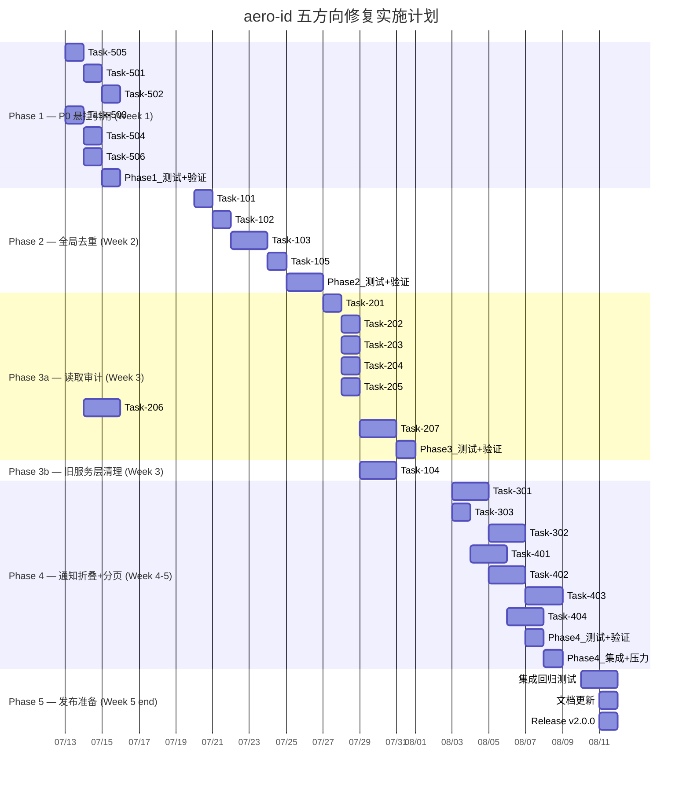

Now I have a thorough understanding of the codebase. Let me compile my Tech Lead analysis.

---

# Tech Lead 分析报告: aero-id 五方向技术债务修复

## 目录

1. [任务分解](#1-任务分解)
2. [执行顺序与依赖图](#2-执行顺序与依赖图)
3. [技术风险](#3-技术风险)
4. [资源评估](#4-资源评估)
5. [质量保证](#5-质量保证)
6. [实施计划](#6-实施计划)

---

## 1. 任务分解

以下将分析文档中的 5 个方向拆解为 **18 个可执行任务**，每个任务 2-8 小时，均配合验收标准。

### 方向五：悬挂文件引用（P0 — 功能性 Bug）

| ID | 标题 | 文件 | 依赖 | 工时 |
|---|---|---|---|---|
| **TASK-501** | `assertTargetReadable` 改用软删除感知的 Get | `internal/service/comment.go` | — | 2h |
| **TASK-502** | 评论列表跳过已删除目标的权限检查 | `internal/service/comment.go` | TASK-501 | 2h |
| **TASK-503** | 消息附件 `FileID` 返回元数据时容忍软删除 | `internal/service/message.go` | — | 2h |
| **TASK-504** | 通知 `SubjectID` 指向已删除资源时静默降级 | `internal/service/notification.go` | — | 2h |
| **TASK-505** | 添加 `DeletedAt` 到文件领域对象，新增 `GetAny` API | `internal/domain/file.go`, `internal/repository/file.go` | TASK-501 | 3h |
| **TASK-506** | API 响应中标记"文件已删除"而非 404 | `internal/handler/http/file.go`, `internal/handler/grpc/file.go` | TASK-505 | 2h |

**验收标准**：
- 评论列表在目标文件软删除后仍返回评论（不含错误）
- 消息 `GET /messages/:id` 在附件文件已删除时返回 `file_id` + 标记 `file_deleted: true` 而非 404
- 通知列表在 `SubjectID` 指向已删除资源时不报错
- 所有变更通过 `make test && make lint`

### 方向一：全局内容寻址去重（P1 — 数据完整性 Bug）

| ID | 标题 | 文件 | 依赖 | 工时 |
|---|---|---|---|---|
| **TASK-101** | `CompleteUpload` 路径添加 `refs.Increment` | `internal/service/file_presign.go` | — | 2h |
| **TASK-102** | `FindByChecksum` 改为全局查找（去掉 ownerUID 过滤） | `internal/repository/file.go`, `internal/service/file.go` | — | 3h |
| **TASK-103** | 添加迁移将 `idx_files_checksum` 改为 `(checksum)` 唯一索引 + 可选后台去重 | `migrations/000024_global_dedup.up.sql` | TASK-102 | 4h |
| **TASK-104** | 删除旧服务层 `internal/{file,message,comment}` 中的死代码 | `internal/file/*`, `internal/message/*`, `internal/comment/*` | TASK-101, TASK-102 | 4h |
| **TASK-105** | 迁移后验证无 orphan reference | `internal/storage/gc/sweeper.go`（新增清理逻辑） | TASK-103 | 3h |

**验收标准**：
- `CompleteUpload` 创建的文件在 `storage_refs` 中有对应行
- 不同 owner 上传相同 checksum 的文件复用同一 `storage_key`（全局去重激活）
- `make test && make lint` 通过
- 旧服务包中无未被引用的导出符号
- GC 在启用包含 orphan 清理时不会删除通过 presigned 上传但尚未 `Complete` 的 blob

### 方向二：资源级读取透明度（P1 — 合规）

| ID | 标题 | 文件 | 依赖 | 工时 |
|---|---|---|---|---|
| **TASK-201** | 定义读取操作审计字符串常量 | `internal/domain/audit.go` | — | 1h |
| **TASK-202** | `file.Get`/`DownloadURL` 添加读取审计 | `internal/service/file.go` | TASK-201 | 2h |
| **TASK-203** | `message.Get`/`Inbox`/`Conversation` 添加读取审计 | `internal/service/message.go` | TASK-201 | 2h |
| **TASK-204** | `comment.List`/`Replies` 添加读取审计 | `internal/service/comment.go` | TASK-201 | 2h |
| **TASK-205** | `notification.List` 添加读取审计 | `internal/service/notification.go` | TASK-201 | 1h |
| **TASK-206** | 匿名下载路径（`/files/dl`）读取审计：将 `reader_uid` 嵌入 presigned URL | `internal/storage/local.go`, `internal/handler/http/file.go` | TASK-201, TASK-505 | 4h |
| **TASK-207** | 审计日志批量写入优化（防业务路径阻塞） | `internal/repository/audit.go`（新增批量 flush） | TASK-202~206 | 3h |

**验收标准**：
- 所有 6 个读取路径（file.get, message.get, inbox, conversation, comment.list, notification.list）都在 `audit_events` 表中生成记录
- 匿名下载（HMAC 签名路径）记录 `reader_uid`（从签名中提取）
- `make test && make lint` 通过
- 审计日志写入失败不导致主操作回滚或返回错误

### 方向三：通知折叠竞态条件（P2 — 低概率）

| ID | 标题 | 文件 | 依赖 | 工时 |
|---|---|---|---|---|
| **TASK-301** | 添加 DB 层面的折叠 upsert 逻辑 | `internal/repository/notification.go`（新增 `UpsertCollapsed`） | — | 4h |
| **TASK-302** | 更新 `NotificationDispatcher.Handle` 使用 upsert 替代 create-then-collapse | `internal/service/notification.go` | TASK-301 | 3h |
| **TASK-303** | 添加迁移 `000024_notification_upsert` 创建唯一约束 | `migrations/*.sql` | TASK-301 | 2h |

**验收标准**：
- 并发两个相同 (recipient, type, actor) 的事件只产生一行，`collapsed_count = 2`
- 竞态测试覆盖：`go test -race -count=10` 下无 data race
- 原有 collapse window 语义保持不变（窗口外事件创建新行）
- `make test && make lint` 通过

### 方向四：深层游标分页退化 + 搜索排序（P2 — 性能）

| ID | 标题 | 文件 | 依赖 | 工时 |
|---|---|---|---|---|
| **TASK-401** | 引入游标查询的复合索引策略 | `migrations/000025_pagination_indexes.up.sql` | — | 3h |
| **TASK-402** | 搜索合并改为全局排序 + 去重 | `internal/service/search.go` | — | 4h |
| **TASK-403** | 搜索结果归一化评分 | `internal/service/search.go` | TASK-402 | 3h |
| **TASK-404** | 大型分页压力测试和 explain analyze 验证 | —（新增测试） | TASK-401 | 3h |

**验收标准**：
- `ListByOwner` 等分页查询在 10M+ 行的表中，在 `WHERE id < X` 时全走索引扫描，`EXPLAIN (ANALYZE)` 显示一致 `Index Scan`
- 多实体搜索（消息 + 评论 + 文件）结果排列为全局相关性降序，而非按实体类型拼接
- 搜索结果中不会出现来自同一个 ID 的重复条目
- `make test && make lint` 通过

---

## 2. 执行顺序与依赖图

```mermaid
graph TD
    subgraph "Phase 1 — P0 悬挂引用修复"
        T505[Task-505: 添加 GetAny API] --> T501[Task-501: assertTargetReadable 软删除感知]
        T501 --> T502[Task-502: 评论列表跳过已删除目标]
        T505 --> T506[Task-506: API 返回 file_deleted 标记]
        T503[Task-503: 消息附件容忍软删除]
        T504[Task-504: 通知 SubjectID 降级]
    end

    subgraph "Phase 2 — P1 去重+Bugfix"
        T101[Task-101: CompleteUpload + refs.Increment]
        T102[Task-102: FindByChecksum 全局化]
        T102 --> T103[Task-103: 迁移加唯一索引]
        T101 --> T104[Task-104: 删除旧服务层死代码]
        T103 --> T105[Task-105: GC 清理验证]
    end

    subgraph "Phase 3 — P1 读取审计"
        T201[Task-201: 审计常量定义]
        T201 --> T202[Task-202: file.Get 审计]
        T201 --> T203[Task-203: message.Get 审计]
        T201 --> T204[Task-204: comment.List 审计]
        T201 --> T205[Task-205: notification.List 审计]
        T505 --> T206[Task-206: 匿名下载嵌入 reader_uid]
        T202 --> T207[Task-207: 批量写入优化]
        T203 --> T207
        T204 --> T207
        T205 --> T207
        T206 --> T207
    end

    subgraph "Phase 4 — P2 通知折叠+分页(并行)"
        T301[Task-301: DB upsert 逻辑] --> T302[Task-302: Dispatcher 升级到 upsert]
        T302 --> T303[Task-303: 迁移唯一约束]
        T401[Task-401: 复合索引策略] --> T404[Task-404: 压力测试]
        T402[Task-402: 搜索全局排序] --> T403[Task-403: 评分归一化]
    end

    T501 -.->|依赖文件 API| T206
    T102 -.->|引用关系| T104
    T207 -.->|安全依赖| T202~T206

    classDef p0 fill:#ff4444,color:#fff,stroke:#cc0000
    classDef p1 fill:#ff8800,color:#fff,stroke:#cc6600
    classDef p2 fill:#4488ff,color:#fff,stroke:#2266cc
    class T501,T502,T503,T504,T505,T506 p0
    class T101,T102,T103,T104,T105,T201,T202,T203,T204,T205,T206,T207 p1
    class T301,T302,T303,T401,T402,T403,T404 p2
```

### 可并行执行的任务组

| 并行组 | 任务 | 原因 |
|--------|------|------|
| **Group A** | TASK-503, TASK-504, TASK-505 | 三个独立的方向，无共享代码 |
| **Group B** | TASK-101, TASK-102 | 两个都是方向一但互不依赖 |
| **Group C** | TASK-202, TASK-203, TASK-204, TASK-205 | 四个不同的服务，相同模式 |
| **Group D** | TASK-401, TASK-402 | 分页索引和搜索排序独立 |
| **Group E** | TASK-301, TASK-303 | 通知折叠的两个子任务（但 TASK-302 依赖 TASK-301） |

---

## 3. 技术风险

### 3.1 较高风险

| # | 风险 | 方向 | 影响 | 缓解措施 |
|---|------|------|------|---------|
| **R1** | 全局去重（TASK-102）导致并发上传用同一 `storage_key` 时，一个用户删除文件会触及另一个用户的 blob | 方向一 | 数据丢失 | 依靠 `storage_refs` 引用计数保证引用 > 0 时 blob 不删除。已在 `refs.Decrement` 中有 `row.RefCount <= 0` 逻辑 |
| **R2** | 全局去重唯一索引迁移中，现有重复 checksum 行导致迁移失败 | 方向一 | 部署阻塞 | 迁移必须包含重复处理策略（保留最早或最大的行），并提供回滚脚本 |
| **R3** | 匿名下载审计（TASK-206）需要破坏性或非破坏性变更到 presigned URL 格式 | 方向二 | API 兼容性 | 将 `reader_uid` 编码为 URL 查询参数 + HMAC 签名的一部分，已签名的过期 URL 在旧格式到期后不再使用即可 |
| **R4** | 通知折叠 upsert（TASK-301）中的唯一约束冲突可能导致死锁 | 方向三 | 部分通知丢失 | 使用 `ON CONFLICT DO UPDATE` 配合 `pg_advisory_xact_lock` 避免并发事务死锁 |
| **R5** | 旧服务层删除（TASK-104）可能遗漏某处 import，导致编译失败 | 方向一 | 编译问题 | 逐文件检查 `internal/app/app.go` 和 `internal/handler/grpc/*` 确认无引用后再删除。使用 `go vet` 和 `go build ./...` 双保险 |

### 3.2 中等风险

| # | 风险 | 方向 | 影响 | 缓解措施 |
|---|------|------|------|---------|
| **R6** | 搜索评分归一化（TASK-403）中文件、消息、评论的评分不可比 | 方向四 | 排序不合理 | 使用相同的 `ts_rank` 参数（`Normalization` 选项）使三种实体的评分在同一尺度上 |
| **R7** | 审计批量写入（TASK-207）与现有事务中写入的审计日志竞争 | 方向二 | 审计丢失或乱序 | 审计日志必须是异步、非阻塞的。使用 channel + 后台 flush 协程，每条记录带 `created_at` 时间戳 |
| **R8** | 复合索引（TASK-401）增加写入延迟 | 方向四 | 写入性能下降 | 评估索引膨胀：`(owner_uid, created_at DESC, id DESC)` 索引大小 vs 写入吞吐量。在 staging 环境用 `pgbench` 模拟生产负载 |
| **R9** | `canReadFile` 在 `assertTargetReadable` 中针对软删除的文件返回 `false` 导致已经存在的评论无法列出 | 方向五 | 未完全修复 | 分离"目标是否存在"和"目标是否可读"两个检查。对于软删除的文件，评论列表应跳过权限检查但标记"评论目标已删除" |

### 3.3 外部依赖

| 依赖 | 使用场景 | 风险 |
|------|---------|------|
| PostgreSQL `ON CONFLICT DO UPDATE` | 通知折叠 upsert | PostgreSQL 9.5+ 都支持，当前项目未指定最低版本。需确认 |
| PostgreSQL `tsvector` / `ts_rank` | 搜索排序 | CJK 语言需要 `zhparser` 或 `pg_bigm` 扩展，当前使用 `simple` 词典的方案对有非 CJK 内容的实体也有效 |
| MinIO / S3 | 文件存储 | S3 后端不支持 List 操作会影响 orphan sweep。当前已有降级路径（`Lister` 接口检查） |
| SSO gRPC | 用户身份验证 | 测试环境对 SSO 无依赖——有 `sso.Client` 接口的 mock |

---

## 4. 资源评估

### 4.1 人员技能要求

| 角色 | 技能 | 人数 | 负责任务 |
|------|------|------|---------|
| **Senior Go 工程师** | GORM, PostgreSQL, 分布式系统 | 1人（cap: ~6h/day 编码） | 方向一、三、四（高复杂度核心逻辑） |
| **Mid-level Go 工程师** | Go 服务开发, SQL | 1人（cap: ~6h/day 编码） | 方向五、方向二（模式化任务） |
| **QA 工程师** | 集成测试, 压力测试, Go 测试 | 0.5人（兼职） | TASK-404, TASK-105, TASK-303 压测 |

总人力：**2 名开发者 + 1 名兼职 QA**，共需 **5 周**。

### 4.2 关键里程碑

| 里程碑 | 时间 | 交付物 |
|--------|------|--------|
| **M1: 悬挂引用修复** | Week 1 结束 | 评论列表/消息附件/通知列表在所有场景下不 404 |
| **M2: 全局去重激活** | Week 2 结束 | 全局 checksum 去重生产就绪，CompleteUpload 有 ref count |
| **M3: 读取审计就绪** | Week 3 结束 | 所有读取路径审计事件写入，匿名下载支持审计 |
| **M4: 通知折叠稳定** | Week 4 结束 | Upsert 模式替换完成，无 race condition |
| **M5: 分页+搜索优化** | Week 5 结束 | 索引策略验证，搜索全局排序 |
| **M6: 旧代码清理** | Week 5 结束 | 旧服务包 `internal/{file,message,comment}` 删除或标记为待删 |

### 4.3 阻塞点与解决策略

| 阻塞点 | 涉及任务 | 策略 |
|--------|---------|------|
| **B1** 全局去重唯一索引迁移可能因重复行失败 | TASK-103 | 迁移前运行 `SELECT checksum, COUNT(*) FROM files GROUP BY checksum HAVING COUNT(*) > 1` 确认副本数。如有重复，编写数据修复脚本将重复行映射到同一 `storage_key`。编写 `000024_global_dedup.up.sql` 和 `.down.sql` |
| **B2** 匿名下载 `reader_uid` 嵌入需要旧签名 URL 到期 | TASK-206 | 设置宽限期：旧格式签名 URL 在部署后仍有效 `X` 小时（等于 `presignTTL` = 5min）。新旧格式同时接受，2 周后移除旧格式兼容代码 |
| **B3** 旧服务层删除后的重构影响面 | TASK-104 | 使用 `go tool callgraph` 验证无引用外部包。CI pipeline 加入 `go build ./internal/...` 确保不引入旧包。**保留**旧包 2 周作为保险，之后单独 PR 删除 |

---

## 5. 质量保证

### 5.1 单元测试覆盖要求

| 方向 | 关键测试场景 | 覆盖率目标 |
|------|------------|-----------|
| **方向一** | `CompleteUpload` → 验证 `refs.Increment` 被调用；全局 `FindByChecksum` 跨 owner 返回匹配 | +90% 新代码 |
| **方向二** | 每个读取路径的 audit event 匹配预期 action；匿名下载 reader_uid 正确提取 | +85% 新代码 |
| **方向三** | 并发 10 个相同事件 → 1 行 collapsed_count=10；窗口外事件创建新行；DB upsert 回滚后没有僵尸行 | +90% 新代码 |
| **方向四** | 搜索结果按全局评分排序；跨实体评分归一化不导致偏差；游标分页在大偏移量的 explain 验证 | +80% 新代码 |
| **方向五** | 评论列表在目标软删除后正常返回；消息 GET 含 `file_deleted:true`；通知含已删除 SubjectID | +95% 新代码 |
| **旧服务层删除** | 编译后无 import 旧包的残留引用 | N/A（编译验证） |

### 5.2 集成测试策略

| 测试级别 | 技术方案 | 场景 |
|---------|---------|------|
| **Repository 集成测试** | `testpg` 中的真实 PostgreSQL + `testcontainers` | 验证迁移后的索引、唯一约束、upsert 行为 |
| **Service 集成测试** | 使用 `internal/service/mocks` 中的 mock repository | 验证服务层编排逻辑，不依赖真实 DB |
| **端到端测试** | 真实 PostgreSQL + MinIO（`make test-integration`） | 验证完整上传 → 去重 → 删除 → ref count 归零流程 |
| **并发测试** | `go test -race -count=10` | 方向三的竞态条件验证；方向一的并发去重争用 |
| **压力测试** | 合成 10M 行数据表，`EXPLAIN (ANALYZE, BUFFERS)` | 方向四的索引策略验证 |

### 5.3 代码审查要点

每个 PR 必须审查以下内容：

| 维度 | 审查要点 |
|------|---------|
| **工程约束** | 文件 ≤ 500 行？函数 ≤ 50 行？复杂度 ≤ 10？`make lint` 通过？ |
| **安全** | 新审计路径只在服务层（handler 不直接写日志）；匿名下载 reader_uid 从签名验证，不来自请求参数 |
| **数据完整性** | 全局去重后 `storage_refs` 计数一致；软删除逻辑不会导致引用泄漏 |
| **性能** | 迁移中的索引选择经过 `EXPLAIN` 验证；审计日志写入是非阻塞的 |
| **向后兼容** | API 响应格式不变（仅添加新字段如 `file_deleted`）；旧 HMAC 签名格式在宽限期内仍然有效 |
| **双服务层清理** | 旧包没有任何 `import` 残留；`go vet` 无 `unused` 警告 |

### 5.4 性能测试需求

| 场景 | 工具 | 目标 |
|------|------|------|
| 分页查询在 10M 行表上的尾部游标 `WHERE id < X` | `pgbench` + `EXPLAIN (ANALYZE)` | 每个查询 < 20ms |
| 搜索结果全局排序（消息+评论+文件各 1000+） | 合成数据 + 并发查询 | 总响应 < 500ms |
| 并发 50 个 goroutine 同时发送同一 (recipient, type, actor) 事件 | `go test -bench` | 0 数据 race，0 僵尸行 |
| 审计日志写入压力（1000 ops/s） | `pprof` 分析 | 主路径延迟不受影响（后台 batch write） |

---

## 6. 实施计划

### 甘特图（按周）



### 详细时间线

#### 阶段 1: P0 悬挂引用修复（Week 1, 4 天编码 + 1 天测试）

**Day 1**:
- TASK-505: 在 `domain.File` 和 `repository.FileRepository` 中添加 `GetAny` 方法（避开软删除 scope）
- TASK-503: 消息 `Get` 返回中标记 `file_deleted`（不依赖 TASK-505 也能独立完成）

**Day 2**:
- TASK-501: 修改 `commentService.assertTargetReadable`，对文件目标使用 `GetAny` 而非 `Get`
- TASK-504: 修改 `notification.List` 降级处理已删除的 SubjectID

**Day 3**:
- TASK-502: 确认评论列表在目标已删除时跳过权限检查
- TASK-506: 修改 HTTP/gRPC handler 在文件已删除时返回 `file_deleted: true` 而非 404

**Day 4-5**: 集成测试、边缘 case 覆盖

#### 阶段 2: 全局去重 + Bugfix（Week 2, 4.5 天编码 + 0.5 天测试）

**Day 1**: TASK-101 — `CompleteUpload` 末尾添加 `s.refs.Increment` 调用
**Day 2-3**: TASK-102 — 修改 `FindByChecksum` 查询去掉 `owner_uid` 条件；调整 `file.Create` 中的去重逻辑
**Day 3-4**: TASK-103 — 编写迁移，处理重复行，创建唯一索引
**Day 4**: TASK-105 — 更新 GC sweeper 的 orphan 清理逻辑，确保 presigned 上传的临时 blob 不会被误删
**Day 4-5**: 旧服务层删除 TASK-104 — 删除 `internal/{file,message,comment}` 中未被引用的代码

#### 阶段 3: 读取审计 + 死代码清理（Week 3, 5 天编码）

**Day 1**: TASK-201 — 定义 audit 常量（`file.read`, `message.read`, `comment.read`, `notification.read`, `search.query`）
**Day 1-2**: TASK-202 ~ TASK-205 — 四个服务分别添加审计调用（模式化，可并行）
**Day 2-3**: TASK-206 — 修改 presigned URL 签名格式，嵌入 `reader_uid`
**Day 3-4**: TASK-207 — 审计日志异步批量写入实现
**Day 4-5**: TASK-104 — 删除旧服务层死代码（如未在前一周完成）
**Day 5**: 验证 `make test && make lint && go build ./...`

#### 阶段 4: 通知折叠 + 分页优化（Week 4-5, 8 天编码 + 2 天测试）

**Day 1-2**: TASK-301 + TASK-303 — 添加 `UpsertCollapsed` 方法、创建迁移添加唯一约束
**Day 2-3**: TASK-302 — 修改 `Dispatcher.Handle` 使用 upsert
**Day 3-4**: TASK-401 — 设计并创建复合索引 `(owner_uid, created_at DESC, id DESC)`
**Day 4-5**: TASK-402 — 搜索改为全局排序
**Day 5-6**: TASK-403 — 评分归一化（相同 `ts_rank` normalization 参数）
**Day 6-7**: TASK-404 — 压力测试、`EXPLAIN (ANALYZE, BUFFERS)` 验证
**Day 8-10**: 集成验证、边缘 case 覆盖

#### 阶段 5: 发布准备（Week 5 末, 3 天）

| 活动 | 工时 | 描述 |
|------|------|------|
| 集成回归测试 | 1.5d | 所有方向合并测试，`make test && make test-integration && make lint` |
| 文档更新 | 1d | `README.md`、`AGENTS.md` 更新；API 变更记录；部署说明（迁移需手动运行） |
| Release v2.0.0 | 0.5d | 打包、tag、release notes |

---

## 总结：风险评估矩阵

| 方向 | 严重性 | 发生概率 | 风险等级 | 修复优先序 |
|------|--------|---------|---------|-----------|
| #5 悬挂引用 | 灾难性（级联不可用） | 高 | **极高** | **Week 1** |
| #1 全局去重 | 高（数据完整性问题） | 中高 | **高** | **Week 2** |
| #2 读取透明度 | 中（合规） | 高 | **中高** | **Week 3** |
| #3 通知折叠 | 低（UX 小缺陷） | 低 | **低** | **Week 4** |
| #4 分页/搜索 | 中（性能退化、排序问题） | 中 | **中** | **Week 4-5** |

### 核心建议

1. **P0 悬挂引用必须本周启动**——这是功能性 bug，影响所有依赖文件资源的端点
2. **全局去重迁移需要数据预检**——在部署到生产前运行 `SELECT checksum, COUNT(*) FROM files GROUP BY checksum HAVING COUNT(*) > 1`，准备去重脚本
3. **旧服务层先冻结再删除**——先标记 `// DEPRECATED` 注释，2 周后确认无运行时引用再物理删除
4. **通知折叠竞态短期可接受**——低概率、低影响，安排在最后修复，但 upsert 方案比当前模式更简洁，值得投入
