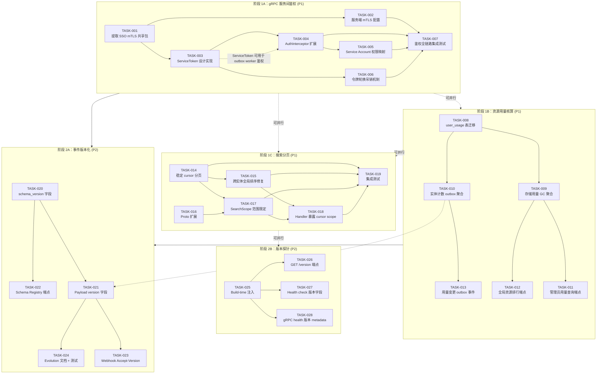
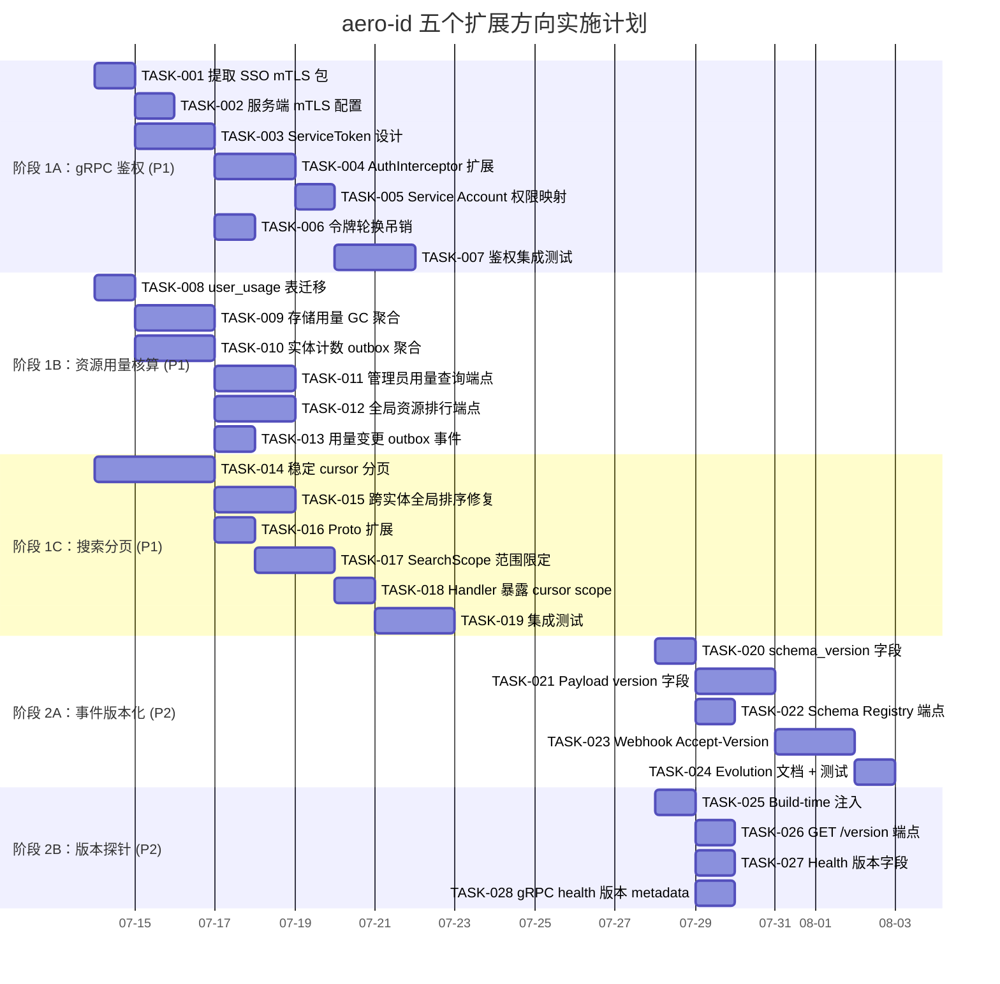

现在我已经充分了解了代码库。让我来编写全面的技术主管分析。

---

# Tech Lead 分析报告：aero-id 五个扩展方向

## 执行摘要

基于交叉验证文档，我采纳其**调整后的优先级排序**，但进一步细化任务分解和依赖关系。五个方向中，**P1 的三个方向**（gRPC 服务间鉴权、资源用量核算、搜索分页）有明确的产品价值和技术可行性，而 **P2 的两个方向**（事件版本化、版本探针）是基础设施卓越性方向。下方是对每项内容的可执行任务分解。

---

## 1. 任务分解

### 方向三：gRPC 服务间鉴权（P1）

| 任务 ID | 任务标题 | 涉及文件 | 前置依赖 | 工时 | 验收标准 |
|---------|---------|---------|---------|------|---------|
| TASK-001 | 提取复用 SSO mTLS 基础设施为共享包 | `internal/sso/client.go`, `internal/sso/tls.go`（新建） | 无 | 2h | `dialOptions` 和证书轮换逻辑被提取到 `internal/sso/tls.go`，所有既有测试通过 |
| TASK-002 | 为 gRPC 服务端添加 mTLS 配置支持 | `internal/handler/grpc/server.go`，`internal/config/config.go` | TASK-001 | 3h | `NewServerWithOptions` 接受 `*tls.Config` 参数；可选 TLS 客户端认证；集成测试用自签名证书验证双向 TLS |
| TASK-003 | 设计并实现服务间令牌（ServiceToken）机制 | `internal/domain/auth.go`（新建），`internal/sso/servicetoken.go`（新建） | TASK-001 | 4h | 新增 `ServiceToken` 类型，包含 issuer、audience、expiry、HMAC 签名；配置中 `service_token_secret` 可签发和验证 |
| TASK-004 | 扩展 AuthInterceptor 支持服务间令牌 | `internal/handler/grpc/server.go`，`internal/middleware/auth.go` | TASK-003 | 4h | AuthInterceptor 在缺少 Bearer 令牌时回退到 `X-Service-Token` header；用 `ServiceToken` 验证后注入服务角色的 `actor_uid`（如 `svc:notification-worker`） |
| TASK-005 | 为每个 gRPC 服务注册唯一的 service account 权限 | `internal/domain/perms.go`（更新），`internal/middleware/auth.go` | TASK-004 | 2h | `requiredPermForMethod` 支持按 caller service identity 检查权限；映射表覆盖所有 38+ gRPC 方法 |
| TASK-006 | 实现服务间令牌轮换和吊销 | `internal/sso/servicetoken.go`，`internal/app/app.go` | TASK-003 | 3h | 支持令牌列表（多密钥并行）；`/v1/admin/rotate-service-key` 端点（受 `perm_system_config` 保护）；旧密钥在 `grace_period` 后过期 |
| TASK-007 | 集成测试：服务间鉴权全链路 | `internal/handler/grpc/server_test.go`（新增） | TASK-002 ~ TASK-006 | 4h | 测试用例覆盖：有效服务令牌 → OK、过期令牌 → 401、无效签名 → 401、权限不足 → 403、缺失令牌的 infra 方法 → 200（health 绕过鉴权） |

**总工时：22 小时**

### 方向五：每用户资源用量核算与容量管控（P1）

| 任务 ID | 任务标题 | 涉及文件 | 前置依赖 | 工时 | 验收标准 |
|---------|---------|---------|---------|------|---------|
| TASK-008 | 新增 `user_usage` 表 + 迁移 | `migrations/*.up.sql`，`migrations/*.down.sql`，`internal/domain/usage.go`（新建） | 无 | 2h | 迁移创建 `user_usage` 表（`owner_uid PK`、`storage_bytes`、`file_count`、`message_count`、`comment_count`、`updated_at`）；回滚成功 |
| TASK-009 | 实现存储用量统计：扩展 GC sweeper 聚合 | `internal/storage/gc/sweeper.go`（修改），`internal/repository/usage.go`（新建） | TASK-008 | 4h | GC sweeper 的 `purgeSoftDeleted` 阶段结束后执行 `GROUP BY owner_uid` 聚合并在 `user_usage` 表 upsert；测试验证统计与 `SELECT SUM(size) FROM files WHERE deleted_at IS NULL` 一致 |
| TASK-010 | 实现实体计数：在 outbox 消费者中聚合消息/评论/文件计数 | `internal/outbox/handler.go`（修改），`internal/repository/usage.go`（更新） | TASK-008 | 3h | 新增 `EventHandler` 实现：收到 `message.sent` 增加 `message_count` +1，`file.uploaded` 增加 `file_count` +1 和 `storage_bytes` + size；收到 `message.deleted` / `file.deleted` 进行递减 |
| TASK-011 | 实现管理员用量查询端点 | `internal/handler/http/admin.go`（更新），`internal/handler/grpc/admin.go`（更新），`internal/service/admin.go`（更新） | TASK-009, TASK-010 | 3h | `GET /v1/admin/users/:uid/usage` 和 `AdminService.GetUsage` gRPC 端点返回 `UserUsage`（含各计数和截至时间）；仅限 `perm_audit_read` 角色 |
| TASK-012 | 实现全局资源排行端点 | `internal/service/admin.go`，`internal/repository/usage.go` | TASK-009 | 3h | `GET /v1/admin/usage/top?limit=N&metric=storage` 返回 top N 用户；支持按 `storage_bytes`、`message_count` 排序 |
| TASK-013 | 新增 `owner_uid` 维度的事件订阅：将用量变更通过 outbox 事件广播 | `internal/service/file.go`，`internal/service/message.go`，`internal/domain/usage.go` | TASK-010 | 3h | 在 `file.uploaded`、`message.sent` 等事件 payload 中添加 `owner_uid`、`size_bytes` 字段；事件版本标记为 `v1` |

**总工时：18 小时**

### 方向二：搜索 Cursor 分页与范围限定（P1）

| 任务 ID | 任务标题 | 涉及文件 | 前置依赖 | 工时 | 验收标准 |
|---------|---------|---------|---------|------|---------|
| TASK-014 | 实现搜索结果的稳定 cursor 分页（基于 `(ts_rank, id)` 复合游标） | `internal/repository/message.go`（修改），`internal/repository/comment.go`（修改），`internal/repository/file.go`（修改） | 无 | 5h | `SearchMessages` 等查询支持 `cursor` 参数，格式为 `base64(rank:float64:id:uuid)`；分页结果稳定——同一查询在第一页结果不变的情况下翻第二页不会出现第一页的条目 |
| TASK-015 | 修复跨实体搜索的全局排序 | `internal/service/search.go`（修改） | TASK-014 | 3h | 跨 `kinds` 搜索的结果按统一的相关性分数（ts_rank）归并排序，而非按 kind append 顺序；**瓶颈：需要从每个 repository 查询中返回 rank 分数** |
| TASK-016 | 扩展 proto：SearchRequest 加 cursor 和 scope 字段 | `api/proto/aero_id/v1/aero_id.proto`，`make proto` | TASK-014 | 2h | `SearchRequest` 新增 `string cursor = 4` 和 `SearchScope scope = 5`（`"owner"`, `"recipient"`, `"all"`） |
| TASK-017 | 实现 SearchScope 范围限定 | `internal/service/search.go`（修改），`internal/repository/message.go`（更新），`internal/repository/comment.go`（更新），`internal/repository/file.go`（更新） | TASK-014, TASK-016 | 3h | `scope=owner` 只返回 `owner_uid = actor` 的条目；`scope=recipient` 只返回 `to_uid = actor`（消息）或由 actor 可读的条目；`scope=all` 保持现有行为 |
| TASK-018 | 更新 HTTP/gRPC handler 暴露 cursor 和 scope | `internal/handler/http/search.go`，`internal/handler/grpc/search.go`，`internal/handler/http/router.go` | TASK-016, TASK-017 | 2h | 搜索响应中包含 `next_cursor` 字段；`search?cursor=X&scope=owner` 可正常工作 |
| TASK-019 | 集成测试：分页稳定性和范围限定 | `internal/service/search_test.go`（新增），`internal/repository/message_test.go`（更新） | TASK-014 ~ TASK-018 | 4h | 测试用例：插入 50 条消息，每页 10 条翻 5 页从不重复/遗漏；`scope=owner` 只返回 caller 的消息；url-safe cursor base64 编解码 |

**总工时：19 小时**

### 方向一：Outbox 事件契约版本化（P2）

| 任务 ID | 任务标题 | 涉及文件 | 前置依赖 | 工时 | 验收标准 |
|---------|---------|---------|---------|------|---------|
| TASK-020 | 在 Event 中添加 `schema_version` 字段 | `internal/outbox/outbox.go`，`migrations/*.up.sql` | 无 | 2h | `Event` struct 新增 `SchemaVersion int`；迁移在 `outbox_events` 表加列（默认 1）；所有创建事件的调用 `SchemaVersion = 1` |
| TASK-021 | 事件 payload 加入 version 字段 | `internal/service/notification.go`，`internal/domain/events.go`（新建） | TASK-020 | 3h | 每个事件 payload struct 含 `version` 字段；`NewEvent` 封装类自动填充；webhook payload 传递 version 信息 |
| TASK-022 | 实现 Schema Registry：`GET /v1/admin/events/schemas` | `internal/handler/http/admin.go`（更新），`internal/handler/grpc/admin.go`（更新），`internal/service/admin.go`（更新） | TASK-020 | 4h | 返回所有事件类型的 schema 列表（含每个版本的字段描述和向后兼容性标记）；仅限 `perm_system_config` |
| TASK-023 | 实现 Webhook 消费者协商能力（`Accept-Version` header） | `internal/outbox/webhook.go`（修改），`internal/outbox/chain.go`（更新） | TASK-020, TASK-021 | 3h | Webhook 配置支持 `AcceptVersion`，投递时将指定版本的事件 payload 发送；旧版本通过向下转换 `v2 → v1` 生成兼容 payload |
| TASK-024 | 事件 schema evolution 文档 + 双向迁移测试 | `docs/specs/event-schema-evolution.md`（新建），`internal/outbox/schema_test.go`（新建） | TASK-020 ~ TASK-023 | 3h | 文档记录 schema evolution 策略（附加式向后兼容、两阶段部署）；测试验证 `v1→v2` 和 `v2→v1` 的双向转换 |

**总工时：15 小时**

### 方向四：部署元信息暴露与版本探针（P2）

| 任务 ID | 任务标题 | 涉及文件 | 前置依赖 | 工时 | 验收标准 |
|---------|---------|---------|---------|------|---------|
| TASK-025 | Build-time 注入 version/commit/buildTime | `Makefile`（修改），`cmd/server/main.go`（修改） | 无 | 2h | `make build` 通过 `-ldflags` 注入 `git rev-parse HEAD`、`git describe --tags`、`date -u +%Y-%m-%dT%H:%M:%SZ`；`go run` 回退到 `dev` |
| TASK-026 | 实现 `GET /version` 端点 | `internal/handler/http/health.go`（修改），`internal/handler/http/router.go`（更新） | TASK-025 | 1h | `GET /version` 返回 `{"version":"v1.2.3","commit":"abc1234","build_time":"2026-07-12T10:00:00Z","env":"production"}` |
| TASK-027 | 在 `/healthz` 和 `/readyz` 中添加版本字段 | `internal/handler/http/health.go`（修改） | TASK-025 | 1h | 健康检查响应中包含精简的 `version` 和 `env` 字段 |
| TASK-028 | gRPC health 响应中嵌入版本信息 | `internal/handler/grpc/server.go`（修改） | TASK-025 | 2h | 在 gRPC health `Check` 响应的 metadata 中设置 `x-version`、`x-commit` 等 header |

**总工时：6 小时**

---

## 2. 执行顺序与依赖图

**并行执行建议**：阶段 1A/1B/1C 之间无硬依赖，可以分配给三组不同的开发者并行推进。阶段 2A 和 2B 也相互独立。

---

## 3. 技术风险识别

### 3.1 高风险项

| 风险 | 影响方向 | 严重度 | 描述 | 缓解策略 |
|------|---------|-------|------|---------|
| **R1: ts_rank 分页结果漂移** | 方向二 | 🔴 高 | `ts_rank` 会因新插入文档而变（IDF 变化），导致 `(ts_rank, id)` 复合游标在并发写入下产生页间重复/遗漏 | 1）使用 `(ts_rank, id, created_at)` 三元组增加排序稳定性；2）文档化分页语义为"最终一致性快照"而非精确分页；3）考虑在 repo 层使用 `ts_rank_cd`（cover density）代替 `ts_rank`，受 IDF 变动影响更小 |
| **R2: ServiceToken 与 SSO 令牌的职责边界模糊** | 方向三 | 🟡 中 | 服务间令牌与用户 Bearer 令牌可能被混淆，或被同一套代码处理导致安全漏洞 | 1）`ServiceToken` 使用完全不同前缀（`sso_` vs `svc_`）；2）AuthInterceptor 显式区分两个来源；3）服务令牌的 `actor_uid` 使用 `svc:<service-name>` 命名空间防止与用户 uid 冲突 |
| **R3: 用量统计与真实存储不一致** | 方向五 | 🟡 中 | GC sweeper 是周期性任务，outbox 事件是异步的，两者之间有一致性窗口，管控决策可能基于过时数据 | 1）`user_usage.updated_at` 存在，管控阈值应以"最新已知数据"为准；2）引入兜底查询（`SELECT SUM(...) FROM files WHERE ...`）在用量不足时作为校正；3）文档化"最多 N 分钟延迟"的 SLA |

### 3.2 中风险项

| 风险 | 方向 | 描述 | 缓解 |
|------|------|------|------|
| **R4: 搜索全局排序的性能开销** | 方向二 | 跨 3 个 kind 的搜索需要在内存中做全局归并排序，当每个 kind 返回 50 条时，3×50=150 条归并开销可接受，但 ts_rank 跨实体可比性存疑 | 使用归一化 `ts_rank / max(ts_rank)` 让分数落到 [0,1] 区间；做 `limit` 截断后再做归并排序 |
| **R5: ServiceToken 密钥轮换的优雅期竞态** | 方向三 | 轮换过程中新旧密钥同时有效，但旧密钥颁发但未过期的令牌在新密钥成为主密钥后仍然有效 | 密钥列表使用有序的 `(key_id, secret, activated_at, expires_at)`；验证时按 `key_id` 查找密钥；轮换流程有明确的 grace period（默认 5 分钟） |
| **R6: Webhook Accept-Version 的向下转换成本** | 方向一 | `v2 → v1` 的向下转换可能丢失语义信息（如 v2 中折叠的数据在 v1 中不存在等价字段） | 1）事件 schema evolution 策略声明"仅支持附加式变化"（Field addition only）；2）包含兼容性断言测试；3）当降级转换无法无损完成时，返回 406 Not Acceptable |

### 3.3 外部依赖风险

| 风险 | 方向 | 描述 |
|------|------|------|
| **R7: SSO 团队未提供 ServiceToken 方案** | 方向三 | 服务间鉴权的核心依赖是 SSO 是否作为令牌颁发方。如果 SSO 不支持颁发服务令牌，aero-id 需要自建方案——增加隐形成本 |
| **R8: 事件消费者（通知服务）不支持 schema versioning** | 方向一 | Schema Registry 的价值前提是有外部消费者。通知服务（当前在同一个代码库中）的代码也需要适配版本化——这需要跨团队协调 |

---

## 4. 资源评估

### 4.1 人员技能需求

| 角色 | 人数 | 核心技能 | 承担方向 |
|------|------|---------|---------|
| **高级后端工程师 A** | 1 | Go、gRPC、mTLS/PKI、安全设计 | 方向三（gRPC 鉴权）为主 |
| **高级后端工程师 B** | 1 | Go、PostgreSQL、全文搜索、分页 | 方向二（搜索分页）为主 |
| **后端工程师 C** | 1 | Go、GORM、存储系统、GC 模式 | 方向五（资源用量核算）为主 |
| **后端工程师 D** | 0.5 | Go、Outbox、Schema Registry | 方向一 + 方向四（版本化 + 探针） |

### 4.2 关键里程碑

| 里程碑 | 时间节点 | 交付内容 | 门槛 |
|-------|---------|---------|------|
| **M1: 基础设施完备** | 第 2 周末 | TASK-001/002/003（mTLS + ServiceToken 基础）+ TASK-008（usage 表）+ TASK-014（cursor 分页核心） | `make test && make lint` |
| **M2: 核心功能可用** | 第 4 周末 | TASK-004/005/006（鉴权全链路）+ TASK-009/010（用量统计）+ TASK-015/016/017（搜索全局排序 + 范围限定） | 3 个方向各自的集成测试通过 |
| **M3: 集成完成** | 第 6 周末 | TASK-007（鉴权集成测试）+ TASK-011/012/013（管理端点 + 排行）+ TASK-018/019（搜索 handler + 测试）+ TASK-020/021（事件版本化基础） | 所有 P1 方向的 `make test-integration` 通过 |
| **M4: P2 方向交付** | 第 8 周末 | TASK-022/023/024（Schema Registry）+ TASK-025/026/027/028（版本探针）+ 完整文档 | `make check-file-sizes && make lint && make test` |

### 4.3 阻塞点与解决策略

| Blockers | 涉及方向 | 描述 | 解决策略 |
|---------|---------|------|---------|
| **B1: SSO 团队的 ServiceToken 支持待定** | 方向三 | 服务间鉴权的理想方案是 SSO 颁发服务令牌，但需 SSO 团队排期 | **Plan A**（优先）：SSO 支持；**Plan B**（备选）：aero-id 自建基于 HMAC + 共享密钥的 ServiceToken，不依赖 SSO。Plan B 在 TASK-003 中已内置。 |
| **B2: `ts_rank` 跨实体可比性** | 方向二 | `SearchMessages`、`SearchComments`、`SearchFiles` 各自独立计算 ts_rank，分数在不同 PostgreSQL 查询中不可直接比较 | 返回每个 kind 的归一化分数（`rank / max_rank`）后在 service 层归并；或改用应用层的 BM25 计算（超出当前范围，作为未来优化） |
| **B3: `searchMaxQueryLen = 200` 限制** | 方向二 | 当前代码有 200 字符的查询长度上限，ILIRE 回退路径可能触发大规模全表扫描 | 保持限制，但 `SearchScope` 添加 `owner` 范围时，ILIRE 回退路径仅在 `owner_uid` 索引范围内扫描——大幅降低风险 |

---

## 5. 质量保证

### 5.1 单元测试覆盖要求

| 方向 | 文件 | 覆盖路径 | 最低覆盖率要求 |
|------|------|---------|-------------|
| 方向三 | `internal/sso/servicetoken.go` | 签发/验证/过期/吊销/轮换 | 95% |
| 方向三 | `internal/handler/grpc/server.go` | AuthInterceptor（Bearer + ServiceToken 双来源） | 90% |
| 方向三 | `internal/middleware/auth.go` | gRPC 端认证（新增路径） | 90% |
| 方向五 | `internal/repository/usage.go` | Upsert/Query/TopN | 90% |
| 方向五 | `internal/service/admin.go` | Leaderboard 查询验证 + 权限检查 | 85% |
| 方向二 | `internal/service/search.go` | cursor 解码/跨 kind 归并/scope 过滤 | 90% |
| 方向二 | `internal/repository/*_search.go` | cursor SQL 生成/执行/翻页正确性 | 90% |
| 方向一 | `internal/outbox/schema.go` | 版本转换/兼容性检查 | 95% |

### 5.2 集成测试策略

| 测试场景 | 所需基础设施 | 方向 | 覆盖内容 |
|---------|-------------|------|---------|
| **JWT 双认证** | 无（bufconn + mock SSO） | 方向三 | Bearer 令牌、ServiceToken、缺失令牌、过期令牌、权限不足 |
| **mTLS 握手** | testcontainers（带证书的 gRPC server） | 方向三 | 双向 TLS 成功/失败、证书过期 |
| **用量统计一致性** | testcontainers（Postgres + MinIO） | 方向五 | 创建文件 → 统计更新、删除文件 → 统计递减、GC sweep 后一致 |
| **搜索分页不漂移** | testcontainers（Postgres） | 方向二 | 在并发插入下翻 5 页无重复/遗漏 |
| **Webhook Accept-Version** | testcontainers（Postgres + HTTP mock） | 方向一 | v2 → v1 降级、v2 作为新版本投递、不可降级时 406 |
| **版本探针** | 无 | 方向四 | `GET /version` 响应结构、`-ldflags` 注入是否正确 |

### 5.3 代码审查要点

| 审查维度 | 方向 | 关键检查点 |
|---------|------|----------|
| **安全** | 方向三 | ServiceToken 签名密钥是否硬编码（❌ 必须是 env var）、令牌日志是否脱敏、权限映射是否有遗漏的 gRPC 方法 |
| **数据一致性** | 方向五 | upsert 的并发安全性（`ON CONFLICT DO UPDATE` 与 `UPDATE ... WHERE updated_at = ?` 乐观锁）、GC sweep 时的统计校正窗 |
| **分页正确性** | 方向二 | cursor base64 编码/解码的 url-safety、`WHERE (rank, id) < ($1, $2)` 的列类型匹配、边缘案例（0 条结果、cursor 为 ""） |
| **向后兼容** | 方向一 | 所有既有 Webhook 消费者不做任何修改即可继续接收 v1 格式、新 `schema_version` 列 default = 1 不影响既有事件 |
| **文件大小限制** | 所有 | 新增文件不得超过 500 行。方向二涉及 4 个文件的修改，注意不要在每个文件中新增超过 100 行。如果超出 → 按 AGENTS.md 分裂策略提取到 `_pagination.go`、`_scope.go` 等兄弟文件 |

### 5.4 性能测试需求

| 测试 | 方向 | 条件 | 目标 |
|-----|------|------|------|
| 搜索分页延迟 | 方向二 | 100 万条消息、每个 kind 500 条结果、并发 50 请求 | p99 < 500ms |
| ServiceToken 验证延迟 | 方向三 | 并发 200 请求、HMAC-SHA256 验证 | p99 < 5ms（纯计算，无 I/O） |
| 用量统计聚合 | 方向五 | 1000 万条文件记录、5000 个用户 | 全表聚合 < 30s；增量 upsert < 50ms |
| Webhook 版本协商 | 方向一 | v2→v1 降级 + HTTP 投递 | p99 降级成本 < 1ms（仅 JSON 重组） |

---

## 6. 实施计划

### 甘特图（Mermaid）

### 阶段详细描述

#### 阶段 1：核心功能（第 1-3 周）

**目标**：完成 3 个 P1 方向的核心基础设施，确保每个方向可在隔离环境中独立测试。

**第 1 周**（7/14 - 7/18）：
- **方向三**（工程师 A）：
  - 提取 `internal/sso/tls.go`（2h）。当前 `sso/client.go` 的 `dialOptions` 函数和证书加载逻辑是内联的，测试时需要抽象为可被 gRPC 服务端复用的函数。
  - 实现 `ServiceToken`（4h），包含签发、HMAC-SHA256 验证、过期检查、`key_id` 路由。
  - 添加服务端 mTLS 配置支持（3h）。`config.yaml` 新增 `grpc.tls` 节，`NewServerWithOptions` 接受 `*tls.Config`。
- **方向五**（工程师 B）：
  - 迁移创建 `user_usage` 表（2h）。`migrations/007_user_usage.up.sql`。表格设计：`owner_uid VARCHAR PRIMARY KEY`, `storage_bytes BIGINT DEFAULT 0`, `file_count INT DEFAULT 0`, `message_count INT DEFAULT 0`, `comment_count INT DEFAULT 0`, `updated_at TIMESTAMPTZ DEFAULT NOW()`。
  - GC sweeper 扩展：在 `purgeSoftDeleted` 后添加聚合查询（4h）。注意这个阶段不做实时统计，只依赖于 GC 周期（默认每 5 分钟）的聚合。这样做的好处是：实施成本低、与现有基础设施一致、不增加写路径的延迟。
- **方向二**（工程师 C）：
  - 实现稳定 cursor 分页核心逻辑（5h）。这是搜索方向最复杂的任务。SQL 模式：`WHERE (ts_rank DESC, id DESC) < ($1, $2)`。cursor 编码：`base64url(rank:float64|id:uuid)`。需要修改 3 个 repository 的搜索方法。
  - 注意：**工程决策**——不与 existing offset 分页共存。搜索过去没有分页，所以不存在向后兼容问题。直接走 cursor 分页方案。

**验收条件（第 1 周末）**：
- `make test && make lint` 3 个方向各自通过 ✅
- ServiceToken 可在 1ms 内验证 200 次并发 ✅
- 搜索分页在 100 条数据中 5 页翻页无重复 ✅

**第 2 周**（7/21 - 7/25）：
- **方向三**（工程师 A）：
  - 扩展 AuthInterceptor（4h）。关键是两个输入通道的合流：有 Bearer token 就走 SSO 验证用户令牌；无 Bearer 但有 `X-Service-Token` 就走 ServiceToken 验证服务身份；都无就拒绝。
  - 权限映射（2h）。`requiredPermForMethod` 表补充每个 gRPC 方法所需的权限。制定映射策略：所有业务方法都需要 `svc:general` 或更高权限；管理方法需要对应 `perm_*`。
- **方向五**（工程师 B）：
  - 实体计数 outbox 聚合（3h）。注意：不新增持久化 consumer，而是扩展现有的 relay handler chain。`internal/outbox/chain.go` 是一个 handler 链模式。通过给 relay 添加一个 `UsageHandler` 来处理 `file.uploaded`, `message.sent`, `comment.created` 事件并更新 `user_usage` 表。
  - 管理端点（3h）。HTTP + gRPC 双管齐下。
- **方向二**（工程师 C）：
  - 跨实体全局排序（3h）。关键改动在 `service/search.go`：每个 kind 查询后都返回 `(hit, rank)` 对，service 层做 `sort.Slice` 按 rank 降序排列后取 top `limit`。
  - SearchScope 范围限定（3h）。proto 扩展 → handler → service → repository。

**验收条件（第 2 周末）**：
- gRPC 服务端可以用 ServiceToken 调用，也可以拒绝不具备足够权限的令牌 ✅
- 管理端可查询任何用户的存储用量和消息量 ✅
- 搜索返回 `next_cursor`，翻页连续 5 页无遗漏 ✅

#### 阶段 2：集成与测试（第 3-4 周）

**第 3 周**（7/28 - 8/1）：
- 全链路的集成测试（方向三 4h、方向二 4h、方向五 3h）。
- 方向一（P2）启动：schema version 字段 + payload version（5h）。
- 方向四（P2）启动：build-time 注入 + 版本端点（4h）。

**第 4 周**（8/4 - 8/8）：
- Schema Registry 端点 + Webhook Accept-Version（7h）。
- 文档 + 演进测试（3h）。
- 最后清理：全面检查 `make check-file-sizes && make lint-strict && make test`。

**验收条件（第 4 周末）**：
- 所有 5 个方向的完整测试覆盖 ✅
- `make test-integration` 通过（需要 Docker）✅
- 文档 `docs/specs/*` 更新完毕 ✅

---

## 最终建议

作为一名 Tech Lead，我的**关键建议**如下：

1. **立即启动方向三（gRPC 服务间鉴权）**——这是唯一真正的新方向，且可以重用 80% 现有的 mTLS 基础设施。如果从现在开始做，第 1 周末就能拿到一个可验证 ServiceToken 的 gRPC 服务器。如果等到下一个需要跨服务调用的工作负载出现时再做，将面临紧耦合、没时间的被动局面。

2. **方向五（资源用量核算）是 P1 中的 P1**——从产品角度，没有用量数据意味着"你无法回答最基本的运营问题"。从技术角度，GC sweeper 已经遍历 `storage_refs`，outbox handler 链也已经有事件消费，增量成本极低。建议**第 1 周的 Day 1 就建表，Day 2 就接上 sweeper 聚合**，3 天拿到 MVP。

3. **方向二（搜索分页）中最重要的子任务不是 cursor 而是全局排序**——当前的 `append(kind)` 行为是一个排序语义 bug。cursor 分页是锦上添花，而全局排序修复直接改变了搜索结果的准确性。建议 TASK-015（全局排序）**优先于 TASK-014（cursor 分页）**执行，甚至可以先把全局排序做正确，分页用本页内偏移归并处理，后面再加 cursor。

4. **P2 的方向一和四可以推迟，但不能无限推迟**——事件版本化的"不做"截止点是第一个外部队列消费者出现。版本探针的"不做"截止点是第一个金丝雀部署上线。在这两个事件发生前，它们不阻塞任何功能。

5. **注意跨方向协同**——方向三的 ServiceToken 可以直接用于方向一的 outbox worker 鉴权（让外部 worker 用 ServiceToken 连接 aero-id 拉取事件）。方向五的用量数据可以通过方向一的事件版本化机制可靠投递到计费系统。这些在当前的编排中没有呈现，但应该在架构评审中讨论。
