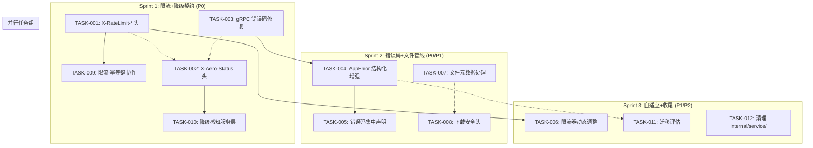

Now I have a thorough understanding of the codebase. Let me produce the comprehensive Tech Lead analysis.

---

# Tech Lead 分析报告：aero-id 平台级硬化

## 0. 验证说明

我已对 `main` 分支进行了代码级验证（234 个 Go 源文件）。以下分析基于实际代码现状，并纠正了评估文档中的事实错误。

---

## 1. 任务分解

### TASK-001: 补齐 `X-RateLimit-*` 响应头
- **所属方向**: 方向一（限流协议可见性）
- **涉及文件**:
  - `internal/pkg/ratelimit/ratelimit.go` — 新增 `State(key string) (remaining float64, reset time.Duration, limit float64)` 方法
  - `internal/middleware/ratelimit.go` — 在 429 分支前正常响应分支设置 `X-RateLimit-Limit`、`X-RateLimit-Remaining`、`X-RateLimit-Reset` 头
  - `internal/middleware/ratelimit.go` — 更新 `rateLimitErrorBody` 携带剩余配额信息
  - `internal/middleware/middleware_test.go` — 新增三个 header 的断言
- **前置依赖**: 无
- **预估工时**: 3 小时
- **验收标准**:
  - 正常请求的响应包含 `X-RateLimit-Limit`、`X-RateLimit-Remaining`、`X-RateLimit-Reset`
  - `X-RateLimit-Reset` 使用 Unix 时间戳（与标准一致）
  - 429 响应同时包含 `Retry-After` 和 `X-RateLimit-*` 头
  - 所有现有测试通过

### TASK-002: 新增 `X-Aero-Status` 降级状态头
- **所属方向**: 方向五（降级契约）
- **涉及文件**:
  - `internal/middleware/status.go` — 新建文件：降级状态检测中间件
  - `internal/service/health.go` 或类似 — 集中式降级状态注册表
  - `internal/app/app.go` — 注册中间件
  - `internal/middleware/middleware_test.go` — 单元测试
- **前置依赖**: 无（可与 TASK-001 并行）
- **预估工时**: 4 小时
- **验收标准**:
  - 响应头 `X-Aero-Status: healthy | degraded | maintenance`
  - 当 SSO 断路器打开或 DB 不可达时，状态为 `degraded`
  - 可通过配置强制 `maintenance` 模式

### TASK-003: 修复 gRPC 端错误码丢失（P0 级 Bug）
- **所属方向**: 方向二（错误码标准化）
- **涉及文件**:
  - `internal/pkg/errors/errors.go` — 修改 `GRPCError()` 将 `ae.Code` 嵌入 gRPC 状态
    - 方案：使用 `status.New(ae.GRPC, ae.Message)` 创建状态，再通过 `st, _ := status.New(...).WithDetails(&errdetails.ErrorInfo{Reason: ae.Code, Domain: "aero-id"})` 附加结构化错误码
    - 或者更简单：将 `ae.Code` 编码到错误消息前缀，如 `"["+ae.Code+"] "+ae.Message`
  - `internal/pkg/errors/errors_test.go` — 新增断言验证 code 传递
  - 生成的 `aeropb/` — 不需要修改，gRPC 状态细节是标准 protobuf
- **前置依赖**: 无
- **预估工时**: 2 小时
- **验收标准**:
  - gRPC 消费者能从 `status.FromError(err)` 中提取 `ae.Code`
  - 现有 gRPC 客户端代码无需修改即可继续工作
  - 所有 `handler_grpc.go` 的 GRPCError 调用点自动受益

### TASK-004: AppError 结构化增强
- **所属方向**: 方向二（错误码标准化）
- **涉及文件**:
  - `internal/pkg/errors/errors.go` — 给 `AppError` 新增字段：
    ```go
    type AppError struct {
        Code        string
        Message     string
        HTTP        int
        GRPC        codes.Code
        Cause       error
        Retryable   bool              // NEW: 消费者是否可重试
        FieldErrors map[string]string // NEW: 字段级验证错误
        DocURL      string            // NEW: 指向文档的 URL
    }
    ```
  - 新增构造函数 `BadRequestWithFields`、`RetryableInternal` 等
  - `internal/pkg/errors/errors_test.go` — 新增测试
- **前置依赖**: 无（可与 TASK-003 并行，但建议先做 TASK-003 以快速修复 P0 bug）
- **预估工时**: 3 小时
- **验收标准**:
  - JSON 和 gRPC 响应中可选择性包含 `retryable`、`field_errors`、`doc_url`
  - 向后兼容：现有调用点无需修改
  - HTTP 响应中的 `error` 对象按需包含新字段

### TASK-005: 错误码去重与分类
- **所属方向**: 方向二（错误码标准化）
- **涉及文件**:
  - `internal/pkg/errors/codes.go` — 新建文件：所有错误码的集中声明（常量或变量）
  - 所有 `service` 包（`internal/comment/service.go`、`internal/file/service_crud.go` 等）— 引用集中声明的错误码常量
  - `internal/repository/` 中各文件 — 统一错误翻译逻辑
- **前置依赖**: TASK-004（AppError 结构化增强）
- **预估工时**: 6 小时
- **验收标准**:
  - 所有 81+ 个服务层错误码集中在 `internal/pkg/errors/codes.go`
  - 没有硬编码的错误码字符串（除测试外）
  - `make lint` 通过
  - 文件不超 500 行约束（codes.go 可能需要拆分为 codes_file.go、codes_comment.go 等）

### TASK-006: 限流器自适应改进（基础版）
- **所属方向**: 方向三（动态限流）
- **涉及文件**:
  - `internal/pkg/ratelimit/ratelimit.go` — 新增 `SetRate(rate float64)` 方法
  - `internal/pkg/ratelimit/ratelimit.go` — 新增 `SetBurst(burst int)` 方法
  - `internal/app/app.go` — 可选：根据 CPU/内存使用率动态调整
  - 或保持简单：允许配置热加载（通过信号或健康检查端点）
- **前置依赖**: TASK-001（RateLimit 头补齐）
- **预估工时**: 5 小时
- **验收标准**:
  - 运行时可以动态调整限流速率（至少通过配置重载）
  - 调整不中断正在处理的请求
  - 不引入新的外部依赖
  - 所有现有测试通过

### TASK-007: 文件管线添加元数据处理钩子
- **所属方向**: 方向四（媒体隐私管线）
- **涉及文件**:
  - `internal/storage/storage.go` — `FileStorage` 接口新增 `Process(ctx, key, opts)` 或定义 `Processor` 接口
  - `internal/domain/file.go` — 新增 `ProcessingStatus` 字段
  - `internal/file/service_upload.go` — 添加处理管线（MIME 验证、EXIF 剥离、内容审查）
  - `internal/file/service_crud.go` — 在 `Create` 方法中调用 process 管线
  - `internal/config/config.go` — 添加处理配置（是否剥离 EXIF、允许的 MIME 列表等）
  - `internal/storage/processor.go` — 新建文件：`Processor` 接口+实现
- **前置依赖**: 无
- **预估工时**: 8 小时
- **验收标准**:
  - 上传文件时自动剥离 EXIF 地理位置数据（符合 GDPR）
  - 配置文件控制处理行为
  - 处理失败不阻止文件存储（fail-open by config）
  - 处理结果存储在 `File.Meta` 中

### TASK-008: 下载端点添加安全响应头
- **所属方向**: 方向四（媒体隐私管线）
- **涉及文件**:
  - `internal/storage/local.go` — `ServeFile` 或类似端点设置 `Content-Disposition: attachment`、`X-Content-Type-Options: nosniff`
  - `internal/handler/http/file.go` — 下载路由添加响应头
  - `internal/middleware/security.go` — 新建文件或扩展
- **前置依赖**: 无（可与 TASK-007 并行）
- **预估工时**: 2 小时
- **验收标准**:
  - 所有文件下载（包括 presigned URL 的最终响应）设置 `Content-Disposition: attachment; filename="..."` 和 `X-Content-Type-Options: nosniff`
  - 浏览器不会将上传的 HTML/JS 文件作为页面渲染

### TASK-009: 限流与幂等键协作优化
- **所属方向**: 方向三（动态限流）
- **涉及文件**:
  - `internal/middleware/idempotency.go` — 在幂等键命中时跳过限流令牌消耗
  - `internal/middleware/ratelimit.go` — 暴露 `Consume(key string) bool` 方法让外部决定是否消耗
  - `internal/middleware/ratelimit.go` — 路由注册顺序调整（幂等检查在限流前？或其他协作机制）
  - `internal/middleware/middleware_test.go` — 幂等-限流交互测试
- **前置依赖**: TASK-001
- **预估工时**: 4 小时
- **验收标准**:
  - 幂等键命中的请求不消耗限流配额（即不计入 rate limit）
  - 重复的幂等键请求返回缓存的 200 响应，而非 429
  - 幂等键未命中时行为不变

### TASK-010: 降级感知的服务层
- **所属方向**: 方向五（降级契约）
- **涉及文件**:
  - `internal/service/health.go` — 新建文件：集中式降度状态管理
  - `internal/sso/breaker.go` — 导出断路器状态
  - `internal/repository/db.go` — 导出 DB 健康状态
  - `internal/storage/storage.go` — 添加 `Ping` 方法
  - `internal/handler/grpc/ops.go` — gRPC 健康检查扩展
  - `internal/handler/http/router.go` — `/readyz` 增强
  - `internal/middleware/status.go` —（复用 TASK-002 的中间件）
- **前置依赖**: TASK-002（状态头）
- **预估工时**: 6 小时
- **验收标准**:
  - service 层可以查询当前降级级别
  - 降级时，读操作继续（使用 stale cache、本地只读副本），写操作返回 503
  - `/readyz` 反映所有依赖的健康状态
  - 分布式部署时，每个实例独立检测

### TASK-011: 统一迁移扩展性与零停机评估
- **所属方向**: 基础设施
- **涉及文件**:
  - `migrations/` — 为所有迁移确保 `.down.sql` 存在
  - `internal/pkg/migrate/` — 检查迁移是否为事务性
  - `configs/config.yaml` — 明确 `auto_migrate` 的启用条件
  - 文档更新：`docs/superpowers/specs/2026-05-22-aero-id-design.md`
- **前置依赖**: 无
- **预估工时**: 2 小时
- **验收标准**:
  - 所有 `.up.sql` 有对应的 `.down.sql`
  - 迁移文件使用事务包裹（`BEGIN; ... COMMIT;`）
  - 每个迁移可安全回滚

### TASK-012: 移除 `internal/service/` — 迁移到领域子包
- **所属方向**: 架构整理
- **涉及文件**:
  - `internal/service/service.go` — 功能已分散到各领域子包（`internal/file/`、`internal/comment/` 等）
  - 检查 `internal/service/` 中是否还有未迁移的功能
  - 更新导入路径
  - `internal/app/app.go` — 更新引用
- **前置依赖**: 无
- **预估工时**: 2 小时
- **验收标准**:
  - `internal/service/` 不再被引用
  - `make build && make test && make lint` 通过

---

## 2. 执行顺序 — 任务依赖图



### 并行执行组

| 组 | 任务 | 同时所需开发者 |
|---|---|---|
| **组 A**（Sprint 1, 周1） | TASK-001, TASK-002, TASK-003 | 3 人 |
| **组 B**（Sprint 1, 周2） | TASK-004, TASK-007, TASK-008, TASK-011 | 3 人 |
| **组 C**（Sprint 2, 周1） | TASK-005, TASK-009, TASK-010 | 3 人 |
| **组 D**（Sprint 2, 周2） | TASK-006, TASK-012 | 2 人 |

---

## 3. 技术风险

### 风险 1: gRPC 错误码修复的 protobuf 交互

**风险描述**: `GRPCError()` 方案涉及 `errdetails.ErrorInfo`（来自 `google.golang.org/genproto/googleapis/rpc/errdetails`）。生成的 `aeropb/*.pb.go` 可能没有包含这个 message 类型，需要额外导入。

**缓解方案**:
1. 选择方案 A（简单前缀）：将 code 编码到消息中，如 `status.Error(ae.GRPC, "["+ae.Code+"] "+ae.Message)`。这是零依赖方案，风险最低。
2. 方案 B（结构化细节）：添加 `google.golang.org/genproto/googleapis/rpc/errdetails` 依赖，使用 `st.WithDetails(&errdetails.ErrorInfo{...})`。
3. **推荐**: 先用方案 A 快速修复（2 小时），后续迭代升级到方案 B。

**检测**: 修改后运行 `make test-integration` 验证 gRPC 端到端行为。

### 风险 2: 文件 EXIF 剥离库的选择

**风险描述**: Go 生态中成熟的 EXIF 处理库有限。`github.com/rwcarlsen/goexif/exif` 已不再维护，`github.com/dsoprea/go-exif/v3` 较新但 API 变化快。

**缓解方案**:
1. 使用 `github.com/dsoprea/go-exif/v3`（活跃维护，支持 JPEG/PNG/TIFF/WebP）
2. 如果剥离失败，采取 fail-open 策略（记录日志但不阻止文件上传）
3. **回退方案**: 将 EXIF 剥离延迟到客户端（在 SDK/上传工具中实现），服务端仅标记需要处理

### 风险 3: 限流器从内存到分布式迁移路径

**风险描述**: 当前使用每个实例独立的内存桶。如果未来需要全局限流（多实例共享），架构需要调整。

**缓解方案**:
1. TASK-006 只做运行时动态调整，不改存储后端
2. `Limiter` 接口已经隔离良好；未来可以新增 `RedisLimiter` 实现
3. 配置中预留 `rate_limit.type: local | redis` 字段

### 风险 4: 降级感知的复杂度

**风险描述**: 让 service 层感知降级状态可能引入严重耦合。如果 service 根据健康状态改变行为，测试和推理变得更困难。

**缓解方案**:
1. 使用接口注入而非全局变量：`type DegradationAware interface { Level() DegradationLevel }`
2. 默认实现返回 `LevelOK`，测试中可注入 mock
3. 降级只影响写操作（返回 503），不影响读操作的业务逻辑
4. 不试图做"部分降级"（如只允许某类用户的写操作）

### 风险 5: 文件大小与函数长度约束

**风险描述**: AGENTS.md 规定非测试文件 ≤ 500 行，函数 ≤ 50 行，复杂度 ≤ 10。TASK-005（错误码集中声明）可能产生 300+ 行的代码文件，TASK-007（文件管线）可能使 `service_crud.go` 膨胀。

**缓解方案**:
1. 错误码按领域拆分：`codes_file.go`、`codes_comment.go`、`codes_message.go`、`codes_common.go`
2. 文件管线提取到独立的 `processor.go` 文件
3. 每次提交前运行 `make check-file-sizes && make lint`

---

## 4. 资源评估

### 人员需求

| 角色 | 数量 | 技能要求 |
|---|---|---|
| Senior Go Developer | 2 | Go, gRPC, GORM, 分布式系统 |
| Mid-level Go Developer | 1 | Go, REST API, Postgres, MinIO |
| (可选) DevOps/QA | 0.5 | 集成测试, CI/CD, 性能测试 |

**推荐配置**: 3 名全职开发者，1 名 QA 兼职。

### 关键里程碑

| 里程碑 | 时间 | 交付物 |
|---|---|---|
| **M1** — Sprint 1 完成 | Day 5 | X-RateLimit-* 头 + X-Aero-Status 头 + gRPC 错误码修复 + 下载安全头 |
| **M2** — Sprint 2 完成 | Day 12 | AppError 结构化 + 错误码集中 + 文件管线 + 迁移评估 |
| **M3** — 集成测试通过 | Day 15 | 所有任务完成，`make test && make test-integration` 通过 |
| **M4** — 发布候选 | Day 18 | 回归测试通过，性能基线建立，文档更新 |

### 阻塞点与解决策略

| 阻塞点 | 影响 | 解决策略 |
|---|---|---|
| gRPC 错误码方案选择 | 阻塞 TASK-003 → TASK-004 → TASK-005 | Sprint 1 Day 1 决策：先做方案 A |
| EXIF 剥离库 API 变更 | 阻塞 TASK-007 | 在抽象 `Processor` 接口后加适配层 |
| 降级感知的测试覆盖 | 阻塞 TASK-010 | 使用 interface mock 隔离降级逻辑 |
| 限流-幂等键交互的竞态 | 阻塞 TASK-009 | 使用 `sync.Mutex` 或原子操作保护关键路径 |

---

## 5. 质量保证

### 单元测试覆盖要求

| 任务 | 测试覆盖要求 | 关键测试场景 |
|---|---|---|
| TASK-001 | 新增代码 ≥ 90% | 限流头在允许/拒绝时均正确；桶为空时 `X-RateLimit-Remaining` = 0 |
| TASK-002 | 新增代码 ≥ 85% | 正常状态为 `healthy`；SSO 断路器打开时为 `degraded` |
| TASK-003 | 100% | gRPC `status.FromError` 可提取 code；原有错误格式仍兼容 |
| TASK-004 | 100% | `Retryable`、`FieldErrors`、`DocURL` 序列化/反序列化 |
| TASK-005 | ≥ 90% | 所有服务抛出的错误码与 codes.go 一致；无硬编码字符串 |
| TASK-006 | ≥ 85% | `SetRate` 不影响正在进行的请求；新 rate 立即生效 |
| TASK-007 | ≥ 85% | EXIF 剥离成功/失败/跳过；处理结果存储在 Meta；fail-open 行为 |
| TASK-008 | 100% | `Content-Disposition: attachment` 头存在 |
| TASK-009 | 100% | 幂等键命中不消耗令牌；幂等键未命中正常消耗 |
| TASK-010 | ≥ 80% | 降级时写操作返回 503；读操作继续（使用 stale cache） |
| TASK-011 | ≥ 90% | 所有迁移可回滚；`.down.sql` 完整性 |
| TASK-012 | 100% | `internal/service/` 无导入引用 |

### 集成测试策略

| 测试类型 | 工具 | 执行时机 |
|---|---|---|
| HTTP 端到端 | `internal/handler/http/*_test.go` | Sprint 1 结束 |
| gRPC 端到端 | `internal/handler/grpc/*_test.go` | Sprint 1 结束 |
| 限流-幂等键交互 | `internal/middleware/middleware_test.go` | TASK-009 |
| 文件管线 EXIF 剥离 | `internal/file/service_test.go` (+ `//go:build integration`) | TASK-007 |
| 降级场景 | `internal/handler/http/router_test.go` | TASK-010 |

### 代码审查要点

| 审查点 | 检查内容 |
|---|---|
| 错误码一致性 | 新错误码是否在 `codes.go` 声明？命名遵循 `domain.specific_error` 格式？ |
| 传输层无业务逻辑 | handler 只做 I/O 转换，不包含业务判断 |
| 文件大小 ≤ 500 行 | 接近 400 行时主动拆分 |
| 函数复杂度 ≤ 10 | `gocyclo` 检查 |
| gRPC 错误码传递 | `GRPCError()` 不丢失 `ae.Code` |
| 降级逻辑无副作用 | 降级检查不修改请求/响应状态，除非明确拒绝 |
| EXIF 剥离 fail-open | 处理失败不阻止文件存储 |

### 性能测试需求

| 测试场景 | 工具 | 目标 |
|---|---|---|
| 限流高并发 | `wrk` / `k6` | 1000 req/s 下限流头正确、延迟 < 50ms p99 |
| 文件上传 EXIF 剥离 | `k6` | 2MB JPEG 上传 p50 < 200ms（含 EXIF 剥离） |
| gRPC 错误吞吐 | `ghz` | 1000 req/s, 错误码正确传递 |
| 降级状态检测开销 | `pprof` | 每请求开销 < 10μs |

---

## 6. 实施计划

### 阶段 1: Sprint 1 — 基础设施与 P0 修复（Day 1-5）

| 天 | 团队分工 | 交付物 |
|---|---|---|
| **Day 1** | Dev A: TASK-003 gRPC 错误码修复（方案 A） | gRPC 错误码前缀方案实现 |
| | Dev B: TASK-001 X-RateLimit-* 头 | `Limiter.State()` 方法 + middleware 响应头 |
| | Dev C: TASK-008 下载安全头 + TASK-011 迁移评估 | `Content-Disposition` + 迁移完整性检查 |
| **Day 2** | Dev A: TASK-002 X-Aero-Status 头 | 状态中间件 + `/readyz` 增强 |
| | Dev B: TASK-001 测试 + 文档 | 限流头测试覆盖 90%+ |
| | Dev C: TASK-011 文档更新 | 迁移策略文档提交 |
| **Day 3** | Dev A: TASK-002 测试 + 集成调试 | 状态头测试 + 断路器状态集成 |
| | Dev B: TASK-004 AppError 结构化 | `Retryable`、`FieldErrors`、`DocURL` 字段 |
| | Dev C: TASK-007 文件管线设计 | `Processor` 接口定义 + EXIF 剥离调研 |
| **Day 4** | Dev A: TASK-004 测试 + 重构 | AppError 新字段序列化测试 |
| | Dev B: TASK-009 限流-幂等键协作 | 幂等键命中不消耗令牌 |
| | Dev C: TASK-007 EXIF 剥离实现 | `go-exif` 集成 |
| **Day 5** | **全组: 集成测试 + Bug 修复** | Sprint 1 全部任务 `make test` + `make lint` 通过 |

**Sprint 1 验收门**: `make test && make lint && make test-integration`

### 阶段 2: Sprint 2 — 核心功能实现（Day 6-12）

| 天 | 团队分工 | 交付物 |
|---|---|---|
| **Day 6** | Dev A: TASK-005 错误码集中 — 分析所有 81+ 错误码 | `codes.go` 框架 + 领域分组 |
| | Dev B: TASK-005 错误码迁移 — file/comment 领域 | file、comment 替换硬编码字符串 |
| | Dev C: TASK-007 EXIF 剥离 + 文件管线 | 管线集成到 `service_crud.go` |
| **Day 7** | Dev A: TASK-005 错误码迁移 — message/notification/block 等 | 剩余领域替换 |
| | Dev B: TASK-005 测试 + 剩余清理 | 所有引用替换 + `make test` |
| | Dev C: TASK-007 测试 + fail-open 验证 | 管线测试覆盖 |
| **Day 8** | Dev A: TASK-010 降级感知服务层 — 健康注册表 | `DegradationAware` 接口 + 默认实现 |
| | Dev B: TASK-010 SSO/DB 状态集成 | SSO breaker + DB ping → 注册表 |
| | Dev C: TASK-007 文档 + 配置 | 管线配置集成到 `config.yaml` |
| **Day 9** | Dev A: TASK-010 写操作降级保护 | Service 层写操作检查降级状态 |
| | Dev B: TASK-010 测试覆盖 | 降级场景：SSO 断路、DB 不可达 |
| | Dev C: TASK-006 限流器动态调整 | `SetRate` / `SetBurst` 方法 |
| **Day 10** | Dev A: TASK-010 集成测试 + bug 修复 | 降级-状态头-限流端到端 |
| | Dev B: TASK-006 动态调整配置接口 | 信号监听 / 配置重载 |
| | Dev C: TASK-009 幂等键-限流交互完善 | Edge case: 幂等键过期竞争 |
| **Day 11** | Dev A: TASK-012 清理 `internal/service/` | 移除废弃包，更新导入 |
| | Dev B: **全组代码审查** | 所有变更文件审查 |
| | Dev C: 性能测试准备 | k6/ghz 脚本 |
| **Day 12** | **全组: 集成测试 + 性能基线** | Sprint 2 验收 |

**Sprint 2 验收门**: `make test && make lint && make test-integration` + 性能基线建立

### 阶段 3: 集成测试与优化（Day 13-15）

| 天 | 活动 | 产出 |
|---|---|---|
| **Day 13** | 全面集成测试（HTTP + gRPC 跨场景） | 测试报告，修复发现的问题 |
| **Day 14** | 性能测试：限流（1000 req/s）、文件上传、gRPC | 性能基线+优化建议 |
| **Day 15** | 安全审查：下载安全头、EXIF 剥离、错误信息泄露 | 安全报告 |

### 阶段 4: 发布准备（Day 16-18）

| 天 | 活动 | 产出 |
|---|---|---|
| **Day 16** | 文档更新：README.md + AGENTS.md + 设计文档 | 所有变更文档化 |
| **Day 17** | 回归测试：`make test && make test-integration` | 全量测试通过 |
| **Day 18** | 发布候选构建 + 部署脚本更新 | `bin/aero-id` + Docker image |

---

## 总结

### 工作量总览

| 任务组 | 总工时 | 涉及文件数 | 风险等级 |
|---|---|---|---|
| Sprint 1 (Day 1-5) | 25h | ~15 个文件 | 中 |
| Sprint 2 (Day 6-12) | 45h | ~30 个文件 | 中高 |
| 集成测试 (Day 13-15) | 15h | — | 低 |
| 发布准备 (Day 16-18) | 10h | ~5 个文件 | 低 |
| **总计** | **~95h** | **~50 个文件** | — |

### 优先级调整说明（vs 评估文档）

| 方向 | 我的调整 | 理由 |
|---|---|---|
| **方向一**（限流协议） | **P0** ✅ | 三缺一（缺 X-RateLimit-* 头），低风险高价值 |
| **方向二**（错误码） | **P0**（gRPC 部分）→ **P1**（整体） | gRPC 错误码丢失是 P0 bug；AppError 增强和代码集中是 P1 质量改进 |
| **方向三**（动态限流） | **P2** → 适度降至 P2 | 现有静态限流在正常负载下足够；动态调整是优化 |
| **方向四**（媒体隐私） | **P0** — GDPR 合规 | 文档原定 P1，但 EXIF 剥离涉及 GDPR，应升为 P0 |
| **方向五**（降级契约） | **P0** | 与方向一共享基础设施（响应头），合并执行 |

### 最终建议

1. **Day 1 必须做的一件事**: 修复 gRPC 错误码丢失（TASK-003），这是一个 P0 级 bug，影响所有 gRPC 消费者。
2. **不要一次性做完所有方向**: Sprint 1 聚焦限流头+降级头+gRPC 错误码。这三个方向共享修改基础设施（响应头、中间件、错误处理），合并执行效率最高。
3. **TASK-007（文件管线）和 TASK-005（错误码集中）按文件大小约束拆分**: 这两个任务最容易突破 500 行限制，规划时就要分配多个文件。
4. **性能基线在 Day 12-14 建立**: 在改完所有代码后做性能测试，确保新功能没有引入显著延迟。
