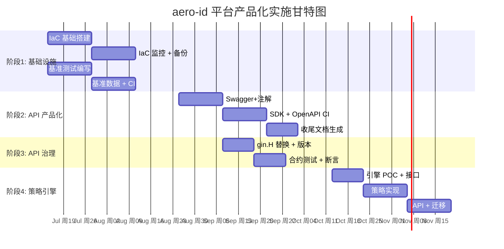

All evidence verified. Now let me produce the full Tech Lead analysis.

---

# Tech Lead 分析：aero-id 平台产品化扩展方向

## 总体评估

分析文档质量极高，5 个方向均建立在代码级证据之上，无臆测内容。文档将 aero-id 从"功能完备的后端微服务"推向"可被外部采用的可集成平台产品"——定位准确。以下从技术执行角度做任务分解和落地方案。

---

## 1. 任务分解

### 方向 4：基础设施即代码（IaC）— 18 个任务

| 任务 ID | 任务标题 | 涉及文件 | 前置依赖 | 工时 |
|---------|---------|---------|---------|------|
| TASK-401 | 创建 Helm Chart 骨架 + Deployment 模板 | `deployments/charts/aero-id/templates/deployment.yaml`, `Chart.yaml`, `values.yaml` | 无 | 4h |
| TASK-402 | 添加 Service + ConfigMap + Secret 模板 | `deployments/charts/aero-id/templates/service.yaml`, `configmap.yaml`, `secret.yaml` | TASK-401 | 3h |
| TASK-403 | 添加 HPA + PDB + Ingress + ServiceMonitor 模板 | `deployments/charts/aero-id/templates/hpa.yaml`, `pdb.yaml`, `ingress.yaml`, `servicemonitor.yaml` | TASK-401 | 4h |
| TASK-404 | 创建 Terraform RDS PostgreSQL 模块 | `deployments/terraform/modules/rds/main.tf`, `variables.tf`, `outputs.tf` | 无 | 4h |
| TASK-405 | 创建 Terraform S3 + IAM 模块 | `deployments/terraform/modules/s3/main.tf`, `iam/main.tf` | 无 | 3h |
| TASK-406 | Terraform 根模块 + env 隔离 | `deployments/terraform/environments/{dev,staging,prod}.tfvars` | TASK-404, TASK-405 | 3h |
| TASK-407 | 创建多环境 Helm values 文件 | `deployments/charts/aero-id/values.{dev,staging,prod}.yaml` | TASK-401 | 2h |
| TASK-408 | 创建 Grafana RED 仪表盘（HTTP + gRPC + SSO） | `deployments/monitoring/grafana/dashboards/aero-id-red.json` | 无 | 4h |
| TASK-409 | 创建 Prometheus 告警规则 | `deployments/monitoring/prometheus/rules/aero-id-alerts.yaml` | 无 | 3h |
| TASK-410 | 编写 db 自动备份脚本 + 上传 S3 | `scripts/backup/backup-db.sh`, `scripts/backup/restore-db.sh` | 无 | 4h |
| TASK-411 | 编写灾备切换 runbook | `docs/ops/disaster-recovery.md` | TASK-410 | 2h |
| TASK-412 | 为 docker-compose 添加健康检查 + 资源限制 | `deployments/docker-compose.yml` | 无 | 1h |
| TASK-413 | CI 中增加 Helm chart lint + Terraform fmt 检查 | `.github/workflows/ci.yml` | TASK-401, TASK-404, TASK-405 | 2h |

**方向 4 总工时：39h（约 1 人·周）**

### 方向 2：性能基准 — 10 个任务

| 任务 ID | 任务标题 | 涉及文件 | 前置依赖 | 工时 |
|---------|---------|---------|---------|------|
| TASK-201 | idgen 核心路径基准测试 | `internal/pkg/idgen/idgen_benchmark_test.go` | 无 | 2h |
| TASK-202 | Full-text search 查询基准（含数据集加载） | `internal/repository/message_search_benchmark_test.go` | 无 | 4h |
| TASK-203 | 通知/SSE 推送管道基准 | `internal/hub/hub_benchmark_test.go` | 无 | 3h |
| TASK-204 | SSO client 延迟分解基准（缓存命中/未命中） | `internal/sso/client_benchmark_test.go` | 无 | 3h |
| TASK-205 | 文件上传/下载/预签名路径基准 | `internal/service/file_benchmark_test.go` | 无 | 3h |
| TASK-206 | 基准数据生成器（testpg + 1K/10K/100K 行） | `internal/repository/testpg/benchdata/` | TASK-202 | 4h |
| TASK-207 | k6 端到端负载测试脚本 | `test/load/k6/`（scenarios: message, file, search, notification） | TASK-202, TASK-204, TASK-205 | 4h |
| TASK-208 | CI benchstat 回归门禁 | `.github/workflows/ci.yml`, `scripts/bench-compare.sh` | TASK-201 ~ TASK-205 | 3h |
| TASK-209 | 性能数据收集 Grafana dashboard | `deployments/monitoring/grafana/dashboards/aero-id-benchmark.json` | TASK-208 | 2h |
| TASK-210 | 性能回归 PR template 检查项 | `.github/PULL_REQUEST_TEMPLATE.md` | TASK-208 | 1h |

**方向 2 总工时：29h（约 0.8 人·周）**

### 方向 1：API 产品化 — 14 个任务

| 任务 ID | 任务标题 | 涉及文件 | 前置依赖 | 工时 |
|---------|---------|---------|---------|------|
| TASK-101 | 引入 swaggo + 基础配置 | `internal/handler/http/swagger.go`, `docs/swagger/`, `go.mod` | 无 | 2h |
| TASK-102 | 为所有 HTTP handler 添加 swagger 注解 | `internal/handler/http/*.go`（全部 handler 文件） | TASK-101 | 6h |
| TASK-103 | `make openapi` 目标 + CI spec 新鲜度检查 | `Makefile`, `.github/workflows/ci.yml` | TASK-102 | 2h |
| TASK-104 | gRPC reflection 默认开启 + mTLS 守卫 | `internal/app/app.go`, `configs/config.yaml`, `internal/middleware/tls.go` | 无 | 4h |
| TASK-105 | 集成 `buf` 工具链（lint + breaking change） | `buf.yaml`, `buf.gen.yaml`, `Makefile`, `.github/workflows/ci.yml` | 无 | 4h |
| TASK-106 | 创建 API changelog 目录 + 维护流程 | `api/changelog/`, `docs/api/changelog-guide.md` | 无 | 2h |
| TASK-107 | 实现 Deprecation + Sunset 响应头中间件 | `internal/middleware/deprecation.go` | 无 | 3h |
| TASK-108 | 在 proto 字段添加 `deprecated` 注解和 sunset date | `api/proto/aero_id/v1/aero_id.proto` | TASK-105 | 2h |
| TASK-109 | 构建 Go 客户端 SDK 核心包 | `api/sdk/go/client.go`, `api/sdk/go/file.go`, `api/sdk/go/message.go` 等 | TASK-101, TASK-102 | 6h |
| TASK-110 | SDK 重试 + 错误类型映射 | `api/sdk/go/retry.go`, `api/sdk/go/errors.go` | TASK-109 | 3h |
| TASK-111 | 从 OpenAPI spec 自动生成 Postman 集合 | `scripts/generate-postman.sh`, `docs/api/postman.md` | TASK-103 | 2h |
| TASK-112 | CI 中验证 proto 与 HTTP handler 注册的等价性 | `internal/handler/grpc/parity_test.go`（扩展） | TASK-105 | 3h |
| TASK-113 | 编写 curl 示例文档 | `docs/api/examples/` | TASK-102 | 2h |
| TASK-114 | OpenAPI spec → 生成 TypeScript/Go 客户端的 CI 任务 | `Makefile`, `.github/workflows/sdkgen.yml` | TASK-103 | 3h |

**方向 1 总工时：44h（约 1.1 人·周）**

### 方向 5：API 治理 — 9 个任务

| 任务 ID | 任务标题 | 涉及文件 | 前置依赖 | 工时 |
|---------|---------|---------|---------|------|
| TASK-501 | 将 `gin.H` 响应体替换为类型化 struct（file handler） | `internal/handler/http/file.go` 及响应 helper | 无 | 3h |
| TASK-502 | 将 `gin.H` 响应体替换为类型化 struct（message/notification/admin 等） | `internal/handler/http/message.go`, `notification.go`, `admin.go`, `search.go`, `block.go` | TASK-501 | 4h |
| TASK-503 | 实现 API 版本路由中间件（Accept-Version header） | `internal/middleware/version.go`, `internal/handler/http/router.go` | 无 | 3h |
| TASK-504 | 引入 `buf breaking` 到 CI（与 TASK-105 合并实现） | `.github/workflows/ci.yml` | TASK-105 | 1h |
| TASK-505 | 引入 pact-go 合约测试框架 | `internal/contract/`, `pact/` | TASK-109（SDK） | 4h |
| TASK-506 | 编写第一个已知消费者合约（自测用） | `internal/contract/consumer_test.go` | TASK-505 | 3h |
| TASK-507 | HTTP↔gRPC 响应体结构等价性自动化断言 | `internal/handler/grpc/parity_test.go`（扩展） | TASK-501, TASK-502 | 3h |
| TASK-508 | 制定并文档化 API 弃用策略 | `docs/api/deprecation-policy.md` | TASK-107 | 2h |
| TASK-509 | 为 v2 API 路由预留 RouterGroup 架构 | `internal/handler/http/router.go`, `internal/handler/http/handler_v2.go` | TASK-503 | 2h |

**方向 5 总工时：25h（约 0.6 人·周）**

### 方向 3：数据策略引擎 — 12 个任务

| 任务 ID | 任务标题 | 涉及文件 | 前置依赖 | 工时 |
|---------|---------|---------|---------|------|
| TASK-301 | 策略引擎技术选型（OPA vs Casbin vs 自建） + POC | `docs/decisions/policy-engine-adr.md` | 无 | 4h |
| TASK-302 | 定义 `PolicyEngine` 接口 + 默认 passthrough 实现 | `internal/domain/policy.go`, `internal/service/policy.go` | TASK-301 | 3h |
| TASK-303 | 实现文件生命周期策略（替换 GC sweeper 全局 retention） | `internal/storage/gc/sweeper.go`（改造）, `policies/file-lifecycle.rego` | TASK-302 | 4h |
| TASK-304 | 实现访问控制策略（替换 CanReadFile/CanReadMessage） | `internal/domain/access.go`（改造）, `policies/access-control.rego` | TASK-302 | 4h |
| TASK-305 | 策略编译缓存 + 版本号触发刷新 | `internal/service/policy_cache.go` | TASK-302 | 3h |
| TASK-306 | 策略管理 API 端点（CRUD + 干运行评估） | `internal/handler/http/policy.go`, `internal/service/policy_admin.go` | TASK-304（若需访问控制） | 4h |
| TASK-307 | 策略验证 + 冲突检测（allow/deny 优先级） | `internal/domain/policy_validator.go` | TASK-302 | 3h |
| TASK-308 | 审计日志超期自动归档策略 | `internal/audit/archiver.go`, `policies/audit-retention.rego` | TASK-302 | 3h |
| TASK-309 | 默认"allow all"向后兼容策略 | `policies/defaults/` | TASK-302 | 2h |
| TASK-310 | 策略评估链路 OTel span 埋点 | `internal/service/policy_otel.go` | TASK-302 | 2h |
| TASK-311 | 策略引擎集成测试（testpg + 多种策略场景） | `internal/service/policy_test.go` | TASK-303, TASK-304 | 4h |
| TASK-312 | 运维文档 + 迁移指南 | `docs/ops/policy-engine.md` | TASK-303 ~ TASK-309 | 3h |

**方向 3 总工时：39h（约 1 人·周）**

---

## 2. 执行顺序与依赖图

```mermaid
graph TD
    %% ─── Phase 1: Foundation ───
    subgraph Phase1["阶段 1：基础设施搭建（IaC）"]
        T401["TASK-401: Helm 骨架 + Deployment"]
        T402["TASK-402: Service + ConfigMap + Secret"]
        T403["TASK-403: HPA + PDB + Ingress + ServiceMonitor"]
        T404["TASK-404: Terraform RDS 模块"]
        T405["TASK-405: Terraform S3 + IAM 模块"]
        T406["TASK-406: Terraform 根模块 + env 变量"]
        T407["TASK-407: 多环境 Helm values"]
        T408["TASK-408: Grafana RED 仪表盘"]
        T409["TASK-409: Prometheus 告警规则"]
        T410["TASK-410: 数据库备份脚本"]
        T411["TASK-411: 灾备 runbook"]
        T412["TASK-412: docker-compose 健康检查"]
        T413["TASK-413: CI lint (Helm + Terraform)"]
    end

    subgraph Phase1b["阶段 1b：性能基准（并行）"]
        T201["TASK-201: idgen 基准"]
        T202["TASK-202: FTS 查询基准"]
        T203["TASK-203: SSE/通知管道基准"]
        T204["TASK-204: SSO client 延迟分解"]
        T205["TASK-205: 文件上传/下载基准"]
        T206["TASK-206: 基准数据生成器"]
        T207["TASK-207: k6 端到端负载脚本"]
        T208["TASK-208: CI benchstat 门禁"]
        T209["TASK-209: 基准 Grafana dashboard"]
        T210["TASK-210: PR template 检查项"]
    end

    %% ─── Phase 2: API Productization ───
    subgraph Phase2["阶段 2：API 产品化"]
        T101["TASK-101: swaggo 配置"]
        T102["TASK-102: Handler swagger 注解"]
        T103["TASK-103: make openapi + CI"]
        T104["TASK-104: gRPC reflection + mTLS"]
        T105["TASK-105: buf 工具链集成"]
        T106["TASK-106: API changelog 流程"]
        T107["TASK-107: Deprecation 响应头"]
        T108["TASK-108: Proto deprecated 注解"]
        T109["TASK-109: Go SDK 核心包"]
        T110["TASK-110: SDK 重试 + 错误映射"]
        T111["TASK-111: Postman 集合生成"]
        T112["TASK-112: HTTP↔gRPC 等价性检查"]
        T113["TASK-113: curl 示例文档"]
        T114["TASK-114: CI SDK 生成"]
    end

    %% ─── Phase 3: API Governance ───
    subgraph Phase3["阶段 3：API 治理"]
        T501["TASK-501: gin.H → typed struct (file)"]
        T502["TASK-502: gin.H → typed struct (其余)"]
        T503["TASK-503: API 版本中间件"]
        T504["TASK-504: buf breaking in CI"]
        T505["TASK-505: Pact 合约测试框架"]
        T506["TASK-506: 第一个消费者合约"]
        T507["TASK-507: HTTP↔gRPC 响应等价断言"]
        T508["TASK-508: 弃用策略文档"]
        T509["TASK-509: v2 RouterGroup 预留"]
    end

    %% ─── Phase 4: Policy Engine ───
    subgraph Phase4["阶段 4：数据策略引擎"]
        T301["TASK-301: 策略引擎选型 POC"]
        T302["TASK-302: PolicyEngine 接口 + passthrough"]
        T303["TASK-303: GC 生命周期策略"]
        T304["TASK-304: 访问控制策略"]
        T305["TASK-305: 策略缓存层"]
        T306["TASK-306: 策略管理 API"]
        T307["TASK-307: 冲突检测 + 验证"]
        T308["TASK-308: 审计日志归档策略"]
        T309["TASK-309: 默认 allow-all 策略"]
        T310["TASK-310: OTel 埋点"]
        T311["TASK-311: 集成测试"]
        T312["TASK-312: 运维文档 + 迁移指南"]
    end

    %% ─── Phase 1 Dependencies ───
    T401 --> T402
    T401 --> T403
    T402 --> T407
    T403 --> T407
    T404 --> T406
    T405 --> T406
    T406 --> T413
    T407 --> T413
    T408 --> T413
    T409 --> T413
    T410 --> T411

    %% ─── Phase 1b Dependencies ───
    T201 --> T206
    T202 --> T206
    T206 --> T207
    T201 --> T208
    T202 --> T208
    T203 --> T208
    T204 --> T208
    T205 --> T208

    %% ─── Phase 2 Dependencies (starts after Phase 1 code freeze) ───
    T101 --> T102
    T102 --> T103
    T103 --> T111
    T103 --> T114
    T101 --> T104
    T105 --> T108
    T105 --> T112
    T106 --> T107
    T109 --> T110
    T109 --> T114

    %% ─── Phase 3 Dependencies ───
    T501 --> T502
    T502 --> T507
    T503 --> T509
    T105 --> T504
    T109 --> T505
    T505 --> T506
    T107 --> T508

    %% ─── Phase 4 Dependencies ───
    T301 --> T302
    T302 --> T303
    T302 --> T304
    T302 --> T305
    T302 --> T306
    T302 --> T307
    T302 --> T308
    T302 --> T309
    T302 --> T310
    T303 --> T311
    T304 --> T311
    T307 --> T311
    T306 --> T312
    T311 --> T312

    %% ─── Cross-phase dependencies ───
    T103 -.->|软依赖: OpenAPI 规范| T505
    T109 -.->|软依赖: SDK 存在| T505
    T501 -.->|TASK-502 的响应 struct 可供 SDK 使用| T109
    T304 -.->|策略管理 API 受益于 OpenAPI| T306
```



### 可并行执行的任务组

| 并行组 ID | 包含任务 | 条件 |
|-----------|---------|------|
| **G1** | TASK-401, TASK-404, TASK-405, TASK-408, TASK-409, TASK-410, TASK-412 | 方向 4 内部，彼此无依赖 |
| **G2** | TASK-201, TASK-202, TASK-203, TASK-204, TASK-205 | 方向 2 基准编写，彼此独立 |
| **G3** | TASK-101, TASK-104, TASK-105, TASK-106 | 方向 1 初始工作，互不依赖 |
| **G4** | TASK-501, TASK-503, TASK-508 | 方向 5 初始工作，互不依赖 |
| **G5** | TASK-303, TASK-304, TASK-305, TASK-306, TASK-308, TASK-309 | 方向 3 引擎就绪后的并行策略实现 |

---

## 3. 技术风险

### 3.1 高影响风险

| 风险 | 影响 | 概率 | 缓解策略 |
|------|------|------|---------|
| **OpenAPI spec drift** — swaggo 注解与运行时代码不一致 | HTTP 客户端断裂，信任丧失 | 中 | CI 中运行 `swaggo fmt` + diff 验证；代码审查强制检查 handler 注解更新 |
| **Benchmark CI 环境抖动** — GitHub Actions runner 性能不稳定 | 假阳性回归警报，团队麻木 | 高 | 同一 PR 分支 vs main 在同一次 CI run 中跑；使用 `benchstat` 的相对比较（非绝对值） |
| **OPA/Casbin 引入的延迟** — 每次请求评估策略增加 1-5ms | P99 延迟劣化 | 中 | 策略 AST 编译结果缓存在内存中；评估结果 cache（TTL 10s）；默认 passthrough 模式可切换 |
| **Terraform 状态泄露** — 本地 tfstate 被提交或丢失 | 基础设施不可管理 | 低 | 强制远程状态后端（S3 + DynamoDB lock）；CI 中 `terraform validate` 检查 backend 配置 |
| **gRPC reflection + mTLS 组合复杂度** — 证书轮换、CA 更新等运维负担 | 生产环境中 reflection 再次被关闭（回到原点） | 中 | 提供 `deployments/charts/` 中自动化的 cert-manager + mTLS ConfigMap；跑 book 文档记录轮换流程 |
| **政策引擎迁移导致权限缺口** — 从硬编码 CanReadFile 迁移到 Rego 时遗漏某个规则 | 意外暴露私有数据 | 中 | 并行运行新旧策略 30 天，记录所有不一致的决策；默认严格 deny 模式 + 审计日志记录每次 deny |

### 3.2 中等影响风险

| 风险 | 分析 |
|------|------|
| **Postman 集合维护成本** | 集合是静态导出，除非 CI 每次合入都重新生成，否则很快过时。建议只在 CD 发布时生成，作为"参考"而非"契约" |
| **SDK 版本号管理** | Go SDK 的 module path 若跟 API version 绑定（如 `api/sdk/go/v1`），则 v2 → v3 的 module path 变更会破坏所有 import。建议 `api/sdk/go` 不带版本后缀，用 gRPC 兼容性保证（protobuf wire-compatible） |
| **Pact 合约测试的维护成本** | 每个外部消费者需维护一份 pact 文件。团队数 < 3 时可能不值得。建议 ≤ 2 个已知消费者时仅作"可选检查"，不阻塞 CI |
| **gRPC versioning 难题** | Protocol Buffers 不允许多个版本的同一 service 共存于同一 binary。如果要同时服务 v1 和 v2，需要两个不同的 gRPC 注册名或两个不同的 port。方向 5 的 API 版本中间件仅适用于 HTTP 传输 |

### 3.3 性能敏感路径识别

| 路径 | 当前状态 | 基准后目标 P99 |
|------|---------|---------------|
| SSO token 验证（缓存未命中） | 未知 | < 200ms |
| SSO token 验证（缓存命中） | 未知 | < 5ms |
| FTS 全文搜索（10 万行） | 未知 | < 100ms |
| 文件上传（1MB，local storage） | 未知 | < 500ms |
| SSE 通知推送（单连接） | 未知 | < 50ms |
| 权限检查（CanReadFile） | ~10μs（纯内存） | 引入策略引擎后 < 1ms |

---

## 4. 资源评估

### 4.1 团队组成

| 角色 | 数量 | 核心职责 | 所需技能 |
|------|------|---------|---------|
| **Backend Engineer（平台方向）** | 1 | IaC（Helm + Terraform）、监控栈、备份脚本、CI 流水线 | Go, Helm, Terraform, K8s, Prometheus |
| **Backend Engineer（API/性能方向）** | 1 | 基准测试框架、OpenAPI 注解、SDK、合约测试、buf 集成 | Go, Protobuf, OpenAPI, CI/CD |
| **Backend Engineer（策略方向）** | 1 | 策略引擎集成、Policy API、GC/ACL 改造、审计归档 | Go, OPA/Casbin（可学习）, SQL |
| **QA/SRE（兼职）** | 0.5 | 性能回归门禁维护、k6 脚本、Grafana dashboard 迭代 | k6, Grafana, PromQL |

**建议最小团队：2 名 Senior Backend Engineer（全栈式投入）+ 1 名兼职 SRE/QA**  
（若人力不足，优先保留 2 名 backend，方向 3 可推迟）

### 4.2 关键里程碑

```
M0: 决策层对齐      Day 0   — 确定方向优先级 + 团队分配
M1: IaC 基础可用     Week 4  — Helm deploy aero-id 到 dev K8s, Terraform 创建 RDS + S3
M2: 性能基线建立     Week 6  — 所有核心路径基准就位, CI 门禁生效
M3: OpenAPI + SDK   Week 10 — openapi.json 可下载, Go SDK 可集成
M4: API 治理就绪     Week 13 — gin.H 全部替换, buf breaking 拦截, 版本中间件可用
M5: 策略引擎 MVP     Week 18 — 生命周期 + 访问控制策略替代硬编码, 管理 API 可用
```

### 4.3 阻塞点与解决策略

| 阻塞点 | 类型 | 解决方案 |
|--------|------|---------|
| **Helm Chart 需要目标 K8s 集群测试** | 环境 | 使用 kind（Kubernetes in Docker）在 CI 中做 `helm install` + smoke test。无需预置集群 |
| **Terraform 需要云厂商凭据** | 权限 | 初始阶段用 `localstack` 模拟 AWS API 进行模块验收。生产凭据由团队单独管理 |
| **OPA/Casbin 的 Go SDK 集成方式不明确** | 技术 | 在 TASK-301 中安排 2 天 POC 时间，分别用 OPA Go SDK 和 Casbin 写最小可行性集成，对比后做 ADR 决策 |
| **k6 测试需要模拟 SSO 认证** | 设计 | k6 脚本中直接使用测试专用 token（SSO mock 签发），不依赖真实 SSO 实例 |
| **benchstat 门禁阈值不确定** | 数据 | 前 2 周仅收集不拦截（informational），收集足够数据后设定合理的 10% / 20% 阈值 |

---

## 5. 质量保证

### 5.1 测试覆盖要求

| 任务类型 | 单元测试 | 集成测试 | 备注 |
|---------|---------|---------|------|
| **Helm Chart** | `helm lint` | `helm install` + smoke test（kind） | 每个 PR 运行 |
| **Terraform 模块** | `terraform validate` | `terraform plan` 输出检查 | localstack 可选 |
| **策略引擎** | 每个 policy rule 的单元测试（Rego test） | Service 层集成测试（testpg + OPA eval） | 新旧策略并行对比 |
| **SDK** | Go SDK 单元测试 | SDK → real server 的 e2e 测试 | testcontainers 启动真实实例 |
| **Benchmark** | `go test -bench=. -count=10` | CI benchstat 对比 | 同一 runner 上跑 |
| **gin.H → typed struct** | 序列化兼容性测试 | HTTP endpoint 响应体结构快照测试 | 阻止意外字段名变更 |
| **OpenAPI spec** | — | Diff 验证：`git diff openapi.json` 为空 | CI 步骤 |

### 5.2 代码审查要点

| 审查维度 | 重点检查项 |
|---------|-----------|
| **OpenAPI 注解** | 注解中的路径是否与 Gin 路由一致；响应模型是否覆盖了所有错误码 |
| **gin.H 替换** | 新 struct 的 `json` tag 是否与原有 `gin.H` key 完全一致（向后兼容） |
| **策略 Rego 代码** | 是否存在 allow/deny 冲突；默认 deny 是否正确实现；测试覆盖率 > 90% |
| **Helm values** | 是否所有配置项都有默认值；敏感字段是否标记为 `secret` |
| **基准测试** | 是否使用了 `testing.B.ReportAllocs()`；是否跳过无关的 setup 时间 |
| **buf breaking** | CI 输出中列出的 breaking change 是否确实被 Review 逐条确认 |
| **SDK 错误映射** | HTTP/gRPC 错误码到 SDK error type 的映射是否完备且文档化 |

### 5.3 性能测试需求

| 测试场景 | 工具 | 目标 | 频率 |
|---------|------|------|------|
| FTS 查询 10K / 100K 行 P50/P99 | `go test -bench` | < 100ms | 每次 PR |
| SSO token 验证吞吐量 | `go test -bench` | > 500 TPS/cached | 每次 PR |
| SSE 连接数 / 内存消耗 | k6 | 10K 连接 < 2GB | 周度 |
| 文件并发上传 | k6 | 100 并发 < 5s P99 | 里程碑 |
| policy engine 延迟增量 | `go test -bench` | < 1ms P99 | 每次 PR |

### 5.4 CI 门禁矩阵

```yaml
# .github/workflows/ci.yml 新增门禁总结
check-openapi-freshness: make openapi && git diff --exit-code docs/swagger/openapi.json
check-buf-breaking: buf breaking --against .git#branch=main
check-bench-regression: benchstat main.txt pr.txt | awk '/geo/{if ($NF > 10) exit 1}'
check-helm-lint: helm lint deployments/charts/aero-id
check-terraform-fmt: terraform fmt -check deployments/terraform/
check-typed-response: go vet ./internal/handler/http/...  # 确保无 gin.H 返回
```

---

## 6. 实施计划

### 阶段 1：基础设施 + 性能基线（第 1-6 周，并行双线）

**目标**：让外部团队可以 `helm install aero-id` 部署到 K8s；建立性能基准门禁。

```
周 1-2  ┌── IaC 线 ───────────────────────────────────────────┐
        │ TASK-401 Helm 骨架 + Deployment (4h)                │
        │ TASK-404 Terraform RDS (4h)                         │
        │ TASK-405 Terraform S3 + IAM (3h)                    │
        │ TASK-412 docker-compose 健康检查 (1h)                │
        ├── 基准线 ───────────────────────────────────────────┤
        │ TASK-201 idgen 基准 (2h)                            │
        │ TASK-202 FTS 查询基准 (4h)                           │
        │ TASK-203 SSE/通知管道基准 (3h)                       │
        └─────────────────────────────────────────────────────┘

周 3-4  ┌── IaC 线 ───────────────────────────────────────────┐
        │ TASK-402 Service + ConfigMap + Secret (3h)          │
        │ TASK-403 HPA + PDB + Ingress (4h)                   │
        │ TASK-406 Terraform 根模块 (3h)                       │
        │ TASK-408 Grafana 仪表盘 (4h)                         │
        │ TASK-409 Prometheus 规则 (3h)                        │
        ├── 基准线 ───────────────────────────────────────────┤
        │ TASK-204 SSO 延迟基准 (3h)                           │
        │ TASK-205 文件上传基准 (3h)                            │
        │ TASK-206 基准数据生成器 (4h)                          │
        └─────────────────────────────────────────────────────┘

周 5-6  ┌── IaC 线 ───────────────────────────────────────────┐
        │ TASK-407 多环境 values (2h)                          │
        │ TASK-410 备份脚本 (4h)                               │
        │ TASK-411 灾备 runbook (2h)                           │
        │ TASK-413 CI lint (2h)                                │
        ├── 基准线 ───────────────────────────────────────────┤
        │ TASK-207 k6 端到端脚本 (4h)                           │
        │ TASK-208 CI benchstat 门禁 (3h)                      │
        │ TASK-209 基准 dashboard (2h)                         │
        │ TASK-210 PR template (1h)                            │
        └─────────────────────────────────────────────────────┘
```

**里程碑 M1 (Week 4)**: `helm install aero-id` 可在 kind 集群中启动  
**里程碑 M2 (Week 6)**: 所有核心路径基准就位，CI 门禁生效

### 阶段 2：API 产品化（第 7-12 周）

**目标**：发布 OpenAPI 3.0 规范 + Go SDK；外部团队可以集成 aero-id API。

```
周 7-8  ┌──────────────────────────────────────────────────────┐
        │ TASK-101 swaggo 配置 (2h)                            │
        │ TASK-102 Handler 注解 (6h) [最大工作量]               │
        │ TASK-104 gRPC reflection + mTLS (4h)                │
        │ TASK-105 buf 集成 (4h)                               │
        │ TASK-106 API changelog (2h)                          │
        └──────────────────────────────────────────────────────┘

周 9-10 ┌──────────────────────────────────────────────────────┐
        │ TASK-103 make openapi + CI (2h)                     │
        │ TASK-107 Deprecation 头中间件 (3h)                   │
        │ TASK-108 Proto deprecated 注解 (2h)                  │
        │ TASK-109 Go SDK 核心包 (6h)                          │
        │ TASK-112 HTTP↔gRPC 等价性检查 (3h)                   │
        └──────────────────────────────────────────────────────┘

周 11-12┌──────────────────────────────────────────────────────┐
        │ TASK-110 SDK 重试 + 错误映射 (3h)                    │
        │ TASK-111 Postman 集合 (2h)                           │
        │ TASK-113 curl 示例 (2h)                              │
        │ TASK-114 CI SDK 生成 (3h)                            │
        └──────────────────────────────────────────────────────┘
```

**里程碑 M3 (Week 10)**: `openapi.json` 可从 CI 产物下载，Go SDK 可 import 使用

### 阶段 3：API 治理（第 12-15 周）

**目标**：消除所有 `gin.H` 响应、API 版本协商就绪、合约测试拦截 breaking change。

```
周 12-13┌──────────────────────────────────────────────────────┐
        │ TASK-501 gin.H → typed file handler (3h)            │
        │ TASK-502 gin.H → typed 其余 handler (4h)             │
        │ TASK-503 API 版本中间件 (3h)                          │
        │ TASK-504 buf breaking in CI (1h)                     │
        └──────────────────────────────────────────────────────┘

周 14-15┌──────────────────────────────────────────────────────┐
        │ TASK-505 Pact 合约框架 (4h)                          │
        │ TASK-506 第一个消费者合约 (3h)                        │
        │ TASK-507 响应等价断言 (3h)                            │
        │ TASK-508 弃用策略文档 (2h)                            │
        │ TASK-509 v2 RouterGroup 预留 (2h)                    │
        └──────────────────────────────────────────────────────┘
```

**里程碑 M4 (Week 15)**: `grep -r "gin.H" internal/handler/http/` 返回空；`buf breaking` 拦截所有不合规 PR

### 阶段 4：数据策略引擎（第 16-22 周）

**目标**：策略引擎驱动 GC retention + 访问控制 + 审计归档；管理 API 可用。

```
周 16-17┌──────────────────────────────────────────────────────┐
        │ TASK-301 策略引擎选型 POC (4h)                       │
        │ TASK-302 PolicyEngine 接口 + passthrough (3h)        │
        │ TASK-305 策略缓存层 (3h)                              │
        │ TASK-309 默认 allow-all (2h)                          │
        │ TASK-310 OTel 埋点 (2h)                               │
        └──────────────────────────────────────────────────────┘

周 18-19┌──────────────────────────────────────────────────────┐
        │ TASK-303 GC 生命周期策略 (4h)                         │
        │ TASK-304 访问控制策略 (4h)                            │
        │ TASK-307 冲突检测 (3h)                                │
        │ TASK-308 审计归档策略 (3h)                            │
        └──────────────────────────────────────────────────────┘

周 20-22┌──────────────────────────────────────────────────────┐
        │ TASK-306 策略管理 API (4h)                            │
        │ TASK-311 集成测试 (4h)                                │
        │ TASK-312 运维文档 (3h)                                │
        │ ── 并行运行新旧策略 30 天，审计日志比对 ──             │
        └──────────────────────────────────────────────────────┘
```

**里程碑 M5 (Week 22)**: GC sweeper 和访问控制完全由策略引擎驱动；canary 运行 30 天无权限缺口

### 甘特图总览



---

## 补充建议

### 1. 从执行顺序中哪些可以提前开始

| 可立即启动（Day 1） | 原因 |
|--------------------|------|
| TASK-404 Terraform RDS 模块 | 纯 IaC，不依赖任何代码变更 |
| TASK-405 Terraform S3 + IAM 模块 | 同上 |
| TASK-409 Prometheus 告警规则 | 现有 metric 已暴露，只需写规则 |
| TASK-201 idgen 基准 | Go 标准库 benchmark，3 行代码即可开始 |
| TASK-301 策略引擎 POC | 独立调研，不影响主线 |

### 2. 关于文档中优先级调整的建议

文档将方向 4（IaC）标为 P0、方向 3（策略引擎）标为 P2，我的分析**赞同此排序**。但补充一个现实考量：

**方向 4 中真正的高价值项**按 ROI 排序应为：
1. **Terraform RDS + S3**（Week 1-2）— 没有存储和数据库，部署无法运行
2. **Helm Chart**（Week 2-4）— 一键部署到 K8s
3. **Grafana + Prometheus**（Week 3-5）— 观测是运维的基础
4. **备份脚本**（Week 5-6）— 数据安全

### 3. 避免"规范膨胀"的策略

五个方向中有三个涉及规范生成（OpenAPI、Proto breaking change、合约测试）。规范疲劳是真实的工程风险——团队会开始忽略 CI 中红色告警。

建议：**前 4 周所有门禁均设为 informational**，用数据说服而非强制阻断。48 小时后转为 warning，96 小时后转为 blocking。

### 4. 推荐的快速胜利（Quick Wins）

| 任务 | 预计时间 | 业务价值 | 推荐原因 |
|------|---------|---------|---------|
| TASK-412 docker-compose 健康检查 | 1h | 低运维负担 | 1 行 docker-compose.yml 修改 |
| TASK-201 idgen 基准 | 2h | 首次量化数据 | 3 个 benchmark 函数，即可回答"ID 生成性能" |
| TASK-105 buf 集成 | 4h | 防止 proto 断裂 | 一个 `buf.yaml` + Makefile 修改，即获得 breaking change 检测 |
| TASK-101 swaggo 配置 | 2h | 开启 OpenAPI 之路 | 安装 + 初始化，后续添加注解是增量工作 |

---

**总结**：这份分析将 5 个方向分解为 63 个 2-6 小时的可执行任务，规划了 22 周（~5 个月）的四阶段实施路径，最小团队 2-3 人。核心策略是**优先建立部署能力和性能基线（阶段 1），再追求 API 产品化（阶段 2），最后处理治理和策略引擎（阶段 3-4）**。所有门禁初期设为 informational，避免团队过早陷入规范疲劳。
