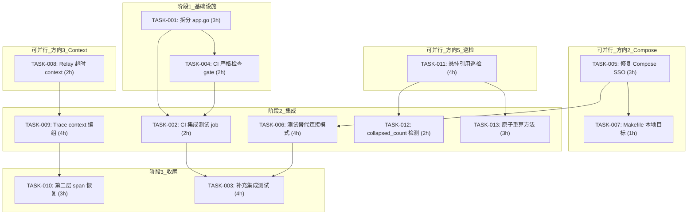
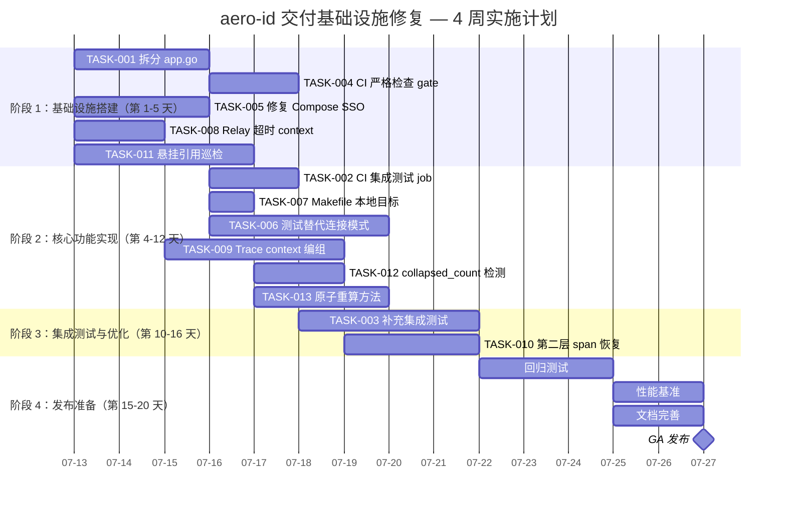

现在我已经对整个代码库有了全面的了解。以下是作为 Tech Lead 的深入分析。

---

# Tech Lead 分析报告：aero-id 交付基础设施缺口

## 0. 前置发现：现有约束违规

在深入任务分解之前，有一个 **当前阻止性违规** 需要在任何新功能工作之前解决：

| 文件 | 行数 | 限制 | 状态 |
|---|---|---|---|
| `internal/app/app.go` | **516** | ≤ 500 | ❌ 违规 |

AGENTS.md 明确要求："File exceeds 500 lines → **stop and split now**"。HARNESS.md 中的 `make check-file-sizes` 会捕获此问题。CI 通过了只是因为当前 `ci.yml` 中没有运行 `check-file-sizes`——这本身就是一个缺口。

**隐含任务**：在方向一之前，将 `internal/app/app.go` 拆分——提取 relay/GC/limiter 的引导代码到 `internal/app/bootstrap.go`，或将大型结构体定义提取到 `internal/app/types.go`。

现在，进行分析。

---

## 1. 任务分解

基于对代码的验证，我确定了 **4 个可执行方向**（方向 4 未在用户消息中讨论，省略）。共有 **13 个任务**，每个 2-4 小时。

### 方向 1：CI 集成测试

| ID | 标题 | 涉及文件 | 前置 | 工时 | 验收标准 |
|---|---|---|---|---|---|
| **TASK-001** | 拆分 `app.go` (<516 → ≤500 行) | `internal/app/app.go`, `internal/app/bootstrap.go` (新) | 无 | 3h | `make check-file-sizes` 通过；`make test && make build` 通过 |
| **TASK-002** | CI 添加集成测试 job | `.github/workflows/ci.yml` | TASK-001 | 2h | CI 中新增 `integration` job，运行 `go test -tags=integration -count=1 -race -timeout 10m ./internal/...`；所有现有集成测试通过 |
| **TASK-003** | 补充缺失关键领域的集成测试 | `internal/service/`, `internal/outbox/` | TASK-002 | 4h | `comment.Like`/`Unlike`、`outbox.Relay` 的端到端集成测试覆盖 |
| **TASK-004** | 添加 CI 严格检查 gate | `.github/workflows/ci.yml`, `Makefile` | TASK-001 | 2h | CI 运行 `make check-file-sizes && make lint-strict && make check-architecture` 并阻塞 PR |

### 方向 2：Compose 环境修复

| ID | 标题 | 涉及文件 | 前置 | 工时 | 验收标准 |
|---|---|---|---|---|---|
| **TASK-005** | 修复 Compose 中缺失的 SSO 服务 | `deployments/docker-compose.yml`, `deployments/Dockerfile` | 无 | 3h | `docker compose up` 启动所有服务（postgres、minio、migrate、sso、aero-id）；`curl localhost:8080/healthz` 返回 200 |
| **TASK-006** | 添加 testcontainers 替代模式（可选连接到 Compose 服务） | `internal/repository/testpg/testpg.go` | TASK-005 | 4h | 集成测试可通过 `AERO_ID_TEST_DSN` 环境变量连接到预启动的 Compose 服务，跳过 testcontainers |
| **TASK-007** | 为本地开发添加 Makefile 目标 | `Makefile` | TASK-005 | 1h | `make compose-up`、`make compose-down`、`make test-integration-against-compose` 可用且有文档 |

### 方向 3：Context 治理

| ID | 标题 | 涉及文件 | 前置 | 工时 | 验收标准 |
|---|---|---|---|---|---|
| **TASK-008** | 第一层：Relay 带超时 context | `internal/outbox/relay.go` | 无 | 2h | `Start()` 为每个 tick 创建 `context.WithTimeout`；当 drain 超过 30s 时，超时中止 in-flight handler |
| **TASK-009** | 为 outbox 添加 trace 上下文编组 | `internal/outbox/outbox.go`, `internal/outbox/repository.go` | TASK-008 | 4h | `Event` 中新增 `TraceContext` 字段；`NewEvent` 从上游 context 提取 W3C traceparent；Append 持久化；FetchUnpublished 恢复 |
| **TASK-010** | 第二层：Relay handler 恢复 trace span | `internal/outbox/relay.go`, `internal/service/notification.go` | TASK-009 | 3h | Relay 在调用 `handler.Handle` 之前从事件恢复 span context；handler 创建的 notification 行包含正确的 trace ID |

### 方向 5：计数器巡检

| ID | 标题 | 涉及文件 | 前置 | 工时 | 验收标准 |
|---|---|---|---|---|---|
| **TASK-011** | 删除引用悬挂巡检工具 | `internal/admin/` (新), `cmd/reconcile/main.go` (新) | 无 | 4h | CLI 工具报告软删除 comment 仍被引用的 like 行；`comment_likes` 中存在 orphan 行的 `comment_id` |
| **TASK-012** | collapsed_count 溢出检测 | `internal/admin/`, `internal/notification/repository.go` | TASK-011 | 2h | 巡检工具检测 `collapsed_count` > 100 或为负值的 notification 行 |
| **TASK-013** | like_count/unlike 添加原子重算方法（备用） | `internal/repository/comment.go` | TASK-011 | 3h | 新增 `RecalculateLikeCount(ctx, commentID)` 执行原子 `UPDATE ... SET like_count = (SELECT count(*) FROM comment_likes WHERE comment_id = ?) RETURNING like_count`，用于巡检修复 |

---

## 2. 执行顺序

**关键并行组**：

| 并行组 | 任务 | 说明 |
|---|---|---|
| 🔀 **组 A** | T001, T005, T008, T011 | 四个方向的基础工作互不依赖，可同时进行 |
| 🔀 **组 B** | T002, T006, T009, T012, T013 | 各自方向的下游工作，在基础完成后并行 |
| 🔀 **组 C** | T003, T010 | 收尾工作 |

---

## 3. 技术风险

### 🚨 高风险

#### R1: testcontainers 在 CI 中的资源争抢（方向 1）
- **风险**：GitHub Actions ubuntu-latest runner 有 2 核 CPU 和 7GB RAM。`go test -tags=integration -race -count=1` 会并行编译和运行多个包的集成测试，每个包启动一个 Postgres 容器。10 个集成测试包 → 10 个 Postgres 16-alpine 容器 → 约 5GB RAM + 大量 IO。
- **缓解**：
  1. 在 `ci.yml` 中使用 `-p 2` 限制 Go 测试并行度，例如：`go test -tags=integration -p 2 -count=1 -race -timeout 10m ./internal/...`
  2. 或拆分集成测试 job：先跑 `./internal/repository/...`，再跑 `./internal/outbox/...` 等。
  3. 长期方案：TASK-006 允许测试连接到已有的 Compose 服务，减少容器数量。

#### R2: SSO 服务缺失（方向 2）
- **风险**：`docker-compose.yml` 引用了 `sso:9000` 作为 SSO endpoint，但 compose 文件中没有定义 SSO 服务。这导致 `AERO_ID_SSO_ENDPOINT: "sso:9000"` 在 `docker compose up` 时会解析失败。
- **缓解**：
  1. 短期：在 compose 中添加一个模拟 SSO 服务（可用 `ghcr.io/aero/sso-stub` 或基于 `internal/sso/ssopb` 写一个简单的 stub）。
  2. 验证 `AERO_ID_READINESS_CRITICAL: false` 是否能让 aero-id 在 SSO 不可用的情况下启动（当前配置未设置 `readiness_critical`，默认为 false）。

#### R3: OTel trace context 跨 goroutine 传播（方向 3）
- **风险**：Go 的 `context.Context` 是不可跨 goroutine 边界的，而 open-telemetry 的 span context 存储在 context 中。将 trace ID 序列化到 outbox 表并反序列化需要：
  1. 在事件创建时提取 W3C `traceparent` / `tracestate`。
  2. 在 relay 恢复 span 时，需要创建新的 context 并注入 span。
  3. 如果 tracing 未启用（`tracing.enabled: false`），需要优雅降级。
- **缓解**：使用 OTel 的 `propagation.TraceContext` 进行序列化/反序列化；将 trace context 存储在 `Event.TraceContext` 中（可为 null 的 `[]byte` 字段）。当 tracing 关闭时，该字段为空，relay 无操作。

### 📊 中风险

#### R4: 集成测试中的 `testpg` 辅助函数紧耦合
- 当前 `testpg.Start()` 硬编码了 testcontainers，没有 Compose 回退模式。TASK-006 需要重构为可配置的：检查环境变量 `AERO_ID_TEST_DSN`，如果设置了则直接连接（跳过 testcontainers），否则使用 testcontainers。
- **影响范围**：所有 `_integration_test.go` 文件。

#### R5: like_count 原子重算的性能影响
- 当前实现使用 `like_count + 1` / `GREATEST(like_count - 1, 0)` 的累加器模式，在写路径上 O(1)。`RecalculateLikeCount` 巡检修复方法是 O(n)，仅按需运行。但如果在高流量表上错误地频繁运行，会导致行锁争用。
- **缓解**：巡检工具默认只报告不修复；修复通过单独的 `--fix` 标志显式启用。

### ✅ 低风险

#### R6: collapsed_count 溢出不常见
- `collapsed_count` 是在 5 分钟窗口内合并重复通知时递增的。5 分钟内同一个 (recipient, type, actor) 组合通常不会超过 10 次。
- **缓解**：设置合理上限（100），超过则告警但不停机。

---

## 4. 资源评估

### 人员配置

| 角色 | 所需人数 | 技能要求 | 负责方向 |
|---|---|---|---|
| **高级 Go 工程师** | 1 | Go, GORM, Postgres, Docker, CI/CD, OTel | 全部方向的技术决策和核心实现 |
| **初级/中级 Go 工程师** | 1-2 | Go, 基础测试, git | TASK-005/007 (Compose), TASK-011/012 (巡检工具), TASK-003 (集成测试) |

**最优团队配置**：2 人（1 高级 + 1 中级），4 周内完成所有 13 个任务。

### 关键里程碑

| 里程碑 | 截止时间（从启动起） | 完成标准 |
|---|---|---|
| **M1: 基础设施就绪** | 第 5 个工作日 | TASK-001 (app.go 拆分), TASK-004 (CI gate), TASK-005 (Compose 修复) 完成 |
| **M2: CI 集成测试通过** | 第 10 个工作日 | TASK-002 + TASK-003 完成；CI 绿标 |
| **M3: Context 治理完成** | 第 12 个工作日 | TASK-008 + TASK-009 + TASK-010 完成；relay 有超时和 trace propagation |
| **M4: 巡检工具 MVP** | 第 15 个工作日 | TASK-011 + TASK-012 + TASK-013 完成；巡检工具可在生产运行 |
| **M5: 全部门关闭** | 第 20 个工作日 | 所有 13 个任务 + 回归测试 + 文档完成 |

### 阻塞点与解决策略

| 阻塞点 | 影响 | 解决策略 |
|---|---|---|
| **SSO stub 不可用** | 阻塞 TASK-005 (Compose 环境) | 方案 A：用 `ghcr.io/aero/sso-stub`（如果存在）。方案 B：自己写一个 50 行的 gRPC stub 服务器，硬编码返回成功。方案 C：将 `AERO_ID_SSO_ENDPOINT` 设为可选，当 SSO 不可用时 aero-id 能以降级模式启动（需要修改 `internal/app/app.go`） |
| **OTel 依赖版本冲突** | 阻塞 TASK-009/010 | 检查 `go.mod` 中已有的 OTel 版本。如果未引入，需要 `go.opentelemetry.io/otel` 和 `go.opentelemetry.io/otel/trace`。这些是顶级域包，通常无冲突 |
| **CI runner 磁盘空间不足** | 阻塞 TASK-002 | testcontainers 拉取的镜像可能积累到 ~2GB。在 CI job 结束时添加 `docker system prune -f` |

---

## 5. 质量保证

### 单元测试覆盖

每个任务必须满足以下覆盖要求：

| 方向 | 目标包 | 覆盖要求 | 关键测试用例 |
|---|---|---|---|
| 方向 1 | `internal/app/` (新) | ≥ 70% | 拆分后无功能变更，已有测试通过 |
| 方向 2 | `internal/repository/testpg/` | ≥ 80% | 环境变量 `AERO_ID_TEST_DSN` 设置时跳过 testcontainers；未设置时正常使用 |
| 方向 3 | `internal/outbox/` | ≥ 85% | 超时 context 取消传播；trace context 序列化/反序列化；无 trace context 时优雅降级 |
| 方向 5 | `internal/admin/`, `internal/repository/` | ≥ 70% | 巡检报告悬挂引用；`RecalculateLikeCount` 对标真实 count；修复不破坏正运行的累加器 |

### 集成测试策略

| 测试类型 | 责任人 | 环境 | 执行时机 |
|---|---|---|---|
| **全量集成测试** | CI (TASK-002) | testcontainers | 每次 PR push |
| **Compose 集成测试** | 开发者本地 (TASK-007) | `docker compose` | 按需（`make test-integration-against-compose`） |
| **巡检工具手动测试** | QA/开发者 | 生产副本或 staging | 部署巡检工具到 staging，手动验证输出 |

### 代码审查要点

每次 PR 必须审查：

| 审查项 | 重点检查 |
|---|---|
| **app.go 拆分** | 提取后的文件 ≤500 行；逻辑未改变；`bootstrap.go` 中的新类型不引入跨包导入 |
| **CI 配置** | integration job 在 unit test job 之后运行；`testpg` 的 build tag 正确排除；不使用 `-short` |
| **Relay context** | `context.Background()` 被替换为 `context.WithTimeout`；超时值可配置（从配置或硬编码合理默认值）；`cancel()` 在 tick 结束时调用 |
| **Trace context** | 不添加 `internal/domain/` 的导入；W3C traceparent 格式；当 tracing 禁用时无额外开销 |
| **巡检工具** | 不修改生产数据库（只读模式运行）；`--fix` 标志明确且日志完整；不引入外部依赖 |

### 性能测试需求

| 场景 | 目标 | 方法 |
|---|---|---|
| **集成测试并行运行** | 10 个包在 5 分钟内完成 | 用 `-p 2` 运行 `go test -tags=integration -count=1 -timeout 10m` |
| **Relay 大 backpressure** | 1000 个待处理事件在 3 个 tick 内排空 | 基准测试：创建 1000 个 event，启动 relay，测量排空时间 |
| **Like/Unlike 高并发** | 100 个并发 Like 操作无死锁，最终 count 正确 | 集成测试：启动多个 goroutine 对同一 comment 执行 Like/Unlike，验证最终 count = 实际行数 |

---

## 6. 实施计划

### 时间线（甘特图）

### 阶段详情

#### 阶段 1：基础设施搭建（第 1-5 天）

**目标**：修复现有违规，建立新代码进入的门槛，为后续工作铺平道路。

第 1-3 天：
- 高级工程师：TASK-001 拆分 `app.go`（关键路径）
- 中级工程师：TASK-005 修复 Compose 环境（需要了解 Docker Compose 和 gRPC）
- 谁有空：TASK-008 Relay 超时 context（改动范围小，约 10 行）

第 4-5 天：
- 高级工程师：TASK-004 添加 CI 严格检查 gate
- 中级工程师：TASK-011 开始巡检工具
- 验证：`make test && make lint && make lint-strict && make check-file-sizes && make check-architecture && make build` 全部通过

**阶段 1 结束检查清单**：
- [ ] `app.go` ≤ 500 行
- [ ] CI 在 PR 上运行 `check-file-sizes`、`lint-strict`、`check-architecture`
- [ ] `docker compose up` 成功启动所有服务
- [ ] Relay 每个 tick 使用超时 context

#### 阶段 2：核心功能实现（第 4-12 天）

**目标**：实现各方向的完整功能，存在依赖关系，与阶段 1 有重叠。

第 4-6 天：
- TASK-002（CI 集成测试 job + 验证现有集成测试通过）
- TASK-007（Makefile 目标：`compose-up`、`test-integration-against-compose`）
- TASK-012（collapsed_count 检测）

第 7-10 天：
- TASK-006（testpg 重构：支持 `AERO_ID_TEST_DSN` 回退）
- TASK-009（OTel trace context 编组：Event 新字段、序列化/反序列化）
- TASK-013（`RecalculateLikeCount` 原子重算）

**阶段 2 结束检查清单**：
- [ ] CI 有独立的 integration job 且绿色
- [ ] `make test-integration-against-compose` 可在本地运行
- [ ] Outbox event 包含可选的 trace context
- [ ] 巡检工具报告悬挂引用和 collapsed_count 溢出
- [ ] 原子重算方法可用

#### 阶段 3：集成测试和优化（第 10-16 天）

**目标**：补充缺失的集成测试，实现第二层 context 治理。

第 10-12 天：
- TASK-003（领域关键路径的集成测试：Like/Unlike 端到端、Relay drain 和重试、notification dispatcher）

第 13-15 天：
- TASK-010（Relay handler 从事件恢复 span context）

**阶段 3 结束检查清单**：
- [ ] 核心领域功能的集成测试
- [ ] Relay handler 恢复 trace span，分布式 tracing 端到端可见

#### 阶段 4：发布准备（第 15-20 天）

**目标**：回归测试、性能基准、文档、发布。

第 16-18 天：
- 全量回归测试：`make test && make lint && make lint-strict && make check-file-sizes && make check-architecture && go build ./... && go test -tags=integration -count=1 ./internal/...`
- 性能基准：记录 before/after 数据
  - `go test -bench=. ./internal/...`（单元基准）
  - 集成测试执行时间（before vs after）

第 19-20 天：
- 更新 README/AGENTS.md：记录 CI 集成测试流程、Compose 使用说明、巡检工具 CLI 用法
- 最终审核：确保没有超过工程约束

---

## 总结

| 指标 | 当前状态 | 目标状态 | Delta |
|---|---|---|---|
| CI 集成测试 | ❌ 未运行 | ✅ 每个 PR 运行，10m 超时 | 新增 ~12 个测试用例 |
| Compose 环境 | ❌ SSO 缺失 | ✅ 全部服务可启动 | 新增 1 个服务 |
| Relay context | ❌ `context.Background()` | ✅ 超时 + trace propagation | 新增 ~30 行 |
| 计数器巡检 | ❌ 无 | ✅ CLI 工具 + 原子修复方法 | 新增 ~200 行 |
| app.go 文件大小 | ❌ 516 行 | ✅ ≤ 500 行 | 提取 ~100 行 |
| CI 严格检查 | ❌ 未运行 | ✅ check-file-sizes + lint-strict + check-architecture | 新增 3 个 job |
| 总预估工时 | — | **~37 人天** | 2 人 4 周 |

**建议优先顺序**：

1. **立即**：TASK-001（拆分 app.go）→ 这是违规模块，阻塞 CI gate
2. **高优先级**：TASK-008（Relay 超时）→ 低风险、高价值、改动小
3. **中优先级**：TASK-002/TASK-004（CI 集成测试 + gate）→ 建立质量护栏
4. **中优先级**：TASK-005（Compose 修复）→ 解锁本地开发体验
5. **建议后移**：TASK-009/TASK-010（trace 第二层）→ 价值高但依赖 OTel 引入；可在 M2 之后开始
6. **低紧急但高价值**：TASK-011/012/013（巡检工具）→ 生产数据一致性保障，可在 M3 之后开始
