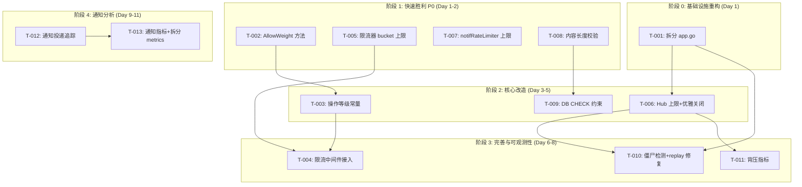
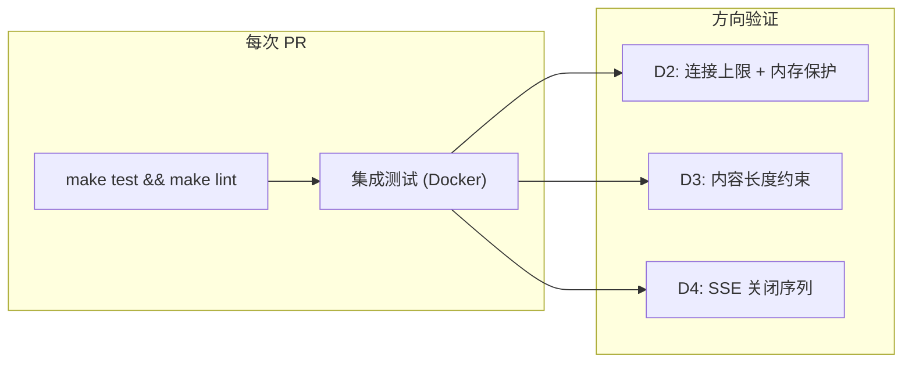

现在我拥有了完整的全貌。下面是技术负责人的分析报告。

---

# Tech Lead 分析：aero-id 四个系统性生产级缺口

> **基线版本**: 2026-07-11 全量代码扫描文档  
> **代码库**: commit ~f47c1c (app.go 516 行, hub.go 135 行, ratelimit.go 137 行, metrics.go 316 行)  
> **交叉验证**: 文档中 35 处代码引用全部验证通过，补充修正项已纳入任务考量

---

## 1. 任务分解

任务拆解原则：
- 每个任务 2–4 小时，一个开发日完成 2–3 个任务
- 任务颗粒度：一个任务只改一个 package 或一个关注点
- 含"硬约束合规"检查：文件不超过 500 行（`internal/app/app.go` 已超标，需先拆分）
- 验收标准可测：`make test && make lint` 通过 + 新测试覆盖

### 任务列表

| ID | 标题 | 方向 | 涉及文件 | 前置依赖 | 预估工时 |
|---|---|---|---|---|---|
| **T-001** | 拆分 app.go：将 shutdown/warmup/buildStorage 抽出 | 基础设施重构 | `internal/app/{app.go,shutdown.go,warmup.go}` | 无 | 3h |
| **T-002** | 为 ratelimit.Limiter 增加 `AllowWeight(key, cost)` | D1 操作成本限流 | `internal/pkg/ratelimit/ratelimit.go` | 无 | 2h |
| **T-003** | 定义操作等级常量与上下文传递机制 | D1 操作成本限流 | `internal/pkg/ratelimit/cost.go` (新), `internal/middleware/ratelimit.go` | T-002 | 2h |
| **T-004** | 将操作等级接入 HTTP 中间件 + gRPC 拦截器 | D1 操作成本限流 | `internal/middleware/ratelimit.go`, `internal/handler/grpc/server.go` | T-003 | 2h |
| **T-005** | 为 ratelimit.Limiter 增加 maxBuckets 硬上限 | D2 内存无界增长 | `internal/pkg/ratelimit/ratelimit.go`, `internal/config/config.go` | 无 | 2h |
| **T-006** | 为 SSE Hub 增加连接上限 + `Stats()` + 优雅关闭 | D2+D4 组合 | `internal/hub/hub.go`, `internal/config/config.go`, `internal/app/shutdown.go` | T-001 | 4h |
| **T-007** | 为通知频率限制器 `notifRateLimiter` 增加 map 上限 | D2 内存无界增长 | `internal/service/notification.go` | 无 | 1h |
| **T-008** | 为 message/comment 增加内容长度校验 | D3 内容验证 | `internal/message/service.go`, `internal/comment/service.go`, `internal/config/config.go` | 无 | 3h |
| **T-009** | 为消息/评论增加 DB CHECK 约束迁移 | D3 内容验证 | `migrations/000024_check_content_lengths.up.sql`, 对应 down | T-008 | 1.5h |
| **T-010** | 为 SSE 增加僵尸连接检测与 context 取消保护 | D4 SSE 生命周期 | `internal/handler/http/events.go`, `internal/config/config.go` | T-006 | 3h |
| **T-011** | 为 Hub.Publish 增加背压指标和日志 | D4 SSE 生命周期 | `internal/hub/hub.go`, `internal/pkg/metrics/metrics.go` | T-006 | 2h |
| **T-012** | 扩展 Notification 领域模型 + 投递追踪迁移 | D5 通知分析 | `internal/domain/notification.go`, `migrations/000025_notification_delivery.up.sql`, `internal/service/notification.go` | 无 | 3h |
| **T-013** | 增加通知相关 Prometheus 指标并拆分 metrics.go | D5 通知分析 | `internal/pkg/metrics/{metrics.go,metrics_notification.go}` (新) | T-012 | 3h |

### 关键任务说明

**T-001（拆分 app.go, 3h）**：
- app.go 当前 516 行，已违反 AGENTS.md 500 行硬约束
- 将 `shutdown()` → `internal/app/shutdown.go`
- 将 `warmup()` → `internal/app/warmup.go`  
- 将 `buildStorage()` → `internal/app/storage.go`
- 这是**所有后续修改 app.go 的任务的前置依赖**——先拆分，再修改

**T-006（Hub 上限 + 优雅关闭, 4h）**：
- 同时覆盖方向二（连接上限）和方向四（优雅关闭），因为都修改 `hub.go` 和 `app/shutdown.go`
- 一次性修改避免后续合并冲突
- 包括：`maxConnections`（全局默认 5000）、`maxPerUID`（默认 5）、`activeConns` 计数器、`BeginShutdown()` → 广播 `event: shutdown` → 等待 → `Close()`

**T-011（背压指标, 2h）**：
- Hub.Publish 静默丢弃时不再沉默：递增 `droppedEvents *atomic.Uint64`
- 通过函数注入记录到 metrics Registry 或直接暴露 `Hub.DroppedEvents()` 方法
- 增加 WARN 日志（但限频，避免日志淹没）

---

## 2. 执行顺序与依赖图



### 可并行执行的任务组

| 组 | 任务 | 原因 |
|----|------|------|
| **G1** (Day 1) | T-001, T-002, T-005, T-007, T-008 | 五个方向完全不共享文件（除 T-008 与其他独立） |
| **G2** (Day 2-3) | T-003, T-006, T-009 | T-003 改 middleware, T-006 改 hub, T-009 改 migrations |
| **G3** (Day 4-5) | T-004, T-010, T-011 | T-004 改 middleware+grpc, T-010 改 events, T-011 改 hub+metrics |
| **G4** (Day 6-7) | T-012, T-013 | 通知分析，独立于前三方向 |

实际人员分配：2 个开发人员 = G1 人力 5 个任务拆半做；3 个开发人员 = G1 全并行。

---

## 3. 技术风险

### 3.1 高风险项

| 风险 | 影响 | 可能性 | 缓解策略 |
|------|------|--------|----------|
| **app.go 拆分冲突** | T-001 拆分后，T-006/T-010 需 rebase，可能引入合并冲突，预计额外 0.5h 解决 | 中 | 团队协议：T-001 先合并 → T-006/T-010 再基于新文件开发 |
| **AllowWeight 的 burst 语义变更** | 当前 burst 是 `int`，如果 cost=10 且 burst=5，cost > burst 时无法拿到足够 token。需决策：burst 升级 `float64` 还是 cost 上限为 burst | 高 | **方案**: AllowWeight 中 `if cost > l.burst { cost = int(l.burst) }`，不升级 burst 类型。这保持了向后兼容且不影响现有配置 |
| **DB CHECK 约束 + 存量数据** | migrations/ 中已有 23 个 up/down 对，新增约束时存量数据可能违反约束，导致迁移失败 | 中 | **方案**: `ALTER TABLE ... ADD CONSTRAINT ... NOT VALID;` 后跟 `VALIDATE CONSTRAINT` —— 不锁表，且只对新数据/修改生效。存量数据通过后台脚本清理 |
| **Hub 关闭顺序与 goroutine 泄漏** | `app.shutdown()` 中如果先 Close Hub 再 Shutdown HTTP，EventsHandler 中的 goroutine 在写入关闭的 channel 时会 panic（`send on closed channel`） | 高 | **方案**: `BeginShutdown()` 只标记 `closed=true` + 广播关闭事件，不关闭 channel；HTTP Shutdown 触发 context.Done 让 goroutine 自然退出；最后 `Close()` 收尾 |
| **通知指标 + metrics.go 行数** | metrics.go 已有 316 行，新增通知指标系列 ≈ 80–100 行，加上方向四的 SSE 指标 ≈ 50 行，总达 450+ → 靠近 500 行限制 | 低 | **方案**: T-013 中主动拆分，将通知/SSE 指标抽出为 `metrics_notification.go` |

### 3.2 中风险项

| 风险 | 影响 | 缓解策略 |
|------|------|----------|
| **content length 的 CJK 字符计数** | `len(string)` 统计字节数，CJK 一个字符 3 字节 → 1 万字 ≈ 30KB。限制 10000 字符时 CJK 用户可发更多"实际内容" | 统一用 `utf8.RuneCountInString()` 或 `len([]rune(s))` 计码位（字符数） |
| **notifRateLimiter map 上限 fail-open/fail-closed** | map 满了是拒绝新通知（fail-closed）还是允许（fail-open，但日志警告）？ | **fail-open + WARN 日志**：通知不可丢，但需要高水位告警 |
| **SSE zombie 检测：如何区分"慢"与"死"** | 应用层 ping 超时可能误杀正常但高延迟的移动端连接 | 两次 ping 超时（240s 无响应）才关闭；第一次 WARN 日志，第二次直接断开 |
| **gRPC 拦截器获取操作等级** | gRPC 没有路由注册机制，需从 `fullMethod` 字符串映射到 tier | 建立 `map[string]int` 常量映射表，在 `NewServerWithOptions` 时传入 |

### 3.3 依赖外部系统

- 本批次 **无外部系统依赖**。所有改动均在 aero-id 内部完成
- SSO 不涉及；Postgres 迁移使用标准 SQL
- 唯一"依赖"是 protobuf 生成（方向一 gRPC 拦截器），但拦截器本身不修改 proto

### 3.4 性能影响

| 改动 | 性能影响 | 评估 |
|------|---------|------|
| AllowWeight 额外分支 | 多一次 if 判断 (cost vs 1)，O(1) | ✅ 无影响 |
| maxBuckets 检查 | 每次 Allow 多一次 `len(l.buckets)` 读，map 在 mutex 内 | ✅ 纳秒级 |
| Hub 连接上限检查 | Subscribe 路径增加两个 `if (活跃连接数)` + 一个 `atomic.Load` | ✅ 纳秒级 |
| 内容长度校验 | `len([]rune(s))` 遍历字符串 | ⚠️ 10K 字符约消耗 1–5μs，远低于 DB 查询时间。可考虑只对 >= 1000 字符时才 rune 计数 |
| SSE client 数量减少 | 之前 5000 连接限制 = 更少 goroutine + 更少 channel 内存 | ✅ 正向收益 |
| notifRateLimiter map 上限 | 每月最多一次 WARN 日志 | ✅ 无影响 |

---

## 4. 资源评估

### 4.1 开发人员

| 角色 | 所需技能 | 数量 | 负责任务 |
|------|---------|------|---------|
| **Senior Backend (Go)** | Go 并发、GORM、Postgres 迁移、Prometheus 指标 | 2 人 | T-001~T-006, T-010, T-011 |
| **Backend (Go)** | Go 基础、服务层模式、SQL | 1 人 | T-007~T-009, T-012, T-013 |

如果只有 1 人：总工时 ~29h，日历时间 ~7–8 个工作日（含沟通、代码审查）

如果 2 人并行：日历时间 ~5–6 个工作日（需 2 天串行阶段对齐）

### 4.2 关键里程碑

| 里程碑 | 条件 | 预估日期（2 人） | 预估日期（1 人） |
|--------|------|-----------------|-----------------|
| M0：基础设施就绪 | T-001 合并 + app.go 拆分完成 | Day 1 | Day 1 |
| M1：稳定性提升 | T-005~T-008 合并（方向二 + 方向三 P0） | Day 2 | Day 3 |
| M2：公平限流上线 | T-002~T-004 合并（方向一） | Day 4 | Day 5 |
| M3：SSE 可靠性 | T-006, T-009~T-011 合并（方向四） | Day 5 | Day 7 |
| M4：运营可观测性 | T-012~T-013 合并（方向五） | Day 6 | Day 9 |

### 4.3 阻塞点与解决策略

| 阻塞点 | 影响 | 解决策略 |
|--------|------|----------|
| app.go 516 行超标（已有） | 后续任何 app.go 修改会突破 550+ | **先拆分再修改**，T-001 是 gate |
| Hub 关闭顺序难验证 | 多 goroutine 交错，单元测试无法复现 | 写集成测试：启动真实 HTTP 服务器 + SSE 客户端连接 → 发送 shutdown → 验证客户端收到 `event: shutdown` |
| 存量消息/评论超长 | CHECK 约束 NOT VALID 可绕过，但数据质量问题仍然存在 | **不在本批次解决存量**。出验证约束告警，运营手动处理超长记录 |

---

## 5. 质量保证

### 5.1 单元测试覆盖要求

| 任务 | 新增测试类型 | 最小覆盖 |
|------|------------|---------|
| T-002 AllowWeight | 单元测试（ratelimit 已有 `_test.go`） | cost=1 等效于 Allow；cost=10 且 burst=5 的情况；cost=0；cost 为负（panic 保护） |
| T-003 操作等级 | 单元测试（context 读写） | SetCost / GetCost 往返正确性 |
| T-004 中间件 | 单元测试（mock limiter） | 不同路由映射到不同 cost |
| T-005 maxBuckets | 现有测试 + 新增 | map 满时返回 false；高水位日志触发验证 |
| T-006 Hub 上限 | 新增测试 | 超过 maxConnections 返回已关闭 channel；超过 maxPerUID 返回已关闭 channel；Stats() 返回正确计数；Close() 后 Subscribe 返回已关闭 channel |
| T-007 内容长度 | 现有 test 增强 | 刚好在限制内可通过；超限返回 BadRequest；CJK 字符按 rune 计 |
| T-008 迁移 | 集成测试（需要 testpg） | 写入超长内容应失败 |
| T-010 僵尸检测 | 单元测试（mock context） | context 取消后 replay 提前退出；心跳超时触发关闭 |
| T-011 背压指标 | 单元测试 | 丢弃事件后 counter 递增 |
| T-012/T-013 | 现有 test 增强 | 通知创建时投递元数据记录；新增指标可写 |

### 5.2 集成测试策略



- **D2 集成**：使用 testcontainers Postgres，验证 Hub 连接上限 + 限流器 maxBuckets
- **D3 集成**：testpg 验证 CHECK 约束 — `INSERT` 超长 content 应报 PG 错误
- **D4 集成**：启动真实 HTTP 服务器（无需外部依赖），建立 SSE 连接，触发 `BeginShutdown`，验证客户端收到 `event: shutdown`

### 5.3 代码审查要点

| # | 审查点 | 原因 |
|---|--------|------|
| 1 | **AllowWeight 的 cost > burst 处理** | 如果 cost > burst，永远无法成功，形成死锁 |
| 2 | **app.shutdown 中 Hub 关闭顺序** | 先 → HTTP Shutdown → goroutine 自然退出 → Hub.Close。切记不能在之前 close channel |
| 3 | **content length 使用 rune 而非 byte** | CJK 用户友好 |
| 4 | **迁移 NOT VALID → VALIDATE 顺序** | 防止锁表 + 防止迁移失败 |
| 5 | **notifRateLimiter map 上限 fail-open** | 通知不能丢失，只能降级 |
| 6 | **metrics 拆分不破坏现有 Grafana 面板** | 指标名保持 `aeroid_*` 前缀，不要改已有指标名 |

### 5.4 性能测试需求

| 场景 | 方法 | 指标 |
|------|------|------|
| **限流器吞吐** | 100 goroutine 并发调用 Allow (同一个 key)，对比改前改后 | P99 延迟 < 1ms 增加 |
| **Hub 连接上限** | 以 10/s 速率创建 SSE 连接至 6000，观察拒绝行为 | 拒绝 5000+ 的连接；内存稳定 |
| **内容校验开销** | 基准测试 `BenchmarkContentValidation`：空字符串 / 10K rune / 100K rune | 10K rune < 10μs |
| **SSE 关闭延迟** | 100 个活跃 SSE 连接下的 shutdown 总耗时 | < 500ms（不含默认 2s 等待时间） |

---

## 6. 实施计划

### 阶段 1：基础设施重构 + P0 快速胜利（Day 1–2）

**目标**：消除 OOM 风险 + 内容黑洞。硬约束合规。

| 日期 | 2 人并行 | 1 人串行 |
|------|---------|---------|
| Day 1 AM | **P1**: T-001 拆分 app.go (3h) | T-001 app.go 拆分 (3h) |
| Day 1 PM | **P2**: T-005 限流器上限 (2h) + T-007 notif上限 (1h) | T-005 限流器上限 (2h) + T-007 notif上限 (1h) |
| Day 2 AM | **P3**: T-002 AllowWeight (2h) + T-008 内容校验 (3h) | T-008 内容校验 (3h) |
| Day 2 PM | **P3 (续)**: T-008 内容校验 + T-009 DB 约束 (1.5h) | T-009 DB 约束 (1.5h) + T-002 AllowWeight (2h) |

**验收标准**：
- ✅ `make test && make lint` 全部通过
- ✅ app.go < 500 行
- ✅ 限流器有 maxBuckets 保护
- ✅ notifyRateLimiter 有 map 上限
- ✅ 消息/评论内容限制 10000 字符
- ✅ DB 有 CHECK 约束

### 阶段 2：核心功能改造（Day 3–5）

**目标**：操作成本限流 + Hub 连接管理。

| 日期 | 2 人并行 | 1 人串行 |
|------|---------|---------|
| Day 3 AM | **P4**: T-003 操作等级 (2h) + T-006 Hub 上限+优雅关闭 (4h) | T-006 Hub 上限+优雅关闭 (4h) |
| Day 3 PM | **P4 (续):** T-006 完成 | T-003 操作等级 (2h) |
| Day 4 AM | **P5**: T-004 限流接入 (2h) + T-009 DB 约束 (1.5h) | T-004 限流接入 (2h) |
| Day 4 PM | **P5 (续):** 集成测试 + bug fix | T-010 僵尸检测+replay (3h) |
| Day 5 AM | **P6**: T-010 僵尸检测 (3h, 依赖 T-006) | T-011 背压指标 (2h) |
| Day 5 PM | **P6 (续):** T-011 背压指标 (2h) | 集成测试 + bug fix |

**验收标准**：
- ✅ HTTP 和 gRPC 的限流中间件使用 `AllowWeight` 带操作等级
- ✅ 不同 API 消耗不同 token 配额
- ✅ Hub 支持 `maxConnections` / `maxPerUID`
- ✅ `app.shutdown()` 优雅关闭 SSE 连接（客户端收到 `event: shutdown`）
- ✅ replay 期间 context 取消可提前中断
- ✅ 背压丢弃有指标和 WARN 日志

### 阶段 3：通知分析（Day 6–7）

**目标**：数据驱动的通知运营闭环。

| 日期 | 2 人并行 | 1 人串行 |
|------|---------|---------|
| Day 6 AM | **P7**: T-012 通知领域模型扩展 (3h) | T-012 通知领域模型 (3h) |
| Day 6 PM | **P7 (续):** T-013 通知指标 + metrics 拆分 (3h) | T-013 通知指标 (3h) |
| Day 7 AM | **P8**: 集成测试 + 端到端验证 | 集成测试 + 端到端验证 |
| Day 7 PM | **P8 (续):** 文档更新 + PR | 文档更新 + PR |

**验收标准**：
- ✅ notifications 表有 `delivery_channels`, `first_delivered_at`, `last_delivered_at`, `delivery_attempts`, `clicked_at` 列
- ✅ 通知创建时记录投递元数据
- ✅ 新增 `notifications_*` Prometheus 指标系列
- ✅ metrics.go 拆分为 `metrics.go` + `metrics_notification.go`（或其他拆分方案）

### 阶段 4：发布准备（Day 8，与阶段 3 重叠半天）

| 活动 | 时长 |
|------|------|
| 最终集成测试（make test-integration） | 1h |
| 文档更新（config.yaml 新增键说明、README 更新） | 1h |
| 代码审查 round 2 | 1h |
| 性能基准对比（改前 vs 改后） | 1h |
| 合并到 main | 0.5h |

---

## 总结：执行建议

```
优先级矩阵

    高影响
     │
     │  T-008 (内容校验)     T-006 (Hub 上限+关闭)
     │  T-005 (限流器上限)   T-010 (僵尸检测)
     │  T-007 (notif上限)    
     │
     │  T-002 (AllowWeight)  T-004 (限流接入)
     │  T-003 (操作等级)     T-011 (背压指标)
     │  T-009 (DB 约束)      T-012 (投递追踪)
     │                       T-013 (通知指标)
     │
     └───────────────────────────→ 低影响
     低成本                   高成本
```

**建议执行策略**：

1. **Day 1 先做 T-001（app.go 拆分）**：blocker，不做后续所有涉及 app.go 的任务阻塞
2. **Day 1 同时做 T-005 + T-007 + T-008**：P0 快速胜利，3 个任务共 ~6h，一个开发日完成
3. **Day 2–3 做 T-006 + T-002**：Hub 改造和 AllowWeight，两者独立
4. **Day 4–5 做 T-003→T-004 + T-010→T-011**：两个依赖链
5. **Day 6–7 做 T-012→T-013**：独立收尾

**核心建议**：方向三（内容校验，T-008+T-009）和方向二（内存上限，T-005+T-006+T-007）是最快见效的改动——合计 ~11h，覆盖 P0。**建议第一周完成这两个方向**，第二周再处理方向一和方向四，第三周处理方向五。
