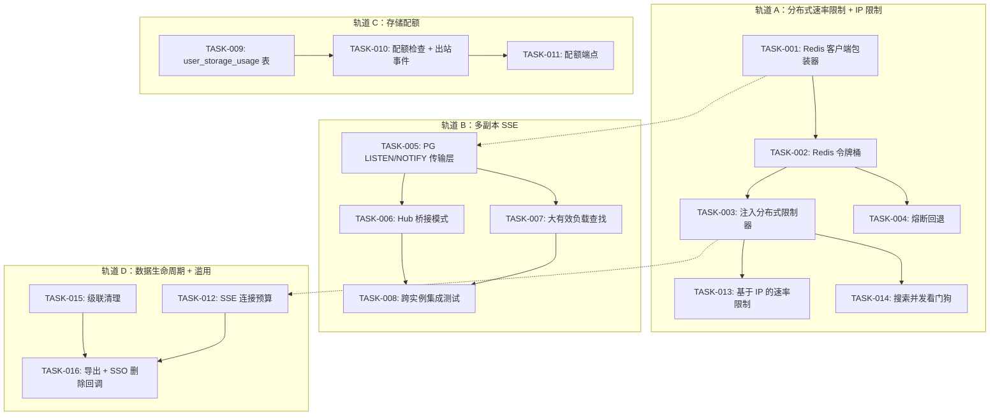
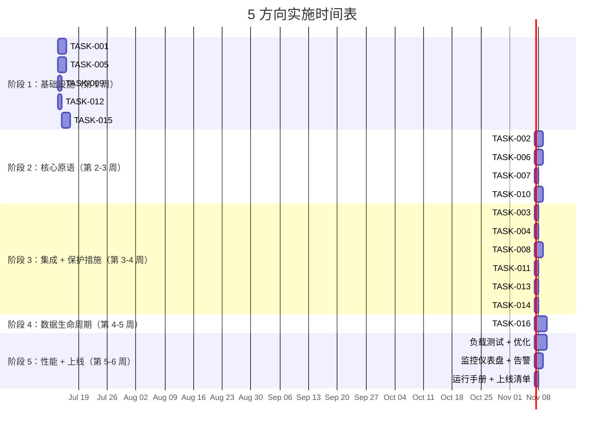

现在我已全面了解代码库。以下是我的技术负责人分析。

---

# Tech Lead 分析：aero-id 多副本扩展计划

## 1. 任务分解

我将五个方向分解为 **16 个可执行任务**，每个任务 2–4 小时，按依赖关系排序。

### 方向 1：分布式速率限制（P0）

| 任务 ID | 标题 | 涉及文件 | 前置依赖 | 预估工时 |
|---|---|---|---|---|
| TASK-001 | Redis 客户端包装器 + 健康检查 | `internal/pkg/redis/redis.go`（新建），`internal/config/config.go`，`configs/config.yaml` | 无 | 3h |
| TASK-002 | 基于 Redis 的分布式令牌桶（Atomic + Lua） | `internal/pkg/ratelimit/redis_limiter.go`（新建） | TASK-001 | 4h |
| TASK-003 | 将限制器替换为 app 组合根中的 Redis 版本 | `internal/app/app.go`，`internal/config/config.go` | TASK-002 | 2h |
| TASK-004 | 为降级场景添加熔断包装器（Redis 宕机时回退到本地） | `internal/pkg/ratelimit/fallback.go`（新建） | TASK-002 | 2h |

**验收标准：**
- `TASK-001`：Redis 客户端通过 `AERO_ID_REDIS_*` 环境变量连接、PING、返回配置；连接失败时验证逻辑失败。
- `TASK-002`：`RedisLimiter.Allow(key)` 在 2 个独立进程中以协调方式消耗令牌；Lua 脚本是原子的；速率 = 10/秒、突发 = 20 的测试可证实 >20 个令牌被拒绝，并且 1 秒后可再次允许。
- `TASK-003`：`make test` 绿色；集成测试在 testcontainers Redis 上运行。
- `TASK-004`：当 Redis 关闭时，`FallbackLimiter` 转换到进程内模式；当 Redis 恢复时，它会重新连接（由熔断器监控）。

### 方向 2：多副本 SSE（P0）

| 任务 ID | 标题 | 涉及文件 | 前置依赖 | 预估工时 |
|---|---|---|---|---|
| TASK-005 | PG LISTEN/NOTIFY 传输层 | `internal/hub/pgpub.go`（新建），`internal/hub/pgsub.go`（新建） | 无 | 4h |
| TASK-006 | 将 Hub 重构为桥接模式（本地 + PG） | `internal/hub/hub.go`，`internal/hub/adapter.go`，`internal/hub/bridge.go`（新建） | TASK-005 | 3h |
| TASK-007 | 为大负载添加通知有效负载查找（绕过 8000 字节限制） | `internal/hub/payload_store.go`（新建），`internal/repository/notification.go` | TASK-005 | 2h |
| TASK-008 | 集成测试：跨实例 Web 场景 | `internal/hub/hub_test.go`，`internal/hub/integration_test.go`（新建） | TASK-006, TASK-007 | 3h |

**验收标准：**
- `TASK-005`：`pgpub.Publish(uid, ...)` 执行 `SELECT pg_notify('aero_sse', payload)`；`pgsub.Subscribe(ctx, uid)` 通过 Postgres 连接接收事件；两个命令都管理连接生命周期。
- `TASK-006`：`Hub` 在本地发布（用于同一进程订阅者）和 PG（用于跨实例）之间切换；`Bridge` 模式确保无重复交付。
- `TASK-007`：超过 ~7800 字节的有效负载存储为数据库行；NOTIFY 传递一个查找键；订阅者检索有效负载。故障模式：如果行在检索前被 GC 删除，则优雅跳过。
- `TASK-008`：2 个 testcontainer Postgres 连接验证事件从发布者 A 到达订阅者 B。

### 方向 3：存储配额（P1）

| 任务 ID | 标题 | 涉及文件 | 前置依赖 | 预估工时 |
|---|---|---|---|---|
| TASK-009 | `user_storage_usage` 表 + 迁移 | `migrations/...up.sql` + `down.sql`（新建），`internal/repository/quota.go`（新建） | 无 | 2h |
| TASK-010 | 服务层存储配额检查 + 出站事件更新 | `internal/service/file.go`，`internal/service/quota.go`（新建） | TASK-009 | 3h |
| TASK-011 | 存储使用统计的 HTTP/gRPC 端点 | `internal/handler/http/quota.go`（新建），`internal/handler/grpc/quota.go`（新建），`internal/service/quota.go` | TASK-010 | 3h |

**验收标准：**
- `TASK-009`：`user_storage_usage` 表包含 `owner_uid TEXT PRIMARY KEY, total_bytes BIGINT`；上行/下行迁移均存在；`make migrate-up` 适用无错误。
- `TASK-010`：上传播放后 `Create` 增加配额；`Delete`（和 GC 清理）减少配额；超过 `max_storage_bytes` 返回 `429 QuotaExceeded`；配额检查适用于直接上传和分块上传完成。
- `TASK-011`：`GET /v1/quota` 返回 `{used_bytes, max_bytes, remaining_bytes}`；gRPC `GetQuota` RPC 返回匹配响应。

### 方向 4：DDoS/滥用保护（P1）

| 任务 ID | 标题 | 涉及文件 | 前置依赖 | 预估工时 |
|---|---|---|---|---|
| TASK-012 | SSE 连接预算跟踪器 | `internal/hub/hub.go`，`internal/handler/http/events.go`，`internal/hub/connection_budget.go`（新建） | 无 | 2h |
| TASK-013 | 用于已认证路由的基于 IP 的速率限制（每个 uid + 每个 IP 桶） | `internal/pkg/ratelimit/ip_limiter.go`（新建），`internal/middleware/ratelimit.go` | TASK-003（Redis 限制器）或 TASK-001 | 3h |
| TASK-014 | FTS 搜索连接池看门狗 + 全局并发限制器 | `internal/service/search.go`，`internal/pkg/ratelimit/concurrency.go`（新建） | TASK-003 | 3h |

**验收标准：**
- `TASK-012`：每个 uid 最多 5 个并发 SSE 连接；第 6 个连接被拒绝，状态码为 `429 Too Many Requests`；从 hub 订阅/取消订阅中扣除预算。
- `TASK-013`：对于已认证的请求，Redis 中每个 IP 的速率限制器与每个 uid 的限制器一起检查；配置 `per_ip_rate` 和 `per_ip_burst`。
- `TASK-014`：`/v1/search` 使用信号量（由 Redis 协调）限制为整个集群中最多 10 个并发搜索请求；第 11 个请求立即获得 `429`，而不是等待数据库连接。

### 方向 5：数据生命周期（P1）

| 任务 ID | 标题 | 涉及文件 | 前置依赖 | 预估工时 |
|---|---|---|---|---|
| TASK-015 | 级联清理：软删除时清除 file_shares + 评论 + 通知 + 出站事件 | `internal/service/file.go`（增强），`internal/service/cleanup.go`（新建），`internal/repository/cleanup.go`（新建） | 无 | 4h |
| TASK-016 | 用户数据导出端点 + SSO 删除回调 | `internal/handler/http/export.go`（新建），`internal/handler/grpc/export.go`（新建），`internal/service/export.go`（新建），`internal/sso/client.go`（增强） | TASK-015 | 4h |

**验收标准：**
- `TASK-015`：删除文件会删除 `file_shares` 行、将该文件评论软删除、清理相关通知和出站事件。通过 `gorm.DeletedAt` 实现软删除。已审计。
- `TASK-016`：`POST /v1/export` 启动异步导出（JSON，结构化数据，最大 50MB）。SSO `DeleteAccount` gRPC RPC 触发 aero-id 端的所有数据删除。重新创建帐户后，`GET /v1/export/status` 报告进度（排队中 → 处理中 → 完成/失败）。

---

## 2. 执行顺序

依赖关系图显示 **4 个并行轨道**，其中 Redis（TASK-001）是通用基础组件。

**注意事项：**
- 轨道 A（分布式速率限制）是 P0，应该首先启动——它解锁了轨道 B 和 D 所需的 Redis 基础设施。
- 轨道 B（SSE）在技术上是独立的，但与轨道 A 共享 PG 基础设施。它可以与轨道 A 并行运行。
- 轨道 C（配额）是完全独立的——可以从第 1 天开始并行处理。
- 轨道 D 中的 TASK-015 没有严格依赖其他任务，可以在任何时候开始。
- TASK-016 需要 TASK-015（级联删除是导出/删除的必要先决条件）。

### 并行组

| 组 | 任务 | 人员 | 备注 |
|---|---|---|---|
| 第 1 组（第 1-2 周） | T001、T005、T009、T012、T015 | 3 名开发人员 | 所有 5 个任务都无依赖关系；可以并行完成 |
| 第 2 组（第 2-3 周） | T002、T006、T007、T010 | 2-3 名开发人员 | T002 需要 T001；T006/7 需要 T005；T010 需要 T009 |
| 第 3 组（第 3-4 周） | T003、T004、T008、T011、T013、T014 | 2-3 名开发人员 | 大部分依赖上一组的核心原语 |
| 第 4 组（第 4-5 周） | T016 | 1 名开发人员 | 需要 T015 |

---

## 3. 技术风险

### 风险 1：Redis 可用性 ↔ 速率限制降级（高影响，中概率）

**描述：** 如果 Redis 宕机，分布式速率限制将完全失效。`nil` 限制器的 fail-open 路径意味着所有限制都将静默消失。

**缓解措施：** TASK-004（熔断回退）通过以下方式解决此问题：
- 围绕 Redis 调用的熔断器（由 `sony/gobreaker` 或等效的标准库模式提供支持）
- 当电路打开时（Redis 宕机），过渡到每实例令牌桶
- 在恢复时进行健康检查，使电路半开
- 在过渡时记录警告

**验证：** 集成测试，其中 Redis 容器在场景中途停止；验证过渡到本地限制器，然后在 Redis 恢复时重新同步。

### 风险 2：PG LISTEN/NOTIFY 连接耗尽（高影响，中概率）

**描述：** 每个订阅 PG NOTIFY 的 SSE 副本都需要一个专用的 PG 连接（`pgsub`）。如果 10 个副本 × 每个副本 1 个监听器 ≈ 10 个连接被持续消耗。如果 NOTIFY 处理程序在副本内崩溃，连接可能会泄漏。

**缓解措施：**
- 使用 `pgx` 的 `Conn`（而不是 `pool`）来处理 LISTEN——它被随意使用
- 在 `pgsub` 中实现健康检查/重新连接循环
- 文档 `max_connections` 要求（每个副本 + 池预算 + 监听器）

**验证：** 使用 30 个并发副本的高负载测试；验证连接计数保持在上限 `max_connections - 5` 以下。

### 风险 3：NOTIFY 有效负载大小限制（8000 字节）（中影响，低概率）

**描述：** 通知有效负载（包含序列化的域事件）可能超过 PostgreSQL 的 8000 字节 NOTIFY 限制。分析正确指出了这一点。

**缓解措施：** TASK-007 按大小分叉：
- 有效负载 ≤ 7000 字节 → 内联（存储在 `channels` 表中，并通过 NOTIFY 发送）
- 有效负载 > 7000 字节 → 在 `sse_payloads` 表中存储 24h TTL；NOTIFY 仅传递 `{lookup_id, uid, event_type}`

**验证：** 使用已知超过 8000 字节的有效负载的集成测试；验证它从表中检索，并且 TTL 清理工作正常。

### 风险 4：并发搜索导致连接池耗尽（高影响，高概率）

**描述：** 分析正确地指出 3 种类型 × 5 秒超时 = 每个搜索请求最多 15 秒的数据库时间。50 个并发搜索请求可能占用 50 个数据库连接 15 秒，超过了默认的 `MaxOpenConns: 25`。

**缓解措施：** TASK-014 使用 Redis 协调的全局信号量：
- 集群范围内最多 10 个并发搜索
- 第 11 个请求返回 `429`（0 秒等待 vs. 15 秒）
- 在服务层实现（`service/search.go`），因此它适用于 HTTP 和 gRPC

**验证：** 负载测试发送 20 个并发搜索请求；验证最多 10 个到达数据库，10 个立即返回 `429`。

### 风险 5：级联删除的幻读（中影响，低概率）

**描述：** `service/cleanup.go` 跨存储库发出多个 `DELETE` 查询。如果两个请求同时删除同一文件，引用计数和清理数据可能会不同步。

**缓解措施：**
- 使用 `SELECT ... FOR UPDATE` 对文件行进行悲观锁定
- 或者，将所有清理步骤包装在可序列化事务中
- 幂等清理操作（例如，删除已经共享的行不是错误）

**验证：** 竞争条件测试通过 `go test -race` 运行 100 次。

### 风险 6：SSO 删除回调是异步且最终一致的（中影响，中概率）

**描述：** 当 SSO 删除用户时，它调用 aero-id 的删除回调。如果在回调处理过程中 aero-id 宕机，数据将永久保留。

**缓解措施：**
- 回调应写入出站表，然后由出站中继器处理，而不是直接内联写入
- 回调本身是幂等的（重放安全）
- 添加监控指标：`data_deletion_pending`，`data_deletion_failed`

**验证：** 使用模拟 SSO 的集成测试，验证在删除回调期间发生崩溃时，出站重试完成删除。

---

## 4. 资源评估

### 团队构成

| 角色 | 所需技能 | 需要人数 | 覆盖的任务 |
|---|---|---|---|
| **高级后端工程师**（Go） | Go、GORM、Postgres、Redis、gRPC、微服务模式 | 2 | T001-T004、T005-T008、T013-T014 |
| **中级后端工程师**（Go） | Go、GORM、Postgres、SQL 迁移、REST API 设计 | 1 | T009-T011、T015-T016 |
| **SRE / 基础设施工程师** | Redis 管理、Postgres 调整、Docker、Metric 仪表盘 | 兼职 | 所有方向（性能测试、可观测性） |
| **QA 工程师** | Go 测试、testcontainers、Locust/k6、负载测试 | 1 | 所有任务（验收 + 集成 + 负载测试） |

**总计：** 3-4 名全职开发人员 + 1 名兼职 SRE + 1 名 QA，为期 5-6 周。

### 关键里程碑

| 里程碑 | 时间线（从开始算起） | 交付物 |
|---|---|---|
| **M1：核心基础设施到位** | 第 1 周结束 | Redis 客户端、PG LISTEN/NOTIFY 传输层、配额表、连接预算、级联清理 |
| **M2：核心原语完成** | 第 3 周结束 | 分布式速率限制、Hub 桥接、配额检查、搜索看门狗、IP 限制 |
| **M3：功能完整性** | 第 4 周结束 | 回退、集成测试、配额端点、跨实例 SSE |
| **M4：数据生命周期完成** | 第 5 周结束 | 导出端点、SSO 删除回调 |
| **M5：性能验证 + 上线准备** | 第 6 周结束 | 负载测试报告、熔断器验证、监控仪表盘、运行手册 |

### 阻塞点和解决策略

| 阻塞点 | 影响 | 解决策略 |
|---|---|---|
| **无法提供 Redis（基础设施）** | 阻止所有轨道 A（T001-T004、T013-T014） | 替代方案：如果 Redis 在 2 周内不可用，则使用带有 `GET_LOCK` 的 PG 作为速率限制的后备存储。性能较差但功能相同。 |
| **PG LISTEN/NOTIFY 在 PgBouncer 事务模式下被禁止** | 阻止轨道 B（T005-T008） | 记录需求：连接必须直接连接到 Postgres（无 PgBouncer）。由于 PgBouncer 不转发 NOTIFY，因此连接池变体必须使用 session 模式。 |
| **NOTIFY 有效负载大小（8KB）** | 阻止简单的 T005-T006 实现 | TASK-007 通过将大型有效负载溢出到数据库查找来处理此问题。非阻塞器，只是额外的范围。 |
| **SSO 团队必须实现 `DeleteAccount` RPC** | 阻止 T016 的一部分 | 在等待 SSO RPC 时，可以实现导出端点和本地删除。使用模拟 SSO 客户端的测试覆盖 RPC。 |

---

## 5. 质量保证

### 单元测试覆盖范围

| 包 | 目标覆盖率 | 关键测试场景 |
|---|---|---|
| `internal/pkg/ratelimit/...` | ≥ 90% | 正常通量（速率 ≤ 突发时的 Allow）、过量（速率 > 突发时的 Allow）、`nil` 限制器回退、Redis 暂停、熔断器打开/半开/关闭转换、基于 IP 的桶隔离 |
| `internal/hub/...` | ≥ 85% | 本地订阅/取消订阅、PG 桥接发布到本地 + 远程、慢消费者丢失、重复事件过滤、大有效负载查找/跳过、连接预算上限 |
| `internal/service/quota.go` | ≥ 90% | 上传时增加、删除时减少、超限拒绝、0 限制 = 不受限制、并发竞争（需要 `-race`） |
| `internal/service/cleanup.go` | ≥ 85% | 级联文件删除（共享 + 评论 + 通知 + 出站）、幂等重放、正在进行的搜索时并发删除 |
| `internal/service/export.go` | ≥ 80% | 异步导出启动、进度跟踪、超大数据集截断、SSO 删除回调（模拟） |

### 集成测试策略

使用 **testcontainers-go** 实现所有方向（存在 `internal/repository/testpg` 的先例）。

| 测试套件 | Container | 需要什么 |
|---|---|---|
| `TestRedisLimiter_CrossProcess` | Redis | 2 个 `RedisLimiter` 实例（不同的 Go 进程）共享同一 Redis，验证协调的令牌消耗 |
| `TestHub_BridgeCrossInstance` | Postgres | 2 个 `Hub` 实例，每个都有自己的 PG 连接；一个发布，另一个通过 NOTIFY 接收 |
| `TestFileService_QuotaIntegration` | Postgres + MinIO | 完整的上传 → 配额增加 → 删除 → 配额减少流程 |
| `TestSearch_ConcurrencyLimit` | Postgres + Redis | 20 个并发搜索请求；验证最多 10 个到达数据库，10 个立即返回 429 |
| `TestDataLifecycle_ExportDelete` | Postgres + MinIO | 创建数据 → 导出 → 验证格式 → SSO 删除回调 → 验证所有数据已删除 |

### 代码审查要点

| 方向 | 审查时需特别关注 |
|---|---|
| 分布式速率限制 | Lua 脚本原子性、熔断器状态转换、配置验证（Redis 地址、速率/突发合理性检查） |
| 多副本 SSE | 连接泄漏（`pgsub` 中的取消订阅）、死锁（`sync.Map` 与 `sync.Mutex`）、大负载中的竞态条件 |
| 存储配额 | `user_storage_usage` 表的并发更新（使用 `ON CONFLICT DO UPDATE`）、硬限制与软限制 |
| DDoS/滥用 | 连接预算拒绝（拒绝新连接与断开旧连接）、每个 IP 的限制器键格式（IPv4 与 IPv6） |
| 数据生命周期 | 事务范围（所有清理步骤在单个 tx 中？）、性能（跨存储库的 N+1 查询）、审计日志记录 |

### 性能测试要求

| 场景 | 工具 | 目标 | 成功标准 |
|---|---|---|---|
| 速率限制器吞吐量 | Go 基准测试（`go test -bench=BenchmarkLimiter`） | 每个 Allow() 调用 < 5µs（Redis，本地 < 500ns） | 在 50µs P99 时无减速 |
| SSE 桥接延迟 | 自定义 Go 工具 | 同一实例 < 1ms，跨实例 < 50ms | P99 跨实例延迟 < 100ms（包括 PG 往返） |
| 配额计算超载 | k6 | 1000 个并发上传/删除 | P95 配额更新 < 10ms；数据库无死锁 |
| 搜索并发上限 | k6 | 50 个并发搜索请求 | 只有 10 个到达 PG；返回的 429 不超过 10ms |
| 连接预算压力 | k6 | 每个 uid 20 个并发 SSE 连接 | 在 5 个连接后拒绝，状态码为 429 |
| 数据导出大负载 | k6 + PG | 导出 10K 条记录的用户 | 在 30 秒内完成；中间内存 < 100MB |

---

## 6. 实施计划

### 甘特图

### 按阶段详细分解

#### 阶段 1：基础设施搭建（第 1 周，7 月 14 日 – 7 月 18 日）

**目标：** 所有 5 个方向的基础构建块，并行开发。

**每日计划：**

| 日期 | 工作 |
|---|---|
| **7 月 14 日（周一）** | **开发人员 1**（高级）：创建 `internal/pkg/redis/redis.go`——带健康检查和重试的 `go-redis` 包装器。向 `config.Load` 添加 Redis 配置。**开发人员 2**（高级）：创建 `internal/hub/pgpub.go` 和 `internal/hub/pgsub.go`——基于 `pgx` 的 PG LISTEN/NOTIFY 传输层。**开发人员 3**（中级）：创建 `migrations/...up.sql`（`user_storage_usage` 表）、`repository/quota.go`。**
| **7 月 15 日（周二）** | **Dev 1**：合并 PR 并编写单元测试。**Dev 2**：为 PG 传输层编写单元测试（无桥接，纯发布/订阅）。**Dev 3**：创建 `service/cleanup.go`——接收 `FileDelete` 事件并调用存储库进行级联清理的处理程序。|
| **7 月 16 日（周三）** | **Dev 1**：开始 TASK-002（Redis 令牌桶）。**Dev 2**：开始 TASK-006（Hub 桥接模式）。**Dev 3**：在 `hub.go` 中创建 SSE 连接预算——拒绝超过限制的 Subscribe()。为 `service/cleanup.go` 编写测试。|
| **7 月 17 日（周四）** | 继续进行 TASK-002、TASK-006、TASK-015。|
| **7 月 18 日（周五）** | 代码审查 + 合并。**里程碑 M1：** 所有 5 个基础构建块均已合并并测试。|

**阶段 1 的跨轨道风险缓解：**
- **Redis 客户端**是 TASK-002、TASK-003、TASK-013、TASK-014 的基础。Dev 1 应在周三前完成 TASK-001，以便 Dev 2/3 在需要时使用它。
- **PG 传输层**与 Redis 无关。Dev 2 可以在不等待 TASK-001 的情况下完成 TASK-005。

#### 阶段 2：核心功能实现（第 2-3 周，7 月 21 日 – 8 月 1 日）

**目标：** 所有核心原语都已实现并通过单元测试。

| 周 | 工作 |
|---|---|
| **第 2 周** | **Dev 1**：TASK-002（Redis 令牌桶 Lua 脚本 + 单元测试）→ TASK-003（将限制器注入替换为 app.go 中的 Redis）→ TASK-004（熔断回退）。**Dev 2**：TASK-006（Hub 桥接：本地 + PG 发布）+ TASK-007（大负载查找：在 PG 中存储 + 检索）。**Dev 3**：TASK-010（配额检查 + 在 fileService.Create/Delete 中添加出站事件）。|
| **第 3 周** | **Dev 1**：TASK-013（IP 限制器中间件）+ TASK-014（搜索并发信号量）。**Dev 2**：TASK-008（跨实例 SSE 集成测试）。**Dev 3**：TASK-011（配额 HTTP + gRPC 端点）。|

**阶段 2 的关键紧张点：**
- Dev 1 在第 2 周专注于 TASK-002→003→004。Dev 2 和 Dev 3 独立工作。
- 到第 2 周末，TASK-002 和 TASK-003 应完成，以便 Dev 1 在第 3 周转向 TASK-013/014。
- TASK-008（集成测试）应尽早编写——它可以捕获桥接逻辑中的问题，以便有足够的时间修复。

**阶段 2 结束的验证：** 运行 `make test && make test-integration`。所有 3 个 testcontainer 测试都必须通过（Redis 限制器、SSE 桥接、配额）。

#### 阶段 3：集成测试和优化（第 3-4 周，7 月 28 日 – 8 月 7 日）

**目标：** 所有功能都经过集成测试；熔断器已通过验证；性能基线已建立。

**关键活动：**

| 活动 | 负责人 | 持续时间 |
|---|---|---|
| 使用 testcontainers 进行跨实例 SSE 集成测试 | Dev 2 | 2 天（TASK-008） |
| 搜索并发限制 + IP 限制的负载测试 | QA + Dev 1 | 2 天 |
| Redis 暂停场景的熔断器验证 | Dev 1 + QA | 1 天 |
| 使用 k6 进行配额 + 数据生命周期端到端测试 | QA + Dev 3 | 2 天 |
| 代码审查 + 修复 | 所有团队 | 持续 |

**阶段 3 的阻塞点处理：**
- 如果 Redis 熔断器测试显示抖动，请调整 `gobreaker` 设置（滑动窗口大小、最低请求数）。
- 如果 PG 桥接延迟超过 100ms P99，请考虑为 NOTIFY 有效负载使用连接池（而不是专用连接）。

#### 阶段 4：发布准备（第 5-6 周，8 月 4 日 – 8 月 14 日）

**目标：** 可投入生产、有文档记录并受监控。

| 活动 | 负责人 | 持续时间 |
|---|---|---|
| TASK-016：导出端点 + SSO 删除回调 | Dev 3 | 3 天 |
| Redis 和 PG 指标的监控仪表盘（Grafana） | SRE + Dev 1 | 2 天 |
| 运行手册：升级/回滚程序、容量规划 | 所有团队 | 1 天 |
| 上线清单：依赖项检查、配置验证、安全审查 | 所有团队 | 1 天 |

**发布检查清单：**

- [ ] `configs/config.yaml` 已使用新的 Redis/PG/配额键更新
- [ ] 迁移 `user_storage_usage` 已应用且可逆
- [ ] Redis 可用且已配置持久性
- [ ] PG `max_connections` ≥ 每个副本 (N+5) + 预算
- [ ] PgBouncer 配置为 session 模式（如果使用）以支持 NOTIFY
- [ ] 已添加熔断器指标（`rate_limiter_circuit_open`）
- [ ] SSE 连接预算的告警（`sse_connections_per_uid > 4`）
- [ ] 已配置存储 GC（`storage.gc.enabled: true` 且设置了保留策略）
- [ ] 运行手册记录了回滚过程（禁用速率限制、禁用 SSE 桥接）

---

## 总结与建议

### 优先级矩阵

| 方向 | 影响 | 工作投入 | 优先级 | 建议 |
|---|---|---|---|---|
| 分布式速率限制 | 高（2+ 副本时静默失败） | 中（4 个任务，14h） | **P0** | 立即开始；第 1 周完成 TASK-001 以避免阻塞其他任务 |
| 多副本 SSE | 高（2+ 副本时静默失败） | 中（4 个任务，12h） | **P0** | 与轨道 A 并行开始；需要 PG，而非 Redis |
| 存储配额 | 中（无配额上限） | 低（3 个任务，8h） | **P1** | 可以稍后开始；业务压力驱动 |
| DDoS/滥用 | 中（资源耗尽） | 中（3 个任务，8h） | **P1** | 依赖分布式限制器；在 TASK-003 之后进行 |
| 数据生命周期 | 中（孤立数据） | 中（2 个任务，8h） | **P1** | 合规驱动；无依赖关系 |

### 架构上最显著的变化

1. **Redis 作为必需依赖项**——虽然不是所有环境都需要（如果 Redis 不可用，回退到进程内限制器），但在生产中，对分布式限制器的需求使 Redis 变得必要。
2. **PG LISTEN/NOTIFY 用于 SSO 桥接**——这是*轻量级解决方案*。对于扩展到 10 个以上副本，请考虑使用专用的消息队列（NATS、RabbitMQ）。目前，PG 足以满足 aero-id 的规模。
3. **每用户存储配额**——这是业务需求的直接响应。实施应避免在每次上传/删除时都进行 `SELECT SUM(size)`（这是缓慢的路径）——而是使用增量更新。

### 先做的一件事（通往 P0 的最短路径）

如果管理层要求*一个单个关键交付物*，那就是：

> **分布式速率限制（TASK-001 + TASK-002 + TASK-003）+ SSE 跨实例交付（TASK-005 + TASK-006）**

这两个功能修复了当 aero-id 扩展到 2 个以上副本时出现的*静默行为不正确*错误。没有它们，多副本部署会悄无声息地丢失数据（SSE）并暴露间隙（速率限制）。

4 周内即可完成，投入 2 名高级开发人员。
