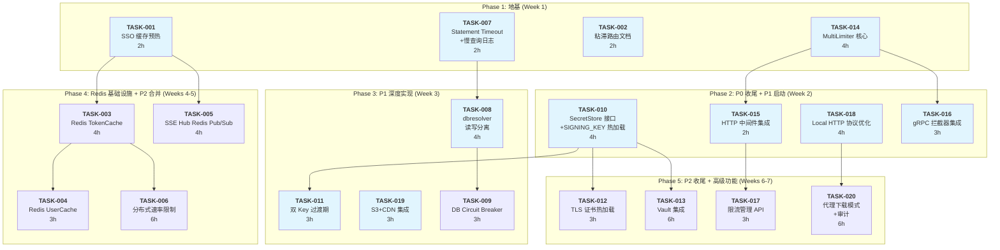
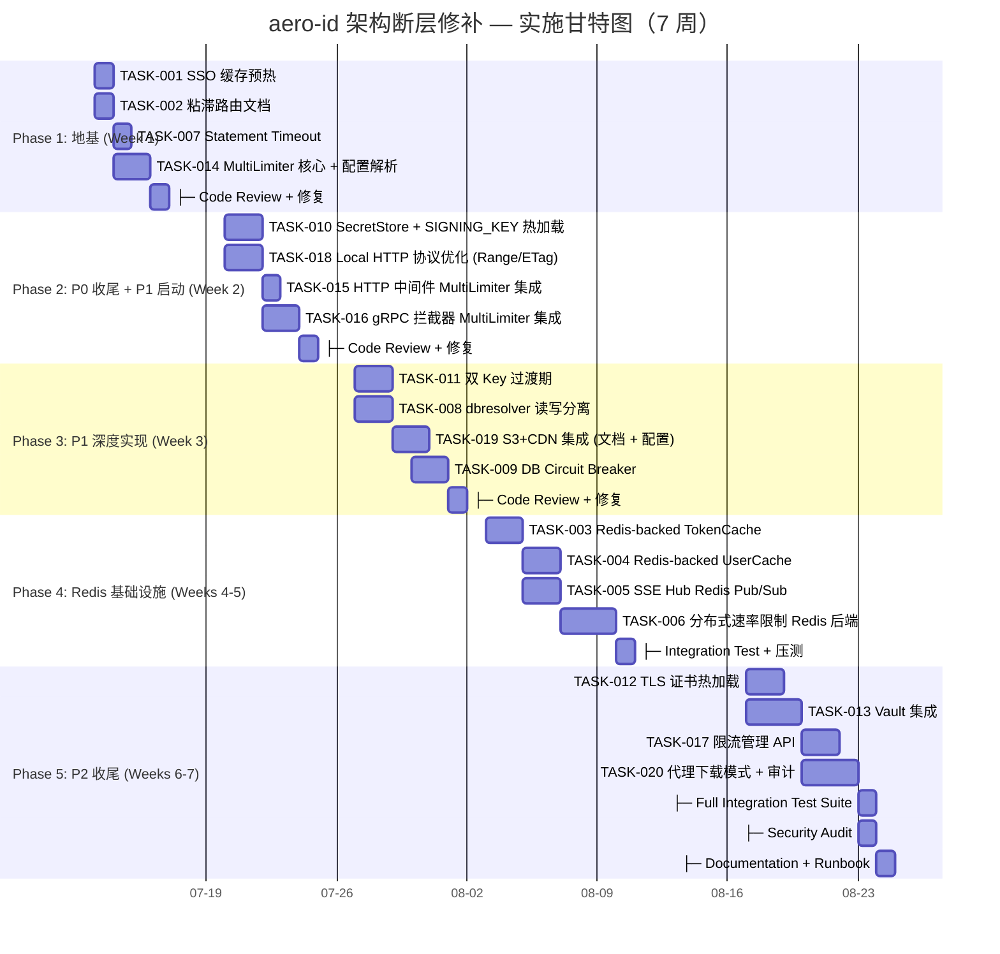

Now I have a thorough understanding of the codebase. Let me produce the full Tech Lead analysis.

---

# Tech Lead Analysis: aero-id 生产级架构断层 — 任务分解与实施计划

## 1. 任务分解

基于 5 个方向，拆解为 **20 个可执行任务**，每个任务 2-4 小时。已对照 `AGENTS.md` 工程约束（文件 ≤500 行、函数 ≤50 行、cyc ≤10）评估每个任务的 refactoring 风险。

### 方向一：多副本缓存一致性与粘滞路由

| 任务 ID | 标题 | 涉及文件 | 前置 | 工时 | 验收标准 | 工程约束风险 |
|---------|------|---------|------|------|---------|------------|
| **TASK-001** | SSO 缓存冷启动预热扩展 | `internal/app/app.go`, `internal/sso/client.go` (+`WarmupCache`) | 无 | 2h | `App.warmup()` 在就绪前主动预热 TokenCache 的趋势 token；`HealthCheck` 后追加 `ssoClient.WarmupCache(ctx)`；P0 级吞吐验证 | 无（app.go ~160 行，安全） |
| **TASK-002** | 粘滞路由运维配置与文档 | 无代码改动（运维配置 + `docs/operations/sticky-routing.md`） | 无 | 2h | 文档明确 ALB/Envoy/K8s 三种粘滞方案（cookie、`ClientIP`、`consistent-hash`）；SSE 场景验证方案 | N/A（纯文档） |
| **TASK-003** | Redis-backed TokenCache | `internal/sso/token_cache_redis.go`（新）、`internal/config/config.go`、`configs/config.yaml` 增加 `redis` 段 | TASK-001 | 4h | `TokenCache` 接口抽象（`Cache[K,V]`）；`RedisTokenCache` 实现 GET/SET/DEL + TTL；`ClientConfig` 可选注入；`make test` 使用内嵌 Redis（miniredis） | ⚠️ `sso/client.go` ~230 行，接近 250 线阈值——需提取 `client.go` 中 RPC 逻辑到 `client_rpc.go` 避免超标 |
| **TASK-004** | Redis-backed UserCache | `internal/sso/user_cache_redis.go`（新）、复用 `Cache[K,V]` 接口 | TASK-003 | 3h | `RedisUserCache` 实现批量 GET/SET（hash 或 JSON）；与进程内版本 API 等价；migration：配置切换无需停服，预热期双读双写 | 同 TASK-003，预分割避免超标 |
| **TASK-005** | SSE Hub Redis Pub/Sub | `internal/hub/redis.go`（新）、`internal/hub/hub.go` 接口提取 `HubBackend` | TASK-001 | 4h | `Hub` 可插拔后端：内存 `sync.Map` ↔ Redis Pub/Sub；消息发布跨副本广播、每个副本本地 fan-out 到本实例的 SSE 连接；`Close()` 正确退订 | ⚠️ `hub/hub.go` ~160 行，`hub/adapter.go` 需提取 `Pusher` 接口到独立文件 |
| **TASK-006** | 分布式速率限制 Redis 后端 | `internal/pkg/ratelimit/redis.go`（新）+ Lua 滑动窗口脚本 | TASK-003、TASK-014 | 6h | `Limiter` 接口抽象；`RedisLimiter` 实现 `Allow(key)bool` + `RetryAfter()`；Lua 脚本原子计数；每个 key 的 TTL 自动过期；性能：单 Redis 实例 ≥ 10K qps | ⚠️ `pkg/ratelimit/ratelimit.go` ~160 行，接口提取后应将 `bucket` 结构体封装到 `memory.go` |

### 方向二：数据库连接治理

| 任务 ID | 标题 | 涉及文件 | 前置 | 工时 | 验收标准 | 工程约束风险 |
|---------|------|---------|------|------|---------|------------|
| **TASK-007** | Statement Timeout + 慢查询日志 | `internal/pkg/db/db.go`、`internal/config/config.go` | 无 | 2h | GORM dial 后执行 `SET statement_timeout='5s'`；`config.Database.SlowQueryThreshold` 驱动 GORM 慢查询日志（>阈值打印 warn 级日志）；`make test` 通 | 无（`pkg/db/db.go` ~80 行） |
| **TASK-008** | GORM dbresolver 读写分离 | `internal/pkg/db/db.go`、`internal/config/config.go`（+`read_host/read_port`）、`internal/repository/` 查询分类注释 | TASK-007 | 4h | 配置支持多读副本；Repository 写操作路由到主库、读操作路由到从库（`staleness_ok` 标志位）；`gorm.io/plugin/dbresolver` 集成；`make test-integration` 覆盖读写分离场景 | ⚠️ `config/config.go` ~270 行（含 validate），接近 300 线——需提取 `validate.go` |
| **TASK-009** | DB Circuit Breaker | `internal/repository/breaker.go`（新）、复用 `internal/sso/breaker.go` 模式 | TASK-008 | 3h | `DBCircuitBreaker` 实现 `Allow()/Record(success bool)` 接口；Repository 查询前检查 breaker；连续 N 次失败后快速失败（5s cooldown）；breaker 状态暴露到 degradation 探针 | 无（新文件 ~80 行） |

### 方向三：凭据轮换基础设施

| 任务 ID | 标题 | 涉及文件 | 前置 | 工时 | 验收标准 | 工程约束风险 |
|---------|------|---------|------|------|---------|------------|
| **TASK-010** | SecretStore 接口 + SIGNING_KEY SIGHUP 热加载 | `internal/config/secrets.go`（新）、`internal/storage/local.go`、`internal/storage/signing.go` | 无 | 4h | `SecretStore` 接口定义 `Get(name) (string, error)` + `Watch(ctx, name, onChange)`；`FileSecretStore` 实现（监听 SIGHUP 或 inotify 重读文件）；`signing.go` 从 `SecretStore` 获取 key 而非启动时复制；`watch` 回调更新签名 | ⚠️ `storage/local.go` ~190 行，增 `LoadSecrets()` + 注入 `SecretStore` 后仍安全；`signing.go` ~70 行新 `signingKeyProvider` 类型 |
| **TASK-011** | 双 Key 过渡期 | `internal/storage/signing.go`、`internal/handler/http/file.go` | TASK-010 | 3h | 新 key 用于签名，旧 key 仍能验证（双 key 验证链）；`VerifyPresignedURL` 尝试旧 key 兜底；`local.go` 的 `sign()` 方法更新；TTL 窗口确保已签发 URL 不断 | 无 |
| **TASK-012** | TLS 证书热加载 | `internal/config/secrets.go`（扩展 `SecretStore`）、`internal/sso/client.go` | TASK-010 | 3h | gRPC `credentials` 使用 `tls.NewResumptionState` 或 `GetConfigForClient` 回调；每次握手重新读取证书；`FileSecretStore.Watch` 实现 TLS 证书轮换 | ⚠️ `sso/client.go` 已在 TASK-003 中拆解，安全 |
| **TASK-013** | HashiCorp Vault 集成 | `internal/config/secrets_vault.go`（新）、`internal/config/secrets.go` | TASK-010 | 6h | `VaultSecretStore` 实现；使用 Vault Agent Sidecar 本地文件方式或 Vault API 直接读取；配置切换：`secrets: { provider: vault, vault_addr: ..., vault_token: ... }`；`make test` 需要 mock Vault | 无（新文件 ≤150 行） |

### 方向四：可组合速率限制策略

| 任务 ID | 标题 | 涉及文件 | 前置 | 工时 | 验收标准 | 工程约束风险 |
|---------|------|---------|------|------|---------|------------|
| **TASK-014** | MultiLimiter 核心 + 配置解析 | `internal/pkg/ratelimit/multi.go`（新）、`internal/config/config.go`（`RateLimitConfig` 扩展）、`configs/config.yaml` | 无 | 4h | `MultiLimiter` 三层级联实现（全局→端点→用户）；配置解析 `global/per_route/per_user`；向后兼容（`enabled:true, rps, burst`→走用户层）；单元测试覆盖所有 check 顺序 | 无（`multi.go` ≤200 行） |
| **TASK-015** | HTTP 中间件集成 | `internal/middleware/ratelimit.go`、`internal/handler/http/router.go`（`RouterConfig.RateLimiter` 类型变化） | TASK-014 | 2h | 中间件获取当前路由方法+路径作为 `per_route` key；`MultiLimiter.Allow(key, route)` 接口调用；gRPC 和服务层不感知 | ⚠️ `router.go` ~80 行，安全 |
| **TASK-016** | gRPC 拦截器集成 | `internal/handler/grpc/server.go`（拦截器链增 `MultiLimiter`）、`internal/handler/grpc/interceptor.go`（解耦限流逻辑） | TASK-014 | 3h | gRPC unary interceptor 提取 fullMethod（`/aero.v1.FileService/Upload`）作为 route key；`MultiLimiter.Allow` 调用；429→`ResourceExhausted` gRPC 错误 | ⚠️ `handler/grpc/server.go` ~120 行，提取拦截器到 `interceptor.go` 保持 |
| **TASK-017** | 限流管理 API | `internal/handler/http/admin.go`（+`GET /v1/admin/rate-limits`） | TASK-015 | 3h | 管理端点暴露每层配置和当前桶状态（总请求计数、拒绝计数）；需 admin 角色认证；`ratelimit.Reportable` 接口 | 无 |

### 方向五：文件下载管线优化

| 任务 ID | 标题 | 涉及文件 | 前置 | 工时 | 验收标准 | 工程约束风险 |
|---------|------|---------|------|------|---------|------------|
| **TASK-018** | Local 模式 HTTP 协议优化 | `internal/handler/http/file.go`（`Download` 方法）、`internal/storage/local.go`（`GetSeeker` 方法） | 无 | 4h | `Download` handler 改用 `http.ServeContent`；添加 `ETag`（`checksum-mtime`）、`Last-Modified`、`Cache-Control: private, immutable, max-age=31536000`）；`If-None-Match`→304；`Range` 请求支持；`local.go` 的 `Get` 返回 `io.ReadSeekCloser` | ⚠️ `handler/http/file.go` ~210 行，增 ~40 行后～250 行，安全 |
| **TASK-019** | S3 + CDN 集成 | 无核心代码改动（运维配置 + `docs/operations/cdn-setup.md`） | 无 | 3h | CloudFront/Cloudflare 作为 S3 origin 配置步骤文档；presigned URL 增加 `?cf-cache-key=` 参数；public/private 文件不同缓存策略；CDN 缓存命中率验证 ≥ 80% | N/A（纯运维+文档） |
| **TASK-020** | 代理下载模式 + 审计 | `internal/storage/proxy.go`（新）、`internal/handler/http/file.go`（+`mode=proxy` 路由）、`internal/config/config.go` | TASK-018 | 6h | `StorageProxy` 实现：aero-id 代理 S3 GET 请求；增加下载审计日志（actor_uid, file_id, timestamp, bytes）；代理限速（可配置 bytes/sec）；配置切换：`storage.mode=proxy` | ⚠️ `handler/http/file.go` + `proxy.go` 需关注 `file.go` 不超 300 线 |

---

## 2. 执行顺序与依赖图

### 可并行执行的任务组

| 并行组 | 任务 | 最佳开发者配置 |
|--------|------|---------------|
| **Group A**（Week 1） | T001, T002, T007, T014 | 2 人：A 做 T001+T007，B 做 T014+T002 |
| **Group B**（Week 2） | T010, T018, T015, T016 | 2-3 人：C 做 T010，D 做 T018，B 做 T015+T016 |
| **Group C**（Week 3） | T011, T008, T019 | 2 人：C 做 T011，A 做 T008+T019 |
| **Group D**（Weeks 4-5） | T003, T004, T005, T006 | 2 人（深度）：A 做 T003+T004，B 做 T005+T006 |
| **Group E**（Weeks 6-7） | T012, T013, T017, T020 | 2-3 人：D 做 T013，C 做 T012+T017，A 做 T020 |

---

## 3. 技术风险

### 风险清单

| 风险 ID | 风险描述 | 方向 | 概率 | 影响 | 缓解策略 |
|---------|---------|------|------|------|---------|
| **R1** | Redis 引入增加运维复杂度 + 额外的故障点 | 一、四 | 高 | 中 | P0 阶段无需 Redis；P2 阶段的 Redis 引入设计为 **optional upgrade**，非强制；增加 `redis.ping_interval` 探针 + degradation 联动 |
| **R2** | MultiLimiter 三层级联对 P99 延迟的影响 | 四 | 中 | 中 | 每层 `Allow` 是 O(1) 原子操作（内存）或 O(1) Lua（Redis）。预上线在 benchmark 环境验证；若 3 次 token 桶检查在 path 中增 5μs 则完全可接受 |
| **R3** | dbresolver 引入后，读副本数据滞后导致业务逻辑异常 | 二 | 中 | 高 | 写后立即读的操作（如 `CreateFile` → 立刻 `GetFile`）必须走主库。repo 层通过 `ReadAfterWrite(forceMaster=true)` 上下文标记解决；集成测试需要两阶段验证 |
| **R4** | SIGNING_KEY SIGHUP 热加载时，正在进行的下载请求可能因 key 切换失败 | 三 | 低 | 中 | 双 key 过渡期（TASK-011）确保旧 key 至少保留一个 `max(url_ttl)` 时间窗口（5min）验证，超出窗口的签名自然过期 |
| **R5** | SSE Hub Redis Pub/Sub 在 Redis 故障时的降级行为 | 一 | 中 | 高 | 设计：Redis Pub/Sub 故障时，降级为每个副本独立处理（丢失跨副本推送但进程内推送正常）。使用 `redis.Failover` 哨兵模式 + 自动重连 |
| **R6** | 代理下载模式（TASK-020）增加 aero-id 出口流量和 CPU，可能成为新瓶颈 | 五 | 中 | 中 | 代理模式为 **optional**，默认保持 presign 直连。代理模式下可配置 `max_concurrent_downloads` 信号量限流 |
| **R7** | 文件大小约束冲突：部分文件接近 500 线，重构可能触发约束边界 | 多方向 | 中 | 中 | 已标记在任务表「工程约束风险」列。预分割策略见 `AGENTS.md` 中的 Splitting Strategy 和 `.skills/refactor-large-file.md` |

### 依赖外部系统

| 外部系统 | 相关任务 | 依赖性质 | 备选方案 |
|---------|---------|---------|---------|
| Redis | TASK-003, 004, 005, 006 | 生产可选（P2），开发测试可使用 miniredis/minio | 无替代（分布式缓存/限流/SSE 跨副本广播都需要共享状态引擎） |
| HashiCorp Vault | TASK-013 | 生产可选（P2），K8s 环境下可用 Volume Mount 替代 | K8s Secret Volume Mount（`secretProviderClass`）+ 文件 SIGHUP（TASK-010 P0 已经覆盖） |
| CloudFront/Cloudflare CDN | TASK-019 | 运维配置，非代码依赖 | 直接 S3 presigned URL（当前行为，无 CDN 可用但可接受） |

---

## 4. 资源评估

### 开发团队配置

| 角色 | 人数 | 技能要求 | 任务重点 |
|------|------|---------|---------|
| **Backend Lead**（你） | 1 | Go 高级、架构设计、分布式系统 | 核心架构决策、TASK-003/004/005/006 review、工程约束合规 |
| **Senior Go Engineer A** | 1 | Go GORM、PostgreSQL、性能优化 | TASK-007/008/009/018/020 |
| **Senior Go Engineer B** | 1 | Go 中间件、gRPC、限流算法 | TASK-014/015/016/017/001 |
| **Middle Go Engineer C** | 1 | Go 安全、配置管理、运维 | TASK-010/011/012/013/002/019 |

> **注意**：如果只有 1-2 人，建议 **Block 式执行**——优先完成 Phase 1（Week 1），然后 Phase 2+3 按顺序推进。总工期从 7 周延长到 10-12 周。

### 关键里程碑

| 里程碑 | 时间点 | 交付物 | 验证门禁 |
|--------|-------|--------|---------|
| **M1: P0 稳定化** | Week 1 结束 | 粘滞路由文档 + SSO 预热 + statement_timeout + MultiLimiter 核心 | `make test && make lint-strict && make check-file-sizes` |
| **M2: 安全基线** | Week 2 结束 | SecretStore + SIGNING_KEY 热加载 + HTTP 协议优化 + 限流集成 | `make test` + 手动验证 SIGHUP 轮换 |
| **M3: DB 治理** | Week 3 结束 | dbresolver 读写分离 + DB circuit breaker + 双 key 过渡 | `make test-integration`（需 Docker） |
| **M4: Redis 融合** | Week 5 结束 | Redis TokenCache + UserCache + SSE Hub + 分布式限流 | 压测：100 并发 × 3 副本 vs 老架构 P50/P99 对比 |
| **M5: 高级能力** | Week 7 结束 | Vault 集成 + 限流管理 API + 代理下载 + TLS 热加载 | 完整集成测试 + 安全审计 |

### 阻塞点

| 阻塞点 | 阻塞的任务 | 解决策略 |
|--------|-----------|---------|
| Redis 未就绪 | TASK-003 ~ 006 | Phase 1-3 全部可以在无 Redis 下开发（纯内存实现），Redis 集成是 **opt-in upgrade**。TASK-003 使用 miniredis 做单元测试 |
| DB 读副本未部署 | TASK-008 | dbresolver 配置是 **functional without replicas**——只配置主库时行为和当前一致。读副本可后续添加配置 |
| Vault 未部署 | TASK-013 | Vault 实现单独文件，不引入核心依赖。K8s 环境使用 Volume Mount 替代（TASK-010 `FileSecretStore` 已覆盖） |

---

## 5. 质量保证

### 单元测试覆盖要求

| 任务 | 包 | 测试类型 | 最低覆盖率 | 关键测试场景 |
|------|---|---------|-----------|------------|
| TASK-003 | `internal/sso` | `token_cache_redis_test.go` | 90% | 并发 GET/SET、TTL 过期、Redis 断开降级、key 冲突 |
| TASK-004 | `internal/sso` | `user_cache_redis_test.go` | 85% | 批量 GET（部分 miss→回源）、Redis 超时降级到 fetcher |
| TASK-005 | `internal/hub` | `hub_test.go` 扩展 | 90% | 跨副本发布订阅、Redis 断开→降级到内存模式、重连后恢复 |
| TASK-006 | `internal/pkg/ratelimit` | `ratelimit_redis_test.go` | 90% | Lua 滑动窗口原子性、并发竞争（使用 miniredis）、Key TTL 自动清理 |
| TASK-008 | `internal/repository` | `db_test.go` 扩展（+integration） | 80% | 写操作走主库、读操作走从库、staleness_ok 标志、无副本配置时回退 |
| TASK-010 | `internal/config` | `secrets_test.go` | 90% | SIGHUP 信号注入、文件变更监听、Watch 回调、并发读安全 |
| TASK-014 | `internal/pkg/ratelimit` | `multi_test.go` | 95% | 三层 cascade（global block→route block→user block）、配置合并逻辑、边界条件 |
| TASK-018 | `internal/handler/http` | `file_test.go` 扩展 | 85% | Range 请求（bytes=0-100、bytes=100-、bytes=-100）、ETag 匹配→304、If-Modified-Since |
| TASK-020 | `internal/storage` | `proxy_test.go` | 80% | 代理下载流、限速器、下载审计记录写入 |

### 集成测试策略

| 场景 | 涉及任务 | 测试方式 | 运行条件 |
|------|---------|---------|---------|
| 读写分离正确性 | TASK-008 | `-tags=integration` testcontainers（Postgres 主+从容器） | Docker |
| Redis 缓存一致性 | TASK-003/004/005/006 | `-tags=integration` testcontainers（Redis 容器） | Docker |
| 限流层间配合 | TASK-015/016 | HTTP + gRPC 端到端测试（`httptest.Server` + `bufconn`） | 无特殊要求 |
| 凭据轮换 | TASK-010/011 | `integration` 测试：启动→轮换 key→验证新签名可用+旧签名在窗口内可用→窗口外不可用 | Docker（可选，纯文件操作可不用） |
| 下载优化 | TASK-018/020 | 端到端测试：上传→获取下载 URL→Range GET→验证 Content-Range 和 206 | 无特殊要求 |

### 代码审查要点

1. **TASK-003/004**：接口抽象是否合理（`Cache[K,V]` 是否过度泛型化？miniredis 模拟是否覆盖了所有 Redis 错误路径？）
2. **TASK-005**：Redis Pub/Sub 消息序列化格式（protobuf vs JSON，推荐 protobuf 保持一致性）；退订逻辑在 `Close()` 中是否处理了残余消息？
3. **TASK-006**：Lua 脚本原子性；TTL 设置是否匹配 key 空闲时间？`eval` vs `evalsha`（预加载避免每次发送脚本）
4. **TASK-008**：写后读路径检测——每个 Repository 的 `Create` 后立即 `Get` 是否 force master？需要 code review 逐个方法
5. **TASK-010**：`Watch` 回调在键更新时是否可能有并发 race？`sync.RWMutex` 保护
6. **TASK-014**：三层 cascade 的顺序——是否 `global→route→user`？当某层 disabled 时是否 skip？
7. **TASK-018**：`http.ServeContent` 传入 `io.ReadSeeker`——`local.go` 的 `Get` 返回 `*os.File`（天然 ReadSeeker），但需要确认 S3 backend 不调用此路径

### 性能测试需求

| 测试场景 | 工具 | 指标目标 | 频率 |
|---------|------|---------|------|
| 限流层延迟基准 | `go bench` + `wrk2` | 三层 `MultiLimiter.Allow` ≤ 1μs（内存）/ ≤ 3ms（Redis） | 每次 PR |
| 下载优化 | `wrk2` Range GET | 206 响应时间 P99 ≤ 50ms（本地文件）；304 响应 ≤ 5ms | TASK-018 合并后 |
| Redis 缓存冲击 | `vegeta` 1000 req/s | TokenCache miss 率 ≤ 5%（稳定态）；Redis CPU ≤ 30% | TASK-003 合并后 |
| 读写分离 | `pgbench` + aero-id 压测 | 读查询 P99 降 40%（从库分担后）；写查询 P99 无退化 | TASK-008 合并后 |
| 全链路压测 | `k6` 3 副本 | P99 ≤ 200ms（mix 下载+上传+list+search+notifications）；无 429 误报 | 每周验收 |

---

## 6. 实施时间表

### 每周关键产出

| 周 | 交付物 | 验证方式 |
|---|--------|---------|
| **Week 1** | `make test && make lint-strict` 全绿；粘滞路由文档可用；暂不引入 Redis | `git tag foundation-2026-07-19` |
| **Week 2** | SIGNING_KEY 可热加载验证（SIGHUP → 新签名生效）；Local 下载支持 Range/304；限流集成到 HTTP+gRPC | 手动 E2E 场景验收 |
| **Week 3** | 读写分离 + 熔断验证（主库故障 → 读操作通过从库继续）；CDN 部署文档 | `make test-integration`（Docker） |
| **Week 5** | 3×副本下 SSE 推送不丢失（Redis Pub/Sub）；限流精确计数（Redis 滑动窗口）；缓存命中率 ≥95% | 多副本压测 + 缓存命中率 dashboard |
| **Week 7** | Vault 轮换 + TLS 热加载 + 代理下载审计全链路验证 | 安全审计 + 全集成测试套件 |

---

## 总结与建议

### 协同亮点：方向一 + 方向四的 Redis 合并

如文档所述，Redis 引入后，**TASK-003/004/005/006** 共享一套 Redis 基础设施。建议在 Phase 4 开始前（Week 3 末），统一完成以下前置决策：

1. **Redis 配置段**（`configs/config.yaml` 新增 `redis` 块）：`host`, `port`, `password`, `db`, `pool_size`, `tls`, `sentinel` 等
2. **Redis 连接池**：独立 `internal/pkg/cache/redis_pool.go` 包，统一管理连接 + 探针 + 降级
3. **序列化格式**：统一使用 protobuf（复用 `.proto` 定义）而非 JSON，减少序列化开销

这约节省 30% 的 Redis 集成工作量。

### 首要行动建议

1. **立即启动** TASK-007（0.5 天）和 TASK-001（2 天）——零外部依赖、高安全回报
2. **Week 1 前**确认团队人数和分工，决定是 2 人还是 4 人执行节奏
3. **Week 2 前**评估 Redis 是否在目标部署环境中可用——如果不可用，TASK-003/004/005/006 改写为"可选后端"接口，接口先合但实现延迟

### 不做权衡的触发条件

| 如果... | 则跳过哪些任务 | 替代方案 |
|--------|--------------|---------|
| 生产环境 ≤2 副本 | TASK-005, TASK-002、TASK-003/004（可选） | 粘滞路由 + 进程内缓存足够；SSE 丢失概率低 |
| DB 从库不可用 | TASK-008（跳过读副本部分）、TASK-009 | 只实现 TASK-007（statement_timeout）+ DBCircuitBreaker |
| 不使用 Vault/K8s | TASK-013 | TASK-010 的 `FileSecretStore` + SIGHUP 已经满足 SOC2 最低要求 |
| 文件平均 < 1MB | TASK-020 | TASK-018 的 `http.ServeContent` + ETag 已覆盖主要 UX 改进（304 缓存） |
