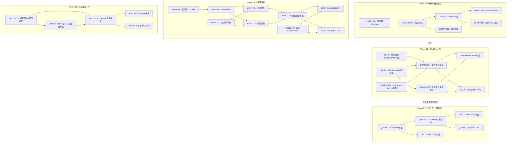

Now I have a thorough understanding of the codebase, its patterns, and the specific code-level claims. Let me construct the Tech Lead analysis.

---

# Tech Lead 分析报告：第五轮交叉分析的 5 个方向

## 0. 代码验证结论（Spot-Check Result）

在深入任务分解之前，先验证分析文档中的代码级声明的准确性：

| 文档声明 | 验证结果 | 详情 |
|---------|---------|------|
| `canReadFile` 不检查 `file_shares` | ⚠️ **部分正确** | `internal/service/service.go` 的包级函数确实只检查 `owner_uid`+`visibility`。但 `fileService.canRead()` 方法额外调用了 `s.shares.IsSharedWith()`。**真正的 Bug 在 `comment.go` 的 `assertTargetReadable`**——它使用了包级 `canReadFile`，所以对文件的评论创建不会检查分享授权 |
| `Message` 无 `Mentions` 字段 | ✅ **确认** | `domain.Message` 只有 `FromUID/ToUID/Kind/Content/FileID/ReadAt/EditedAt/Meta/CreatedAt`，无提及相关字段 |
| `SendMessageInput` 无 `Mentions` | ✅ **确认** | service 接口定义的 `SendMessageInput` 确实无提及字段 |
| `UserDirectory.GetUsers` 存在 | ✅ **确认** | `sso.Client.GetUsers` 通过 `UserCache` 批量查询 |
| `NotifTypeCommentReply` 存在 | ✅ **确认** | 但无 `NotifTypeMention` |
| `internal/repository/file_share.go` 有 `ListGrantees` | ✅ **确认** | 但该能力**未透出**到 service 层（`FileService` 接口无 `ListGrantees` 方法） |
| `meta` 是 JSONB 字段 | ✅ **确认** | `Message.Meta map[string]any` 和 `fileRow` 的 `Meta datatypes.JSON` |

**结论**：文档的分析质量高，发现的 5 个方向代码级证据真实可靠。唯一需要修正的细微之处：文件读权限在 `fileService.Get` 路径上已通过 `canRead` 方法检查了 `file_shares`，但评论创建路径上遗漏了。

---

## 1. 任务分解

基于 AGENTS.md 的工程约束（≤500 行/文件，≤50 行/函数，复杂度 ≤10），每个方向拆解为 2-4 小时可完成的任务。

### 方向一：内容草稿与自动保存（Draft & Auto-Save）

| 任务 ID | 标题 | 涉及文件 | 前置 | 工时 | 验收标准 |
|---------|------|---------|------|------|---------|
| DRAFT-001 | 添加 `drafts` 表迁移和 Domain 模型 | `migrations/000028_create_drafts.up.sql`、`.down.sql`、`internal/domain/draft.go` | 无 | 2h | 迁移可回滚；`domain.Draft` 包含 `ID/OwnerUID/DraftType/SubjectID/Content/Version/ExpiresAt/Timestamps`；`UNIQUE(owner_uid, draft_type, COALESCE(subject_id, '0000…'))` 约束 |
| DRAFT-002 | 实现 DraftRepository（CRUD + 过期清理） | `internal/repository/draft.go`、`internal/repository/draft_test.go` | DRAFT-001 | 3h | `Upsert`（ON CONFLICT 合并）、`Get`、`ListByOwner`（分页）、`Delete`、`DeleteExpired`；单元测试覆盖正常路径和并发覆盖 |
| DRAFT-003 | 实现 DraftService（业务逻辑 + 乐观锁 + 过期策略） | `internal/service/draft.go`、`internal/service/draft_test.go` | DRAFT-002 | 3h | 服务层验证 owner 匹配；`version` 乐观锁防旧覆盖新；`expires_at` 默认 7 天；权限检查（仅 owner 可读写）；错误类型转换 |
| DRAFT-004 | HTTP Handler：草稿 CRUD 端点 | `internal/handler/http/draft.go`、`internal/handler/http/draft_test.go`、`internal/handler/http/router.go` | DRAFT-003 | 2h | `POST /v1/drafts`（upsert）、`GET /v1/drafts`（列表）、`GET /v1/drafts/:id`、`DELETE /v1/drafts/:id`；Idempotency-Key 支持；HTTP 集成测试 |
| DRAFT-005 | gRPC Handler：草稿 RPC | `internal/handler/grpc/draft.go`、`internal/handler/grpc/draft_test.go`、`api/proto/aero_id/v1/aero_id.proto` (扩展)、`internal/handler/grpc/aeropb/` (重新生成) | DRAFT-003 | 3h | Proto 定义 `DraftService`（`UpsertDraft`/`ListDrafts`/`GetDraft`/`DeleteDraft`）；gRPC ↔ HTTP 行为一致（parity test） |
| DRAFT-006 | 自动过期清理 + 配置集成 | `internal/storage/gc/draft_cleaner.go`、`configs/config.yaml` | DRAFT-002 | 2h | 可配置的清理间隔（`draft.cleanup_interval`）；复用 `idemStore.RunCleaner` 或 GC sweeper 的定时模式；集成测试验证过期草稿被清理 |

**方向一小计：15 工时**

### 方向二：@提及与用户标记（Mentions）

| 任务 ID | 标题 | 涉及文件 | 前置 | 工时 | 验收标准 |
|---------|------|---------|------|------|---------|
| MENT-001 | 添加 `mentions` 表迁移和 Domain 模型 | `migrations/000029_create_mentions.up.sql`、`.down.sql`、`internal/domain/mention.go` | 无 | 2h | `domain.Mention` 包含 `ID/MentionedUID/ActorUID/SubjectType/SubjectID/MentionText/CreatedAt`；索引 `(mentioned_uid, created_at DESC)` |
| MENT-002 | 实现 MentionRepository | `internal/repository/mention.go`、`internal/repository/mention_test.go` | MENT-001 | 2h | `Create`、`ListByMentioned`（分页）、`DeleteBySubject`；单元测试 |
| MENT-003 | @提及解析器（纯函数，无外部依赖） | `internal/service/mention_parser.go`、`internal/service/mention_parser_test.go` | 无 | 2h | 正则 `@([^\s,.;:!?，。；：！？]+)` 匹配；返回唯一用户名列表；处理中英文标点和边界情况；100% 单元覆盖 |
| MENT-004 | 扩展 MessageService.Send 支持提及 | `internal/service/message.go`、`internal/service/message_test.go` | MENT-002、MENT-003 | 3h | `SendMessageInput` 新增 `Mentions []string` 字段（可选，自动从 content 解析）；保存时写入 mentions 表；若 `Mentions` 显式提供则验证 content 中的 `@` 与之匹配；通过 outbox 发出 `mention.created` 事件 |
| MENT-005 | 扩展 CommentService.Create 支持提及 | `internal/service/comment.go`、`internal/service/comment_test.go` | MENT-002、MENT-003 | 2h | 同 MENT-004 但针对评论；注意 `internal/service/comment.go` 已 481 行——提取 `assertTargetReadable` 等方法到 `internal/service/comment_common.go` 以控制文件大小 |
| MENT-006 | 新增 `mention` 通知类型 + NotificationDispatcher 扩展 | `internal/domain/notification.go`（加 `NotifTypeMention`）、`internal/notification/dispatcher.go`、`internal/notification/dispatcher_test.go` | MENT-004、MENT-005 | 3h | `NotifTypeMention` → `mention` 通知类型；dispatcher 处理 `mention.created` 事件；通知负载包含提及原文片段；块检查（blocked user 不触发通知） |
| MENT-007 | SSO `SearchUsers` RPC 支持（可选前置） | `internal/sso/client.go`（加 `SearchUsers` 方法）、`internal/sso/client_test.go`、`api/proto/sso/v1/sso.proto` | 无（独立） | 3h | 新增 `SearchUsers(query string, limit int)` → `[]User`；缓存搜索结果的合理性评估（搜索很少命中缓存，建议旁路缓存但限流） |
| MENT-008 | HTTP Handler：提及列表 + 自动补全 | `internal/handler/http/mention.go`、`internal/handler/http/mention_test.go`、`internal/handler/http/router.go` | MENT-002、MENT-007 | 2h | `GET /v1/mentions`（分页列表）、`GET /v1/users/suggest?q=xxx`（自动补全，仅返回 uid+display_name） |
| MENT-009 | gRPC Handler：提及列表 + 用户搜索 | `internal/handler/grpc/mention.go`、`api/proto/aero_id/v1/aero_id.proto` (扩展) | MENT-002、MENT-007 | 2h | parity test 覆盖 |

**方向二小计：21 工时**

### 方向三：内容引用与转发（Quoting & Forwarding）

| 任务 ID | 标题 | 涉及文件 | 前置 | 工时 | 验收标准 |
|---------|------|---------|------|------|---------|
| QUOTE-001 | 扩展 Domain 模型引用相关字段和方法 | `internal/domain/message.go`、`internal/domain/comment.go` | 无 | 1h | `Message` 新增 `QuotedMessage *QuotedMessage` 和 `ForwardedFrom *ForwardedFrom` 嵌入式类型；`Comment` 新增 `QuotedContent *string`；添加 `ValidateQuote(actor, target)` 验证可见性 |
| QUOTE-002 | 实现引用/转发的 Service 层逻辑 | `internal/service/message.go`、`internal/service/message_test.go` | QUOTE-001 | 3h | `SendMessageInput` 新增 `QuotedMessageID *domain.ID`、`ForwardedFromMessageID *domain.ID`；`Send()` 中验证引用消息存在且调用方可读；引用信息以 JSON 存入 `Message.Meta`；被引用消息删除后不级联删除引用 |
| QUOTE-003 | 扩展消息 HTTP 端点支持引用 | `internal/handler/http/message.go`、`internal/handler/http/message_test.go` | QUOTE-002 | 2h | `POST /v1/messages` 支持 `quoted_message_id` 和 `forwarded_from_message_id` 参数 |
| QUOTE-004 | 扩展消息 gRPC 端点支持引用 | `internal/handler/grpc/message.go`、`api/proto/aero_id/v1/aero_id.proto` (扩展 `SendMessageRequest`) | QUOTE-002 | 2h | parity test 覆盖引用/转发行为 |
| QUOTE-005 | 评论引用：引用目标评论内容 | `internal/service/comment.go`、`internal/handler/http/comment.go`、`internal/handler/grpc/comment.go` | QUOTE-001 | 2h | 评论创建时可选 `quoted_content`；注意 `internal/service/comment.go` 接近 500 行限制——可将引用逻辑提取到 `internal/service/comment_quote.go` |

**方向三小计：10 工时**

### 方向四：通用批量操作 API（Batch Operations）

| 任务 ID | 标题 | 涉及文件 | 前置 | 工时 | 验收标准 |
|---------|------|---------|------|------|---------|
| BATCH-001 | 批量操作基础架构：部分失败结果模型 + 限流适配 | `internal/domain/batch.go`、`internal/middleware/ratelimit.go`、`internal/pkg/errors/errors.go` | 无 | 3h | `domain.BatchResult[T]` 泛型类型包含 `Results []BatchItemResult`、`Total/Succeeded/Failed`；`BatchError` 包含单个子操作的错误码；限流中间件支持按子操作数计费的 `Weight()` 接口 |
| BATCH-002 | Repository 批量操作方法 | `internal/repository/file.go`（加 `DeleteMany`/`ShareMany`）、`internal/repository/message.go`（加 `MarkReadMany`）、`internal/repository/comment.go`（加 `HideMany`/`DeleteMany`） | BATCH-001 | 3h | 每个批量方法用 `WHERE id IN (...)` 实现；返回成功/失败的 ID 列表；与单实体操作行为一致（权限检查在 service 层） |
| BATCH-003 | Service 批量操作层 + 幂等性支持 | `internal/service/file_batch.go`、`internal/service/message_batch.go`、`internal/service/comment_batch.go` | BATCH-002 | 4h | `BatchDeleteFiles(ctx, ids []domain.ID) → *domain.BatchResult`；`BatchShareFiles`、`BatchMarkRead`、`BatchDeleteComments`；每个子操作独立提交；幂等性 key 映射到组合结果；注意文件拆分 `file_service.go` 和 `comment_service.go` |
| BATCH-004 | HTTP 批量端点 | `internal/handler/http/file.go`、`internal/handler/http/message.go`、`internal/handler/http/comment.go` | BATCH-003 | 3h | `POST /v1/files/batch-delete`、`POST /v1/files/batch-share`、`POST /v1/messages/batch-mark-read`、`POST /v1/comments/batch-delete`；限制 `max_batch_size`（默认 100） |
| BATCH-005 | gRPC 批量 RPC | `internal/handler/grpc/file.go`、`internal/handler/grpc/message.go`、`api/proto/aero_id/v1/aero_id.proto`（扩展） | BATCH-003 | 3h | parity test |

**方向四小计：16 工时**

### 方向五：跨域关系遍历 API（Entity Graph）

| 任务 ID | 标题 | 涉及文件 | 前置 | 工时 | 验收标准 |
|---------|------|---------|------|------|---------|
| GRAPH-001 | **修复 `canReadFile` 权限 Bug** | `internal/service/service.go`（包级 `canReadFile` 函数新增 `shares FileShareRepository` 参数或改为方法）、`internal/service/comment.go`（更新 `assertTargetReadable` 使用 `fileService.canRead`） | 无 | 2h | `assertTargetReadable` 对文件类型使用检查 `file_shares` 的读取权限；现有测试不破坏 |
| GRAPH-002 | 定义 Graph API 的 Domain 响应模型 | `internal/domain/graph.go` | 无 | 1h | `FileRelations`（`ReferencingMessages`/`Comments`/`Shares`/`Versions`）、`MessageRelations`（`Replies`/`Reactions`/`ReferencedFile`/`QuotedMessages`）、`UserRelations`（`Files`/`Messages`/`Comments`/`Notifications`） |
| GRAPH-003 | 为文件侧暴露 `ListGrantees` 到 Service 层 | `internal/service/file.go`（`FileService` 新增 `ListGrantees(id) → []string`）、`internal/service/file_share.go` | 无 | 1h | 调用 `fileshareRepo.ListGrantees`；权限检查仅文件 owner 可调用 |
| GRAPH-004 | 实现文件关系查询 Service 方法 | `internal/service/file_graph.go`、`internal/service/file_graph_test.go` | GRAPH-001、GRAPH-002、GRAPH-003 | 3h | `GetFileRelations(ctx, id, include []string) → *domain.FileRelations`；可选 `include` 参数控制加载项（messages, comments, shares），默认全加载；每个子查询独立并受权限检查；注意 `internal/service/file.go` 已占用——新建 `file_graph.go` |
| GRAPH-005 | 实现消息/用户关系查询 Service 方法 | `internal/service/message_graph.go`、`internal/service/message_graph_test.go` | GRAPH-001、GRAPH-002 | 2h | `GetMessageRelations`、`GetUserRelations` |
| GRAPH-006 | HTTP 关系遍历端点 | `internal/handler/http/file.go`、`internal/handler/http/message.go`、`internal/handler/http/router.go` | GRAPH-004、GRAPH-005 | 2h | `GET /v1/files/:id/related?include=messages,comments`；`GET /v1/messages/:id/related`；`GET /v1/users/:uid/related?types=files,messages,comments`（管理员/本人） |
| GRAPH-007 | gRPC 关系遍历 RPC | `internal/handler/grpc/file.go`、`internal/handler/grpc/message.go`、`api/proto/aero_id/v1/aero_id.proto`（扩展） | GRAPH-004、GRAPH-005 | 2h | parity test |

**方向五小计：13 工时**

---

## 2. 执行顺序（Mermaid 依赖图）



### 并行执行组

| 并行组 | 任务 | 理由 |
|--------|------|------|
| **Group A** | DRAFT-001～006 | 完全独立的数据域，不依赖其他方向 |
| **Group B** | GRAPH-001～007 + MENT-007(SSO SearchUsers) | Graph API 独立于草稿；SSO 搜索是可选前置 |
| **Group C** | MENT-001～009 | 依赖 Group B 完成—但实际 MENT-001～007 可独立推进，仅 MENT-008/009 的自动补全依赖 MENT-007 |
| **Group D** | BATCH-001～005 | 独立于其他所有方向，可在任意阶段开展 |
| **Group E (Phase 3)** | QUOTE-001～005 | 依赖群聊（不在本次范围内）但其 Domain 模型和 Service 逻辑可独立先做 |

---

## 3. 技术风险

### 3.1 高风险项

| 风险 | 方向 | 描述 | 缓解策略 |
|------|------|------|---------|
| **R1: `comment.go` 文件超限** | 方向二/三 | `internal/service/comment.go` 当前 481 行，距 500 行限制仅 19 行。MENT-005 和 QUOTE-005 分别会在其中增加 30+ 行 | **必须在实施 MENT-005 前拆分**：将 `assertTargetReadable`、`Create` 的公共验证逻辑、`Edit`/`Delete`/`Like`/`Unlike` 的权限检查提取到 `internal/service/comment_common.go`。预估可减少主文件 80-100 行 |
| **R2: SSSO SearchUsers RPC 依赖** | 方向二 | 自动补全需要 SSO 端搜索能力，但 SSO 是外部系统，不在 aero-id 控制范围内 | 前端可先实现客户端侧补全（预加载联系人列表）。MENT-007 作为可选优化，不阻塞 MENT-008 的核心端点 |
| **R3: 批量操作的限流权重量化** | 方向四 | 批量请求中每个子操作消耗的限流配额需要精确计算。若按请求数计费，一个批量 100 的请求会绕过限流 | 实现 `middleware.RateLimit` 的 `Weight()` 接口：批量端点返回 `len(ids)`，与 token bucket 的 `tokens` 计费适配。文档已考虑这一点，但需要实际验证 |
| **R4: GRAPH-001 修复 `canReadFile` 的影响范围** | 方向五 | `assertTargetReadable` 是 `CreateComment` 的热路径入口。修复后新增 `file_shares` 查询会增加一次 DB 查询 | 查询是 PK 索引扫描（`file_shares (file_id, grantee_uid)`），延迟增加 < 1ms。加上现有的 `s.files.Get(ctx, target)` 已经是 2 次查询——接受。也可考虑将 `IsSharedWith` 信息合并到 `Get` 返回中 |
| **R5: 提及解析的 UTF-8 边界** | 方向二 | 正则 `@([^\s,.;:!?，。；：！？]+)` 在处理 CJK 用户名时可能因零宽空格或特殊 Unicode 字符误匹配 | 补充 fuzz testing；用户名解析后通过 `UserDirectory.GetUsers` 验证存在性就是天然的安全阀——不存在的用户名不会写入 mentions 表 |

### 3.2 低风险项

| 风险 | 方向 | 描述 | 处理方式 |
|------|------|------|---------|
| 草稿过期清理的并发安全 | 方向一 | `DraftRepository.DeleteExpired` 与 `Upsert` 可能并发 | 软删除 + 独立清理周期，容忍写偏，无一致性问题 |
| 引用消息的软删除后显示 | 方向三 | 被引用的消息被删除后，引用方显示什么 | 先保留引用时的 content_snippet，引用方显示"原文已被删除"+ 存档片段 |
| 批量操作的幂等性 | 方向四 | `Idempotency-Key` 映射到批量操作的效果 | 存储所有子操作的 result hash，相同 key+body 返回缓存的响应，但不重新执行已成功的操作 |

### 3.3 性能分析

| 方向 | 热点 | 分析 | 优化策略 |
|------|------|------|---------|
| 方向一 | 草稿列表 `ListByOwner` | 用户持有草稿数量通常 ≤ 20，性能无压力 | 无需额外优化，分页即可 |
| 方向二 | 提及解析 + 通知 | 每条消息/评论都需正则扫描 content | 长的 content 可能耗时 > 1ms，但通常在 100μs 内完成 |
| 方向三 | 引用消息存在性检查 | `Get` 调用 + 可见性验证 | 复用 `MessageService.Get` 的缓存层（GORM 无缓存，但 PK 查询快） |
| 方向四 | 批量操作按 `id IN (...)` 查询 | 100 个 ID 的 IN 查询在 PG 上通常 < 5ms | 确保 `id` 是 PK；限制 `max_batch_size` |
| 方向五 | 关系遍历 N+1 查询 | `/v1/files/:id/related` 默认加载 3-4 个关联查询 | 每个查询独立、受限（默认各返回 10 条）、可选的 `include` 参数 |

---

## 4. 资源评估

### 4.1 开发人员配置

| 角色 | 数量 | 所需技能 | 负责方向 |
|------|------|---------|---------|
| **Senior Go 后端工程师** | 2人 | GORM, gRPC, HTTP API 设计, 单元测试/集成测试 | 方向一(A) + 方向五(B) / 方向四(D) |
| **全栈工程师** (可兼职 SSO 集成) | 1人 | Go, protobuf, 通知系统, SSO 集成 | 方向二(C) + 方向三(E) |
| **QA 工程师** | 1人 | 集成测试, 性能测试, API parity 验证 | 全方向——与开发并行 |

**替代方案**：如果只有 1 名 Senior + 1 名 Mid-level：
- Senior 负责方向一（独立）+ 方向五（修复 Bug + 架构设计）
- Mid-level 负责方向二 + 方向四
- 方向三推迟到群聊上线后

### 4.2 关键里程碑

| 里程碑 | 时间 | 交付物 | 验证标准 |
|--------|------|--------|---------|
| **M1** 基础就绪 | 第 5 天 | DRAFT-001～003 + GRAPH-001～003 | `make test && make lint` 通过；草稿 CRUD 在服务层可用；`canReadFile` Bug 修复 |
| **M2** Graph API 端到端 | 第 8 天 | GRAPH-004～007 + HTTP/gRPC 端点 | 关系遍历 API 在浏览器和 gRPC client 中可用 |
| **M3** 草稿端到端 | 第 10 天 | DRAFT-004～006 | 前端可调用草稿 CRUD；过期草稿自动清理 |
| **M4** @提及上线 | 第 15 天 | MENT-001～009 | 消息/评论中的 @提及被解析、存储、通知；自动补全端点可用 |
| **M5** 批量操作上线 | 第 18 天 | BATCH-001～005 | 批量删除文件/标记已读/删除评论端到端可用 |
| **M6** 引用/转发上线 | 第 22 天* | QUOTE-001～005 | *依赖群聊上线后开始。消息引用和评论引用端到端可用 |

### 4.3 Blockers 和解决策略

| Blocker | 影响 | 解决策略 |
|---------|------|---------|
| **B1: SSO `SearchUsers` 不存在** | MENT-008 自动补全功能受限 | 前端侧预加载 + 本地搜索；SSO 端 RPC 作为独立任务降低优先级 |
| **B2: 群聊未上线** | QUOTE-001～005 最大价值受限 | 引用/转发的 1:1 场景仍有价值（类似 Telegram 回复）。先实现核心存储和验证逻辑，UI 增强随群聊一起发布 |
| **B3: `internal/service/comment.go` 超 500 行** | 违反 AGENTS.md 硬限制 | **这是最高优先级的重构**。在任何方向二/三的变更之前，必须拆分 `comment.go`。见 R1 缓解策略 |

---

## 5. 质量保证

### 5.1 单元测试覆盖要求

| 层级 | 目标覆盖率 | 特殊要求 |
|------|-----------|---------|
| **Domain**（`domain/*.go`） | ≥ 95% | 所有实体创建函数、验证函数（如 `ValidateNewComment`） |
| **Repository**（`repository/*.go`） | ≥ 80% | 所有 CRUD 路径（正常 + 空结果 + 并发冲突 + 到期清理） |
| **Service**（`service/*.go`） | ≥ 85% | 所有成功路径 + 权限拒绝 + 输入验证 + NotFound + 边界条件 |
| **Handler**（`handler/*/*.go`） | ≥ 75% | 请求解码、参数验证、响应格式、错误渲染 |
| **Parser**（`mention_parser.go`） | **100%** | 正则解析器必须 fuzz test 覆盖 CJK、emoji、零宽空格 |

### 5.2 集成测试策略

| 测试类型 | 工具 | 覆盖范围 | 执行条件 |
|---------|------|---------|---------|
| **Repository Integration** | `testpg` (testcontainers Postgres) | 新表的 INSERT/SELECT/UPDATE/DELETE，迁移 up/down | `go test -tags=integration` |
| **API Parity Test** | `parity_edit_test.go` 模式 | HTTP ↔ gRPC 行为完全一致 | `make test-integration` |
| **Notify Flow** | `testpg` + outbox Relay | 提及事件 → outbox → dispatcher → notification 行 → SSE | `go test -tags=integration` |
| **Batch Partial Failure** | Mock 服务 + 集成 DB | 批量操作中部分子操作失败 → 其余成功 + 详细错误结果 | `go test -tags=integration` |

### 5.3 代码审查要点

| 关注点 | 检查内容 |
|--------|---------|
| **权限** | 草稿：仅 owner 可读写；提及：仅提到自己的用户可看列表；关系遍历：每个关联实体独立的 `canRead` 检查 |
| **文件大小** | 变更后的文件是否 ≤ 500 行；若接近则必须拆分 |
| **函数长度** | 任何新增函数 ≤ 50 行；if-nesting ≤ 3 层；复杂度 ≤ 10 |
| **错误处理** | Repo 返回原始错误 → Service 转换为 `*AppError` → Handler 渲染。无原始 DB 错误泄露 |
| **迁移** | 每 `.up.sql` 有对应的 `.down.sql` |
| **幂等性** | 批量操作的幂等键映射正确；草稿 upsert 安全 |
| **分页** | 所有列表端点使用 cursor 分页（`WHERE id < ? ORDER BY id DESC LIMIT n+1`） |

### 5.4 性能测试需求

| 场景 | 负载 | 目标 | 工具 |
|------|------|------|------|
| 提及解析 + 写入 | 1000 requests/s，content 平均 200 字 | P99 < 20ms | k6 或 ghz |
| 批量删除 100 个文件 | 50 并发 | P99 < 500ms（含 DB 事务） | ghz (gRPC) |
| 关系遍历（全量加载） | 100 并发查询最热门文件 | P99 < 50ms | k6 |
| 草稿 upsert 并发冲突 | 10 客户端同时保存同一草稿 | 最终只有一个版本存活（乐观锁）并返回 409 | 自定义 Go test |

---

## 6. 实施计划

### 时间线（假设 2 名 Senior Go + 1 名 QA，全栈兼职。每日有效工时 = 6h/人）

```mermaid
gantt
    title aero-id Round 5 实施甘特图
    dateFormat  YYYY-MM-DD
    axisFormat  %m-%d

    section Phase 1A: 草稿与自动保存 (15h)
    DRAFT-001~003 表+Repo+Service :a11, 2026-07-14, 2d
    DRAFT-004 HTTP Handler       :a12, after a11, 1d
    DRAFT-005 gRPC Handler       :a12, 2026-07-15, 1d
    DRAFT-006 过期清理            :a13, 2026-07-16, 1d
    Phase 1A 完成+测试            :milestone, a13, 1h

    section Phase 1B: 关系遍历 API (13h)
    GRAPH-001 修复 Bug           :b11, 2026-07-14, 1d
    GRAPH-002~003 模型+暴露       :b11, after b11, 1d
    GRAPH-004~005 Service        :b11, 2026-07-15, 2d
    GRAPH-006~007 HTTP+gRPC      :b11, 2026-07-17, 1d
    Phase 1B 完成+测试            :milestone, 2026-07-17, 1h

    section Phase 2A: @提及系统 (21h)
    MENT-001~003 表+Repo+解析器  :c21, 2026-07-18, 2d
    MENT-004~005 消息+评论提及    :c22, after c21, 2d
    MENT-006 通知扩展             :c23, after c22, 1d
    MENT-007~009 SSO搜索+端点     :c24, after c23, 2d
    Phase 2A 完成+测试            :milestone, 2026-07-24, 1h

    section Phase 2B: 批量操作 API (16h)
    BATCH-001 基础架构            :d21, 2026-07-18, 1d
    BATCH-002~003 Repo+Service   :d22, after d21, 2d
    BATCH-004~005 HTTP+gRPC      :d23, after d22, 1d
    Phase 2B 完成+测试            :milestone, 2026-07-22, 1h

    section Phase 3: 引用/转发 (10h, 依赖群聊)
    QUOTE-001~002 Domain+Service :e31, 2026-07-25, 2d
    QUOTE-003~005 HTTP+gRPC+评论  :e32, after e31, 2d
    Phase 3 完成+测试             :milestone, 2026-07-28, 1h

    section 质量加固
    集成测试覆盖                  :qa, 2026-07-28, 3d
    性能测试+调优                 :q2, after qa, 2d
    文档+AGENTS.md更新           :q3, after q2, 1d
    Round 5 完成                 :milestone, 2026-08-01, 1h
```

### 4 阶段详细计划

#### 阶段 1：基础设施搭建（第 1-4 天，7/14-7/17）

**目标**：打好两个无依赖方向的底层基础 + 修复关键的权限 Bug

| 天 | 并行任务 | 产出 |
|----|---------|------|
| Day 1 | **Developer A**: `DRAFT-001`（迁移+Domain）+ `DRAFT-002`（Repository） | 草稿的数据库层 |
| Day 1 | **Developer B**: `GRAPH-001`（修复 Bug）+ `GRAPH-002`（Domain 模型）+ `GRAPH-003`（ListGrantees） | 权限修复 + 关系遍历模型 |
| Day 2 | **A**: `DRAFT-003`（Service）+ `DRAFT-006`（过期清理配置） | 草稿服务层 |
| Day 2 | **B**: `GRAPH-004`（文件关系查询）+ `GRAPH-005`（消息/用户关系查询）⚠️ 注意 `fileGraph` 不超 500 行，新建文件即可 | 关系查询 Service |
| Day 3 | **A**: `DRAFT-004`（HTTP Handler）+ 开始 `DRAFT-005`（gRPC Handler） | 草稿 HTTP 端点 |
| Day 3 | **B**: `GRAPH-006`（HTTP 端点）+ `GRAPH-007`（gRPC RPC） | 关系遍历端点 |
| Day 4 | **A**: `DRAFT-005` 完成 + `DRAFT-006` 清理逻辑测试 | 草稿端到端 |
| Day 4 | **B**: 集成测试 + parity test + 文档 | 关系遍历端到端 |

**验证门禁**：`make test && make lint && make test-integration`

#### 阶段 2：核心功能实现（第 5-11 天，7/18-7/24）

**目标**：@提及系统 + 批量操作 API 双线并行

| 天 | Developer A（@提及） | Developer B（批量操作） | QA |
|----|--------------------|----------------------|----|
| Day 5 | `MENT-001`（迁移） + `MENT-003`（解析器）+ Fuzz test | `BATCH-001`（结果模型+限流） | 写 Phase 1 的集成测试 |
| Day 6 | `MENT-002`（Repository）+ `MENT-004`（消息提及） | `BATCH-002`（Repo 批量方法） | 同上 |
| Day 7 | `MENT-005`（评论提及）⚠️ **先拆分 `comment.go`** | `BATCH-003`（Service 批量） | Code Review Phase 1 |
| Day 8 | `MENT-006`（通知扩展）+ Dispatcher 修改 | `BATCH-003` 完成 | Phase 1 回归测试 |
| Day 9 | `MENT-007`（SSO Search）+ `MENT-008`（HTTP） | `BATCH-004`（HTTP 端点） | 开始 Phase 2 测试 |
| Day 10 | `MENT-009`（gRPC）+ parity test | `BATCH-005`（gRPC）+ parity test | 并发测试 |
| Day 11 | 集成测试 + Bug 修复 | 集成测试 + Bug 修复 | 全量回归 |

**关键动作点**：
- Day 7 之前必须完成 `comment.go` 拆分（Developer A 或 B 提前一天做）
- Day 8 的 NotificationDispatcher 修改需要 Developer B 或 Senior 做 Code Review（这是通知系统核心路径）

#### 阶段 3：集成测试和优化（第 12-15 天，7/25-7/28）

**目标**：引用/转发（如果群聊就绪）+ 全量集成测试 + 性能测试

| 任务 | 负责 | 验收标准 |
|------|------|---------|
| `QUOTE-001~005`（引用/转发） | Developer A（如果群聊已上线）或 Developer B | 消息引用和评论引用可用 |
| 全量 integration test 覆盖 | QA | 所有 5 个方向的关键路径覆盖 |
| 性能测试：提及 + 批量 + 关系遍历 | QA + Developer A | P99 满足目标 |
| 权限审计测试 | Developer B | 每个新端点的权限矩阵覆盖（owner、shared_with_me、stranger） |
| `AGENTS.md` 更新 | 任一 Developer | 记录新方向的架构决策和约束 |

#### 阶段 4：发布准备（第 16-19 天，7/29-8/1）

| 任务 | 验收标准 |
|------|---------|
| API 文档同步（README + proto 注释） | 所有新端点有完整的请求/响应示例 |
| 配置文档更新 | `configs/config.yaml` 注释覆盖所有新配置项 |
| 前端对接联调 | 前端团队确认新 API 满足需求 |
| 性能基线对比 | 新功能上线后核心 API 的 P99 退化 ≤ 5% |
| 全量 `make test && make lint && make test-integration` | 绿通过 |

---

## 7. 总结与建议

### 推荐实施策略

**立即启动（Phase 1 并行）**：
- 草稿（方向一）和关系遍历（方向五）是互不依赖的两个方向，可分配给 2 名开发者并行推进
- `GRAPH-001`（修复 `canReadFile` Bug）是整个系统的安全加固，属于 GA 级别的缺陷修复，应最高优先级

**Phase 2 的并行机会**：
- @提及（方向二）和批量操作（方向四）也可以并行，分别分配给 A 和 B
- 但注意开发 A 在推进 @提及时需要额外 0.5 天拆分 `comment.go`

**推迟方向三**：
- 引用/转发是用户价值最高的方向之一，但其最大收益在群聊场景中释放
- 核心存储模型可以提前落地（QUOTE-001~002 + QUOTE-005），但完整的端到端功能建议在群聊基础设施就绪后发布

### 优先级调整建议

对照 AGENTS.md 的工程约束，我在分析中发现一个**必须优先处理的技术债务**：

1. **⚠️ 紧急：拆分 `internal/service/comment.go`**（当前 481 行，距 500 仅 19 行）。任何方向二/三的修改都会导致文件超限。建议在实施 MENT-005 前创建一个独立任务 `REFACTOR-001: Split comment.go`（1h，提取 `assertTargetReadable` 和权限检查函数到 `comment_common.go`）

2. **⚠️ 需注意：`internal/service/file.go` 的复杂性**。虽然没有文件超限问题（相对安全），但 `canRead` 方法中 `fileService` 接管了 `canReadFile` 的检查职责——这是一个代码异味：同一种权限逻辑分散在包级函数和 struct 方法中。建议在 `GRAPH-001` 的修复中做统一。

### 风险对冲

- **如果 SSO `SearchUsers` RPC 不可用**：MENT-008 的自动补全回退到客户端侧搜索+联系人缓存。不影响 MENT-004/005/006 的核心提及功能
- **如果群聊延期**：引用/转发延期到 Phase 4。但 QUOTE-001~002（Domain 模型 + Service 验证逻辑）可以提前完成并投入 1:1 对话场景
- **如果资源缩减**：砍掉方向四（批量操作），这是对高频用户有价值但不是 core UX 的功能。保留方向一+方向二+方向五作为 MVP
