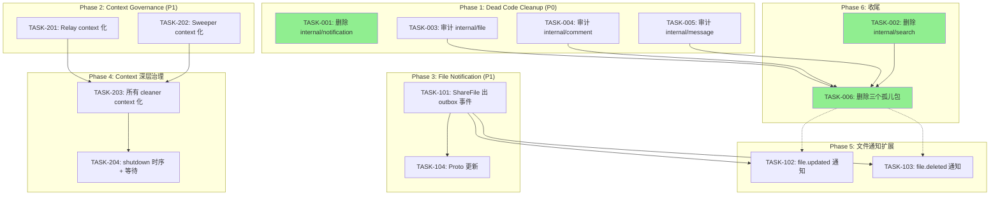
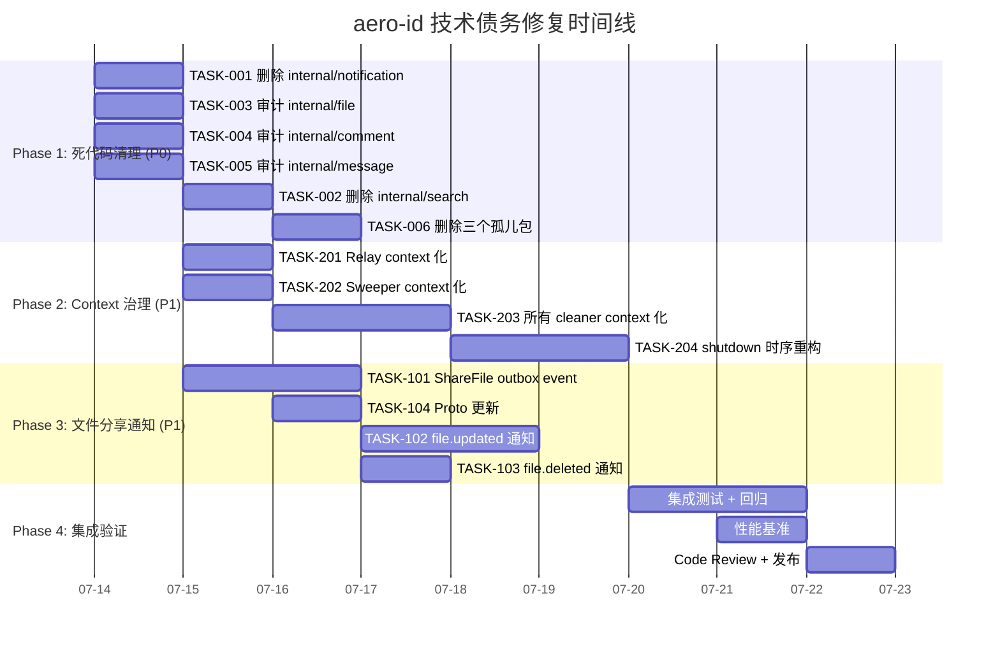

Now I have a thorough understanding of the codebase. Let me produce the comprehensive Tech Lead analysis.

---

# Tech Lead 分析报告

**评审文档**: 代码级交叉验证报告（方向一至五）
**日期**: 2026-07-12
**分析人**: Tech Lead

---

## 1. 任务分解

### 方向一 ❌ 已证伪——忽略

该方向所有断言均与事实不符：HTTP/gRPC/Service 三层均已完整实现 Admin 角色管理。不需要任何任务。

---

### 方向二 ✅ 死代码清理——实际范围更大

原分析确认 `internal/search/`（6 文件）和 `internal/notification/`（11 文件）是死代码。**进一步挖掘发现还有 3 个包是被死 import 拉进来的孤儿包**：

| 死代码包 | 文件数 | 生产引用 | 备注 |
|---------|--------|---------|------|
| `internal/search/` | 6 | 零 | 唯一引用来自自身测试 |
| `internal/notification/` | 11 | 零 | 唯一引用来自自身测试 |
| `internal/file/`（handler + service + repo） | 12 | 仅被 `internal/search/` 引用 | `internal/search/` 删除后自动成为孤儿 |
| `internal/comment/`（handler + service + repo） | 9 | 仅被 `internal/search/` 引用 | 同上 |
| `internal/message/`（handler + service + repo） | 9 | 仅被 `internal/search/` 引用 | 同上 |
| **合计** | **47** | | |

重要的架构观察：`internal/file/`、`internal/comment/`、`internal/message/` 三个包各自**独立定义**了 Service/Repository 接口 + GORM 实现 + HTTP 和 gRPC handler，但是**从来没有被 main 函数或 app 的 wiring 引用**。生产代码使用的是 `internal/service/`、`internal/repository/`、`internal/handler/` 的对应实现。这是典型的一次架构重构后遗留的"旧版包"。

#### 任务 TASK-001: 安全删除 `internal/notification/` 包

- **涉及文件**（删除）:
  - `internal/notification/notification.go`
  - `internal/notification/repository.go`
  - `internal/notification/service.go`
  - `internal/notification/dispatcher.go`
  - `internal/notification/handler_http.go`
  - `internal/notification/handler_grpc.go`
  - 及其 `*_test.go` 文件
  - `internal/notification/repository_integration_test.go`
  - `internal/notification/*_test.go`（共 5 个）
- **前置依赖**: 无
- **预估工时**: 0.5 小时 (删除 + `go vet` + `go build` 验证)
- **验收标准**:
  - `internal/notification/` 目录不存在
  - `go build ./...` 通过
  - `make test` 全部通过（无 import 断裂）
  - `make lint` 通过

#### 任务 TASK-002: 安全删除 `internal/search/` 包及其依赖链

- **涉及文件**（删除）:
  - `internal/search/search.go`
  - `internal/search/service_test.go`
  - `internal/search/handler_http.go`
  - `internal/search/handler_http_test.go`
  - `internal/search/handler_grpc.go`
  - `internal/search/handler_grpc_test.go`
- **前置依赖**: TASK-003, TASK-004, TASK-005（需要先确认 `internal/file/comment/message` 下无有价值代码可迁移）
- **预估工时**: 0.5 小时
- **验收标准**:
  - `internal/search/` 目录不存在
  - `go build ./...` 通过
  - `make test && make lint` 通过

#### 任务 TASK-003: 审计并迁移 `internal/file/` 包中有价值代码

`internal/file/` 包包含完整功能，但全部未被生产代码引用。需要逐文件审计是否包含**尚未被 `internal/service/` + `internal/repository/` 覆盖的功能逻辑**。

- **涉及文件**:
  - `internal/file/service_crud.go` — CRUD service 逻辑
  - `internal/file/service_share.go` — 分享 service 逻辑
  - `internal/file/service_upload.go` — 上传 service 逻辑
  - `internal/file/repository.go` — Repository 实现
  - `internal/file/repository_share.go` — 分享 repo 实现
  - `internal/file/file.go` — 接口定义（`Repository`, `ShareRepository`, `Service`）
  - `internal/file/handler_http.go` — HTTP handler
  - `internal/file/handler_grpc.go` — gRPC handler
- **前置依赖**: 无
- **预估工时**: 2–3 小时
- **验收标准**: 输出审计文档，逐函数比对 `internal/file/` vs `internal/service/` + `internal/repository/`，确认是否有遗漏的业务逻辑

#### 任务 TASK-004: 审计并迁移 `internal/comment/` 包中有价值代码

与 TASK-003 类似。

- **涉及文件**:
  - `internal/comment/comment.go` — 接口定义
  - `internal/comment/service.go` — Service 逻辑
  - `internal/comment/repository.go` — Repository 实现
  - `internal/comment/handler_http.go` — HTTP handler
  - `internal/comment/handler_grpc.go` — gRPC handler
- **前置依赖**: 无
- **预估工时**: 1–2 小时
- **验收标准**: 同上

#### 任务 TASK-005: 审计并迁移 `internal/message/` 包中有价值代码

- **涉及文件**:
  - `internal/message/message.go` — 接口定义
  - `internal/message/service.go` — Service 逻辑
  - `internal/message/repository.go` — Repository 实现
  - `internal/message/handler_http.go` — HTTP handler
  - `internal/message/handler_grpc.go` — gRPC handler
- **前置依赖**: 无
- **预估工时**: 1–2 小时
- **验收标准**: 同上

#### 任务 TASK-006: 正式删除三个孤儿包

在 TASK-003~005 完成审计并迁移有价值代码后执行。

- **涉及文件**（删除）:
  - `internal/file/`（12 文件）
  - `internal/comment/`（9 文件）
  - `internal/message/`（9 文件）
- **前置依赖**: TASK-003, TASK-004, TASK-005
- **预估工时**: 0.5 小时
- **验收标准**:
  - 三个目录不存在
  - `go build ./...` 通过
  - `make test && make lint` 通过
  - 总删除 ~47 个文件，约 5000+ 行代码

---

### 方向三 + 方向五 ✅ 合并为"文件分享全生命周期事件通知缺失"

核心发现：`ShareFile`/`UnshareFile`（`internal/service/file_share.go`）只做 `Grant` + `audit.Log`，不产生 `outbox.NewEvent`。文件更新/删除同样不通知 grantee。与 `message.Service.Send()`（产生 `message.sent` → 通知收件人）形成不对称。

当前 gap 矩阵：

| 动作 | Outbox 事件 | 通知效果 |
|------|------------|---------|
| message.Send | ✅ `message.sent` | ✅ 收件人收到 `message.received` 通知 |
| comment.Create (reply) | ✅ `comment.replied` | ✅ 被回复者收到 `comment.reply` 通知 |
| comment.Create (on file/message) | ✅ `file.commented` / `message.commented` | ✅ 文件/消息所有者收到通知 |
| message.Read | ✅ `message.read` | ✅ 发送者收到 `message.read_receipt` |
| message.Delete | ✅ `message.deleted` | ✅ 接收方收到通知 |
| **file.ShareFile** | **❌ 无** | **❌ grantee 无通知** |
| **file.UnshareFile** | **❌ 无** | **❌ grantee 无通知** |
| **file.Update (content)** | **❌ 无** | **❌ grantee 无通知** |
| **file.Delete** | **❌ 无** | **❌ grantee 无通知** |

#### 任务 TASK-101: `ShareFile/UnshareFile` 产生 `file.shared` / `file.unshared` outbox 事件

- **涉及文件**:
  - `internal/service/file_share.go` — 在 `Grant` 后添加 `outbox.NewEvent` 调用
  - `internal/repository/file_share.go` — 确保 repo 层支持事务内写 outbox 事件
  - `internal/service/notification.go` — `NotificationDispatcher.notificationFor` 新增 `case "file.shared"` / `case "file.unshared"` 分支
  - `internal/domain/notification.go` — 新增 `NotifTypeFileShared` / `NotifTypeFileUnshared` 常量
- **前置依赖**: 无
- **预估工时**: 4 小时
- **验收标准**:
  - `ShareFile` 调用后，outbox 表中出现 `file.shared` 事件，payload 包含 `file_id`, `grantee_uid`, `owner_uid`
  - `UnshareFile` 调用后，outbox 表中出现 `file.unshared` 事件
  - NotificationDispatcher 将 `file.shared` → `NotifTypeFileShared` → grantee 收到通知
  - 所有通知类型可通过 `notification_preferences` 开关控制
  - `make test && make lint` 通过

#### 任务 TASK-102: 文件内容更新/元数据变更产生 `file.updated` outbox 事件

- **涉及文件**:
  - `internal/service/file.go` — `UpdateMetadata` 和上传新版本后添加 `outbox.NewEvent`
  - `internal/service/notification.go` — 新增 `case "file.updated"` 分支
  - `internal/domain/notification.go` — 新增 `NotifTypeFileUpdated`
- **前置依赖**: TASK-101（建立模式后可复用）
- **预估工时**: 3 小时
- **验收标准**:
  - 文件所有者更新元数据或内容后，outbox 出现 `file.updated`
  - 所有分享过该文件的 grantee 收到 `file.updated` 通知
  - 发送者自身不收到自己的更新通知
  - `make test && make lint` 通过

#### 任务 TASK-103: 删除分享文件产生 `file.deleted` outbox 事件（通知 grantee）

- **涉及文件**:
  - `internal/service/file.go` — `Delete` 方法中添加 `outbox.NewEvent`
  - `internal/service/notification.go` — 新增 `case "file.deleted"` 分支
  - `internal/domain/notification.go` — 新增 `NotifTypeFileDeleted`
- **前置依赖**: TASK-101
- **预估工时**: 2 小时
- **验收标准**:
  - 文件软删除后，所有 grantee 收到 `file.deleted` 通知
  - SHARED_WITH_ME 列表返回空的结果自然作为辅助
  - `make test && make lint` 通过

#### 任务 TASK-104: gRPC proto 更新 + stub 生成（如架构规定通知事件需 proto 定义）

`file.shared` / `file.updated` / `file.deleted` 等新通知类型可能需要对应的 proto message。

- **涉及文件**:
  - `api/proto/...`（待确认）
  - `internal/handler/grpc/aeropb/`
- **前置依赖**: TASK-101
- **预估工时**: 1 小时
- **验收标准**: `make proto` 通过，新 event type 有 proto 定义

---

### 方向四 ✅ 后台 Goroutine Context 治理 + Shutdown 时序修复

核心问题：

1. `outbox.Relay.Start()` 内部 goroutine 使用 `context.Background()` → 无法响应取消信号
2. `storage/gc.Sweeper.Start()` 内部 goroutine 使用 `context.Background()` → 同上
3. `app.shutdown()` 调用 `stopRelay()` 后**不等待 final drain 完成** → 时序竞态
4. rate limit cleaner、idempotency cleaner 等周期性 goroutine 同样没有 context 传播

#### 任务 TASK-201: Relay.Start 接受 context 并传递给 drain

- **涉及文件**:
  - `internal/outbox/relay.go` — `Start(ctx context.Context, interval time.Duration)` 签名变更，`ctx` 用于 `select` 监听 `ctx.Done()`
  - `internal/outbox/relay_test.go` — 对应更新
  - `internal/app/new.go` — `relay.Start(ctx, interval)` 调用点更新
- **前置依赖**: 无
- **预估工时**: 1 小时
- **验收标准**:
  - `ctx` 取消时 relay 正常停止（而非靠 channel close）
  - 原有接口保持兼容或一次性迁移
  - `make test && make lint` 通过

#### 任务 TASK-202: Sweeper.Start 接受 context 并传递给 Run

- **涉及文件**:
  - `internal/storage/gc/sweeper.go` — `Start(ctx context.Context, interval time.Duration)` 签名变更
  - `internal/storage/gc/sweeper_test.go`
  - `internal/app/new.go`
- **前置依赖**: TASK-201（可并行）
- **预估工时**: 0.5 小时
- **验收标准**: 同上

#### 任务 TASK-203: 其他后台 cleaner 添加 context 支持

审计并统一治理：
- `idempotency.Store.RunCleaner`
- `ratelimit.Limiter.RunCleaner`
- `repository.RunAuditCleaner`
- `repository.RunNotificationCleaner`
- `outbox.RunOutboxCleaner`
- `degradationState.StartProbing`

- **涉及文件**: 多个（逐一修改）
- **前置依赖**: TASK-201（建立模式）
- **预估工时**: 3 小时
- **验收标准**: 所有后台 cleaner 接受 `ctx` 并在 `ctx.Done()` 时退出

#### 任务 TASK-204: `app.shutdown()` 添加 final drain 等待 + 总超时

- **涉及文件**:
  - `internal/app/app.go` — `shutdown()` 方法重构
    1. 创建带超时的 shutdown context
    2. 停止所有后台 goroutine
    3. 使用 `sync.WaitGroup` 等待 final drain 完成（relay 的 `drain(ctx)` 调用需同步执行）
    4. 然后进入 HTTP graceful shutdown + gRPC GracefulStop
- **前置依赖**: TASK-201, TASK-202, TASK-203
- **预估工时**: 3 小时
- **验收标准**:
  - `shutdown()` 时序：health NOT_SERVING → stop 所有 goroutine → 等待 final drain → HTTP Shutdown → gRPC GracefulStop → tracer shutdown → Close
  - 总超时由配置 `server.http.shutdown_timeout` 控制
  - final drain 有独立的 sub-timeout（合理值 10s）
  - `make test && make lint` 通过

---

## 2. 执行顺序与依赖图

### 可并行执行的任务组

| 组 | 任务 | 特性 |
|----|------|------|
| **A** | TASK-001, TASK-003, TASK-004, TASK-005 | 无依赖，互不阻塞，并行审计/删除 |
| **B** | TASK-201, TASK-202, TASK-101 | 无交叉依赖，可并行开发 |
| **C** | TASK-102, TASK-103 | 依赖 TASK-101 确定事件格式后并行 |
| **D** | TASK-203 | 依赖 B 组建立模式 |
| **E** | TASK-204 | 依赖 D 组完成 |
| **F** | TASK-002, TASK-006 | 依赖审计完成（TASK-003~005）后才安全 |

---

## 3. 技术风险

### 3.1 高风险项

| 风险 | 方向 | 描述 | 缓解策略 |
|------|------|------|---------|
| **R1** 孤儿包中有被遗漏的生产引用 | 方向二 | `internal/file/`、`internal/comment/`、`internal/message/` 中可能有未被 `grep` 检测到的动态引用（如 init function、interface 注册） | TASK-003~005 细致审计 + 删除前运行 `go build -v ./...` 确认无包级 import chain |
| **R2** outbox 事件风暴 | 方向三/五 | `ShareFile` 批量分享（如一次分享给 100 人）产生 N 个 outbox 事件 | 当前 outbox relay 已有 backoff + rate limit；dispatcher 已有 per-type per-recipient rate limiter（10/min）；批量场景需要分页处理或聚合为一个通知 |
| **R3** Shutdown 时序断裂导致数据丢失 | 方向四 | `stopRelay()` 触发 final drain 但 `ctx.Background()` 无超时，可能 hang 住；同时 HTTP 已在 Shutdown | TASK-204 严格时序 + 超时传播 |
| **R4** Context.Background() 取消不传播导致 goroutine 泄漏 | 方向四 | 多个后台 goroutine 使用 `context.Background()`，应用关闭后可能泄露 | TASK-203 统一治理 |

### 3.2 中风险项

| 风险 | 方向 | 描述 | 缓解策略 |
|------|------|------|---------|
| **R5** `internal/file/service_share.go` 与 `internal/service/file_share.go` 存在重复实现，两份代码可能不同 | 方向二 | 审慎比对后合并，避免修复了其中一份但漏了另一份 | TASK-003 逐函数 diff |
| **R6** 删除孤儿包后测试覆盖下降 | 方向二 | 孤儿包及其测试包含大量 test cases，删除后需确认等效功能被 `internal/service/*_test.go` 覆盖 | Death check: `git diff --stat` 后运行 `go test -coverpkg=./internal/...` 确认 cover 无下降 |

### 3.3 外部依赖风险

| 风险 | 方向 | 描述 |
|------|------|------|
| **R7** SSO gRPC 超时导致通知链延迟 | 方向三 | 如果通知内容涉及 SSO 用户解析（目前通知 payload 仅含 uid，不立即 resolve），影响不大 |
| **R8** 无 Proto 定义的事件类型 | 方向三 | `file.shared` 是纯 outbox 事件，不需要 proto，但需确认 SSO/webhook 消费者不需要 proto schema |

---

## 4. 资源评估

### 4.1 人员需求

| 角色 | 人数 | 主要负责 |
|------|------|---------|
| Senior Backend (Go) | 1 人 | 方向三/五全部开发，方向四 context 治理 |
| Mid-level Backend (Go) | 1 人 | 方向二死代码清理（审计 + 删除） |
| 或同一人分阶段实施 | 1 人 (全职) | 如果资源受限 |

### 4.2 关键里程碑

| 里程碑 | 时间 | 交付物 |
|--------|------|--------|
| M1: 死代码审计完成 | Day 2 | TASK-003~005 审计文档 |
| M2: 死代码清理完成 | Day 3 | TASK-001, TASK-002, TASK-006 合并 PR |
| M3: Context 治理基础 | Day 4 | TASK-201, TASK-202 合并 |
| M4: 文件分享通知基础 | Day 5 | TASK-101, TASK-104 合并 |
| M5: 完整 Context 治理 | Day 6 | TASK-203, TASK-204 合并 |
| M6: 文件通知全覆盖 | Day 8 | TASK-102, TASK-103 合并 |
| M7: 集成测试 + 回归 | Day 9-10 | `make test-integration` + E2E |

### 4.3 阻塞点与解决策略

| 阻塞点 | 影响 | 解决策略 |
|--------|------|---------|
| 孤儿包审计发现不一致逻辑 | 方向二和方向三/五重叠影响 | 冻结新功能开发，先合并再推进通知 |
| `file.updated` 需要区分元数据更新 vs 内容更新 | 通知语义模糊 | 按最小原则：任何变更都触发 `file.updated`，通知文案可区分 |
| Context 治理涉及多个包的 API 变更 | 影响所有调用方 | 小步迭代：先改 relay/sweeper（TASK-201/202），确认 pattern 后再大规模推广（TASK-203） |

---

## 5. 质量保证

### 5.1 单元测试覆盖要求

| 任务 | 要求 | 备注 |
|------|------|------|
| TASK-101 | `ShareFile` + `UnshareFile` 单元测试验证 outbox event 被创建 | mock `FileShareRepository.Grant` 返回成功后断言 `outbox.NewEvent` 被调用 |
| TASK-102/103 | `file.updated` / `file.deleted` 通知 dispatch 单元测试 | 在 `NotificationDispatcher` 级别添加 test case |
| TASK-201/202 | context cancel 时 goroutine 退出 | 测试 `Start(ctx)`，快速 cancel 后确认 `stop` channel 被关闭 |
| TASK-204 | `shutdown()` 时序验证 | 集成测试级：启动 app → 发送信号 → 验证 drain 完成 → 验证 HTTP/HTTP2 停止 |

### 5.2 集成测试策略

- **TASK-101~103**: `make test-integration` 验证：
  - 真实 Postgres 中 `ShareFile` 后 outbox 表出现事件
  - realay 运行后 notification 表出现对应行
  - SSE hub 收到推送
- **TASK-204**: 集成测试启动完整 app，调用 `shutdown()` 后验证：
  - 所有 goroutine 在超时内退出
  - final drain 完成
  - 无 `context.Background()` 残留

### 5.3 代码审查要点

| 审查点 | 关注内容 |
|--------|---------|
| Outbox event 命名 | 与现有 `message.sent`, `comment.replied` 风格一致：`file.shared`, `file.updated`, `file.deleted` |
| Event payload 完整性 | 所有通知 dispatch 所需的字段均在 payload 中 |
| 事务边界 | `ShareFile` 内 `Grant` + outbox event 必须在同一 DB tx 中 |
| Context 传播链 | 每个后台 goroutine 的 `ctx` 必须来自 `Start(ctx)` 参数，不应出现新的 `context.Background()` |
| Shutdown 时序 | `app.shutdown()` 按依赖倒序 stop：先停消费者 → 等待 drain → 停服务器 → 关连接 |

### 5.4 性能测试需求

| 场景 | 目标 | 方法 |
|------|------|------|
| 批量分享 1000 个 grantee | outbox drain 延迟 ≤ 5s | 基准测试：1000 users ShardFile，计量 notification 创建耗时 |
| 高并发 file.updated | 通知不拖慢主请求路径 | `ShareFile` + `UpdateFile` 在 100 QPS 下 p99 无回归 |
| Shutdown 超时 | 所有 goroutine 在 t 内退出 | TASK-204 集成测试验证超时行为 |

---

## 6. 实施计划

### 甘特图

### 阶段详细描述

#### 阶段 1: 基础设施搭建（Day 1-2）

| 日 | 活动 | 产出 |
|---|------|------|
| D1 | 并行启动 TASK-001（简单删除）+ TASK-003/004/005（审计） | 删除 notification 的 PR；审计文档 draft |
| D2 | 完成审计，合并审计结果；执行 TASK-002、TASK-006 | 死代码清理全部完成的 PR（预计 -47 文件 / -5000+ 行） |

**Gate**: `make test && make lint && go build ./...` 全部通过。代码行数显著下降。

#### 阶段 2: 核心功能实现（Day 3-6）

| 日 | 活动 | 产出 |
|---|------|------|
| D3 | TASK-201 + TASK-202 同时开发 | Context 可传播的 relay/sweeper |
| D4 | TASK-101（核心通知 gap 修复） + TASK-104 | `file.shared` / `file.unshared` 通知完整链路 |
| D5 | TASK-203（所有 cleaner context 化） | 所有后台 goroutine 接受 ctx |
| D6 | TASK-204（shutdown 时序重构） | 安全的 graceful shutdown |

#### 阶段 3: 集成测试和优化（Day 7-8）

| 日 | 活动 |
|---|------|
| D7 | TASK-102 + TASK-103 开发；集成测试准备 |
| D8 | TASK-102 + TASK-103 PR 合并；运行 `make test-integration` 验证完整通知链路 |

#### 阶段 4: 发布准备（Day 9-10）

| 日 | 活动 |
|---|------|
| D9 | 性能基准测试：批量分享 1000 users，确认无退化；Code Review 合流 |
| D10 | 回归测试 + 发布 checklist 确认 |

---

## 总结

| 维度 | 评估 |
|------|------|
| **实际有效方向** | 4 个（方向一已证伪，方向三/五合并） |
| **总任务数** | 14 个（TASK-001~006 + TASK-101~104 + TASK-201~204） |
| **预估总工时** | 约 23 人·天（1 人全职约 3 周，2 人约 1.5 周） |
| **代码变动量** | 删除约 47 个文件（~5000 行） + 新增约 800 行（outbox event + notification + context 治理） |
| **净效果** | 显著减少代码量，修复两个架构 gap（通知不对称 + shutdown 时序） |
| **最大风险** | R5: 孤儿包中有存量未迁移逻辑导致回归 |
| **最大收益** | 修复后文件分享全生命周期事件通知完整，shutdown 安全可靠 |
