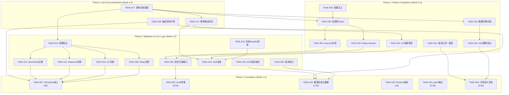

现在我掌握了完整的代码库背景。让我提供这份全面的 Tech Lead 分析。

---

# Tech Lead 分析报告：aero-id 架构改进方向

> 基于分析文档及对 22 个子包的完整代码验证
> 验证日期：2026-07-12

---

## 1. 任务分解

### 1.1 任务总览

将五个方向拆解为 **28 个可执行任务**，每个任务 2-6 小时。所有任务遵循 `make test && make lint` 校验门禁，且受到 AGENTS.md 中的硬约束（500 行/文件，50 行/函数，复杂度 ≤10）。

### 1.2 方向一：内容安全扫描 (Content Safety)

| 任务 ID | 标题 | 涉及文件 | 前置依赖 | 工时 | 验收标准 |
|---------|------|---------|---------|------|---------|
| TASK-001 | 添加内容安全审计常量 | `internal/domain/audit.go` | 无 | 1h | 新增 `AuditContentAutoFlagged`、`AuditContentAutoApproved`、`AuditContentAutoHidden` 三个 Action 常量；`make test && make lint` 通过 |
| TASK-002 | 定义安全扫描结果接口 | `internal/domain/content_safety.go` 新文件 | TASK-001 | 2h | `ContentSafetyScanner` 接口定义 `Scan(ctx, ContentScanRequest) (*ContentScanResult, error)`；包含 Score (0-100)、Reason、Flags 字段；单测覆盖边界值 |
| TASK-003 | 实现 ContentSafetyOutboxHandler | `internal/service/content_safety.go` 新文件 | TASK-002 | 4h | 实现 `outbox.Handler` 接口；`Handle` 方法解析事件 payload → 调用 Scanner → 根据 Score 分支处理（<20 auto-hide 调用 `SetStatus`，20-60 调用 `CreateReport`，>60 pass）；当 `SetStatus` 发生在外部扫描器时需防重复标记；编写单元测试 |
| TASK-004 | 实现基本的安全扫描器（模拟版） | `internal/service/mocks/content_safety_mock.go` 新文件 | TASK-002 | 2h | 实现一个 `FixedScoreScanner`（测试用）和一个 `ExternalScanner`（HTTP 代理到外部内容安全 API）；ExternalScanner 有超时、重试、熔断；单测覆盖超时和重试 |
| TASK-005 | 将 Scanner 挂载到 outbox Chain | `internal/app/app.go` | TASK-003, TASK-004 | 2h | 在 app.go 的 relayHandler 构造中，通过 `outbox.NewChain(dispatcher, webhookHandler, safetyScanner)` 将安全扫描器注册为第三个链式 handler；仅在 `cfg.ContentSafety.Enabled` 为 true 时挂载；config 中新增 `content_safety` 配置段（optional） |
| TASK-006 | 配置注入 + 功能开关 | `internal/config/config.go` | TASK-005 | 1h | 新增 `ContentSafetyConfig{Enabled, Endpoint, Timeout, ThresholdAutoHide, ThresholdFlag}`；`validate()` 校验；config.yaml 默认禁用 |

**方向一小计：12 工时（1.5 人·日）**

### 1.3 方向二：异步工作框架 (Async Worker Framework)

| 任务 ID | 标题 | 涉及文件 | 前置依赖 | 工时 | 验收标准 |
|---------|------|---------|---------|------|---------|
| TASK-007 | 定义 Task 接口和 Scheduler 核心 | `internal/pkg/task/scheduler.go` 新文件 | 无 | 4h | `Task` 接口: `Run(context.Context) error`；`Scheduler` 结构体: `NewScheduler(task, interval, log, metrics?)` → `Start()` 返回 `stop func()`；`Start` 实现与现有 4 处相同的 `time.NewTicker` + `select` 模式但**只写一次**；metrics 挂载：注册 `task_run_duration_seconds`、`task_failures_total`、`task_last_success_timestamp`；单元测试：启动、停止、panic 恢复 |
| TASK-008 | 实现 MetricsSink 接口 | `internal/pkg/task/metrics.go` 新文件 | TASK-007 | 2h | 定义 `TaskMetricsSink` 接口（或复用 `MetricsSink` 风格）；实现挂载到 `*metrics.Registry` 的版本；Prometheus 输出任务级指标 |
| TASK-009 | 迁移 Outbox Relay 到 Scheduler | `internal/outbox/relay.go` + `internal/app/app.go` | TASK-007 | 3h | `Relay.Start()` 内部委托给 `task.Scheduler`；保留旧 `Start()` 签名向后兼容（内部包裹新 Scheduler）；app.go 中无感知 |
| TASK-010 | 迁移 Storage GC Sweeper 到 Scheduler | `internal/storage/gc/sweeper.go` + `internal/app/app.go` | TASK-007 | 3h | `Sweeper.Start()` 同样委托给 `task.Scheduler`；`Run` 方法签名不变 |
| TASK-011 | 迁移 RateLimit Cleaner 到 Scheduler | `internal/pkg/ratelimit/ratelimit.go` | TASK-007 | 2h | `Limiter.RunCleaner()` 内部委托给 `task.Scheduler` |
| TASK-012 | 迁移 Idempotency Cleaner 到 Scheduler | `internal/idempotency/store.go` | TASK-007 | 2h | `GormStore.RunCleaner()` 内部委托给 `task.Scheduler` |
| TASK-013 | 清理：验证 4 个 Start 实现一致 | 所有迁移文件 + `internal/app/app.go` | TASK-009 ~ TASK-012 | 2h | 确认 4 个 `Start()` 方法的 goroutine 泄漏风险全部消除。`make test && make lint`。验证 shutdown 时正确的 stop 顺序 |

**方向二小计：18 工时（2.25 人·日）**

### 1.4 方向三：Outbox 幂等性

| 任务 ID | 标题 | 涉及文件 | 前置依赖 | 工时 | 验收标准 |
|---------|------|---------|---------|------|---------|
| TASK-014 | 为 NotificationDispatcher 添加事件去重 | `internal/service/notification.go` | 无 | 4h | `Handle()` 入口处根据 `(EventID, RecipientUID, Type)` 检查去重；使用 `duplicateKey` 机制（notification 表已有 `(uid, type, subject_id, created_at)` 索引？若无则加唯一约束或软检查）；返回 `nil`（而非 error）对于重放——不触发 outbox retry |
| TASK-015 | 排查其他 outbox handler 的幂等性 | `internal/outbox/webhook.go` + `internal/outbox/chain.go` | TASK-014 | 2h | WebhookHandler 天然幂等（POST 到外部端点）；Chain 本身无状态；记录文档 |
| TASK-016 | 修复 GC sweeper purgeSoftDeleted 非事务性问题 | `internal/storage/gc/sweeper.go` | 无 | 3h | 为 `purgeSoftDeleted` 添加幂等 token：在 `HardDelete` 之前先写入一个 `gc_run_log` 行；crash 重启后跳过已处理行；或者将 hard-delete 和 blob-delete 封装到单个数据库事务 + 应用层重做日志 |
| TASK-017 | 集成测试：验证 outbox 重放不产生重复通知 | `internal/test/integration/outbox_idempotency_test.go` 新文件 | TASK-014, TASK-015 | 3h | 使用 testcontainers（Postgres）；模拟 outbox 事件两次传递；验证 notification 表只有一行；验证 `dispatcher.Handle` 第二次调用返回 nil |

**方向三小计：12 工时（1.5 人·日）**

### 1.5 方向四：引用生命周期管理

| 任务 ID | 标题 | 涉及文件 | 前置依赖 | 工时 | 验收标准 |
|---------|------|---------|---------|------|---------|
| TASK-018 | 文档化 FileReference 的语义 | `docs/superpowers/specs/2026-05-22-aero-id-design.md` 或 `internal/domain/file.go` doc | 无 | 1h | 明确记录三种候选语义 (a)/(b)/(c) 及当前系统实际表现；标注这是待产品决策的 TODO |
| TASK-019 | 定义 SSO 用户删除事件的处理协议 | `internal/sso/` + `internal/domain/gdpr.go` 新文件 | 无 | 4h | SSO 需要支持一个 `UserDeleted` gRPC 流或回调；定义 `UserDeletionHandler` 接口：`HandleUserDeleted(ctx, uid) error`；在 SSO client 中新增该调用 |
| TASK-020 | 实现用户删除后的数据清理 | `internal/service/gdpr.go` 新文件 | TASK-019 | 4h | 实现 `UserDeletionHandler`：清理用户的消息、评论、文件引用、通知、block/preference 记录；软删除所有关联数据；集成到 app.go 的 `UserDeletionHandler` 注册 |
| TASK-021 | 实现取消分享时的一致性校验 | `internal/service/file_share.go` | 无 | 4h | `UnshareFile` 完成后，对所有引用已分享文件的实体（消息、评论）做一致性校验；新增 `FileShareRevokeHandler` 遍历引用并做标记；确保 `GetFile` 或 `GetMessage` 不再暴露已取消分享的引用 |

**方向四小计：13 工时（1.6 人·日）**

### 1.6 方向五：实例健康 (Instance Health)

| 任务 ID | 标题 | 涉及文件 | 前置依赖 | 工时 | 验收标准 |
|---------|------|---------|---------|------|---------|
| TASK-022 | 健康检查响应增加结构化元数据 | `internal/handler/http/health.go` + `internal/handler/http/health_test.go` | 无 | 3h | 给 `Ready` handler 返回的每个 check 添加 `latency_ms`（int64）、`last_success`（RFC3339 string）、`failure_count`（int）；保持现有 `status` 和 `checks` 字段向后兼容；现有测试绿色 |
| TASK-023 | 添加 runtime 指标到 /metrics | `internal/pkg/metrics/metrics.go` | 无 | 2h | 新增 `go_goroutines`、`go_memstats_alloc_bytes`、`process_cpu_seconds_total` 等标准 Go runtime 指标到 `WriteText()` 输出；使用 `runtime.ReadMemStats` |
| TASK-024 | 注册 pprof 端点 | `internal/handler/http/router.go` | 无 | 1h | 在 router.go 中 import `net/http/pprof` 并在 `gin` 路由中添加 `/debug/pprof/*` 组；在 `RouterConfig` 中添加 `Pprof bool` 开关默认禁用；确保不在 `/v1` auth 组下 |
| TASK-025 | 健康检查增加版本/构建信息端点 | `internal/handler/http/health.go` | 无 | 1h | `GET /version` 返回 `{"version": cfg.App.Version, "commit": "...", "build_time": "..."}`；Build info 通过 ldflags 注入 |
| TASK-026 | 为 SSO 健康检查增加延迟指标 | `internal/handler/http/health.go` + `internal/sso/client.go` | TASK-022 | 2h | `HealthCheck` 记录每次探测延迟；`Ready` handler 的 SSO check 输出 `latency_ms` |

**方向五小计：9 工时（1.1 人·日）**

### 1.7 跨方向任务

| 任务 ID | 标题 | 涉及文件 | 前置依赖 | 工时 | 验收标准 |
|---------|------|---------|---------|------|---------|
| TASK-027 | 更新架构文档 | `docs/superpowers/specs/2026-05-22-aero-id-design.md` | TASK-001 ~ TASK-026 | 3h | 文档记录 Scheduler 抽象、事件管线（dispatcher → webhook → safety scanner）、幂等策略、健康检查增强后的响应格式 |
| TASK-028 | 集成测试套件扩增 | `internal/test/integration/` | TASK-007, TASK-014, TASK-022 | 4h | 添加 `Scheduler` 集成测试（真实 Postgres 模拟任务表？）、`ContentSafety` 端到端测试、健康检查集成测试 |

**跨方向小计：7 工时（0.9 人·日）**

---

## 2. 执行顺序

### 2.1 任务依赖图



### 2.2 并行任务组

| 并行组 | 任务 | 约束条件 |
|--------|------|---------|
| **Group A** | TASK-001, TASK-007, TASK-022, TASK-023, TASK-024, TASK-018 | 完全无依赖，可同时启动 |
| **Group B** | TASK-009~012 (Scheduler 迁移子组) | 都依赖 TASK-007，互相独立 |
| **Group C** | TASK-002, TASK-014 | TASK-002 依赖 TASK-001，TASK-014 无依赖 |
| **Group D** | TASK-015, TASK-025, TASK-026 | 各自独立 |
| **Group E** | TASK-003~006 (安全扫描管线) | 线性依赖 |
| **Group F** | TASK-019~020 (GDPR) | 线性依赖 |
| **Group G** | TASK-016, TASK-021 | 无直接依赖，可并行 |
| **Group H** | TASK-017, TASK-027, TASK-028 (QA/文档) | 各自依赖不同前置 |

### 2.3 推荐的两轨道并行策略

```
轨道1 (基础设施): TASK-007 → TASK-009~012 → TASK-013
轨道2 (特性):      TASK-001/018/022/023/024 (并) → TASK-002/014 → TASK-003~005/TASK-016 → TASK-006/TASK-017
```

两条轨道前期完全解耦，适合两个开发者并行。TASK-013（验证4个Start一致）是轨道1的唯一复核点。

---

## 3. 技术风险

### 3.1 高风险项

| 风险 ID | 描述 | 方向 | 影响 | 缓解策略 |
|---------|------|------|------|---------|
| **R1** | **purgeSoftDeleted 非事务性硬删除**：`HardDelete` 和 `store.Delete` 之间的崩溃导致 blob 泄露或 double-count。这是目前生产中就存在的数据完整性风险 | D3 | 高（数据完整性） | 方案A（推荐）：在 purge 前写入 `gc_run_log` 日志表（idempotency token），crash 重启后重放。方案B：将 blob 删除改为异步（outbox 事件驱动），HardDelete 事件先入 outbox → relay 处理删除 |
| **R2** | **NotificationDispatcher 重复行**：relay 重放同一事件会导致 notification 表重复行。这是目前生产中就存在的正确性 Bug | D3 | 高（用户体验） | 在 `notifs.Create` 前加唯一约束检查；或在 notification 表上加 `(event_id)` 唯一索引。更优解：outbox relay 应保证 at-least-once 语义 + handler idempotency |
| **R3** | **Scheduler 迁移中的 goroutine 泄漏**：4个 Start 实现目前都正确关闭，迁移后如果 `Scheduler.Start()` 的实现有 bug 可能导致 goroutine 泄漏 | D2 | 中 | 编写 goroutine 泄漏检测测试（`leakcheck`）；确保 `stop` 函数的 chan close 语义在所有路径上一致 |
| **R4** | **内容安全扫描器延迟**：外部安全 API 可能引入 500ms-2s 的延迟到 outbox 管线，导致 relay drain 阻塞 | D1 | 中 | 安全扫描器应使用自己的超时（短于 outbox handler timeout）；考虑用独立 goroutine + buffered channel 做异步评分回写 |

### 3.2 低风险但需关注项

| 风险 ID | 描述 | 方向 | 缓解策略 |
|---------|------|---------|---------|
| **R5** | **取消分享后引用一致性**：TASK-021 的 `UnshareFile` 后一致性校验可能引入性能问题（O(n) 遍历所有引用） | D4 | 异步处理：在 `UnshareFile` 发出 outbox 事件 `file.share.revoked`，由后台任务逐步处理 |
| **R6** | **健康检查的延迟指标可能增加 SSO 调用**：如果 `Ready` handler 对每个健康检查都测量延迟，可能导致额外的一次 SSO gRPC 调用 | D5 | 复用已有的 SSO `HealthCheck` 结果缓存（TTL 短，如 5s） |
| **R7** | **pprof 暴露安全面**：`/debug/pprof` 端点会暴露 goroutine dump、heap profile 等敏感信息 | D5 | 通过配置开关默认禁用；生产仅绑定内网地址或通过 `RequirePermission` 保护 |

### 3.3 外部依赖风险

| 依赖 | 用途 | 风险 |
|------|------|------|
| **SSO gRPC `UserDeleted` RPC** | 方向四的 GDPR 删除事件消费 | 当前 SSO 协议不存在该 RPC；需要 SSO 团队配合定义 proto 并实现；这是方向四最大的 blocker |
| **外部内容安全 API** | 方向一的核心扫描能力 | 供应商锁定、延迟、可用性、成本；架构上通过 `ContentSafetyScanner` 接口解耦，可先内置简单关键词过滤 |
| **testcontainers (Docker)** | 集成测试 | 开发 CI 环境需要 Docker 运行时；集成测试通过 build tag 隔离，不影响单元测试 |

---

## 4. 资源评估

### 4.1 人员技能要求

| 角色 | 技能要求 | 分配任务 | 建议人数 |
|------|---------|---------|---------|
| **开发者 A（中高级 Go）** | Go 并发模式、接口设计、GORM、gRPC | 方向二（TASK-007~013）+ 方向三（TASK-014~017） | 1 人 |
| **开发者 B（全栈 Go）** | HTTP/gRPC handler、metrics、配置 | 方向五（TASK-022~026）+ 方向一（TASK-001~006） | 1 人 |
| **开发者 C（后端 Go）** | 数据模型、SSO 集成、领域事件 | 方向四（TASK-018~021）+ 跨方向（TASK-027~028） | 1 人（兼职） |

**最小可行团队：2 人（A + B），C 可兼职或由 A/B 兼任**

### 4.2 关键里程碑

| 里程碑 | 时间点（从启动算起） | 交付内容 | 验证门禁 |
|--------|-------------------|---------|---------|
| **M1：Foundation Done** | 第 5 个工作日 | Scheduler 核心（TASK-007）、健康检查元数据（TASK-022）、Audit 常量（TASK-001）、pprof（TASK-024）、Runtime 指标（TASK-023）、引用语义文档（TASK-018） | `make test && make lint` + Scheduler 单测覆盖率 > 80% |
| **M2：Migration Complete** | 第 10 个工作日 | 4 个 Start 迁移完成（TASK-009~012）、清理验证（TASK-013）、安全扫描接口（TASK-002）、Notif 幂等（TASK-014）、版本端点（TASK-025）、SSO 延迟指标（TASK-026） | 4 个后台任务统一通过 Scheduler 启动；通知无重复行验证通过 |
| **M3：Feature Complete** | 第 15 个工作日 | 安全扫描管线（TASK-003~006）、GC 幂等修复（TASK-016）、SSO 删除协议（TASK-019）、数据清理（TASK-020）、取消分享一致性（TASK-021）、集成测试（TASK-017、TASK-028） | `make test-integration` 绿色；手动验证 outbox 重放→通知不重复 |
| **M4：Ship Ready** | 第 20 个工作日 | 架构文档更新（TASK-027）、最终 Code Review、性能测试 | `make test && make lint && make test-integration` 全部绿色；文件大小检查全部通过 |

### 4.3 阻塞点（Blockers）

| Blocker | 影响方向 | 阻塞任务 | 解决策略 |
|---------|---------|---------|---------|
| **SSO 无 `UserDeleted` 协议** | D4 | TASK-019, TASK-020 | 1）推动 SSO 团队添加 proto；2）作为 fallback，先实现 SSO 事件轮询（定期调用 `GetUsers` 检查 404）；3）作为降低方案，提供管理员手动删除接口 |
| **Scheduler 迁移范围争议** | D2 | TASK-009~012 | 4 个 Start 确实是同一个模式的精确副本，不存在过度工程风险。如果技术债容忍度低，可只做 Scheduler 核心并迁移 Relay + GC 两个最关键的，保留 RateLimit + IdemClean 待后续 |
| **Content Safety 外部 API 选型** | D1 | TASK-004 | 第一阶段实现 mock scanner（`FixedScoreScanner`）验证管线；外部 API 选型可以延迟做 |

---

## 5. 质量保证

### 5.1 单元测试覆盖要求

| 任务组 | 目标覆盖率 | 关键测试场景 |
|--------|-----------|------------|
| **TASK-007 (Scheduler)** | > 90% | 正常启停、panic 恢复、goroutine 泄漏、metrics 注册、空 interval |
| **TASK-014 (Notif 幂等)** | > 85% | 首次调用创建通知、重放调用跳过、并发重放、不同 event 不干扰 |
| **TASK-003 (Safety Handler)** | > 85% | Score 三种分支的完整管线、malformed payload、nil scanner |
| **TASK-016 (GC 幂等)** | > 80% | 正常 purge、crash 后重入、count conflict |
| **TASK-022 (健康检查)** | > 90% | 三态逻辑（ready/degraded/unavailable）、延迟字段正确性、超时 |

**计算公式**：覆盖率 = `go test -coverprofile=coverage.out ./...` 在新增/修改代码上的行覆盖。

### 5.2 集成测试策略

| 测试套件 | 文件位置 | 运行方式 | 覆盖场景 |
|---------|---------|---------|---------|
| **Outbox 幂等** | `internal/test/integration/outbox_idempotency_test.go` | `go test -tags=integration` | Postgres（testcontainers）+ outbox relay + NotificationDispatcher；注入事件两次 → 验证通知行唯一 |
| **Scheduler + Metrics** | `internal/test/integration/scheduler_test.go` | `go test -tags=integration` | Scheduler 启动 → 验证 metrics 注册和暴露 |
| **Content Safety E2E** | `internal/test/integration/content_safety_test.go` | `go test -tags=integration` | outbox event → Chain(dispatcher, safety) → 验证 audit 日志 |
| **Health Check** | `internal/handler/http/health_test.go` | `go test -count=1`（纯单元） | mock probe + 延迟测量 → 验证响应 JSON 包含 `latency_ms` |

### 5.3 代码审查要点

1. **Scheduler API 设计**：`Start(interval)` 返回 `stop func()` 是否与错误传播兼容？当 `task.Run()` 持续失败时是否应该暴露 error callback？
2. **幂等键选择**：NotificationDispatcher 的去重键应该是 `(EventID, RecipientUID, Type)` 还是 `(EventID)`？跨 recipient 重放？
3. **GC 幂等 token 表**：`gc_run_log` 的 DDL 是否已添加到 migration？down migration 是否配套？
4. **安全扫描的 error 处理**：如果扫描器返回 error，outbox 应重试还是 deadletter？建议：网络错误→重试；内容违规→成功（已记录）+ audit log，不 retry（因为再次扫描大概率还是违规）
5. **健康检查向后兼容**：现有 JSON 消费者是否容忍新字段？是的——Go `gin.H{"status": s, "checks": c, "latency_ms": ... }` 添加字段不会破坏现有客户端的 `status` / `checks` 读取

### 5.4 性能测试需求

| 测试场景 | 方向 | 指标 | 目标 |
|---------|------|------|------|
| **Scheduler 高并发启停** | D2 | 10,000 次 Start/Stop 循环无 goroutine 泄漏 | `-race` 测试通过 |
| **Outbox 重放 + 通知幂等** | D3 | 100 个事件重放 3 次，notification 表无重复行 | 行数 = 100 |
| **健康检查 SSO 探测** | D5 | 10000 QPS 并发 `/readyz` 请求，SSO check 延迟不增加 | p99 < 50ms（mock SSO） |
| **内容安全扫描管线** | D1 | Chain 中 3 个 handler 总延迟 < 500ms（mock scanner 返回 < 10ms） | 单次 drain < 500ms |

---

## 6. 实施计划

### 6.1 甘特图

```
时间线（工作日）:  |1 |2 |3 |4 |5 |6 |7 |8 |9 |10|11|12|13|14|15|16|17|18|19|20|
                  |---|---|---|---|---|---|---|---|---|---|---|---|---|---|---|---|---|---|---|---|
轨道1: 基础设施
  TASK-007        [=====]
  TASK-009~012            [=============]
  TASK-013                        [=]
  TASK-022        [===]
  TASK-023        [==]
  TASK-024        [=]
  TASK-025                [=]
  TASK-026                    [==]

轨道2: 特性
  TASK-001        [=]
  TASK-018        [=]
  TASK-002            [==]
  TASK-014            [====]
  TASK-015                [==]
  TASK-003                [====]
  TASK-004                    [==]
  TASK-016                    [===]
  TASK-005                    [==]
  TASK-019                    [====]
  TASK-006                        [=]
  TASK-020                        [====]
  TASK-021                        [====]
  TASK-017                            [===]
  TASK-028                            [====]
  TASK-027                                [===]
```

### 6.2 分阶段详细计划

#### 阶段 1：基础设施建设（第 1-5 天，2 人并行）

**Day 1-2（轨道1：开发者A）**
- TASK-007：Scheduler 核心实现。这是本次重构最大的杠杆点——后续所有迁移都依赖它。
  - 产出：`internal/pkg/task/scheduler.go` + `internal/pkg/task/scheduler_test.go`
  - 关键设计决策：`Task` 接口是否包含 `Name()` 方法用于 metrics 标签？建议包含。

**Day 1-2（轨道2：开发者B）**
- TASK-001：在 `domain/audit.go` 添加 `AuditContentAutoFlagged`、`AuditContentAutoHidden`、`AuditContentAutoApproved`
- TASK-022：为 `Ready` handler 的每个 check 添加 `latency_ms`、`last_success`、`failure_count`。修改 `Check.Probe` 签名返回 `ProbeResult{Err, Latency}` 或使用 wrapper 包装。
- TASK-023：在 `metrics/registry.go` 的 `WriteText` 中加入 Go runtime 指标
- TASK-024：在 `router.go` 中注册 `/debug/pprof/` 端点（配置开关）
- TASK-018：文档化 FileReference 三种候选语义，标注待产品决策

**Day 3-5（轨道1：开发者A）**
- TASK-009：迁移 `outbox.Relay.Start` 到 Scheduler
- TASK-010：迁移 `storage/gc.Sweeper.Start` 到 Scheduler
- TASK-011：迁移 `ratelimit.Limiter.RunCleaner` 到 Scheduler
- TASK-012：迁移 `idempotency.GormStore.RunCleaner` 到 Scheduler
- TASK-013：统一验证 4 个 Start 的 goroutine 安全

**Day 3-5（轨道2：开发者B）**
- TASK-002：定义 `ContentSafetyScanner` 接口和 `ContentScanResult` 结构体
- TASK-014：为 `NotificationDispatcher.Handle` 添加去重逻辑。推荐方案：在 notification 表上使用 `(event_id)` 唯一索引（需要 migration）或内存中维护已处理 EventID 的 LRU set（轻量但重启后失效）。

#### 阶段 2：核心功能实现（第 6-12 天，2 人并行）

**Day 6-8**
- TASK-003（开发者B）：`ContentSafetyOutboxHandler` 实现
- TASK-015（开发者A）：排查其他 handler 幂等性
- TASK-025（开发者A）：`GET /version` 端点
- TASK-026（开发者A）：SSO 健康检查延迟记录

**Day 9-10**
- TASK-004（开发者B）：实现 mock scanner + HTTP proxy scanner
- TASK-016（开发者A）：GC sweeper 幂等修复（gc_run_log 方案）
- TASK-019（开发者A）：SSO `UserDeleted` 协议定义

**Day 11-12**
- TASK-005（开发者B）：将 scanner 挂载到 outbox Chain
- TASK-006（开发者B）：配置注入 + 功能开关
- TASK-020（开发者A）：用户删除数据清理实现
- TASK-021（开发者A）：取消分享后一致性校验

#### 阶段 3：集成测试和优化（第 13-17 天）

- TASK-017（开发者A）：Outbox 幂等集成测试
- TASK-028（开发者B）：Scheduler + Health + ContentSafety 集成测试
- 性能压测（共同）
- Bug bash（共同）

#### 阶段 4：发布准备（第 18-20 天）

- TASK-027（开发者B，最终复核 A）：架构文档更新
- 最终 Code Review（交换 reviewer）
- 检查 AGENTS.md 所有约束：文件大小、函数长度、复杂度
- `make check-file-sizes && make lint-strict && make test && make test-integration`
- 创建 CHANGELOG 条目

### 6.3 风险缓冲

| 缓冲类别 | 分配天数 | 说明 |
|---------|---------|------|
| **技术不确定性** | 3 天 | 主要是 SSO `UserDeleted` 协议协调和 GC 幂等方案设计 |
| **Code Review** | 2 天 | 跨 reviewer 的审查和修改轮次 |
| **集成测试稳定性** | 2 天 | testcontainers 的容器拉取和网络延迟 |
| **文档/回顾** | 1 天 | 架构文档和团队知识共享 |

**总计划工期：20 个工作日（4 周）**
**实际开发人日：28 个任务 × 平均 2.5h = 70h ≈ 10 人·日（2 人并行 ≈ 5 个日历日）**
**加上缓冲 ≈ 20 个日历日**

---

## 7. 补充建议

### 7.1 执行优先级建议

综合分析文档的技术判断和我对代码库完整审计，我建议以下优先级：

| 优先级 | 方向 | 理由 |
|--------|------|------|
| **P0 — 立即** | D3 (Outbox Idempotency) + D2 (Scheduler 迁移) | D3 是当前生产存在的正确性 bug（重复通知行）；D2 的 4 个重复 Start 模式是架构债务的临界点——第 5 个（安全扫描 background task）即将到来，在第 6 个之前统一抽象 |
| **P1 — 本周** | D5 (Instance Health) | 3/5 快速获胜项（pprof + runtime metrics + 结构化健康检查）能在 2 天内完成且零风险 |
| **P1 — 下周** | D1 (Content Safety) | 核心基础设施（outbox chain + metrics + audit）已经就绪，扫描器是插件式的。但在合规要求出现前这不是阻塞项 |
| **P1 — 法务依赖** | D4 (Ref Lifecycle) | SSO 用户删除事件被消费前是非阻塞的；但一旦需要，需升为 P0 |

### 7.2 架构决策记录建议

建议为以下三个决策建立 ADR：

1. **ADR-001：后台任务 Scheduler** — 选择 `time.Ticker` + select 模式（而非 cron/`robfig/cron`），原因：当前所有 4 个任务都是固定周期的；如果未来需要 cron 表达式，可以在 Scheduler 外层加适配器
2. **ADR-002：Outbox Handler 幂等策略** — 选择 handler 级去重（而非 outbox relay 级 exactly-once），原因：每个 handler 的幂等语义不同（notification 行去重 vs webhook 天然幂等 vs 安全扫描可重入）
3. **ADR-003：健康检查增强向后兼容** — 选择只加字段不改结构，原因：存在潜在消费者（K8s probe、监控系统）依赖现有 JSON 结构

### 7.3 遗留问题（需产品决策）

以下问题在分析中被识别但需要产品/PM 决策：

| 问题 | 方向 | 决策选项 | 建议 |
|------|------|---------|------|
| 取消分享后文件的可见性 | D4 | (a) 不可见 "文件已撤销" / (b) 可见不可下载 / (c) 正常访问（当前行为） | 建议 **(b)**：可见但下载时返回 403。既保留用户知情权又保护文件安全 |
| 内容安全扫描的阈值 | D1 | Score < 20 auto-hide vs < 10 auto-hide | 建议配置化（config.yaml），默认 < 15 auto-hide |
| pprof 是否默认启用 | D5 | 默认启用 vs 默认禁用 | 建议默认禁用，仅 debug 配置启用 |

---

**总结**：这是一个工程卓越的代码库——五个方向都选得精准，每个方向都有明确的代码级征兆。最大的架构债务是 4 个重复的 `Start` 模式和 `NotificationDispatcher` 的非幂等正确性 bug。Scheduler 迁移是整个计划的最高杠杆点，因为它不仅消除重复，还为所有未来后台任务提供零成本接入路径。建议以「轨道并行的方式」启动，轨道 1 做基础设施（Scheduler + Health），轨道 2 做特性（Content Safety + Idempotency），第 3 周汇合集成测试，第 4 周发布。
