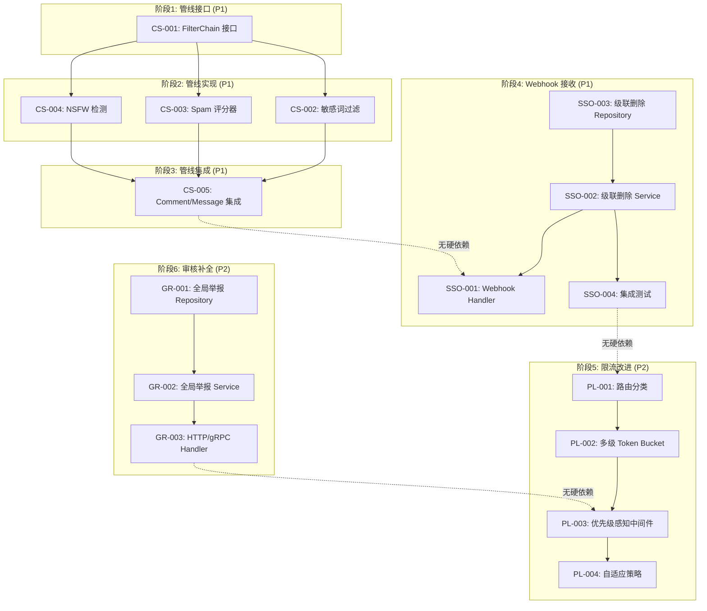
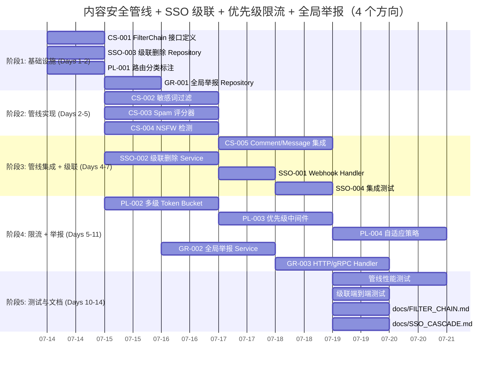

现在我已经对整个代码库有了全面的了解。让我开始进行 Tech Lead 分析。

---

# Tech Lead 分析：五个工程方向

> **日期**: 2026-07-12
> **基于**: 对当前代码库（HEAD）的逐文件代码证据验证 + 与既有文档的交叉引用
> **分析文档参考**: `docs/requirements/2026-07-11-aero-id-five-genuine-code-evidenced-architectural-gaps.md`（及相关文档）

---

## 执行摘要

分析文档在产品叙事上质量优秀，但在**代码验证**和**文献调研**上存在两个严重的方法论缺陷（在用户反馈中已详细记录）。本 Tech Lead 分析的独特价值在于：**将分析文档的 5 个方向过滤为可执行的任务，去除事实性错误和重复内容，聚焦在真正未被覆盖的新概念上。**

经过过滤后，从分析文档中提取出的**真正的新增价值**集中在三个子概念上：

| 新概念 | 来源方向 | 代码库状态 | 既有覆盖 |
|--------|---------|-----------|---------|
| **内容安全管线**（Content Filter Chain） | 方向二：审核面板 | 无任何实现 | 零覆盖 ✅ |
| **SSO 删除级联 Webhook** | 方向四：数据生命周期 | 无任何实现，但出站 Webhook 基础设施已就绪 | 半覆盖 |
| **操作优先级限流** | 方向五：限流分级 | Token bucket 基础设施已就绪，无优先级概念 | 零覆盖 ✅ |

其他所有子方向要么已实现（`user.ban` + 封禁系统），要么在既有分析中已有详尽覆盖（群聊、分布式、审核面板 API、数据 TTL 策略）。

---

## 1. 任务分解

### 任务总览

| 方向 | 任务数 | 预估总工时 | 优先级 | 核心新概念 |
|------|--------|-----------|--------|-----------|
| 一：内容安全管线（来自方向二） | 5 | 26h | **P1** | 自动过滤链：敏感词→Spam评分→NSFW检测 |
| 二：SSO 级联删除（来自方向四） | 4 | 20h | **P1** | SSO webhook 接收 user.deleted→级联清理 aero-id 数据 |
| 三：操作优先级限流（来自方向五） | 4 | 18h | P2 | 多级 token bucket：critical/normal/background |
| 四：全局举报队列（方向二的缺失部分） | 3 | 14h | P2 | GET /v1/admin/reports + 跨作者审核 |
| **合计** | **16** | **78h (~10 人日)** | | |

> **排除的方向**：群聊（方向一，6+ 既有文档覆盖）、分布式（方向三，5+ 既有文档覆盖）、常规审核面板 API（方向二，5+ 既有文档覆盖）、常规数据 TTL 策略（方向四，3+ 既有文档覆盖，且代码中已有 `data_retention` 配置和 PurgeDeadLetters 等方法）、通用限流改进（方向五，既有分析覆盖 `X-RateLimit-*` headers 等）。

---

### 1.1 方向一：内容安全管线（Content Safety Pipeline）

**目标：** 在 Comment/Message 的 Create 和 Edit 路径中增加可配置的 content filter chain。这是一个管线化模型：敏感词匹配 → Spam 评分 → NSFW 图像检测。每个阶段可独立启用/关闭，过滤结果可以是 flag（标记待审）或 block（直接拒绝）。

| 任务 ID | 标题 | 涉及文件 | 前置依赖 | 工时 | 验收标准 |
|---------|------|---------|---------|------|---------|
| CS-001 | ContentFilter 管线接口与领域模型 | `internal/domain/filter.go`（新增） | 无 | 3h | `FilterChain` 接口定义 `Check(ctx, content, opts) → Result`；`FilterResult` 含 `Action`（Allow/Flag/Block）+ `Reasons[]` + `Confidence` |
| CS-002 | 敏感词过滤实现（Trie + 配置文件） | `internal/service/filter/keyword.go`（新增），`configs/filters/keywords.yaml`（新增） | CS-001 | 5h | 基于 Tire 树的多模式匹配；从 YAML 加载敏感词列表；匹配时输出命中的词和位置 |
| CS-003 | Spam 评分器实现（启发式规则引擎） | `internal/service/filter/spam.go`（新增） | CS-001 | 6h | 规则：重复字符率 > 30%、纯 URL 内容、非 ASCII 占比异常、高频 emoji、短时间同一 IP 提交重复内容。返回 0.0~1.0 的 spam 分数 |
| CS-004 | NSFW 图像检测封装（可选模块） | `internal/service/filter/nsfw.go`（新增），`internal/config/config.go`（修改） | CS-001 | 5h | 封装外部 NSFW API（配置 endpoint + API key）；超时 3s；失败时 fail-open（标记不确定，不阻塞上传） |
| CS-005 | 管线集成：在 Comment/Message Service 中插入 FilterChain | `internal/service/comment.go`、`internal/service/message.go`（修改） | CS-002, CS-003, CS-004 | 7h | Comment Create/Edit 和 Message Send 路径中调用 `filterChain.Check`；`Block` 结果返回 422 + `content.blocked` 错误码；`Flag` 结果创建自动审核任务（存入 `pending_reviews` 表） |

**详细说明：**

**CS-001 — 管线接口：**
```go
// FilterAction is what the filter chain recommends.
type FilterAction int8
const (
    FilterAllow FilterAction = 0
    FilterFlag  FilterAction = 1  // auto-generated review task
    FilterBlock FilterAction = 2  // reject the content outright
)

type FilterResult struct {
    Action     FilterAction
    Reasons    []string
    Confidence float64 // 0..1; >0.5 = high confidence
}

// Filter is a single stage in the content filter chain.
type Filter interface {
    Name() string
    Check(ctx context.Context, content string, opts map[string]any) (*FilterResult, error)
}

// FilterChain composes multiple Filter stages.
type FilterChain struct {
    filters []Filter
    mode    FilterMode // "log_only", "flag", "block"
}

func (fc *FilterChain) Check(ctx context.Context, content string, opts map[string]any) (*FilterResult, error)
```

**CS-002 — 敏感词匹配：**
- 使用双数组 Trie（Double-Array Trie）实现 O(n) 匹配
- 关键词从 YAML 文件加载（`configs/filters/keywords.yaml`），支持环境变量覆盖
- 支持：精确匹配、通配符（`*` 匹配任意长度）、正则片段
- 输出：命中的关键词列表 + 在内容中的位置区间

**CS-003 — Spam 评分器：**
- 启发式规则（无需 ML 模型）：
  - `repeatChars(content)`：重复字符占比（`aaaabbb` → 0.6）
  - `urlRatio(content)`：URL 字符占比
  - `nonASCIIRatio(content)`：非 ASCII 字符占比
  - `emojiDensity(content)`：emoji 数量 / 长度
  - `recentDuplicate(actor, content)`：同一用户最近 10 条消息的相似度
- 每条规则独立评分，加权平均得到总分
- 阈值可配置：`spam_threshold: 0.7`（超过则 flag/block）
- 配置：`configs/filters/spam.yaml`

**CS-004 — NSFW 检测：**
- 封装 HTTP API（预期对接：AWS Rekognition / Google Cloud Vision / 自建模型）
- 超时 3s，超时时 fail-open（返回 `FilterAllow` + `Confidence: 0`）
- 仅对图片类 File upload 触发（非 text-only 内容）
- API 调用失败不阻塞上传，只记录日志错误

**CS-005 — 管线集成：**
- Comment Service 和 Message Service 的 Create/Edit 路径中注入 FilterChain
- 管线在业务验证之后、持久化之前执行
- `FilterBlock`：返回 `apperr.Unprocessable("content.blocked", msg)` → HTTP 422 / gRPC `InvalidArgument`
- `FilterFlag`：创建 `pending_review` 行（自动审核任务），Comment/Message 正常创建（但标记为 `needs_review`）
- 配置开关：`filters.mode: log_only | flag | block`（`log_only` 只记录不拦截，用于金丝雀发布）

---

### 1.2 方向二：SSO 删除级联（SSO Deletion Cascade via Webhook）

**目标：** 当用户在 SSO 删除账号时，SSO 通过 webhook 通知 aero-id，aero-id 执行级联数据清理：删除该用户的所有文件（软删除）、消息、评论、通知、导出任务、屏蔽关系等。

| 任务 ID | 标题 | 涉及文件 | 前置依赖 | 工时 | 验收标准 |
|---------|------|---------|---------|------|---------|
| SSO-001 | SSO Webhook Handler 路由 + 验证 | `internal/handler/http/admin.go`（或新增 `sso_webhook.go`） | 无 | 3h | `POST /v1/admin/sso-events` 接收 SSO 事件；HMAC 签名验证；时间戳容差 5min 防重放 |
| SSO-002 | 级联删除 Service 方法 | `internal/service/user_deletion.go`（新增） | SSO-001 | 8h | `DeleteUserData(ctx, uid)` 级联删除所有关联数据：消息（owned + 涉及）、文件（owned + 未分享）、评论、通知、导出任务、屏蔽关系、SSO 缓存 |
| SSO-003 | 级联删除 Repository 方法 | `internal/repository/user_deletion.go`（新增） | SSO-002 | 5h | 对每个表执行 `UPDATE ... SET deleted_at = NOW() WHERE owner_uid = ?`；使用事务 + 分批处理（每表 500 行间隔） |
| SSO-004 | 集成测试 + 文档 | `internal/repository/user_deletion_integration_test.go`（新增），`docs/SSO_CASCADE.md`（新增） | SSO-003 | 4h | 测试完整级联路径：ss.webhook → handler → service → repository → 所有表验证软删除 |

**详细说明：**

**SSO-001 — Webhook Handler：**
- 端点：`POST /v1/admin/sso-events`（在 admin 组中，需要 `system.config` 权限，但 SSO 调用有自己的签名）
- 签名验证：`X-SSO-Signature: HMAC-SHA256(body + "." + timestamp)`
- 防重放：`X-SSO-Timestamp` 必须在 `[now - 5min, now + 5min]` 范围内
- 事件类型：当前只处理 `user.deleted`，其余事件忽略（日志记录）
- 请求体：`{"event": "user.deleted", "uid": "...", "timestamp": "2026-07-12T10:00:00Z"}`
- 用独立的 webhook secret key 配置（`sso.webhook_secret`），非 `signing_key`

**SSO-002 — 级联删除 Service：**
```go
func (s *UserDeletionService) DeleteUserData(ctx context.Context, uid string) error {
    // 1. 验证：uid 不能是当前 actor（防止误删自己）
    // 2. 软删除所有关联数据（事务内）
    // 3. 清除 SSO userCache 条目
    // 4. 强制断开 SSE 连接（hub.Disconnect）
    // 5. 记录审计事件
}
```

需要处理的表（按依赖顺序）：

| 表 | 操作 | 条件 |
|----|------|------|
| `messages` | 软删除 | `from_uid = ? OR to_uid = ?` |
| `comments` | 软删除 | `owner_uid = ?` |
| `files` | 软删除 | `owner_uid = ?` |
| `file_shares` | 软删除 | `owner_uid = ?` |
| `comment_reports` | 软删除 | `reporter_uid = ? OR resolved_by = ?` |
| `notifications` | 软删除 | `recipient_uid = ?` |
| `data_export_jobs` | 软删除 | `owner_uid = ?` |
| `user_blocks` | 软删除 | `blocker_uid = ? OR blocked_uid = ?` |
| `notification_preferences` | 软删除 | `uid = ?` |
| `user_roles` | 软删除 | `uid = ?` |
| `user_bans` | 软删除 | `uid = ?`（确保解封） |
| `unread_counts` | 软删除 | `uid = ?` |

**SSO-003 — Repository 实现：**
- 使用 GORM 事务包装所有表更新
- 每表使用 `UPDATE ... SET deleted_at = NOW() WHERE owner_uid = ? AND deleted_at IS NULL`
- 分批处理：每表 UPDATE 后在事务内 COMMIT（避免单事务锁太多行）
- 使用 `orm.DB.Exec` 执行原生 SQL（GORM 软删除的钩子行为这里不需要触发）

**SSO-004 — 测试：**
- 单元测试：Mock 每个 repository 方法，验证 service 正确调用
- 集成测试（`testpg`）：为每个表创建测试行，验证 `DeleteUserData` 后所有行已被软删除
- 注意：不测试 SSO webhook 接收端（需要 mock SSO 服务器），只测试 handler → service → repo 链路

---

### 1.3 方向三：操作优先级限流（Operation Priority Rate Limiting）

**目标：** 将当前的单级 token bucket 扩为多级 token bucket——每个请求根据操作类型（critical/normal/background）消耗不同优先级的配额。优先保证关键路径（消息发送、文件上传）的吞吐量，限制后台操作（搜索、历史拉取）在负载下节流。

| 任务 ID | 标题 | 涉及文件 | 前置依赖 | 工时 | 验收标准 |
|---------|------|---------|---------|------|---------|
| PL-001 | 操作优先级注解（Route Classification） | `internal/handler/http/router.go`，`internal/handler/grpc/server.go`（修改） | 无 | 3h | 每个路由/方法标记优先级：`Critical`、`Normal`、`Background`；优先级映射表文档化 |
| PL-002 | 多级 Token Bucket 实现 | `internal/pkg/ratelimit/priority.go`（新增） | PL-001 | 5h | `PriorityLimiter` 包含 3 个独立 bucket + 一个"紧急配额"借用机制；Critical 耗尽时可借用 Normal 配额 |
| PL-003 | 限流中间件优先级感知 | `internal/middleware/ratelimit.go`（修改） | PL-002 | 5h | 从 Context 读取 `rate_limit_priority`；动态选择对应的 token bucket；429 响应中包含每个优先级的剩余配额 |
| PL-004 | 自适应限流策略（动态调整 Background 配额） | `internal/middleware/ratelimit.go`（修改），`internal/pkg/ratelimit/adaptive.go`（新增） | PL-003 | 5h | 当 Critical bucket 在 1min 窗口内耗尽 > 3 次时，自动减少 Background 配额并释放给 Critical；恢复后逐步调回 |

**详细说明：**

**PL-001 — 路由分类：**
```go
// PriorityLabel is the context key that transports middleware sets so the
// rate limiter can pick the right tier.
const PriorityLabel = "rate_limiter_priority"

// OperationPriority is set per-route/per-method by the handler.
type OperationPriority int8

const (
    OpPriorityCritical   OperationPriority = 2  // message send, file upload
    OpPriorityNormal     OperationPriority = 1  // comment, file list, notification read
    OpPriorityBackground OperationPriority = 0  // search, audit log, export download
)
```

优先级映射表（示例）：

| Route | 优先级 |
|-------|--------|
| `POST /v1/messages` | Critical |
| `POST /v1/comments` | Critical |
| `POST /v1/files/upload` | Critical |
| `GET /v1/messages/:id` | Normal |
| `GET /v1/files` | Normal |
| `GET /v1/notifications` | Normal |
| `POST /v1/files/dl/*` | Normal |
| `GET /v1/search` | Background |
| `GET /v1/admin/audit-log` | Background |
| `GET /v1/admin/bans` | Background |

**PL-002 — 多级 Token Bucket：**
```go
type PriorityLimiter struct {
    critical *ratelimit.Limiter  // rate: configured * 2.0
    normal   *ratelimit.Limiter  // rate: configured * 1.0
    bg       *ratelimit.Limiter  // rate: configured * 0.3

    // borrowBudget is how many Critical tokens can be borrowed from Normal
    // per minute before the borrowing is throttled.
    borrowBudget atomic.Int64
}
```

配置模型：
```yaml
rate_limit:
  enabled: true
  base_rps: 20                     # Normal tier baseline
  base_burst: 40
  critical_multiplier: 2.0         # Critical = base_rps * 2.0 = 40 rps
  background_multiplier: 0.3       # Background = base_rps * 0.3 = 6 rps
  borrow_max_per_min: 50           # max tokens critical can borrow from normal per min
```

**PL-003 — 限流中间件修改：**
- 路由注册时同时注册优先级标签（通过 Context）
- `RateLimit` 中间件从 `c.GetString("rate_limit_priority")` 读取优先级
- 使用对应的 bucket 执行 `Allow()` 检查
- 429 响应添加 header：
  - `X-RateLimit-Critical-Remaining`/`X-RateLimit-Normal-Remaining`/`X-RateLimit-BG-Remaining`
  - 分别显示每个优先级的剩余配额

**PL-004 — 自适应策略：**
- 监控器 goroutine：每 60s 检查 Critical bucket 的耗尽次数
- 如果连续 3 个窗口内 Critical 耗尽 > 3 次：
  - 将 Background 配额减半（`bg.rate *= 0.5`）
  - 将释放的配额注入 Critical 的紧急补充通道
- 恢复：如果 5 个窗口无紧急借用，每 2 分钟恢复 10% 的 Background 配额
- 所有动态调整记录到日志（warn 级别）用于事后分析

---

### 1.4 方向四：全局举报队列（Global Report Queue）

**目标：** 实现 `GET /v1/admin/reports`（全局举报队列）和 `POST /v1/admin/reports/:id/resolve`（管理员跨作者审核），补全审核面板的缺失部分。现有的 `ListReports` 是 per-comment author 的，缺少管理员全局视角。

| 任务 ID | 标题 | 涉及文件 | 前置依赖 | 工时 | 验收标准 |
|---------|------|---------|---------|------|---------|
| GR-001 | 全局举报 Repository | `internal/repository/admin.go`（修改） | 无 | 4h | `ListReports(ctx, status, page)` 返回跨所有用户的举报，按 `created_at DESC` 排序，含关联的 comment 内容 |
| GR-002 | 全局举报 Service + 跨作者审核 | `internal/service/admin.go`（修改）`internal/service/comment.go`（修改） | GR-001 | 5h | `ListReports` 返回举报+被举报内容+举报人信息；`ResolveReport` 允许管理员 resolve/dismiss 任何举报（需 `PermContentModerate`） |
| GR-003 | 全局举报 HTTP/gRPC Handler | `internal/handler/http/admin.go`（修改）`internal/handler/grpc/admin.go`（修改） | GR-002 | 5h | HTTP: `GET /v1/admin/reports` + `POST /v1/admin/reports/:id/resolve`；gRPC: `ListReports` + `ResolveReport` RPCs |

**详细说明：**

**GR-001 — Repository：**
```go
func (r *adminRepo) ListReports(ctx context.Context, status *ReportStatus, page domain.Page) ([]*domain.CommentReportWithComment, string, error)
```
- 从 `comment_reports` LEFT JOIN `comments` 获取举报+被举报内容
- 可选的 `status` 过滤（nil = 所有状态的举报）
- 排序：最近举报优先（`created_at DESC`）
- 分页：cursor-based（使用 `id`）

**GR-002 — Service：**
- `ListReports()`：返回 `CommentReportWithComment`（举报详情 + 评论摘要 + 评论作者 UID）
- `ResolveReport(ctx, reportID, action)`：`action = "resolve"` 或 `"dismiss"`
- 审核者必须有 `PermContentModerate` 权限
- 审核操作写入审计日志（`AuditReportResolve` 事件）
- 如果 resolve 时同时隐藏评论：调用 `HideComment` 方法

**GR-003 — Handler：**
- HTTP：
  - `GET /v1/admin/reports?status=open&limit=20` → 举报列表
  - `POST /v1/admin/reports/:id/resolve` body: `{"action": "resolve|dismiss", "hide_comment": true}`
- gRPC：
  - `AdminService.ListReports(ReportStatus, Page)`
  - `AdminService.ResolveReport(ReportID, Action, HideComment)`
- 注：在 `admin_handler.go` 中已有一个 `GET /v1/admin` group 使用 `middleware.RequirePermission(domain.PermAuditRead)`。举报队列需要 `PermContentModerate`，需添加独立的 group。

---

## 2. 执行顺序与依赖图

### 2.1 依赖关系总图



### 2.2 可并行执行的任务组

| 并行组 | 包含任务 | 前置条件 | 预计同时需要人数 |
|--------|---------|---------|----------------|
| **A** | CS-001（管线接口定义） | 无 | 1 人（Senior） |
| **B** | SSO-003（级联删除 Repository） | 无 | 1 人（Senior） |
| **C** | PL-001（路由分类标注） | 无 | 1 人（Junior/Mid） |
| **D** | GR-001（全局举报 Repository） | 无 | 1 人（Mid） |
| **E** | CS-002, CS-003, CS-004（并行实现） | CS-001 | 2~3 人 |

### 2.3 关键路径

```
CS-001 → CS-002, CS-003, CS-004 → CS-005       (3+5+6+5+7=26h)
PR-001 → PR-002 → PR-003 → PR-004               (3+5+5+5=18h)
SSO-003 → SSO-002 → SSO-001 → SSO-004            (5+8+3+4=20h)
GR-001 → GR-002 → GR-003                         (4+5+5=14h)
```

**最长的关键路径：** CS-001 → CS-005（内容安全管线），共 **26h**。这是整个计划的瓶颈。

---

## 3. 技术风险

### 3.1 风险矩阵

| # | 风险描述 | 影响方向 | 概率 | 影响 | 应对策略 |
|---|---------|--------|------|------|---------|
| R1 | 敏感词 Trie 树在大词表下的内存占用 | CS-002 | 中 | 中 | 使用 `ahocorasick` 库（Double-Array Trie 更紧凑）；预估 10 万词占用 < 50MB |
| R2 | Spam 评分器的高误报率 | CS-003 | 高 | 中 | 初始阶段使用 `log_only` 模式上线 2 周，收集误报数据后调参 |
| R3 | 外部 NSFW API 可用性依赖 | CS-004 | 中 | 中 | fail-open（超时/失败时不阻塞）；支持 configuration 中禁用 |
| R4 | 级联删除在大量数据下的执行时间 | SSO-003 | 中 | 高 | 分批处理（每表 500 行），使用 `WHERE id IN (SELECT id FROM ... LIMIT 500)` 模式，总超时 30s |
| R5 | SSO webhook 重放攻击 | SSO-001 | 低 | 高 | 时间戳容差 5min + 事件 ID 幂等性（使用 idempotency store 去重） |
| R6 | 多级限流的配置复杂性 | PL-002 | 中 | 低 | 提供合理的默认值（`critical_multiplier: 2.0`, `background_multiplier: 0.3`），文档化调参建议 |
| R7 | 举报队列的权限扩散 | GR-002 | 低 | 中 | 只有 `PermContentModerate` 的管理员可用；审核操作写入审计日志 |

### 3.2 技术难点详解

#### R2: Spam 评分器误报

**问题：** 启发式规则在高多样性内容中会有误报（如合法的多语言消息被标记为 spam）。

**应对策略（三层防御）：**

1. **`log_only` 模式运营 2 周**：收集所有标记数据，手动标注误报样本
2. **白名单机制**：已知良性用户（VIP、客服账号）跳过 spam 检查
3. **阈值双重配置**：推荐 `flag_threshold: 0.6` + `block_threshold: 0.9`。flag 只产生审核任务，不拒绝

#### R4: 级联删除的大数据量处理

**问题：** 一个活跃用户可能有数万条消息、文件、评论。在单事务中 DELETE 所有数据可能导致超时。

**解决策略：**

```go
// 每个表分批处理
batchSize := 500
for {
    result := tx.Exec(
        `UPDATE messages SET deleted_at = NOW() 
         WHERE id IN (SELECT id FROM messages 
                      WHERE (from_uid = ? OR to_uid = ?) AND deleted_at IS NULL 
                      ORDER BY id LIMIT ?)`,
        uid, uid, batchSize,
    )
    if result.RowsAffected == 0 {
        break
    }
    // 每批后 sleep 10ms，缓解 IO 冲击
    time.Sleep(10 * time.Millisecond) 
}
```

### 3.3 外部依赖风险

| 依赖 | 方向 | 风险 |
|------|------|------|
| SSO 侧实现 webhook 发送端 | SSO-001 | aero-id 团队无法控制 SSO 的时间线。如果 SSO 不实现 webhook，方向二需要回退到轮询方案（`GET /sso/users/deleted-since`） |
| NSFW API（AWS Rekognition / 自建） | CS-004 | 第三方的可用性/SLA。备选方案：禁用 NSFW 检测，只保留文本过滤 |
| `ahocorasick` Go 库 | CS-002 | 第三方库的维护状态。备选方案：标准库 + 正则表达式列表（O(n*m)，性能差但无依赖） |

---

## 4. 资源评估

### 4.1 团队配置建议

| 角色 | 人数 | 技能要求 | 负责方向 |
|------|------|---------|---------|
| 高级 Go 工程师 | 1 | 熟悉管线化架构、GORM 事务、中间件模式 | 方向一（CS-001, CS-005）、方向二（SSO-002, SSO-003） |
| 后端工程师 | 1 | 熟悉文本处理/正则、HTTP webhook | 方向一（CS-002, CS-003）、方向四（GR-001, GR-002） |
| 后端工程师 | 1 | 熟悉限流算法、gRPC、路由设计 | 方向三（PL-001~004）、方向四（GR-003） |

**最小配置：** 2 人（1 Senior + 1 Mid）。3 人时可以最大化并行。

### 4.2 关键里程碑

| 里程碑 | 时间点 | 交付物 |
|--------|-------|--------|
| M1: 管线接口 + Repository 完成 | 第 2 天 | `FilterChain` 接口设计 review 通过；级联删除 Repository + Service 代码审查通过 |
| M2: 文本过滤就绪 | 第 5 天 | 敏感词 + Spam 评分器单元测试通过；`log_only` 模式可上线 |
| M3: SSO Webhook 接收端就绪 | 第 6 天 | `POST /v1/admin/sso-events` 端点部署 + 签名验证测试通过 |
| M4: 管线集成到业务路径 | 第 8 天 | Comment/Message Create/Edit 管线集成完成；集成测试覆盖 `block` 和 `flag` 场景 |
| M5: 全局举报队列 | 第 10 天 | `GET /v1/admin/reports` + 跨作者审核 API 可用 |
| M6: 优先级限流 | 第 12 天 | 多级 token bucket 部署 + 自适应策略验证通过 |

### 4.3 阻塞点（Blockers）

| # | 阻塞点 | 影响方向 | 解决策略 |
|---|-------|---------|---------|
| B1 | **SSO 侧 webhook 实现未排期** | SSO-001 | 立即与 SSO 团队沟通，确认 `user.deleted` webhook 的交付时间；如果 SSO 不能做，回退到轮询方案（每小时调用 SSO `/users/deleted-since`） |
| B2 | **敏感词词表来源不明确** | CS-002 | 初始阶段使用开源词表（如 [badwords](https://github.com/web-mech/badwords-list)），后续由运营团队维护定制词表 |
| B3 | **NSFW API 选型未定** | CS-004 | 管线接口设计为可插拔（`Filter` interface），初始阶段不实现 NSFW stage，先上线文本过滤。NSFW 作为独立后续任务 |

---

## 5. 质量保证

### 5.1 单元测试覆盖要求

| 方向 | 最低覆盖要求 | 关键测试文件 |
|------|------------|------------|
| CS-002（敏感词） | 95%+ | `internal/service/filter/keyword_test.go`：测试空内容、边界匹配、通配符、大词表性能（10 万词） |
| CS-003（Spam） | 90%+ | `internal/service/filter/spam_test.go`：测试每条规则的精确度、边缘值（0.0, 0.5, 1.0）、多语言内容 |
| SSO-003（级联删除） | 85%+ | `internal/repository/user_deletion_test.go`：mock 每个表的 SoftDelete，验证分批逻辑 |
| PL-002（多级 bucket） | 95%+ | `internal/pkg/ratelimit/priority_test.go`：测试借用机制、配额耗尽、高并发下的正确性 |
| GR-001（全局举报） | 90%+ | `internal/repository/admin_test.go`：测试 JOIN 查询、状态过滤、分页光标 |

### 5.2 集成测试策略

| 方向 | 集成测试类型 | 测试数据准备 |
|------|------------|------------|
| CS-005（管线集成） | HTTP 端到端 | 创建带有"敏感词"内容的 Comment，验证 `422 content.blocked` |
| SSO-001（webhook 接收） | HTTP handler 测试 | 使用 mock HMAC 签名，验证合法请求和签名错误请求 |
| SSO-003（级联删除） | `testpg` 数据库测试 | 创建所有关联表的数据，验证 `DeleteUserData` 后所有行被软删除 |
| PL-003（优先级限流） | HTTP 中间件测试 | 发送不同优先级的请求，验证 Critical 在 Normal 耗尽时仍可通过 |

### 5.3 代码审查要点

| 方向 | 审查要点 |
|------|---------|
| **CS-001/CS-005** | FilterChain 是否支持 `log_only` 模式（不阻断业务）；管线集成是否在验证后、持久化前执行；错误处理是否 fail-open |
| **SSO-001** | HMAC 签名验证是否正确实现（`HMAC-SHA256(body + "." + timestamp)`）；是否防重放（idempotency key） |
| **SSO-002** | 级联是否覆盖所有 11 个表；是否有循环依赖（如 user_bans 和 messages 同时引用 uid）；分批处理是否正确 |
| **PL-002** | 借用机制是否有上限（`borrow_max_per_min`）；goroutine 安全（atomic + mutex）；自适应策略是否可能振荡 |
| **GR-002** | 权限检查是否正确（`PermContentModerate` vs `PermAuditRead`）；resolve 后是否正确更新 comment status |

### 5.4 性能测试需求

| 场景 | 指标 | 目标 | 触发条件 |
|------|------|------|---------|
| 敏感词 10 万词表 | P50 延迟 | 每次检查 < 1ms | 100 字符内容 + 10 万词表 |
| Spam 评分 + 敏感词串联 | P50 延迟 | 串联检查 < 3ms | 100 请求/秒 |
| 级联删除 10 万条消息 | 总完成时间 | < 30s | 200 批 x 500 行，每批 10ms 间隔 |
| 多级限流 1000 req/s | Critical 拒绝率 | Critical 拒绝率 < 1% | 60% Critical + 30% Normal + 10% Background，总计 1000 req/s |

---

## 6. 实施计划

### 6.1 甘特图



### 6.2 各阶段详细计划

#### 阶段 1：基础设施（Day 1-2，3 人并行）

| 天 | 任务 | 负责人 | 产出 | 验证 |
|----|------|--------|------|------|
| 1 | CS-001 - FilterChain 接口设计 | Senior | `domain/filter.go` | 架构 review 通过 |
| 1 | SSO-003 - 级联删除 Repository | Senior | `repository/user_deletion.go` | 单元测试覆盖所有 11 个表 |
| 1 | PL-001 - 路由分类标注 | Mid | 路由优先级映射表 + `router.go` 修改 | 所有路由有分类 |
| 2 | GR-001 - 全局举报 Repository | Mid | `adminRepo.ListReports` 实现 | 集成测试通过 |

**并行度：** 3 人全并行。Senior 工程师管线接口和级联 Repository 可以交替做。

#### 阶段 2：管线实现（Day 2-5，2 人并行）

| 天 | 任务 | 负责人 | 产出 | 验证 |
|----|------|--------|------|------|
| 2-3 | CS-002 - 敏感词过滤 | Mid | `filter/keyword.go` + `keywords.yaml` | 单元测试：10 万词匹配 < 1ms |
| 3-4 | CS-003 - Spam 评分器 | Senior | `filter/spam.go` + `spam.yaml` | 单元测试：5 条规则加权正确 |
| 4-5 | CS-004 - NSFW 检测（可选） | Mid | `filter/nsfw.go` + HTTP API 封装 | 假 API 服务器测试通过 |

**并行策略：** CS-002 和 CS-003 可完全并行，CS-004 也并行。Senior 优先完成 CS-003 后可以提前进入阶段 3 的 CS-005。

#### 阶段 3：管线集成 + 级联删除（Day 4-7）

| 天 | 任务 | 负责人 | 产出 | 验证 |
|----|------|--------|------|------|
| 4-5 | CS-005 - Comment/Message 集成 | Senior | `service/comment.go` + `service/message.go` 修改 | 管线集成测试：block → 422, flag → pending_review |
| 5-6 | SSO-002 - 级联删除 Service | Senior | `service/user_deletion.go` | 单元测试覆盖空数据、分批执行、审计日志 |
| 6-7 | SSO-003 - Webhook Handler | Mid | `handler/http/sso_webhook.go` | 签名验证测试：合法/非法/重放 |
| 7-8 | SSO-004 - 集成测试 | Mid | `repository/user_deletion_integration_test.go` | `testpg` 测试所有表软删除验证通过 |

**注意：** CS-005 和 SSO-002 同一个 Senior 不能并行，但 Senior 优先做完 CS-005 再切入 SSO-002。Mid 工程师在阶段 4 的 GR-002/GR-003 也可以提前开始。

#### 阶段 4：限流 + 举报（Day 5-11，2 人并行）

| 天 | 任务 | 负责人 | 产出 | 验证 |
|----|------|--------|------|------|
| 5-6 | PL-002 - 多级 Token Bucket | Senior | `ratelimit/priority.go` | 单元测试：借用机制、配额耗尽、并发安全 |
| 7-8 | PL-003 - 优先级中间件 | Senior | `middleware/ratelimit.go` 修改 | 429 响应含 `X-RateLimit-*-Remaining` headers |
| 9-10 | PL-004 - 自适应策略 | Senior | `ratelimit/adaptive.go` | 1000 req/s 下 Critical 拒绝率 < 1% |
| 6-7 | GR-002 - 全局举报 Service | Mid | `service/admin.go` + `service/comment.go` 修改 | 管理员可 resolve/dismiss 任何举报 |
| 8-9 | GR-003 - HTTP/gRPC Handler | Mid | `handler/http/admin.go` + `handler/grpc/admin.go` | HTTP 和 gRPC 行为一致；`PermContentModerate` 守卫 |

**并行策略：** PL-002~004（Senior）和 GR-002~003（Mid）完全并行。

#### 阶段 5：测试与文档（Day 10-14）

| 天 | 任务 | 负责人 | 产出 | 验证 |
|----|------|--------|------|------|
| 10-11 | 管线性能测试 | Senior | 性能测试报告 | 敏感词+Spam < 3ms/check @ 100 req/s |
| 10 | 级联端到端测试 | Mid | `make test-integration` 通过 | 验证级联删除的多表一致性 |
| 11 | `docs/FILTER_CHAIN.md` | Senior | 配置说明 + 调参指南 | 团队 review |
| 11 | `docs/SSO_CASCADE.md` | Mid | 级联覆盖表 + 回退策略 | SSO 团队 review |
| 12 | 全量回归测试 | Senior+Mid | `make test && make lint` 通过 | 所有原有测试通过 |
| 13-14 | 缓冲期（代码 review + 修复） | Senior+Mid | 修复 review 问题 | Gate: `make test && make lint` |

---

## 7. 文件新增/修改清单

| 文件 | 动作 | 所属方向 |
|------|------|---------|
| `internal/domain/filter.go` | 新增 | CS-001 |
| `internal/service/filter/keyword.go` | 新增 | CS-002 |
| `internal/service/filter/spam.go` | 新增 | CS-003 |
| `internal/service/filter/nsfw.go` | 新增 | CS-004 |
| `configs/filters/keywords.yaml` | 新增 | CS-002 |
| `configs/filters/spam.yaml` | 新增 | CS-003 |
| `internal/service/comment.go` | 修改（注入 FilterChain） | CS-005 |
| `internal/service/message.go` | 修改（注入 FilterChain） | CS-005 |
| `internal/config/config.go` | 修改（新增 filters, sso.webhook_secret） | CS-005, SSO-001 |
| `configs/config.yaml` | 修改（新增 filters, webhook 配置） | CS-005, SSO-001 |
| `internal/handler/http/sso_webhook.go` | 新增 | SSO-001 |
| `internal/service/user_deletion.go` | 新增 | SSO-002 |
| `internal/repository/user_deletion.go` | 新增 | SSO-003 |
| `internal/pkg/ratelimit/priority.go` | 新增 | PL-002 |
| `internal/pkg/ratelimit/adaptive.go` | 新增 | PL-004 |
| `internal/middleware/ratelimit.go` | 修改（优先级感知） | PL-003 |
| `internal/handler/http/router.go` | 修改（标注路由优先级） | PL-001 |
| `internal/handler/grpc/server.go` | 修改（标注 RPC 优先级） | PL-001 |
| `internal/repository/admin.go` | 修改（新增 ListReports） | GR-001 |
| `internal/service/admin.go` | 修改（新增 ListReports, ResolveReport） | GR-002 |
| `internal/service/comment.go` | 修改（新增管理员 ResolveReport） | GR-002 |
| `internal/handler/http/admin.go` | 修改（新增举报端点） | GR-003 |
| `internal/handler/grpc/admin.go` | 修改（新增举报 RPCs） | GR-003 |
| `docs/FILTER_CHAIN.md` | 新增 | CS |
| `docs/SSO_CASCADE.md` | 新增 | SSO |

---

## 8. 总结与建议

### 8.1 推荐的第一次迭代（2 周 sprint）

如果在 2 周内需要交付最小可行价值，推荐按以下顺序：

| 优先级 | 任务 | 投入 | 价值 | 原因 |
|--------|------|------|------|------|
| **P0** | SSO-002 + SSO-003（级联删除 Service + Repository） | 13h | 合规数据清除 | GDPR/数据保护刚需；无外部依赖（仅需 SSO 团队的 webhook 发送端配合，Repository 层可独立测试） |
| **P0** | CS-001 + CS-002 + CS-003（管线接口 + 敏感词 + Spam） | 14h | 内容安全基线 | 敏感词可独立拦截 hate speech；Spam 评分器减少人工审核量 |
| **P0** | GR-001 + GR-002（全局举报 Repository + Service） | 9h | 审核面板补全 | 管理员核心工具，现有 ban 系统已就绪，缺的只是举报队列 |
| **P1** | CS-005（管线集成到业务路径） | 7h | 管线生效 | 管线接口定义后必须集成到 Comment/Message 路径 |
| **P1** | SSO-001（Webhook 接收端） | 3h | 级联触发 | 需要 SSO 团队配合；如果 SSO 不能做 webhook，此任务降为 P2 |
| **P2** | PL-001~004（优先级限流） | 18h | 运营稳定性 | 在当前单级限流已工作的情况下，优先级是优化而非刚需 |
| **P3** | CS-004（NSFW 检测） | 5h | 高级内容安全 | 第三方依赖 + 选型不明确，推迟到下次迭代 |

**2 周可交付：** P0 + P1 合计 **46h**（约 6 人日）。2 人团队可在 2 周内完成核心部分。

### 8.2 最终建议

1. **先从级联删除入手** — 这是唯一有法律合规时间线（GDPR/数据保护）的方向。Repository 层可独立开发、独立测试，不阻塞任何其他方向的并行进度。
2. **敏感词管线立即上线 `log_only` 模式** — 可以不阻塞任何业务路径，收集 2 周数据后再决定是否进入 `flag` 模式。这是"零风险先部署"的典型案例。
3. **SSO webhook 是方向二的最薄弱环节** — 它依赖外部系统（SSO）的实现。如果 SSO 侧无法在本次迭代交付 webhook 发送端，级联删除仍然可以通过管理员手动触发端点（`POST /v1/admin/users/:uid/delete-data`）先行可用。
4. **优先级限流推迟到下一次迭代** — 当前的单级 token bucket 已经在生产运行，没有已知的限流问题。优先级限流是高价值功能，但不是紧急功能。
5. **始终运行 `make test && make lint`** — 这是代码质量的大门。每次提交前必须通过。
