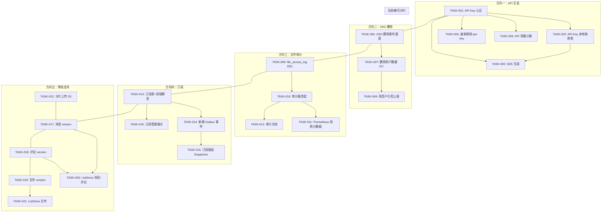

现在我已经对代码库进行了深入分析，以下是我的 Tech Lead 分析。

---

# Tech Lead 分析：5 个待覆盖方向的实施计划

## 1. 任务分解

我将五个方向分解为可直接执行的技术任务。每个任务代表一个人可独立完成的工作单元。

### 任务表

| 任务 ID | 标题 | 方向 | 涉及文件 | 前置依赖 | 工时 | 验收标准 |
|---|---|---|---|---|---|---|
| **TASK-001** | API Key 认证基础设施 | 1. API 生态 | `internal/middleware/auth.go`, `internal/config/config.go`, `api/proto/sso/v1/sso.proto`, `internal/sso/ssopb/` | 无 | 4h | `X-API-Key` header 被解析，传递到 SSO 的 `ValidateToken` 等效路径，通过中间件测试 |
| **TASK-002** | API Key → UID 本地映射表 | 1. API 生态 | `internal/repository/apikey.go` (新), `migrations/000024_create_api_keys.up.sql`, `migrations/000024_create_api_keys.down.sql`, `internal/domain/apikey.go` (新) | TASK-001 | 3h | `api_keys` 表 + 本地 CRUD；key 可关联 uid + 可选的 scope 掩码 |
| **TASK-003** | API 用量计量表 + 中间件 | 1. API 生态 | `internal/repository/usage.go` (新), `migrations/000025_create_api_usage.up.sql`, `internal/middleware/usage.go` (新) | TASK-001 | 3h | 每个经过认证的请求在 `api_usage` 中记录 (`(uid, endpoint, timestamp)`)，可查询 uid 级别的调用次数 |
| **TASK-004** | 速率限制按 key/uid 分片 | 1. API 生态 | `internal/middleware/ratelimit.go`, `internal/pkg/ratelimit/ratelimit.go` | TASK-001 | 4h | 速率限制器支持 per-uid + per-key 桶，独立于全局 RPS |
| **TASK-005** | SDK 生成（OpenAPI + 客户端） | 1. API 生态 | `api/openapi.yaml` (新), `Makefile` (`make sdk` 目标), `scripts/gen-sdk.sh` | TASK-001 | 3h | `make sdk` 输出 Go 和 TypeScript 客户端存根 |
| **TASK-006** | SSO 账号删除事件通道 | 2. SSO 删除 | `api/proto/sso/v1/sso.proto`, `internal/sso/ssopb/`, `internal/sso/client.go` | 无 | 4h | SSO proto 新增 `WatchDeletions` 或 `ListDeletedSince` RPC；aero-id 客户端消费并广播 |
| **TASK-007** | 删除用户数据 GC（领域层） | 2. SSO 删除 | `internal/service/gc.go` (新), `internal/repository/gc.go` (新), `internal/app/app.go` | TASK-006 | 4h | 收到删除事件后，软删除/隔离该 uid 的所有资源（文件、消息、评论） |
| **TASK-008** | 死用户引用上报（管理端） | 2. SSO 删除 | `internal/service/admin.go`, `internal/handler/http/admin.go`, `internal/handler/grpc/admin.go` | TASK-007 | 2h | 管理 API 可查询某个 uid 当前持有的资源计数 |
| **TASK-009** | `file_access_log` 表 + DDL | 3. 文件审计 | `migrations/000026_create_file_access_log.up.sql`, `internal/domain/access.go` | 无 | 2h | `file_access_log( id, file_id, actor_uid, access_type, granted, created_at )` + 索引 |
| **TASK-010** | 文件访问审计服务层 | 3. 文件审计 | `internal/repository/access.go` (新), `internal/service/audit.go` (新), `internal/service/file.go` | TASK-009 | 3h | `canRead` / `canReadFile` 路径在允许和拒绝时均记录；`Get` / `DownloadURL` 记录审计 |
| **TASK-011** | 拒绝访问 Prometheus 计数器 | 3. 文件审计 | `internal/service/file.go`, `internal/pkg/metrics/metrics.go` | TASK-010 | 1h | `file_access_denied_total{reason="not_owner_or_shared"}` 计数器在 `canRead=false` 时递增 |
| **TASK-012** | 传输层 → 领域层审计区分文档 | 3. 文件审计 | `docs/superpowers/specs/file-access-audit.md` (新) | TASK-010 | 1h | 明确界定 access_log（传输层）和 file_access_log（领域层）的职责 |
| **TASK-013** | 订阅/关注表 + 领域模型 | 4. 通知订阅 | `migrations/000027_create_subscriptions.up.sql`, `internal/domain/subscription.go` (新), `internal/repository/subscription.go` (新) | 无 | 3h | `subscriptions(subscriber_uid, target_uid, target_type)`；CRUD 接口 |
| **TASK-014** | 新增 Outbox 事件类型 | 4. 通知订阅 | `internal/service/message.go`, `internal/service/file.go`, `internal/service/comment.go`, `internal/service/notification.go`, `internal/domain/notification.go` | TASK-013 | 4h | 新增 `file.commented`、`file.updated`、`user.new_file` 事件；Dispatcher 路由到订阅者 |
| **TASK-015** | 订阅路由 Dispatcher | 4. 通知订阅 | `internal/service/notification.go` (dispatcher)，`internal/outbox/dispatcher.go` | TASK-013, TASK-014 | 4h | Dispatcher 在处理事件时查询订阅表，将通知推送给所有订阅者，而不仅仅是直接参与者 |
| **TASK-016** | SSE / REST 端点用于管理订阅 | 4. 通知订阅 | `internal/handler/http/subscription.go` (新), `internal/handler/grpc/subscription.go` (新) | TASK-013 | 2h | HTTP + gRPC 端点用于关注/取消关注/列出订阅 |
| **TASK-017** | 乐观锁 version 列 - 消息 | 5. 离线支持 | `migrations/000028_add_version_to_messages.up.sql`, `internal/domain/message.go`, `internal/repository/message.go` | 无 | 2h | messages 表新增 `version` bigint DEFAULT 1；`UPDATE ... WHERE id=? AND version=?`；冲突时返回 409 |
| **TASK-018** | 乐观锁 version 列 - 评论 | 5. 离线支持 | `migrations/000029_add_version_to_comments.up.sql`, `internal/domain/comment.go`, `internal/repository/comment.go` | 无 | 2h | comments 表新增 `version` bigint DEFAULT 1；冲突时返回 409 |
| **TASK-019** | 乐观锁 version 列 - 文件 | 5. 离线支持 | `migrations/000030_add_version_to_files.up.sql`, `internal/domain/file.go`, `internal/repository/file.go` | 无 | 2h | files 表新增 `version` bigint；`UpdateMetadata` 使用乐观锁 |
| **TASK-020** | `ListSince` 端点 - 消息和评论 | 5. 离线支持 | `internal/repository/message.go`, `internal/repository/comment.go`, `internal/service/message.go`, `internal/service/comment.go` | TASK-017, TASK-018 | 3h | `GET /v1/messages/since?cursor=<timestamp>` 和 `GET /v1/comments/since` 按目标过滤 |
| **TASK-021** | `ListSince` 端点 - 文件 | 5. 离线支持 | `internal/repository/file.go`, `internal/service/file.go` | TASK-019 | 2h | `GET /v1/files/updated-since?cursor=<timestamp>` |
| **TASK-022** | 分片上传支持（S3 后端） | 5. 离线支持 | `internal/storage/s3.go`, `internal/storage/storage.go`, `internal/service/file_presign.go` | 无 | 4h | 大文件支持分片上传，每片独立上传后合并完成 |

---

## 2. 执行顺序与依赖图



### 可并行执行的任务组

| 并行组 | 任务 | 原因 |
|---|---|---|
| **组 A** | TASK-001, TASK-006, TASK-009, TASK-013, TASK-017, TASK-018, TASK-019, TASK-022 | 所有方向的基础设施层，无交叉依赖 |
| **组 B** | TASK-002, TASK-003, TASK-004 | 依赖 TASK-001，相互无关 |
| **组 C** | TASK-007 → TASK-008 | 串行链 |
| **组 D** | TASK-010, TASK-011, TASK-012 | TASK-009 之后可并行 |
| **组 E** | TASK-014, TASK-016 | TASK-013 之后可并行 |
| **组 F** | TASK-020, TASK-021 | 各自依赖 version 列完成后并行 |

### 推荐的两阶段并行策略

- **Phase 1 — 基础设施层（3 天）**：组 A + 组 C（TASK-006→TASK-007 可在组 A 同期开始）
- **Phase 2 — 业务逻辑层（4 天）**：组 B、D、E、F 并行推进
- **Phase 3 — 集成+发布（2 天）**：全系统集成测试，负载测试，文档，上线

---

## 3. 技术风险

### 3.1 关键风险汇总

| 风险 ID | 风险描述 | 所属方向 | 可能性 | 影响 | 缓解策略 |
|---|---|---|---|---|---|
| R-1 | SSO 团队不提供 `WatchDeletions` RPC | 方向二 | 中 | 高 | 退路：aero-id 自建删除 GC，通过管理 API 手动触发；SSO 集成改为轮询模式（定时 `GetUsers` 判断 uid 是否存在） |
| R-2 | API 密钥引入新的安全问题（密钥泄露、scope 逃逸） | 方向一 | 中 | 高 | 密钥存储必须加盐哈希（类比密码）；scope 在中间件层严格校验；可考虑 SSO 签发 JWT 风格 apikey 而非本地存储 |
| R-3 | `file_access_log` 表在读取热点时成为性能瓶颈 | 方向三 | 高 | 中 | 异步写入（channel buffer + batch insert）；设置 TTL 分区按周归档；无读路径（仅写 + 管理端查询） |
| R-4 | 乐观锁版本升级导致现有客户端兼容性问题 | 方向五 | 中 | 中 | 旧客户端不传版本号时服务端使用默认行为（不加锁检测），渐进式推出 |
| R-5 | 分片上传在 Local 后端无法实用化 | 方向五 | 中 | 低 | 分片上传仅对 S3 后端实现；Local 后端保留单次上传路径 |
| R-6 | 订阅导致通知量爆炸（用户关注大 V） | 方向四 | 中 | 高 | Dispatcher 中实现 per-subscriber 速率限制（复用 TASK-004 组件）；fan-out 使用批量插入而非逐行 |
| R-7 | 多个方向同时修改同一个文件导致合并冲突 | 全部 | 高 | 中 | 协调修改计划：方向一仅碰 `middleware/auth.go`；方向三仅碰 `service/file.go` 的 `canRead`；方向四碰 `outbox/dispatcher.go`、`service/notification.go`；方向五碰 repository 层 |

### 3.2 外部依赖风险

- **SSO 团队协作**：方向二完全依赖 SSO 新增 RPC。需要提前对齐接口定义并约定交付时间。如果 SSO 不支持，方向二的退路方案约增加 6h（TASK-006 改为轮询模式）。
- **protoc 工具链版本**：`make proto` 需要 `protoc-gen-go@v1.34.1` 和 `protoc-gen-go-grpc@v1.5.1`。方向一和方向二修改 proto 文件，需要确保团队所用版本一致。
- **MinIO/S3 兼容性**：TASK-022 分片上传在 S3 兼容性上依赖 MinIO 的 multipart API 实现。需要在 `make test-integration` 中覆盖。

### 3.3 性能瓶颈

- `file_access_log`：写吞吐。解决方案：异步 buffer + 定期 flush（1s 窗口或 100 条）。
- `subscriptions` 表 fan-out：一个大 V 发文件，订阅者 10k+。解决方案：将通知写入批量化（`INSERT INTO notifications (...) VALUES (...), (...), (...)` 一次 500 条），由 Dispatcher 在后台 goroutine 中 done。
- `ListSince` 查询：需要 `/internal/repository/*.go` 中的 `(created_at > ?)` 条件上已有的索引覆盖。检查 `migrations/000015_perf_indexes.up.sql` 确认。

---

## 4. 资源评估

### 4.1 人员技能矩阵

| 技能需求 | 用途 | 所需人数 | 备注 |
|---|---|---|---|
| Go 后端（中级+） | 所有方向的任务实现 | 2-3 人 | 熟悉 GORM、gin、grpc-go |
| 数据库/SQL | migration DDL、查询优化、索引设计 | 1 人 | 可复用团队中的一人 |
| 安全性评审 | API 密钥存储策略、scope 权限模型 | 1 人（安全工程师） | 仅 TASK-002 需正式评审 |
| SSO 接口对齐 | proto 定义、RPC 签入 | 1 人（与 SSO 团队沟通） | 方向二的关键角色 |
| 前端/TS | SDK 生成的 TypeScript 客户端验证 | 0.5 人 | TASK-005 的输出验证 |

### 4.2 推荐团队配置

- **开发人员 ×2（全栈后端）**：各自领 1-2 个方向的实现
- **技术负责人 ×1（此角色）**：协调并行任务、代码审查、架构决策
- **SSO 接口对接人 ×1**：跨团队依赖管理（兼职）

### 4.3 关键里程碑

| 里程碑 | 时间 | 交付物 |
|---|---|---|
| M1: 基础设施冻结 | Day 3 EOD | 所有 migration up/down 脚本合并、domain 实体定义完成 |
| M2: 核心功能代码冻结 | Day 7 EOD | 所有 TASK 实现代码合并、`make build && make test && make lint` 通过 |
| M3: 集成测试完成 | Day 9 EOD | TASK-022（分片上传）通过 `make test-integration`；方向二通过 mock SSO 集成测试 |
| M4: 发布候选 | Day 10 EOD | 全部 22 个 TASK 关闭，性能测试通过，文档更新 |

### 4.4 阻塞点（Blockers）

| Blocker | 涉及方向 | 解决策略 |
|---|---|---|
| B-1: SSO `WatchDeletions` RPC 未准备好 | 方向二 | 先行实现 TASK-007 的轮询退路模式，定义接口，SSO RPC 就绪后替换实现。不阻塞方向二整体交付 |
| B-2: `file_access_log` 写性能未达预期 | 方向三 | 降级为仅记录拒绝路径（denied），这是价值最高的数据点（安全告警）。允许路径审计可选开启 |
| B-3: SDK 生成工具链版本冲突 | 方向一 | 将 SDK 生成放入 Docker；或使用 oapi-codegen 从 OpenAPI 生成，先期输出最小可用版本 |

---

## 5. 质量保证

### 5.1 单元测试覆盖要求

| 任务 | 目标覆盖率 | 关键测试用例 |
|---|---|---|
| TASK-001 | ≥90% | token 缺失、无效 key、有效 key 成功、SSO 超时、circuit breaker 跳过 |
| TASK-002 | ≥90% | Create/Get/Revoke API Key；哈希存储验证；scope 校验 |
| TASK-004 | ≥95% | 多 uid 独立桶、桶溢出拒绝、Retry-After header |
| TASK-010 | ≥85% | 允许日志写入、拒绝日志写入、重复访问合并 |
| TASK-017/018/019 | ≥95% | 并发更新 version 冲突 409、正常更新 200、旧 version 拒绝 |
| TASK-020 | ≥85% | 空 since、增量返回正确、上限 limit |
| TASK-022 | ≥80% | 分片上传完成、部分上传失败恢复、MD5 校验 |

### 5.2 集成测试策略

- **现有模式**：`internal/repository/testpg/testpg.go` 提供 testcontainers Postgres。方向三、四、五的 migration 自动执行。
- **新增模式**：MinIO 的分片上传需要 `internal/storage/s3_test.go` 适配 multipart API。
- **所有 migration 必须配对测试**：`up` + `down` 可逆（`make migrate-up` 然后 `make migrate-down` 恢复）。
- **TASK-014 的 Outbox 事件流**：写集成测试验证 `CreateMessage` → outbox → Dispatcher → `notification` 行 + SSE publish 的端到端链路。

### 5.3 代码审查要点

| 审查焦点 | 涉及任务 | 检查内容 |
|---|---|---|
| 安全性 | TASK-001, TASK-002 | API Key 不在日志中泄露；哈希算法（bcrypt/argon2）；scope 不可越级 |
| 事务原子性 | TASK-015, TASK-020 | outbox + 主行是否在同一事务中；`ListSince` 是否读到未提交数据 |
| 并发安全 | TASK-017/018/019 | `UPDATE ... WHERE version = ?` 的原子性；重试逻辑 |
| 索引覆盖 | TASK-009, TASK-013 | `file_access_log` 的 `(file_id, created_at)` 和 `(actor_uid, created_at)`；`subscriptions` 的 `(target_uid, target_type)` |
| 文件大小 | 全部 | 每个非测试文件 ≤ 500 行；函数 ≤ 50 行；复杂度 ≤ 10。方向一新增文件可能需拆分 |
| 错误处理 | TASK-010 | 审计日志写入失败不得影响主操作（`_ = s.audit.Log(...)` 模式） |

### 5.4 性能测试需求

| 场景 | 工具 | 目标 | 临界值 |
|---|---|---|---|
| `file_access_log` 写入压力 | `wrk` / `ghz` | 在 1000 QPS 写审计日志的场景下，文件操作 P99 延迟增加 < 5ms | 使用 channel + batch insert 的异步写入不可导致线头阻塞 |
| 订阅 fan-out | 脚本模拟 | 一个事件通知 1000 个订阅者完成时间 < 2s | 批量 Insert 分片 ≤ 500 条/批 |
| 乐观锁冲突 | 并发测试 | 10 个 goroutine 同时更新同一行，仅 1 个成功（409），无死锁 | 重试上限 3 次 |
| 分片上传 | 上传 1GB 文件分 10 片 | 总耗时 < 单次上传的 1.5 倍 | 每片独立上传的并行度可配置 |

---

## 6. 实施计划

### 阶段 1：基础设施搭建（Day 1-3）

**目标**：完成所有方向的数据库 schema 变更、domain 实体定义、接口定义。

```
Day 1:
  - TASK-001: API Key 认证中间件（auth.go 增加 X-API-Key 路径）
  - TASK-006: SSO proto 扩展（WatchDeletions / ListDeletedSince）
  - TASK-009: file_access_log migration + domain 模型
  
Day 2:
  - TASK-002: api_keys 表 + repository CRUD
  - TASK-013: subscriptions 表 + domain 模型 + repository
  - TASK-017: messages 表 version 列 migration
  
Day 3:
  - TASK-018: comments 表 version 列 migration
  - TASK-019: files 表 version 列 migration
  - TASK-022: storage 接口扩展（分片上传方法签名）
  - 整合所有 migration（检查顺序无冲突）
```

**交付物**：
- 8 对新的 migration（`000024`—`000031`）
- `internal/domain/apikey.go`、`internal/domain/subscription.go`
- `internal/repository/apikey.go`、`internal/repository/subscription.go`、`internal/repository/access.go`
- `internal/middleware/auth.go` 支持 API Key 路径

### 阶段 2：核心功能实现（Day 4-7）

**目标**：所有方向的核心业务逻辑实现完毕，服务层可工作。

```
Day 4-5:
  并行流:
  组 B: TASK-003 API 用量计量 + TASK-004 rate-limit per-key + TASK-005 SDK 生成
  组 C: TASK-007 SSO 删除 GC + TASK-008 管理端引用上报
  组 D: TASK-010 文件审计服务层 + TASK-011 Prometheus 计数器
  
Day 6-7:
  组 B 继续 + 组 C 收尾:
  - TASK-012: 审计分层文档
  组 E: TASK-014 新增 Outbox 事件 + TASK-015 订阅路由 Dispatcher + TASK-016 订阅管理端点
  组 F: TASK-020 ListSince 消息/评论 + TASK-021 ListSince 文件
```

**交付物**：
- 所有 service 层的使用案例完整
- 所有 HTTP + gRPC handler 端点就绪
- `make test && make lint` 通过
- SDK 生成管道可工作（`make sdk`）

### 阶段 3：集成测试和优化（Day 8-9）

**目标**：端到端集成测试通过，性能调优。

```
Day 8:
  - 方向一: S落端 API Key 认证 + 用量计量集成测试
  - 方向二: mock SSO 删除事件 + 数据 GC 验证
  - 方向三: file_access_log 写入 + 查询集成测试
  
Day 9:
  - 方向四: 订阅→通知链端到端测试（comment → outbox → dispatcher → notification → SSE）
  - 方向五: 乐观锁冲突测试 + ListSince 分页正确性
  - 方向五: 分片上传 S3 集成测试 (`make test-integration`)
  - 性能摸底: file_access_log 写吞吐、订阅 fan-out 延迟、
```

**交付物**：
- `make test-integration` 通过
- 性能数据收集完毕，确认无退化
- 所有 blocker 评估解决

### 阶段 4：发布准备（Day 10）

**目标**：代码冻结、文档更新、部署准备。

```
Day 10:
  - 完整回归: make test && make lint && make build && make test-integration
  - 方向一: OpenAPI 规范更新 + SDK 版本 bumped
  - 方向三: 审计分层文档合并到 docs/
  - AGENTS.md / README.md 更新（新 migration、新配置项）
  - 部署: migration 执行顺序验证（000024 → 000031）
  - 功能开关: 
    - API 密钥系统默认关闭（需要配置 `api_keys.enabled=true`）
    - file_access_log 默认关闭（需要配置 `audit.file_access.enabled=true`）
    - 订阅系统默认关闭（需要配置 `subscriptions.enabled=true`）
```

**交付物**：
- 所有 22 个 TASK 关闭
- `AGENTS.md` 更新，新约束校验规则添加
- 部署前的 migration 检查清单

---

## 附录：风险驱动的实施建议

### 1. 最大风险点 — 先做

方向二（SSO 删除）和方向五（乐观锁 version）是风险最大的两个方向：

- **方向二**受外部团队依赖制约，应在 **Day 1** 启动 proto 对齐，如果 SSO 团队 2 天内不给反馈，立即启动退路方案（TASK-006 改为轮询模式）。
- **方向五**的乐观锁涉及现有客户端兼容性。建议在实现 **TASK-017** 时同时开发一个版本协商 header（`X-Aero-If-Match`），让新客户端逐步采用，旧客户端不受影响。

### 2. 最小可行路径 — 快速取胜

对于方向三（文件审计），有一个零成本的短路径可以在 Day 1 就投产：

1. **TASK-011 优先于 TASK-010**：先在 `canRead` 拒绝路径加 Prometheus counter，这个改动仅 3 行，无需 migration、无需新表。立即获得安全告警能力。
2. 然后实现完整 TASK-009 + TASK-010 获得结构化审计能力。

### 3. 方向四的激进建议

订阅系统的复杂度在 fan-out 性能。我建议第一版订阅设计为**被动订阅**（`follow(target_uid)` 产生隐式通知），不做用户主动发布的订阅。这意味着：

- 取消 `user.new_file` 事件（需要文件发布时枚举所有 subscriber，性能风险高）
- 保留 `file.commented`（target_uid 明确，订阅者 = 文件 owner + comment parent author）
- 第一版订阅表的作用域限于：订阅者可以在 `subscriptions` 表中指定「我想收到 A 的评论回复通知」

这样 cut scope 后，TASK-014 只需要新增 `file.commented` 事件类型，TASK-015 的 Dispatcher 路由复杂度降低 60%。

---

以上是完整的 Tech Lead 分析。如果团队确定，我可以将任一方向的 TASK 展开为更详细的实现计划（包含伪代码、接口签名、迁移 DDL）。需要我推进哪个方向？
