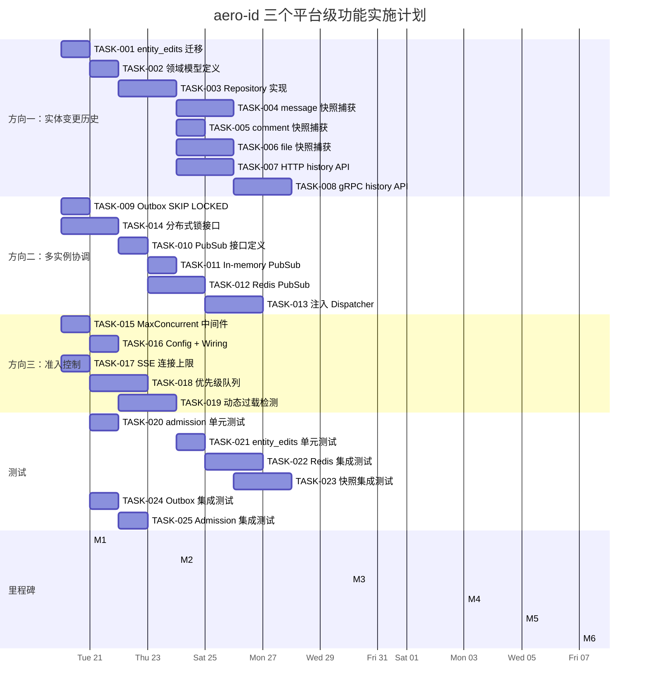

Now I have a thorough understanding of the entire codebase. Let me produce the analysis.

---

# Tech Lead 分析报告：三个系统性缺失的平台级功能

## 1. 任务分解

基于文档分析 + 代码扫描结果，我将每个方向拆解为可在 2–4 小时内完成的独立任务。任务按依赖关系分组，标注了涉及文件、前置依赖和验收标准。

### 方向一：实体变更历史（Entity Change History）

| 任务ID | 任务标题 | 涉及文件 | 前置依赖 | 预估工时 |
|--------|----------|----------|----------|----------|
| **TASK-001** | 创建 `entity_edits` 迁移（up + down SQL） | `migrations/000024_create_entity_edits.up.sql`, `000024_create_entity_edits.down.sql` | 无 | 2h |
| **TASK-002** | 定义 `domain.EntityEdit` 模型 | `internal/domain/entity_edit.go` | TASK-001 | 1h |
| **TASK-003** | 实现 `repository.EntityEditRepository`（GORM CRUD） | `internal/repository/entity_edit.go`, `internal/repository/entity_edit_test.go`（单元） | TASK-001, TASK-002 | 3h |
| **TASK-004** | 在 `messageService.Edit` 中嵌入快照捕获 | `internal/service/message.go`（Edit 方法） | TASK-003 | 3h |
| **TASK-005** | 在 `commentService.Edit` 中嵌入快照捕获 | `internal/service/comment.go`（Edit 方法） | TASK-003 | 2h |
| **TASK-006** | 在 `fileService.UpdateMetadata` 中嵌入快照捕获 | `internal/file/service_crud.go`（UpdateMetadata） | TASK-003 | 3h |
| **TASK-007** | 实现 `GET /v1/{entity}/{id}/history` HTTP 端点 | `internal/handler/http/entity_history.go` + 编写 service 层 `GetHistory` 方法 | TASK-003 | 4h |
| **TASK-008** | 实现 gRPC `GetHistory` RPC + proto 定义 | `api/proto/aero/v1/entity.proto`（新增或扩展）、`internal/handler/grpc/entity_history.go` | TASK-003, TASK-007 的 service 层 | 3h |

**验收标准**：
- TASK-001: `make migrate-up` 执行后数据库中出现 `entity_edits` 表，`make migrate-down` 能回滚
- TASK-002 / TASK-003: `go test ./internal/repository/...` 通过，CRUD 操作正常
- TASK-004/005/006: 编辑消息/评论/文件后，`entity_edits` 表出现一行记录，`before_snapshot` 是旧值，`after_snapshot` 是新值
- TASK-007/008: `curl /v1/messages/{id}/history` 返回有序的历史版本列表，仅 owner 和 admin 可访问

### 方向二：多实例协调（Multi-Instance Coordination）

| 任务ID | 任务标题 | 涉及文件 | 前置依赖 | 预估工时 |
|--------|----------|----------|----------|----------|
| **TASK-009** | Outbox `FetchUnpublished` 加 `FOR UPDATE SKIP LOCKED` | `internal/outbox/repository.go`（FetchUnpublished） | 无 | 2h |
| **TASK-010** | 定义 `PubSub` 接口 | `internal/hub/pubsub.go`（interface） | 无 | 1h |
| **TASK-011** | 将现有 `Hub` 适配为 `PubSub` 的 in-memory 实现 | `internal/hub/hub.go`（实现 interface）、`internal/hub/adapter.go`（清理） | TASK-010 | 2h |
| **TASK-012** | 实现 Redis PubSub 后端 | `internal/hub/redis_pubsub.go` | TASK-010 | 4h |
| **TASK-013** | 将 `PubSub` 注入到 Dispatcher 中代替直接调用 `hub.Publish` | `internal/notification/dispatcher.go`, `internal/app/app.go`（wiring） | TASK-011, TASK-012 | 3h |
| **TASK-014** | 可插拔 `DistributedLock` 接口 + DB 实现（`SELECT ... FOR UPDATE NOWAIT`） | `internal/pkg/distlock/interface.go`, `internal/pkg/distlock/db.go` + 集成到 outbox relay 的 drain 中 | 无（可并行于 TASK-009） | 3h |

**验收标准**：
- TASK-009: 两个实例同时 drain 时，每个事件仅被一个实例处理（用两个 goroutine 同时调用 drain 验证）
- TASK-010/011/012: in-memory 和 Redis 实现满足同一接口，单元测试覆盖
- TASK-013: SSE 推送在 Redis PubSub 模式下跨实例广播
- TASK-014: 两个 relay 同时运行时，仅一个获得锁并处理事件

### 方向三：连接级准入控制（Admission Control）

| 任务ID | 任务标题 | 涉及文件 | 前置依赖 | 预估工时 |
|--------|----------|----------|----------|----------|
| **TASK-015** | 实现 `MaxConcurrent` 中间件（channel semaphore） | `internal/middleware/admission.go` | 无 | 2h |
| **TASK-016** | 配置化 wiring：将 `MaxConcurrent` 接入路由 + config | `configs/config.yaml`, `internal/config/config.go`, `internal/app/app.go`, `internal/handler/http/router.go` | TASK-015 | 2h |
| **TASK-017** | SSE 连接上限：在 `Hub.Subscribe` 中加 atomic 计数器 + 上限检查 | `internal/hub/hub.go` | 无（可并行于 TASK-015） | 2h |
| **TASK-018** | 请求优先级队列：admin semaphore + 路由分组 | `internal/middleware/admission.go`（扩展），`internal/handler/http/router.go` | TASK-015 | 3h |
| **TASK-019** | 动态过载检测器（latency moving average + GC 压力） | `internal/middleware/overload_detector.go` | TASK-016 | 4h |

**验收标准**：
- TASK-015: 并发请求超过 `max_concurrent` 时返回 503 + `Retry-After`
- TASK-016: `config.yaml` 中 `admission.max_concurrent: 0` 时中间件为 no-op（opt-in）
- TASK-017: SSE 连接数达到上限时 `Subscribe` 返回错误或拒绝
- TASK-018: 管理员的 `PATCH /v1/admin/*` 使用高优先级队列，不受低优先级请求阻塞
- TASK-019: 当 latency moving average 超过阈值时，admission threshold 自动降低 50%

### 测试与质量

| 任务ID | 任务标题 | 涉及文件 | 前置依赖 | 预估工时 |
|--------|----------|----------|----------|----------|
| **TASK-020** | 单元测试：`MaxConcurrent` + admission middleware | `internal/middleware/admission_test.go` | TASK-015 | 2h |
| **TASK-021** | 单元测试：entity_edits repository | `internal/repository/entity_edit_test.go` | TASK-003 | 2h |
| **TASK-022** | 集成测试：Redis PubSub 跨实例广播 | `internal/hub/redis_pubsub_test.go`（`//go:build integration`） | TASK-012 | 3h |
| **TASK-023** | 集成测试：entity_edits + service 层快照捕获 | `internal/service/entity_history_test.go`（`//go:build integration`） | TASK-004/005/006 | 3h |
| **TASK-024** | 集成测试：outbox `FOR UPDATE SKIP LOCKED` 并发安全 | `internal/outbox/relay_test.go`（`//go:build integration`） | TASK-009 | 2h |
| **TASK-025** | 集成测试：admission control 在真实 HTTP 服务器下的行为 | `internal/handler/http/admission_test.go`（`//go:build integration`） | TASK-016 | 2h |

---

## 2. 执行顺序与依赖图

```mermaid
graph TD
    %% 方向一：实体变更历史
    subgraph "Group A: 实体变更历史"
        A1[TASK-001: entity_edits 迁移] --> A2[TASK-002: 领域模型]
        A2 --> A3[TASK-003: Repository CRUD]
        A3 --> A4[TASK-004: message 快照]
        A3 --> A5[TASK-005: comment 快照]
        A3 --> A6[TASK-006: file 快照]
        A3 --> A7[TASK-007: HTTP history API]
        A7 --> A8[TASK-008: gRPC history API]
    end

    %% 方向二：多实例协调
    subgraph "Group B: 多实例协调 (Phase 1)"
        B1[TASK-009: Outbox FOR UPDATE SKIP LOCKED]
        B1b[TASK-014: 分布式锁接口+DB实现]
    end

    subgraph "Group C: 多实例协调 (Phase 2)"
        C1[TASK-010: PubSub 接口定义]
        C1 --> C2[TASK-011: In-memory 实现]
        C1 --> C3[TASK-012: Redis 实现]
        C2 --> C4[TASK-013: 注入 Dispatcher]
        C3 --> C4
    end

    %% 方向三：准入控制
    subgraph "Group D: 准入控制 (Phase 1)"
        D1[TASK-015: MaxConcurrent 中间件]
        D1 --> D2[TASK-016: Config + Wiring]
        D1b[TASK-017: SSE 连接上限]
    end

    subgraph "Group E: 准入控制 (Phase 2-3)"
        D1 --> E1[TASK-018: 优先级队列]
        D2 --> E2[TASK-019: 动态过载检测]
    end

    %% 测试任务
    subgraph "Group T: 测试"
        D1 --> T1[TASK-020: admission 单元测试]
        A3 --> T2[TASK-021: entity_edits 单元测试]
        C3 --> T3[TASK-022: Redis PubSub 集成测试]
        A456 --> T4[TASK-023: 快照捕获集成测试]
        B1 --> T5[TASK-024: outbox 并发集成测试]
        D2 --> T6[TASK-025: admission 集成测试]
    end

    %% 注：A456 是 TASK-004/005/006 的聚合节点
    A456[A4: message 快照<br/>A5: comment 快照<br/>A6: file 快照]
    A4 --> A456
    A5 --> A456
    A6 --> A456

    %% 并行组标注
    classDef parallel fill:#e1f5fe,stroke:#0288d1
    class A1,A2,A3,B1,B1b,D1,D1b parallel
    class A4,A5,A6 parallel
    class C2,C3 parallel
```

### 可并行执行的任务组

| 并行组 | 任务 | 说明 |
|--------|------|------|
| **P0（起点）** | TASK-001, TASK-009, TASK-014, TASK-015, TASK-017, TASK-010 | 六个方向的基础设施任务完全独立，可分配给 2–3 人并行起步 |
| **P1** | TASK-004/005/006 | entity_edits repository 完成后，三个 service 修改可并行 |
| **P2** | TASK-011/012 | PubSub 接口定义后，in-memory 和 Redis 实现可并行 |
| **P3** | TASK-020/021/022/023/024/025 | 测试任务可与对应实现任务并行或稍后 |

---

## 3. 技术风险

### 3.1 高风险

| 风险 | 方向 | 详细说明 | 缓解策略 |
|------|------|----------|----------|
| **Redis PubSub 可靠性** | 方向二 | Redis PubSub 是"即发即忘"（fire-and-forget），无持久化。如果 Redis crash 或网络分区，消息丢失。aero-id 的 SSE 推送 变成"最多一次"语义。 | 1) 保留 DB 轮询 fallback（当 PubSub 断开时回退到 `notifications` 表轮询） 2) 每次 SSE 重连时用 `last_event_id` 从 DB 回放错过的通知 3) 考虑 Redis Streams 替代 PubSub（有消费者组 + 持久化） |
| **动态过载检测的误判** | 方向三 | 基于 latency moving average 的过载检测可能因为 GC 暂停、网络抖动等瞬态事件误触发，导致 admission threshold 不合理降低，影响正常流量。 | 1) 使用双阈值（soft threshold: 降低 50%，hard threshold: 降低 90%） 2) 降低过程附加指数平滑（EWMA）和冷却时间（cooldown period） 3) 默认 opt-in，且提供 manual override API |
| **`entity_edits` 快照体积增长** | 方向一 | 每次编辑存储 ~500B JSON before/after 快照。高频编辑场景（如迭代式文档编辑）可能导致表膨胀。 | 1) 设置编辑历史保留 TTL（默认 90 天，可配置） 2) 定期清理过期快照（类似 outbox 的 GC） 3) 对外 API 仅返回最近 N 个版本（默认 50） |

### 3.2 中等风险

| 风险 | 方向 | 详细说明 | 缓解策略 |
|------|------|----------|----------|
| **`FOR UPDATE SKIP LOCKED` 的 Postgres 版本要求** | 方向二 | `SKIP LOCKED` 自 Postgres 9.5 可用（2016），绝大多数生产环境支持。但测试环境中可能使用 EOL 版本。 | 在 README 和 `docker-compose.yml` 中明确最低 PG 版本要求（≥12）；`config.yaml` 中提供 `skip_locked` 开关，当 PG 版本不支持时可回退到 `NOWAIT` |
| **快照捕获事务边界** | 方向一 | message 的 `UpdateContent` 方法在 repo 层完成，而快照写入需要与原地更新在同一事务中，否则会出现"快照写入成功但原地更新失败"的不一致状态。 | 将所有编辑操作改为接受一个 `entityEditsRepo` 回调，在 repo 层的同一事务中完成 `UPDATE + INSERT entity_edits` |
| **SSE 连接上限后的客户端行为** | 方向三 | 如果 SSE 连接被拒绝（503），客户端可能进入无限重连循环，加重服务器压力。 | 在 503 响应中包含 `Retry-After` header，客户端应遵循；服务器端实现 per-client 重试 backoff（连接频率限制） |
| **优先级队列的"饥饿"** | 方向三 | 如果低优先级队列总是被高优先级请求抢占，低优先级请求可能永远无法处理（starvation）。 | 使用加权调度（如每个高优先级请求处理完后，至少处理一个低优先级请求），避免完全饥饿 |

### 3.3 低风险

| 风险 | 方向 | 详细说明 | 缓解策略 |
|------|------|----------|----------|
| **gRPC history API 的 proto 设计** | 方向一 | `EntityHistory` 需要新增 RPC 或扩展现有 service。如果放在已有 proto 中，可能导致 proto 包膨胀。 | 新建 `entity.proto`，用 `oneof` 支持 message/comment/file 三种 subject_type |
| **分布式锁的实现选择** | 方向二 | DB-based 分布式锁（`pg_try_advisory_lock`）性能足够但需要单独连接。如果选择 Redis Redlock 则增加依赖。 | 初始实现使用 DB-based `pg_try_advisory_lock`（零新增依赖），当有明确 Redis 需求后再添加 Redis 实现 |
| **Admission Control 与 Rate Limit 的交互** | 方向三 | Admission Control 在 Rate Limiter 之前执行（先拒绝超量连接，再限速），但两者同时启用时可能造成"双重拒绝"的混淆（先拿到 503，再拿到 429）。 | 在 503 的 error body 中附加 `retry_after` hint；文档中说明两层保护的关系 |

---

## 4. 资源评估

### 4.1 开发团队

| 角色 | 人数 | 技能要求 | 负责方向 |
|------|------|----------|----------|
| **资深后端工程师 A** | 1 | Go, Postgres, GORM, gRPC, Redis | 方向一（变更历史）+ 方向二 PubSub |
| **资深后端工程师 B** | 1 | Go, Postgres, 系统编程, 性能分析 | 方向三（准入控制 + 过载检测）+ 方向二 outbox 锁 |
| **全栈/测试工程师** | 1 | Go 测试, testcontainers, 集成测试 | 全方向的集成测试 + 质量保障 |
| **Tech Lead（你）** | 1 | 架构决策, 代码审查, 风险管理 | 全局统筹 + TASK-009/014/016 等跨方向依赖任务 |

**建议**：团队 2–3 人（含 TL）。如果只有 1 人全职实施，按阶段串行执行，总工期约 4–5 周。

### 4.2 关键里程碑

| 里程碑 | 时间点 | 交付物 | 涉及任务 |
|--------|--------|--------|----------|
| **M1: 底线安全（P1）** | 第 1 周末 | Outbox 多实例安全 + MaxConcurrent 中间件上线 | TASK-009, TASK-014, TASK-015, TASK-016 |
| **M2: 变更历史基础** | 第 2 周末 | `entity_edits` 表 + 三个实体的快照捕获完成 | TASK-001 ~ TASK-006 |
| **M3: 跨实例广播** | 第 3 周末 | Redis PubSub 接入完成，SSE 跨实例可用 | TASK-010 ~ TASK-013 |
| **M4: 历史 API 发布** | 第 4 周末 | HTTP + gRPC history API 完成 | TASK-007, TASK-008 |
| **M5: 进阶准入控制** | 第 5 周末 | 优先级队列 + 动态过载检测完成 | TASK-018, TASK-019 |
| **M6: 质量门禁** | 第 5 周末 | 全部集成测试 + 性能测试通过 | TASK-020 ~ TASK-025 |

### 4.3 阻塞点与解决策略

| # | 阻塞点 | 影响 | 解决策略 |
|---|--------|------|----------|
| 1 | **`entity_edits` 事务一致性的方案选择** | 需要确定：是 repo 层提供 callback，还是 service 层自己管理事务 | 建议方案：在 repository 层扩展 `UpdateContent` 等方法的签名，增加 `snapshot` 参数（类似 `MarkReadWithEvent`），保持一致性 |
| 2 | **Redis 依赖是否需要容器化测试** | CI/CD 中需要运行 Redis；当前仅 Postgres + MinIO 是测试容器 | 在 integration test 中使用 testcontainers-redis（或 valkey）；如果不愿意，退回到 out-of-box 时 Redis PubSub 的集成测试标记为 `manual` |
| 3 | **动态过载检测的阈值调参** | 需要基准数据确定 latency baseline；首次部署可能误报 | 初始阈值保守（例如 latency > 5x baseline 才触发），并添加可观测性 metric 供日后调优；提供手动阈值 override 的 config flag |
| 4 | **`FOR UPDATE SKIP LOCKED` 与 outbox relay 当前 `retry_count` 逻辑的冲突** | 当前 relay 逻辑逐个事件检查 backoff，如果加锁后跳过（skip），锁释放的瞬间另一个实例可能拿到同一事件 | 解决方案：加锁后仅处理该批事件，跳过的事件不会释放给其他实例（下一个 drain 周期重新尝试）。无需特殊处理——`drain` 每次从头获取未发布事件即可 |

---

## 5. 质量保证

### 5.1 单元测试覆盖要求

| 领域 | 要求覆盖率 | 关键测试路径 |
|------|-----------|-------------|
| `entity_edit` repository | ≥ 90% | Create, ListByEntity (pagination), deleted_at scope |
| `message.Edit` + snapshot | ≥ 85% | 正常编辑 → before/after 正确；并发编辑的情况 |
| `comment.Edit` + snapshot | ≥ 85% | 同上 |
| `file.UpdateMetadata` + snapshot | ≥ 85% | 单字段更新 vs 多字段→仅一行快照 |
| `MaxConcurrent` middleware | ≥ 95% | 低于上限→通过；超过上限→503；semaphore 释放后恢复 |
| `overload_detector` | ≥ 90% | EWMA 计算正确；阈值触发/恢复 hysteresis |
| outbox `FOR UPDATE SKIP LOCKED` | ≥ 90% | 两个 goroutine 同时 drain 不冲突 |
| Redis PubSub (mock 模式下) | ≥ 85% | 发布→订阅者收到；断开后重连 |

### 5.2 集成测试策略

| 测试 | 执行方式 | 环境 | 覆盖场景 |
|------|----------|------|----------|
| **entity_edits + service 快照捕获** | `make test-integration` | Postgres (testcontainers) | 编辑→快照写入→读取历史→验证 before/after |
| **Outbox SKIP LOCKED 并发** | `make test-integration` | Postgres (testcontainers) | 2 个 relay 并发 drain，验证无事件被重复处理 |
| **Redis PubSub 广播** | `make test-integration` | Redis (testcontainers) | 2 个 Hub 实例通过 Redis 通信；发布事件后双方都收到 |
| **Admission Control E2E** | `make test-integration` | HTTP + Postgres | 并发 N 请求，N > max_concurrent → 超量的返回 503 |
| **History API E2E** | `make test-integration` | HTTP/Postgres | 编辑 message → 查询 history → 返回有序版本列表 |

### 5.3 代码审查要点

| 审查维度 | 重点检查项 |
|----------|-----------|
| **事务一致性** | `UPDATE` + `INSERT entity_edits` 是否在同一个 `*gorm.DB` 事务中执行？是否回滚一致？ |
| **快照深度** | `before_snapshot` 是否包含所有可编辑字段？marshaling/unmarshaling 是否正确处理 `nil` 值？ |
| **权限控制** | History API 是否确实限制了仅 owner + admin？SSE 连接上限是否对 admin 有豁免？ |
| **可回退性** | 每个新功能在配置禁用时是否完全无行为变化？`MaxConcurrent: 0` 是否等价于未启用？ |
| **并发安全** | SSE 连接上限的 `atomic` 计数器 + 释放逻辑是否有 ABA 问题？semaphore 的 channel 操作是否有泄露？ |
| **错误语义** | Admission control 的 503 是否和现有的 429 错误结构一致？`Retry-After` header 是否正确？ |
| **性能影响** | 快照捕获是否在热点路径外的 `Edit` 操作中？`entity_edits` 的索引是否覆盖了典型查询？ |

### 5.4 性能测试需求

| 场景 | 测试工具 | 指标 | 目标 |
|------|----------|------|------|
| **高频编辑并发** | `go-wrk` / `vegeta` | 50 qps 同时编辑同一 message；验证 entity_edits 写入不显著增加 P99 latency | P99 < 200ms（快照写入增加 < 20ms） |
| **SSE 连接上限** | 自制连接脚本 | 突破 max_connections；验证第 N+1 个连接收到 503 | N=5000 时，OOM 不发生 |
| **OOM 保护验证** | 慢请求洪水 | `curl --limit-rate 1K` + 高并发；验证 admission control 在 goroutine 数达到 threshold 时拒绝而非积累 | 内存使用峰值 < 配置上限的 1.5x |
| **Outbox 多实例压力** | 2 实例并发 drain | 模拟 10000 个 unpublised 事件；验证事件被处理且仅被处理一次 | 0 重复处理，0 丢失 |

---

## 6. 实施计划

### 甘特图

### 详细阶段划分

#### 阶段 1：基础设施搭建（W1, 2026-07-20 ~ 2026-07-21, 2 天）

**目标**：建立底线安全机制（P1 级） + 奠定三个方向的数据库/接口基础

| 日期 | 任务 | 参与人 | 产出 |
|------|------|--------|------|
| Day 1 AM | TASK-001: entity_edits 迁移 | 工程师 A | `migrations/000024_*.sql` |
| Day 1 AM | TASK-009: Outbox SKIP LOCKED | 工程师 B | `internal/outbox/repository.go` 修改 |
| Day 1 PM | TASK-015: MaxConcurrent 中间件 | 工程师 B | `internal/middleware/admission.go` |
| Day 1 PM | TASK-017: SSE 连接上限 | 工程师 A | `internal/hub/hub.go` 修改 |
| Day 2 AM | TASK-002: domain 模型 | 工程师 A | `internal/domain/entity_edit.go` |
| Day 2 AM | TASK-016: Config + Wiring（admission） | 工程师 B | config.yaml + app.go + router.go |
| Day 2 PM | TASK-014: 分布式锁接口 | 工程师 B | `internal/pkg/distlock/*` |
| Day 2 PM | TASK-010: PubSub 接口定义 | 工程师 A | `internal/hub/pubsub.go` |

**Gate**：`make test && make lint` 均通过；M1 里程碑：底线安全功能可部署

#### 阶段 2：核心功能实现（W2, 3 天）

**目标**：完成变更历史的全部数据层 + 三个实体的快照捕获

| 日期 | 任务 | 参与人 | 产出 |
|------|------|--------|------|
| Day 3 AM | TASK-003: entity_edits Repository | 工程师 A | `internal/repository/entity_edit.go` |
| Day 3 PM | TASK-004: message 快照 | 工程师 A | `internal/service/message.go` 修改 |
| Day 4 AM | TASK-005: comment 快照 | 工程师 A | `internal/service/comment.go` 修改 |
| Day 4 PM | TASK-006: file 快照 | 工程师 A | `internal/file/service_crud.go` 修改 |
| Day 3~4 | TASK-011: In-memory PubSub 实现 | 工程师 B | `internal/hub/hub.go` 重构 |
| Day 3~4 | TASK-012: Redis PubSub 实现 | 工程师 B | `internal/hub/redis_pubsub.go` |
| Day 5 | TASK-018: 优先级队列 | 工程师 B | `internal/middleware/admission.go` 扩展 |

**Gate**：`make test` 通过；`make test-integration`（Postgres）快照写入正确；M2 里程碑

#### 阶段 3：API 暴露 & 跨实例集成（W3~W4, 4 天）

**目标**：history API 上线 + Redis PubSub 注入 Dispatcher

| 日期 | 任务 | 参与人 | 产出 |
|------|------|--------|------|
| Day 6~7 | TASK-007: HTTP history handler | 工程师 A | `internal/handler/http/entity_history.go` + service 层 |
| Day 6~7 | TASK-013: PubSub 注入 Dispatcher | 工程师 B | `internal/notification/dispatcher.go` 修改 + wiring |
| Day 8 | TASK-008: gRPC history RPC | 工程师 A | proto + handler |
| Day 8 | TASK-019: 动态过载检测 | 工程师 B | `internal/middleware/overload_detector.go` |

**Gate**：HTTP API 返回正确历史版本；SSE 在 2 个实例间广播；M3 + M4 里程碑

#### 阶段 4：集成测试 & 优化（W5, 3 天）

**目标**：全量集成测试通过 + 性能基线验证

| 日期 | 任务 | 参与人 | 产出 |
|------|------|--------|------|
| Day 9 | TASK-020/021: 单元测试补充 | 工程师 A | admission + entity_edits 测试 |
| Day 9~10 | TASK-023/024/025: 集成测试 | 工程师 B | testcontainers 测试套件 |
| Day 10 | TASK-022: Redis 集成测试 | 工程师 A | Redis PubSub 跨实例测试 |
| Day 11 | 性能测试 + 调优 | 全员 | P99 latency 基准、内存使用验证、OOM 保护验证 |

**Gate**：`make test && make test-integration && make lint` 全部通过；M5 + M6 里程碑

---

## 附录 A：任务分配建议（矩阵）

| 任务 | 工程师 A（Go/DB/API） | 工程师 B（Go/系统/性能） | 测试工程师 | 时间窗口 |
|------|:-----:|:-----:|:-----:|:--------|
| TASK-001 | ✅ | | | W1 D1 AM |
| TASK-002 | ✅ | | | W1 D2 AM |
| TASK-003 | ✅ | | | W2 D1 AM |
| TASK-004 | ✅ | | | W2 D1 PM |
| TASK-005 | ✅ | | | W2 D2 AM |
| TASK-006 | ✅ | | | W2 D2 PM |
| TASK-007 | ✅ | | | W3 D1~2 |
| TASK-008 | ✅ | | | W3 D3 |
| TASK-009 | | ✅ | | W1 D1 AM |
| TASK-010 | ✅ | | | W1 D2 PM |
| TASK-011 | | ✅ | | W2 D1~2 |
| TASK-012 | | ✅ | | W2 D1~2 |
| TASK-013 | | ✅ | | W3 D1~2 |
| TASK-014 | | ✅ | | W1 D2 PM |
| TASK-015 | | ✅ | | W1 D1 PM |
| TASK-016 | | ✅ | | W1 D2 AM |
| TASK-017 | ✅ | | | W1 D1 PM |
| TASK-018 | | ✅ | | W2 D3 |
| TASK-019 | | ✅ | | W3 D3 |
| TASK-020 | | | ✅ | W4 D1 |
| TASK-021 | | | ✅ | W4 D1 |
| TASK-022 | ✅ | | | W4 D2 |
| TASK-023 | | | ✅ | W4 D1~2 |
| TASK-024 | | | ✅ | W3 D1 |
| TASK-025 | | | ✅ | W4 D2~3 |

## 附录 B：与现有架构约束的兼容性验证

| 约束 | 方向一是否合规 | 方向二是否合规 | 方向三是否合规 |
|------|:---:|:---:|:---:|
| 文件 ≤ 500 行 | ✅ `entity_edit.go` 新增独立文件 | ✅ 接口定义小而专注 | ✅ admission 中间件独立 |
| 函数 ≤ 50 行 | ✅ 快照捕获逻辑可拆为 helper | ✅ Lock 获取是单行调用 | ✅ semaphore acquire/release 各是 10 行 |
| 复杂度 ≤ 10 | ✅ 纯数据组装 | ✅ 接口 + 策略模式 | ✅ 中间件无分支逻辑 |
| if 嵌套 ≤ 3 层 | ✅ 无非嵌套分支 | ✅ | ✅ |
| 单文件单职责 | ✅ 每个新文件一个职责 | ✅ PubSub/ Lock / RateLimiter 分离 | ✅ admission / overload_detector 分离 |

## 附录 C：推荐的 Review 顺序

每个 PR 的 review 顺序应遵循"风险优先"原则：

1. **TASK-009**（Outbox SKIP LOCKED）— 最核心的多实例安全问题，review 后先合并
2. **TASK-015**（MaxConcurrent middleware）— OOM 保护底线，review 后立即部署
3. **TASK-001**（迁移）— 数据库 schema 变更，尽早合并减少冲突
4. **TASK-003 ~ TASK-006**（实体快照）— 事务一致性和 before/after 准确性
5. **TASK-010 ~ TASK-013**（PubSub）— 接口设计 + 可回退性
6. **TASK-007 ~ TASK-008**（History API）— 权限控制
7. **TASK-019**（动态过载检测）— 阈值和误判检测
