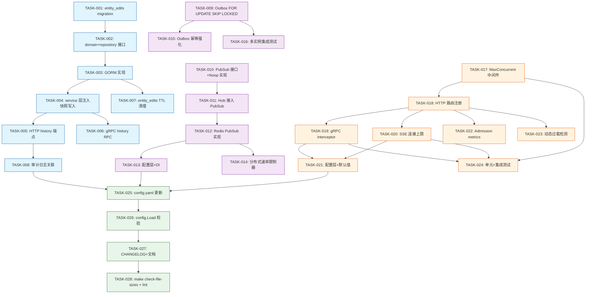
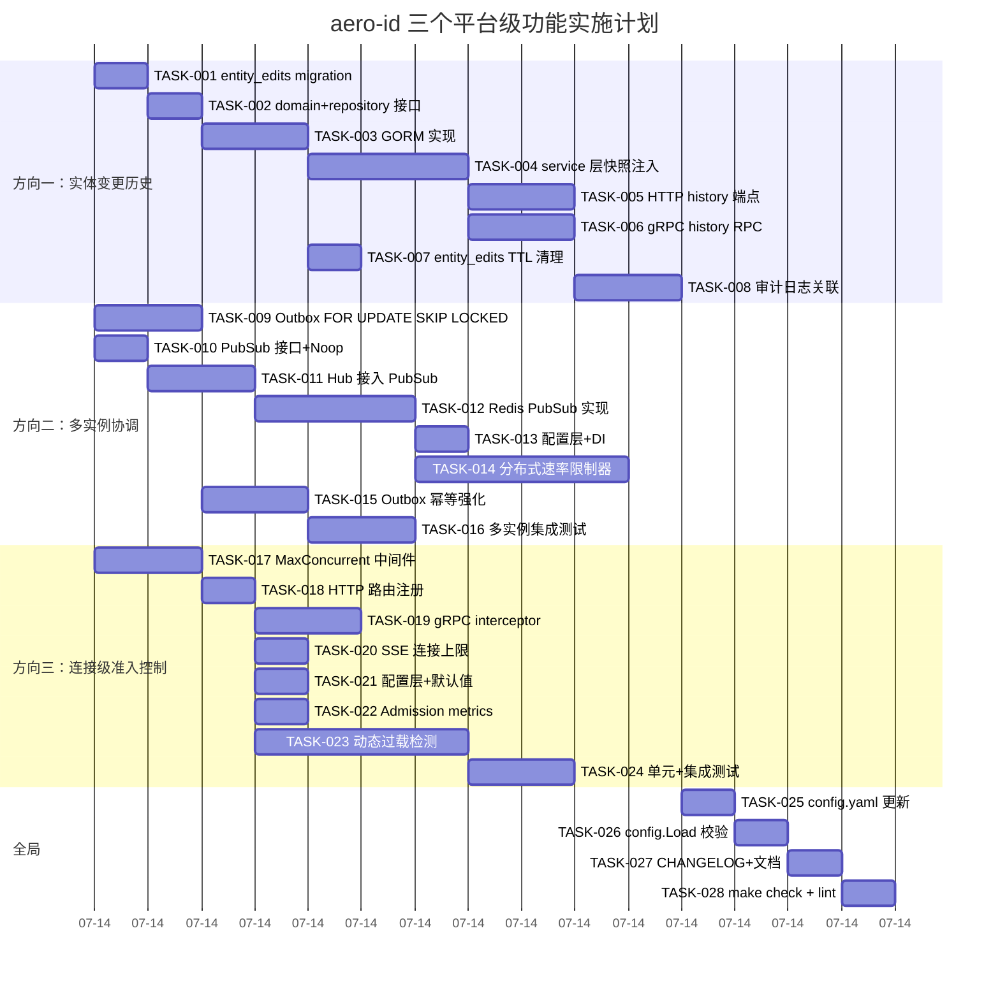

Now I have a thorough understanding of both the analysis and the actual codebase. Let me produce the Tech Lead analysis.

---

# Tech Lead 分析报告：三个系统性缺失的平台级功能

> **分析日期**: 2026-07-12
> **分析者**: Tech Lead
> **基础文档**: `docs/requirements/2026-07-11-aero-id-three-systemic-missing-platform-level-features.md`

---

## 1. 任务分解

### 方向一：实体变更历史 (Entity Change History)

| 任务 ID | 任务标题 | 涉及文件 | 前置依赖 | 工时 | 验收标准 |
|---------|---------|---------|---------|------|---------|
| **TASK-001** | 新增 `entity_edits` 多态表 migration | `migrations/000024_create_entity_edits.up.sql`, `.down.sql` | 无 | 1h | migration up/down 可逆；表结构含 `entity_type`, `entity_id`, `version`, `before_snapshot(jsonb)`, `after_snapshot(jsonb)`, `actor_uid`, `created_at`；有 `(entity_type, entity_id, version)` 唯一索引 |
| **TASK-002** | 定义 `domain.EntityEdit` + `domain.EntityEditsRepository` | `internal/domain/entity_edit.go` | TASK-001 | 1h | 结构体字段与 migration 列对应；Repository 接口定义 `Append`, `ListByEntity`, `LatestVersion` |
| **TASK-003** | 实现 `repository.GormEntityEditsRepository` | `internal/repository/entity_edit.go` | TASK-002 | 2h | GORM 实现 Append（事务内写入）、ListByEntity（按 version DESC）、LatestVersion（返回 max version）；单元测试覆盖 CRUD |
| **TASK-004** | service 层 Edit/UpdateMetadata 注入快照写入 | `internal/service/message.go`, `internal/service/comment.go`, `internal/file/service_crud.go` | TASK-003 | 3h | 在 `service.Edit()` 中读旧值 → 在事务中先 `Append` entity_edit 行 → 再 `Update`；对 `file.UpdateMetadata` 同理；已有单元测试覆盖快照正确性 |
| **TASK-005** | HTTP 端点 `GET /v1/{entity}/{id}/history` | `internal/handler/http/events.go`（更换路径）或新增 `internal/handler/http/history.go` | TASK-004 | 2h | 返回版本列表（version, before, after, actor_uid, created_at）；只允许 owner/admin 查询；含 cursor-based 分页 |
| **TASK-006** | gRPC 端点 `GetEntityHistory` RPC | `api/proto/aero/v1/history.proto`（新增）、`internal/handler/grpc/history.go` | TASK-005 | 2h | proto 定义请求/响应消息；gRPC handler 调用 service；HTTP 与 gRPC 行为一致 |
| **TASK-007** | entity_edits TTL 清理 | `internal/repository/entity_edit.go` + `internal/app/new.go` | TASK-003 | 1h | 可配置 retention + clean_interval 在 `data_retention` 下；与已有 audit/notification/outbox 清理模式一致 |
| **TASK-008** | 审计日志与 entity_edits 关联 | `internal/service/audit.go` 或 service 层注入 | TASK-005 | 2h | audit 事件的 Meta 中关联 `edit_version`；admin 通过 audit 事件 + version 号能跳转到变更快照 |

**方向一小计：14h（~2 人天）**

---

### 方向二：多实例协调 (Multi-Instance Coordination)

| 任务 ID | 任务标题 | 涉及文件 | 前置依赖 | 工时 | 验收标准 |
|---------|---------|---------|---------|------|---------|
| **TASK-009** | Outbox relay 加 `FOR UPDATE SKIP LOCKED` | `internal/outbox/repository.go` | 无 | 2h | `FetchUnpublished` 使用 `SELECT ... FOR UPDATE SKIP LOCKED` 替代简单 SELECT；事件在 relay 处理期间被本实例锁定，其他实例跳过；需大版本 migration 调整查询 |
| **TASK-010** | 定义 `PubSub` 接口 + `NoopPubSub` 实现 | `internal/hub/pubsub.go`（新增） | 无 | 1h | 接口：`Publish(ctx, channel, payload)` / `Subscribe(ctx, channel) <-chan Message`；Noop 实现仅本地日志 |
| **TASK-011** | Hub.Publish 改为调用 PubSub 接口 | `internal/hub/adapter.go`（修改）、`internal/hub/hub.go` | TASK-010 | 2h | `Hub.Publish` 调用 `PubSub.Publish` + 本地 pub（保持单实例向后兼容）；`Hub.Subscribe` 启动 goroutine 消费 PubSub channel + 本地 sub；接口回退到纯本地时行为与当前一致 |
| **TASK-012** | Redis PubSub 实现 | `internal/hub/redis_pubsub.go`（新增） | TASK-010 | 3h | 使用 go-redis 的 Pub/Sub；连接失败时退化为 Noop（fail-open）；配置通过 `coordinator.type: redis` 控制 |
| **TASK-013** | 配置层 + 依赖注入 | `internal/config/config.go`（新增 `CoordinatorConfig`）、`internal/app/new.go` | TASK-012 | 1h | `config.yaml` 增加 `coordinator:` 段（type: local/redis, redis_addr...）；app.New 根据配置选择 PubSub 实现 |
| **TASK-014** | 分布式速率限制器（可选 Redis 后端） | `internal/pkg/ratelimit/redis_limiter.go`（新增） | TASK-012 | 4h | 实现 `DistributedLimiter` 接口，使用 Redis `INCR` + `EXPIRE`（滑动窗口）或 lua 脚本（token bucket）；通过 `rate_limit.mode: local|redis` 切换 |
| **TASK-015** | Outbox 幂等处理强化 | `internal/outbox/repository.go`、`internal/outbox/relay.go` | TASK-009 | 2h | `MarkPublished` 使用幂等更新（`UPDATE ... WHERE published_at IS NULL`）防止重复标记；relay 处理前 events 添加去重 map |
| **TASK-016** | 集成测试：多实例 outbox 隔离 | `internal/outbox/repository_integration_test.go` | TASK-009 | 2h | 测试两个并发 goroutine 模拟实例同时 drain，各自只获得互斥事件子集；无事件被重复 published |

**方向二小计：17h（~2.5 人天）**

---

### 方向三：连接级准入控制 (Admission Control)

| 任务 ID | 任务标题 | 涉及文件 | 前置依赖 | 工时 | 验收标准 |
|---------|---------|---------|---------|------|---------|
| **TASK-017** | 实现 `MaxConcurrent` 中间件 | `internal/middleware/admission.go`（新增） | 无 | 2h | channel-based semaphore（默认 cap=1000）；超过时返回 503 `Service Unavailable` + `Retry-After` header；可选地支持 per-route 权重 |
| **TASK-018** | 注册 admission 中间件到 HTTP 路由 | `internal/middleware/admission.go` + `internal/handler/http/router.go` | TASK-017 | 1h | 在 RouterConfig 中增加 `MaxConcurrent` 字段；中间件放在 Auth 和 RateLimit 之前（见架构图）；通过环境变量 `AERO_ID_SERVER_HTTP_MAX_CONCURRENT` 控制，默认 0=disabled |
| **TASK-019** | gRPC 流式请求 admission | `internal/handler/grpc/interceptors.go`（新增/修改） | TASK-017 | 2h | gRPC 的 `UnaryServerInterceptor` + `StreamServerInterceptor` 共享同一 semaphore；超出返回 `ResourceExhausted` |
| **TASK-020** | SSE 连接上限控制 | `internal/hub/hub.go`（`Subscribe` 方法） | TASK-018 | 1h | 在 `Hub.Subscribe` 中用 `atomic.Int64` 计数器 + 上限检查（可配置）；超过上限返回已关闭 channel + 日志告警 |
| **TASK-021** | 配置层 + 默认值 | `internal/config/config.go` | TASK-018, TASK-020 | 1h | `server.http.max_concurrent`、`server.grpc.max_concurrent_streams`（已有，但现在是应用层 admission）、`hub.max_sse_connections`；默认值保守（HTTP 1000, SSE 5000） |
| **TASK-022** | Admission metrics 埋点 | `internal/middleware/admission.go` | TASK-018 | 1h | 统计当前 inflight 数、拒绝数（`admission_rejected_total`）、排队等待时间（`admission_queued_seconds`）metrics |
| **TASK-023** | 动态过载检测（Phase 3） | `internal/middleware/admission.go` | TASK-018 | 4h | 基于 moving average 的 request latency + GC 频率 → 动态降低 admission threshold；可选告警 webhook |
| **TASK-024** | 单元测试 + 集成测试 | `internal/middleware/admission_test.go` | TASK-018, TASK-019 | 2h | 测试并发 N req 超过上限时第 N+1 个返回 503；测试 SSE 超过上限时被拒绝；gRPC interceptor 覆盖 |

**方向三小计：14h（~2 人天）**

---

### 全局任务

| 任务 ID | 任务标题 | 涉及文件 | 前置依赖 | 工时 | 验收标准 |
|---------|---------|---------|---------|------|---------|
| **TASK-025** | 更新 `configs/config.yaml` 默认配置 | `configs/config.yaml` | TASK-008, TASK-013, TASK-021 | 1h | 所有新配置项有合理的生产默认值（admission 默认关闭，entity_edits retention 默认 90 天，coordinator 默认 local） |
| **TASK-026** | 更新 `config.Load` 校验 | `internal/config/config.go` | TASK-013, TASK-021 | 1h | 新配置项的 validate 逻辑（coordinator type 只允许 local/redis，retention >= 0 等） |
| **TASK-027** | CHANGELOG + 文档更新 | `docs/CHANGELOG.md`, `README.md`, `docs/ARCHITECTURE.md` | TASK-025 | 1h | 记录新增功能、配置项、迁移版本号 |
| **TASK-028** | `make check-file-sizes` 和 `make lint-strict` 验证 | 全局 | TASK-008, TASK-016, TASK-024 | 1h | 所有新文件 ≤ 500 行，函数 ≤ 50 行，复杂度 ≤ 10 |

**全局小计：4h（~0.5 人天）**

---

### 总计

| 方向 | 任务数 | 总工时 | 人天（6h/day） |
|------|--------|--------|----------------|
| 方向一：实体变更历史 | 8 个 | 14h | 2.3 |
| 方向二：多实例协调 | 8 个 | 17h | 2.8 |
| 方向三：连接级准入控制 | 8 个 | 14h | 2.3 |
| 全局任务 | 4 个 | 4h | 0.6 |
| **合计** | **28 个** | **49h** | **~8 人天** |

---

## 2. 执行顺序

### 依赖图



### 可并行执行的任务组

| 组 | 任务 | 条件 |
|----|------|------|
| **组 A（立即启动）** | TASK-001, TASK-009, TASK-017, TASK-010 | 无前置依赖；三个方向的基础设施可完全并行 |
| **组 B1** | TASK-002 → TASK-003 | 串行；依赖组 A 的 TASK-001 |
| **组 B2** | TASK-011 | 依赖组 A 的 TASK-010 |
| **组 B3** | TASK-018 | 依赖组 A 的 TASK-017 |
| **组 C1** | TASK-004, TASK-007 | 可并行；依赖 B1 的 TASK-003 |
| **组 C2** | TASK-012, TASK-014 | 可并行；依赖 B2 的 TASK-011 |
| **组 C3** | TASK-019, TASK-020, TASK-022 | 可并行；依赖 B3 的 TASK-018 |
| **组 D** | TASK-005, TASK-006, TASK-008, TASK-013, TASK-015, TASK-021, TASK-023, TASK-016 | 大部分可并行，少量串行依赖 |
| **组 E** | TASK-024, TASK-025, TASK-026, TASK-027, TASK-028 | 最后集成 |

---

## 3. 技术风险

### 3.1 方向一：实体变更历史

| 风险 | 级别 | 说明 | 缓解策略 |
|------|------|------|---------|
| **快照尺寸膨胀** | 中 | `before_snapshot` 和 `after_snapshot` JSONB 在大实体（如大量 meta 的 file）下可能达数 KB；100 万次编辑约 ~1-2GB | 1) 限制 `json_strip_nulls` 存储；2) 只记录变更字段（而非全量）；3) TTL 清理默认 90 天 |
| **事务一致性** | 高 | 编辑操作需在事务中先读旧值、再写快照、再原地更新——事务存活时间延长，锁竞争增加 | 确保 `SELECT ... FOR UPDATE` 锁定目标行；监控死锁率 |
| **历史 API 误用导致隐私泄露** | 中 | 公开 `GET /v1/{entity}/{id}/history` 可能暴露"黑历史" | 严格 owner/admin-only 授权检查；按 `internal/middleware/permission.go` 模式实现权限 |
| **性能影响** | 中 | 每次编辑增加一次 INSERT，高编辑频率实体（如消息）可能产生大量快照行 | `entity_edits` 表上 `(entity_type, entity_id, created_at)` 索引；write path INSERT 是 append-only，无 IO争用 |

### 3.2 方向二：多实例协调

| 风险 | 级别 | 说明 | 缓解策略 |
|------|------|------|---------|
| **`FOR UPDATE SKIP LOCKED` 的 PG 版本要求** | 低 | SKIP LOCKED 需要 PostgreSQL 9.5+，当前架构已经是 PG | 无问题，兼容 |
| **Redis PubSub 断连恢复** | 中 | Redis 宕机时 PubSub 连接断开，退化为 Noop；但重新连接后需要重订阅所有 channels | 使用 go-redis 自动重连 + resubscribe 逻辑；连接断开时仍走本地 Hub 广播（用户不丢事件，只是跨实例不广播） |
| **Redis 部署依赖** | 中 | 新增外部基础设施依赖，增加运维复杂度 | Coordinator 模式设计为 opt-in：不配 Redis 则退化到纯本地行为，对所有环境透明 |
| **分布式限流的精度** | 高 | 网络延迟 + clock skew 会导致 Redis 限流的精度不如本地 token bucket | 允许配置 `rate_limit.mode: local`（默认）或 `redis`；生产高精度部署配上 Redis |
| **Outbox 死锁** | 中 | `FOR UPDATE SKIP LOCKED` 在大量实例并发 drain 时可能出现解锁延迟 | 保持 batch size 合理（100）；监控 `pg_locks` |

### 3.3 方向三：连接级准入控制

| 风险 | 级别 | 说明 | 缓解策略 |
|------|------|------|---------|
| **Semaphore 粒度与资源关系** | 高 | 所有请求共享一个 semaphore 无法区分"轻查询"和"大文件上传" | 提供 per-route weight 机制（可选）；先实现全局 semaphore，后续按需精细化 |
| **gRPC interceptor 与 stream 不兼容** | 中 | 流式 RPC（如无现有流，但未来可能加）的 admission 需要区分 stream start 和每个 message | 仅在 `StreamServerInterceptor` 的 stream-open 钩子中计数，message 级别不计数 |
| **SSE 连接上限的边界条件** | 中 | 用户断线重连窗口期可能导致计数器不一致 | `Hub.Subscribe` 时原子递增 → `defer` 原子递减；网络断线时 Hub 的 `unsub` 函数确保递减 |
| **动态过载检测的伪阳性** | 中 | 临时 GC 停顿被误判为过载，导致 admission threshold 不必要降低 | 使用指数移动平均（EMA），至少 5 个采样窗口后才调整阈值；trigger 上下界有 buffer |

---

## 4. 资源评估

### 4.1 开发人员技能需求

| 角色 | 技能要求 | 负责方向 | 投入 |
|------|---------|---------|------|
| **Senior Backend (Go)** | 精通 GORM、PostgreSQL JSONB、事务设计、迁移管理 | 方向一（实体变更历史） | 1 人 × 2.5 天 |
| **Senior Backend (Go + Infra)** | 熟悉分布式系统、Redis、gRPC、并发控制 | 方向二（多实例协调） | 1 人 × 3 天 |
| **Senior Backend (Go)** | 熟悉 HTTP 中间件模式、gRPC interceptor、过载保护策略 | 方向三（连接级准入控制） | 1 人 × 2.5 天 |
| **DevOps/平台** | 熟悉 PostgreSQL migration、Redis 部署、监控告警 | 全局（配置 + 部署） | 0.5 人 × 1 天 |

**最优方案**：2 人 full-time × 1 周 = 10 人天（> 8 人天需求，含 20% buffer）

### 4.2 关键里程碑

| 里程碑 | 时间点 | 条件 |
|--------|--------|------|
| **M1: 基础设施完成** | Day 2 | TASK-001, TASK-009, TASK-010, TASK-017 全部完成且 `make test && make lint` 通过 |
| **M2: 核心逻辑完成** | Day 4 | TASK-003, TASK-011, TASK-018 完成；三个方向的半数任务已实现 |
| **M3: 功能完整** | Day 6 | 所有功能任务（TASK-001~TASK-024）完成；`make test && make lint` 全绿 |
| **M4: 发布就绪** | Day 8 | TASK-025~TASK-028 完成；CHANGELOG 更新；集成测试全绿 |

### 4.3 阻塞点与解决策略

| 阻塞点 | 影响 | 解决策略 |
|--------|------|---------|
| **Redis 部署不可用** | 方向二 Phase 2 和 Phase 3 无法测试 | 1) Coordinator 接口设计为可回退（local = no-op）；2) 集成测试用 testcontainers 启动 Redis 容器验证 |
| **PostgreSQL < 9.5** | TASK-009 的 SKIP LOCKED 不兼容 | 当前已是 PG 15+（`go.mod` 依赖 `pgx`）；无风险 |
| **审计日志表结构与 entity_edits 重复** | 工程师可能质疑两者关系 | 在 `docs/ARCHITECTURE.md` 和 CHANGELOG 中明确区分：audit = who-action，entity_edits = before-after-snapshot |

---

## 5. 质量保证

### 5.1 单元测试覆盖要求

| 包 | 要求覆盖函数 | 最低覆盖率 |
|----|-------------|-----------|
| `internal/domain/entity_edit.go` | 所有 define + validation | 100% |
| `internal/repository/entity_edit.go` | `Append`, `ListByEntity`, `LatestVersion` | 90%+ |
| `internal/service/message.go` (修改) | `Edit` 快照写入路径 | 70%+（已有测试基础上叠加） |
| `internal/service/comment.go` (修改) | `Edit` 快照写入路径 | 70%+ |
| `internal/middleware/admission.go` | `MaxConcurrent.Wait`, `SSEConnectionLimiter.Allow` | 95%+ |
| `internal/hub/pubsub.go` | `Publish`, `Subscribe`, 退路逻辑 | 90%+ |
| `internal/hub/redis_pubsub.go` | 连接管理, 重连, 超时 | 85%+ |
| `internal/outbox/repository.go` (修改) | `FetchUnpublished SKIP LOCKED` | 90%+ |
| `internal/pkg/ratelimit/redis_limiter.go` | token bucket lua script | 90%+（需 mock Redis） |

### 5.2 集成测试策略

| 测试类别 | 测试工具 | 覆盖场景 | 标记 |
|----------|---------|---------|------|
| entity_edits 事务写入 | testcontainers + Postgres | 正常编辑→快照写入；编辑+DB 故障→快照不回写 | `//go:build integration` |
| 多实例 outbox drain | testcontainers + Postgres | 2 个并发 drain 各得互斥事件子集；无重复 published | `//go:build integration` |
| Redis PubSub 跨实例广播 | testcontainers + Redis | 实例 A publish → 实例 B 的 subscriber 收到 | `//go:build integration` |
| 分布式限流 | testcontainers + Redis | 多个 key 通过 Redis 共享 bucket | `//go:build integration` |
| Admission control HTTP | net/http/httptest | 并发 N+1 请求 → 503；正常请求绿 | 纯 Go 测试（无 Docker） |
| SSE 连接上限 | goroutine 模拟 | 超过 `hub.max_sse_connections` → 拒绝 | 纯 Go 测试 |

### 5.3 代码审查要点

| 审查点 | 方向 | 重要性 |
|--------|------|--------|
| entity_edits 的 `before_snapshot` 是否在事务内与 UPDATE 一起提交 | 一 | **关键** — 不一致的快照 = 无用 |
| `FOR UPDATE SKIP LOCKED` 是否只在 PG 9.5+ 部署 | 二 | **关键** — 低版本语法错误 |
| Hub.Publish 是否调用 PubSub.Publish + 本地 pub（而非替代） | 二 | **关键** — 回退兼容性 |
| admission semaphore 的 `Release` 是否在 panic/defer 中确保执行 | 三 | **关键** — 泄露 semaphore = 死锁 |
| owner/admin-only 检查是否在 history 端点中严格实现 | 一 | **高** — 隐私数据 |
| Redis 连接断开的 fail-open 行为 | 二 | **高** — 避免级联故障 |
| SSE 连接上限的 `atomic` 加减是否成对出现 | 三 | **高** — 计数器泄漏 |
| 所有新配置项是否都有环境变量覆盖 | 全局 | **中** — 运维一致性 |

### 5.4 性能测试需求

| 场景 | 工具 | 目标 | 指标 |
|------|------|------|------|
| 编辑操作吞吐量（有/无 entity_edits 对比） | `go test -bench` | entity_edits 写入增加延迟 < 1ms | p50 latency |
| Outbox drain 多实例并发 | 自制并发 drain 测试 | 10 实例并发 → 无事件重复处理 | 0 重复率 |
| Admission control 极限 | k6 / wrk | 1000 并发请求 → 准确拒绝超出上限的请求 | 503 ratio == (total - max) / total |
| SSE 连接上限 | 自制脚本 | 6000 连接 → 前 5000 成功，后 1000 被拒 | 拒绝顺序正确 |
| Redis PubSub 延迟 | 自制脚本 | 跨实例通知延迟 < 50ms（同区域） | p99 latency |

---

## 6. 实施计划

### 甘特图



### 阶段划分

#### 阶段 1：基础设施搭建（Day 1–2）

**目标**：三个方向的基础抽象层 + DB schema 就绪

| 天 | 上午 | 下午 |
|----|------|------|
| Day 1 | **TASK-001**: entity_edits migration（1h）<br/>**TASK-009**: Outbox SKIP LOCKED（2h） | **TASK-010**: PubSub 接口（1h）<br/>**TASK-017**: MaxConcurrent 中间件（2h） |
| Day 2 | **TASK-002**: domain + repository 接口（1h）<br/>**TASK-003**: GORM 实现（2h） | **TASK-011**: Hub 接入 PubSub（2h）<br/>**TASK-018**: HTTP 路由注册（1h） |

**Gate**: `make test && make lint` 全绿

#### 阶段 2：核心功能实现（Day 3–5）

**目标**：三个方向的核心业务逻辑完成

| 天 | 上午 | 下午 |
|----|------|------|
| Day 3 | **TASK-004**: service 层快照注入（3h） | **TASK-012**: Redis PubSub 实现（2h）<br/>**TASK-015**: Outbox 幂等强化（1h） |
| Day 4 | **TASK-005**: HTTP history 端点（2h）<br/>**TASK-006**: gRPC history RPC（1h） | **TASK-019**: gRPC admission（2h）<br/>**TASK-020**: SSE 连接上限（1h） |
| Day 5 | **TASK-013**: 配置层+DI（1h）<br/>**TASK-021**: 配置层+默认值（1h）<br/>**TASK-022**: Admission metrics（1h） | **TASK-007**: entity_edits TTL（1h）<br/>**TASK-008**: 审计日志关联（2h） |

**Gate**: 所有功能任务完成；手工测试冒烟通过

#### 阶段 3：集成测试与优化（Day 6–7）

**目标**：测试覆盖 + 性能验证

| 天 | 上午 | 下午 |
|----|------|------|
| Day 6 | **TASK-014**: 分布式限流器（2h）<br/>**TASK-023**: 动态过载检测（2h） | **TASK-016**: 多实例集成测试（2h）<br/>**TASK-024**: Admission 测试（2h） |
| Day 7 | 代码审查 & 修改 | 性能测试（k6 bench）<br/>修复发现的问题 |

**Gate**: `make test && make test-integration && make lint` 全绿

#### 阶段 4：发布准备（Day 8）

**目标**：文档 + 配置 + 最终验证

| 时段 | 活动 |
|------|------|
| 上午 | **TASK-025**: config.yaml 更新（1h）<br/>**TASK-026**: config.Load 校验（1h） |
| 下午 | **TASK-027**: CHANGELOG + 文档（1h）<br/>**TASK-028**: check-file-sizes + lint（1h）<br/>**最终检查**: 对照 AGENTS.md 的工程约束逐条验证 |

**Gate**: `make test && make test-integration && make lint && make check-file-sizes` 全绿；CHANGELOG 更新已 review

---

## 附：给团队的开发指导

### 优先执行顺序（按业务价值）

```
Day 1 上午应该先做什么？
→ TASK-017 (MaxConcurrent 中间件, 2h)
→ 这是"半天改动，防止 OOM 事故"——最高 ROI

Day 1 下午应该先做什么？
→ TASK-009 (Outbox FOR UPDATE SKIP LOCKED, 2h)
→ "1 天改动，防止多实例下事件重复处理"
```

### 避免落入的陷阱

1. **不要在 entity_edits 中存全量快照** — 只存变更字段。用 `jsonb_strip_nulls` + 计算 diff 而非全量深拷贝
2. **不要在 Hub.Publish 中阻塞本地广播** — `PubSub.Publish` 调用应通过 goroutine/异步 channel 发送，不能增加 request 路径延迟
3. **不要给 admission semaphore 加超时** — 过载时应快速失败（503），而非排队等超时（这会把压力传导到上游反向代理）
4. **不要提前优化分布式限流** — 先实现最简单的 Redis 方案（`INCR` + `EXPIRE`），发现性能瓶颈后再上 lua token bucket

### 与已有代码风格的一致性

- 配置模式：与 `rate_limit.enabled` 保持一致（opt-in，默认 disabled）
- 错误处理：service 层返回 `*pkg/errors.AppError`，handler 层渲染
- 事务模式：与已有 outbox/notification 一致
- 测试模式：`_test.go` 放单元测试，`_integration_test.go` 用 testcontainers
- 迁移：每个 `*.up.sql` 有对应的 `*.down.sql`，版本号递增
