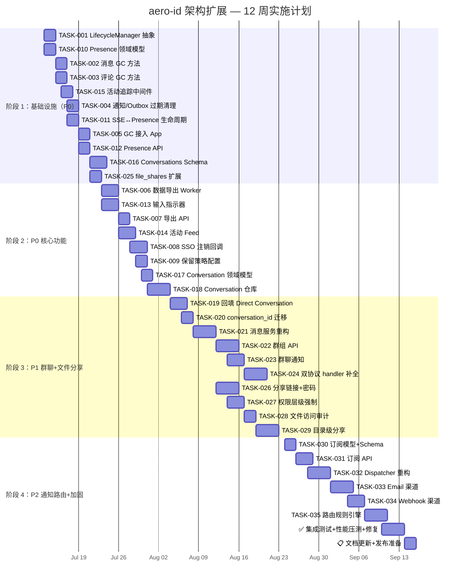

现在我已充分理解代码库。以下是我从 Tech Lead 视角进行的全面分析。

---

# Tech Lead 分析报告：aero-id 架构扩展方向

## 1. 任务分解

我将文档中识别的五个方向拆解为可执行的技术任务，每个任务 2-4 小时。总计 **33 个任务**，按方向分组。

---

### 方向二：数据生命周期管理（P0 — 合规优先）

| 任务 ID | 标题 | 涉及文件 | 前置依赖 | 工时 | 验收标准 |
|---------|------|---------|---------|------|---------|
| **TASK-001** | 将 GC Sweeper 抽象为通用 `LifecycleManager` 接口 | `internal/storage/gc/sweeper.go` → 拆分：`lifecycle/manager.go`（接口），`lifecycle/config.go`，`lifecycle/sweeper.go` | 无 | 4h | `LifecycleManager` 接口定义 `RegisterEntity` 和方法，现有 `Sweeper` 重构为第一个实现；`make test && make lint` 通过 |
| **TASK-002** | 消息仓库：添加 `ListSoftDeletedBefore` + `HardDelete` | `internal/message/repository.go`（新增方法），`internal/domain/message.go`（无变更） | TASK-001 | 3h | 两种方法经 unit + integration 测试验证；现有 `SoftDelete` 不受影响 |
| **TASK-003** | 评论仓库：添加 `ListSoftDeletedBefore` + `HardDelete` | `internal/comment/repository.go`，`internal/repository/comment.go` | TASK-001 | 3h | 与 TASK-002 相同的验证标准 |
| **TASK-004** | 通知/Outbox 过期清理 GC | `internal/notification/repository.go`（新增过期删除），`internal/outbox/` | TASK-001 | 3h | 超过保留期的陈旧通知行被硬删除；outbox 已处理事件被清理 |
| **TASK-005** | 将消息/评论 GC 接入 app 组合根 | `internal/app/app.go`（新增 `stopMsgGC`/`stopCommentGC`），`configs/config.yaml`（新增 `gc.message_retention`/`gc.comment_retention`） | TASK-002, TASK-003, TASK-004 | 2h | `App.Run` 启动时启动所有 GC 协程，配置控制保留期和间隔 |
| **TASK-006** | 数据导出 Worker — 收集用户全部数据 | `internal/service/export.go`（新增），`internal/service/mocks/export.go`（mock），`internal/repository/export.go`（新增） | 无 | 4h | Worker 可收集用户的消息、评论、文件、通知，打包为 ZIP 归档，写入存储后端；异步任务使用现有 `data_export_jobs` 表（migration 000025） |
| **TASK-007** | 数据导出 API 端点 | `internal/handler/http/export.go`（新增），`internal/handler/grpc/export.go`（新增），`api/proto/aero_id/v1/aero_id.proto`（新增 `ExportData` RPC） | TASK-006 | 3h | `POST /v1/export` 创建导出任务并返回 job ID；`GET /v1/export/:id` 查询进度并下载归档；gRPC 端点对等 |
| **TASK-008** | SSO 账户注销回调/Webhook | `internal/handler/http/sso_webhook.go`（新增），`internal/service/account_deletion.go`（新增） | TASK-005（清理），TASK-006（导出） | 3h | SSO POST `/v1/sso/account-deleted` 回调 → 级联软删除用户所有资源；启动时可选触发一次性数据导出 |
| **TASK-009** | 保留策略配置与强制 | `configs/config.yaml`（新增 `retention_policies`），`internal/repository/message.go`（按策略过滤），`internal/repository/comment.go` | TASK-002, TASK-003 | 2h | 配置 `messages.retention_days: 90` → 超出 90 天的消息行被 GC 硬删除；策略支持每个实体独立配置 |

---

### 方向三：实时状态与活动感知（P0 — 体验快速见效）

| 任务 ID | 标题 | 涉及文件 | 前置依赖 | 工时 | 验收标准 |
|---------|------|---------|---------|------|---------|
| **TASK-010** | Presence 领域模型 + `user_last_activity` 表 | `internal/domain/presence.go`（新增），`migrations/000028_create_user_last_activity.up.sql`（新增），`migrations/000028_create_user_last_activity.down.sql` | 无 | 2h | 字段：`uid TEXT PK`, `status`, `last_seen_at`, `current_device_count`；含 `upsert` 逻辑 |
| **TASK-011** | SSE 连接 → 在线/离线生命周期管理 | `internal/hub/hub.go`（新增连接/断开回调），`internal/handler/http/events.go`（连接建立时通知 Presence Service），`internal/service/presence.go`（新增） | TASK-010 | 4h | SSE 连接建立 → 用户标记为 `online`；所有连接断开 → 延迟（30s 宽限期避免闪烁）后标记为 `offline`；`presence.online`/`presence.offline` 事件推送给关注者 |
| **TASK-012** | Presence 查询 API（HTTP + gRPC） | `internal/handler/http/presence.go`（新增），`internal/handler/grpc/presence.go`（新增），`api/proto/aero_id/v1/aero_id.proto`（新增 `GetPresence`/`ListOnline` RPC） | TASK-011 | 3h | `GET /v1/presence/:uid` 返回当前状态 + 最后在线时间；`GET /v1/presence/online` 分页返回在线用户列表；仅对共同会话参与者可见 |
| **TASK-013** | 输入指示器通道 | `internal/handler/http/typing.go`（新增），`internal/service/typing.go`（新增），`api/proto/aero_id/v1/aero_id.proto`（新增 `SendTyping` RPC） | TASK-011 | 3h | `POST /v1/typing` body `{ "conversation_id": "...", "action": "start|stop" }` → 通过 SSE 广播 `typing.start`/`typing.stop` 给会话其他成员 |
| **TASK-014** | 活动 Feed 聚合 | `internal/domain/activity.go`（新增），`internal/service/feed.go`（新增），`migrations/000029_create_activity_feed.up.sql`（新增） | 无 | 4h | 从 outbox 事件子集生成 `activity_feed` 行；`GET /v1/feed` 返回关注用户/实体的最近活动；支持按实体类型过滤 |
| **TASK-015** | 最后活动追踪中间件 | `internal/middleware/activity.go`（新增），注入 `app.go` | TASK-010 | 2h | 每个经过认证的 API 请求后更新 `user_last_activity.last_seen_at`（批量/周期性 flush）；不影响请求延迟感知 |

---

### 方向一：多人群聊与协作空间（P1 — 最大产品差异化）

| 任务 ID | 标题 | 涉及文件 | 前置依赖 | 工时 | 验收标准 |
|---------|------|---------|---------|------|---------|
| **TASK-016** | `conversations` + `conversation_members` 表和迁移 | `migrations/000030_create_conversations.up.sql`，`migrations/000030_create_conversations.down.sql`，`migrations/000031_create_conversation_members.up.sql`，`migrations/000031_create_conversation_members.down.sql` | 无 | 3h | `conversations(id, type, title, created_by, created_at, deleted_at)`；`conversation_members(conversation_id, member_uid, role, joined_at)`；唯一约束 + 索引 |
| **TASK-017** | Conversation + ConversationMember 领域模型 | `internal/domain/conversation.go`（新增） | TASK-016 | 2h | `Conversation` 实体：`ID`, `Type`（direct/group）, `Title`, `CreatedBy`, `Members []ConversationMember`；`ConversationMember`：`ConversationID`, `MemberUID`, `Role`（admin/member）, `JoinedAt` |
| **TASK-018** | Conversation 仓库（CRUD + 成员管理） | `internal/conversation/repository.go`（新建包），`internal/conversation/conversation.go` | TASK-017 | 4h | 方法：`Create`, `Get`, `ListByMember`, `AddMember`, `RemoveMember`, `UpdateTitle`, `SoftDelete`；支持分页；附带出箱事件 |
| **TASK-019** | 回填：从现有消息创建隐式 Direct Conversation | `internal/service/migration_backfill.go`（新增），`internal/repository/message.go`（查询所有（from_uid, to_uid）对） | TASK-018 | 3h | 对消息表中每对 `(from_uid, to_uid)` 去重，创建 type='direct' 的 conversation，添加双方成员；迁移脚本或一次性后台任务 |
| **TASK-020** | 为 messages 表添加 `conversation_id` 列 | `migrations/000032_add_conversation_id_to_messages.up.sql`（可空 `conversation_id` + 索引），`migrations/000032_add_conversation_id_to_messages.down.sql` | TASK-019 | 2h | 迁移后新消息写入 `conversation_id`；旧消息为 NULL 的业务兼容性 |
| **TASK-021** | 消息服务重构：基于 Conversation 的路由 | `internal/message/service.go`（重构 `Send`、`ListConversation`、`ListInbox`），`internal/message/repository.go`（新增 `CreateInConversation`、`ListByConversation`） | TASK-019, TASK-020 | 4h | `Send` 自动解析或创建 direct conversation；`ListConversation` → `ListConversation(ctx, conversationID)`；旧 `to_uid` 查询添加废弃兼容层；**无 `Message.ToUID` 引用被移除**（向后兼容） |
| **TASK-022** | 群组 Conversation API | `internal/conversation/service.go`（新增），`internal/conversation/handler_http.go`（新增），`internal/conversation/handler_grpc.go`（新增），`api/proto/aero_id/v1/aero_id.proto`（新增） | TASK-018, TASK-021 | 4h | `POST /v1/conversations`（CreateGroup），`POST /v1/conversations/:id/members`（AddMember），`DELETE /v1/conversations/:id/members/:uid`（RemoveMember），`GET /v1/conversations`（ListMine） |
| **TASK-023** | 群聊通知：`group.message`、`user.added_to_group`、`user.removed_from_group` | `internal/domain/notification.go`（新增 3 种类型），`internal/notification/dispatcher.go`（新增 switch case） | TASK-022 | 3h | 群消息发送 → 所有成员收到 `group.message` 通知；添加/移除成员 → 通知被操作者 |
| **TASK-024** | 双协议 handlers 补全 + 集成测试 | `internal/conversation/handler_http_test.go`，`internal/conversation/handler_grpc_test.go`，`internal/conversation/service_test.go` | TASK-022, TASK-023 | 4h | HTTP + gRPC handlers 功能对等；`make test && make test-integration` 通过 |

---

### 方向四：策略化文件访问控制（P1 — 企业刚需）

| 任务 ID | 标题 | 涉及文件 | 前置依赖 | 工时 | 验收标准 |
|---------|------|---------|---------|------|---------|
| **TASK-025** | 扩展 `file_shares` Schema | `migrations/000033_extend_file_shares.up.sql`（添加 `permission TEXT DEFAULT 'read'`、`expires_at TIMESTAMPTZ`、`max_downloads INT`、`access_count INT DEFAULT 0`、`last_accessed_at TIMESTAMPTZ`），`migrations/000033_extend_file_shares.down.sql` | 无 | 2h | 迁移可逆；现有 `file_shares` 数据默认兼容 |
| **TASK-026** | 分享链接生成 + 密码保护 | `internal/file/service_share.go`（新增 `CreateShareLink`/`RevokeShareLink`/`GetByShareToken`），`internal/file/repository_share.go`（新增 `share_links` 表操作），`migrations/000034_create_share_links.up.sql`（新增 `share_links` 表） | TASK-025 | 4h | `POST /files/:id/share-links` → 返回 `token`；`GET /shared/:token` → 匿名访问文件（可选密码验证）；过期时间/最大下载次数强制 |
| **TASK-027** | 权限层级强制（Read/Write/Admin） | `internal/domain/access.go`（新增 `CanWriteFile`/`CanAdminFile`），`internal/file/service_crud.go`（写操作检查写权限），`internal/file/service_share.go`（分享操作检查管理员权限） | TASK-025 | 3h | 拥有 `write` 权限的用户可修改元数据；`admin` 可修改分享设置；**无 BC 断裂**：现有 `read` 权限语义不变 |
| **TASK-028** | 文件访问审计日志 | `internal/file/repository_share.go`（更新 `access_count`/`last_accessed_at`），`internal/service/file_audit.go`（新增；审计日志写入 `audit_log`） | TASK-025 | 2h | 每次分享文件被访问 → `access_count++` + `last_accessed_at` 更新；重大访问事件写入审计日志 |
| **TASK-029** | 目录级分享（按标签/前缀范围） | `internal/domain/access.go`（新增 `ScopeShare` 概念），`internal/file/repository_share.go`（新增 `scope_shares` 表），`migrations/000035_create_scope_shares.up.sql` | TASK-027 | 4h | 支持 `POST /v1/share-scopes` 通过 `tag` 或 `prefix` 分享文件集合；`CanReadFile` 检查单个文件 ID + scope 匹配 |

---

### 方向五：跨实体订阅与通知路由（P2 — 长线演进）

| 任务 ID | 标题 | 涉及文件 | 前置依赖 | 工时 | 验收标准 |
|---------|------|---------|---------|------|---------|
| **TASK-030** | 用户订阅领域模型 + Schema | `internal/domain/subscription.go`（新增），`migrations/000036_create_user_subscriptions.up.sql` | 无 | 2h | `user_subscriptions(uid, entity_type, entity_id, event_type_glob, channels[], created_at)`，唯一约束 |
| **TASK-031** | 订阅 CRUD API | `internal/subscription/service.go`（新增），`internal/subscription/handler_http.go`，`internal/subscription/handler_grpc.go`，`api/proto/`（新增 `SubscriptionService`） | TASK-030 | 3h | `POST /v1/subscriptions`，`GET /v1/subscriptions`，`DELETE /v1/subscriptions/:id`；事件类型 glob 支持通配符 |
| **TASK-032** | Dispatcher 重构：从 switch 到订阅驱动 | `internal/notification/dispatcher.go`（移除硬编码 switch，改为查询匹配的订阅），`internal/notification/dispatcher_test.go` | TASK-031 | 4h | Dispatcher 对 outbox 事件遍历匹配的订阅，为每个订阅生成通知；性能：缓存订阅以避免每个事件都查库 |
| **TASK-033** | 电子邮件通知渠道 | `internal/notification/channel_email.go`（新增；SMTP 发送），`configs/config.yaml`（新增 `smtp.*` 配置） | TASK-032 | 4h | 用户可在偏好中启用邮件通知；Dispatcher 调用邮件频道发送；支持即时邮件和每日摘要两种模式 |
| **TASK-034** | 用户级 Webhook 通知渠道 | `internal/notification/channel_webhook.go`（新增；HTTP POST），`internal/user_webhook/repository.go` | TASK-032 | 3h | 用户配置 webhook URL → dispatcher POST JSON 负载；失败退避重试；Dashboard 查看投递状态 |
| **TASK-035** | 通知路由规则引擎 | `internal/notification/router.go`（新增；规则匹配+合并），`migrations/000037_create_notification_routing.up.sql` | TASK-032 | 4h | 规则：`(uid, event_type_glob, channels[], quiet_hours)`；支持按事件类型、时间段、实体路由到不同渠道 |

---

## 2. 执行顺序

```mermaid
graph TD
    %% === 方向二：数据生命周期（P0） ===
    T001["TASK-001<br/>LifecycleManager 抽象"]
    T002["TASK-002<br/>消息 GC 方法"]
    T003["TASK-003<br/>评论 GC 方法"]
    T004["TASK-004<br/>通知/Outbox 过期清理"]
    T005["TASK-005<br/>GC 接入 App"]
    T006["TASK-006<br/>数据导出 Worker"]
    T007["TASK-007<br/>导出 API"]
    T008["TASK-008<br/>SSO 注销回调"]
    T009["TASK-009<br/>保留策略配置"]

    %% === 方向三：实时状态（P0） ===
    T010["TASK-010<br/>Presence 领域模型"]
    T011["TASK-011<br/>SSE↔Presence 生命周期"]
    T012["TASK-012<br/>Presence API"]
    T013["TASK-013<br/>输入指示器"]
    T014["TASK-014<br/>活动 Feed"]
    T015["TASK-015<br/>最后活动追踪中间件"]

    %% === 方向一：群聊（P1） ===
    T016["TASK-016<br/>Conversations Schema"]
    T017["TASK-017<br/>Conversation 领域模型"]
    T018["TASK-018<br/>Conversation 仓库"]
    T019["TASK-019<br/>回填隐式 Direct Conv."]
    T020["TASK-020<br/>消息表加 conversation_id"]
    T021["TASK-021<br/>消息服务重构"]
    T022["TASK-022<br/>群组 API"]
    T023["TASK-023<br/>群聊通知"]
    T024["TASK-024<br/>双协议 Handler 补全+测试"]

    %% === 方向四：文件访问控制（P1） ===
    T025["TASK-025<br/>扩展 file_shares"]
    T026["TASK-026<br/>分享链接+密码"]
    T027["TASK-027<br/>权限层级强制"]
    T028["TASK-028<br/>文件访问审计"]
    T029["TASK-029<br/>目录级分享"]

    %% === 方向五：订阅/通知路由（P2） ===
    T030["TASK-030<br/>订阅模型+Schema"]
    T031["TASK-031<br/>订阅 API"]
    T032["TASK-032<br/>Dispatcher 重构"]
    T033["TASK-033<br/>Email 渠道"]
    T034["TASK-034<br/>Webhook 渠道"]
    T035["TASK-035<br/>路由规则引擎"]

    %% === 依赖关系 ===
    T001 --> T002
    T001 --> T003
    T001 --> T004
    T002 --> T005
    T003 --> T005
    T004 --> T005
    T006 --> T007
    T005 --> T008
    T005 --> T009

    T010 --> T011
    T011 --> T012
    T011 --> T013
    T012 --> T014
    T010 --> T015

    T016 --> T017
    T017 --> T018
    T018 --> T019
    T019 --> T020
    T020 --> T021
    T018 --> T022
    T021 --> T022
    T022 --> T023
    T022 --> T024
    T023 --> T024

    T025 --> T026
    T025 --> T027
    T026 --> T028
    T027 --> T029

    T030 --> T031
    T031 --> T032
    T032 --> T033
    T032 --> T034
    T032 --> T035

    %% === 并行组 ===
    subgraph P0_Phase1["阶段 1（P0 - 基础设施）"]
        T001
        T010
    end

    subgraph P0_Phase2["阶段 2（P0 - 核心实现）"]
        T002
        T003
        T004
        T011
        T015
    end

    subgraph P1_GroupChat["方向一（群聊）"]
        T016
        T017
        T018
        T019
        T020
        T021
        T022
        T023
        T024
    end

    subgraph P1_FileShare["方向四（文件分享）"]
        T025
        T026
        T027
        T028
        T029
    end

    subgraph P2_Notifications["方向五（通知路由）"]
        T030
        T031
        T032
        T033
        T034
        T035
    end
```

### 可并行执行的任务组

| 并行组 | 任务 | 所需人数 | 原因 |
|--------|------|---------|------|
| **组 A** | TASK-001 + TASK-010 | 2 人 | 两个方向的独立基础设施构建 |
| **组 B** | TASK-002 + TASK-003 + TASK-004 + TASK-015 | 2 人 | 四个独立的 repository/ middleware 任务 |
| **组 C** | TASK-005 + TASK-012 + TASK-006 | 2 人 | App 组合根、Presence API、导出 Worker 不冲突 |
| **组 D** | TASK-016 + TASK-025 + TASK-030 | 1 人 | 三个独立的 Schema 变更（可串行但互不阻塞） |
| **组 E** | TASK-022 + TASK-026 + TASK-027 | 2 人 | 群聊 API、分享链接、权限层级可并行 |
| **组 F** | TASK-033 + TASK-034 | 1 人 | 两种通知频道实现可串行 |

---

## 3. 技术风险

### 3.1 高概率/高影响风险

| 序号 | 风险 | 概率 | 影响 | 缓解策略 |
|------|------|------|------|---------|
| R1 | **Conversation 回填（TASK-019）数据量过大** — 百万级消息对导致回填迁移耗时过长 | 中 | 高 | 分批处理（每批 1000 条），带进度日志；设 `max_duration` 守护进程；支持断点续传；在低峰期执行 |
| R2 | **消息服务重构（TASK-021）引入 BC 断裂** — 现有 1:1 `to_uid` 查询路径被意外破坏 | 低 | 极高 | 保守策略：旧 `to_uid` 路径保留兼容层，用 feature flag 逐步切换；所有现有测试在重构前后保持不变 |
| R3 | **Dispatcher 重构（TASK-032）增加通知延迟** — 订阅查询取代 switch 语句，查询延迟影响写路径 | 中 | 高 | 订阅缓存（in-process map + TTL）；批量事件处理；添加延迟指标告警 |
| R4 | **Presence 状态闪烁** — SSE 网络抖动导致用户反复上线/下线 | 中 | 中 | 30s 宽限期（离线延迟标记）；设备级追踪（一个设备断连 ≠ 全部断连） |
| R5 | **SSO 注销回调缺乏可靠性保证** — SSO 回调丢失导致孤儿数据 | 中 | 高 | 引入重试队列 + dead-letter；SSO 侧支持定期同步"已注销用户列表"的治理端点 |
| R6 | **文件工程约束** — 文件大小 ≤ 500 行，函数 ≤ 50 行，复杂度 ≤ 10。多个新包（conversation, presence, subscription）有被违反的风险 | 中 | 中 | 每个新包初始建立多个文件（如 `service.go`/`repository.go`/`service_test.go`）均匀分配；对拆分实施 `make check-file-sizes` 作为 CI 门禁 |

### 3.2 性能瓶颈

| 瓶颈 | 场景 | 预估压力 | 策略 |
|------|------|---------|------|
| `user_last_activity` 写入 | 每个 API 请求更新 | 数百 QPS | 批量 flush（每 10s 或累积 100 条写入一次）；不阻塞请求路径 |
| `activity_feed` 写入 | 每个 outbox 事件 | 与写路径 QPS 相同 | 异步 outbox 消费者写入；带 TTL 自动清理旧行 |
| Subscription 查询 | 每个 outbox 事件查询匹配订阅 | 与 outbox 事件量相同 | 全量缓存（订阅数据量小）；订阅变更时无效化缓存 |
| Share link token 验证 | 匿名下载路径 | 可能与文件下载量相同 | Token 加前缀索引；可选 Redis 缓存验证结果 |
| Conversation 回填 | 一次性迁移 | 消息表全表扫描 | 分批 + 进度追踪；允许暂停/恢复 |

---

## 4. 资源评估

### 4.1 人员技能需求

| 角色 | 技能 | 数量 | 负责方向 |
|------|------|------|---------|
| **资深后端工程师 A** | Go, GORM, PostgreSQL, gRPC, 架构设计 | 1 人 | 方向一（群聊：最复杂的架构变更） + TASK-021 消息服务重构 |
| **后端工程师 B** | Go, PostgreSQL, 测试 | 1 人 | 方向二（数据生命周期） + 方向三（Presence） |
| **后端工程师 C** | Go, GORM, API 设计 | 1 人 | 方向四（文件分享增强） + 方向五（订阅/通知路由的前半部分） |
| **QA/测试工程师** | Go 测试, integration tests, performance tests | 0.5 人（兼职） | 所有方向的测试覆盖 |

> **最优投入**：前 4 周 2 人全情投入（P0 方向二三），第 5 周起扩展至 3 人（P0 + P1 方向一开始）。

### 4.2 关键里程碑

| 里程碑 | 时间点 | 交付物 | 验收标准 |
|--------|--------|--------|---------|
| **M1** | 第 1 周末 | GC 抽象 + 消息/评论 GC 运行 | `make test && make lint` 通过；GC 可配置运行并硬删除过期行 |
| **M2** | 第 2 周末 | Presence 在线状态可查询 | SSE 连接触发在线状态；`GET /v1/presence/:uid` 返回正确状态 |
| **M3** | 第 3 周末 | 数据导出 + 账户注销可用 | `POST /v1/export` 生成完整归档；SSO 回调触发级联软删除 |
| **M4** | 第 5 周末 | 输入指示器 + 活动 Feed 运行 | 输入指示器广播生效；活动 Feed 实时聚合关键事件 |
| **M5** | 第 8 周末 | Conversation Schema + 消息服务重构完成 | 群聊创建/成员管理 API 工作；旧 1:1 消息完全兼容 |
| **M6** | 第 10 周末 | 文件分享增强 + 分享链接 | 权限层级强制生效；密码保护分享链接可用 |
| **M7** | 第 12 周末 | 订阅驱动的通知路由（MVP） | 用户可订阅文件评论事件；至少一个备用渠道（Email）工作 |

### 4.3 阻塞点与解决策略

| 阻塞点 | 描述 | 影响 | 解决策略 |
|--------|------|------|---------|
| **B1** | Conversation 回填需要停机标记？ | 影响 TASK-020/TASK-021 | 不需要停机。隐式 conversation 创建是纯 INSERT 操作，可在运行时分批执行。写一个 idempotent backfill worker |
| **B2** | SSO 回调接口未定义 | 阻塞 TASK-008 | **立即联系 SSO 团队**定义回调协议（HTTP POST + HMAC 签名验证）。如果 SSO 不支持回调，降级为轮询"已注销用户列表"端点 |
| **B3** | SMTP 服务器不可用 | 阻塞 TASK-033 | 配置可空，缺失时降级为 log-only；支持 AWS SES / SendGrid 等替代方案；channel 接口可插拔 |
| **B4** | 方向一与方向二同时修改 messages 表 | 需协调 schema 变更 | 方向二（TASK-002）不影响 schema；方向一（TASK-020）是独立 migration。两个分支可以独立开发和测试，合并时按 migration 序号排列 |

---

## 5. 质量保证

### 5.1 单元测试覆盖要求

| 模块 | 最低覆盖率 | 关键测试场景 |
|------|-----------|-------------|
| `internal/service/export.go` | ≥ 85% | 空用户导出、含所有数据类型的用户导出、导出中途失败回滚 |
| `internal/service/presence.go` | ≥ 90% | 连接/断连生命周期、宽限期不闪烁、多设备场景 |
| `internal/conversation/service.go` | ≥ 85% | CreateGroup 权限校验、成员增删、direct conversation 自动创建 |
| `internal/file/service_share.go` | ≥ 80% | 权限升级/降级、过期分享、最大下载次数强制 |
| `internal/subscription/service.go` | ≥ 85% | 通配符匹配、订阅更新、频道路由 |
| `internal/notification/dispatcher.go` | ≥ 90% | 订阅驱动后的事件→通知映射、block 感知、缓存命中/未命中 |

### 5.2 集成测试策略

| 测试套件 | 依赖 | 运行方式 | 覆盖范围 |
|---------|------|---------|---------|
| **Lifecycle GC** | Postgres (testcontainers) | `make test-integration` | 消息/评论 `ListSoftDeletedBefore` + `HardDelete`；验证孤儿数据被清除 |
| **Presence** | Postgres | `make test-integration` | 多设备在线/离线状态转换；宽限期延迟；并发连接/断连 |
| **Conversation** | Postgres | `make test-integration` | 群组 CRUD；成员权限验证；消息在 conversation 中创建和查询 |
| **File Share** | Postgres + MinIO | `make test-integration` | 分享链接过期验证；权限层级强制；匿名下载 |
| **Export** | Postgres + MinIO | `make test-integration` | 完整导出；部分导出；导出失败回滚 |
| **Subscription** | Postgres | `make test-integration` | 订阅创建/匹配；多频道投递；路由规则冲突 |

### 5.3 代码审查要点

| 审查维度 | 具体关注点 |
|---------|-----------|
| **架构合规性** | 新包是否遵循 `handler → service → repository/storage/sso` 单向依赖？有无跨层访问？ |
| **BC 兼容性** | TASK-021 消息重构是否保留了 `to_uid` 查询路径？旧 proto 有无意外变更？ |
| **文件约束** | 新文件是否 ≤ 500 行？函数 ≤ 50 行？复杂度 ≤ 10？ |
| **错误处理** | repository 错误是否通过 service 层翻译为 `*AppError`？原始 DB 错误是否从未泄露到 handler？ |
| **并发安全** | `Hub` 连接/断连回调是否线程安全？`Sync.Map` 使用是否正确？ |
| **迁移可逆性** | 每个 `*.up.sql` 是否有对应的 `*.down.sql`？回滚逻辑是否验证过？ |

### 5.4 性能测试需求

| 场景 | 负载 | 目标 | 工具 |
|------|------|------|------|
| **Presence 状态更新** | 5000 并发 SSE 连接，每秒 10% 连接/断连 | P99 延迟 < 50ms | k6 自定义脚本 |
| **Conversation 消息发送** | 200 群组，每群组 20 人，每秒 100 条消息 | P99 延迟 < 200ms | k6 + 自定义 gRPC |
| **分享链接下载** | 1000 QPS 匿名 token 验证 + 文件下载 | Token 验证 P99 < 10ms | k6 |
| **订阅驱动通知** | 每秒 500 个 outbox 事件，共 5000 个订阅 | P99 分发延迟 < 100ms | 定制负载发生器 |
| **GC 压力测试** | 100 万软删除行，单次 GC 运行 | 时间 < 30s，不影响读请求 P99 | 定制测试 |

---

## 6. 实施计划

### 阶段 1：基础设施搭建（第 1-2 周）

| 日 | 任务 | 负责人 |
|---|------|--------|
| Day 1-2 | **TASK-001** LifecycleManager 抽象 + **TASK-010** Presence 领域模型 | 工程师 A + B |
| Day 3-4 | **TASK-002** 消息 GC + **TASK-003** 评论 GC + **TASK-015** 活动追踪中间件 | 工程师 B |
| Day 5-6 | **TASK-004** 通知/Outbox 过期清理 + **TASK-011** SSE↔Presence 生命周期 | 工程师 B |
| Day 7-8 | **TASK-005** GC 接入 App + **TASK-012** Presence API | 工程师 B |
| Day 9-10 | **TASK-016** Conversations Schema + **TASK-025** file_shares 扩展 (P1 前置) | 工程师 A |
| **里程碑 M1** | GC 抽象 + 消息/评论 GC 运行 | ✅ |

### 阶段 2：P0 核心功能实现（第 3-5 周）

| 日 | 任务 | 负责人 |
|---|------|--------|
| Day 11-12 | **TASK-006** 数据导出 Worker + **TASK-013** 输入指示器 | 工程师 A + B |
| Day 13-14 | **TASK-007** 导出 API + **TASK-014** 活动 Feed | 工程师 B |
| Day 15-16 | **TASK-008** SSO 注销回调 + **TASK-009** 保留策略配置 | 工程师 A |
| Day 17-18 | **TASK-017** Conversation 领域模型 + **TASK-018** Conversation 仓库 | 工程师 A |
| Day 19-20 | **TASK-019** 回填隐式 Direct Conversation | 工程师 A |
| Day 21-24 | **TASK-020** 消息表加 conversation_id + **TASK-021** 消息服务重构 | 工程师 A |
| **里程碑 M2-M4** | Presence 可查询、数据导出可用、输入指示器运行 | ✅ |

### 阶段 3：P1 核心功能实现（第 6-9 周）

| 日 | 任务 | 负责人 |
|---|------|--------|
| Day 25-28 | **TASK-022** 群组 API（HTTP + gRPC）+ **TASK-023** 群聊通知 | 工程师 A |
| Day 29-32 | **TASK-024** 双协议 handler 补全 + 集成测试 + **TASK-026** 分享链接 | 工程师 A + C |
| Day 33-36 | **TASK-027** 权限层级强制 + **TASK-028** 文件访问审计 | 工程师 C |
| Day 37-40 | **TASK-029** 目录级分享 + 集成测试 | 工程师 C |
| **里程碑 M5-M6** | 群聊 API 工作、文件分享增强可用 | ✅ |

### 阶段 4：P2 长线演进 + 加固（第 10-12 周）

| 日 | 任务 | 负责人 |
|---|------|--------|
| Day 41-43 | **TASK-030** 订阅模型 + Schema + **TASK-031** 订阅 API | 工程师 C |
| Day 44-47 | **TASK-032** Dispatcher 重构（订阅驱动）| 工程师 C |
| Day 48-51 | **TASK-033** Email 渠道 + **TASK-034** Webhook 渠道 | 工程师 C |
| Day 52-54 | **TASK-035** 通知路由规则引擎 | 工程师 C |
| Day 55-58 | **全面集成测试 + 性能压测 + Bug 修复** | 全部 |
| Day 59-60 | **文档更新 + 迁移验证 + 发布 check-list** | 全部 |
| **里程碑 M7** | 订阅驱动的通知路由 MVP 可用 | ✅ |

---

### 甘特图总览

---

## 总结性建议

### 对分析文档的整体评价

文档完成了高价值的架构边界扫描。五个方向的识别都基于代码级证据，而非推测。优先级排序（P0：方向二 + 方向三；P1：方向一 + 方向四；P2：方向五）完全合理。

### 工程执行建议

1. **方向二和方向三可以在同一 Sprint 并行推进**。它们无代码冲突（修改不同的 package），且共享相同的 infrastructure（TASK-001 LifecycleManager 和 TASK-010 Presence Model 互不依赖）。

2. **TASK-021（消息服务重构）是这个计划中技术风险最高的任务**。建议：
   - 先在 `internal/message/` 中建立新的 `service_v2.go`（interface + implementation），与旧路径并存
   - 逐步迁移 API handler 调用新路径
   - 最后在验证无误后移除旧路径
   - 总工作量估计偏保守（4h），建议预留 6h 缓冲

3. **关于 TASK-022 的群组 API** — 应确保 **TASK-021 完全验证通过**后再开始，因为群组的消息收发依赖 `conversation_id` 路由。

4. **方向五的 Dispatcher 重构（TASK-032）是整个计划中第二高风险的点**。建议：
   - 将硬编码 switch 重构为 subscription 查询 + cache fallback 的分层模式
   - 对性能敏感的 `message.sent` 事件走 cache path，对低频事件走 DB path
   - 逐步切换：先并行运行新旧两套逻辑，对比结果一致后再下线旧逻辑

5. **文件工程约束的自检**: AGENTS.md 要求文件 ≤ 500 行、函数 ≤ 50 行、复杂度 ≤ 10。根据经验估算：
   - `internal/conversation/service.go` 预估 200-300 行（safe）
   - `internal/service/presence.go` 预估 150-250 行（safe）
   - `internal/notification/dispatcher.go` 重构后约 200-350 行（当前已在 120 行以内，重构后需注意拆分）
   - **风险点**: TASK-021 消息服务重构可能使 `internal/message/service.go` 膨胀 → 建议拆分为 `service_v2.go`（新逻辑）+ `service_compat.go`（兼容层）

6. **关键决策**：`conversation_id` 的迁移策略。建议：
   - 新建 messages 写入时必须带 `conversation_id`
   - 旧消息的 `to_uid` 查询路径保留至少 1 个版本周期
   - 在消息 service 入口做 `to_uid → conversation_id` 的自动解析（查寻或创建 direct conversation）

这些方向代表了 aero-id 从"私信工具"到"协作平台"的架构演进路径。方向二和三打好合规和体验基础，方向一做出产品差异化，方向四和五巩固企业场景。建议按上述计划分阶段推进，每个阶段完成时验证 `make test && make lint && make test-integration` 无红。
