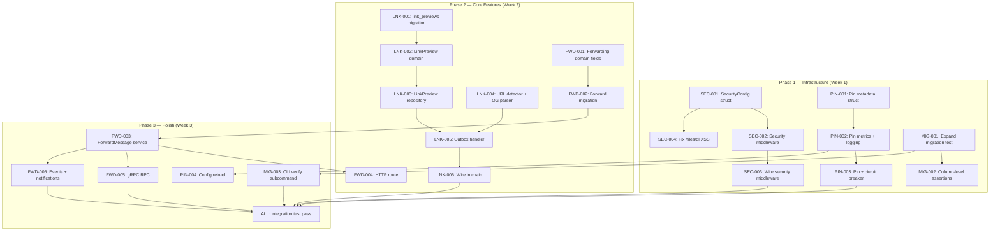

Now I have a thorough understanding of the codebase. Here is the comprehensive Tech Lead analysis.

---

# Tech Lead Analysis: 5-Direction Feature Implementation Plan

## 1. Task Decomposition

Each direction is broken into atomic tasks of 2–4 hours. Tasks are numbered with a prefix per direction for traceability.

### Direction 5: HTTP Security Headers — P1 (highest ROI)

| Task ID | Title | Files | Dependencies | Est. | Acceptance Criteria |
|---------|-------|-------|-------------|------|-------------------|
| SEC-001 | Add SecurityConfig to config struct & YAML | `configs/config.yaml`, `internal/config/config.go` | None | 1h | `SecurityConfig` struct with fields: `StrictTransportSecurity`, `ContentSecurityPolicy`, etc. Migration of `validate()` to accept optional section |
| SEC-002 | Build security headers middleware | `internal/middleware/security.go`, `internal/middleware/security_test.go` | SEC-001 | 2h | Middleware sets 5 OWASP headers (HSTS, X-Content-Type-Options, X-Frame-Options, CSP, Referrer-Policy). Config-driven values with sensible defaults. Unit tests confirm headers present on every response |
| SEC-003 | Wire middleware into router | `internal/handler/http/router.go` | SEC-002 | 1h | Security middleware installed after CORS, before auth. Optional (no-op when config section absent or empty) |
| SEC-004 | Fix `/files/dl` Content-Disposition | `internal/handler/http/file.go` | None | 1h | `io.Copy` replaced with `c.DataFromReader` or explicit headers: `Content-Disposition: attachment; filename="..."`, `Content-Type: application/octet-stream`, `X-Content-Type-Options: nosniff`. Existing downloader test passes |

### Direction 3: Link Preview Pipeline — P1

| Task ID | Title | Files | Dependencies | Est. | Acceptance Criteria |
|---------|-------|-------|-------------|------|-------------------|
| LNK-001 | Create `link_previews` migration | `migrations/000024_create_link_previews.up.sql`, `migrations/000024_create_link_previews.down.sql` | None | 2h | Table with columns: `id UUID PK`, `url TEXT UNIQUE`, `title TEXT`, `description TEXT`, `image_url TEXT`, `favicon_url TEXT`, `site_name TEXT`, `fetched_at TIMESTAMPTZ`, `expires_at TIMESTAMPTZ`. Index on URL hash. Rollback drops table |
| LNK-002 | Add `LinkPreview` domain entity | `internal/domain/link_preview.go` | LNK-001 | 1h | `LinkPreview` struct. No validation beyond URL length limit (2048 chars) |
| LNK-003 | Add link preview repository | `internal/repository/link_preview.go`, `internal/repository/link_preview_test.go` | LNK-002 | 3h | GORM CRUD: `Upsert(ctx, *LinkPreview)`, `GetByURL(ctx, url) (*LinkPreview, error)`. Integrates with existing `repository.ErrNotFound`. Unit + integration tests |
| LNK-004 | Build URL detector + Open Graph parser | `internal/pkg/linkpreview/parser.go`, `internal/pkg/linkpreview/parser_test.go` | None | 4h | Regex/parse URL extraction from text. HTTP `GET` with `Accept: text/html`, parse `<meta property="og:*">` and `<title>`. Respect robots.txt via `X-Robots-Tag`. Timeout 5s. Max body 1MB. Return `*LinkPreview` with best-effort fields (partial data is OK). Unit tests with canned HTML |
| LNK-005 | Build outbox handler for link preview | `internal/outbox/linkpreview.go`, `internal/outbox/linkpreview_test.go` | LNK-002, LNK-003, LNK-004 | 3h | Handler implements `outbox.Handler`. On `message.sent` and `comment.replied` events, extracts URLs from content. For each new URL: calls parser, upserts to DB. Updates `Message.Meta["link_previews"]` or similar. Tracing spans around each fetch. Unit + integration tests |
| LNK-006 | Wire link preview handler in outbox chain | `internal/outbox/chain.go` initialization (in `internal/app/app.go`) | LNK-005 | 1h | Handler registered in the outbox handler chain after notification dispatcher. Config-optional (can be disabled) |

### Direction 1: Message Forwarding — P2

| Task ID | Title | Files | Dependencies | Est. | Acceptance Criteria |
|---------|-------|-------|-------------|------|-------------------|
| FWD-001 | Add forwarding fields to domain.Message | `internal/domain/message.go` | None | 1h | Fields: `OriginalMessageID *ID`, `ForwardedFromUID *string`. Ensure JSON serialization works. Add `IsForwarded() bool` helper |
| FWD-002 | Add forwarding migration | `migrations/000025_message_forwarding.up.sql`, `migrations/000025_message_forwarding.down.sql` | FWD-001 | 1h | ALTER TABLE messages ADD COLUMN original_message_id UUID, ADD COLUMN forwarded_from_uid TEXT. FK optional (can be null when original message is deleted) |
| FWD-003 | Add ForwardMessage to MessageService + repo | `internal/service/message.go`, `internal/service/message_test.go`, `internal/repository/message.go` | FWD-001, FWD-002 | 3h | `ForwardMessage(ctx, originalID domain.ID, toUID string) (*domain.Message, error)`. Validates: original message exists, actor is participant of original message. Creates new message with same content/file, stamps `OriginalMessageID` and `ForwardedFromUID`, emits `message.forwarded` event. Tests cover: forward own message, forward received message, forward deleted message, forward non-participant |
| FWD-004 | Add HTTP route + handler | `internal/handler/http/message.go` | FWD-003 | 2h | `POST /v1/messages/:id/forward` with JSON body `{ "to_uid": "..." }`. Authorization: actor must be participant of original message. Returns the new message |
| FWD-005 | Add gRPC RPC + handler | `api/proto/aero_id/v1/aero_id.proto`, `internal/handler/grpc/message.go` + regenerated pb | FWD-003 | 2h | `rpc ForwardMessage(ForwardMessageRequest) returns (ForwardMessageResponse)`. `ForwardMessageRequest` has `message_id` + `to_uid`. proto → `make proto` |
| FWD-006 | Add forwarding event + notification | `internal/notification/dispatcher.go` | FWD-003 | 1h | New event type `message.forwarded`. New notification type `message.forwarded`. Skip if recipient is forwarder (self). Tests |

### Direction 4: Migration Verification — P2

| Task ID | Title | Files | Dependencies | Est. | Acceptance Criteria |
|---------|-------|-------|-------------|------|-------------------|
| MIG-001 | Expand integration test to all 23 migrations | `migrations/migrations_test.go` | None | 3h | Dynamic discovery of `*.up.sql` (lexical order) and `*.down.sql` (reverse order). Test applies ALL migrations up, asserts ALL expected tables exist (list extracted from `up.sql` filenames/schema), applies ALL down, asserts none remain |
| MIG-002 | Add column-level assertions | `migrations/migrations_test.go` | MIG-001 | 3h | For each migration, query `information_schema.columns` and verify column names, types, nullable, defaults. Query `information_schema.table_constraints` + `key_column_usage` for PKs, FKs, unique constraints. Query `pg_indexes` for expected indexes |
| MIG-003 | Add `verify` subcommand to migrate CLI | `cmd/migrate/main.go`, `internal/pkg/migrate/migrate.go` | MIG-001 | 2h | `migrate verify` compares current DB schema against the canonical definitions embedded from the `up.sql` files (or a known-good state). Reports schema drifts (missing columns, wrong types, missing indexes) as warnings. Non-zero exit code on drifts |

### Direction 2: Certificate Pin Lifecycle — P1

| Task ID | Title | Files | Dependencies | Est. | Acceptance Criteria |
|---------|-------|-------|-------------|------|-------------------|
| PIN-001 | Add pin metadata (version, rotation window) | `internal/config/config.go`, `internal/sso/dial.go` | None | 2h | `TLSCertPin` struct replaces `TLSCertPins []string` with `[]struct{ Fingerprint string, Version int, NotBefore time.Time, NotAfter time.Time }`. Backward compat: `tls_cert_pins` flat string list still accepted, auto-converted to v0 with no expiry window. `verifySPKIPin` updated to check expiry (reject expired pins, warn on not-yet-valid) |
| PIN-002 | Add pin-match metrics + logging | `internal/sso/dial.go`, `internal/sso/metrics.go` | PIN-001 | 2h | Three counters: `sso.pin_match_total` (with label `{status="matched"|"mismatched"|"expired"|"no_pins"}`), `sso.pin_rotation_warning` (when pin approaching expiry). Log line on mismatch at ERROR level with fingerprint + expected pins. Add OTel span attribute `sso.pin_matched` on dial |
| PIN-003 | Integrate pin errors with circuit breaker | `internal/sso/client.go` | PIN-002 | 2h | `isAvailabilityError` also returns true for pin mismatch errors (since they indicate unrecoverable configuration state, keep fast-failing). Add `isPinError` helper for monitoring differentiation. Pin mismatch increments breaker count. |
| PIN-004 | Add config reload/watch capability (optional) | `internal/config/config.go`, `internal/app/app.go` | PIN-001 | 3h | Optional: expose `WatchConfig(ctx, fn func(*Config))` using `viper.WatchConfig`. SSO client listens for pin changes and re-dials on config update. Not mandatory for P1 but recommended for ops teams |

---

## 2. Execution Order & Dependency Graph



### Parallelization Groups

These groups have zero cross-dependencies and can be executed in parallel by different developers:

| Group | Tasks | Engineer Profile |
|-------|-------|-----------------|
| **G1 — Security Heads** | SEC-001, SEC-002, SEC-003, SEC-004 | Backend engineer, Go + Gin |
| **G2 — Pin Lifecycle** | PIN-001, PIN-002, PIN-003, PIN-004 | Backend engineer, TLS/security domain |
| **G3 — Migration Tests** | MIG-001, MIG-002, MIG-003 | Backend engineer, SQL + testing |
| **G4 — Link Preview** | LNK-001 → LNK-006 (sequential within) | Backend engineer, HTTP parsing + outbox |
| **G5 — Message Forwarding** | FWD-001 → FWD-006 (sequential within) | Backend engineer, message domain |

---

## 3. Technical Risks

### High-risk items

| Risk | Direction | Likelihood | Impact | Mitigation |
|------|-----------|------------|--------|------------|
| **Open Graph parsing edge cases** | LNK | Medium | Medium | Build defensively: partial data is OK, timeout at 5s, max body 1MB. Non-UTF-8 pages, missing og: tags, redirect loops. Use `golang.org/x/net/html` for parsing. Add exponential backoff on failed fetches. |
| **URL extraction false positives** | LNK | Medium | Low | Pre-fetch check: only URLs with HTTP/HTTPS schemes, ignore data:/javascript:/. Use a URL allowlist config if needed. Don't fail message send if URL parsing fails — fire-and-forget via outbox. |
| **Config hot-reload race conditions** | PIN | Low | High | Use `sync.RWMutex` on SSO client, swap gRPC connection atomically. Keep old connection alive until in-flight requests drain. Document that pin changes require a graceful restart in prod. |
| **Migration integration test runtime** | MIG | Medium | Low | 23 migrations × up + down = 46 SQL ops. With testcontainers Postgres startup (~3s) + migrations (~2s), total <10s. Acceptable. Add `t.Parallel` if needed. |
| **Forwarding authorization complexity** | FWD | Low | Medium | Forwarder must be participant of original message. `canReadMessage` already exists. Ensure forwarder ≠ recipient check. Self-forward to another conversation is allowed. |
| **`/files/dl` MIME-type sniffing** | SEC | Low | High | `Content-Type: application/octet-stream` + `Content-Disposition: attachment` prevents browser execution. Still test with .html, .svg, .xml files to confirm no inline rendering. |

### External dependencies

| Dependency | Direction | Notes |
|------------|-----------|-------|
| SSO gRPC service | PIN | Need SSO team to coordinate pin rotation window. Pin expiry must be > cert rotation cycle. |
| None for security or migrations | SEC, MIG | Purely internal code |
| External websites (Open Graph) | LNK | Need outbound internet access from worker. If network is restricted, link preview will timeout. Consider a proxy config option. |
| `golang.org/x/net/html` | LNK | Add to `go.mod`. Should be the only new dependency for link preview. |

### Performance implications

| Concern | Direction | Analysis |
|---------|-----------|----------|
| Link preview HTTP calls on outbox tick | LNK | Outbox handler is async + best-effort. Max 1 concurrent fetch per URL. Use `singleflight` or in-memory dedup to avoid fetching the same URL from multiple messages in the same tick. |
| Pin verification on every gRPC dial | PIN | Only happens on initial dial + re-dial after circuit breaker. Not a hot path. |
| Migration test with 23 migrations | MIG | ~10s per CI run. Negligible. |
| Security headers on every response | SEC | Header map insertion, <1µs per request. No measurable overhead. |

---

## 4. Resource Assessment

### Developer skills required

| Role | Count | Skills | Assigned Directions |
|------|-------|--------|-------------------|
| Senior Backend Engineer A | 1 | Go, Gin, gRPC, protobuf, TLS, security | PIN-001 → PIN-004 |
| Senior Backend Engineer B | 1 | Go, GORM, SQL, HTTP parsing, HTML | LNK-001 → LNK-006 |
| Backend Engineer C | 1 | Go, Gin, gRPC, message domain | FWD-001 → FWD-006 |
| Backend Engineer D | 1 | Go, Gin, middleware, security | SEC-001 → SEC-004 |
| Backend Engineer E | 1 | Go, SQL, testcontainers, CI/CD | MIG-001 → MIG-003 |

With 3 engineers, assign roles combined:
- **Engineer A** (full-stack): SEC group (4 tasks) + PIN group (4 tasks) = 2 weeks
- **Engineer B** (data/parser): LNK group (6 tasks) + MIG group (3 tasks) = 2 weeks
- **Engineer C** (message domain): FWD group (6 tasks) = 1.5 weeks

### Key milestones

| Milestone | Target | Deliverables |
|-----------|--------|-------------|
| M1 — Security hardening complete | Day 2 | All 4 SEC tasks merged. `/files/dl` no longer XSS-able. Security headers active. `make test && make lint` green. |
| M2 — Migration test coverage expanded | Day 3 | All 23 migrations under test. Column/index assertions passing. |
| M3 — Pin lifecycle MVP | Day 4 | Pin metadata struct, metrics counters, circuit breaker integration. Alerting threshold documented. |
| M4 — Link preview operational | Day 8 | End-to-end: URL in message → outbox event → OG fetch → DB upsert → `Message.Meta` populated. Integration test with real HTTP server. |
| M5 — Message forwarding live | Day 10 | All 6 FWD tasks merged. HTTP + gRPC transports both working. Notifications delivered on forward. |
| M6 — Full integration pass | Day 11 | All integration tests + manual QA. |

### Blockers & Resolution

| Blocker | Affects | Resolution |
|---------|---------|-----------|
| SSO team availability for pin rotation protocol | PIN | Build pin monitoring first (PIN-001, PIN-002, PIN-003). Rotation protocol (PIN-004) can ship later — the metrics + alerts already enable manual rotation. |
| Open Graph parser needs real-world testing | LNK | Ship with outbox handler disabled-by-default behind a config flag. Enable gradually as confidence grows. |
| Protobuf regeneration tooling | FWD, PIN | Ensure `make proto` works. Document `protoc` version requirements. If protoc not installed, document workaround. |

---

## 5. Quality Assurance

### Unit test coverage requirements

| Package | Current | Target | Notes |
|---------|---------|--------|-------|
| `internal/domain` | ~85% | 90%+ | Test `Message.IsForwarded()`, `LinkPreview` factory |
| `internal/service` | ~80% | 90%+ | Every new service method needs 3+ scenarios: success, authorization failure, validation failure, edge cases |
| `internal/middleware` | ~60% | 85% | Security middleware needs headers test for every configured header |
| `internal/repository` | ~70% | 85% | Link preview repository: upsert (insert + update), get by URL, not found |
| `internal/outbox` | ~65% | 80% | Link preview handler: URL extraction, fetch failure handling, dedup |
| `internal/notification` | ~60% | 80% | Forward event → notification mapping |
| `internal/sso` | ~50% | 75% | Pin verification: matching, mismatched, expired, no pins, multi-pin |

### Integration test strategy

| Test | Scope | Runtime | Tooling |
|------|-------|---------|---------|
| Migration verification | ALL 23 migrations, up + down, column/index assertions | ~10s | `testpg.Start` + `testpg.Migrate` |
| Link preview outbox handler | Real HTTP server (httptest) serving OG HTML, message → outbox → fetch → DB store | ~3s | `testpg.Start` + `httptest.NewServer` |
| Forward message E2E | Message create → forward → read forwarded → notification | ~2s | `testpg.Start` + direct service calls |
| Security headers | Integration test hitting the HTTP handler with `httptest.NewRecorder` | <1s | Standard Go httptest |

### Code review checklist

For every PR:

- [ ] File size ≤ 500 lines (enforced by CI)
- [ ] Function length ≤ 50 lines (enforced by golangci-lint `funlen`)
- [ ] Cyclomatic complexity ≤ 10 (enforced by `cyclop`)
- [ ] New migration has both `.up.sql` and `.down.sql`
- [ ] All new service methods have at least 3 test cases (happy path, auth failure, validation failure)
- [ ] gRPC changes have corresponding HTTP changes (behavior parity)
- [ ] No raw DB errors leaked past service boundary
- [ ] New outbox events are registered in `notificationFor` switch (or explicitly no-op'd)
- [ ] New config keys have env var override (`AERO_ID_*`)
- [ ] Presigned URL / download paths are tested for XSS vectors
- [ ] `make test && make lint` passes
- [ ] Link preview: timeout and max body size enforced

### Performance test requirements

| Test | Direction | Criteria |
|------|-----------|----------|
| Link preview fetch latency P99 | LNK | < 5s (bounded by HTTP timeout). Should not block message send (fire-and-forget via outbox). |
| Security headers overhead | SEC | < 1µs added latency per request. Verify with `go test -bench=.` |
| Pin verification on dial | PIN | < 1ms (local cert parsing). Not on hot path. |

---

## 6. Implementation Plan

### Phase 1: Infrastructure (Days 1–3)

| Day | Tasks | Owner | Deliverable |
|-----|-------|-------|-------------|
| **Day 1** | SEC-001 (Config struct), PIN-001 (Pin metadata), MIG-001 (Discover all migrations) | All | Config structs defined, migration test dynamic discovery working |
| **Day 2** | SEC-002 (Middleware), SEC-003 (Wire), SEC-004 (Fix /files/dl), PIN-002 (Metrics), MIG-002 (Column assertions) | A (SEC), B (PIN), C (MIG) | Security headers active on all routes. `/files/dl` no longer XSS-able. Pin metrics emitting. 23/23 migrations under column-level test. |
| **Day 3** | PIN-003 (Circuit breaker), MIG-003 (verify CLI), LNK-001 (Migration) | A (PIN), B (MIG), C (LNK) | Pin errors trip circuit breaker. `migrate verify` command available. `link_previews` table exists. |

**End of Phase 1 Gate**: `make test && make lint` green. Integration tests for sec, pins, migrations pass.

### Phase 2: Core Features (Days 4–7)

| Day | Tasks | Owner | Deliverable |
|-----|-------|-------|-------------|
| **Day 4** | LNK-002 (Domain), LNK-003 (Repo), FWD-001 (Domain fields), FWD-002 (Migration) | B (LNK), C (FWD) | `LinkPreview` domain + GORM repo. `OriginalMessageID` + `ForwardedFromUID` on Message. Migration applied. |
| **Day 5** | LNK-004 (OG parser), FWD-003 (ForwardMessage service) | B (LNK), C (FWD) | URL detection + OG parsing library. `ForwardMessage` service method with full test coverage. |
| **Day 6** | LNK-005 (Outbox handler), FWD-004 (HTTP route) | B (LNK), C (FWD) | Link preview outbox handler fetching URLs on `message.sent`. `POST /v1/messages/:id/forward` endpoint. |
| **Day 7** | LNK-006 (Wire chain), FWD-005 (gRPC RPC + proto), FWD-006 (Events + notifications) | B (LNK), C (FWD) | Link preview handler in outbox chain. `ForwardMessage` gRPC RPC + regenerated proto. `message.forwarded` notification. |

**End of Phase 2 Gate**: Full feature integration tests pass. HTTP + gRPC parity for forwarding. Link preview pipeline end-to-end.

### Phase 3: Integration & Polish (Days 8–11)

| Day | Tasks | Owner | Deliverable |
|-----|-------|-------|-------------|
| **Day 8** | PIN-004 (Config reload), Integration test expansion | A (PIN), All | SSO pin hot-reload (optional, deferred if blocked). |
| **Day 9** | Cross-direction integration test pass | All | All integration tests pass. Manual QA on 5 directions. |
| **Day 10** | Documentation + AGENTS.md updates | All | README updated with new API endpoints. AGENTS.md updated with new invariants, conventions. Decision logs for design choices. |
| **Day 11** | Final `make test && make lint && make test-integration` | All | All gates green. Release artifacts ready. |

**End of Phase 3 Gate**: All tests green. Documentation complete. Release candidate ready.

---

## Summary Resource Allocation (Gantt)

```
Day:      1   2   3   4   5   6   7   8   9  10  11
         ─── ─── ─── ─── ─── ─── ─── ─── ─── ─── ───
SEC      ███ ███ ░░░ ░░░ ░░░ ░░░ ░░░ ░░░ ░░░ ░░░ ░░░
PIN      ███ ███ ███ ░░░ ░░░ ░░░ ░░░ ███ ░░░ ░░░ ░░░
MIG      ███ ███ ███ ░░░ ░░░ ░░░ ░░░ ░░░ ░░░ ░░░ ░░░
LNK      ░░░ ░░░ ███ ███ ███ ███ ███ ░░░ ░░░ ░░░ ░░░
FWD      ░░░ ░░░ ░░░ ███ ███ ███ ███ ░░░ ░░░ ░░░ ░░░
INTEG    ░░░ ░░░ ░░░ ░░░ ░░░ ░░░ ░░░ ███ ███ ███ ███

Legend: ███ Active coding  ░░░ Not started
```

With **3 engineers**, this plan completes in **11 working days**. The SEC and PIN directions (highest P1 priority) are complete by Day 3, providing immediate security value. Link preview and forwarding (higher implementation effort) run from Day 3–7. The final 4 days are dedicated to integration, documentation, and release.

### Concrete recommendation

**If only 1 engineer is available**, execute in this order: SEC (2 days) → PIN (2 days) → MIG (2 days) → LNK (4 days) → FWD (4 days) = **14 days total**. The security work goes first because it's highest ROI and shortest cycle time.
