现在我对代码库有了深入的了解。让我生成全面的技术负责分析报告。

---

# Tech Lead 分析报告：aero-id 架构扩展实施计划

> **日期**: 2026-07-12
> **视角**: Tech Lead
> **依据**: 对代码库的全量扫描 + 对架构评审文档的逐条验证反馈 + 对 `internal/`、`migrations/`、`docs/requirements/` 中 80+ 份文件的交叉引用

---

## 1. 任务分解

以下将用户反馈中的 5 个方向 + 建议的方向六（审核策略引擎）拆解为可执行的技术任务。每个任务 2-4 小时，可独立验证。

### Sprint 1：分布式速率限制 + Outbox Leader 选举（Phase 1a + 1b）

| 任务 ID | 标题 | 所属方向 | 涉及文件 | 前置依赖 | 工时 | 验收标准 |
|---------|------|---------|---------|---------|------|---------|
| TASK-001 | PG advisory lock 工具函数包 | 方向一 | `internal/pkg/pglock/pglock.go`, `internal/pkg/pglock/pglock_test.go` | 无 | 3h | `TryLock`/`Unlock` 基于 `pg_advisory_lock`/`pg_advisory_unlock`，含超时和心跳续租；单元测试覆盖竞争和超时路径 |
| TASK-002 | 分布式双桶速率限制器 | 方向一 | `internal/pkg/ratelimit/distributed.go`, `internal/pkg/ratelimit/distributed_test.go` | TASK-001 | 4h | 新 `DistributedLimiter`：本地桶（零延迟处理 99% 请求）+ PG 桶每 100ms 同步水位；`Allow(key, cost)` 方法；PG 不可用时 fail-open 到纯本地桶 |
| TASK-003 | 速率限制器集成到 middleware | 方向一 | `internal/middleware/ratelimit.go`, `internal/app/app.go`, `internal/config/config.go` | TASK-002 | 2h | middleware 根据配置选择单实例/分布式限流；config 新增 `distributed` 开关；`make test` 和 `make lint` 通过 |
| TASK-004 | Outbox leader 选举模块 | 方向一 | `internal/outbox/leader.go`, `internal/outbox/leader_test.go` | TASK-001 | 3h | `LeaderElection` 通过 PG advisory lock 选主；心跳间隔可配置；失活后 2× 超时自动接管；`IsLeader()` 方法供 relay 调用 |
| TASK-005 | Outbox relay 集成 leader 选举 | 方向一 | `internal/outbox/relay.go`, `internal/app/app.go`, `internal/config/config.go` | TASK-004 | 2h | relay 仅在 leader 实例上 drain；非 leader 实例跳过处理，等待 leader 选举结果；config 新增 `election` 节 |
| TASK-006 | 集成测试：分布式限流 + leader 选举 | 方向一 | `internal/pkg/ratelimit/distributed_integration_test.go`, `internal/outbox/leader_integration_test.go` | TASK-003, TASK-005 | 3h | 两个实例并行运行，验证速率总额正确性、leader 故障转移、PG 恢复后限流恢复；`make test-integration` 通过 |

### Sprint 2：级联删除 + 数据导出 + 管理面板

| 任务 ID | 标题 | 所属方向 | 涉及文件 | 前置依赖 | 工时 | 验收标准 |
|---------|------|---------|---------|---------|------|---------|
| TASK-007 | 用户数据清除端点（短路径） | 方向二 | `internal/service/admin.go`, `internal/repository/admin.go`, `internal/handler/http/admin.go`, `internal/handler/grpc/admin.go` | 无 | 4h | `POST /v1/admin/account/:uid/purge` 软删除所有消息、文件、评论、通知；返回被清除的资源计数；只有拥有 `admin.purge` 权限的角色可调用 |
| TASK-008 | 级联删除：从属资源清理 | 方向二 | `internal/repository/message.go`, `internal/repository/file.go`, `internal/repository/comment.go` | TASK-007 | 4h | 删除消息时同时删除 reactions（硬删除）；删除文件时评论 target 标记为 `hidden`；删除评论时递减 `reply_count`/`like_count`；删除通知时同时清理 SSE pending |
| TASK-009 | 从属资源清理集成测试 | 方向二 | `internal/repository/cascade_integration_test.go` | TASK-008 | 2h | 创建消息→发送 reactions→删除消息→验证 reactions 已清空、未读计数回退；同理测试文件→评论、评论→回复 |
| TASK-010 | 异步数据导出骨架（outbox 事件驱动） | 方向二 | `internal/service/export.go`, `internal/outbox/handler_export.go`, `internal/config/config.go` | TASK-005 | 3h | 用户请求导出→创建 `export.requested` outbox 事件→dispatcher 生成 JSON export（消息/文件元数据/评论/通知）→通过 webhook 回调或返回 presigned URL；config 新增 `export` 节 |
| TASK-011 | 管理面板：系统健康仪表盘（per-upstream） | 方向二 | `internal/handler/http/admin.go`, `internal/pkg/metrics/health.go` | 无 | 3h | `GET /v1/admin/health` 返回每个 upstream（Postgres、SSO、MinIO）的详细健康状态 + 延迟 p50/p95/p99 + 断路器状态；需要 SSO client 暴露 `BreakerState()` 方法 |
| TASK-012 | 管理员 API 端点集成测试 | 方向二 | `internal/handler/http/admin_test.go`, `internal/handler/grpc/admin_test.go` | TASK-007, TASK-011 | 2h | Admin purge/health 端点的 HTTP + gRPC 测试通过 |

### Sprint 3：多域审核 + Moderation Strategy 框架

| 任务 ID | 标题 | 所属方向 | 涉及文件 | 前置依赖 | 工时 | 验收标准 |
|---------|------|---------|---------|---------|------|---------|
| TASK-013 | 统一报告表迁移 + 域模型 | 方向三 | `migrations/000024_unified_reports.up.sql`, `migrations/000024_unified_reports.down.sql`, `internal/domain/report.go` | 无 | 3h | 新建 `reports` 表支持多 subject_type（message/file/comment）+ 状态枚举（open/dismissed/actioned）+ `action_taken` 字段；`domain.Report` 结构体 + 校验；迁移 up/down 可逆 |
| TASK-014 | Report repository | 方向三 | `internal/repository/report.go`, `internal/repository/report_test.go` | TASK-013 | 2h | `Create`、`ListByStatus` (cursor-paginated)、`Resolve`、`CountBySubject` 方法；单元测试 |
| TASK-015 | 消息/文件的 hidden_at 字段 + 迁移 | 方向三 | `migrations/000025_hidden_fields.up.sql`, `migrations/000025_hidden_fields.down.sql`, `internal/domain/message.go`, `internal/domain/file.go` | 无 | 2h | messages 表 + `hidden_at`；files 表 + `hidden_at`；软隐藏（`WHERE hidden_at IS NULL`）+ 管理员可显式查询隐藏记录 |
| TASK-016 | 审核 service 层（报告 + 隐藏 + 审批） | 方向三 | `internal/service/moderation.go`, `internal/service/moderation_test.go` | TASK-014, TASK-015 | 4h | `CreateReport`（用户端）、`ResolveReport`（管理员端）、`HideSubject`/`UnhideSubject`；消息/文件隐藏后对所有普通用户不可见；审核记录写入 audit log |
| TASK-017 | Moderation Strategy Chain 框架 | 方向三 | `internal/service/moderation_strategy.go`, `internal/service/moderation_strategy_test.go` | 无 | 3h | `ModerationStrategy` 接口 + `Chain` 实现 + 内置 `noop` 策略；service create/update 后调用链；config 控制启用/禁用；策略可热插拔 |
| TASK-018 | 审核 HTTP + gRPC handler | 方向三 | `internal/handler/http/moderation.go`, `internal/handler/grpc/moderation.go`, `internal/handler/http/router.go` | TASK-016 | 3h | `POST /v1/reports`、`PUT /v1/admin/reports/:id/resolve`、`PUT /v1/admin/subjects/:type/:id/hide` + 对应的 gRPC RPC；`RegisterRoutes` 集成到 router |
| TASK-019 | 审核集成测试 | 方向三 | `internal/service/moderation_integration_test.go` | TASK-016 | 3h | 创建报告→管理员处理→验证 subject 隐藏/可见；策略 chain 空链创建正常、注入 mock 策略后生效；`make test-integration` 通过 |

### Sprint 4：推送网关抽象 + 跨实例 SSE + 设备注册表

| 任务 ID | 标题 | 所属方向 | 涉及文件 | 前置依赖 | 工时 | 验收标准 |
|---------|------|---------|---------|---------|------|---------|
| TASK-020 | 跨实例事件总线（PG LISTEN/NOTIFY） | 方向四 | `internal/pkg/pgeventbus/pgeventbus.go`, `internal/pkg/pgeventbus/pgeventbus_test.go` | TASK-001 | 3h | 基于 `LISTEN`/`NOTIFY` 的轻量 pub/sub；`Publish(channel, payload)` + `Subscribe(channel, handler)` + 自动重连；心跳超时后清空订阅者 |
| TASK-021 | 跨实例 SSE 同步（Hub 桥接） | 方向四 | `internal/hub/bridge.go`, `internal/hub/bridge_test.go`, `internal/app/app.go` | TASK-020 | 3h | 本地 `Hub` publish 时通过 event bus 广播到其他实例；每个实例的 bridge 订阅 `sse.{uid}` 频道并注入本地 hub；配置开关（默认启用） |
| TASK-022 | 推送网关抽象接口 | 方向四 | `internal/notification/gateway.go`, `internal/notification/gateway_test.go` | 无 | 2h | `PushGateway` 接口：`Send(recipientUID, notification)` 返回 `(provider, token, error)`；内置 `noop` 实现和 `log` 实现 |
| TASK-023 | 设备注册表迁移 + 域模型 | 方向四 | `migrations/000026_device_registry.up.sql`, `migrations/000026_device_registry.down.sql`, `internal/domain/device.go` | 无 | 2h | `device_registry` 表：uid, device_token, provider (apns/fcm), platform, locale, created_at, updated_at；唯一索引 (uid, provider, device_token)；`domain.Device` 结构体 |
| TASK-024 | 设备注册 repository + service | 方向四 | `internal/repository/device.go`, `internal/service/device.go`, `internal/repository/device_test.go`, `internal/service/device_test.go` | TASK-023 | 3h | `RegisterDevice`/`UnregisterDevice`/`ListDevices`；读写分离；单元测试覆盖重复注册/注销不存在的设备 |
| TASK-025 | 推送网关集成到 dispatcher | 方向四 | `internal/notification/dispatcher.go`, `internal/app/app.go`, `internal/config/config.go` | TASK-022, TASK-024 | 2h | `notification.created` 后遍历用户的设备列表→依次调用每个 provider 的 `Send`→失败时标记 token 失效（可选的自动注销）；config 新增 `push_gateway` 节 |
| TASK-026 | 设备注册 HTTP + gRPC handler | 方向四 | `internal/handler/http/device.go`, `internal/handler/grpc/device.go` | TASK-024 | 2h | `POST /v1/devices` 注册、`DELETE /v1/devices/:id` 注销、`POST /v1/events` 支持设备级推送 token 的 SSE 绑定 |
| TASK-027 | 跨实例 + 推送集成测试 | 方向四 | `internal/hub/bridge_integration_test.go`, `internal/notification/dispatcher_push_test.go` | TASK-021, TASK-025 | 3h | 两个实例：实例 A 发布 SSE 事件→实例 B 的订阅者接收；设备注册→推送 mock provider→验证收到调用 |

### Sprint 5：@mentions → 统一时间线 → 搜索排序

| 任务 ID | 标题 | 所属方向 | 涉及文件 | 前置依赖 | 工时 | 验收标准 |
|---------|------|---------|---------|---------|------|---------|
| TASK-028 | 通知系统支持 mention 类型 | 方向五 | `internal/notification/dispatcher.go`, `internal/notification/notification.go` | 无 | 2h | `notification_type = 'mention'` 新增；`reference_type`/`reference_id` 指向消息或评论；复用已有折叠/去重/推送机制 |
| TASK-029 | Service 层 @handle 解析器 | 方向五 | `internal/service/mention.go`, `internal/service/mention_test.go` | TASK-028 | 3h | 正则 `@handle` 解析（配置 handle 正则规则）；解析出 handle→通过 SSO `GetUsers` 解析为 uid；每个消息/评论最多 10 个 @mentions 限制 |
| TASK-030 | 消息发送/评论回复中注入 mention 检测 | 方向五 | `internal/service/message.go`, `internal/service/comment.go` | TASK-029 | 2h | `Send()` / `Reply()` 后调用 mention 解析器；检测到的 uid 通过 outbox 事件生成 mention 通知；不存在或已阻止的 placeholder 静默忽略 |
| TASK-031 | mentions 表（性能优化阶段） | 方向五 | `migrations/000027_mentions.up.sql`, `migrations/000027_mentions.down.sql`, `internal/repository/mention.go` | TASK-030 | 2h | `mentions` 表：mention_id, subject_type, subject_id, mentioned_uid, actor_uid, created_at；唯一索引防重复；`ListMentions(uid, cursor)` |
| TASK-032 | 跨域活动源统一查询 | 方向五 | `internal/service/timeline.go`, `internal/service/timeline_test.go` | TASK-031 | 4h | `ListActivity(uid, cursor)` 合并查询 messages_sent（本人发出的）、comments_posted、mentions；时间线去重；cursor 分页（`(type, id, created_at)` 复合） |
| TASK-033 | 搜索排序：TF-IDF 信号提升 | 方向五 | `internal/repository/search.go`, `internal/service/search.go` | 无 | 3h | 搜索结果按 `ts_rank(tsv, query) + recency_boost + author_relationship_boost` 排序；关系信号来自 `messages` 表的通信频率 |
| TASK-034 | 活动源 + 搜索集成测试 | 方向五 | `internal/service/timeline_integration_test.go`, `internal/repository/search_integration_test.go` | TASK-032, TASK-033 | 3h | 跨域活动源查询包含正确的实体、去重工作、cursor 分页正确；搜索结果排序符合预期 |

### 方向六（附加）：配置驱动的内容审核策略引擎

| 任务 ID | 标题 | 所属方向 | 涉及文件 | 前置依赖 | 工时 | 验收标准 |
|---------|------|---------|---------|---------|------|---------|
| TASK-035 | 审核策略配置定义和热加载 | 方向六 | `internal/config/config.go`, `internal/service/moderation_strategy.go` | 无 | 3h | 从 config 声明式加载策略列表（`blocked_keywords`、`rate_limit_threshold`、`nsfw_classifier_endpoint`）；支持策略开关和参数；配置变更自动热加载（10 秒轮询） |
| TASK-036 | 内置策略实现：关键词屏蔽 + 频率检测 | 方向六 | `internal/service/strategy_keywords.go`, `internal/service/strategy_rate_limit.go`, `internal/service/strategy_rate_limit_test.go` | TASK-035 | 4h | `KeywordsStrategy`：通过正则匹配内容中的敏感词→返回 `action: hide`；`RateLimitStrategy`：检测用户最近 N 分钟内的创建频率→超过阈值则自动降权（对同一个 subject 延迟展示）；单元测试覆盖 |
| TASK-037 | 策略 Chain 集成到 service create 路径 | 方向六 | `internal/service/message.go`, `internal/service/comment.go`, `internal/service/file.go` | TASK-017, TASK-036 | 3h | `Send()`/`Reply()`/`Upload()` 成功后调用 `ModerationChain.Eval()`；返回 `action: hide` → 自动设置 `hidden_at`；返回 `action: flag` → 创建自动审批报告；失败时降级（fall-open） |

---

## 2. 执行顺序 — 任务依赖图

```mermaid
graph TD
    %% Sprint 1: 基础设施
    T001["TASK-001: PG pglock 工具包"] --> T002["TASK-002: 分布式双桶限流器"]
    T001 --> T004["TASK-004: Outbox leader 选举"]
    T002 --> T003["TASK-003: 限流器集成 middleware"]
    T002 --> T006["TASK-006: 分布式限流集成测试"]
    T004 --> T005["TASK-005: Relay 集成 leader 选举"]
    T005 --> T006

    %% Sprint 2: 级联删除 + 管理面板
    T007["TASK-007: 用户数据清除端点"] --> T008["TASK-008: 从属资源清理"]
    T008 --> T009["TASK-009: 级联删除集成测试"]
    T005 --> T010["TASK-010: 异步数据导出骨架"]
    T011["TASK-011: 管理健康仪表盘"]
    T007 --> T012["TASK-012: 管理 API 集成测试"]
    T011 --> T012

    %% Sprint 3: 审核
    T013["TASK-013: 统一报告表迁移"] --> T014["TASK-014: Report repository"]
    T014 --> T016["TASK-016: 审核 service 层"]
    T015["TASK-015: hidden_at 字段"] --> T016
    T017["TASK-017: Moderation Strategy 框架"]
    T016 --> T018["TASK-018: 审核 handler"]
    T016 --> T019["TASK-019: 审核集成测试"]
    T018 --> T019

    %% Sprint 4: 推送网关
    T001 --> T020["TASK-020: PG LISTEN/NOTIFY 事件总线"]
    T020 --> T021["TASK-021: 跨实例 SSE 桥接"]
    T023["TASK-023: 设备注册表迁移"] --> T024["TASK-024: Device repository+service"]
    T022["TASK-022: 推送网关接口"] --> T025["推送网关集成 dispatcher"]
    T024 --> T025
    T021 --> T027["跨实例+推送集成测试"]
    T025 --> T027
    T024 --> T026["设备注册 handler"]

    %% Sprint 5: @mentions + 时间线
    T028["TASK-028: mention 通知类型"] --> T029["TASK-029: @handle 解析器"]
    T029 --> T030["TASK-030: 消息/评论注入 mention"]
    T030 --> T031["TASK-031: mentions 表"]
    T031 --> T032["TASK-032: 跨域活动源"]
    T033["TASK-033: 搜索排序提升"] --> T034["活动源+搜索集成测试"]
    T032 --> T034

    %% 方向六: 审核策略引擎
    T035["TASK-035: 策略配置热加载"] --> T036["TASK-036: 内置策略实现"]
    T017 --> T037["TASK-037: 策略链集成 create 路径"]
    T036 --> T037

    %% 交叉依赖标注
    T005 -.-> T010["TASK-010 依赖 leader 选举"]
    T017 -.-> T037["TASK-037 依赖策略框架"]
```



### 可并行执行的任务组

```
Sprint 1 并行组     │ TASK-001 (PG lock) → TASK-002 / TASK-004
                    │ TASK-003 等待 TASK-002，TASK-005 等待 TASK-004
                    │
Sprint 2 并行组     │ TASK-011 (健康仪表盘) ⇆ TASK-007 (清除端点) → 无阻塞
                    │ TASK-010 (导出骨架) 等待 TASK-005
                    │
Sprint 3 并行组     │ TASK-013 (报告表) + TASK-015 (hidden_at) + TASK-017 (策略框架)
                    │ 三者互不依赖，可并行开工
                    │
Sprint 4 并行组     │ TASK-020 (PG eventbus) + TASK-022 (网关接口) + TASK-023 (设备表)
                    │ 三者互不依赖
                    │
Sprint 5 并行组     │ TASK-028 (mention 类型) + TASK-033 (搜索排序) 无前置依赖
                    │ TASK-030 需等待 TASK-029 (解析器)
```

---

## 3. 技术风险

### 🚨 高风险项

| 风险 | 影响 | 概率 | 缓解策略 |
|------|------|------|---------|
| **PG advisory lock 在高并发下死锁** | 速率限制器获取锁时客户端等待超时，降级到纯本地模式 | 中 | 1) 设置 `lock_timeout` (GUC `lock_timeout = '2s'`)，超时后 fail-open 到本地桶<br>2) 使用 `pg_try_advisory_lock` 而非阻塞版本<br>3) 每个 key 使用独立的 lock ID 空间避免全局竞争 |
| **PG LISTEN/NOTIFY 连接耗尽** | 多个实例同时 subscribe 大量频道，PG 连接数暴涨 | 低-中 | 1) 所有实例共享同一个 PG LISTEN 连接（Go channel 多路复用）<br>2) 设置 `max_connections` 告警阈值<br>3) 通知量超过阈值时降级为 polling |
| **@mention 解析的 SSO 调用放大** | 一条消息有 5 个 @handle，每个都需要 SSO 查询 → 5 倍延迟 | 中 | 1) 利用现有的 `UserCache.GetMany` 批量查询<br>2) mention 解析在 outbox 异步路径进行（非请求路径）<br>3) 增加 `@handle` 解析的本地 LRU 缓存（handle→uid 映射） |
| **级联删除的数据一致性** | 删除用户时，部分从属资源删除失败，导致数据残留 | 中 | 1) purge 端点使用事务（如果可能）<br>2) 批量删除使用 chunked transactions（每 100 条一个事务）<br>3) 不可删除的记录记入 dead letter queue 并告警 |
| **审核策略链的空链添加** | 空链在生产环境误吞创建请求 | 低 | 1) 空链是 no-op（`ModerationAction{}`），不影响请求<br>2) 集成测试验证空链创建正常<br>3) config 增加 `enabled` 开关，默认关闭 |

### ⚠️ 中风险项

| 风险 | 影响 | 缓解策略 |
|------|------|---------|
| **分布式限流器在 PG 故障时的 fail-open 行为被滥用** | 攻击者故意压垮 PG 来绕过限流 | 限流器的 fail-open 仅持续到 PG 可用性恢复，且每次 fail-open 都记录告警日志 + metric spike；建议在 PG 不可用时依然维持一个较低的本地上限（如 10× 正常速率而非无限制） |
| **设备推送 token 失效检测延迟** | APNs/FCM 返回 InvalidToken 但应用端未重新注册前仍尝试推送 | 1) dispatcher 遇到 InvalidToken 错误时自动标记为软删除<br>2) 软删除的 token 在 N 次失败后硬删除<br>3) 每次推送前检查 token 的 `last_failed_at` 间隔 |
| **跨实例 SSE 的 at-least-once 语义导致重复通知** | PG LISTEN/NOTIFY 不保证 exactly-once | SSE 桥接使用 notification 的 `created_at` 做去重：客户端已有该时间戳的通知则跳过 |
| **@mention 在编辑时更新** | 用户编辑已发消息，新增/删除 @handle 需要生成/撤销对应通知 | 编辑时重新解析 `@handle`，对新增的 mention 发通知，对移除的不动作（通知不可撤回）；这个行为需在文档中明确 |

### 🟢 低风险项（但需注意）

| 风险 | 说明 |
|------|------|
| **健康仪表盘依赖 SSO 暴露 BreakerState** | 需要给 SSO client 新增一个导出方法，对现有代码零侵入 |
| **数据导出大文件内存压力** | 用户有 10 万条消息时，JSON export 可能很大；使用流式 JSON encoder + gzip 压缩 |
| **搜索排序需要 tsvector 更新** | 现有 FTS 索引使用 trigger 更新 tsv，排序变更不需要改表结构 |

---

## 4. 资源评估

### 团队技能要求

| 角色 | 人数 | 核心技能 | 覆盖方向 |
|------|------|---------|---------|
| **Senior Go Engineer** | 1 (Tech Lead) | Go, GORM, PostgreSQL, gRPC, 分布式系统设计 | 架构决策、代码审查、Sprint 1 核心模块（PG lock、限流器、leader 选举） |
| **Backend Engineer A** | 1 | Go, GORM, REST/gRPC | Sprint 2（级联删除、管理面板）+ Sprint 3（审核模块） |
| **Backend Engineer B** | 1 | Go, PostgreSQL, 消息/推送系统 | Sprint 4（推送网关、设备注册）+ Sprint 5（@mentions、时间线） |
| **QA Engineer** | 0.5 (兼职) | Go testing, testcontainers, 性能测试 | 集成测试、性能测试、安全测试 |

**最小可行团队**: 2 人（Tech Lead + 1 Backend Engineer），Sprint 1+2 并行 4 周完成，Sprint 3+4 顺延。

### 关键里程碑

```
M0 [Week 0]:   代码审查完成，TASK-001 启动
M1 [Week 1]:   PG lock 工具包 + 分布式限流器 + leader 选举 → 单元测试通过
M2 [Week 2]:   分布式限流 + leader 选举 → 集成测试通过，Sprint 1 交付
M3 [Week 3]:   级联删除 + 管理面板 + 报告表 + hidden_at → 所有迁移可逆
M4 [Week 4]:   审核 service + 策略框架 → Sprint 2+3 核心交付
M5 [Week 5]:   跨实例 SSE + 设备注册 + 推送网关 → Sprint 4 交付
M6 [Week 6]:   @mentions + 活动源 + 搜索排序 → Sprint 5 交付
M7 [Week 7]:   集成测试 + 性能测试 + 文档 → 全部完成
```

### 阻塞点（Blockers）与解决策略

| 阻塞点 | 阻塞哪些任务 | 解决策略 |
|--------|------------|---------|
| **PG advisory lock 在连接池模式下行为验证** | TASK-001 → TASK-002 → TASK-004 | 1) 使用独立连接（非连接池）执行 lock/unlock<br>2) 在 `testpg` 中增加 `advisory_lock_integration_test.go` 测试连接池 + lock 的互斥行为 |
| **SSO 不暴露 BreakerState 给外部** | TASK-011（健康仪表盘） | 在 SSO client 上新增 `BreakerState() string` 导出方法，复用内部 `breaker.State()`。PR 小于 30 行，不影响现有功能 |
| **APNs/FCM sandbox 环境不可用** | TASK-025（推送网关集成） | 推送网关使用 Provider 接口模式，Sprint 4 交付时先只集成 `log` provider（打印到日志），APNs/FCM provider 作为 TASK-038（后置） |
| **PostgreSQL 版本要求 LISTEN/NOTIFY** | TASK-020（跨实例事件总线） | PG 9.1+ 即支持 LISTEN/NOTIFY（当前最小版本要求 PG 14+），无版本阻塞 |
| **现有 client 依赖单体限流器行为** | TASK-003 | 分布式限流器通过配置开关启用，默认关闭。单体限流器保持不变，不影响现有部署 |

---

## 5. 质量保证

### 5.1 单元测试覆盖要求

| 组件 | 文件 | 最低覆盖率 | 关键路径 |
|------|------|-----------|---------|
| PG lock 工具包 | `internal/pkg/pglock/pglock_test.go` | 90% | 加锁/解锁/超时/心跳续租/并发竞争/死锁超时 |
| 分布式限流器 | `internal/pkg/ratelimit/distributed_test.go` | 85% | Allow/单实例限速/多实例合计限速/DB 不可用时 fail-open/恢复时 re-sync |
| Leader 选举 | `internal/outbox/leader_test.go` | 85% | 选主/心跳续租/leader 失效后 failover/非 leader 不处理 |
| 审核 strategy 框架 | `internal/service/moderation_strategy_test.go` | 85% | Chain 执行顺序/空链/策略返回 action/策略 panic 恢复 |
| @mention 解析器 | `internal/service/mention_test.go` | 90% | 标准 handle/特殊字符/边界情况/最多 10 个限制/空内容 |
| 推送网关 | `internal/notification/gateway_test.go` | 90% | Send/失败重试/token 失效检测/并发调用 |
| 跨域活动源 | `internal/service/timeline_test.go` | 80% | 消息+评论+mention 合并/去重/cursor 分页/空结果 |

### 5.2 集成测试策略

每条新 migration 都需要 `integration_test.go` 验证 up/down 可逆性。

| 测试套件 | 测试文件 | 所需基础设施 | 关键场景 |
|---------|---------|------------|---------|
| PG lock 集成测试 | `internal/pkg/pglock/pglock_integration_test.go` | Postgres（testpg） | 两个 goroutine 并发获取同一 lock ID → 只有一个成功；锁释放后另一个获取成功 |
| 分布式限流器集成测试 | `internal/pkg/ratelimit/distributed_integration_test.go` | Postgres（testpg） | 两个并发 client 使用同一 key → 合计速率不超过 2× 单实例限制；PG 断开 → 阈值不超过本地上限的 10 倍 |
| Leader 选举集成测试 | `internal/outbox/leader_integration_test.go` | Postgres（testpg） | 两个实例并发选主 → leader 唯一；leader 释放锁 → follower 在 2× heartbeat 内当选 |
| 级联删除集成测试 | `internal/repository/cascade_integration_test.go` | Postgres（testpg） | 消息删除 + reactions 清理 + 未读计数回退；文件删除 + 评论隐藏 |
| 审核集成测试 | `internal/service/moderation_integration_test.go` | Postgres（testpg） | 创建报告 → 管理员处理 → 验证隐藏；策略链空链集成 |
| 跨实例 SSE 集成测试 | `internal/hub/bridge_integration_test.go` | Postgres（testpg） | 两个 Hub 实例连接同一 PG → 实例 A publish → 实例 B 的订阅者接收 |
| 推送集成测试 | `internal/notification/dispatcher_push_test.go` | Postgres（testpg） | 创建通知 + 设备注册 → dispatcher 调用 mock provider → 验证调用参数 |
| 活动源集成测试 | `internal/service/timeline_integration_test.go` | Postgres（testpg） | 发消息 + 发评论 + 被 @mention → 活动源包含三项 → cursor 分页正确 |
| 搜索集成测试 | `internal/repository/search_integration_test.go` | Postgres（testpg） | 现有集成测试扩展排序断言 |

### 5.3 代码审查要点

每份 PR 必须包含以下检查项：

| 类别 | 检查项 |
|------|--------|
| **工程约束** | 文件 ≤ 500 行 ✅ `make check-file-sizes`<br>函数 ≤ 50 行 ✅ `funlen`<br>循环复杂度 ≤ 10 ✅ `cyclop`<br>if 嵌套 ≤ 3 层 |
| **安全性** | 所有用户输入在 service 层验证（非 handler）<br>管理员 API 有权限校验 (`HasPermission`)<br>SQL 注入预防：仅使用参数化查询（GORM 默认）<br>SSO token 不落日志 |
| **可观测性** | 所有新的 service 方法有 structured logging<br>所有新的 repository 方法有 tracing span<br>所有新的 outbound 调用有 metric 观测 |
| **迁移** | 每个 `.up.sql` 有对应的 `.down.sql`<br>迁移 ID 严格递增<br>迁移包含索引创建（如果有查询路径） |
| **错误处理** | repository 返回原始错误（包括 `gorm.ErrRecordNotFound`）<br>service 用 `apperr.Wrap` 翻译<br>handler 不吞错误 |
| **测试** | 单元测试不依赖外部服务<br>集成测试有 `//go:build integration`<br>集成测试使用 `testpg` |

### 5.4 性能测试需求

| 测试场景 | 工具 | 目标 |
|---------|------|------|
| 分布式限流器吞吐量 | `go test -bench` | 单实例瓶颈 < 100µs/req（含 DB 往返 < 5ms/req）；本地桶 ≥ 100K req/s |
| 跨实例 SSE 延迟 | 自定义 benchmark | 从 instance A publish 到 instance B 交付 ≤ 50ms（同地区） |
| PG LISTEN/NOTIFY 压力 | `pgbench` + 自定义脚本 | 100 并发频道 × 10 msg/s 无丢失；CPU 使用率增长 < 5% |
| @mention SSO 调用延迟 | `go test -bench` | 单个 @handle 解析 ≤ 30ms（含 SSO 缓存命中） |
| 级联删除大用户数据 | 集成测试 + 伪数据 | 10K 消息 + 5K 文件 + 2K 评论的 purge ≤ 5s |
| 数据导出大文件 | 集成测试 | 生成 100MB+ JSON export ≤ 30s（含 gzip） |

---

## 6. 实施计划 — 详细时间表

### 阶段 1：基础设施搭建（第 1 周 — 7 天）

```
第 1-2 天  │ TASK-001: PG advisory lock 工具包
           │   交付物: pglock.go + pglock_test.go + pglock_integration_test.go
           │   ⏱ 验证: make test && make test-integration
           │
第 2-4 天  │ TASK-002: 分布式双桶限流器 + TASK-003: 集成 middleware
           │   交付物: distributed.go + distributed_test.go + 改 ratelimit.go + middleware
           │   ⏱ 验证: make test && make lint
           │
第 3-5 天  │ TASK-004: Outbox leader 选举 + TASK-005: Relay 集成
           │   交付物: leader.go + leader_test.go + 改 relay.go + 改 app.go
           │   ⏱ 验证: make test && make test-integration
           │
第 6-7 天  │ TASK-006: 集成测试（分布式限流 + leader 选举）
           │   交付物: distributed_integration_test.go + leader_integration_test.go
           │   ⏱ 验证: make test-integration (docker)
           │
           │  Sprint 1 门禁: make test && make lint && make test-integration ✅
```

### 阶段 2：核心功能实现（第 2-4 周 — 18 天）

```
══════════════════════ 第 2 周 ══════════════════════

第 1-2 天  │ TASK-007: 用户数据清除端点
           │ TASK-008: 从属资源清理（reactions 硬删除、comment hidden、未读回退）
           │   交付物: admin.go + cascade 逻辑 + handler
           │   ⏱ 验证: make test && make lint
           │
第 2-3 天  │ TASK-011: 管理健康仪表盘（per-upstream 健康详情）
           │   交付物: sso/client.go 新增 BreakerState() + admin health handler
           │   ⏱ 验证: make test
           │
第 3-4 天  │ TASK-010: 异步数据导出骨架
           │   交付物: export.go + outbox handler_export.go + 配置
           │   ⏱ 验证: make test && make lint
           │
第 4-5 天  │ TASK-013: 统一报告表迁移 + TASK-015: hidden_at 字段
           │   交付物: 000024_unified_reports.up/down.sql + 000025_hidden_fields.up/down.sql
           │   ⏱ 验证: make test-integration (migrations) + go vet
           │
第 5-7 天  │ TASK-014: Report repository + TASK-016: 审核 service 层
           │   交付物: report.go + moderation.go + unit tests
           │   ⏱ 验证: make test && make lint

══════════════════════ 第 3 周 ══════════════════════

第 1-2 天  │ TASK-017: Moderation Strategy 框架
           │   交付物: moderation_strategy.go + moderation_strategy_test.go
           │   ⏱ 验证: make test && make lint
           │
第 2-4 天  │ TASK-018: 审核 handler（HTTP + gRPC）+ TASK-019: 审核集成测试
           │   交付物: moderation.go (handler) + route registration + 集成测试
           │   ⏱ 验证: make test && make test-integration
           │
第 3-5 天  │ TASK-020: PG LISTEN/NOTIFY 跨实例事件总线
           │   交付物: pgeventbus.go + pgeventbus_test.go + 集成测试
           │   ⏱ 验证: make test && make test-integration
           │
第 5-7 天  │ TASK-021: 跨实例 SSE 桥接 + TASK-022: 推送网关抽象接口
           │   交付物: hub/bridge.go + notification/gateway.go
           │   ⏱ 验证: make test && make lint
           │
           │  Sprint 2+3 门禁: make test && make lint && make test-integration ✅

══════════════════════ 第 4 周 ══════════════════════

第 1-2 天  │ TASK-023: 设备注册表迁移 + TASK-024: Device repository+service
           │   交付物: 000026_device_registry.up/down.sql + device.go (repo+service)
           │   ⏱ 验证: make test && make lint
           │
第 2-4 天  │ TASK-025: 推送网关集成 dispatcher + TASK-026: 设备注册 handler
           │   交付物: dispatcher.go 适配 + device handler (HTTP+gRPC)
           │   ⏱ 验证: make test && make test-integration
           │
第 4-6 天  │ TASK-027: 跨实例 + 推送集成测试
           │   交付物: bridge_integration_test.go + dispatcher_push_test.go
           │   ⏱ 验证: make test-integration (docker)
           │
第 6-7 天  │ TASK-035: 审核策略配置热加载 + TASK-036: 内置策略实现
           │   交付物: strategy_keywords.go + strategy_rate_limit.go + config
           │   ⏱ 验证: make test && make lint
           │
           │  Sprint 4 门禁: make test && make lint && make test-integration ✅
```

### 阶段 3：集成测试和优化（第 5 周 — 7 天）

```
第 1-2 天  │ TASK-028: mention 通知类型 + TASK-029: @handle 解析器
           │   交付物: dispatcher 适配 + mention.go + mention_test.go
           │   ⏱ 验证: make test
           │
第 2-4 天  │ TASK-030: 消息/评论注入 mention 检测 + TASK-031: mentions 表
           │   交付物: message.go/comment.go 注入 + 000027_mentions.up/down.sql + repo
           │   ⏱ 验证: make test && make test-integration
           │
第 4-6 天  │ TASK-032: 跨域活动源 + TASK-033: 搜索排序提升
           │   交付物: timeline.go + search.go 排序改进
           │   ⏱ 验证: make test && make test-integration
           │
第 5-7 天  │ TASK-037: 策略链集成到 create 路径 + TASK-034: 活动源集成测试
           │   交付物: service create 路径适配 + 集成测试套件
           │   ⏱ 验证: make test && make test-integration
           │
           │  Sprint 5 门禁: make test && make lint && make test-integration ✅
```

### 阶段 4：发布准备（第 6-7 周 — 12 天）

```
第 1-2 天  │ 性能测试
           │   目标: 分布式限流器吞吐 > 100K/s（本地）+ 跨实例 SSE 延迟 < 50ms
           │   工具: go test -bench + 自定义 benchmark
           │
第 3-5 天  │ 文档编写
           │   交付物:
           │     - docs/operations/distributed-rate-limiting.md
           │     - docs/operations/leader-election.md
           │     - docs/operations/push-gateway.md
           │     - docs/operations/moderation.md
           │     - docs/operations/data-lifecycle.md
           │     - AGENTS.md 更新（新命令、新约束）
           │     - README.md 更新（新 API 表格）
           │
第 5-7 天  │ 完善测试 + Bug 修复
           │   目标: 全部集成测试通过 ✅ make test && make test-integration
           │
第 8-10 天 │ 代码审查 + 重构
           │   目标: 文件大小 ≤ 500 ✅ 函数长度 ≤ 50 ✅ 复杂度 ≤ 10 ✅
           │
第 11-12天 │ 最终验证 + 发布
           │   目标: 全部 gate 通过 + CHANGELOG 更新 + git tag
```

---

## 附录 A：新文件与修改文件汇总

| 方向 | 新文件 | 修改文件 |
|------|--------|---------|
| **S1** | `internal/pkg/pglock/pglock.go`, `internal/pkg/ratelimit/distributed.go`, `internal/outbox/leader.go` | `internal/middleware/ratelimit.go`, `internal/outbox/relay.go`, `internal/app/app.go`, `internal/config/config.go` |
| **S2** | `internal/service/export.go`, `internal/outbox/handler_export.go` | `internal/service/admin.go`, `internal/repository/admin.go`, `internal/handler/http/admin.go`, `internal/handler/grpc/admin.go`, `internal/repository/message.go`, `internal/repository/file.go`, `internal/repository/comment.go`, `internal/sso/client.go` |
| **S3** | `internal/domain/report.go`, `internal/service/moderation.go`, `internal/service/moderation_strategy.go`, `internal/service/strategy_keywords.go`, `internal/service/strategy_rate_limit.go`, `internal/handler/http/moderation.go`, `internal/handler/grpc/moderation.go`, `internal/repository/report.go` + 3 migrations | `internal/domain/message.go`, `internal/domain/file.go`, `internal/handler/http/router.go`, `internal/app/app.go`, `internal/config/config.go` |
| **S4** | `internal/pkg/pgeventbus/pgeventbus.go`, `internal/hub/bridge.go`, `internal/notification/gateway.go`, `internal/domain/device.go`, `internal/repository/device.go`, `internal/service/device.go`, `internal/handler/http/device.go`, `internal/handler/grpc/device.go` + 1 migration | `internal/notification/dispatcher.go`, `internal/app/app.go`, `internal/config/config.go` |
| **S5** | `internal/service/mention.go`, `internal/service/timeline.go`, `internal/repository/mention.go` + 1 migration | `internal/notification/dispatcher.go`, `internal/service/message.go`, `internal/service/comment.go`, `internal/service/search.go`, `internal/repository/search.go` |
| **S6** | 复用 S3 策略框架文件 | `internal/service/message.go`, `internal/service/comment.go`, `internal/service/file.go`, `internal/config/config.go` |

**总计**: ~30 个新 Go 文件 + 5 个 migration pairs + ~25 个修改文件 + 集成测试文件

---

## 附录 B：check-file-sizes 风险预警

以下现有文件已接近 400 行，在新增功能前需要关注：

| 文件 | 当前行数（约） | 风险 | 建议拆分策略 |
|------|--------------|------|------------|
| `internal/app/app.go` | ~280 | Sprint 1-5 会增加 ~50 行依赖注入 | 考虑将限流器/leader/eventbus 的构建逻辑提取到 `app/ratelimit.go`, `app/outbox.go`, `app/eventbus.go` |
| `internal/service/message.go` | ~350 | Sprint 3+5 会增加审核 + mention 注入 | 提取审核相关的 `EvalStrategy` 调用到 `moderation.go`；提取 mention 到 `mention.go` |
| `internal/handler/http/router.go` | ~80 | 新增 3 个 handler 注册后约 ~110 | 当前安全。超过 150 时考虑按域分组注册 |
| `internal/repository/message.go` | ~300 | 级联删除 + reactions 清理 | 提取 `repo.message_lifecycle.go` 或利用 `repo.cascade.go` 管理级联逻辑 |

---

准备好开始实施 S1 的具体代码方案设计了吗？如果需要，我可以紧接着生成每个 TASK 的详细设计文档（接口签名、数据结构、测试计划）。
