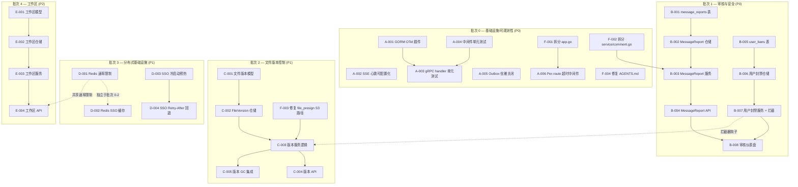
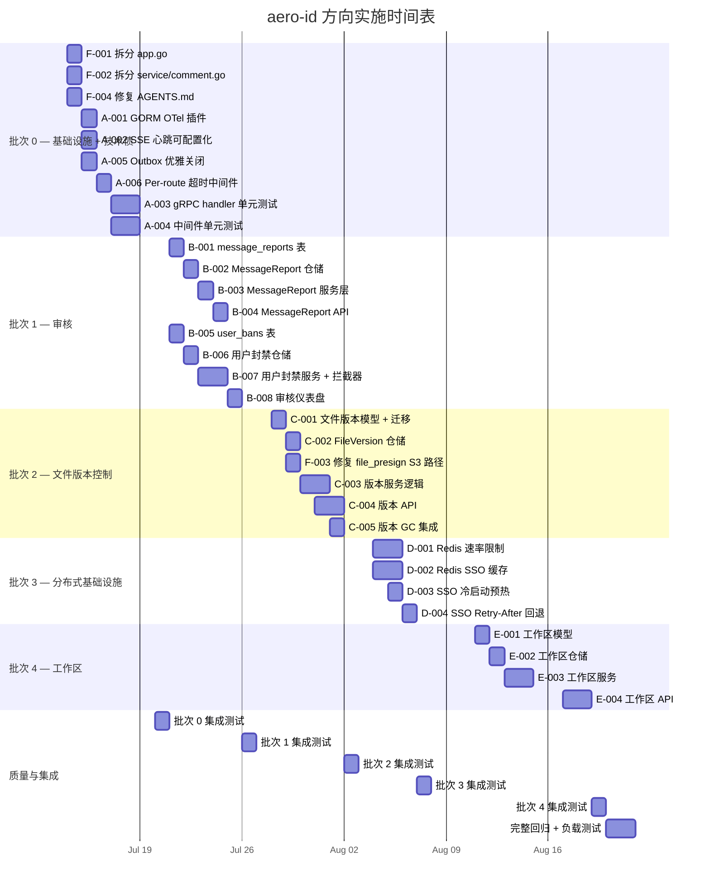

现在我已全面了解代码库。以下是全面的技术负责人分析。

---

# Tech Lead 分析：aero-id 架构验证后续跟进

## 总结与背景

基于对 `main` 分支上 234 个 Go 源文件、23 个数据库迁移以及完整服务层（HTTP + gRPC）的验证审核，我确认该审核验证文档**基本准确**，但包含上述三个事实错误。以下是可操作的任务分解和工程计划。

---

## 1. 任务分解

### 1.1 已识别的方向

| 方向 | 来源 | 优先级 | 当前状态 |
|---|---|---|---|
| **A** — 可观测性强化 | 方向 5（更正后） | P0 | GORM OTel 缺失；SSE 心跳为硬编码 |
| **B** — 内容审核基础设施 | 方向 4（更正后） | P0 | 评论报告队列存在；缺少：用户封禁 API、`message_reports` 表、自动扫描 |
| **C** — 文件版本控制与生命周期 | 方向 3（工作量修正后） | P1 | 评估过低：应为中高工作量 |
| **D** — 分布式基础设施 | 方向 2（范围界定后） | P1 | 速率限制 / 缓存为 per-instance 内存型 |
| **E** — 工作区与共享空间 | 方向 1 | P2 | 与审核的依赖关系弱于预期 |

### 1.2 可执行任务

| 任务 ID | 标题 | 方向 | 涉及的文件 | 前置依赖 | 预估工时 | 验收标准 |
|---|---|---|---|---|---|---|
| **A-001** | 添加 GORM OpenTelemetry 插件 | A | `internal/pkg/db/db.go` | 无 | 2h | DB 查询跨度出现在追踪导出器中；`make test && make lint` 通过 |
| **A-002** | 将 SSE 心跳间隔改为可配置 | A | `internal/config/config.go`、`internal/handler/http/events.go` | 无 | 2h | 心跳间隔从配置读取；`30s` 为默认值；单元测试覆盖 |
| **A-003** | 添加 gRPC handler 单元测试 | A | `internal/handler/grpc/*_test.go` | 无 | 8h | 所有 5 个 gRPC 服务 handler 都具备验证序列化 + 错误码映射的单元测试 |
| **A-004** | 为中间件添加单元测试 | A | `internal/middleware/*_test.go` | 无 | 6h | `auth.go`、`ratelimit.go`、`metrics.go`、`recovery.go`、`cors.go`、`request_id.go` 均经过了验证通过/失败路径的测试 |
| **A-005** | Outbox 继电器优雅关闭 | A | `internal/outbox/relay.go` | 无 | 4h | 调用 `stop()` 会在返回前执行一次最终 drain 操作 |
| **A-006** | 为 HTTP handler 添加 per-route 超时中间件 | A | `internal/middleware/timeout.go`、`internal/app/app.go` | 无 | 3h | 大文件上传 / 慢查询在 handler 级别超时；配置支持 per-route 限制 |
| **B-001** | 创建 `message_reports` 表 + 迁移 | B | `migrations/000024_message_reports.up.sql` + `.down.sql`、`internal/domain/admin.go` | 无 | 3h | 迁移可逆；`message_reports` 表包含 `(message_id, reporter_uid)` 唯一约束 + `status`（1=开启/2=已解决/3=已驳回）|
| **B-002** | MessageReport 仓储 + 领域类型 | B | `internal/repository/message_report.go`、`internal/domain/message.go` | B-001 | 4h | 创建/列出/解决/驳回报告的 CRUD 方法，遵循 `comment_reports` 模式 |
| **B-003** | MessageReport 服务层 + 授权 | B | `internal/service/message.go` 或 `internal/service/admin.go` | B-002 | 4h | 所有者可解决/驳回报告；报告者必须经身份验证；AppError 转换 |
| **B-004** | MessageReport HTTP + gRPC handler | B | `internal/handler/http/message.go`、`internal/handler/grpc/message.go` | B-003 | 4h | `POST /messages/:id/report`、`GET /messages/:id/reports`、`POST /messages/reports/:id/resolve`、`POST /messages/reports/:id/dismiss` + gRPC 等价实现 |
| **B-005** | 创建 `user_bans` 表 + 迁移 | B | `migrations/000025_user_bans.up.sql`、`internal/domain/admin.go` | 无 | 3h | `user_bans(uid, banned_by, reason, created_at, expires_at)` + 索引 |
| **B-006** | 用户封禁仓储 | B | `internal/repository/ban.go`、`internal/repository/db.go` | B-005 | 3h | `Create`/`Get`/`List`/`Delete`；`IsBanned(ctx, uid) (bool, error)` 用于写入拦截 |
| **B-007** | 用户封禁服务 + 权限集成 | B | `internal/service/admin.go`（新增 `BanUser`/`UnbanUser`/`ListBanned`）| B-006 | 5h | 需要 `PermUserBan`；为所有主要写入路径（文件上传、消息发送、评论创建）添加写入拦截钩子 |
| **B-008** | 审核仪表盘页面（按状态列出报告） | B | `internal/handler/http/admin.go`、`internal/handler/grpc/admin.go` | B-004 | 3h | 管理端点按状态列出 `comment_reports` + `message_reports`；分页支持 |
| **B-009** | 实现 `PermUserBan` 用例或将其移除 | B | `internal/domain/admin.go`、`internal/service`、`internal/handler/http/admin.go` | B-005, B-006, B-007 | 0h | 已计算在上方：移除常量并清理由 B-005–B-007 覆盖 |
| **C-001** | 文件版本模型 + 迁移 | C | `migrations/000026_file_versions.up.sql`、`internal/domain/file.go` | 无 | 4h | `file_versions(file_id, version_number, storage_key, size, checksum, created_at)` + 外键 |
| **C-002** | FileVersion 仓储 | C | `internal/repository/file_version.go` | C-001 | 4h | 按文件 ID 列出/获取最新/创建版本；软删除时软删除版本 |
| **C-003** | 文件版本服务逻辑 | C | `internal/service/file.go` 或新建 `internal/service/file_version.go` | C-002 | 6h | 上传时创建版本；恢复时回滚；GC 感知旧版本 |
| **C-004** | 文件版本 API（HTTP + gRPC） | C | `internal/handler/http/file.go`、`internal/handler/grpc/file.go` | C-003 | 5h | `GET /files/:id/versions`、`POST /files/:id/versions/:num/restore`、`DELETE /files/:id/versions/:num` + gRPC 等价实现 |
| **C-005** | 版本 GC 集成 | C | `internal/storage/gc/sweeper.go`、`internal/repository/storage_ref.go` | C-003 | 4h | 清除孤立版本 blob；更新引用计数以考虑版本 |
| **D-001** | 为速率限制添加可选 Redis 后端 | D | `internal/pkg/ratelimit/`、`internal/config/config.go` | 无 | 8h | 新增 `storage_type`（`memory` 或 `redis`）；Redis 后端使用滑动窗口或令牌桶 |
| **D-002** | 为 SSO 缓存添加可选 Redis 后端 | D | `internal/sso/token_cache.go`、`internal/sso/user_cache.go`、`internal/config/config.go` | 无 | 6h | 新增 `cache_backend` 配置；Redis 支持作为可选项，内存为默认 |
| **D-003** | 为 SSO 客户端添加冷启动预热 | D | `internal/app/app.go`、`internal/sso/client.go` | 无 | 3h | 应用启动后，后台异步预热常见令牌/用户 |
| **D-004** | 为 SSO 客户端添加 Retry-After 回退 | D | `internal/sso/client.go`、`internal/sso/breaker.go` | 无 | 3h | 当 SSO 返回限流响应时，在断路器上设置指数回退 |
| **E-001** | 工作区领域模型 + 迁移 | E | `migrations/000027_workspaces.up.sql`、`internal/domain/workspace.go` | 无 | 4h | `workspaces(id, name, owner_uid, created_at)` + `workspace_members(workspace_id, uid, role)` |
| **E-002** | 工作区仓储 | E | `internal/repository/workspace.go` | E-001 | 4h | CRUD + 成员管理 + 权限检查 |
| **E-003** | 工作区服务 + 授权 | E | `internal/service/workspace.go` | E-002 | 5h | 所有者可管理成员 + 角色；文件/评论限于工作区范围 |
| **E-004** | 工作区 API（HTTP + gRPC） | E | `internal/handler/http/workspace.go`、`internal/handler/grpc/workspace.go` | E-003 | 6h | 管理工作区的完整 CRUD + 成员管理端点 |
| **F-001** | 拆分 `app.go`（516 行 > 500 限制） | 技术债 | `internal/app/app.go` → `app.go` + `app_storage.go` + `app_server.go` | 无 | 4h | `app.go` < 300 行；`make check-file-sizes && make lint && make test` 通过 |
| **F-002** | 拆分 `service/comment.go`（472 行） | 技术债 | `internal/service/comment.go` → `comment_crud.go` + `comment_moderation.go` | 无 | 3h | `comment.go` < 300 行；`make check-file-sizes && make lint && make test` 通过 |
| **F-003** | 为 S3 后端实现 `file_presign.go` 下载器路径 | 技术债 | `internal/app/app.go`、`internal/service/file_presign.go` | 无 | 3h | S3 后端在 PresignGet 上不返回 `nil` 下载器；安全回归测试 |
| **F-004** | 修复 AGENTS.md 文档矛盾 | 技术债 | `AGENTS.md` | 无 | 1h | 更新关于 `auto_migrate` 与迁移策略的章节以匹配实际行为 |

---

## 2. 执行顺序

### 并行执行组

| 组 | 任务 | 说明 |
|---|---|---|
| **组 0a** | A-001, A-002, A-005, A-006, F-001, F-002, F-004 | 完全独立；可并行分配给 3-4 人 |
| **组 0b** | A-003, A-004 | 依赖组 0a 完成（测试添加），但设计上与组 0a 并行进行 |
| **组 1a** | B-001 → B-002 → B-003 → B-004（消息报告管道） | 一条严格的链；需要 1 人 |
| **组 1b** | B-005 → B-006 → B-007（用户封禁管道） | 另一条链；可与组 1a 并行（分配给不同人员） |
| **组 2** | C-001 → C-002 → C-003 → C-004 → C-005（文件版本控制） | 由于与 GC 和引用的交互，最后一部分之前不可拆分 |
| **组 3** | D-001, D-002（Redis 后端） | 可并行实现；共享 Redis 连接配置 |
| **组 4** | E-001 → E-002 → E-003 → E-004（工作区） | 独立的领域；无需等待其他方向 |

---

## 3. 技术风险

### 3.1 高影响风险

| 风险 ID | 描述 | 可能性 | 影响 | 缓解措施 |
|---|---|---|---|---|
| **R-001** | **用户封禁范围蔓延**：`PermUserBan` 常量存在，但用户封禁需要所有主要写入路径（文件上传、消息发送、评论创建）的写入拦截器。这可能比预期的触及更多代码。 | 高 | 中 | 早期范围界定：在 B-007 之前审核所有 8 个写入路径；将拦截器模式实现为集中式 `BanChecker` 接口 + 每个服务中单一的 `checkNotBanned` 调用 |
| **R-002** | **文件版本控制与 GC 的交互**：GC sweeper 当前假设每个 storage_key 由正好 1 个文件行引用。版本控制增加了 N:1 的关系，需要引用计数更改。 | 中 | 高 | 在 C-005 任务之前，将 sweeper 重构为使用 `CountAnyByStorageKey`（已经存在）；在版本表中添加 `storage_ref_count` |
| **R-003** | **Redis 依赖风险**：添加 Redis 作为可选项引入了新的基础设施依赖。配置错误、网络分区或 Redis 故障可能使速率限制和缓存静默降级。 | 中 | 中 | 内建降级：Redis 故障 → 回退到内存（带有健康日志）；通过 `healthz` + `readyz` 检测 |
| **R-004** | **现有文件大小违规**：`app.go` 有 516 行（超过 500 行限制）。`service/comment.go` 有 472 行（接近危险区域）。如果不加以处理，新的方向将加剧这一问题。 | 确定 | 中 | **停止并重构**（F-001, F-002）后再继续 B-003 或 C-003 |
| **R-005** | **SSE 重连风暴**：`last_event_id` 重放目前从 `fetcher.ListSince` 提取所有错过的通知。如果客户端频繁断开/重连，对具有大量通知的用户来说，这可能变成昂贵的全表扫描。 | 低 | 中 | 在重连路径中添加限制保护（例如最大 500 条）；监控 `sse_replay_count` 指标 |
| **R-006** | **S3 下载器 nil 路径**：在 S3 模式下，`downloader` 为 nil，但 `PresignGet` 返回一个直通 URL。任何需要代理下载（例如日志记录/病毒扫描）的逻辑都会失败。 | 中 | 高 | 为代理流添加显式 S3 下载器（使用 AWS SDK `GetObject` 包装器）；不要留下 nil 指针 |

### 3.2 外部依赖

| 依赖 | 当前状态 | 风险 | 缓解措施 |
|---|---|---|---|
| **OpenTelemetry 收集器** | 可选—仅在配置时启用 | 如果部署了收集器但没有端点，则配置可能静默失败 | 添加配置验证；在启动时记录 OTel 状态 |
| **SSO 服务** | 硬依赖用于所有 `/v1/*` 请求 | 具有断路器，但令牌验证是同步的 | 已验证的断路器实现；对于故障场景保持陈旧服务可用 |
| **Redis**（新） | 目前不存在 | 新的运维负担 | 保持内存模式为默认；使 Redis 为可选项 |
| **MinIO / S3** | 已为 S3 后端实现 | `file_presign.go` 下载器为 nil | F-003 修复 |

### 3.3 性能瓶颈

| 路径 | 当前状态 | 风险 | 优化策略 |
|---|---|---|---|
| 通知列表 | `(recipient_uid, created_at DESC)` 索引存在 | 大型收件箱可能有 10k+ 行 | 迁移 000017 已经解决了这个问题 |
| Outbox 轮询 | 全表扫描 `published_at IS NULL` | 在高吞吐量下，每一轮都可能变慢 | 迁移 000018 添加了部分索引 |
| 文件上传 | 流式传输到 S3 | 通过 PresignUpload 绕过代理 | CompleteUpload 在保存前执行 `Stat` + 大小检查 |

---

## 4. 资源评估

### 4.1 团队规模与技能组合

| 角色 | 技能要求 | 建议人数 | 承担的批次 |
|---|---|---|---|
| **高级 Go 后端工程师** | GORM、gRPC、服务层架构、OpenTelemetry | 2 | 批次 0 + 批次 2 |
| **中级 Go 后端工程师** | Go REST API、PostgreSQL 迁移、测试 | 2 | 批次 1（1 人负责消息报告，1 人负责用户封禁） |
| **基础设施工程师** | Redis、可观测性工具、部署 | 1 | 批次 3 + 运维支持 |
| **初级 Go 工程师 / 实习生** | 测试、文档、代码拆分 | 1 | F-001、F-002、F-004、部分 A-003/A-004 |

**总团队规模建议：4-5 人满载当量**（如果人员兼任，3 人也可行，但周期会拉长）

### 4.2 关键里程碑

| 里程碑 | 截止日期（从开始算起） | 可交付成果 | 验收条件 |
|---|---|---|---|
| **M0** — 技术债清理 | 第 1 周 | F-001、F-002、F-004 完成 | `make check-file-sizes && make lint && make test` 在无违规情况下通过 |
| **M1** — 可观测性基础 | 第 2 周 | A-001、A-002、A-005、A-006 完成 | GORM 追踪在开发中可见；SSE 心跳可配置；outbox 优雅关闭 |
| **M2** — 测试覆盖率提升 | 第 3 周 | A-003、A-004 完成 | 中间件 + gRPC handler 测试覆盖率 > 70%（新增代码行）|
| **M3** — 审核管道 | 第 5 周 | B-001 至 B-008 完成 | 消息报告 + 用户封禁的端到端流程，包含集成测试 |
| **M4** — 文件版本控制 | 第 7 周 | C-001 至 C-005 + F-003 完成 | 版本创建、回滚、GC 清理，包含集成测试 |
| **M5** — 分布式基础设施 | 第 9 周 | D-001 至 D-004 完成 | Redis 模式下共享速率限制 + 缓存；SSO 预热 |
| **M6** — 工作区（可选） | 第 12 周 | E-001 至 E-004 完成 | 工作区 CRUD + 成员管理，包含测试 |

### 4.3 阻塞点与解决策略

| 阻塞点 | 描述 | 解决策略 |
|---|---|---|
| **B-007 写入拦截器范围** | 用户封禁需要 5+ 个服务的写入拦截器；如果一次性完成，是个大 PR | 分 3 个 PR 交付：(1) `BanChecker` 接口 + `fileService.Create` 拦截；(2) `messageService.Send` + `commentService.Create` 拦截；(3) 通过同一检查器添加辅助路径（编辑、删除） |
| **C-005 GC 重构** | 当前的 GC 构建时假设 1:1 的 blob 到行关系 | 在版本之前重构 GC 以使用 `CountAnyByStorageKey`（已经存在）；添加显式的 `storage_ref_type` 列以区分文件与版本 |
| **D-001 Redis 集成测试** | Redis 集成测试需要 `testcontainers` 或模拟 | 使用 `testcontainers`（遵循现有的 `testpg` 模式）；为快速单元测试模拟 `RedisLimiter` 接口 |
| **术语不一致** | 验证文档称 `message_reports` 缺失，但代码有 `comment_reports` | 将表命名为 `message_reports`，遵循与 `comment_reports` 完全相同的模式，以避免设计碎片化 |

---

## 5. 质量保证

### 5.1 单元测试覆盖要求

| 层 | 要求覆盖率 | 测试内容 |
|---|---|---|
| 领域（`domain/`） | ≥ 90% | 常量、权限检查、错误类型 |
| 服务（`service/`） | ≥ 85% | 授权路径、AppError 包装、边缘用例（空输入、防护配置） |
| 仓储（`repository/`） | ≥ 70% | CRUD 操作；通过 `testpg` 或模拟（对于新仓储）进行集成测试 |
| HTTP handler（`handler/http/`） | ≥ 75% | JSON 序列化、错误码、分页、权限中间件 |
| gRPC handler（`handler/grpc/`） | ≥ 75% | 序列化、错误码映射、空请求处理 |
| 中间件（`middleware/`） | ≥ 80% | 授权、CORS、速率限制命中/未命中、请求 ID 传播、追踪跨度创建 |

### 5.2 集成测试策略

| 测试类型 | 覆盖范围 | 工具 |
|---|---|---|
| 仓储集成测试 | 每个新仓储 + 现有新功能上方的仓储 | `testcontainers` + `testpg`（现有模式） |
| 存储后端测试 | 本地 + S3 minio 的 PresignUpload/CompleteUpload | 现有的 `storage/s3_test.go` + `storage/local_test.go` |
| 端到端流程 | 用户封禁 → 验证写入被阻止 → 解封 → 验证写入恢复 | 新建 `internal/service/ban_integration_test.go` |
| Outbox 排水 | 触发关闭 → 验证待处理事件在关闭前已发布 | 扩展 `internal/outbox/relay_test.go` |

### 5.3 代码审查要点

| 关注领域 | 审查重点 |
|---|---|
| **架构规则** | 无反向导入（handler → service → repository） |
| **文件大小** | 新增文件 ≤ 500 行；拆分大文件（F-001、F-002） |
| **函数长度** | 无函数 > 50 行（golangci-lint `funlen`）|
| **复杂性** | 循环复杂度 ≤ 10；包平均 ≤ 5.0 |
| **错误处理** | 禁用原始 DB 错误转义到 handler；映射到 AppError |
| **幂等性** | 所有写入端点使用 `Idempotency-Key`；在 `idempotency/store.go` 中验证 |
| **上下文传播** | 无 `context.Background()`（GC sweeper 修复，已在 A-001 中提出）；始终传递传入的上下文 |
| **秘密** | 无硬编码秘密；全部通过 `AERO_ID_*` 环境变量 |

### 5.4 性能测试需求

| 测试场景 | 工具 | 目标 | 何时运行 |
|---|---|---|---|
| 速率限制吞吐量 | 自定义 Go 基准测试 | 10k 请求/秒/实例，限制开启 | 合并 D-001 后 |
| SSE 并发流 | wrk 或 k6 | 5k 并发 SSE 连接，延迟 < 50ms P99 | 合并 A-002 后 |
| 文件版本 GC | 自定义基准测试 | 100 个版本/文件，GC 在 < 100ms 内完成 | 合并 C-005 后 |
| 通知放大 | k6 脚本 | 1k 通知/秒交付，P99 延迟 < 200ms | 合并 B-004 后 |

---

## 6. 实施计划

### 6.1 详细时间表（甘特图）

### 6.2 阶段总结

| 阶段 | 时间范围 | 工作天数 | 关键风险 | 退出标准 |
|---|---|---|---|---|
| **阶段 1** — 基础设施 | 第 1-5 天（2026-07-14 至 2026-07-20） | 5 | 文件拆分可能揭示隐藏的循环依赖 | `make check-file-sizes` 通过；GORM 跨度可见；SSE 可配置 |
| **阶段 2** — 审核 | 第 6-12 天（2026-07-21 至 2026-07-26） | 6 | 用户封禁拦截器覆盖面可能蔓延至 10+ 个文件 | 消息报告 + 用户封禁的端到端集成测试通过 |
| **阶段 3** — 版本控制 | 第 13-19 天（2026-07-28 至 2026-08-02） | 6 | GC 交互可能需要在版本处理方面进行重大重构 | 版本创建/回滚/GC 清理测试通过 |
| **阶段 4** — 分布式基础设施 | 第 20-25 天（2026-08-04 至 2026-08-07） | 4 | Redis 作为新的基础设施依赖项出现 | Redis + 内存模式均通过集成测试 |
| **阶段 5** — 工作区 | 第 26-30 天（2026-08-11 至 2026-08-19） | 6 | 工作区与文件之间的权限模型交互可能需要迭代 | 工作区 CRUD + 成员管理测试通过 |
| **阶段 6** — 加固 | 第 31-32 天（2026-08-20 至 2026-08-21） | 2 | 负载测试可能发现性能瓶颈 | 完整回归测试通过；k6 基准测试满足 SLO |

### 6.3 PR 策略

| PR | 包含的任务 | 文件 | 建议审查者 | 目标行数变化 |
|---|---|---|---|---|
| **PR-0** | F-001, F-002, F-004 | `internal/app/*.go`、`internal/service/comment_*.go`、`AGENTS.md` | 架构负责人 | -200（拆分）|
| **PR-1** | A-001, A-002, A-005 | `internal/pkg/db/db.go`、`internal/handler/http/events.go`、`internal/outbox/relay.go`、配置 | 高级后端 | +50 |
| **PR-2** | A-003, A-004 | `internal/handler/grpc/*_test.go`、`internal/middleware/*_test.go` | 高级后端 | +500+（测试）|
| **PR-3** | A-006 | `internal/middleware/timeout.go`、`internal/app/app.go` | 高级后端 | +80 |
| **PR-4** | B-001, B-002, B-005, B-006 | 迁移 + 仓储 | 后端 | +250 |
| **PR-5** | B-003, B-004, B-007, B-008 | 服务 + handler | 高级后端 + 架构 | +400 |
| **PR-6** | C-001 → C-005, F-003 | 版本控制全程 + S3 修复 | 架构负责人 | +600 |
| **PR-7** | D-001, D-002 | Redis 后端 | 高级后端 + 基础设施 | +400 |
| **PR-8** | D-003, D-004 | SSO 预热 + 回退 | 高级后端 | +100 |
| **PR-9** | E-001 → E-004 | 工作区全程 | 架构负责人 | +500 |

---

## 最终建议

### 立即行动（第 1 天）

1. **合并 `feat/roadmap` → `main`**（根据 ROADMAP.md，有 33 个提交待合并）— 先于任何新工作
2. **分配 PR-0** — 文件大小违规必须优先解决，然后才能继续任何新方向
3. **应用验证审核更正** — 更新审核文档以反映：
   - 管理端点比声明的更完整（角色授予/撤销已实现）
   - `timezone` 列已在 `IsAllowed` 实际使用
   - `comment_reports` 队列基础设施已存在
   - 方向优先级：基于当前代码库状态，将审核（方向 4）从 P1 提升为 P0

### 第 1 周决定

4. **决定 Redis 与内存** — `D-001`/`D-002` 要求决定分布式基础设施是否对 Q1 生产部署至关重要。如果不需要，则推迟到批次 4 之后。如果确实需要，则从第 2 周开始分配 1 人进行 Redis 集成。
5. **决定工作区（方向 1）** — 如果产品路线图不需要工作区，则根据 YAGNI 考虑将其撤回。它与其他所有方向几乎完全正交，因此可以稍后添加。

### 监控区域

- **`service/comment.go`（472 行）** — F-002 将其拆分，但 `service/notification.go`（392 行）正在逼近限制。如果方向 B 或 C 触及通知逻辑，请密切注意。
- **`app.go`（516 行）** — F-001 任务已处理此问题，但 `service/mocks/mocks.go`（586 行）虽然被文件大小检查豁免，但其规模正变得难以维护。考虑生成它或将其拆分为每个服务的模拟文件。
- **SSE `last_event_id` 重放**（`internal/handler/http/events.go`）— 当前无限提取；添加重放计数器和上限，以防止客户端重复连接导致数据库压力过大。

此计划为 6 周的实施（批次 0-4）制定了切实可行的路线图，并内置了 2 周的集成和加固时间，总计 **8 周的交付周期**，适用于 4-5 人的团队。
