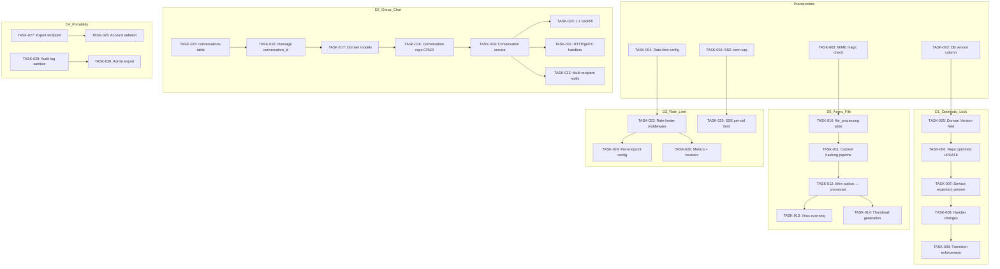

Now I have a thorough understanding of the codebase. Let me produce the full Tech Lead analysis.

---

# Tech Lead Analysis Report: aero-id 5-Direction Roadmap

## 1. Task Decomposition

### TASKS OVERVIEW

| Task ID | Title | Direction | Est. (h) | Dependencies |
|---|---|---|---|---|
| **INFRASTRUCTURE & PREREQUISITES** | | | | |
| TASK-001 | SSE per-UID connection cap | Prerequisite (A2) | 3 | None |
| TASK-002 | Add `version` column to messages & comments tables | Direction 1 | 2 | None |
| TASK-003 | Add MIME magic-number validation on upload | Direction 5 | 3 | None |
| TASK-004 | Add config schema for rate-limiter settings | Direction 3 | 2 | None |
| **DIRECTION 1: OPTIMISTIC LOCKING** | | | | |
| TASK-005 | Add `Version` field to `domain.Message` / `domain.Comment` | Direction 1 | 2 | TASK-002 |
| TASK-006 | Implement optimistic-lock UPDATE in repository (message + comment) | Direction 1 | 4 | TASK-005 |
| TASK-007 | Service-layer plumbing: accept & propagate `expected_version` | Direction 1 | 3 | TASK-006 |
| TASK-008 | HTTP/gRPC handler changes for `expected_version` + transition metrics | Direction 1 | 4 | TASK-007 |
| TASK-009 | Transition: log-warning phase → required field enforcement | Direction 1 | 2 | TASK-008 |
| **DIRECTION 5: ASYNC FILE PROCESSING** | | | | |
| TASK-010 | Add `file_processing` table & migration (status, attempts, result) | Direction 5 | 3 | None |
| TASK-011 | Extract content-hashing pipeline to async `file_processor` package | Direction 5 | 4 | TASK-010 |
| TASK-012 | Wire file-created outbox event → processing job | Direction 5 | 3 | TASK-011 |
| TASK-013 | Virus scanning integration (ClamAV gRPC/socket) | Direction 5 | 6 | TASK-012 |
| TASK-014 | Thumbnail generation (image/video) integration | Direction 5 | 6 | TASK-012 |
| **DIRECTION 2: GROUP CHAT** | | | | |
| TASK-015 | Add `conversations` & `conversation_participants` tables | Direction 2 | 3 | None |
| TASK-016 | Add `conversation_id` (nullable) to `messages` table | Direction 2 | 2 | TASK-015 |
| TASK-017 | Domain model: `Conversation`, `Participant` with type + role | Direction 2 | 3 | TASK-015 |
| TASK-018 | Repository: CRUD conversations, participant management | Direction 2 | 5 | TASK-017 |
| TASK-019 | Service: conversation creation, invite, leave, message routing | Direction 2 | 6 | TASK-018 |
| TASK-020 | Backfill: lazily create 1:1 conversations from existing message pairs | Direction 2 | 4 | TASK-019 |
| TASK-021 | HTTP/gRPC handlers for group-chat operations | Direction 2 | 5 | TASK-019 |
| TASK-022 | Group-chat notification dispatch (multi-recipient) | Direction 2 | 4 | TASK-019 |
| **DIRECTION 3: RATE LIMITING** | | | | |
| TASK-023 | Sliding-window rate-limiter middleware (in-memory + Redis) | Direction 3 | 5 | TASK-004 |
| TASK-024 | Per-endpoint rate-limit config (HTTP router + gRPC interceptor) | Direction 3 | 4 | TASK-023 |
| TASK-025 | SSE endpoint concurrent-connection per-uid limit | Direction 3 | 2 | TASK-001 |
| TASK-026 | Rate-limit metrics + headers (X-RateLimit-*) | Direction 3 | 3 | TASK-023 |
| **DIRECTION 4: DATA PORTABILITY** | | | | |
| TASK-027 | Export endpoint: collect all user data (files, msgs, comments, etc.) | Direction 4 | 8 | None |
| TASK-028 | Account deletion pipeline (soft-delete → purge after grace period) | Direction 4 | 5 | TASK-027 |
| TASK-029 | Audit log sanitization (deterministic hash with per-user salt) | Direction 4 | 4 | None |
| TASK-030 | Admin-initiated data export (S3 bucket) | Direction 4 | 4 | TASK-027 |

---

## 2. Execution Order & Dependency Graph



### Parallelizable Groups

| Group | Tasks | Rationale |
|---|---|---|
| **G1 — Foundation** | T001, T002, T003, T004 | No cross-dependencies, each touches disjoint layers |
| **G2 — Optimistic Lock** | T005→T006→T007→T008→T009 | Linear chain; but T009 (transition) can overlap with other directions |
| **G3 — Async Pipeline** | T010→T011→T012→T013 (T014 forks) | T013 and T014 fork after T012; can be done in parallel by 2 devs |
| **G4 — Group Chat** | T015→T016→T017→T018→T019 | Longest linear chain; T020, T021, T22 fork from T019 |
| **G5 — Rate Limit** | T023→T024 (T025⊕T026 fork) | T025 depends on T001; otherwise parallelizable with G4 |
| **G6 — Portability** | T027→T028 (T029 parallel) | T029 has no dependencies; T030 depends on T027 |

---

## 3. Technical Risks

### Risk Matrix

| # | Risk | Direction(s) | Likelihood | Impact | Mitigation |
|---|---|---|---|---|---|
| R1 | **Optimistic lock migration on large tables**: adding `version` column to `messages` with millions of rows could block writes | D1 | Medium | High | Use `ADD COLUMN ... DEFAULT 1 NOT NULL` (PostgreSQL 11+ instant metadata change); no backfill needed. Test on staging replica first. |
| R2 | **Lost-update window during transition**: legacy clients sending PUT without `expected_version` while versioned clients start using it | D1 | High | Medium | TASK-009: log-only phase for 2 weeks with Prometheus counter `edit_no_version`; if >5% after 1 week, extend transition. |
| R3 | **MIME magic false positives/negatives**: `http.DetectContentType` is limited to first 512 bytes; polyglot files (e.g. GIFAR) bypass | D5 | Medium | Medium | Combine magic + extension check; use `filetype` Go library (or `libmagic` bindings) as a secondary pass. Accept 99% accuracy — perfect MIME detection is impossible. |
| R4 | **ClamAV socket unavailability**: virus scanning becomes a hard dependency that can fail open or fail closed | D5 | Medium | High | Make virus scanning **fail-open** initially (skip on error, log). Add circuit-breaker after 3 consecutive timeouts. Only switch to fail-closed after stability is proven. |
| R5 | **Group-chat notification fan-out**: a group with 500 members sending a message generates 500 outbox events + 500 SSE pushes | D2 | Medium | High | Batch notification creation (single INSERT per message, not per recipient); use `notification_collapse` table (already exists per migrations). SSE push loops over recipients sequentially with timeout. |
| R6 | **Conversation backfill performance**: scanning all historical message pairs to lazily create 1:1 conversations | D2 | Low | High | Run backfill in background batch (1000 pairs per txn) with a migration flag; skip if `conversations` table already populated. |
| R7 | **Rate-limiter memory pressure**: per-uid sliding window state for 100k concurrent users | D3 | Medium | Medium | In-memory mode: use sharded `sync.Map` with TTL cleanup. Production: Redis-backed with local cache fallback. Default to 100 req/min per endpoint. |
| R8 | **Export data size**: a user with 10k files + 50k messages could generate multi-GB archives | D4 | Low | Medium | Stream ZIP progressively (don't buffer in memory). Set max archive size (2GB), split into parts if exceeded. S3 multipart upload for admin export. |
| R9 | **Audit hash re-identification**: deterministic hash of `actor_uid` still allows correlation attacks | D4 | High | Medium | Use **per-user rotating salt** stored separately. Hash = `HMAC-SHA256(salt_uid, actor_uid)`. Salt is generated on account creation and rotated on data deletion requests. |
| R10 | **N+1 notification queries during SSE replay**: fetching 50 missed events triggers N per-event SQL queries | A2/D2 | Medium | Medium | Already mitigated: `ListSince` does a single query. But after group chat, notification volume grows — ensure index on `(recipient_uid, created_at)`. |

### Key Architectural Decisions

**D1 (Optimistic Lock) — Version column choice:**
- Use `version INTEGER DEFAULT 1 NOT NULL` on both `messages` and `comments`.
- UPDATE: `WHERE id = ? AND version = ?` + `SET version = version + 1`.
- GORM's `clause.OnConflict` is not needed; use raw `Model().Where("id = ? AND version = ?").Update(...)` and check `RowsAffected == 0`.
- The DTO (`UpdateContentInput`) includes `ExpectedVersion *int` — nil skips check.

**D5 (Async Processing) — Processing pipeline architecture:**
```
File Created (outbox event "file.created")
  ↓
relay → file_processor.Handle()
  ├── Step 1: MIME re-validation (magic bytes)
  ├── Step 2: Virus scan (ClamAV)
  ├── Step 3: Thumbnail generation (if image/video)
  └── Step 4: Update file row (mime_type corrections, thumbnail meta, scan status)
```
- Use the existing outbox relay (`internal/outbox/relay.go`) — it already handles backoff, retry, dead-letter.
- `file_processing` table tracks status per file: `pending → processing → completed | failed`.
- The `Handler` interface in outbox already fits perfectly: `Handle(ctx, *outbox.Event) error`.

**D2 (Group Chat) — Conversation model:**
- `conversations(id, type[1:1|group], title, created_at, updated_at, deleted_at)`
- `conversation_participants(conversation_id, uid, role[admin|member], joined_at, left_at)`
- `messages` add nullable `conversation_id` FK. Current 1:1 messages keep it NULL during migration.
- Querying: `WHERE (conversation_id = ?) OR (conversation_id IS NULL AND ((from_uid=? AND to_uid=?) OR ...))`
- After backfill (TASK-020), all messages have `conversation_id`.

---

## 4. Resource Assessment

### Team Composition

| Role | Count | Focus Areas |
|---|---|---|
| **Senior Go Backend** | 2 | Core service/repo layer, optimistic locking, group chat service |
| **Full-Stack Go Developer** | 1 | HTTP/gRPC handlers, rate-limiting middleware, SSE improvements |
| **DevOps / Infra** | 1 (shared) | ClamAV integration, Redis for rate-limiter, S3 for exports |
| **QA Engineer** | 1 | Integration tests, performance/load testing, transition monitoring |

### Timeline Estimate (Assuming 2 full-time devs + 1 shared)

| Phase | Tasks | Est. Duration (calendar) |
|---|---|---|
| **Phase 1: Foundation** | T001, T002, T003, T004, T010, T015 | 1 week |
| **Phase 2: Core Implementation** | T005–T009 (D1 lock), T011–T012 (D5 pipeline), T023–T024 (D3 rate-limit) | 2.5 weeks |
| **Phase 3: Feature Completion** | T013–T014 (D5 scan/thumb), T016–T020 (D2 chat service), T025–T026 (D3 SSE limit) | 3.5 weeks |
| **Phase 4: Portability + Polish** | T021–T022 (D2 handlers/notifs), T027–T030 (D4 export/delete), T009 (transition) | 2.5 weeks |
| **Phase 5: Stabilization** | Load testing, bug fixes, observability dashboards, docs | 1.5 weeks |

**Total: ~11 weeks (2.5 months)**

### Blockers & Dependencies

| Blocker | Owner | Resolution Strategy |
|---|---|---|
| ClamAV not deployed in staging | DevOps | Use `freshclam` container in docker-compose; fall back to `fail-open` in dev |
| Redis instance for rate-limiter | DevOps | Use in-memory fallback in dev; Redis required only for multi-replica prod |
| No migration CI pipeline validates `down.sql` | Team | Add `make test-migration` that applies up → down → up and checks for drift |
| Group chat needs SSO batch-resolve for all participants | Waste (depends on SSO) | Already have `UserDirectory.GetUsers` — just ensure it handles >100 UIDs per batch |

---

## 5. Quality Assurance

### Unit Test Coverage Targets

| Package | Current Est. | Target | Key Test Cases |
|---|---|---|---|
| `internal/service` | ~70% | **≥85%** | Optimistic lock conflict (version mismatch), MIME validation both passes, group-chat invite to non-existent user, export with deleted rows |
| `internal/repository` | ~60% | **≥80%** | `UpdateContent` with version check, conversation backfill idempotency, `file_processing` status transitions |
| `internal/handler` | ~75% | **≥85%** | SSE last-event-ID edge cases (negative, future timestamp, malformed), group-chat auth (non-member tries to post) |
| `internal/outbox` | ~85% | **≥90%** | Processor handler error → retry → dead-letter flow |

### Integration Test Strategy

1. **Transactional tests** (using `testpg`): Every new migration gets an integration test that applies it, inserts representative data, and exercises the new query paths.
2. **MinIO-backed file tests**: MIME magic validation end-to-end — upload known-good files (PDF, PNG) and known-bad (shell script renamed to `.jpg`).
3. **Outbox → processor end-to-end**: Create file → verify `file.created` event → relay picks up → processing table updated. Use `internal/outbox/repository_integration_test.go` as template.
4. **Group chat multi-participant tests**: 3 users in a group, send message → all 3 receive notification → 1 leaves → remaining 2 still notified.
5. **Rate-limiter integration**: Start server, fire 101 requests → 100 succeed, 1 gets 429.

### Code Review Checklist

| Check | Description |
|---|---|
| **No raw SQL in service layer** | All DB calls go through repository interfaces |
| **Optimistic lock reads version before write** | Service calls `Get` (which returns current version) → checks `expected_version` → calls `UpdateContent` with version WHERE clause |
| **Outbox events not duplicated** | Processors are idempotent (check `file_processing.status` before processing) |
| **SSE subscription cleaned up on disconnect** | `defer unsub()` in `Stream()` — verify with `TestHub/cleanup_on_disconnect` |
| **New tables have proper indexes** | `conversation_participants(uid, conversation_id)` unique index; `file_processing(file_id)` unique; rate-limit state TTL-indexed |
| **Down migration is safe** | Drops columns/tables only after verifying no data loss; has a corresponding `down.sql` |

### Performance & Load Testing

| Scenario | Target | Tool | Threshold |
|---|---|---|---|
| Optimistic-lock UPDATE throughput | 1000 msg edits/sec per DB node | k6 / pgbench | P99 < 50ms |
| Group chat message with 100 members | 100 msgs/sec fan-out | k6 | P99 notification dispatch < 500ms |
| SSE with 10k concurrent connections | All receive events within 200ms | Custom Go tool | No goroutine leak, RSS < 1GB |
| Rate-limiter with Redis backend | 10k req/s sustained | wrk2 | P99 latency overhead < 5ms |
| Data export for 10k files | Complete within 60s | k6 | Memory < 512MB, no OOM |

---

## 6. Detailed Implementation Plan

### Phase 1: Foundation Engineering (Week 1)

```
Day 1-2:  TASK-001 (SSE conn cap)
          TASK-002 (DB version column for messages + comments)
          TASK-003 (MIME magic validation — independent quick win)
          
Day 3-4:  TASK-004 (Rate-limit config schema)
          TASK-010 (file_processing table)
          TASK-015 (conversations + participants tables)

Day 5:    Write integration tests for all new migrations
          Update make check-file-sizes for new files
          Merge Phase 1 → main
```

**Deliverables**: 3 new migrations, `Hub.Subscribe` capped per-UID, `file.go` MIME magic check inline, rate-limit YAML config, `conversations` + `conversation_participants`+ `file_processing` tables.

### Phase 2: Optimistic Locking + Async Pipeline Core + Rate-Limiter Core (Week 2–3)

```
Week 2:
Day 1-2:  TASK-005 (Add Version to domain.Message, domain.Comment)
          TASK-006 (repository.UpdateContent with version check)
          TASK-011 (file_processor package — content hashing)

Day 3-4:  TASK-007 (service.Edit accepts expected_version, returns conflict)
          TASK-012 (Wire file.created outbox event → processor)
          TASK-023 (Sliding-window rate-limiter impl)

Day 5:    TASK-024 (Per-endpoint rate-limit config)
          Service unit tests for lock conflict
          Integration test for processor pipeline

Week 3:
Day 1-2:  TASK-008 (HTTP/gRPC handler changes + transition metrics)
          TASK-025 (SSE per-uid connection limit)
          TASK-026 (Rate-limit headers + Prometheus counters)

Day 3:    Merge Phase 2 → main
          Run load test: optimistic lock throughput
```

**Deliverables**: `messages.version` + `comments.version` active, `Edit` with `< 1, 1>` conflict errors, `file_processor` consuming outbox events, rate-limiter middleware on `/v1/*` routes, SSE capped at 10 connections/uid, `X-RateLimit-Remaining` header.

### Phase 3: Feature Completion (Week 4–6)

```
Week 4:
Day 1-2:  TASK-017 (Domain: Conversation, Participant models + validation)
          TASK-018 (Conversation repo: Create, Get, AddParticipant, RemoveParticipant, ListByUID)

Day 3-4:  TASK-016 (ALTER messages ADD conversation_id)
          TASK-019 (Conversation service: Create, Send, Invite, Leave, List)

Day 5:    TASK-020 (Background 1:1 backfill)
          Integration tests for conversation service

Week 5:
Day 1-2:  TASK-013 (ClamAV integration in file processor)
          TASK-014 (Thumbnail generation, conditional on MIME type)

Day 3-4:  TASK-021 (HTTP/gRPC group-chat handlers)
          TASK-022 (Group-chat notification fan-out + multi-recipient SSE)

Day 5:    Integration test: group with 3 members, message → 3 notifications
          Load test: group chat with 100 members

Week 6:
Day 1-4:  TASK-027 (Export endpoint: collect files, messages, comments, profile data)
Day 5:    TASK-028 (Account deletion: grace period + scheduled purge)
          Merge Phase 3 → main
```

**Deliverables**: Full group chat (CRUD conversations, send to group, invite/leave, 1:1 backfill), virus scanning + thumbnails in async processing pipeline, data export endpoint (`GET /v1/export`), account deletion pipeline.

### Phase 4: Portability + Transition Lockdown (Week 7–8)

```
Week 7:
Day 1-2:  TASK-029 (Audit log sanitization: per-user HMAC salt, rotate on delete)
Day 3-4:  TASK-030 (Admin export to S3, triggered by role)
Day 5:    Integration test: verify hash is non-reversible and per-user unique

Week 8:
Day 1-2:  TASK-009 (Transition enforcement: log → warn → required)
Day 3-4:  Create migration docs + changelog
          Security review: audit trail completeness
Day 5:    Merge Phase 4 → main
```

**Deliverables**: `actor_uid` in audit log replaced with HMAC hash (with per-user salt), admin S3 export, `expected_version` now required on all edit endpoints, deprecation warnings removed.

### Phase 5: Stabilization & Observability (Week 9–10)

```
Day 1-3:  Load testing results review
          Fix bottlenecks found in Phase 2-3
          Add Prometheus dashboards (outbox lag, rate-limit hits, processing queue depth)

Day 4-6:  Final integration test pass (full coverage)
          Documentation update: README API tables, new gRPC proto docs, migration guide

Day 7-10: Production deployment runbook
          Rollback plan for each direction
          Team training/walkthrough
```

---

## Summary for Leadership

| Dimension | Verdict | Key Decision |
|---|---|---|
| **Start with** | TASK-003 (MIME magic) — smallest effort, highest immediate security ROI; can ship within 2 days | Independent of everything else |
| **Highest risk** | Group chat (D2) — longest dependency chain (8 tasks), introduces fan-out notifications that stress SSE infrastructure | Mitigate: ship TASK-001 (conn cap) and TASK-025 (rate-limit) before D2 |
| **Best parallelization** | D1 (optimistic lock) and D3 (rate-limiter) can be built by two devs concurrently after Phase 1 | Assign Dev A to D1, Dev B to D3 in Phase 2 |
| **Must not skip** | TASK-009 (transition period) — without it, old clients silently overwrite new edits | Non-negotiable; log + metrics before enforcement |
| **Deferred** | TASK-013 (virus scan) and TASK-014 (thumbnails) — can ship without them; processing table + pipeline are the core infrastructure | Ship TASK-010→T012 first; add T013/T014 in a follow-up sprint |
| **Observability gap** | No existing dashboards for outbox lag, SSE subscriber counts, rate-limit hits | Add in Phase 5; critical before D2 goes live |
