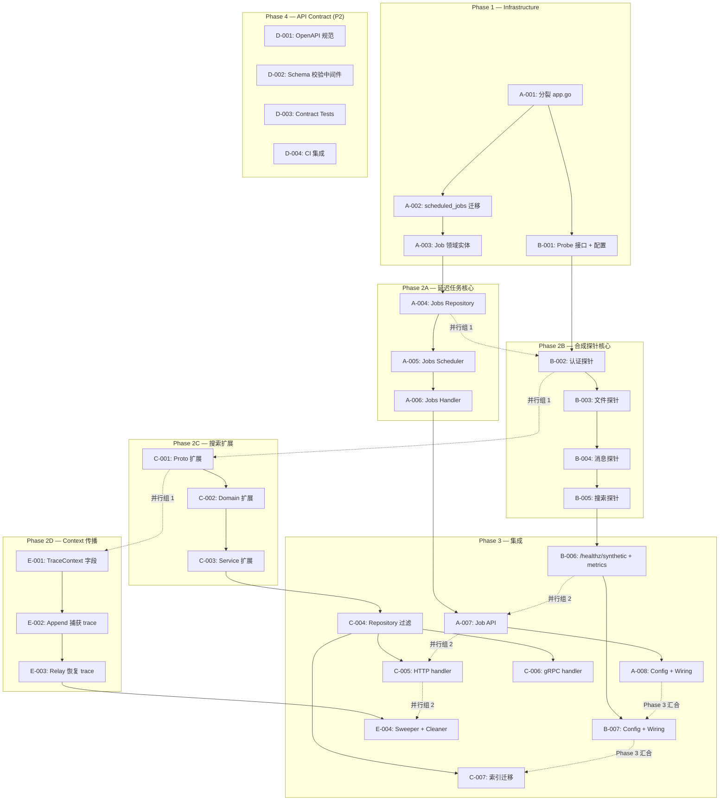
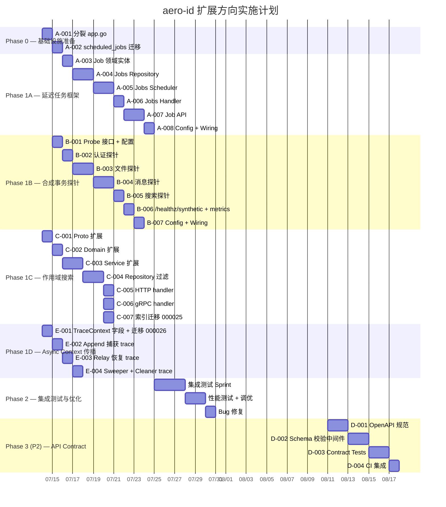

现在我已经充分理解了代码库的现状和需求文档。以下是完整的技术负责人分析。

---

# Tech Lead 分析报告：系统性扩展方向

## 摘要

本分析基于 `docs/requirements/2026-07-11-systematic-expansion-direction-scan.md`，对五个扩展方向进行任务分解、依赖分析、风险评估和排期规划。

**关键发现**：

- `internal/app/app.go` 已达 **516 行**，违反 ≤500 行的约定——所有新增 wiring 必须先分裂此文件
- 最新迁移为 `000023_unread_counts`，后续迁移从 `000024` 开始编号
- 搜索接口（HTTP + gRPC + proto）目前仅支持 `query + kinds + limit`，无任何 scope/时间/过滤参数
- Outbox Event 结构体无 `TraceContext` 字段，relay 全部使用 `context.Background()`
- Outbox relay 的轮询模式（`Start(interval) → stop func()`）可直接被延迟任务框架复用

---

## 1. 任务分解

### 方向 A：延迟任务框架（P1）

| 任务 ID | 标题 | 涉及文件 | 前置依赖 | 工时 | 验收标准 |
|---|---|---|---|---|---|
| **A-001** | 分裂 app.go 至 ≤500 行 | `internal/app/app.go` → `internal/app/app.go` + `internal/app/wiring.go` | 无 | 2h | app.go ≤500 行；`make test && make lint` 通过 |
| **A-002** | 创建 `scheduled_jobs` 表（迁移 000024） | `migrations/000024_scheduled_jobs.{up,down}.sql` | A-001 | 1h | `make migrate-up` 应用后表存在，含正确索引和约束 |
| **A-003** | 定义 Job 领域实体 + 状态枚举 | `internal/domain/job.go` | A-002 | 1.5h | 类型定义完整，状态机正确（pending→running→done/failed），单元测试覆盖状态转换 |
| **A-004** | 实现 `internal/jobs/repository.go`（GORM CRUD） | `internal/jobs/repository.go` + `internal/jobs/repository_test.go` | A-003 | 3h | CRUD 方法完整；`FetchDue` 按 `(status, scheduled_at)` 返回到期任务；gorm 集成测试覆盖 |
| **A-005** | 实现 `internal/jobs/scheduler.go`（轮询 + 执行引擎） | `internal/jobs/scheduler.go` + `internal/jobs/scheduler_test.go` | A-004 | 3h | 复用 outbox.Relay 的 Start/stop 模式；到期执行、失败重试（指数退避）、死信；单元测试覆盖 |
| **A-006** | 实现 `internal/jobs/handler.go`（Handler 注册 + 派发） | `internal/jobs/handler.go` + `internal/jobs/handler_test.go` | A-005 | 2h | JobType→Handler 映射表；支持 Chain 模式（同 outbox）；单元测试 |
| **A-007** | 定义 Job API（HTTP + gRPC + proto） | `internal/handler/http/job.go`, `internal/handler/grpc/job.go`, `api/proto/...`, `internal/domain/job.go` | A-005, A-006 | 3h | `POST /v1/jobs` 创建延迟任务；HTTP 和 gRPC 行为一致；404/409 错误正确；集成测试 |
| **A-008** | Config + App wiring（注入 jobs.Scheduler） | `internal/config/config.go`, `configs/config.yaml`, `internal/app/wiring.go` | A-007, A-001 | 2h | 配置项 `jobs.poll_interval`, `jobs.max_retries`；App 启动时启动 scheduler；优雅关闭 |

**方向 A 合计：17.5h**

### 方向 B：合成事务探针（P1）

| 任务 ID | 标题 | 涉及文件 | 前置依赖 | 工时 | 验收标准 |
|---|---|---|---|---|---|
| **B-001** | 定义 SyntheticProbe 接口 + 监控服务账户配置 | `internal/healthz/probe.go`, `internal/config/config.go` | A-001 | 2h | Probe 接口定义；配置项 `health.synthetic.{enabled,token,uid,interval}`；配置校验 |
| **B-002** | 实现认证探针（验证测试 token→uid） | `internal/healthz/synthetic.go` + test | B-001 | 2h | 使用测试 SSO token 调用验证端点，拿到 uid；失败返回 probe error |
| **B-003** | 实现文件探针（上传→获取→删除→确认404） | `internal/healthz/synthetic.go`（扩展） | B-002 | 3h | 文件 CRUD 完整链路；隔离存储 key 前缀 `synthetic_`；清理不留垃圾 |
| **B-004** | 实现消息/通知探针（发送→出站→通知投递验证） | `internal/healthz/synthetic.go`（扩展） | B-003 | 3h | 发送消息→等待 outbox→验证通知行已创建；含超时保护 |
| **B-005** | 实现搜索探针（创建数据→搜索→验证命中） | `internal/healthz/synthetic.go`（扩展） | B-004 | 2h | 写入可搜索数据→搜索→验证结果包含预期内容 |
| **B-006** | 实现 `/healthz/synthetic` HTTP 端点 + metrics | `internal/handler/http/health.go`, `internal/pkg/metrics/metrics.go` | B-001~B-005 | 2h | GET `/healthz/synthetic` 返回探针汇总；metrics 上报 `health.synthetic.*` 系列 |
| **B-007** | Config + App wiring | `internal/app/wiring.go`, `configs/config.yaml` | B-006, A-001 | 1h | 后台定期执行探针；结果暴露为 metrics；优雅关闭 |

**方向 B 合计：15h**

### 方向 C：作用域搜索（P1）

| 任务 ID | 标题 | 涉及文件 | 前置依赖 | 工时 | 验收标准 |
|---|---|---|---|---|---|
| **C-001** | Proto 扩展：SearchRequest 增加 scope/time/filter 字段 | `api/proto/aero_id/v1/aero_id.proto` | 无 | 1.5h | 新增 `scope_type`, `scope_id`, `since`, `until`, `file_type`, `sort` 字段；`make proto` 通过 |
| **C-002** | Domain 层扩展：Scope 类型 + SearchFilter 结构体 | `internal/domain/search.go` | C-001 | 1h | 新增 `ScopeType`, `SearchFilter` 类型；向后兼容 |
| **C-003** | Service 层扩展：解析 scope/time 参数 → SQL 条件 | `internal/search/search.go` + `internal/search/search_test.go` | C-002 | 4h | scope 限定正确（conversation_id/file_id 过滤）；时间范围 WHERE；file_type 过滤；单元测试 |
| **C-004** | 仓储层扩展：消息/评论/文件搜索增加过滤条件 | `internal/message/repository.go`, `internal/comment/repository.go`, `internal/file/repository.go`（搜索方法） | C-003 | 4h | 各仓储搜索方法支持可选 WHERE 条件；游标分页兼容；集成测试 |
| **C-005** | HTTP handler 扩展：解析新参数 | `internal/handler/http/search.go` | C-004 | 1.5h | 解析 scope/时间/类型参数；参数校验；错误返回 |
| **C-006** | gRPC handler 扩展：传入新字段 | `internal/handler/grpc/search.go` | C-004 | 1h | gRPC handler 传递新字段到 service |
| **C-007** | 复合索引评估 + 创建（迁移 000025） | `migrations/000025_search_scope_indexes.{up,down}.sql` | C-004 | 2h | `EXPLAIN ANALYZE` 验证索引命中；`make test-integration` 通过 |

**方向 C 合计：15h**

### 方向 D：API Schema Contract（P2）

| 任务 ID | 标题 | 涉及文件 | 前置依赖 | 工时 | 验收标准 |
|---|---|---|---|---|---|
| **D-001** | 创建 OpenAPI 3.1 规范骨架（路由定义 + 共享 schemas） | `api/openapi/v1/aero-id.yaml` | 无 | 4h | 覆盖所有 ~38 条 HTTP 路由；请求/响应结构完整；`openapi-generator validate` 通过 |
| **D-002** | Schema 驱动请求校验中间件 | `internal/middleware/schemavalidator.go` + test | D-001 | 3h | 自动校验 query/body 参数；返回标准化错误格式；可配置跳过 |
| **D-003** | 消费者契约测试（Pact/自建） | `internal/contract/*_test.go` | D-002 | 4h | 每个核心实体 2-3 个消费者场景；CI 中运行；破坏性变更捕获 |
| **D-004** | CI 集成契约验证步骤 | `Makefile` + CI 配置 | D-003 | 1h | `make contract-test` 在 CI 流水线中运行；失败阻止 merge |

**方向 D 合计：12h**

### 方向 E：异步 Context 传播（P2）

| 任务 ID | 标题 | 涉及文件 | 前置依赖 | 工时 | 验收标准 |
|---|---|---|---|---|---|
| **E-001** | Outbox Event 增加 TraceContext 字段 + 迁移 000026 | `internal/outbox/outbox.go`, `migrations/000026_outbox_trace_context.{up,down}.sql` | 无 | 2h | Event 结构体新增 `TraceContext`；迁移增加列；现有数据无损坏 |
| **E-002** | Outbox Append 时捕获 trace context | `internal/outbox/repository.go`（或 Append 调用处） | E-001 | 1.5h | 从 `ctx` 提取 span context 写入 event；无 trace 时为空；单元测试 |
| **E-003** | Outbox Relay Handle 时恢复 trace context | `internal/outbox/relay.go` | E-002 | 2h | 从 event 的 TraceContext 重建 parent span；创建 child span 包裹 handler；单元测试 |
| **E-004** | GC Sweeper + RateLimit Cleaner trace 穿透（可选） | `internal/storage/gc/sweeper.go`, `internal/pkg/ratelimit/ratelimit.go` | E-003 | 2h | Sweeper 恢复 trace；Cleaner 恢复 trace |

**方向 E 合计：7.5h**

---

## 2. 执行顺序与依赖图



### 并行执行策略

```
迭代 1（Phase 1 + 2，共 4 周）
  │
  ├── Sprint A: 方向 A+B（延迟任务 + 合成探针）
  │     Dev 1: A-001→A-002→A-003→A-004→A-005→A-006
  │     Dev 2: B-001→B-002→B-003→B-004→B-005
  │     Dev 3: A-007, B-006, B-007 (Phase 3 wiring)
  │
  ├── Sprint B: 方向 C+E（作用域搜索 + Context 传播）
  │     Dev 1: C-001→C-002→C-003→C-004→C-005→C-006→C-007
  │     Dev 2: E-001→E-002→E-003→E-004
  │
  └── Sprint C (P2): 方向 D（API Contract）
        Dev 1: D-001→D-002→D-003→D-004
```

---

## 3. 技术风险

### 3.1 高风险项

| 风险 | 影响方向 | 风险等级 | 缓解策略 |
|---|---|---|---|
| **延迟任务的时间精度**：轮询模式（示例 5s interval）只能提供 ~5s 精度，不能满足秒级定时需求 | A | 🔴 高 | Phase 1 接受 `interval = 1s`（适度轮询压力）；Phase 2 可改用 PostgreSQL `LISTEN/NOTIFY` 或 `pg_sleep` 精确唤醒 |
| **合成探针污染生产数据**：探针写入的数据可能被真实用户看到或影响计数 | B | 🔴 高 | 使用独立的 `synthetic_` prefix uid；探针数据写入后立即清理；清理失败时报警但不影响探针成功/失败状态 |
| **搜索 scope 参数对 FTS 索引的冲击**：增加 scope WHERE 条件后，现有 `to_tsvector` 索引可能无法同时满足 `scope_id + tsquery` 的复合过滤 | C | 🟡 中 | 预先用 `EXPLAIN ANALYZE` 验证查询计划；按需创建 `(scope_type, scope_id, fts_index)` 复合索引或 partial index |
| **outbox TraceContext 向后兼容**：已有 outbox 行没有 `trace_context` 列，relay 升级后读取旧行时可能 panic | E | 🟡 中 | 使用 `NULL` 默认值；代码中 nil-safe 处理（先 check `!= nil` 再重建 span） |
| **app.go 分裂设计争议**：不同开发者对分裂策略（按域 vs 按层）可能有分歧 | A | 🟢 低 | 采用"按域分组"策略（`wiring_jobs.go`, `wiring_probes.go`，最后 `wiring.go` 合并），与 AGENTS.md 的 splitting strategy 一致 |

### 3.2 外部依赖风险

| 依赖 | 风险说明 |
|------|----------|
| **SSO**（合成探针） | 合成探针需要 SSO 签发测试 token；如果 SSO 不支持"服务账户"模式，需要另寻认证方式（如配置一个长期有效的预生成 token，或绕过 token 校验直接使用配置的 synthetic uid） |
| **postgres `LISTEN/NOTIFY`**（延迟任务 Phase 2 优化） | 如果未来需要精确唤醒，需要 postgres 连接池支持原生 connection；GORM 连接池默认不支持 |
| **protoc 工具链**（proto 扩展） | `go.mod` 固定了 `protoc-gen-go@v1.34.1` 和 `protoc-gen-go-grpc@v1.5.1`，版本不兼容会导致 generate 失败 |

### 3.3 性能考量

| 方向 | 性能瓶颈 | 优化策略 |
|------|----------|----------|
| **A**（延迟任务） | 高频轮询空表（无到期任务时浪费 CPU） | 使用 `pg_try_advisory_lock` 减少多实例冲突；空表时指数退避（从 1s→5s→30s） |
| **B**（合成探针） | 探针本身消耗资源（影响生产延迟） | 探针使用独立连接池/低优先级配置；interval 可配置（默认 60s）；探针超时 ≤ 5s |
| **C**（作用域搜索） | 复合过滤导致顺序扫描 | 核心是索引策略——提前做 `EXPLAIN ANALYZE` 压力测试；考虑 partial index（如 `WHERE scope_type = 'conversation'`） |
| **E**（Context 传播） | `trace_context` JSONB 列增加存储和反序列化开销 | JSONB 存储开销可忽略（每个 event 约 150 bytes）；反序列化仅发生在 relay 处理时，非热点路径 |

---

## 4. 资源评估

### 4.1 人员技能要求

| 角色 | 技能要求 | 数量 | 分配方向 |
|------|----------|------|----------|
| **Senior Go Developer** | 熟悉 GORM、Postgres、gRPC/protobuf、OpenTelemetry | 2 | A + B + E → Dev 1；C + D → Dev 2 |
| **QA Engineer** | 集成测试、性能测试、契约测试 | 1 | 贯穿所有方向 |

> **备注**：如果只有 1 名开发者，按顺序执行方向 A → B → C → E → D，预计总工期约 8 周。

### 4.2 关键里程碑

| 里程碑 | 时间点 | 交付物 |
|--------|--------|--------|
| M1: Infrastructure Ready | 第 1 周末 | app.go 分裂完成；scheduled_jobs 表 + 探针配置可注入 |
| M2: 延迟任务核心可运行 | 第 2 周末 | Scheduler 轮询执行 handler；单元测试覆盖 |
| M3: 合成探针 MVP | 第 3 周初 | 认证 + 文件探针上线；/healthz/synthetic 响应正常 |
| M4: 作用域搜索可用 | 第 4 周初 | scope/time/type 过滤在 HTTP + gRPC 均可工作 |
| M5: Context 传播完成 | 第 4 周末 | outbox → notification 全链路 trace 可见 |
| M6: API Contract MVP | 第 6 周初（P2） | OpenAPI 规范 + CI 契约测试 |
| M7: 全方向集成完成 | 第 6 周末 | `make test && make lint && make test-integration` 全部通过 |

### 4.3 阻塞点与解决策略

| 阻塞点 | 影响方向 | 解决策略 | 负责人 |
|--------|----------|----------|--------|
| SSO 不支持监控服务账户 | B | 方案 A: 预生成一个永不过期的 SSO token，配置到 `health.synthetic.token`；方案 B: 创造一个内部 bypass（仅对 synthetic uid 跳过 token 验证） | Dev + SSO 团队沟通 |
| Postgres 版本不支持 JSONB 部分更新（E 方向） | E | 全量读写 JSONB 而非原地更新，性能影响可忽略 | Dev 决策 |
| protoc 版本与 go.mod 不兼容 | C, E | 在 `Makefile` 中增加版本检查 + `.tools-version` 锁定 | Dev 处理 |

---

## 5. 质量保证

### 5.1 单元测试覆盖要求

| 方向 | 覆盖目标 | 关键测试场景 |
|------|----------|-------------|
| **A** | ≥85% | Job 状态机转换；到期/未到期任务的 Fetch；重试退避计算；死信门限；并发安全 |
| **B** | ≥80% | 认证探针失败场景；文件 CRUD 全部路径（上传失败→获取 404→删除已不存在）；超时行为 |
| **C** | ≥90% | scope 过滤正向/反向；时间范围边界（`since > until` → 400）；二次组合过滤 |
| **D** | ≥80% | schema 验证：额外字段→400；缺少必填→400；合法请求→通过 |
| **E** | ≥85% | 有 trace/无 trace 的 JSONB 序列化/反序列化；span 父子关系验证；nil-safe 处理 |

### 5.2 集成测试策略

- **方向 A**：`make test-integration` 需要包含 `scheduled_jobs` 表的真实 postgres 测试。测试数据：插入一条 `scheduled_at=now-1s` 的 job → 等待 ≤2s → 验证 handler 被调用
- **方向 B**：集成测试比较特殊——探针是对真实系统的端到端验证，单元测试可以 mock handler 层；完整的探针测试只能通过 `make test-integration`（需要启动 SSO 容器）。建议编写一个独立的 `internal/healthz/synthetic_integration_test.go`
- **方向 C**：修改 FTS 查询后的集成测试尤为重要——需要在 real Postgres 中验证 `to_tsvector @@ to_tsquery` 配合 scope WHERE 子句的查询计划
- **方向 E**：OTLP collector 不是集成测试的必要条件——可以用 `tracingtest` 包验证 span 创建/传播

### 5.3 代码审查要点

| 方向 | 审查重点 |
|------|----------|
| **A** | 轮询周期：是否实现了空表指数退避？多实例冲突保护？（`pg_try_advisory_lock`）Handler 注册：是否可并发注册？ |
| **B** | 探针清理：是否保证数据在任何情况下都被清理？（`defer` + fallback GC 路径）隔离：synthetic uid 是否保证不污染真实用户空间？ |
| **C** | 向后兼容：默认参数行为是否与旧版本一致？SQL 注入：scope_id 是否为 `domain.ID` UUID 类型？ |
| **D** | OpenAPI 规范是否与 proto 定义保持同步？是否有自动化验证？ |
| **E** | `trace_context` 是否为 nil-safe？旧数据回放是否会导致 panic？ |

### 5.4 性能测试需求

| 方向 | 测试场景 | 指标 |
|------|----------|------|
| **A** | 10,000 个到期 job 同时触发 | 处理吞吐量 ≥ 500 jobs/s；内存使用 ≤ 50MB |
| **C** | 100 万行消息表 + 作用域搜索 | 响应时间 P99 ≤ 200ms；顺序扫描 0 |
| **B** | 探针与生产请求同时运行 | 探针对 P99 延迟影响 ≤ 5ms |

---

## 6. 实施计划

### 甘特图



### 详细时间表

#### 阶段 1：基础设施搭建（3 天）
- **Day 1**：A-001 分裂 app.go（最重要阻塞点），C-001 Proto 扩展（需 make proto 验证），E-001 TraceContext 字段 + 迁移
- **Day 2**：A-002 迁移，B-001 探针接口 + 配置，C-002 Domain 扩展，E-002 Append 捕获 trace
- **Day 3**：A-003 Job 领域实体，B-002 认证探针，C-003 Service 扩展，E-003 Relay 恢复 trace

**Deliverable**：分裂后的 app.go ≤ 500 行；scheduled_jobs 表已创建；探针配置可注入；proto 扩展编译通过；outbox trace 传播可单元测试验证。

#### 阶段 2：核心功能实现（8 天）
- **Day 4-6**（延迟任务）：A-004→A-005→A-006（可并行 B-003→B-004 文件/消息探针）
- **Day 5-7**（合成探针）：B-003→B-004→B-005（可并行 A-006→A-007）
- **Day 6-8**（作用域搜索）：C-004 Repository 过滤（最复杂任务，需 2 天）
- **Day 7-8**（并行）：A-007 Job API，C-005/C-006 HTTP+gRPC，E-004 扩展

**Deliverable**：延迟任务可调度执行；合成探针端到端运行；搜索支持 scope 过滤；outbox→dispatcher trace 完整。

#### 阶段 3：集成测试和优化（6 天）
- **Day 9-10**：A-008 + B-006/B-007 + C-007 wiring 和配置注入
- **Day 11-13**：集成测试 sprint——全量 `make test-integration`，包括新的 scheduled_jobs 表、合成探针隔离验证、搜索索引 EXPLAIN ANALYZE
- **Day 14**：性能测试 + Bug 修复

**Deliverable**：全部方向在集成环境中通过；P99 延迟符合指标；无回归。

#### 阶段 4：发布准备（P1 方向）+ P2 独立 Sprint（6 天）
- **Day 15**：Code freeze 前重构（检查文件大小、函数长度约束）
- **Day 16**：文档更新（README、CHANGELOG）、PR 提交流程
- **Day 17-22**（P2，可选）：D-001 → D-002 → D-003 → D-004

**Deliverable**：全部 PR merged；`make test && make lint && make check-file-sizes` 通过；P2 方向在下一个迭代交付。

---

## 附加建议

### 1. app.go 分裂策略（紧急性最高）

当前 app.go 516 行，已经越线。建议采用以下分裂方案：

```
internal/app/
├── app.go           ← 核心结构体 + New() + Run() + shutdown()（≤ 300 行）
├── wiring.go        ← 所有 wiring 逻辑（repository、service、handler 创建）
│                      可以进一步按域分裂为：
│                       - wiring_core.go（DB、SSO、tracing、metrics）
│                       - wiring_jobs.go（延迟任务相关）
│                       - wiring_probes.go（合成探针相关）
├── storage.go       ← buildStorage() 函数（原 app.go 中的函数）
└── warmup.go        ← warmup() 函数
```

### 2. 延迟任务框架 Phase 2 规划

上述 Phase 1 仅实现"到期轮询执行"。建议预留 Phase 2 方向：

- **精确时间触发**：使用 PostgreSQL `pg_sleep_until()` 或 `LISTEN/NOTIFY` 实现秒级精度
- **Cron 表达式支持**：引入 `robfig/cron/v3` 库，支持 `0 3 * * *` 等周期性调度
- **Job 依赖链**：支持 `depends_on` 语义（B 任务在 A 完成后再执行）

### 3. scope 搜索与 FTS 索引策略

```
-- 推荐复合索引（PostgreSQL 15+ 支持更灵活）
CREATE INDEX CONCURRENTLY IF NOT EXISTS idx_messages_search_scope
    ON messages (scope_type, scope_id, created_at DESC)
    WHERE to_tsvector('simple', content) IS NOT NULL;

-- 或使用 partial index 按 scope_type 细分
CREATE INDEX CONCURRENTLY IF NOT EXISTS idx_messages_search_conversation
    ON messages (scope_id, created_at DESC)
    WHERE scope_type = 'conversation' AND to_tsvector('simple', content) @@ plainto_tsquery(...);
```

### 4. 安全性——合成探针 token

合成探针使用的 token 需要 **最小权限原则**：

- 建议创建一个专门的 SSO 角色 `synthetic_monitor`，权限仅为：
  - 上传文件（带 `synthetic_` 前缀的 key）
  - 发送消息（仅在 `synthetic_` uid 之间）
  - 搜索（只读）
- token 永不过期或有效期极长（≥ 1 年）
- token 泄露不影响真实用户数据

---

**总体评估**：三个 P1 方向（A+B+C）并行开发约需 3 周（2 Senior Dev + 1 QA），前 1.5 周即可产出可用代码。方向 E（Context 传播）可在 1 周内完成但依赖于方向 A 的基础架构，建议作为 Sprint 1 的后半部分任务。方向 D（API Contract）是重要的长期投资，但非紧急，建议在 P1 方向稳定后启动独立 Sprint。
