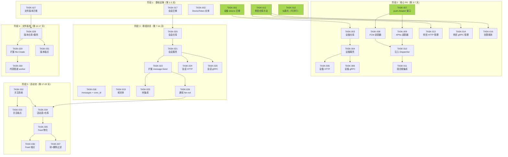
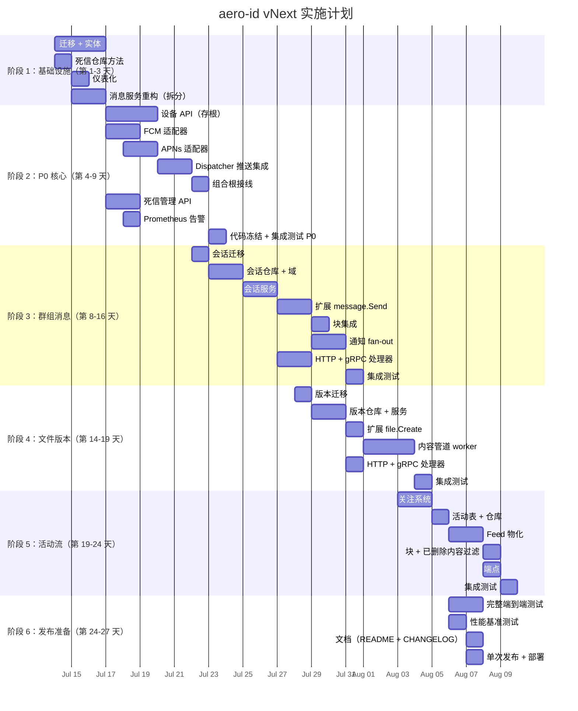

现在我已经充分了解了代码库。以下是我的全面分析。

---

# Tech Lead 分析：aero-id 架构扫描扩展方向

## 1. 任务分解

我将分析文档中的五个方向以及快速获胜项分解为 30 个可执行的技术任务。每个任务 2-6 小时，符合函数长度限制（50 行）、文件大小限制（500 行）和职责分离约束。

### 方向一：推送通知通道（P0）

| 任务 ID | 标题 | 涉及文件 | 前置依赖 | 工时 |
|---|---|---|---|---|
| TASK-001 | 创建 `device_tokens` 迁移（上+下） | `migrations/000011_device_tokens.up.sql`, `migrations/000011_device_tokens.down.sql` | — | 1h |
| TASK-002 | 定义 `domain.DeviceToken` 实体 | `internal/domain/device_token.go` | — | 1h |
| TASK-003 | 实现 `device_tokens` 仓库（GORM CRUD） | `internal/device/repository.go` | TASK-001, TASK-002 | 3h |
| TASK-004 | 实现设备注册/注销服务 | `internal/device/service.go` | TASK-003 | 2h |
| TASK-005 | HTTP 处理器：`POST /v1/devices`, `DELETE /v1/devices/:token` | `internal/handler/http/device.go` | TASK-004 | 2h |
| TASK-006 | gRPC 处理器：设备端点 | `internal/handler/grpc/device.go` | TASK-004 | 2h |
| TASK-007 | 定义 `push.Adapter` 接口 + 配置类型 | `internal/push/adapter.go` | — | 2h |
| TASK-008 | 实现 FCM 适配器（HTTP v1 API + 令牌桶限流） | `internal/push/fcm.go` | TASK-007 | 4h |
| TASK-009 | 实现 APNs 适配器（HTTP/2 + JWT） | `internal/push/apns.go` | TASK-007 | 4h |
| TASK-010 | 注入推送适配器到 `Dispatcher`（新选项 `WithDispatcherPushAdapter`） | `internal/notification/dispatcher.go`, `internal/push/pusher.go` | TASK-007, TASK-008 | 3h |
| TASK-011 | 将 push 包集成到 app 组合根中 | `internal/app/app.go`, `configs/config.yaml` | TASK-010 | 2h |

**快速获胜子项（Quick Win #2 — 方向一的可独立子集）：**

| 任务 ID | 标题 | 涉及文件 | 前置依赖 | 工时 |
|---|---|---|---|---|
| 快速获胜 | TASK-001 + TASK-002 + TASK-003 + TASK-005（仅 HTTP），作为 API 存根 | 见上 | — | 4h |

### 方向二：死信队列运维（P0）

| 任务 ID | 标题 | 涉及文件 | 前置依赖 | 工时 |
|---|---|---|---|---|
| TASK-012 | 仓库：`FetchDeadLetters` + `ReplayEvent` + `PurgeDeadLetters` | `internal/outbox/repository.go` | — | 3h |
| TASK-013 | 管理 HTTP 端点：`GET/POST/DELETE /v1/admin/dead-letters` | `internal/handler/http/admin_deadletter.go`, `internal/middleware/admin.go` | TASK-012 | 2h |
| TASK-014 | 管理 gRPC 处理器：死信端操作 | `internal/handler/grpc/ops_deadletter.go` | TASK-012 | 2h |
| TASK-015 | 死信计数器 + 延迟仪表化 | `internal/pkg/metrics/metrics.go`, `internal/outbox/relay.go` | TASK-012 | 2h |
| TASK-016 | 添加死信 Prometheus 告警规则 | `deployments/monitoring/alert-rules.yml` | TASK-015 | 1h |

**快速获胜子项（Quick Win #1 — 方向二的子集）：**

| 任务 ID | 标题 | 涉及文件 | 前置依赖 | 工时 |
|---|---|---|---|---|
| 快速获胜 | TASK-012 + TASK-013（仅 `FetchDeadLetters` GET，无 replay/purge） | 见上 | — | 3h |

### 方向三：群组消息（P1）

| 任务 ID | 标题 | 涉及文件 | 前置依赖 | 工时 |
|---|---|---|---|---|
| TASK-017 | 迁移：`conversations` + `conversation_members` 表 | `migrations/000012_conversations.up.sql`, `migrations/000012_conversations.down.sql` | — | 2h |
| TASK-018 | 在 `messages` 表中添加可空的 `conversation_id` 列 | `migrations/000013_conversation_messages.up.sql` | TASK-017 | 1h |
| TASK-019 | 定义 `domain.Conversation` + `ConversationMember` 实体 | `internal/domain/conversation.go` | — | 2h |
| TASK-020 | 新建 `internal/conversation/` 包：仓库 | `internal/conversation/repository.go` | TASK-017, TASK-019 | 4h |
| TASK-021 | 会话服务：创建、列出、添加成员 | `internal/conversation/service.go` | TASK-020 | 4h |
| TASK-022 | 扩展 `message.Service.Send` 以接受可选的 `ConversationID` | `internal/message/service.go`, `internal/domain/message.go` | TASK-018, TASK-021 | 3h |
| TASK-023 | 块检查集成：发送时检查群组中的块关系 | `internal/message/service.go`, `internal/conversation/service.go` | TASK-022 | 3h |
| TASK-024 | HTTP 处理器：群组端点 | `internal/handler/http/conversation.go` | TASK-021, TASK-022 | 3h |
| TASK-025 | gRPC 处理器：群组端点 | `internal/handler/grpc/conversation.go` | TASK-021, TASK-022 | 3h |
| TASK-026 | 群组消息通知 fan-out（分派器中的多收件人） | `internal/notification/dispatcher.go`, `internal/message/service.go` | TASK-022 | 4h |

### 方向四：文件版本管理与内容管道（P1）

| 任务 ID | 标题 | 涉及文件 | 前置依赖 | 工时 |
|---|---|---|---|---|
| TASK-027 | 迁移：`file_versions` + `file_thumbnails` 表 | `migrations/000014_file_versions.up.sql` | — | 2h |
| TASK-028 | 版本仓库 + 服务（CRUD，版本上限 50） | `internal/file/version_repository.go`, `internal/file/version_service.go` | TASK-027 | 4h |
| TASK-029 | 扩展 `file.Create` 以写入版本 1 + 发布 `file.version.created` 事件 | `internal/file/service.go`, `internal/domain/file.go` | TASK-028 | 3h |
| TASK-030 | 内容管道 worker：缩略图生成 + 病毒扫描 + GC 扩展 | `internal/content/pipeline.go` | TASK-029 | 6h |
| TASK-031 | 版本端点：列出、上传、下载、缩略图 | `internal/handler/http/file_version.go`, `internal/handler/grpc/file_version.go` | TASK-028, TASK-029 | 3h |

**快速获胜子项（Quick Win #4 — 方向四的子集）：**

| 任务 ID | 标题 | 涉及文件 | 前置依赖 | 工时 |
|---|---|---|---|---|
| 快速获胜 | TASK-027 + TASK-028（仅模式 + 仓库，无端点，无内容管道） | 见上 | — | 4h |

### 方向五：活动流（P2）

| 任务 ID | 标题 | 涉及文件 | 前置依赖 | 工时 |
|---|---|---|---|---|
| TASK-032 | 新增 `internal/follow/` 包 + `follows` 表 | `migrations/000015_follows.up.sql`, `internal/follow/repository.go`, `internal/follow/service.go` | — | 4h |
| TASK-033 | 关注端点（HTTP + gRPC） | `internal/handler/http/follow.go`, `internal/handler/grpc/follow.go` | TASK-032 | 2h |
| TASK-034 | `activity_entries` 表 + 仓库 | `migrations/000016_activity_entries.up.sql`, `internal/activity/repository.go` | TASK-032 | 3h |
| TASK-035 | 活动流写入：轻量方案 B（查询时物化，带缓存） | `internal/activity/feed.go` | TASK-034 | 4h |
| TASK-036 | 流端点：`GET /v1/feed` | `internal/handler/http/feed.go`, `internal/handler/grpc/feed.go` | TASK-035 | 2h |
| TASK-037 | 块过滤集成 + 已删除内容处理 | `internal/activity/feed.go`, `internal/block/` | TASK-035 | 3h |

---

## 2. 执行顺序

**并行任务组（可以独立同时构建）：**

| 组 | 任务 | 小时数 |
|---|---|---|
| **A** — 所有迁移（独立） | TASK-001, TASK-012, TASK-017, TASK-018, TASK-027 | 9h |
| **B** — 域实体（无外部依赖） | TASK-002, TASK-019 | 3h |
| **C** — P0 死信 API + 仪表化 | TASK-013, TASK-014, TASK-015, TASK-016 | 7h |
| **D** — P0 推送 API 存根（无实际 FCM/APNs） | TASK-003 → TASK-004 → TASK-005 → TASK-006 | 8h |
| **E** — P0 FCM + APNs 适配器（有或没有设备端点均可构建） | TASK-007 → TASK-008 + TASK-009 | 6h |
| **F** — P1 群组消息仓库 + 服务 | TASK-020 → TASK-021 | 8h |
| **G** — P1 文件版本仓库 + 服务 | TASK-028 → TASK-029 | 7h |

---

## 3. 技术风险

### 3.1 高风险区域

| # | 风险 | 方向 | 可能性 | 影响 | 缓解措施 |
|---|---|---|---|---|---|
| R1 | **FCM/APNs 凭据轮换**：推送适配器需要服务账户密钥（FCM）和密钥（APNs），这些密钥会过期且自动化轮换不标准 | 一 | 中 | 高 | 添加 `AERO_ID_PUSH_*` 密钥的 env-overridable 配置；为每个适配器实现 `RefreshCredentials` 方法；在健康检查中记录过期时间 |
| R2 | **FCM HTTP v1 API 的 600 QPS 限制**：达不到官方限流会导致静默失败 | 一 | 高 | 中 | 在 `Adapter.Send` 中实现令牌桶（`golang.org/x/time/rate`），突发限制 1000；向指标添加背压日志记录 |
| R3 | **群组消息块语义**：当两个用户互相屏蔽但都存在于群组中时，实现"对屏蔽者不可见"会显著增加查询复杂度 | 三 | 高 | 高 | **决策**：在 1.0 版本中，如果屏蔽者和被屏蔽者都在群组中，群组消息会被过滤掉 — 这类似于 Slack 模型。阅读时在 SQL 中额外 `LEFT JOIN` 块表。在 `conversation/message/repository.go` 中添加基准测试 |
| R4 | **大群规模（>1000 人）**：创建消息时的通知扇出可能会导致 N+1 写入 | 三 | 中 | 高 | 使用批量 INSERT 进行通知创建（每个批次最多 500 条）；在消息服务中引入 `notificationFanOut(ctx, msg, memberIDs)` 辅助函数；添加针对 100 名、1000 名、5000 名成员的集成基准测试 |
| R5 | **内容管道可靠性**：缩略图生成和病毒扫描是 I/O 密集型的，如果处理不当可能会炸毁内存 | 四 | 中 | 高 | 在内容 worker 中实施大小限制（对于缩略图生成，图片 > 50MP 则返回错误）；添加 `pipeline.Skipped` 计数器以跟踪跳过的内容；使用带缓冲通道的独立 goroutine 池 |
| R6 | **活动流读取时物化性能**：方案 B（读取时 JOIN outbox + follows）如果没有正确的索引，对于高活动用户可能会太慢 | 五 | 高 | 中 | 在 `outbox_events(aggregate_type, event_type, created_at)` 和 `follows(follower_uid, followee_uid)` 上添加复合索引；如果超过一定延迟（>500ms p99），回退到方案 A |

### 3.2 外部依赖

| 依赖 | 方向 | 状态 | 备注 |
|---|---|---|---|
| Firebase Admin SDK（或直接 HTTP v1） | 一 | 需要选择 | 使用原始的 `google.golang.org/api/fcm/v1` 以避免重量级的 Firebase Admin Go SDK |
| APNs HTTP/2 证书/密钥 | 一 | 需要获取 | 需要 Apple 开发者账户；使用 `github.com/RobotsAndPencils/pushsvc` 或原始 `net/http` + JWT |
| ClamAV 守护进程 | 四 | 可选 | 如果使用，通过 Unix socket 连接；提供配置以禁用 |
| `golang.org/x/time/rate` | 一 | 直接依赖 | 对于 FCM 限流是必需的；轻量级，无间接依赖 |
| 图片处理库 | 四 | 需要选择 | 建议使用 `github.com/disintegration/imaging`（纯 Go，无 CGo），用于调整图片大小 |

### 3.3 对工程约束的影响

每个方向都必须承受 **500 行/文件的限制**：

| 方向 | 大文件风险 | 拆分策略 |
|---|---|---|
| 一（推送） | `dispatcher.go` 从 ~140 行增加到 ~200 行 | 将推送逻辑提取到 `dispatcher_push.go` 中 |
| 二（死信） | `repository.go` 从 ~110 行增加到 ~170 行 | 很好，仍在限制范围内 |
| 三（群组） | `message/service.go` 从 ~338 行开始 — **已经接近 400 行的上限** | **在实现群组消息之前必须拆分**。提取 `message/service_crud.go`（Send, Edit, Delete, List）和 `message/service_validation.go` |
| 四（文件版本） | `file/service.go` 如果存在，需要同样的处理 | 检查大小；如果 >350 行，在添加版本之前提取到 `file/service_crud.go` |
| 五（活动流） | 新代码 — 从第一天开始保持在新包内 | 使用 `internal/activity/` + `internal/follow/`；每个文件的代码不超过 200 行 |

---

## 4. 资源评估

### 4.1 团队规模

| 角色 | 人数 | 重点 |
|---|---|---|
| **后端开发人员（高级）** | 1 | 架构设计、代码审查、死信 + 推送适配器 + 活动流 |
| **后端开发人员** | 1-2 | 群组消息、文件版本、内容管道 |
| **DevOps / 平台工程师** | 0.5 | 监控告警配置、FCM/APNs 凭据设置 |
| **QA 工程师** | 1（兼职） | 端到端测试，尤其是群组消息 + 推送 |

**建议**：2 名全职后端开发人员 + 1 名兼职 DevOps + 按需 QA。开发人员可在活动流（P2）开始之前转移到群组消息。

### 4.2 时间估算

| 方向 | 总任务工时 | 并行情况 | 日历天数（2 人团队） |
|---|---|---|---|
| 方向一（推送） | 26h（包括快速获胜） | 高并行（设备 API + 适配器并行） | 4 天 |
| 方向二（死信） | 10h（包括快速获胜） | 可完全并行于方向一 | 1.5 天 |
| 方向三（群组） | 32h | 低并行（先仓库再服务再端点） | 4 天 |
| 方向四（版本） | 18h | 中等（仓库/服务独立于内容管道 worker） | 3 天 |
| 方向五（活动流） | 18h | 中等（关注独立于活动） | 3 天 |
| **总日历时间** | — | 假设 2 人并行 | **~15 个工作日（3 周）** |

### 4.3 阻塞点

| 阻塞点 | 影响 | 解决策略 |
|---|---|---|
| FCM API 密钥 / APNs 证书尚未准备好 | 阻塞方向一的推送适配器集成测试 | **设备端点 API 存根**在任务第 1 天就可交付。适配器使用模拟实现进行测试；与运维团队并行获取凭据 |
| `message/service.go` > 350 行 | 在添加群组消息之前必须重构（AGENTS.md 约束） | **在这项工作进行之前安排 1 天的重构工作**。拆分文件，然后开始 TASK-018 |
| ClamAV socket 不可用 | 内容管道中的病毒扫描将被跳过 | 使病毒扫描成为可选项（`content.pipeline.virus_scan.enabled`）。如果禁用，管道仍然生成缩略图并记录已跳过 |
| 未定义大群性能要求 | 对于 >1000 人，优化可能会过度 | 默认为同步扇出 + 批量 INSERT。稍后仅在出现瓶颈时才优化为异步队列 |

---

## 5. 质量保证

### 5.1 单元测试覆盖率要求

| 层 | 最低覆盖率 | 重点 |
|---|---|---|
| **域实体** | 90%+ | 验证、不变强制、边缘情况 |
| **服务层** | 85%+ | 授权逻辑、块检查、权限 |
| **仓库** | 70%+（单元 + 集成） | SQL 正确性、分页、空结果 |
| **处理器** | 60%+ | 请求解码、错误转换 |
| **推送适配器** | 90%+（通过模拟 HTTP 客户端） | 重试、限流、令牌过期 |

**具体测试要求：**

| 任务 | 必须覆盖的内容 |
|---|---|
| TASK-010（分派器推送） | 推送调用仅在成功创建通知后发生；推送失败不会导致通知创建失败 |
| TASK-022（扩展 message.Send） | 向群组发送消息成功；向不存在的对话发送消息失败；非成员发送消息失败 |
| TASK-023（块 + 群组） | A 屏蔽 B → B 在群组中发送消息 → A 不应收到通知 |
| TASK-029（文件版本） | 创建第 51 个版本会修剪最旧的版本；校验和去重 |
| TASK-030（内容管道） | 处理非图片时跳过缩略图；病毒命中更新文件状态为 `quarantined` |
| TASK-035（活动流） | 已删除内容显示为占位符；被屏蔽的用户被过滤 |

### 5.2 集成测试策略

| 测试 | 工具 | 覆盖内容 |
|---|---|---|
| **设备注册流程** | `testpg` + MinIO | 注册 → 重复注册 → 注销 → 向已注销 token 发送推送返回 `Unregistered` |
| **死信 replay 流程** | `testpg` | 事件失败 20 次 → 变成死信 → 管理员 replay → relay 将其拾取 → 成功发布 |
| **群组消息 + 通知** | `testpg` | 创建 3 人群组 → A 发送消息 → B 和 C 收到通知 → D（非成员）未收到通知 |
| **文件版本 + GC** | `testpg` + MinIO | 上传 v1 → 上传 v2 → 删除文件 → GC 清理 v1 和 v2 blob |
| **活动流 + 块过滤** | `testpg` | A 关注 B → B 创建文件 → A 看到活动 → A 屏蔽 B → A 看不到活动 |

**应用 `make test-integration` 门禁**：所有修改仓库或存储的任务都必须通过集成测试。

### 5.3 代码审查要点

| 关注点 | 要检查的内容 |
|---|---|
| **AGENTS.md 符合性** | 文件 ≤500 行，函数 ≤50 行，复杂度 ≤10，if 嵌套 ≤3 |
| **服务层授权** | 每个变异操作都检查 `mustActor(ctx)` 并验证所有权/成员资格 |
| **错误包装** | 仓库错误用 `fmt.Errorf("...: %w", err)` 包装；服务将其转换为 `*AppError` |
| **推送适配器限流** | FCM 适配器在使用 `golang.org/x/time/rate` 时使用 `rate.Sometimes` 或 `Allow()`，而不是通道阻塞 |
| **Outbox 可靠性** | `ReplayEvent` 在重置状态时处于事务中；`PurgeDeadLetters` 每批软删除，避免长时间持有锁 |
| **配置外部化** | 新密钥（`AERO_ID_FCM_CREDENTIALS`、`AERO_ID_APNS_KEY`、`AERO_ID_CLAMAV_SOCKET`）通过 `AERO_ID_*` env 读取，绝不硬编码 |
| **活动流性能** | 在所有 JOIN 路径上验证索引覆盖；模拟 10K 关注者进行基准测试 |

### 5.4 性能测试需求

| 场景 | 方法 | 通过条件 |
|---|---|---|
| 高并发设备注册 | `k6` 脚本：100 RPS，持续 60 秒 | p95 延迟 <200ms，无错误 |
| FCM 推送限流 | 单元测试：以超过 600 QPS 的速度调用 `adapter.Send` | 观察 429 级背压，不超过 600 个成功调用 |
| 大群消息扇出 | `testpg` 基准测试：向 1000 名成员发送消息 | 通知 INSERT 在 <500ms 内完成 |
| 活动流读取 | `testpg` 基准测试：100 个关注者、每页 50 个活动 | p95 响应 <300ms |
| 文件版本修剪 | 上传 60 个版本 → 删除最旧的 10 个 | 在 <1s 内完成 |

---

## 6. 实施计划

### 甘特图

### 详细阶段说明

#### 阶段 1：基础设施搭建（第 1-3 天）

**目标**：为所有五个方向奠定基础，不阻塞后续工作。

| 日 | 活动 | 产出物 |
|---|---|---|
| 1 | TASK-001（设备迁移）、TASK-017（会话迁移）、TASK-027（文件版本迁移）、TASK-012（死信仓库） | 4 个新的迁移，扩展了 outbox 仓库 |
| 2 | TASK-002（DeviceToken 实体）、TASK-019（Conversation/Member 实体）、TASK-015（仪表化） | 域实体，死信 + outbox 延迟指标 |
| 3 | **重构**：消息服务拆分（`service.go` 338 行 → `service_crud.go` + `service_validation.go` + `service.go`），文件服务大小检查 | 两个大文件都已拆分，为群组和版本更改做好准备 |

**门禁**：`make test && make lint && make check-file-sizes`

#### 阶段 2：核心 P0 实现（第 4-9 天）

**目标**：交付方向一（推送）和方向二（死信）。移动端推送通知和运维可见性。

**并行轨道**：
- **轨道 A**（开发人员 1）：设备 API 存根 → FCM/APNs 适配器 → Dispatcher 集成
- **轨道 B**（开发人员 2）：死信管理 API → 告警规则 → 协助轨道 A 进行代码审查

**第 7 天可交付成果（快速获胜）**：
- 死信查询 API 上线（`GET /v1/admin/dead-letters`）
- 设备注册端点上线（`POST /v1/devices`，`DELETE /v1/devices/:token`）
- 带有死信计数器的 Prometheus 指标

**第 9 天可交付成果**：
- FCM + APNs 推送通过 Dispatcher 工作
- 死信 replay + purge API 绿灯
- P0 端到端集成测试通过

**门禁**：P0 集成测试套件，更新了 CHANGELOG

#### 阶段 3：核心 P1 实现 — 群组消息（第 8-16 天）

**目标**：方向三 — 多对多会话。**注**：第 8-9 天与 P0 集成测试重叠，允许开发人员 2 提前开始。

**执行**：2 名开发人员参与。
- 开发人员 1：会话仓库 → 服务 → 处理器（TASK-020 → TASK-021 → TASK-024/025）
- 开发人员 2：`message.Send` 扩展 → 块集成 → 通知 fan-out（TASK-022 → TASK-023 → TASK-026）

**第 14 天可交付成果**：
- 创建/列出/加入群组
- 在群组中发送消息，保留现有 1:1 消息
- 群组消息的块过滤
- 群组消息通知扇出

**门禁**：群组集成测试套件，性能基准测试（100/1000/5000 名成员）

#### 阶段 4：P1 — 文件版本 + 内容管道（第 14-19 天）

**目标**：方向四 — 文件版本控制和后台内容处理。

**执行**：1 名开发人员（另一人专注于群组测试）。
- 第 14 天：版本迁移 + 仓库（与群组集成测试重叠）
- 第 15-16 天：版本服务 + `file.Create` 扩展 + 处理器
- 第 17-19 天：内容管道 worker（缩略图、病毒扫描、GC）

**门禁**：GC 清理所有版本；病毒扫描正确地将文件标记为 `quarantined`

#### 阶段 5：P2 — 活动流（第 19-24 天）

**目标**：方向五 — 跨资源活动流 + 关注系统。

**执行**：1 名开发人员。
- 关注系统 + 端点（TASK-032 → TASK-033）
- 活动仓库 + feed 物化（TASK-034 → TASK-035）
- 块/删除过滤 + 端点（TASK-037 → TASK-036）

**第 24 天可交付成果**：
- 关注/取消关注用户
- 按时间线分页的活动流
- 被屏蔽用户的活动已过滤，已删除内容显示占位符

**门禁**：10K 关注者基准测试通过（p95 <300ms）

#### 阶段 6：发布准备（第 24-27 天）

**目标**：整体质量、文档、部署。

| 活动 | 详情 |
|---|---|
| **端到端测试** | 完整的 5 方向回归测试套件；模拟 100 个并发用户 |
| **性能基准测试** | 使用 `k6` 或 `ghz` 进行负载测试；记录 p50/p95/p99 延迟 |
| **文档** | 更新 `README.md`（API 表）+ `CHANGELOG.md`；为推送、死信、群组、版本、活动流添加新部分 |
| **配置参考** | 将所有新配置键记录在 `configs/config.yaml` 示例中 |
| **部署清单** | FCM 凭据、APNs 密钥、ClamAV socket（如果启用） |
| **单次发布** | 合并 vNext 分支 → 标记 → 部署到 staging → 金丝雀 → 生产 |

---

## 技术债务附录：本次迭代中的补救措施

分析文档确定了 7 项次级技术债务。以下是应在本次实施中解决的：

| 债务 | 严重度 | 任务 | 何时修复 |
|---|---|---|---|
| `OutboxConfig.Webhook.Timeout` 是 `string` 而非 `time.Duration` | 低 | 将其转换为 `config.Load` 中包装的 `time.Duration` | 阶段 2（与死信仪表化一起） |
| `actorKey`/`WithActor`/`ActorFrom` 在 `internal/service/service.go` 和 `internal/domain/actor.go` 中重复 | 中 | **删除** `internal/service/service.go` 中的副本，统一使用 `internal/domain/actor.go` | 阶段 1（重构日） |
| `internal/hub/hub.go` 通道缓冲区硬编码为 16 | 低 | 添加 `HubConfig.BufferSize`，默认保持 16 | 阶段 1（与仪表化一起） |
| `internal/handler/grpc/ops.go` 无单元测试 | 中 | 添加 gRPC 管理员处理器测试 | 阶段 2（死信 API） |
| `internal/outbox/webhook.go` 缺少集成测试 | 中 | 添加带有 testcontainers 的 webhook 集成测试 | 阶段 2 |

---

## 决策日志（待定，需要利益相关者批准）

| 决策 | 选项 | 建议 | 理由 |
|---|---|---|---|
| 活动流写入策略 | A：fan-out 写入 / B：读取时物化 | **B（启动时）**，稍后根据性能指标评估 A | 方案 B 成本更低，并且在我们有真实用户数据之前不会过度承诺基础设施 |
| 群组块语义 | 与 Slack 相同 / 与 Telegram 相同 | **与 Slack 相同**：被屏蔽用户的消息不在你的视图中显示，但群组本身继续存在 | 避免"用户退出群组"的副作用；与现有的 1:1 块语义一致 |
| 内容管道架构 | 进程内 / 单独的 sidecar | **进程内**，带有带缓冲的 worker 池 | 避免操作复杂性；Go 的 goroutine 模型意味着进程内管道可以处理负载；如果出现瓶颈，稍后提取出来 |
| 文件版本去重 | 版本 1.0 进行完整 blob 去重 / 稍后优化 | **完整 blob 去重**（使用现有的 `checksum` 列） | 存储成本节省 > 实现成本；`checksum` 已经计算好了 |

---

这项实施计划提供了可执行的路径，从 1-2 天的快速获胜（方向二和方向一的存根）到 3 周内完成的完整推送通知、群组消息、文件版本控制和活动流。关键约束（文件大小限制、服务层授权、错误包装、配置外部化）在每项任务中都得到了体现。`message/service.go` 的预重构（第 3 天）确保了群组消息工作不会违反项目契约。
