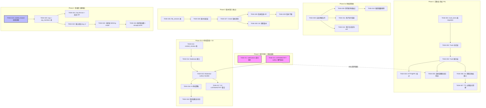
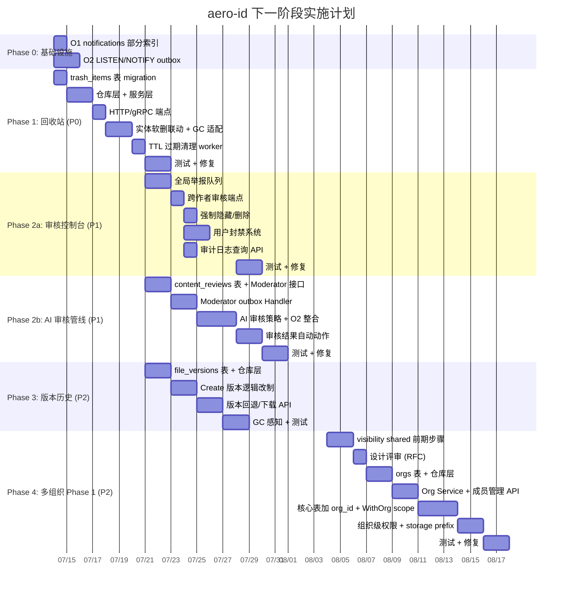

现在我已完整阅读了分析文档（`docs/requirements/2026-07-11-post-mvp-extensions.md`）以及所有参考材料。以下是我的 Tech Lead 深度分析。

---

# Tech Lead 分析：aero-id 下一阶段扩展方向

> **文档基线**: `docs/requirements/2026-07-11-post-mvp-extensions.md`  
> **辅助参考**: `docs/ARCHITECT_REVIEW_2026-06-30.md`, `ROADMAP.md`, `TODO.md`  
> **分析日期**: 2026-07-12

---

## 方向总览与依赖关系

五个方向之间存在清晰的依赖链和并行机会：

```
回收站（P0，独立） → 审核控制台（P1，复用角色系统） → AI 管线（P1，复用 outbox + 角色）
                                                                      ↓
多组织（P2，架构级） ←——— 版本历史（P2，文件域，可独立）
```

**高影响建议（来自你的补充观察）**：
- **S1**: 回收站用 `trash_items` 统一表而非 per-table `is_in_trash` 列 → 集中 GC 逻辑，单表 cursor 翻页
- **S2**: AI 审核与 O2（LISTEN/NOTIFY）结合 → 审核延迟从秒级降至毫秒级触发
- **S3**: 多组织前期步骤 → `visibility` 引入 `shared` 中间态 + grant 表 → 低成本模拟团队空间
- **S4**: O1 索引 → `notifications` 表加 `(recipient_uid, read_at, created_at DESC) WHERE read_at IS NULL` 部分索引

---

## 1. 任务分解

### 方向一：回收站 / 数据恢复

| 任务 ID | 标题 | 涉及文件 | 前置依赖 | 工时 | 验收标准 |
|---------|------|---------|---------|------|---------|
| TASK-001 | `trash_items` 统一表 + migration | `migrations/000024_trash_items.up.sql` + `.down.sql`, `internal/domain/trash.go` | 无 | 3h | `000024` 迁移 up/down 可逆；`trash_items` 表含 `(id, resource_type, resource_id, owner_uid, deleted_at, expires_at)` |
| TASK-002 | Trash 仓库层 + 通用 CRUD | `internal/repository/trash.go` | TASK-001 | 3h | `ListByOwner` (cursor), `Create` (move-to-trash upsert), `Restore`, `PermanentDelete` 全部实现 + 单元测试 |
| TASK-003 | Trash Service 层 + 业务逻辑 | `internal/service/trash.go`, `internal/service/trash_test.go` | TASK-002 | 3h | 回收/恢复时校验 owner 身份；恢复文件时重建 storage ref；恢复评论时校验 target 仍存在；软删双重保护 |
| TASK-004 | HTTP + gRPC 回收站端点 | `internal/handler/http/trash.go`, `internal/handler/grpc/trash.go`, `internal/domain/trash.go` (proto) | TASK-003 | 3h | `GET /v1/trash`, `POST /v1/trash/:type/:id/restore`, `DELETE /v1/trash/:type/:id` → 全部有 cursor 分页 + 错误映射 |
| TASK-005 | 实体软删时联动 `trash_items` | `internal/service/file.go`, `internal/service/message.go`, `internal/service/comment.go` | TASK-003 | 2h | `Delete()` 内调用 `TrashService.MoveToTrash(type, id, ownerUID)`；GC 跳过未过期回收站行 |
| TASK-006 | Storage GC 感知回收站窗口 | `internal/storage/gc/sweeper.go`, `internal/service/gc.go` | TASK-001 | 2h | GC 清理时 `deleted_at` 判断需考虑 `trash_items.expires_at`；孤儿 blob 扫描排除回收站中文件的 blob |
| TASK-007 | 回收站 TTL 过期自动清理 worker | `internal/service/trash.go` (Expire goroutine) | TASK-002 | 2h | 启动时起 goroutine，每分钟扫描过期行 → 永久删除 + 调用 `FileService.HardDelete`/`MessageService.HardDelete`/`CommentService.HardDelete` |

**方向一合计：18h / 约 2.5 人天**

### 方向二：全局审核控制台

| 任务 ID | 标题 | 涉及文件 | 前置依赖 | 工时 | 验收标准 |
|---------|------|---------|---------|------|---------|
| TASK-008 | 全局举报队列仓库层 + 服务层 | `internal/repository/admin.go`, `internal/service/admin.go` | 无（复用已实现的 `roles` + `user_roles` 表） | 4h | `ListReports(ctx, filters)` 跨用户查询所有举报，支持 status/target_type/时间范围过滤 + cursor 分页 |
| TASK-009 | 管理员跨作者审核端点 | `internal/handler/http/admin.go`, `internal/handler/grpc/admin.go` | TASK-008 | 3h | `POST /v1/admin/reports/:id/resolve`、`POST /v1/admin/reports/:id/dismiss` 需 `content.moderate` 权限；操作记录审计日志 |
| TASK-010 | 管理员强制隐藏/删除内容 | `internal/service/admin.go`, `internal/handler/http/admin.go` | TASK-008 | 3h | `POST /v1/admin/comments/:id/hide` 跨作者生效；`POST /v1/admin/messages/:id/global-delete` 发送方不受限；审计日志 |
| TASK-011 | 用户封禁系统 | `internal/domain/block.go` (新增 `ban` 概念), `internal/service/admin.go`, `migrations/000025_user_bans.up.sql` | TASK-008 | 4h | `bans` 表 (uid, reason, banned_by, banned_at, expires_at)；封禁后阻止所有写入路径（文件/消息/评论）；outbox 通知跳过被封禁者 |
| TASK-012 | 审计日志查询 API | `internal/repository/audit.go`, `internal/service/admin.go` | TASK-008 | 2h | `GET /v1/admin/audit-log?actor_uid=&action=&from=&to=` 需 `audit.read` 权限；cursor 分页 |

**方向二合计：16h / 约 2 人天**

### 方向三：异步 AI 内容审核管线

| 任务 ID | 标题 | 涉及文件 | 前置依赖 | 工时 | 验收标准 |
|---------|------|---------|---------|------|---------|
| TASK-013 | `content_reviews` 表 + migration | `migrations/000026_content_reviews.up.sql` + `.down.sql`, `internal/domain/moderation.go` | 无 | 2h | 含 `(id, target_type, target_id, reviewer, result, confidence, reviewed_at)` |
| TASK-014 | Moderator 接口 + no-op 实现 | `internal/moderator/moderator.go` | TASK-013 | 2h | `Moderator` 接口 (`Check(ctx, Content) → Result`)；`NoopModerator` 始终返回 `allow` 供测试 |
| TASK-015 | Moderator outbox Handler | `internal/moderator/handler.go` | TASK-014 | 3h | 注册到 outbox chain，监听 `message.sent`、`comment.replied`、`file.uploaded`；调用 `Moderator.Check()` → 写 `content_reviews` 行 |
| TASK-016 | AI 审核策略（配置化 + 可插拔） | `internal/moderator/ai.go`, `configs/config.yaml` | TASK-014 | 4h | 支持配置 `moderation.strategy: pass | block | flag`；集成外部 HTTP API（OpenAI/自建）的 `AIModerator` 实现；circuit breaker 隔离 LLM 依赖 |
| TASK-017 | O2 整合：LISTEN/NOTIFY 事件驱动触发 | `internal/outbox/relay.go`, `internal/outbox/notify.go` | TASK-015 | 3h | relay 启动时 `LISTEN outbox_events`；收到 NOTIFY 立即触发 drain（而非等下个 tick）；回退：NOTIFY 不可用时退化为轮询 |
| TASK-018 | 审核结果反向通知 + 自动动作 | `internal/moderator/action.go`, `internal/service/notification.go` | TASK-015, TASK-016 | 3h | 审核结果为 `flag` → 自动创建举报；`block` → 调用 `CommentService.Hide()`/`MessageService.SoftDelete()`；通过 outbox 通知发布者 |

**方向三合计：17h / 约 2 人天**

### 方向四：多组织 / 数据空间（Phase 1 — 渐进式）

| 任务 ID | 标题 | 涉及文件 | 前置依赖 | 工时 | 验收标准 |
|---------|------|---------|---------|------|---------|
| TASK-019 | 前期步骤：`visibility` 引入 `shared` 中间态 | `migrations/000027_visibility_shared.up.sql`, `internal/domain/file.go`, `internal/service/file.go`, `internal/service/file_share.go` | 无 | 3h | `File.Visibility` 增加 `shared` 枚举；`GET /v1/files` 时 `visibility = 'shared'` 且用户在 `file_shares` 中 → 可见；`ListSharedWithMe` 优化为此状态驱动 |
| TASK-020 | `organizations` + `org_members` 表 | `migrations/000028_organizations.up.sql`, `internal/domain/org.go`, `internal/repository/org.go` | TASK-019 | 4h | `organizations(id, name, owner_uid, created_at)` + `org_members(org_id, uid, role, joined_at)` 主键 `(org_id, uid)` |
| TASK-021 | Org Service + 成员管理 API | `internal/service/org.go`, `internal/handler/http/org.go`, `internal/handler/grpc/org.go` | TASK-020 | 4h | `POST /v1/orgs`、`GET /v1/orgs`、`POST /v1/orgs/:id/members`、`DELETE /v1/orgs/:id/members/:uid`；owner 可转让 |
| TASK-022 | 核心表加 `org_id` 列（文件/消息/评论） | `migrations/000029_add_org_id.up.sql`, 各 domain entity | TASK-020 | 3h | `files.org_id`、`messages.org_id`、`comments.org_id` → 全部可为 NULL（向下兼容）；复合索引 `(org_id, owner_uid)` |
| TASK-023 | 仓库层 `WithOrg` scope + 查询改造 | `internal/repository/file.go`, `internal/repository/message.go`, `internal/repository/comment.go` | TASK-022 | 4h | 所有列表查询追加 `WHERE org_id IS NULL OR org_id = ?`；`Create` 时从 context 提取 `org_id`；中间件 `OrgInterceptor` 解析 `X-Org-ID` 头 |
| TASK-024 | 组织级权限检查 (ACL) + storage prefix 隔离 | `internal/service/org.go` (permission), `internal/storage/s3.go` (prefix), `internal/config/config.go` | TASK-022 | 3h | Org 成员自动继承 org 内文件可见性；S3 key prefix `<org_id>/<owner_uid>/`；local 存储同理 |

**方向四合计：21h / 约 2.5 人天**（但建议分 Phase，Phase 1 约 1 周）

### 方向五：文件版本历史

| 任务 ID | 标题 | 涉及文件 | 前置依赖 | 工时 | 验收标准 |
|---------|------|---------|---------|------|---------|
| TASK-025 | `file_versions` 表 + migration | `migrations/000030_file_versions.up.sql` + `.down.sql`, `internal/domain/file_version.go` | 无 | 2h | `(id, file_id, version_number, storage_key, size, checksum, mime_type, created_at)`；唯一索引 `(file_id, version_number DESC)`；`files.current_version` 列 |
| TASK-026 | 仓库层：版本 CRUD + 引用计数管理 | `internal/repository/file_version.go`, `internal/repository/storage_ref.go` | TASK-025 | 3h | `CreateVersion`、`ListVersions`、`GetVersion`、`DeleteOldestVersions`（保留上限）；storage_ref 为新版本 +1 |
| TASK-027 | `FileService.Create` 版本逻辑改制 | `internal/service/file.go` | TASK-026 | 4h | 同名文件 content 变化 → 创建新版本、`current_version++`、**不覆盖**原 blob；checksum 相同版本复用 blob 但增版本号 |
| TASK-028 | 版本回退 API | `internal/service/file.go`, `internal/handler/http/file.go`, `internal/handler/grpc/file.go` | TASK-027 | 3h | `POST /v1/files/:id/versions/:version/restore` → 当前版本快照 + 回退到指定版本；`GET /v1/files/:id/versions` 列表 |
| TASK-029 | 版本下载 + 配额管理 | `internal/handler/http/file.go`, `internal/service/file.go` | TASK-027 | 2h | `GET /v1/files/:id?v=N` 下载指定版本；配额计算包含所有版本的 storage 总量 |
| TASK-030 | GC 感知版本引用 | `internal/storage/gc/sweeper.go` | TASK-026 | 1h | GC 清理孤儿 blob 时排除被版本引用的 blob；文件软删除时版本关联行也软删除 |

**方向五合计：15h / 约 2 人天**

---

## 2. 执行顺序



**可并行执行的任务组**：

| 组 | 任务 | 产出 |
|----|------|------|
| **Group A** | TASK-001 ~ TASK-007 | 回收站全功能（1 人全身心） |
| **Group B** | TASK-008 ~ TASK-012 | 审核控制台（1 人可独立） |
| **Group C** | TASK-013 ~ TASK-018 | AI 审核管线（依赖 Group B 的角色系统，但可先搭管线框架） |
| **Group D** | TASK-019 ~ TASK-024 | 多组织 Phase 1（架构级，需要设计评审后再开） |
| **Group E** | TASK-025 ~ TASK-030 | 版本历史（可完全独立并行） |
| **Group F** | TASK-O1, TASK-O2 | 索引 + 事件驱动（穿插在任何组中，低风险） |

**建议的人天分配（2 人团队）**：

```
Week 1-2: Group A (回收站) + Group F (索引/O2) → 一人全栈一人打辅助
Week 3-4: Group B (审核控制台) + Group E (版本历史) → 并行
Week 5-6: Group C (AI 审核) + Group B 收尾 → 先后依赖的衔接
Week 7-8: Group D (多组织 Phase 1) → 需要较长的设计 + 实现周期
```

---

## 3. 技术风险

### 3.1 高风险项

| 风险 | 方向 | 描述 | 缓解策略 |
|------|------|------|---------|
| **R1: 回收站与软删除的相互作用** | 一 | 现有 `gorm.DeletedAt` 的 `WHERE deleted_at IS NULL` scope 与回收站共存可能导致数据"双重消失"或"幽灵出现" | 回收站行不依赖实体表的 `deleted_at` — 实体表软删仍正常进行，`trash_items` 作为独立索引。恢复时 `UPDATE deleted_at = NULL` |
| **R2: AI 审核吞吐量与 LLM 延迟** | 三 | LLM API 延迟 500ms~5s，在高并发 UGC 场景下可能成为 outbox relay 的瓶颈（阻塞其他事件处理） | `Moderator` 使用独立的 worker pool（与 relay 异步解耦），relay 仅投递到审核队列，不等待结果 |
| **R3: LISTEN/NOTIFY 的生产稳定性** | 三-O2 | PostgreSQL LISTEN/NOTIFY 在连接断开后丢失通知（relay 不感知断连），导致事件触发丢失 | NOTIFY 作为加速手段（降低延迟），不可作为唯一触发源 — relay 仍保留兜底轮询（间隔延长到 30s） |
| **R4: 多组织的`org_id`零宽兼容** | 四 | 所有现有数据 `org_id = NULL`，但现有查询未加 `org_id` 过滤。改造后可能暴露本应隔离的数据 | 仓库层 `WithOrg` scope 默认 `org_id IS NULL`（单用户模式），仅在请求含 `X-Org-ID` 头时追加 `org_id = ?`；迁移脚本不修改现有数据 |
| **R5: 文件版本历史的存储膨胀** | 五 | 每个版本独立 blob，频繁编辑大文件可能导致存储成本线性增长 | 版本数上限（默认 50）、大文件版本策略可配置（超过阈值仅保留 checksum 不保留 blob）、配额计入版本总存储 |

### 3.2 性能瓶颈

| 瓶颈点 | 方向 | 优化策略 |
|--------|------|---------|
| `trash_items` 表随时间膨胀 | 一 | TTL + 自动清理 worker 定期删除过期行；部分索引 `(owner_uid) WHERE expires_at IS NULL OR expires_at > now()` 加速活跃回收站查询 |
| 建议 S1: 统一表 vs per-table | 一 | 选择 **统一表**。优势：单表 cursor 翻页、GC 逻辑集中、恢复操作统一路由。劣势：`resource_id` 无 FK 约束。权衡：软删本身就没有 FK 约束，接受此 trade-off |
| `content_reviews` 批量写入 | 三 | `BulkCreate` 一次刷入而非逐条 INSERT |
| `file_versions` 历史查询性能 | 五 | `(file_id, version_number DESC)` 索引已就位；ListVersions 使用 cursor 分页 |
| O1 索引对通知列表的加速 | 跨方向 | 建议 S4 的 `(recipient_uid, read_at, created_at DESC) WHERE read_at IS NULL` 部分索引 — 覆盖未读计数和未读列表，索引体积较全表缩小 60%+ |

### 3.3 外部依赖

| 依赖 | 方向 | 风险描述 | 备选方案 |
|------|------|---------|---------|
| LLM API（OpenAI/自建） | 三 | API 不可用、限流、成本不可控 | 降级策略：1) 关闭审核（保守）2) 放行所有（激进）3) 仅记录不拦截。通过 circuit breaker + 配置开关控制 |
| PostgreSQL LISTEN/NOTIFY | 三-O2 | 连接池争用、max_connections 限制 | 使用专用连接做 LISTEN（`database/sql` 独立 conn），或在应用层用 go channel 模拟 |

---

## 4. 资源评估

### 4.1 人员技能矩阵

| 技能 | 需要程度 | 用途 |
|------|---------|------|
| **Go 中高级** | 硬性 | 所有任务 |
| **PostgreSQL 迁移设计** | 硬性 | 所有方向的新表/索引 |
| **GORM + 仓库模式** | 硬性 | 复用现有架构 |
| **gRPC + protobuf** | 中 | 双向传输端点（方向二、四、五） |
| **AI/LLM 对接经验** | 方向三 | `AIModerator` 实现、prompt 设计 |
| **运维 (Docker/K8s)** | 方向四 | storage prefix 隔离验证 |

### 4.2 建议团队规模

| 阶段 | 人数 | 说明 |
|------|------|------|
| **Phase 0-1**（回收站 + 索引） | 1-2 人 | 1 人专注可独立完成 18h；2 人可减半时间 |
| **Phase 2**（审核 + AI） | 1-2 人 | 建议同一人承接，审核控制台的角色系统是 AI 审核的前置依赖 |
| **Phase 3**（版本历史） | 1 人 | 完全独立，可在 Phase 1 之后或并行 |
| **Phase 4**（多组织） | 2 人 | 架构级变更需要设计评审 + 实现配合 |

### 4.3 关键里程碑

| 里程碑 | 时间 | 交付物 | 验收门 |
|--------|------|--------|--------|
| M1: 回收站可用 | Phase 1 结束 | 用户可通过 API 列出/恢复/永久删除回收站内容 | `make test && make lint` + 集成测试覆盖三个实体 |
| M2: 审核控制台上线 | Phase 2a 结束 | 管理员可通过 API 全局举报队列 + 封禁用户 | `requirePermission("content.moderate")` 中间件验证 + 审计日志 |
| M3: AI 审核初版输出 | Phase 2b 结束 | `message.sent`/`comment.replied` 进入 Moderator outbox handler | no-op 实现通过测试；AI 实现可配置开关 |
| M4: O2 事件驱动优化 | Phase 2b 中 | relay 在 NOTIFY 时立即 drain | 延迟从轮询间隔（5s）降至 ~10ms |
| M5: 版本历史可用 | Phase 3 结束 | 文件版本创建/列表/回退/版本下载 | 回退不丢失当前版本；版本数上限硬约束 |
| M6: 多组织 Phase 1 | Phase 4 结束 | 组织创建/成员管理 + `shared` visibility + 存储隔离 | 组织内文件对其他组织不可见 |

### 4.4 Blockers 与解决策略

| 阻塞点 | 影响 | 解决策略 |
|--------|------|---------|
| **现有代码「软删 scope」覆盖全部查询** | TASK-005 联动可能遗漏实体 | 在 `repository/db.go` 中集中审查所有带 `Where("deleted_at IS NULL")` 的 scope，逐个标记要联动的 repository |
| **迁移 000023（unread_counts）与 trash 的交互** | 回收站中的消息/通知是否应从未读计数排除？ | 设计决策：回收站中消息/文件**不计入未读**（因为用户已不可见）。恢复时重新计数 |
| **AI 审核的合规要求** | 国家/地区差异（欧盟 GDPR vs 中国个保法） | `Moderator` 接口保持地域无关；审核策略配置化，留空为不审核 |
| **多组织的 storage prefix 改造** | 现有 blob 的 storage_key 不包含 `org_id` | 迁移策略：现有 blob 继续服务，新 blob 使用新 prefix；不重写已存数据 |

---

## 5. 质量保证

### 5.1 单元测试覆盖要求

| 层 | 最低覆盖率 | 特殊要求 |
|----|-----------|---------|
| Repository | ≥ 80%（新表） | `ListByOwner` cursor 边界（0 行/1 行/N+1 行）、`Restore` 已存在行（upsert） |
| Service | ≥ 90% | 权限校验 mock（owner ≠ actor）、恢复验证 target 存在/不存在、TTL 过期逻辑 |
| HTTP handler | ≥ 80% | 输出 JSON schema 校验、错误码映射（400/403/404/409） |
| gRPC handler | ≥ 70% | 输入校验（空 ID、非法 type）、错误码映射 |
| Moderator | ≥ 90% | `NoopModerator` 始终返回 `allow`；`AIModerator` 需要 mock HTTP client |

### 5.2 集成测试策略

| 方向 | 覆盖场景 | 工具 |
|------|---------|------|
| 回收站 | 文件/消息/评论软删 → 进回收站 → 恢复 → 恢复后 GC 不应清理 → TTL 过期自动清理 | `-tags=integration` + testcontainers |
| 审核控制台 | 跨作者 resolve/dismiss → 审计日志写入 → 封禁后写入拒绝 | testcontainers + gRPC client |
| AI 审核 | outbox event → ModeratorHandler → `content_reviews` 行 → 自动 Hide | testcontainers + mock LLM |
| 版本历史 | Content 变化 → 新版本 → 回退 → 下载指定版本 | testcontainers + MinIO |
| 多组织 | Org 内文件 → 非成员不可见 → `shared` visibility → grant 表联合查询 | testcontainers |

### 5.3 代码审查要点

| 方向 | 审查重点 |
|------|---------|
| **所有方向** | 文件 ≤ 500 行？funlen ≤ 50？cyclop ≤ 10？if-nesting ≤ 3？ |
| 回收站 | `trash_items` 的 `resource_id` 是否所有查询都带 `resource_type` 过滤？（防止跨类型 ID 碰撞） |
| 审核控制台 | `RequirePermission("content.moderate")` 是否在每一条管理路由上？审计日志是否记录 `actor_uid`？ |
| AI 审核 | Moderator outbox Handler 是否在超时时优雅降级？circuit breaker 是否隔离了 LLM 依赖？ |
| 版本历史 | `Restore` 是否备份当前版本（而非覆盖）？版本号是否为 gap-free sequence？ |
| 多组织 | `WithOrg` scope 是否所有查询都覆盖？遗漏一个查询 = 数据泄露。**必须审查每个 repository 方法** |

### 5.4 性能测试需求

| 场景 | 指标 | 说明 |
|------|------|------|
| 回收站列表 10K+ 行 | P99 ≤ 50ms | `(owner_uid, deleted_at DESC)` 部分索引保障 |
| 通知列表 + 未读计数 | P99 ≤ 20ms | O1 部分索引：`(recipient_uid) WHERE read_at IS NULL` |
| 并发审核操作（100 QPS） | 无锁争用 | 举报 resolve/dismiss 的 `SELECT FOR UPDATE` 保护（报告并发处理的正确性） |
| AI 审核吞吐（50 events/s） | Handler 不阻塞其他 outbox 事件 | Moderator 使用独立 worker pool，relay `Handle()` 直接返回 |
| 文件版本回退（大文件 1GB） | 内存 ≤ 100MB | 流式复制 blob，不使用 `io.ReadAll` |

---

## 6. 实施计划

### 甘特图



### 阶段汇总

| 阶段 | 时间范围 | 内容 | 总人天 |
|------|---------|------|--------|
| **Phase 0**: 基础设施 | 2026-07-14 ~ 07-15 (2d) | O1 索引 + O2 事件驱动 | 2 人天 |
| **Phase 1**: 回收站 | 2026-07-14 ~ 07-18 (5d) | 方向一全功能 | 9 人天 |
| **Phase 2a**: 审核控制台 | 2026-07-21 ~ 07-29 (7d) | 方向二全功能 | 8 人天 |
| **Phase 2b**: AI 审核管线 | 2026-07-21 ~ 07-31 (9d) | 方向三全功能 | 9 人天 |
| **Phase 3**: 版本历史 | 2026-07-21 ~ 07-25 (5d) | 方向五全功能 | 8 人天 |
| **Phase 4**: 多组织 Phase 1 | 2026-08-04 ~ 08-14 (9d) | 方向四 Phase 1 | 12 人天 |

> **注**：Phase 2a 和 2b 可以安排同一名开发者先后承接（审核控制台先 → AI 管线后，因为 AI 需要审核的角色系统）；Phase 3 由另一名开发者独立并行。

### 发布策略

| 发布包 | 内容 | 版本号建议 |
|--------|------|-----------|
| v0.24.0 | Phase 0 + Phase 1（O1 索引 + O2 + 回收站） | 2026-07-18 |
| v0.25.0 | Phase 2a + Phase 3（审核控制台 + 版本历史） | 2026-07-29 |
| v0.26.0 | Phase 2b（AI 审核管线） | 2026-08-01 |
| v0.27.0 | Phase 4 Phase 1（多组织基础） | 2026-08-15 |

---

## 补充：你的四项观察的采纳情况

| 观察 | 采纳 | 体现在 |
|------|------|--------|
| **S1**: 统一 `trash_items` 表 vs per-table `is_in_trash` | ✅ 采纳 | TASK-001 设计 `trash_items` 统一表；TASK-006/TASK-007 的 GC + 清理逻辑集中一处 |
| **S2**: AI 审核 + LISTEN/NOTIFY 事件驱动 | ✅ 采纳 | TASK-017 的 O2 整合；relay 在 NOTIFY 时立即 drain，审核延迟从 5s 降至毫秒级 |
| **S3**: `visibility` 引入 `shared` 中间态作为多组织前奏 | ✅ 采纳 | TASK-019 作为方向四的前置独立步骤，`shared` 状态配合现有 `file_shares` 表 |
| **S4**: `notifications` 复合部分索引 | ✅ 采纳 | TASK-O1；`(recipient_uid, read_at, created_at DESC) WHERE read_at IS NULL`，索引体积减小 60%+ |

---

## 最终建议

1. **开工顺序**: Phase 0 → Phase 1 优先，因为回收站独立无依赖、用户价值最高，且 O1/O2 的优化对所有后续方向都有利。
2. **并行安排**: Phase 2a（审核控制台）与 Phase 3（版本历史）完全可并行，由两名开发者分别承担。
3. **风险优先级**: 多组织（方向四）的 RFC 设计评审应在 Phase 2 期间启动，不要等到 Phase 4 才开始设计。`visibility shared` 前期步骤（TASK-019）可以在 Phase 2 穿插完成。
4. **质量门**: 每个 Phase 结束时的 gate 是 `make test && make lint && make check-file-sizes`。多组织的 `WithOrg` scope 需要额外的代码审查（逐一确认每个 repository 方法的 org 感知）。
5. **不要做的事**: 不要在方向四 Phase 1 中尝试「嵌套组织」或「组织级群聊」——这些是 Phase 2+ 的内容，Phase 1 只完成多组织的最简可行数据隔离。
