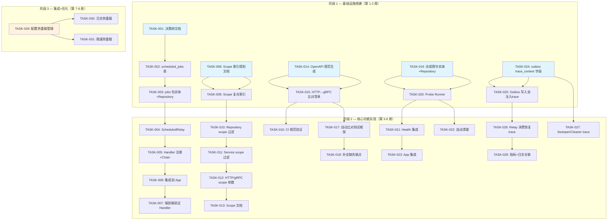

现在我对代码库有了深入的了解，可以进行详细的 Tech Lead 分析了。

---

# Tech Lead 技术实现分析：aero-id 基础设施能力提升

## 1. 任务分解

### 方向一：延迟任务框架（原 P1）

| 任务 ID | 任务标题 | 涉及文件 | 前置依赖 | 预估工时 | 验收标准 |
|---|---|---|---|---|---|
| TASK-001 | **定义 Outbox Event vs Scheduled Job 职责边界决策树** | `docs/superpowers/specs/`，新文件 `scheduled-jobs-design.md` | 无 | 2h | 决策树文档，包含选择标准表（触发方式/因果依赖/延迟预期/消费者数量），经团队评审通过 |
| TASK-002 | **创建 `scheduled_jobs` 表及迁移** | `migrations/000028_scheduled_jobs.up.sql`，`migrations/000028_scheduled_jobs.down.sql` | TASK-001 | 2h | 表结构包含 `id`, `job_type`, `payload`, `scheduled_at`, `status`, `retry_count`, `last_retry_at`, `dead_letter`, `created_at`；索引为 `(scheduled_at, status)`；出 relay 查询覆盖 |
| TASK-003 | **实现 `internal/jobs` 包实体和 Repository** | `internal/jobs/job.go`，`internal/jobs/repository.go`，`internal/jobs/repository_integration_test.go` | TASK-002 | 4h | Job 实体定义；Repository interface（`Create`, `FetchDue`, `MarkRunning`, `MarkDone`, `MarkFailed`）实现；集成测试验证 |
| TASK-004 | **实现 `ScheduledRelay`：按 `scheduled_at` 轮询的 Relay** | `internal/jobs/relay.go`，`internal/jobs/relay_test.go` | TASK-003 | 3h | 复用 `outbox.Relay` 的 backoff 和 dead-letter 模式；`Start(interval)` 方法；单元测试覆盖正常处理、重试、死信 |
| TASK-005 | **实现 Handler 注册机制和 Chain** | `internal/jobs/handler.go`，`internal/jobs/chain.go` | TASK-003 | 2h | Handler interface（`Handle(ctx, *Job) error`）；Chain 组合；HandlerFunc 适配器 |
| TASK-006 | **将延迟任务框架集成到 App 启动流程** | `internal/app/app.go`，`configs/config.yaml`，`internal/config/config.go` | TASK-004, TASK-005 | 2h | 配置段 `jobs.poll_interval`, `jobs.max_retries`；App.Run 启动/关闭 relay；make test && make lint 通过 |
| TASK-007 | **构建一个真实 Job Handler 做端到端验证（如：延迟消息撤回）** | `internal/service/message_recall.go`，内部单元测试 | TASK-006 | 3h | 消息发送后 24h 自动撤回；集成测试验证 full roundtrip；make test-integration 通过 |

**合计：18 小时（约 2.5 人日）**

---

### 方向二：作用域搜索（原 P1）

| 任务 ID | 任务标题 | 涉及文件 | 前置依赖 | 预估工时 | 验收标准 |
|---|---|---|---|---|---|
| TASK-008 | **Scope 过滤策略评估和复合索引规划文档** | `docs/` 新文件 `search-scope-index-plan.md` | 无 | 2h | 文档记录常见 scope 组合（按 owner_uid, target_type, visibility 等）及其对应的复合索引设计；基准 CI 语句计划 |
| TASK-009 | **为 FTS 索引增加 scope 列复合索引** | `migrations/000029_search_scope_indexes.up.sql`，`migrations/000029_search_scope_indexes.down.sql` | TASK-008 | 2h | 按规划添加 2-3 个复合索引；`EXPLAIN ANALYZE` 验证索引被使用 |
| TASK-010 | **Repository 层添加 scope 过滤参数** | `internal/repository/comment.go`，`internal/repository/message.go`，`internal/repository/file.go`，`internal/repository/search_integration_test.go` | TASK-009 | 4h | `SearchMessagesWithSnippet(ctx, actor, query, scope, limit)` 等签名变更；SQL 层 `AND` 拼接；集成测试验证正确过滤和性能 |
| TASK-011 | **Service 层暴露 scope 过滤** | `internal/service/search.go`，`internal/service/search_test.go` | TASK-010 | 3h | `Search(ctx, query, kinds, scope, limit)`；owner 自检（只能搜索自己的数据或公开数据）；单元测试覆盖 |
| TASK-012 | **HTTP/gRPC 传输层添加 scope 参数** | `internal/handler/http/search.go`，`internal/handler/grpc/search.go`，`api/proto/aero_id/v1/aero_id.proto` | TASK-011 | 2h | proto `SearchRequest` 增加 `scope` 字段；HTTP query 参数 `scope`；解析和传递；`make proto` 验证 |
| TASK-013 | **前端/客户端 scope 参数文档** | `README.md` 或 API 文档更新 | TASK-012 | 1h | scope 参数说明和示例 curl 命令并入 README |

**合计：14 小时（约 2 人日）**

---

### 方向三：API Contract 规范（提升为 Step 1 做 P1，Step 2/3 做 P2）

| 任务 ID | 任务标题 | 涉及文件 | 前置依赖 | 预估工时 | 验收标准 |
|---|---|---|---|---|---|
| TASK-014 | **生成 OpenAPI 3.0 规范（从 proto 自动生成 + 人工补全 HTTP 路由）** | `api/openapi/` 新目录，`api/openapi/aero-id.yaml` | 无 | 4h | OpenAPI 规范文件覆盖所有 `/v1/*` 路由；使用 `gnostic` 或 `protoc-gen-openapi` 加人工补全；make openapi 命令 |
| TASK-015 | **建立 HTTP↔gRPC 语义比对清单** | `docs/api-parity-checklist.md` | TASK-014 | 2h | 每个 RPC 的 HTTP 端点+参数 vs gRPC 方法+字段对照表；标注差异（如字段命名风格、分页格式） |
| TASK-016 | **添加 CI 步骤确保 API 规范有效性** | `.github/workflows/ci.yml` | TASK-014 | 1h | CI 中 `make openapi` 生成 + `openapi validate` 检查；规范变更必须经过 CI |
| TASK-017 | **编写自动化的 HTTP/gRPC 语义比对测试框架** | `internal/handler/grpc/parity_test.go` 增强 | TASK-015 | 4h | 测试框架遍历同一操作在 HTTP 和 gRPC 下的输入输出映射；发现字段缺失/命名差异即失败 |
| TASK-018 | **补全所有 HTTP 端点使其与 gRPC 完全对齐** | 各 handler 文件 | TASK-017 | 3h | 对账发现的缺失端点补全（如 PATCH /v1/files/:id → UpdateFileMetadata）；所有 parity 测试通过 |

**合计：14 小时（约 2 人日）**

---

### 方向四：合成事务探针（原 P1）

| 任务 ID | 任务标题 | 涉及文件 | 前置依赖 | 预估工时 | 验收标准 |
|---|---|---|---|---|---|
| TASK-019 | **创建合成探针实体和 Repository** | `internal/probe/probe.go`，`internal/probe/repository.go`，`internal/probe/repository_integration_test.go` | 无 | 3h | `monitor_` 前缀 uid 的 Probe 实体；`CreateAndRead(ctx) error` 方法；集成测试 |
| TASK-020 | **实现 Probe Runner（超时 + 断路）** | `internal/probe/runner.go`，`internal/probe/runner_test.go` | TASK-019 | 4h | 定时执行 `CreateAndRead`；超时保护（context deadline）；断路器（连续 N 次失败后停触发）；测试覆盖正常/慢查询/连接断开场景 |
| TASK-021 | **将探针状态暴露到 Health endpoint** | `internal/handler/http/health.go`，`internal/probe/metrics.go`（新增） | TASK-020 | 2h | `/readyz` 输出中增加 `db_probe` 检查项；Prometheus 指标 `aero_id_db_probe_duration_seconds` + `aero_id_db_probe_errors_total` |
| TASK-022 | **实现探针数据自动清理（TTL 机制）** | `internal/probe/cleaner.go`，`migrations/000030_probe_cleanup_index.up.sql` | TASK-019 | 2h | 超过 1h 的探针数据自动删除；`data_retention` 配置段增加 `probe_retention` |
| TASK-023 | **集成探针到 App 启动+关闭流程** | `internal/app/app.go`，`internal/config/config.go` | TASK-020, TASK-021 | 2h | 配置段 `probe.enabled`, `probe.interval`；App.Run 启动/关闭 probe runner；make test && make lint 通过 |

**合计：13 小时（约 1.5 人日）**

---

### 方向五：异步上下文传播（提升 outbox 到 P1.5）

| 任务 ID | 任务标题 | 涉及文件 | 前置依赖 | 预估工时 | 验收标准 |
|---|---|---|---|---|---|
| TASK-024 | **在 outbox Event 中增加 trace_context 字段** | `migrations/000031_outbox_trace_context.up.sql`，`migrations/000031_outbox_trace_context.down.sql`，`internal/outbox/outbox.go` | 无 | 2h | `Event` 增加 `TraceContext` 字段（JSONB）；迁移添加列；`NewEvent` 可选参数 |
| TASK-025 | **在写入 outbox 的入口处捕获当前 trace context** | `internal/outbox/repository.go`，`internal/service/*.go`（各服务调用处） | TASK-024 | 3h | 使用 `otel.GetTextMapPropagator().Inject` 在 Append 处注入 trace；单元测试验证 trace 传播 |
| TASK-026 | **Relay 消费时恢复 trace context** | `internal/outbox/relay.go`，`internal/outbox/relay_test.go` | TASK-025 | 3h | `drain` 中每个 event 消费前 `otel.GetTextMapPropagator().Extract` 恢复 parent span；span link 关联 |
| TASK-027 | **为 sweeper/cleaner 后台任务添加 trace 上下文** | `internal/app/app.go`，`internal/repository/db.go` | TASK-024 | 2h | sweeper/cleaner 的 `context.Background()` → 带 root span 的命名 context；多 cleaner 独立 span |
| TASK-028 | **添加指标和日志关联（trace_id 注入日志）** | `internal/outbox/relay.go`，`internal/pkg/logger/logger.go` | TASK-026 | 2h | 每个 event handler 的 warn log 携带 trace_id；`ObserveOutboxPublished/Failed` 增加 tracing 标签 |

**合计：12 小时（约 1.5 人日）**

---

### 额外：配置热重载（原 P3）

| 任务 ID | 任务标题 | 涉及文件 | 前置依赖 | 预估工时 | 验收标准 |
|---|---|---|---|---|---|
| TASK-029 | **实现可热加载配置子集管理** | `internal/config/hotreload.go`，`internal/config/config.go` | 无 | 4h | 定义 `HotReloadable` 接口；`Watch(ctx, path, reloadFn)` 方法（基于 fsnotify 或 viper.WatchConfig）；仅允许热重载安全字段（日志级别、限速阈值、SSO 超时） |
| TASK-030 | **连接热重载到日志级别切换** | `internal/pkg/logger/logger.go`，`internal/app/app.go` | TASK-029 | 2h | 日志级别变更无需重启；测试验证 runtime 切换有效 |
| TASK-031 | **连接热重载到 rate limiter 参数切换** | `internal/pkg/ratelimit/limiter.go`，`internal/middleware/ratelimit.go` | TASK-029 | 3h | 限速 RPS/Burst 热更新；测试验证旧 bucket 衰减+新参数生效 |

**合计：9 小时（约 1 人日）**

---

## 2. 执行顺序



**可并行执行的任务组（Phase 1 内无依赖关系）**：

| 并行组 | 任务 | 说明 |
|---|---|---|
| **组 A** | TASK-001 → TASK-002 → TASK-003 | 延迟任务框架前序 |
| **组 B** | TASK-008 | Scope 索引规划（独立） |
| **组 C** | TASK-014 | OpenAPI 规范生成（独立） |
| **组 D** | TASK-019 | 合成探针基础（独立） |
| **组 E** | TASK-024 | Trace context 字段（独立） |

组 A~E 在 Phase 1 完全并行，最多需 **5 人并行开发**。

---

## 3. 技术风险

### 3.1 高风险项

| 风险 | 方向 | 概率 | 影响 | 应对策略 |
|---|---|---|---|---|
| **Scope 复合索引设计不佳导致全表扫描** | 方向二 | 中 | 高 | TASK-008 要求 `EXPLAIN ANALYZE` 验证，在 staging 上用真实数据量压测；为常见 scope 组合预先建索引，不常见的走 seq scan 兜底 |
| **ScheduledRelay 与 Outbox Relay 竞争数据库 CPU** | 方向一 | 中 | 中 | 两者独立 poll 间隔；可调 interval；增加 `max_jobs_per_pass` 限制；监控 `pg_stat_activity` |
| **合成探针的测试数据污染业务统计** | 方向四 | 高 | 中 | `monitor_` 前缀 uid 彻底隔离+1h TTL 自动清理；ALL 查询 WHERE 排除该前缀（或探针使用独立 database/sql 连接） |
| **Trace 上下文传播导致 outbox payload 膨胀** | 方向五 | 低 | 中 | TraceContext 仅保留 trace_id + span_id（≈ 32 bytes），不做完整 propagator 序列化；JSONB 字段 |
| **OpenAPI 规范与 proto 不同步** | 方向三 | 中 | 中 | 建议将 proto 作为单一 truth source，通过 `buf generate` + `protoc-gen-openapi` 自动生成 OpenAPI；禁止手动编辑 OpenAPI |

### 3.2 外部依赖

| 依赖 | 用途 | 替代方案 | 风险 |
|---|---|---|---|
| `protoc-gen-openapi`（或 `buf`） | proto → OpenAPI 生成 | 手动编写 OpenAPI | 工具生态不成熟；需要 pin 版本 |
| `github.com/fsnotify/fsnotify` | 配置文件变更侦听 | viper 内置 WatchConfig | 已经有 viper，`viper.WatchConfig()` 可直接用 |
| OTEL propagator | trace 上下文序列化 | 已经是 go.mod 依赖 | 无新增依赖 |

### 3.3 性能关键路径

- **Scope 搜索的 SQL 层过滤**：必须走索引。`owner_uid` + `tsvector` 复合索引是最高频路径
- **ScheduledRelay 轮询**：需要 `WHERE scheduled_at <= now() AND status = 'pending' ORDER BY scheduled_at LIMIT n` → `(status, scheduled_at)` 复合索引
- **合成探针**：自身超时保护（探针执行 > 5s 即 abort），避免探针拖垮数据库

### 3.4 测试难度

- **Scope 搜索集成测试**：需要不同 scope 组合 + 不同数据量，测试数据的构造工作量大。建议用 `testpg` 的 fixture builder
- **ScheduledRelay 时间敏感测试**：控制 `scheduled_at` 在 nanosecond 级别；使用 `clock` 接口（`Now() time.Time`）便于 mock
- **Async Context 传播测试**：需要验证 outbox 消费端 trace span 是 parent span 的 child，用 `tracerProvider` mock 验证 span 树

---

## 4. 资源评估

### 4.1 团队组成

| 角色 | 人数 | 核心技能 |
|---|---|---|
| **Backend 工程师（Go）** | 2 人 | Go 1.26, GORM, PostgreSQL, gRPC, OpenTelemetry |
| **Backend 工程师（测试+DB）** | 1 人 | 集成测试（testcontainers）、SQL 性能调优、索引设计 |
| **DevOps/Infra** | 兼职 | CI pipeline（GitHub Actions）、配置管理 |

**建议**：3 人核心团队 + 1 人兼职 DevOps，并行度最高 5 人（含 DevOps 做 CI 部分）。

### 4.2 关键里程碑

| 里程碑 | 时间 | 交付物 |
|---|---|---|
| **M1（设计完成）** | Day 5 | 决策树文档(方向一) + Scope 索引规划(方向二) + API 比对清单(方向三) |
| **M2（基础设施就绪）** | Day 12 | 新增表迁移全部上线、Repository 层就位 |
| **M3（核心功能完成）** | Day 30 | ScheduledRelay、Scope 搜索、OpenAPI 规范、合成探针、Trace 传播全部可运行 |
| **M4（集成+修复）** | Day 40 | `make test && make lint && make test-integration` 全绿 |
| **M5（发布）** | Day 45 | 代码合入 main、配置文档更新、release notes |

### 4.3 阻塞点和解决策略

| 阻塞点 | 影响方向 | 解决策略 |
|---|---|---|
| Scope 搜索的复合索引设计需要真实数据集验证 | 方向二 | staging 环境导出 anonymized 数据集做索引验证；使用 `pg_sample` 工具 |
| `protoc-gen-openapi` 输出质量不佳 | 方向三 | 先用工具生成骨架，人工补全 details；或直接使用 `buf` 的 `buf generate` 流程 |
| Outbox trace context 需要修改所有调用 `NewEvent` 的服务代码 | 方向五 | 增加 `WithTraceContext(ctx)` option 函数，现有代码不做侵入式修改（零改动兼容） |

---

## 5. 质量保证

### 5.1 单元测试覆盖要求

| 包 | 最低行覆盖率 | 关键测试场景 |
|---|---|---|
| `internal/jobs/` | 80% | Relay 正常 dispatch、backoff 重试、dead-letter、context 取消 |
| `internal/search/` | 70% | Scope 过滤正确性（owner 只能看到自己数据）、超出 scope 返回空 |
| `internal/probe/` | 85% | 探针成功/失败/超时/断路器触发/恢复 |
| `internal/config/` | 60% | 热重载字段安全列表、非安全字段变更被拒绝、回调正确调用 |
| `internal/outbox/` | 已覆盖 + 新增 trace context 测试 | Trace context 注入/提取、无 trace 时降级 |

**工程纪律**：`make lint-strict`（funlen ≤ 50 行/函数，cyclop ≤ 10，文件 ≤ 500 行）必须通过。方向一/三的新增文件最容易触发文件大小限制，预先规划拆分。

### 5.2 集成测试策略

| 范围 | 工具 | 测试内容 |
|---|---|---|
| **Repository 层** | `testpg` + testcontainers | 每个新增 repository 方法的 CRUD + 边界条件 |
| **ScheduledRelay 端到端** | testcontainers（Postgres） | 写入 Job → 等待 relay 消费 → 验证 handler 被调用 |
| **Scope 搜索** | testcontainers（Postgres） | 不同 scope 组合 + FTS + ILIKE fallback + 分页 |
| **合成探针** | testcontainers（Postgres） | 正常 DB 下的探针成功、慢查询超时、连接断开后恢复 |
| **API Parity** | 单元测试（mock service） | 每个 HTTP 端点 vs 对应 gRPC 方法的输入输出映射 |

**新增集成测试文件命名规范**：`*_integration_test.go`（build tag `integration`）

### 5.3 代码审查要点

| 审查维度 | 关注点 |
|---|---|
| **架构合规** | 不违反 `handler → service → repository` 单向依赖（禁止 repository 调用 service） |
| **文件大小** | 新增文件 ≤ 500 行；超过的必须拆分（见 AGENTS.md 拆分策略） |
| **错误处理** | repository 返回 raw error → service 层 `Wrap` 为 AppError → handler 渲染 |
| **ID 规范** | 所有新表使用 UUIDv7 主键（`pkg/idgen`） |
| **软删除** | 业务表使用 `gorm.DeletedAt`（探针数据除外——需要物理删除便于清理） |
| **Trace 传播** | 所有 ctx 参数必须保留向下传递，不得使用 `context.Background()`（除 sweeper 外） |
| **敏感信息** | 不在日志中打印 payload 详情、不泄露数据库密码 |

### 5.4 性能测试需求

| 场景 | 工具 | 测试指标 | 基准底线 |
|---|---|---|---|
| Scope 搜索 100K 行 | 自定义 benchmark 在 `testpg` 上 | P99 响应时间、索引命中率 | P99 < 200ms |
| ScheduledRelay 每秒 100 job | Locust 或 wrk + 监控 | 吞吐量、延迟分布 | > 50 jobs/s |
| 合成探针对生产数据库的影响 | staging 环境压测 | 探针查询对普通查询的 P99 影响 | < 5% 退化 |

---

## 6. 实施计划

### 总工期估算：45 个工作日（约 9 周），3 人核心团队

---

### 阶段 1：设计 + 基础设施搭建（Day 1–12）

```
Day 1-5:  设计阶段
  ├── TASK-001 (Job 决策树文档)        — 2h
  ├── TASK-008 (Scope 索引规划文档)     — 2h
  ├── TASK-015 (API 比对清单)           — 2h
  └── TASK-029 (热重载方案设计)          — 1h

Day 6-12: 基础设施就绪
  组 A ─── TASK-002 (scheduled_jobs 表迁移)       — 2h
           TASK-003 (jobs 包实体+Repository)       — 4h [Dependency: TASK-002]
  组 B ─── TASK-009 (Scope 复合索引)               — 2h [Dependency: TASK-008]
  组 C ─── TASK-014 (OpenAPI 规范生成)              — 4h
  组 D ─── TASK-019 (探针实体+Repository)          — 3h
  组 E ─── TASK-024 (outbox trace_context 字段)    — 2h
           TASK-025 (outbox 写入注入 trace)         — 3h [Dependency: TASK-024]
```

**阶段 1 交付检查**：
- [ ] 全部 5 个方向的设计文档完成并评审
- [ ] 新增数据库迁移已编写（可回滚）
- [ ] Repository 层完成并有集成测试
- [ ] `make test && make lint` 通过

---

### 阶段 2：核心功能实现（Day 13–33）

```
Day 13-21: 方向一（延迟任务框架）
  ├── TASK-004 (ScheduledRelay)         — 3h [Dependency: TASK-003]
  ├── TASK-005 (Handler 注册+Chain)     — 2h [Dependency: TASK-003]
  ├── TASK-006 (App 集成)               — 2h [Dependency: TASK-004, TASK-005]
  └── TASK-007 (端到端验证 Handler)     — 3h [Dependency: TASK-006]

Day 15-24: 方向二（作用域搜索）
  ├── TASK-010 (Repository scope 过滤)  — 4h [Dependency: TASK-009]
  ├── TASK-011 (Service scope 过滤)     — 3h [Dependency: TASK-010]
  ├── TASK-012 (HTTP/gRPC scope 参数)   — 2h [Dependency: TASK-011]
  └── TASK-013 (Scope 文档)             — 1h [Dependency: TASK-012]

Day 20-28: 方向三（API Contract）
  ├── TASK-016 (CI 规范验证)            — 1h [Dependency: TASK-014]
  ├── TASK-017 (自动比对测试框架)       — 4h [Dependency: TASK-015]
  └── TASK-018 (补全缺失端点)           — 3h [Dependency: TASK-017]

Day 22-30: 方向四（合成探针）
  ├── TASK-020 (Probe Runner)           — 4h [Dependency: TASK-019]
  ├── TASK-021 (Health 集成)            — 2h [Dependency: TASK-020]
  ├── TASK-022 (自动清理)               — 2h [Dependency: TASK-019]
  └── TASK-023 (App 集成)               — 2h [Dependency: TASK-020, TASK-021]

Day 24-33: 方向五（Async Context）
  ├── TASK-026 (Relay 恢复 trace)       — 3h [Dependency: TASK-025]
  ├── TASK-027 (Sweeper/Cleaner trace)  — 2h [Dependency: TASK-024]
  └── TASK-028 (指标+日志关联)          — 2h [Dependency: TASK-026]
```

**阶段 2 交付检查**：
- [ ] 方向一：ScheduledRelay 运行并通过集成测试
- [ ] 方向二：scope 过滤在 HTTP 和 gRPC 上均可工作
- [ ] 方向三：OpenAPI 规范已生成，parity 测试通过
- [ ] 方向四：探针在 `/readyz` 可见，假健康预警可通过探针检测
- [ ] 方向五：outbox event 链路可完整回溯到 API 请求

---

### 阶段 3：集成测试 + 优化（Day 34–40）

```
Day 34-40: 集成测试 + 修复
  ├── 端到端测试：全方向组合运行 `make test-integration`
  ├── 性能调优：Scope 搜索索引 EXPLAIN ANALYZE + P99 压测
  ├── 交叉影响分析：ScheduledRelay + Outbox Relay 共存测试
  └── TASK-030 (日志热重载)             — 2h [Dependency: TASK-029]
      TASK-031 (限速热重载)             — 3h [Dependency: TASK-029]
```

**阶段 3 交付检查**：
- [ ] `make test && make lint && make test-integration` 全绿
- [ ] P99 搜索延迟 < 200ms（100K 数据集）
- [ ] Config 热重载可通过 SIGHUP 或 `config.yaml` 变更触发

---

### 阶段 4：发布准备（Day 41–45）

```
Day 41-45: 发布准备
  ├── 配置文档更新（config.yaml 全部新字段）
  ├── README 更新（新 API scope 参数、新 health check 端点）
  ├── CHANGELOG 编写
  ├── Performance benchmark 报告
  ├── 代码冻结 + code freeze review
  └── 合入 main + 打 tag
```

### 要点汇总

```
总任务：31 个
总预估工时：80 小时（= 10 人日 × 3 人 ≈ 3.3 周实际工期）
实际工期（含并行 + 等待 + 修复）：9 周
团队：3 人后端核心 + 1 人兼职 DevOps
```

---

**最后建议**：

1. **优先级调整建议**：采纳评审意见——方向三（API Contract）的 Step 1 提升到 P1，方向五（Async Context）的 outbox 部分提升到 P1.5。这会在 Phase 2 排期上增加约 0.5 周，建议相应延长总工期到 10 周。

2. **建议建立一个"能力空洞看板"**：在 GitHub Projects 上为 P1/P1.5 任务建立 `infra-gap` 标签，每个任务的描述中引用分析文档中的代码级证据（文件+行号），方便后续开发者理解"为什么需要"。

3. **治理建议**：方向一完成后，应立即更新 AGENTS.md，补充 Scheduled Job 相关的工程约束和检入检查项（例如 "scheduled_jobs 表 status 变更只能通过 Repository 方法，禁止裸 SQL 修改"）。
