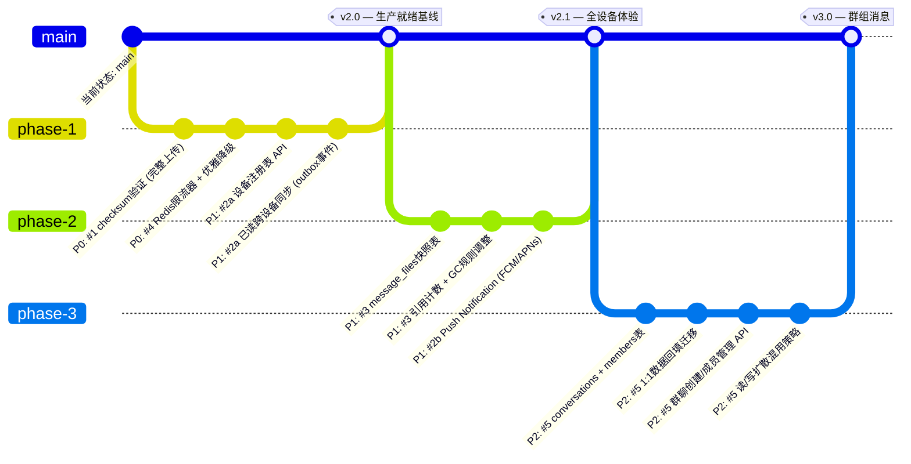

现在我已经充分理解了代码库基础、当前架构和扩展分析文档。以下是我的深入架构分析。

---

# 架构分析：aero-id 下一阶段扩展方向

## 1. 架构评估

### 1.1 现有架构的优势

当前架构是一种经典的**分层单体（layered monolith）**，具有几个非常强的结构属性：

- **传输层对称性（Transport Symmetry）**：HTTP 和 gRPC handler 共享同一个 service 层。这不仅仅是 DRY——它保证了行为一致性。任何跨传输的差异都属于测试边界，而 parity_test.go 已经覆盖了这一点。这是一个常被忽视的架构优势，值得保护。
- **单向依赖树**：`handler → service → repository`，service 两侧是 `storage` 和 `sso`。没有循环依赖。没有服务层互相导入。这使得测试时 mock 边界非常清晰。
- **基础设施的接口抽象**：`storage.FileStorage` 接口（local/S3）、`ratelimit.Limiter`（memory/未来 Redis）和 outbox event handler 链都是通过接口注入的。这些接口是**未来扩展的关键接入点**——它们使得 #4（分布式限流）可以零侵入地实现。
- **事件基础设施已存在**：hub + outbox + dispatcher 整体架构是健全的。Hub 已经支持同一 uid 下的多订阅者；outbox 已通过 Dispatcher 链式解耦事件生产与消费。@2 和 #3 可以重用这些组件。

### 1.2 当前的局限性

- **非持久化的应用状态**：限流器（in-memory token bucket）和 SSE Hub（in-memory subscriber map）都是进程本地的。任何状态需要跨副本共享时都需要外部存储——#4 直接触及了这个点。
- **消息模型是扁平的**：`Message` 只有 `from_uid`/`to_uid`，没有 `conversation_id`。这意味着 #5 不是一个"加个新表"的变更，而是整个消息数据模型的重构——这是为什么它被正确地放在了 P2。
- **文件附件是弱引用的**：`Message.file_id` 是纯外键，没有快照语义。@3 准确地指出了这一点——这是从"文件作为独立资源"视角而非"消息作为不可变通信记录"视角留下的设计选择。
- **没有平台密钥服务（non-secret key service）**：HMAC 签名密钥、SSO 信任配置等是明文配置的。虽然这些不是用户秘密，但缺少一个密钥轮换机制。

### 1.3 架构债务

分析文档已经覆盖了功能层面的债务，但我想补充几点**架构层面的技术债**：

| 债务 | 影响 | 严重程度 |
|------|------|----------|
| outbox relay 无优雅关闭 | 快速重启可能丢失事件 | Medium |
| SSE Hub 无持久化恢复点 | 断线重连依赖 `last_event_id`，但 Hub 本身重启后所有连接丢失 | Medium |
| 审计日志是追加式的，无索引规划 | 长周期查询会全表扫描 | Low-Medium |
| 配置热加载未实现 | 修改限流 RPS 需要重启 | Low |

这些都不是紧迫的，但在实现 #2（多设备同步）和 #4（分布式限流）时，outbox 优雅关闭值得一修——因为 Push Notification 的高可靠性要求会放大这个缺陷的影响。

---

## 2. 扩展方向——深入分析

分析文档识别了五个方向。以下从架构视角对每个方向进行细化，包括设计选项和权衡。

---

### 方向 #1：大文件端到端完整性验证

**分析文档评价**：精准，P0。我完全同意。

#### 核心挑战

`sha256` 校验在 presigned 路径上的核心问题是：**服务端从未接触文件内容**。客户端直接 PUT 到 S3，服务端只做元数据记录。要验证完整性，服务端必须在某个时刻获取文件内容或内容指纹。

#### 三种方案对比

| 方案 | 方式 | 优点 | 缺点 |
|------|------|------|------|
| **A. 客户端声明 + 异步验证** | 客户端在 `CompleteUpload` 时提供 `sha256`；服务端异步从 S3 读取验证后更新 `files.checksum` | 不阻塞上传路径；客户端感知好 | 存在一个"信任窗口期"——验证完成前文件可能已被其他服务使用 |
| **B. 客户端声明 + S3 ETag 交叉验证** | 利用 S3 多部分上传的 ETag（单部分时是 MD5）作为轻量验证 | 不需要读取文件内容；极低成本 | 多部分上传时 ETag 不是文件哈希；需要客户端额外用 `--content-md5` 标记 |
| **C. 要求客户端在 PUT 前上传 checksum 并通过预签名签入** | 在 `PresignUpload` 响应中将 `expected_checksum` 签入 URL 参数或 header，S3 拒绝不匹配的 PUT | 无需服务端验证步骤；S3 层面强制执行 | S3 原生不支持 Content-SHA256 验证——需要 presigned URL 中嵌入 `x-amz-checksum-sha256`（S3 API 支持 `x-amz-checksum-*` headers） |

**架构推荐：方案 A + 方案 B 分层**

1. **短期（立即可行）**：要求客户端在 `CompleteUpload` 中提供 `expected_sha256`。服务端记录但不阻塞——存入 `files.checksum`，同时用 `ETag`（HEAD 请求获取）做快速交叉验证。
2. **中期（异步 Worker）**：在 outbox handler 链中注册 `checksumVerifier`，消费 `file.uploaded` 事件，异步从 S3 读取前 1MB + 尾 1MB + 整个文件的 SHA256，匹配 `files.checksum`。
3. **审计日志记录**：无论验证结果如何，在 `audit_logs.detail` 中记录 `checksum_verified: true/false` + `actual_checksum`。

#### 对现有系统的影响

- `file.Service.Create` / `CompleteUpload`：新增可选参数 `expected_checksum`
- `file.Service.VerifyChecksum`：新方法，被异步 worker 调用
- `file.Repository`：`files.checksum` 列已存在，不需要 schema 变更
- 不需要新的依赖

**风险**：异步验证意味着文件在验证完成前处于"未验证"状态。需要定义用户在该窗口期内的体验——文件列表可能显示"验证中"状态指示。

---

### 方向 #2：多设备同步与会话管理

**分析文档评价**：正确识别了 SSE Hub 的当前能力边界。P1 优先级合理。

#### 架构挑战

核心挑战不是"添加设备注册表"（这是一个简单的 CRUD），而是**跨设备状态同步的一致性模型**。

**读状态同步的三种模型**：

| 模型 | 方式 | 一致性强弱 | 复杂度 |
|------|------|-----------|--------|
| **事件驱动（推荐）** | `mark_read` 时通过 outbox 发出 `message.read_cross_device` → dispatcher → hub 推送到其他设备 | 最终一致（秒级） | 低 |
| **查询时同步** | 设备 SSE 连接定时拉取"我是否有新的已读标记" | 依赖于轮询间隔 | 中 |
| **强一致** | 所有设备的读操作必须经过一个中心化仲裁（如 Redis） | 强一致 | 高（不推荐） |

**推荐**：事件驱动模型。outbox + hub 基础设施已经完全支持——只需在 `dispatcher.go` 中注册一个新的 handler 映射。

#### 方案细化：设备注册与 Push Notification

设备注册本质上是一个**绑定表**：

```sql
user_devices (
    uid             TEXT NOT NULL,
    device_id       TEXT NOT NULL,       -- 客户端生成的设备唯一 ID
    device_name     TEXT,                -- 人类可读名称
    push_provider   SMALLINT NOT NULL,   -- 1=FCM, 2=APNs, 3=WebPush
    push_token      TEXT NOT NULL,
    last_seen_at    TIMESTAMPTZ,
    locale          TEXT,                -- 用于推送本地化
    created_at      TIMESTAMPTZ NOT NULL DEFAULT NOW(),
    PRIMARY KEY (uid, device_id)
)
```

**架构决策点**：Push Notification 的 outbox handler 放在哪里？

- **选项 A**：放在 `internal/notification/dispatcher.go` 中——复用现有 handler 链。缺点：dispatcher 包会引入 FCM/APNs gRPC 依赖，违反当前"轻量 dispatcher"的原则。
- **选项 B**：新包 `internal/push/`，从 outbox 独立消费事件。优点：关注点分离；Push 失败（token 过期、provider 限流）不影响通知流程。
- **选项 C**：作为 webhook 类型的 outbox handler（已有 `webhook.go` 模式），暴露给外部 push service。优点：解耦最强，但增加了运维复杂度。

**推荐**：**选项 B**——新包 `internal/push`，注册为 outbox handler chain 的最后一个 handler。Push 失败只打日志 + 标记 device 为 inactive，不回滚 outbox 事件。

#### 对现有系统的影响

- **新表**：`user_devices`（+ 迁移文件）
- **新 API**：`POST/GET/DELETE /v1/devices`（HTTP 和 gRPC）
- **新包**：`internal/push/`（FCM/APNs sender）
- **Dispatcher 扩展**：注册 `message.read_cross_device` → `hub.Publish` 给该 uid 的所有其他连接
- **Hub 改进**：对于"退出所有设备"场景，需要 hub 支持按 `device_id` 断开连接（当前 hub 只能按 `uid` 断开）

#### 向后兼容性

- 现有 SSE 客户端忽略未知的 event type（这是规范行为）
- 不注册设备的用户不受影响

---

### 方向 #3：消息附件生命周期管理

**分析文档评价**：准确。P1 合理。

#### 架构选择

核心问题是：**消息发送后，附件应该与消息同生命周期，还是独立于消息？**

**三个方案**：

| 方案 | 描述 | 优点 | 缺点 |
|------|------|------|------|
| **快照（Snapshot）** | 发送消息时复制文件元数据到 `message_files` 表 | 附件完全不依赖于原始文件 | 存储冗余（元数据复制）；如果文件删除后通过快照引用下载需要保留 blob |
| **冻结引用（Freeze Ref）** | 消息保存 `file_id`，但文件删除时只标记文件为 `attached` 状态而非真正删除 | 不需要新表 | 修改了文件删除语义；文件系统变得复杂 |
| **写时复制（Copy-on-Write）** | 发送时复制文件 blob（新 storage_key） | 真正的独立生命周期 | 存储成本翻倍；大文件复制延迟 |

**推荐**：**快照方案**，但做两点优化：

1. **轻量快照**：不复制 blob，只复制元数据（`name`, `mime`, `size`, `checksum`）。存储原始 `file_id` 作为弱引用——如果文件仍存在，优先从原始文件返回内容；如果文件已删除，返回"附件已不可用"占位。
2. **延迟加载**：`ListMessages` 默认不 JOIN `message_files`。仅当客户端请求 `?include_attachments=true` 时才加载附件元数据。

```sql
message_files (
    message_id           UUID NOT NULL REFERENCES messages(id),
    file_id              UUID,                  -- 原始文件 ID（可 NULL，如果文件已删除）
    snapshot_name        TEXT NOT NULL,
    snapshot_mime        TEXT NOT NULL,
    snapshot_size        BIGINT NOT NULL,
    snapshot_checksum    TEXT,
    storage_key          TEXT NOT NULL,          -- 指向实际 blob
    created_at           TIMESTAMPTZ NOT NULL DEFAULT NOW(),
    PRIMARY KEY (message_id, file_id)
)
```

**注意**：如果先实现 #5（conversation 表），`message_files` 可以省掉 `from_uid`/`to_uid`，直接关联 `conversation_id`——这是分析文档中提到的跨方向耦合点。

#### 对现有系统的影响

- **新表**：`message_files`（或基于现有 schema 扩展）
- **Service 变更**：`file.Service.Delete` 需要检查文件是否被消息引用（`message_files` 有记录），选择阻止删除或标记删除
- **Storage**：blob 的 GC 规则需要调整——被消息引用的 blob 不应被回收
- **Schema**：可能需要 `files.ref_count` 列支持引用计数

---

### 方向 #4：分布式速率限制与滥用检测

**分析文档评价**：P0，完全同意。这是生产多副本部署的必要前提。

#### 架构方案

核心问题：**如何在保持低延迟的同时，在分布式环境中维护一致的速率计数？**

**算法选择**：

| 算法 | 一致性 | 内存开销 | 精确度 | 适用性 |
|------|--------|---------|--------|--------|
| **Token Bucket (Redis)** | 最终一致 | 低（每个 key 一个计数器 + 时间戳） | 中等（依赖 Redis 时钟） | 推荐 |
| **Sliding Window Log (Redis Sorted Set)** | 强一致 | 高（每个请求一个成员） | 高 | 仅限关键 endpoint |
| **GCRA (Generic Cell Rate Algorithm)** | 强一致 | 中（每个 key 一个 TAT） | 高 | 需要严格限流的场景 |
| **Fractal Token Bucket (客户端侧)** | 无中心化 | 无 | 低 | 不推荐 |

**推荐**：**Token Bucket + Redis**，理由：
1. 当前 in-memory 实现已经是 token bucket——Redis 版本可保持相同的语义
2. 接口已抽象：`ratelimit.Limiter` 定义明确，新增 `redisLimiter` 实现只需注册一个新的构造器
3. Redis 是大多数部署中已有的基础设施

```go
// 当前接口（internal/pkg/ratelimit/ratelimit.go）
type Limiter interface {
    Allow(ctx context.Context, key string) (bool, time.Duration, error)
}

// 新增实现
type RedisLimiter struct {
    client *redis.Client
    rps    float64
    burst  int
}
```

#### 配置化降级

```yaml
rate_limit:
  type: redis             # memory | redis
  redis_fallback_to_memory: true
  default_rps: 20
  endpoints:
    "POST /v1/comments/*/report": { rps: 2, burst: 5 }
    "POST /v1/messages": { rps: 5, burst: 10 }
```

**关键设计决策**：如果 Redis 不可用，且 `redis_fallback_to_memory` 为 true，降级到 in-memory 限流器。这是**优雅降级**模式——在多副本中意味着限流效果减弱（每个实例独立计数），但不会完全丧失限流能力。

#### 滥用检测——可插拔评分接口

分析文档提到了 spam 检测。我建议将其设计为**接口 + 链式调用**：

```go
type AbuseScorer interface {
    Score(ctx context.Context, content string, context map[string]any) (float64, error)
}

// 链式调用：依次尝试每个 scorer，取最高分
type ChainScorer struct {
    scorers []AbuseScorer
}
```

初始实现：
- **PatternScorer**：关键字/正则黑名单（零依赖，离线可用）
- **LengthScorer**：超短消息 + 重复 URL 检测

后续可扩展：
- **MLScorer**：调用外部 ML 服务（如 Perspective API）
- **EmbeddingScorer**：基于向量相似度的重复 spam 检测

#### 对现有系统的影响

- **新依赖**：`go-redis` 或 `rueidis`
- **配置变更**：`rate_limit` 部分新增 `type`、`redis_*` 字段
- **基础设施**：添加 Redis 连接池管理
- **不涉及 schema 变更**

**风险**：Redis 成为新的基础设施依赖。需要一个不依赖 Redis 也能运行的开发模式——这正是 `redis_fallback_to_memory` 的作用。

---

### 方向 #5：对话抽象与群组消息

**分析文档评价**：P2，正确。这是架构变更量最大的方向。

#### 为什么这是最复杂的变更

这不是"加个新表"级别的变更。它影响到：

| 组件 | 影响程度 | 原因 |
|------|---------|------|
| `messages` 表 | **重大** | 新增 `conversation_id` FK；`from_uid`/`to_uid` 语义变化 |
| `message.Repository` | **重大** | `ListConversation` 从 JOIN 查询变为按 `conversation_id` 查询 |
| `message.Service` | **重大** | 发送逻辑从"插入一条消息"变为"验证成员身份 + 插入消息 + 更新会话预览" |
| `Inbox` API | **中等** | 从"按消息返回"变为"按会话分组，返回最后一条消息摘要" |
| Notifications | **中等** | 群聊消息的通知需要分发到所有成员 |
| SSE Hub | **小** | 群聊消息的实时推送按 `conversation_id` 路由而非 `to_uid` |

#### 架构迁移策略

群聊的引入需要谨慎的数据迁移和 API 版本策略：

1. **Phase 1 — Schema 准备**：新增 `conversations`、`conversation_members`、`conversation_read_cursors` 表
2. **Phase 2 — 数据回填**：为每一对曾通信过的用户自动创建 1:1 `conversation`，将 `message.from_uid`/`to_uid` 迁移为 `conversation_id`
3. **Phase 3 — API 发布**：新 RPC `CreateConversation`、`AddMember`、`RemoveMember`；旧 API 标记为 deprecated
4. **Phase 4 — 旧 API 移除或适配**：`POST /v1/messages` 内部转化为写对应 conversation 的消息

这是 P2 的原因——它需要跨多个版本进行，且每一步都需要完整的迁移脚本和兼容层。

#### 关于写扩散（Write Fan-out）的决策

分析文档提到群聊消息采用写扩散。这个决策需要进一步细化：

| 方式 | 存储 | 典型场景 | 一致性 |
|------|------|---------|--------|
| **读扩散（Read Fan-out）** | 消息存 1 份，每个成员的 `read_cursor` 记录位置 | 大群（500+） | 最终一致 |
| **写扩散（Write Fan-out）** | 每个成员独立存一份消息副本 | 小群（≤50），要求强一致 | 强一致 |

**推荐**：初期（≤100 人）使用**写扩散**以简化撤回和删除语义。当群规模超过 100 人时，自动切换为**读扩散**——两种模式对上层透明，在 Repository 层封装。

分析文档建议的是写扩散模式，这是正确的短期选择。但架构上应为未来的读扩散切换留好接口。

---

## 3. 接口设计建议

### 3.1 关键设计原则

**接口稳定性分层**：

```
服务对外部  (HTTP/gRPC API)   →  仅向后兼容
服务内部    (service/repo)     →  允许演进，但语义不变
基础设施    (storage/sso)      →  接口稳定，实现可变
工具包      (pkg/errors)       →  几乎不变
```

基于此，以下建议：

### 3.2 新增接口设计

**Limiter 的 Redis 实现**——当前 `ratelimit.Limiter` 接口适合扩展，但需要注意：

```go
// 当前 Allow 方法
Allow(ctx context.Context, key string) (bool, time.Duration, error)

// 分布式版本需要考虑 clock skew，建议新增方法：
AllowWithTimestamp(ctx context.Context, key string, now time.Time) (bool, time.Duration, error)
```

或者将时间戳提取为 Limiter 内部参数，不在接口层暴露（使用 Redis `TIME` 命令）。

**Push Provider 接口**：

```go
type PushProvider interface {
    Send(ctx context.Context, token string, msg PushMessage) error
    // ValidateToken 在 provider 返回失败时调用
    ValidateToken(ctx context.Context, token string) (bool, error)
}
```

**AbuseScorer 接口**（上文已描述）。

### 3.3 不需要引入新的抽象层

当前的分层已经是合适的。**不要引入**：
- 独立的 "attachment service"（附件逻辑可以放在 `file.Service` 中扩展）
- 独立的 "conversation service"（可以放在 `message.Service` 中扩展，或者拆出 `message/conversation_service.go`）
- 独立的 "push service"（`internal/push` 包足够，不需要拆为独立服务）

### 3.4 向后兼容性策略

| 变更类型 | 策略 |
|---------|------|
| 新增 API | 新路由/新 RPC，不影响旧客户端 |
| 现有 API 新增可选字段 | 旧客户端忽略未知字段（Proto 3 语义） |
| 现有 API 行为变更 | 标记旧行为为 deprecated，给出迁移时间窗口 |
| 消息模型变更 | 数据迁移脚本 + 新旧 model 并行存在直到迁移完成 |

---

## 4. 技术选型

### 4.1 是否需要引入新的技术栈

| 方向 | 新增依赖 | 评估 |
|------|---------|------|
| #1 完整性验证 | 无（使用现有 S3 SDK） | 零新增依赖 |
| #2 多设备同步 | FCM SDK / APNs HTTP/2 | 外部 Push provider 不可避免 |
| #3 附件生命周期 | 无 | 纯 schema + 逻辑变更 |
| **#4 分布式限流** | **Redis 客户端** | **需要评估** |
| #5 对话抽象 | 无 | 纯 schema + 逻辑变更 |

**关于 Redis 的具体评估**：需要引入一个 Redis Go 客户端。选项：

| 客户端 | Stars | 性能 | 生态 | 推荐 |
|--------|-------|------|------|------|
| `go-redis/redis` (v9) | 20k+ | 好 | 最成熟，文档完备 | **推荐** |
| `redis/rueidis` | 2k+ | 更好（DoCache 模式） | 较新，但功能完整 | 可选 |
| `gomodule/redigo` | 9k+ | 好 | 维护模式，不推荐新项目 | 不推荐 |

**推荐**：`go-redis/redis` v9。如果对延迟敏感且限流是高 QPS endpoint，可以考虑 `rueidis` 的 pipelining 优化。

### 4.2 第三方依赖的评估标准

对于每个新依赖，应该遵守以下标准：

1. **许可证兼容**：必须是 MIT/Apache 2.0/BSD
2. **活跃维护**：最近 6 个月内有 commit
3. **Go 版本兼容**：支持 Go 1.26
4. **无 CGO 依赖**（保持交叉编译能力）
5. **API 稳定性**：不依赖 alpha/beta 阶段的客户端

### 4.3 自建 vs 采购决策

**Push Notification**：必须自建。FCM/APNs 是标准协议，没有商业 SDK 的必要。`firebase/fcm` 库可以简化发往 FCM 的请求，但核心逻辑（token 管理、重试、降级）仍然需要自建。

**Spam 检测（滥用防护）**：
- **初期（P0-P1）**：自建基于规则的模式匹配——零外部依赖，离线运行
- **后期（P2+）**：如果初始规则误报率过高，评估外部 ML 服务（Perspective API、AWS Comprehend）。此时引入 AbuseScorer 接口的价值就体现出来了——自建实现和外部服务可以无缝切换

---

## 5. 实施路线图

### 5.1 优先级排序

我基本同意分析文档的排序，但增加两个依赖关系的修正：

| 优先级 | 方向 | 前置依赖 | 估计工作量 |
|--------|------|---------|-----------|
| **P0** | #1 完整性验证 | 无 | 1-2 周 |
| **P0** | #4 分布式限流 | Redis 基础设施 | 1-2 周 |
| **P1** | #2 多设备同步（基础版本：设备注册 + 已读同步） | 无 | 2-3 周 |
| **P1** | #3 消息附件生命周期 | 无 | 1-2 周 |
| **P1** | #2 Push Notification | #2（设备注册）+ #4（infra 已就绪） | 2-3 周 |
| **P2** | #5 对话抽象与群组 | #2 + #3（附件快照复用 conversation_id） | 4-6 周 |

**调整说明**：
- #2 拆分为了两个迭代：基础版（设备注册 + 已读同步）可以在 P1 早期做；Push Notification 依赖设备注册表就绪，是 P1 后期
- #5 被标记为依赖 #2 和 #3，但这是"优化依赖"而非"硬依赖"——可以先做 #5 的 schema 变更，然后利用 #2 的设备注册提供群聊的通知推送

### 5.2 阶段划分



### 5.3 Phase 1 （P0 + P1 前半）— 生产就绪基线

**里程碑**：生产多副本部署的完备基础

| 任务 | 产出 | 风险 |
|------|------|------|
| #1 客户端 SHA-256 声明 + ETag 交叉验证 | `CompleteUpload` 新增 `expected_checksum` | 客户端升级成本；旧客户端不传校验值 |
| #1 异步 Worker 验证 | `file.uploaded` outbox handler | Worker 失败的回退策略 |
| #4 Redis Token Bucket | `redisLimiter` + 配置化切换 | Redis 成为关键依赖（fallback 缓解） |
| #4 per-endpoint 限流 | 配置覆盖 + 中间件读取 | 配置复杂度增加 |
| #2a 设备注册 CRUD | `user_devices` 表 + API | 无（简单的 CRUD） |
| #2a 已读跨设备同步 | outbox 事件 → hub.Publish | hub 重启后丢失消息（Push 解决） |

**风险缓解**：
- Redis 不可用：`redis_fallback_to_memory: true`（限流降级但不中断）
- 旧客户端不传 checksum：使用`files.checksum IS NULL`查询作为旧行为的标记，不做强制要求

### 5.4 Phase 2（P1 后半）— 全设备体验

**里程碑**：移动端 Push Notification + 附件完整性

| 任务 | 产出 | 风险 |
|------|------|------|
| #2b Push Notification outbox handler | `internal/push/` + FCM/APNs 发送 | Push token 过期——标记 device inactive 而不是阻塞 event |
| #2b 通知折叠前的 Push | Push 聚合（5min 窗口期内多个通知合为一条 Push） | 需要额外的事件缓冲 |
| #3 message_files 快照表 | 发送消息时写入快照 | 写入路径增加延迟（可异步化） |
| #3 引用计数 | `files.ref_count` + `Delete` 检查 | 并发 decrement 需要原子操作 |

**风险缓解**：
- Push 失败不应影响 outbox 事件消费——使用独立的 error log + device inactive 标记
- 快照写入的延迟可通过将快照写入移到 outbox handler 中异步化（`message.sent` → `snapshotWriter`）

### 5.5 Phase 3（P2）— 群组消息

**里程碑**：完整的消息系统（1:1 + 群聊 + 附件 + 跨设备）

**这是风险最大的阶段**，需要特别注意：

| 风险 | 概率 | 影响 | 缓解策略 |
|------|------|------|---------|
| 数据迁移中丢失消息 | 低 | 高 | 在先前的备份上运行迁移；先做 staging 测试 |
| 群聊消息的已读语义复杂 | 中 | 中 | 初始版本使用"最后一条已读消息"而非"每条消息已读状态" |
| 写扩散在群规模大时 OOM | 低 | 高 | 设置最大群人数（如 100）；超过时自动切换读扩散 |
| 与旧 API 的不兼容 | 中 | 高 | 旧 API 在新 schema 上模拟——`ListConversation` 按 `conversation_id` 过滤返回 |

---

## 总结

分析文档是一份高质量的工作。五个方向的选择是合理的，优先级判断也是正确的。从架构角度看，最重要的是**保持方向 #4 和 #1 的 P0 优先级不动摇**——它们是其他所有方向的基础。

几个需要持续关注的设计原则：

1. **接口优先**：所有跨包调用都应经过接口（限流器、Push provider、Abuse scorer），不依赖具体实现
2. **降级优于失败**：Redis 不可用时用内存限流、"附件不可用"优于 500 错误、Push 失败降级为 app 内通知
3. **增量迁移**：#5 是最难的变更，必须分阶段部署，每个阶段可独立上线
4. **不引入新的大概念**：当前的分层是合适的——不需要事件总线、不需要 CQRS、不需要微服务

最后，分析文档提到但没有展开的一个点值得再次强调：**#3 和 #5 之间的耦合**。如果先做 #5（conversation 表），`message_files` 的快照可以直接关联 `conversation_id` 而非 `from_uid`/`to_uid`。建议在 Phase 2 规划时重新评估这两个方向的顺序——如果 #5 的被推迟到 Phase 3，那么在 #3 实现时要确保 `message_files` schema 预留 `conversation_id` 列（可为空），不要做死到 `from_uid`/`to_uid`。
