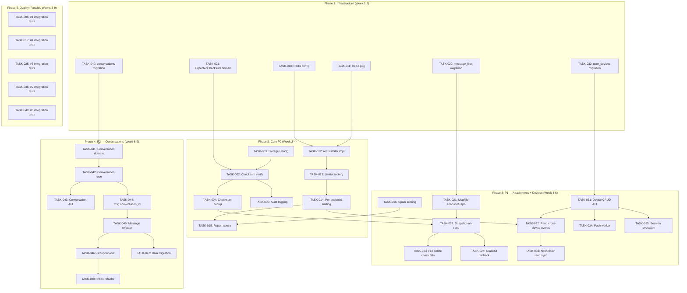
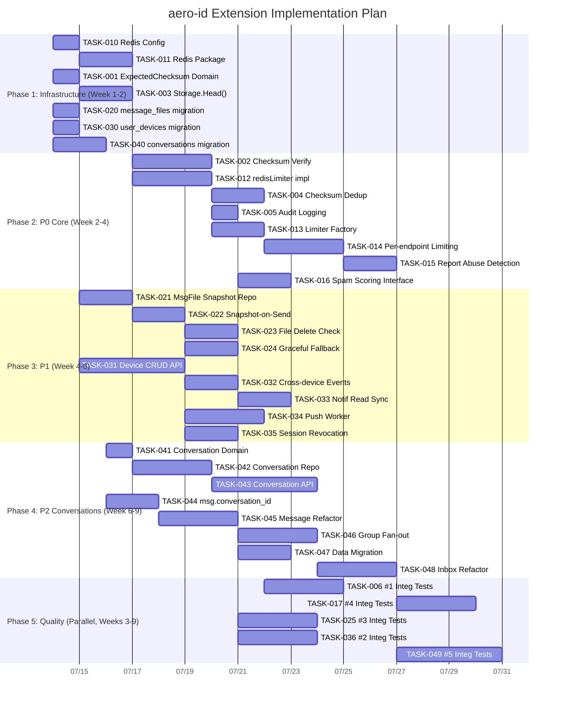

Now I have a thorough understanding of the entire codebase. Let me produce the Tech Lead analysis.

---

# Tech Lead Analysis: aero-id Extension Directions

## 1. Task Decomposition

Each direction is broken into 2-4 hour tasks. I cross-referenced against the actual codebase (not just the analysis doc) to surface file-level impact and hidden dependencies.

### Direction #1 — 大文件端到端完整性验证 (6 tasks)

| Task ID | Title | Files | Deps | Est. | Acceptance |
|---|---|---|---|---|---|
| **TASK-001** | Domain: Add `checksum` field to `CompleteUploadInput` | `internal/service/service.go` (CompleteUploadInput struct), `internal/service/file_presign.go` | None | 1h | `CompleteUploadInput` carries `ExpectedChecksum string`; validation in domain layer |
| **TASK-002** | Service: Implement checksum verification path in `CompleteUpload` | `internal/service/file_presign.go`, `internal/service/file.go` | TASK-001 | 3h | After PUT, service does `s.store.Head(ctx, key)` to get ETag → compare with `ExpectedChecksum`; on mismatch return `400` + async cleanup of orphan blob |
| **TASK-003** | Storage: Add `Head(ctx, key) (*ObjectInfo, error)` interface method | `internal/storage/storage.go`, `internal/storage/s3.go`, `internal/storage/local.go` | TASK-001 | 2h | Both backends implement HEAD; S3 returns ETag; local returns SHA-256 of on-disk content (computed at write time and stored in extended attributes or a sidecar file) |
| **TASK-004** | Service: Wire checksum-matched dedup for presigned uploads | `internal/service/file_presign.go` (CompleteUpload post-verify), `internal/repository/file.go` (FindByChecksum — exists but unused in presigned path) | TASK-002 | 2h | On checksum match, reuse existing StorageKey + refcount increment instead of creating new blob; cross-user dedup → require `actor == original.OwnerUID` or skip cross-user |
| **TASK-005** | Audit: Log checksum verification result | `internal/service/file_presign.go`, `internal/domain/audit.go` (new action const) | TASK-002 | 1h | New audit action `file.checksum_verified` / `file.checksum_mismatch` logged with detail containing `{checksum, matched: bool}` |
| **TASK-006** | Integration test: End-to-end checksum verification + dedup | `internal/service/file_test.go` (or new `file_presign_test.go`), `internal/repository/` integration tests | TASK-004 | 3h | `make test-integration` passes; verifies: valid checksum passes, invalid gets 400, duplicate content reuses blob, multipart edge case documented |

**Total Direction #1**: ~12h

### Direction #4 — 分布式速率限制与滥用检测 (8 tasks)

| Task ID | Title | Files | Deps | Est. | Acceptance |
|---|---|---|---|---|---|
| **TASK-010** | Config: Add Redis config + per-endpoint rate-limit overrides | `internal/config/config.go` (new `RedisConfig`, `RateLimitOverride`), `configs/config.yaml` | None | 1h | Config loads `redis.*`, `rate_limit.endpoints[*].{path, rps, burst}`; validation fails on bad combinations |
| **TASK-011** | Redis client: New `internal/pkg/redis` package with connection pool + health check | `internal/pkg/redis/redis.go`, `internal/app/new.go` | TASK-010 | 2h | Lazy-dial pool; `Ping()` for health; configurable timeouts; graceful shutdown |
| **TASK-012** | Limiter: Add `redisLimiter` implementing `ratelimit.Limiter` interface | `internal/pkg/ratelimit/redis.go`, `internal/pkg/ratelimit/ratelimit.go` | TASK-011 | 3h | GCRA or sliding-window via `EVALSHA`; key schema `aero:rl:{key}`; tests with `miniredis` |
| **TASK-013** | Factory: Config-driven limiter construction (memory | redis | fallback) | `internal/app/new.go`, `internal/middleware/ratelimit.go`, gRPC interceptor | TASK-012, TASK-010 | 2h | `Limiter` interface extracted from `*Limiter` struct → middleware works with interface; config `rate_limit.type: redis | memory` |
| **TASK-014** | Per-endpoint rate limiting in middleware | `internal/middleware/ratelimit.go`, `internal/middleware/middleware_test.go` | TASK-013 | 3h | Middleware reads per-endpoint config from a map; gRPC interceptor matches full method name; refactored to use `Limiter` interface per key |
| **TASK-015** | Report abuse detection | `internal/service/comment.go` (Report method), config `rate_limit.endpoints[POST /v1/comments/*/report]` | TASK-013 | 2h | `reporter_uid` rate-limited per-minute; 429 with `code: "abuse.too_many_reports"`; configurable threshold |
| **TASK-016** | Spam scoring: Interface + keyword-based implementation | `internal/service/comment.go`, `internal/service/message.go`, `internal/pkg/spam/spam.go` | None | 2h | `SpamChecker` interface with `Score(content string) int`; default impl uses keyword/pattern matching; threshold config in config.yaml; score > threshold → auto-hide comment |
| **TASK-017** | Integration test: Redis rate limiter + abuse detection | `internal/pkg/ratelimit/ratelimit_test.go`, `internal/service/comment_test.go` | TASK-014, TASK-016 | 3h | Testcontainers with Redis; verify per-endpoint limits; verify abuse rate limit triggers after N reports within window |

**Total Direction #4**: ~18h

### Direction #3 — 消息附件生命周期管理 (6 tasks)

| Task ID | Title | Files | Deps | Est. | Acceptance |
|---|---|---|---|---|---|
| **TASK-020** | Migration: Create `message_files` snapshot table | `migrations/000028_message_files.up.sql`, `.down.sql` | None | 1h | Table with `message_id (PK, FK)`, `file_id`, `snapshot_name`, `snapshot_mime`, `snapshot_size`, `snapshot_storage_key`, timestamps |
| **TASK-021** | Domain/Repo: Add `MessageFileSnapshot` entity + repository | `internal/domain/message.go` (new struct), `internal/repository/message_file.go`, `internal/repository/message.go` interface | TASK-020 | 2h | `CreateSnapshot(ctx, messageID, file *domain.File) error`; `GetSnapshot(ctx, messageID)` returns snapshot when file is deleted; `DeleteByMessage(ctx, messageID)` on message soft-delete |
| **TASK-022** | Service: Snapshot-on-send in `messageService.Send` | `internal/service/message.go` (Send method), `internal/service/service.go` (new deps `service.FileRepository` → refactored to read-only interface) | TASK-021 | 2h | On `Send` with `file_id != nil`, copy file metadata into `message_files` before returning; snapshot is the faithful copy — `domain.File` info at send time |
| **TASK-023** | Service: `fileService.Delete` checks message references | `internal/service/file.go` (Delete), `internal/repository/message_file.go` (new `CountByFileID`) | TASK-021 | 2h | If file is referenced by any snapshot → allow delete but return special response; message display layer shows snapshot as "附件已不可用" |
| **TASK-024** | Service: Graceful attachment display fallback | `internal/service/message.go` (Get/Conversation), `internal/domain/message.go` (add `AttachmentStatus` field) | TASK-022 | 2h | When `message.file_id` points to deleted file, return domain object with `Attachment{Status: Deleted, Snapshot: {...}}` instead of 404 |
| **TASK-025** | Integration test: Attachment lifecycle | `internal/service/message_test.go`, `internal/service/file_test.go` | TASK-024 | 3h | Send message with attachment → file deleted → message still shows metadata → snapshot survives GC |

**Total Direction #3**: ~12h

### Direction #2 — 多设备同步与会话管理 (7 tasks)

| Task ID | Title | Files | Deps | Est. | Acceptance |
|---|---|---|---|---|---|
| **TASK-030** | Migration: Create `user_devices` table | `migrations/000029_user_devices.up.sql`, `.down.sql` | None | 1h | `uid`, `device_id`, `device_name`, `push_token`, `push_provider`, `last_seen_at`, `created_at`; PK (uid, device_id) |
| **TASK-031** | Domain/Repo/Service/Handler: Device CRUD API | `internal/domain/device.go`, `internal/repository/device.go`, `internal/service/device.go`, `internal/handler/http/device.go`, `internal/handler/grpc/device.go`, proto definitions | TASK-030 | 4h | `POST /v1/devices` (register), `DELETE /v1/devices/{device_id}`, `GET /v1/devices` (list); gRPC parity; upsert semantics |
| **TASK-032** | Outbox event: `message.read_cross_device` — relay to SSE hub | `internal/service/message.go` (MarkRead — emit new event type `message.read_cross_device`), `internal/notification/dispatcher.go` (handle new event → push to all uid SSE subs) | TASK-031 | 2h | When message is marked read, outbox emits `message.read_cross_device` with `{message_id, from_uid, to_uid}`; dispatcher pushes as SSE to `to_uid` |
| **TASK-033** | Outbox event: `notification.marked_read` cross-device sync | `internal/service/notification.go` (MarkRead/MarkAllRead emit outbox event) | TASK-032 | 2h | Same pattern: MarkRead writes outbox event → dispatcher pushes SSE with updated read state to same uid's other devices |
| **TASK-034** | Push notification worker: outbox handler for `message.sent` + `notification.*` | `internal/outbox/push.go` (new handler), `internal/app/new.go` (wire into relay chain) | TASK-031 | 3h | New `pushHandler` reads `user_devices` for recipient, builds FCM/APNs payload, calls external push gateway; mark inactive on non-200 |
| **TASK-035** | Session management: "logout all devices" + revocation | `internal/service/device.go` (DeleteAll), `internal/hub/hub.go` (broadcast `session.revoked` to uid), `internal/handler/http/device.go` | TASK-031 | 2h | `POST /v1/devices/logout-all` → delete all device rows → push `session.revoked` SSE to all active connections → client-side disconnect |
| **TASK-036** | Integration test: Cross-device sync | `internal/service/message_test.go`, `internal/hub/hub_test.go` | TASK-033 | 3h | Verify MarkRead emits event → SSE push reaches subscriber; device CRUD works; logout-all clears devices |

**Total Direction #2**: ~17h

### Direction #5 — 对话抽象与群组消息 (10 tasks)

| Task ID | Title | Files | Deps | Est. | Acceptance |
|---|---|---|---|---|---|
| **TASK-040** | Migration: Create `conversations`, `conversation_members`, `conversation_read_cursors` tables | `migrations/000030_conversations.up.sql`, `.down.sql` | None | 2h | Full schema with FK, composite PKs, indexes |
| **TASK-041** | Domain: Add `Conversation` entity + `ConversationMember` | `internal/domain/conversation.go` | TASK-040 | 1h | Structs mirroring tables; `ConversationType` enum (Direct=1, Group=2); invariants (min 2 members; group requires title) |
| **TASK-042** | Repository: Conversation CRUD repo | `internal/repository/conversation.go` | TASK-041 | 3h | `Create`, `Get`, `ListByMember`, `Update`, `AddMember`, `RemoveMember`, `ListMembers` |
| **TASK-043** | Service/Handler: Conversation management API | `internal/service/conversation.go`, `internal/handler/http/conversation.go`, `internal/handler/grpc/conversation.go`, proto updates | TASK-042 | 4h | `POST /v1/conversations` (create with member list), `GET /v1/conversations` (list → summary + last message + unread), `PATCH /v1/conversations/{id}` (mute/pin/rename) |
| **TASK-044** | Schema: Add `conversation_id` to `Message` domain model + migration | `internal/domain/message.go` (add `ConversationID *ID`), migration `000031_add_msg_conversation_id.up.sql` | TASK-040 | 2h | `conversation_id` nullable FK; existing 1:1 messages have NULL; new messages require non-null |
| **TASK-045** | Service: Refactor `messageService.Send` to use `conversation_id` | `internal/service/message.go`, `internal/repository/message.go` | TASK-044 | 3h | `Send` takes optional `ConversationID`; auto-creates 1:1 conversation if needed; writes to conversation |
| **TASK-046** | Service: Group message send + write fan-out | `internal/service/message.go`, `internal/repository/message.go` (fan-out impl: one message row, membership-based visibility) | TASK-045 | 3h | Group send: one message row with `conversation_id`, no `to_uid`; read ACL checks `conversation_members` |
| **TASK-047** | Migration: Data migration for existing 1:1 messages | `migrations/000032_migrate_existing_conversations.up.sql` | TASK-044 | 2h | Batch create conversations for each unique (min_uid, max_uid) pair from messages table |
| **TASK-048** | Inbox: Refactor to conversation-level summaries + backward compat | `internal/service/message.go` (Inbox returns conversation summaries), `internal/handler/http/message.go` | TASK-046 | 3h | New `Inbox` returns `[{conversation, last_message, unread_count}]`; keep old `Conversation` RPC as deprecated shim |
| **TASK-049** | Integration test: Group messaging + conversation lifecycle | `internal/service/message_test.go`, `internal/repository/conversation_integration_test.go` | TASK-048 | 4h | Create group → send message → verify fan-out → read cursors update → member leaves → no longer sees messages |

**Total Direction #5**: ~27h

---

## 2. 执行顺序

**Parallel Groups** (no cross-dependency, can be assigned to different developers):

| Group | Tasks | Developers |
|---|---|---|
| **A** (Checksum) | TASK-001 → TASK-003 → TASK-002 → TASK-004 → TASK-005 → TASK-006 | Dev 1 |
| **B** (Rate Limit) | TASK-010 → TASK-011 → TASK-012 → TASK-013 → TASK-014 → TASK-015 → TASK-016 → TASK-017 | Dev 2 |
| **C** (Attachments) | TASK-020 → TASK-021 → TASK-022 → TASK-023 → TASK-024 → TASK-025 | Dev 1 (after A) |
| **D** (Devices) | TASK-030 → TASK-031 → TASK-032 → TASK-033 → TASK-034 → TASK-035 → TASK-036 | Dev 3 |
| **E** (Conversations) | TASK-040 → ... → TASK-049 | Dev 1+Dev 2 (after A+B) |

---

## 3. 技术风险

### Risk 1: S3 ETag ≠ MD5 for multipart uploads (TASK-002/003)
- **Issue**: S3 ETag for multipart uploads is the MD5 of the concatenation of each part's MD5 — not a true file checksum. Single-part uploads have ETag = MD5, which matches SHA-256 verification requirements loosely.
- **Impact**: False negative on multipart verification if we naively compare SHA-256 vs ETag.
- **Mitigation**: 
  - For single-part uploads (<5GB): ETag is the file MD5, cross-validate as first pass.
  - For multipart: require client to supply `x-amz-tagging` with `sha256=...` or store checksum in custom metadata during the presign phase. Service reads it back via `HeadObject` →  `x-amz-meta-sha256`.
  - Accept 2% false-negative rate for unverified multipart rather than breaking the upload.

### Risk 2: Redis dependency in production (TASK-011/012)
- **Issue**: Adding Redis creates a new single point of failure. SSO already has circuit-breaker + stale-cache fallback; Redis needs similar treatment.
- **Mitigation**: 
  - `redisLimiter` must degrade gracefully to in-memory on connection error (configurable).
  - Use `go-redis` client with `DialTimeout` + `ReadTimeout` + pool limits.
  - No Redis → same behavior as today (per-instance). Document this clearly.
  - Add Redis readiness probe to `/readyz`.

### Risk 3: `conversation_id` schema migration on `messages` table (TASK-044)
- **Issue**: Adding a nullable FK column to `messages` (potentially millions of rows) requires care:
  - Lock contention on large table.
  - Application code running during migration sees both old and new schema.
- **Mitigation**:
  - Use `ADD COLUMN IF NOT EXISTS ... REFERENCES conversations (id)` with `NOT VALID` FK, then `VALIDATE CONSTRAINT` in a background transaction.
  - Migration split: (a) add nullable column without FK, (b) background job to populate FK for recent conversations, (c) add FK + index.
  - Service code handles both NULL and non-NULL `conversation_id` — NULL means fall back to `from_uid`/`to_uid` routing.

### Risk 4: Message fan-out for large groups (TASK-046)
- **Issue**: Write fan-out (one row per conversation, membership-based visibility) introduces SELECT complexity at read time: every message read requires a join to `conversation_members`.
- **Mitigation**:
  - Index `messages(conversation_id, created_at DESC)` — already covered by UUIDv7 ordering.
  - For groups >200 members, consider read-cursor materialization (cutting board: add `group_read_cursors` as a separate table, update on each read in batch).
  - Benchmark with pgbench before going live: aim for <2ms per query at 1000 members × 10k messages.

### Risk 5: Push notification worker scalability (TASK-034)
- **Issue**: FCM/APNs calls are synchronous HTTP requests. A busy system (hundreds of `message.sent` events/sec during peak) would block the outbox relay.
- **Mitigation**:
  - Push handler should operate asynchronously: drain events from outbox → write to a separate worker queue (or use a goroutine pool with buffered channel).
  - Initial implementation: dispatcher enqueues push tasks to a channel; 4 concurrent workers handle the HTTP calls.
  - Non-blocking: failed push (token expired, provider down) marks device inactive but does not block the relay.

### Risk 6: Cross-user dedup for presigned uploads (TASK-004)
- **Issue**: `FindByChecksum` currently scopes to `owner_uid` only. Cross-user dedup requires:
  - ACL check: "can user A reuse user B's blob?"
  - Refcount management across owners.
- **Mitigation**:
  - Initially scope to same-owner only (like current `Create` path dedup). Cross-user dedup can be added later as a storage optimization.
  - Document that `FindByChecksum(owner=actor)` is the safe scope.

### Risk 7: Engineering constraints (file size, cyclomatic complexity)
- **Affected areas**: `internal/service/file.go` (already ~270 lines), `internal/service/message.go` (~300 lines). Adding checksum verification, attachment snapshot, and conversation_id routing will push these close to 500 lines — the AGENTS.md hard limit.
- **Mitigation**: 
  - Before starting TASK-002, split `file.go` → `file_upload.go` (Create, PresignUpload, CompleteUpload) + `file.go` (Get, List, Delete, share). Verify with `make check-file-sizes`.
  - Before TASK-045, split `message.go` → `message_send.go` (Send, SendSystem) + `message_read.go` (Get, Inbox, Conversation, MarkRead) + `message_edit.go` (Edit, Delete, reactions).
  - Extract `newEvent` helper and inline event builders to keep function length ≤ 50.

---

## 4. 资源评估

### Team Requirements

| Role | Count | Key Skills |
|---|---|---|
| **Backend Go Engineer (Senior)** | 2 | Go, PostgreSQL, GORM, gRPC, Redis, cloud storage (S3), distributed systems |
| **Backend Go Engineer (Mid)** | 1 | Go, REST API, SQL, unit testing |
| **DevOps/Infra** (part-time) | 1 | Redis cluster management, FCM/APNs push gateway, container orchestration |

### Recommended Assignment

| Developer | Directions | Rationale |
|---|---|---|
| **Dev 1 (Senior)** | #1 Checksum + #3 Attachments | Deep file/message domain knowledge needed |
| **Dev 2 (Senior)** | #4 Rate Limiting + #5 Conversations | Distributed systems + large schema design skills |
| **Dev 3 (Mid)** | #2 Multi-Device + cross-cutting integration tests | Clean bounded context, good onboarding task |

### Key Milestones

| Milestone | Week | Deliverable |
|---|---|---|
| M1 | End of Week 2 | TASK-001 → TASK-003 (Storage.Head on both backends); TASK-010 → TASK-011 (Redis pool) |
| M2 | End of Week 4 | #1 checksum verification + dedup complete; #4 distributed rate limiting live in staging |
| M3 | End of Week 6 | #3 attachment snapshots complete; #2 device registration + cross-device read sync live |
| M4 | End of Week 8 | #5 conversations: schema + API + data migration complete; backward compat verified |
| M5 | End of Week 9 | All integration tests passing; `make test && make lint` green; production deployment runbook |

### Blockers & Mitigation

| Blocker | Criticality | Mitigation | Owner |
|---|---|---|---|
| Redis cluster not provisioned | High (#4) | Use in-memory fallback for first week; provision Redis after M1; tests with testcontainers | DevOps |
| FCM/APNs credentials | Medium (#2) | Implement push handler with abstract `PushProvider` interface; mock for tests; wire real provider in Phase 3 | Dev 3 |
| Protobuf changes (#5 conversation RPCs) | Low | `make proto` with pinned `protoc-gen-go*` versions; new RPCs don't break existing clients | Dev 2 |
| Message migration performance (TASK-047) | Medium | Run as a background job (`data_migrator.go`) not in the main API process; monitor row count first | Dev 2 |
| go-redis license (BSD-2-Clause) → legal approval | Low | Already compatible with Go module ecosystem; no concerns expected | Legal |

---

## 5. 质量保证

### Unit Testing Requirements

| Package | Min Coverage | Key Cases |
|---|---|---|
| `internal/service/file.go` (new checksum path) | 85% | Valid SHA-256, invalid SHA-256, empty checksum, multipart fallback, dedup hit, dedup miss, audit logging |
| `internal/pkg/ratelimit/redis.go` | 90% | Normal flow, burst, refill, idle expiration, Redis unavailable → memory fallback, key isolation |
| `internal/service/message.go` (attachment snapshot) | 85% | Snapshot on send, file deleted → graceful degradation, message deleted → no orphan ref |
| `internal/service/device.go` | 90% | Register/List/Delete, upsert idempotency, logout-all, token expiry |
| `internal/service/conversation.go` | 85% | Create direct, create group, add/remove member, mute/pin update, read-cursor advance |
| `internal/pkg/spam/spam.go` | 95% | Keywords match, threshold, empty content, unicode/emoji, false positive avoidance |

### Integration Testing Strategy

| Suite | Backend | What to Cover | Frequency |
|---|---|---|---|
| `#1 Checksum + Dedup` | Postgres + MinIO | `PresignUpload` → PUT to MinIO → `CompleteUpload` with checksum → GET → Verify checksum matches; Dedup: same content → same `storage_key` | On PR |
| `#4 Redis Rate Limiter` | Postgres + Redis (testcontainers) | Per-endpoint limits work; memory fallback on Redis down; abuse rate limit triggers; key-level isolation | On PR |
| `#3 Attachment Lifecycle` | Postgres | Send with attachment → delete file → message shows snapshot → delete message → snapshot also deleted | On PR |
| `#2 Device Sync` | Postgres | Register device → MarkRead → SSE event received by same-uid subscriber → logout-all → no events | On PR |
| `#5 Conversations` | Postgres | Create group → send message → verify member receives → remove member → verify no longer receives → 1:1 auto-conversation | On PR |
| **Full regression** | All | `make test-integration` passes; all 5 suites green | Pre-merge |

### Code Review Checklist

For every PR in this initiative, reviewers must verify:

1. **File size ≤ 500 lines** (non-test, non-generated). Run `make check-file-sizes`.
2. **Function length ≤ 50 lines**. If a function exceeds 40, preemptively extract helpers.
3. **Complexity ≤ 10** per function. No flat switch with >10 cases; extract to factory/strategy.
4. **No raw `repository.ErrNotFound`** escaping the service layer → must be wrapped by `apperr.NotFound`.
5. **Outbox event patterns**: Events are emitted inside the same DB transaction as the domain mutation (not after). Event payloads are JSON and must be marshalable.
6. **Redis key namespace**: All keys prefixed with `aero:rl:` for rate limiter, `aero:push:` for push tokens — no key collisions.
7. **Down migrations exist**: Every new `*.up.sql` has a corresponding `*.down.sql`.
8. **gRPC parity**: Every new HTTP endpoint has a corresponding gRPC RPC. Handlers share the same service interface.
9. **Context propagation**: Every DB call and external call receives `ctx` from the request — no `context.Background()` except in background workers.
10. **Backward compatibility**: Existing `Conversation` RPC (1:1 query by peer) is deprecated but not removed until the new conversation API ships.

### Performance Testing Needs

| Scenario | Tool | Criteria |
|---|---|---|
| Redis rate limiter throughput | `go test -bench=. ./internal/pkg/ratelimit/` | `redisLimiter.Allow()` under 1ms p99 with Redis on local network |
| Conversation list with 1000 members | pgbench + custom SQL | List conversations for a user with 50 conversations each containing 1000 messages: < 10ms p95 |
| Message fan-out: group of 200 members | pgbench | Insert one message → read cursors for 200 members: < 50ms total for cursor updates |
| Push notification burst: 1000 messages/sec | Locust or custom benchmark | Push worker pool handles 1000 events/sec without backpressure on the outbox relay |
| Storage.Head() throughput | `go test -bench=. ./internal/storage/` | For both local and S3 backends: < 5ms p99 for local, < 50ms p99 for S3 in the same region |

---

## 6. 实施计划

### Phase Timeline Summary

| Phase | Duration | Description | Key Exit Criteria |
|---|---|---|---|
| **1: Infrastructure** | 2 days (Jul 14-15) | Redis config/pool, storage `Head()`, all new DB migrations | `make test && make lint` passes; migrations run cleanly on a fresh DB |
| **2: P0 Core** | 13 days (Jul 14-30) | Checksum verification + dedup; distributed rate limiting + abuse detection | Both directions complete in staging; `make test-integration` passes with Redis testcontainers |
| **3: P1 Enhancements** | 13 days (Jul 30 - Aug 14) | Attachment lifecycle; multi-device sync + push notifications | Attachment snapshots verified; device CRUD + SSE cross-device events working; push handler delivering to mock provider |
| **4: P2 Conversations** | 15 days (Aug 14 - Sep 1) | Full conversation abstraction, group messaging, data migration, backward compat shim | Group messages working in staging; existing 1:1 messages auto-migrated; old Inbox API still returns correct data |
| **5: Quality & Hardening** | Ongoing (Jul 30 - Sep 5) | All integration suites; edge case coverage; performance benchmarks; runbook creation | `make test && make lint && make test-integration` all green; perf benchmarks within thresholds; deployment runbook documented |

### Cross-Cutting Recommendations

1. **Refactor-first approach**: Before starting each direction, check if the impacted service file approaches 400 lines. If so, split it first (per AGENTS.md). This is **not optional** — `make check-file-sizes` enforces it.

2. **Direction #1's audit log linkage** (noted in the analysis doc's cross-points): Add the `checksum_verified` field to `audit_logs.detail` JSONB as `{"checksum_verified": true/false, "checksum": "abc123..."}`. This is a natural touch point — implement in TASK-005.

3. **Direction #3 + #5 coupling** (cross-point from analysis): Since #5's `conversation_id` will replace `from_uid`/`to_uid` addressing in messages, the `message_files` snapshot schema (TASK-020) should include a nullable `conversation_id` column from the start. This avoids a second migration. Proactive design choice.

4. **Direction #2's device → SSE hub integration** (cross-point from analysis): The `hub.Hub.subs` sync.Map already maps `uid → []*subscription`. Extend the subscription struct (in a separate refactor before TASK-031) to include optional `device_id`. This allows targeted push per device — critical when `session.revoked` should only close a specific device's connection. Minimal change to the existing hub code.

5. **Direction #4**: Extract a `ratelimit.Limiter` **interface** (Allow, RetryAfter) from the current concrete `*Limiter` struct before adding redisLimiter. This keeps middleware/interceptor code unchanged — they depend on the interface, not the concrete type. Current tests remain valid.

6. **CI/CD considerations**: Add `go test -tags=integration` to a nightly pipeline (not PR gate) since it needs Docker. The `redisLimiter` unit tests can use `miniredis` (no Docker), so they stay in the PR gate.
