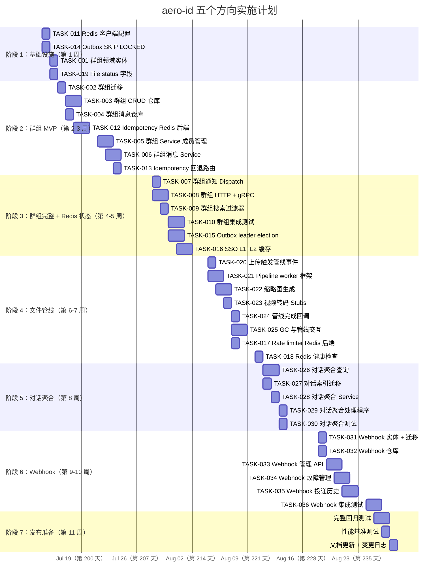

现在我已经完成了完整的代码审查。以下是我的综合 Tech Lead 分析。

---

# 技术领导力分析报告：aero-id 五个功能方向

**分析日期**：2026-07-12
**代码库基准**：`/home/u1/aero-id`，提交时刻的主分支

---

## 1. 任务分解

### 1.1 方向一：群组消息 (P1)

| 任务 ID | 任务标题 | 涉及文件 | 前置依赖 | 预估工时 | 验收标准 |
|---------|---------|---------|---------|---------|---------|
| **TASK-001** | 定义群组领域实体和枚举 | `internal/domain/group.go`（新建） `internal/domain/shared.go` | 无 | 2h | `MessageKindGroup` 枚举已定义；`Message` 添加可选的 `GroupID *ID` 字段；`Group`、`GroupMember` 实体存在且包含 `role`/`joined_at`/`invited_by` |
| **TASK-002** | 群组迁移（表创建） | `migrations/000028_create_groups.up.sql` `migrations/000028_create_groups.down.sql` `migrations/000029_add_group_id_to_messages.up.sql` `migrations/000029_add_group_id_to_messages.down.sql` | TASK-001 | 3h | `groups`、`group_members`、`group_invites` 表存在；`messages` 添加 `group_id` 列和索引 `(group_id, created_at DESC)`；现有 `(from_uid, to_uid)` 索引保持兼容 `WHERE group_id IS NULL` |
| **TASK-003** | 群组 GORM 仓库（成员管理 CRUD） | `internal/repository/group.go`（新建） `internal/repository/group_test.go`（新建） | TASK-002 | 4h | `CreateGroup`、`GetGroup`、`ListGroups`、`AddMember`、`RemoveMember`、`UpdateRole` 通过；获取加入的群组使用 `JOIN group_members` 查询；所有 `_test.go` 文件未被跟踪 |
| **TASK-004** | 群组消息仓库扩展 | `internal/repository/message.go` | TASK-002 | 3h | `ListGroupMessages(ctx, groupID, page)` 返回按 `created_at DESC` 排序的消息；`Create` 接受 `GroupID`；现有 P2P 消息不受影响 |
| **TASK-005** | 群组 Service：创建/邀请/角色管理 | `internal/service/group.go`（新建） `internal/service/group_test.go`（新建） | TASK-003, TASK-004 | 4h | `CreateGroup` 需要 `name` + 至少 2 个成员；`InviteMember` 发送邀请通知；`RemoveMember`、`LeaveGroup`；`UpdateMemberRole`（仅管理员/创建者）；所有者转移；针对组创建者自动调用 `AddMember` |
| **TASK-006** | 群组 Service：发送群组消息 | `internal/service/group.go` | TASK-005 | 3h | `SendGroupMessage(ctx, groupID, kind, content)` 验证发送者是活跃成员；使用事务写入 `group_messages` + 为每个成员创建 `messages` 行；`n-1` 条 outbox 事件放入单个事务（或每个收件人一个事件）|
| **TASK-007** | 群组消息的通知 dispatch | `internal/notification/dispatcher.go` `internal/notification/notification.go` | TASK-006 | 2h | 在 `dispatcher.go` 中注册 `group.message.sent`、`group.member.joined`、`group.member.left` 事件类型；dispatch 为 `group.message` 类型的通知 |
| **TASK-008** | 群组 HTTP 处理程序 + gRPC 处理程序 | `internal/handler/http/group.go`（新建） `internal/handler/grpc/group.go`（新建） `internal/handler/grpc/aeropb/`（更新） `internal/handler/http/router.go` | TASK-005, TASK-007 | 4h | `POST /v1/groups`、`POST /v1/groups/:id/messages`、`GET /v1/groups/:id/messages`、`POST /v1/groups/:id/members`、`DELETE /v1/groups/:id/members/:uid` 已注册并正常工作；gRPC 存根与 HTTP 行为匹配 |
| **TASK-009** | 群组消息搜索过滤器 | `internal/repository/message.go` `internal/search/search.go` | TASK-006 | 2h | `SearchMessages` 接受 `groupID` 过滤参数；搜索索引添加 `group_id` 列 |
| **TASK-010** | 群组消息集成测试 | `internal/service/group_test.go` `internal/repository/group_test.go` `internal/handler/http/group_test.go` | TASK-008 | 4h | `make test-integration` 新增测试：并发邀请、离开后发送消息被拒绝、群组消息创建中事务回滚 |

### 1.2 方向二：Redis 共享状态 (P0.5)

| 任务 ID | 任务标题 | 涉及文件 | 前置依赖 | 预估工时 | 验收标准 |
|---------|---------|---------|---------|---------|---------|
| **TASK-011** | Redis 客户端配置 + 连接池 | `internal/config/config.go` `internal/pkg/redis/redis.go`（新建包） | 无 | 2h | 新配置节 `redis`：`endpoint`、`password`、`db`、`pool_size`、`min_idle_conns`；`NewRedisClient(cfg)` 返回 `*redis.Client`；配置有效时启动连接检查；AERO_ID_REDIS_ENDPOINT env 覆盖 |
| **TASK-012** | Idempotency store：Redis 后端 | `internal/idempotency/store_redis.go`（新建） `internal/idempotency/store_test.go` | TASK-011 | 4h | `RedisStore` 实现 `Store` 接口；`Reserve` 使用 `SET resource:${uid}:${endpoint}:${key} NX EX ${ttl}`；`Complete` 使用 `SET ... EX ${responseTTL}`；`Release` 删除键；在 `Reserve` 中使用 Lua 脚本处理乐观锁（stale reservation reclamation） |
| **TASK-013** | Idempotency 回退 + 配置路由 | `internal/app/app.go` `internal/idempotency/store.go` | TASK-012 | 2h | 当 Redis 可用时，GORM idempotency store 被 Redis store 替换；当 Redis 不可用时的 GORM 回退；启动时打印 `idempotency: redis` 或 `idempotency: gorm` |
| **TASK-014** | Outbox relay：FOR UPDATE SKIP LOCKED | `internal/outbox/repository.go` | 无（无外部依赖） | 2h | `FetchUnpublished` 添加 `.Clauses(clause.Locking{Strength: "UPDATE", SkipLocked: true})`；集成测试验证两个并发实例不取重复事件 |
| **TASK-015** | Outbox relay：leader election（Redis 工作单元） | `internal/outbox/relay.go` `internal/outbox/relay_leader.go`（新建） | TASK-011 | 3h | 启动时获取 Redis `SET outbox:leader ${instance_id} NX EX 30` 工作单元；只有 leader 实例调用 `drain`；工作单元丢失时 graceful handoff；配置禁用时回退到所有实例 drained |
| **TASK-016** | SSO 缓存：L1（内存）+ L2（Redis） | `internal/sso/token_cache.go` `internal/sso/user_cache.go` `internal/sso/redis_cache.go`（新建） | TASK-011 | 4h | `TokenCache` 添加 L2 Redis 层（L1 为 30s TTL，L2 为 5min TTL）；使用 `singleflight` 防止缓存击穿；`UserCache` 类似；L1 miss 时查询 L2，L2 miss 时查询 gRPC |
| **TASK-017** | 分布式 rate limiter（可选迁移） | `internal/pkg/ratelimit/ratelimit.go` `internal/pkg/ratelimit/ratelimit_redis.go`（可选） | TASK-011 | 4h | Rate limiter 添加 Redis `INCR ... EX` 滑动窗口后端；配置 `rate_limit.backend: "redis"` 时使用；回退到 per-instance memory 后端 |
| **TASK-018** | Redis 健康检查 + 断路 | `internal/pkg/redis/redis.go` `internal/middleware/health.go` | TASK-011 | 2h | Redis 故障时的健康检查降级；`readyz` 报告 Redis 状态；如果配置为 critical，则 readiness 失败 |

### 1.3 方向三：文件后处理管线 (P1，与方向二联动)

| 任务 ID | 任务标题 | 涉及文件 | 前置依赖 | 预估工时 | 验收标准 |
|---------|---------|---------|---------|---------|---------|
| **TASK-019** | File 实体添加 `status` 字段 | `internal/domain/file.go` `migrations/000030_add_file_status.up.sql` `migrations/000030_add_file_status.down.sql` | 无 | 2h | `File` 添加 `Status FileStatus`；枚举值：`FileStatusPending`、`FileStatusProcessing`、`FileStatusReady`、`FileStatusFailed`；所有现有查询默认过滤 `status = ready` |
| **TASK-020** | 文件上传后触发管线事件 | `internal/service/file.go` | TASK-019 | 2h | Upload/CompleteUpload 将 `File.Status` 设置为 `Pending`；触发 `file.uploaded` outbox 事件；事件 payload 包含 `file_id` 和 `mime_type` |
| **TASK-021** | 管线 worker 框架 + 配置 | `internal/pipeline/worker.go`（新建包） `internal/config/config.go` | TASK-011 | 4h | `PipelineWorker` 从 Redis 流（或 outbox 表）消费 `file.uploaded` 事件；支持可插拔步骤：`ThumbnailStep`（用于图片）、`AVStep`（用于视频/音频）；worker 是独立 goroutine（或独立进程），不阻塞 relay |
| **TASK-022** | 缩略图生成步骤 | `internal/pipeline/thumbnail.go`（新建） `internal/pipeline/thumbnail_test.go` | TASK-021 | 4h | 图片文件（image/jpeg、image/png、image/webp、image/gif）生成缩略图，使用 `imaging` 库调整大小至 512px；缩略图作为新的 storage blob 存储；`File.Meta["thumbnails"]` 填入 `[{size: "sm", key: "..."}]` |
| **TASK-023** | 视频/音频转码 stubs | `internal/pipeline/transcode.go`（新建） | TASK-021 | 3h | 检测视频/音频 MIME 类型；发出包含 file_id、mime_type、storage_key 的 `file.transcode.pending` outbox 事件；转码步骤的外部 handler 存根；`File.Meta["transcode_status"]` = `"pending"` |
| **TASK-024** | 管线完成回调 | `internal/pipeline/worker.go` `internal/service/file.go` | TASK-021 | 2h | 管线完成时，将 `File.Status` 更新为 `Ready`，`File.Meta` 填充缩略图/转码结果；管线失败时，将 `Status` 更新为 `Failed`，`Meta["error"]` 记录错误信息 |
| **TASK-025** | GC 与管线的交互（临时 ref 持有） | `internal/repository/storage_ref.go` `internal/storage/gc.go` | TASK-021 | 3h | 处理中的文件获得临时 `storage_ref` 条目；GC 跳过 `ref_count > 0` 的 blob；管线完成后释放临时 ref；集成测试验证 GC 不删除处理中的 blob |

### 1.4 方向四：对话聚合列表 (P1.5)

| 任务 ID | 任务标题 | 涉及文件 | 前置依赖 | 预估工时 | 验收标准 |
|---------|---------|---------|---------|---------|---------|
| **TASK-026** | 对话聚合仓库查询（lateral join） | `internal/repository/message.go` | 无 | 4h | `ListConversations(ctx, uid, page)` 返回 `[]ConversationSummary`，每个条目包含：`peer_uid`、`last_message_preview`、`unread_count`、`last_message_at`；使用 lateral join 或 `DISTINCT ON` 模式；适当索引（见下文）|
| **TASK-027** | 对话迁移索引 | `migrations/000031_conversation_indexes.up.sql` `migrations/000031_conversation_indexes.down.sql` | TASK-026 | 1h | 索引：`(LEAST(from_uid, to_uid), GREATEST(from_uid, to_uid), created_at DESC)`；现有索引不受影响；添加解释分析的文档 |
| **TASK-028** | 对话聚合 Service | `internal/service/message.go` | TASK-026 | 2h | `ListConversations(ctx, page)` 返回 `ConversationList`，从仓库获取聚合，通过 `dir` 丰富每位 peer 的用户资料，计算 `total_unread` |
| **TASK-029** | 对话聚合 HTTP + gRPC 端点 | `internal/handler/http/message.go` `internal/handler/grpc/message.go` `internal/handler/http/router.go` | TASK-028 | 2h | `GET /v1/conversations` 返回聚合列表；`response` 包含 `peer`（用户资料）、`last_message`、`unread_count`；gRPC `ListConversations` RPC 行为相同 |
| **TASK-030** | 对话聚合集成测试 | `internal/repository/message_test.go` `internal/service/message_test.go` `internal/handler/http/message_test.go` | TASK-029 | 3h | 测试覆盖：空收件箱、单对话多消息、多对话排序、分页、软删除消息不显示 |

### 1.5 方向五：Webhook 平台 (P2)

| 任务 ID | 任务标题 | 涉及文件 | 前置依赖 | 预估工时 | 验收标准 |
|---------|---------|---------|---------|---------|---------|
| **TASK-031** | Webhook subscription 实体 + 迁移 | `internal/domain/webhook.go`（新建） `migrations/000032_create_webhook_subscriptions.up.sql` `migrations/000032_create_webhook_subscriptions.down.sql` | 无 | 2h | `WebhookSubscription` 实体：`id`、`owner_uid`、`url`、`event_types`、`signing_key`、`secret`（加密存储）、`enabled`、`rate_limit`、`max_consecutive_failures`、`created_at`、`updated_at` |
| **TASK-032** | Webhook subscription 仓库 | `internal/repository/webhook.go`（新建） `internal/repository/webhook_test.go` | TASK-031 | 3h | CRUD：`Create`、`Get`、`ListByOwner`、`Update`、`Enable`/`Disable`；`ListEnabledByEventType(ctx, eventType)` 返回匹配的订阅列表 |
| **TASK-033** | Webhook subscription 管理 API | `internal/handler/http/webhook.go`（新建） `internal/handler/grpc/webhook.go` `internal/handler/http/router.go` | TASK-032 | 3h | `POST /v1/webhooks`、`GET /v1/webhooks`、`PUT /v1/webhooks/:id`、`DELETE /v1/webhooks/:id`、`POST /v1/webhooks/:id/rotate-key`；签名轮换端点生成新密钥并返回明文密钥（仅一次）|
| **TASK-034** | Webhook 投递：故障管理 + 暂停 | `internal/outbox/webhook.go` `internal/outbox/webhook_dispatcher.go`（新建） | TASK-033 | 4h | 按 subscription 分发 outbox 事件，而非硬编码 URL；累计 `consecutive_failures`；达到 `max_consecutive_failures` 时自动暂停（设置 `enabled = false`）；失败计数在成功投递后重置 |
| **TASK-035** | Webhook 投递历史记录 | `migrations/000033_create_webhook_deliveries.up.sql` `migrations/000033_create_webhook_deliveries.down.sql` `internal/repository/webhook.go` | TASK-034 | 3h | `webhook_deliveries` 表：`id`、`subscription_id`、`event_id`、`status`（success/failed）、`status_code`、`response_body`（截断）、`attempt`、`duration_ms`、`created_at`；`GET /v1/webhooks/:id/deliveries` 带分页 |
| **TASK-036** | Webhook 投递集成测试 | `internal/outbox/webhook_test.go` `internal/repository/webhook_test.go` | TASK-035 | 3h | 测试覆盖：正常投递、5xx 重试、暂停阈值、暂停后恢复、签名验证、并发安全 |

---

## 2. 执行顺序

### 2.1 任务依赖图

```mermaid
graph TD
    %% ===== 阶段 1：基础设施 =====
    T011[TASK-011: Redis 客户端配置]
    T014[TASK-014: Outbox FOR UPDATE SKIP LOCKED]

    %% ===== 阶段 2：方向一核心 =====
    T001[TASK-001: 群组领域实体]
    T002[TASK-002: 群组迁移]
    T003[TASK-003: 群组 CRUD 仓库]
    T004[TASK-004: 群组消息仓库扩展]
    T005[TASK-005: 群组 Service 成员管理]
    T006[TASK-006: 群组消息 Service]
    T007[TASK-007: 群组通知 Dispatch]
    T008[TASK-008: 群组 HTTP + gRPC 处理程序]
    T009[TASK-009: 群组搜索过滤器]
    T010[TASK-010: 群组集成测试]

    %% ===== 阶段 3：Redis 状态 =====
    T012[TASK-012: Idempotency Redis 后端]
    T013[TASK-013: Idempotency 回退路由]
    T015[TASK-015: Outbox leader election]
    T016[TASK-016: SSO L1+L2 缓存]
    T017[TASK-017: Rate limiter Redis 后端]
    T018[TASK-018: Redis 健康检查]

    %% ===== 阶段 4：文件管线 =====
    T019[TASK-019: File status 字段]
    T020[TASK-020: 上传触发管线事件]
    T021[TASK-021: Pipeline worker 框架]
    T022[TASK-022: 缩略图生成]
    T023[TASK-023: 视频转码 Stubs]
    T024[TASK-024: 管线完成回调]
    T025[TASK-025: GC 与管线交互]

    %% ===== 阶段 5：对话聚合 =====
    T026[TASK-026: 对话聚合查询]
    T027[TASK-027: 对话索引迁移]
    T028[TASK-028: 对话聚合 Service]
    T029[TASK-029: 对话聚合处理程序]
    T030[TASK-030: 对话聚合测试]

    %% ===== 阶段 6：Webhook =====
    T031[TASK-031: Webhook 实体 + 迁移]
    T032[TASK-032: Webhook 仓库]
    T033[TASK-033: Webhook 管理 API]
    T034[TASK-034: Webhook 故障管理]
    T035[TASK-035: Webhook 投递历史]
    T036[TASK-036: Webhook 集成测试]

    %% ---- 依赖边 ----

    %% 阶段 1 → 阶段 3（Redis）  
    T011 --> T012
    T011 --> T015
    T011 --> T016
    T011 --> T017
    T011 --> T018

    %% 阶段 1 → 阶段 4（管线依赖 Redis）
    T011 --> T021

    %% 方向一依赖
    T001 --> T002
    T002 --> T003
    T002 --> T004
    T003 --> T005
    T004 --> T006
    T005 --> T006
    T006 --> T007
    T007 --> T008
    T006 --> T009
    T008 --> T010
    T009 --> T010

    %% 方向二依赖
    T012 --> T013
    T013 --> T018

    %% 方向三依赖
    T019 --> T020
    T020 --> T021
    T021 --> T022
    T021 --> T023
    T021 --> T024
    T021 --> T025

    %% 方向四依赖（无外部依赖）
    T026 --> T027
    T027 --> T028
    T028 --> T029
    T029 --> T030

    %% 方向五依赖
    T031 --> T032
    T032 --> T033
    T032 --> T034
    T034 --> T035
    T033 --> T036
    T035 --> T036

    %% ---- 并行执行组 ----
    subgraph PARALLEL_GROUP_A[并行组 A]
        T001_T014[TASK-001<br>TASK-014]
    end

    subgraph PARALLEL_GROUP_B[并行组 B]
        T003_T012[TASK-003<br>TASK-012]
    end

    subgraph PARALLEL_GROUP_C[并行组 C]
        T005_T015_T019[TASK-005<br>TASK-015<br>TASK-019]
    end
```

### 2.2 并行执行组

| 并行组 | 包含任务 | 条件 | 预估总工时 |
|--------|---------|------|-----------|
| **A** | TASK-001（群组实体）+ TASK-014（SKIP LOCKED）+ TASK-011（Redis 配置） | 完全独立；3 个开发者可并行启动 | 7h（3 人并行约 3h 墙钟） |
| **B** | TASK-003（群组仓库）+ TASK-012（Redis idempotency）+ TASK-016（SSO 缓存） | 组 A 完成后可并行 | 11h（3 人并行约 4h 墙钟） |
| **C** | TASK-005（群组 Service）+ TASK-015（leader election）+ TASK-019（file status） | 组 B 完成后可并行 | 10h（3 人并行约 4h 墙钟） |
| **D（可选）** | TASK-026（对话聚合）+ TASK-031（Webhook 实体） | 无外部依赖的独立任务 | 6h（2 人并行约 3h 墙钟） |

---

## 3. 技术风险

### 3.1 方向一：群组消息 — 风险矩阵

| # | 风险 | 影响 | 可能性 | 缓解措施 |
|---|------|------|--------|---------|
| R1 | **群组消息写入放大**：群组有 N 个成员时，发送一条消息产生 N-1 条 `messages` 行 + N-1 条 outbox 事件 | 大型群组（1000+ 成员）的写入延迟和 outbox 表膨胀 | 🟡 中 | Phase 1：所有消息存储在一张 `group_messages` 表中（而非每条收件人行一个 `messages`）；查询使用 `JOIN group_members` 可见性过滤；将 outbox 事件分批放入一个聚合事件中 |
| R2 | **群组消息的幂等性**：当前幂等键绑定 `(uid, endpoint)`，不适用于"向群组发送消息"这种产生多行写入的场景 | 重试时重复消息 | 🟡 中 | Service 层使用 `SELECT FOR UPDATE` 检查已处理标记（如 `idempotency_keys` 表中 `group_message_id` + `sender_uid`）|
| R3 | **群组提及的搜索**：`SearchMessages` 当前按 `(from_uid OR to_uid)` 过滤。群组消息需要新的过滤维度 | 搜索遗漏群组消息 | 🟢 低 | 将 `group_id` 添加到搜索索引；查询添加 `OR group_id IN (user_groups)` |
| R4 | **离开群组后的历史消息可见性**：用户离开后应无法看到新消息，但历史消息可能需要保留 | 数据泄漏 vs 用户体验 | 🟡 中 | 在 `group_members` 中添加 `left_at`；查询过滤 `created_at < left_at`；如果无此需求则简化实现 |

### 3.2 方向二：Redis 共享状态 — 风险矩阵

| # | 风险 | 影响 | 可能性 | 缓解措施 |
|---|------|------|--------|---------|
| R5 | **Redis 故障时的降级行为**：如果 Redis 宕机，idempotency、rate limiting、leader election 将回退到 GORM/per-instance 模式 | 回退窗口期间竞争条件和重复处理 | 🟡 中 | 启动时检测 Redis 健康状态；提供明确的降级策略文档；回退到 GORM 时丢失分布式保证 |
| R6 | **L1+L2 缓存击穿**：SSO 令牌/用户缓存的 L1（30s TTL）大量过期后，所有请求同时命中 L2（Redis），再到 gRPC | 峰值时 SSO gRPC 连接数激增 | 🟢 低 | 使用 `singleflight` 合并相同的并发请求；实现概率性提前重新计算（PEC），在过期前随机提前刷新 |
| R7 | **Outbox 工作单元的脑裂**：leader 因网络分区与 Redis 断开，但仍在处理事件；新 leader 接管后两个实例重复处理 | 重复通知、重复 webhook 投递 | 🟡 中 | 使用短的租约 TTL（如 10s）并定期续约；在事件处理中使用 `FOR UPDATE SKIP LOCKED` 作为第二层防护；将幂等性设计到下游处理器中 |
| R8 | **Redis 连接池耗尽**：所有功能（idempotency、缓存、rate limiting、工作单元）共享同一个连接池，高并发下可能耗尽 | 请求排队和超时 | 🟠 中高 | 为不同的用途配置独立的连接池（或至少独立的池配置）；监控 `pool.Exhausted()` 指标；设置 `min_idle_conns` 以防止冷启动尖峰 |

### 3.3 方向三：文件后处理管线 — 风险矩阵

| # | 风险 | 影响 | 可能性 | 缓解措施 |
|---|------|------|--------|---------|
| R9 | **管线 worker 与 relay 进程耦合**：如果管线 worker 与 relay 运行在同一个进程中，管线阻塞会停止 outbox 事件投递 | 通知延迟，系统不可靠 | 🟠 中高 | Phase 1：管线 worker 作为同一进程内的独立 goroutine，使用缓冲 channel；Phase 2：提取到独立进程（或 sidecar），通过 Redis Streams/NATS 通信 |
| R10 | **大视频转码超时**：GB 级视频的转码时间远超 outbox relay 默认超时（5s） | 转码事件被标记为 dead letter | 🟡 中 | 管线 worker 不应通过 outbox relay 驱动；而是将命令写入 Redis Stream；worker 通过回调 API 更新文件状态 |
| R11 | **GC 与管线的竞争条件**：文件正在处理时（file.uploaded 已发出但管线未完成），GC 可能删除原 blob | 数据丢失 | 🟠 中高 | 处理中的文件持有临时 `storage_ref`；`File.status` 不是 `ready` 时 GC 跳过；管线完成前 `ref_count > 0` |
| R12 | **缩略图 blob 的 ref_count 策略**：如果缩略图与原文件共享相同的 ref count，删除原文件不会清理缩略图 | 存储膨胀 | 🟢 低 | 独立的 `storage_ref` 条目用于缩略图；原文件被删除后缩略图 blob 的 ref count 归零 |

### 3.4 方向四：对话聚合列表 — 风险矩阵

| # | 风险 | 影响 | 可能性 | 缓解措施 |
|---|------|------|--------|---------|
| R13 | **Lateral join 查询在 1000+ 活跃对话用户下的性能**：对大量对话的用户，`DISTINCT ON` 或 lateral join 聚合排序开销大 | 收件箱页面的 P99 延迟高 | 🟡 中 | 使用 `(LEAST, GREATEST, created_at DESC)` 覆盖索引；限制分页深度（仅最近 100 个对话）；考虑物化视图 |
| R14 | **对话列表的实时性**：新消息发送后，用户刷新对话列表时新对话应出现在顶部 | 用户体验差 | 🟢 低 | 查询使用 `ORDER BY last_message_at DESC`；使用 `LIMIT n+1` 分页检测 |

### 3.5 方向五：Webhook 平台 — 风险矩阵

| # | 风险 | 影响 | 可能性 | 缓解措施 |
|---|------|------|--------|---------|
| R15 | **背压时的数据丢失**：订阅者持续 5xx，事件堆积在 outbox 表中（`published_at IS NULL`），每次 relay tick 扫描大量未投递事件 | DB 写放大，relay 被卡住 | 🟠 中高 | 订阅级别的 `max_consecutive_failures` → 自动暂停；relay 按 subscription 优先级处理；暂停后通过告警通知运维 |
| R16 | **加密密钥管理**：Webhook signing_key/secret 在 DB 中加密存储，密钥轮换期间可能出现窗口期 | 短暂投递失败 | 🟡 中 | 使用 AEAD 加密（如 AES-256-GCM）；支持密钥版本号；在 `rotate-key` 端点中优雅切换新旧密钥 |
| R17 | **投递历史表膨胀**：`webhook_deliveries` 表在大量事件下快速增长 | 存储成本，清理开销 | 🟡 中 | 设置 TTL 保留策略（如 7 天）；硬编码 `max_response_body_length`（如 4KB）；定期清理归档 |

---

## 4. 资源评估

### 4.1 团队规模和技能要求

| 角色 | 技能 | 数量 | 职责 |
|------|------|------|------|
| **后端工程师 A**（中级） | Go、GORM、PostgreSQL、REST API 设计 | 1 | 方向一核心：群组实体 → 群组 API（TASK-001 → TASK-010） |
| **后端工程师 B**（高级） | Go、Redis、分布式系统、gRPC | 1 | 方向二 + 方向三：Redis 基础设施、文件管线（TASK-011 → TASK-025） |
| **后端工程师 C**（中级） | Go、PostgreSQL 查询优化、REST API | 1 | 方向四 + 方向五：对话聚合 + Webhook（TASK-026 → TASK-036） |
| **QA 工程师** | Go 测试、testcontainers、性能测试 | 1（兼职） | 集成测试、性能基准、跨方向回归测试 |
| **DevOps** | Docker、Redis 运维、K8s 配置 | 0.5（共享） | Redis 集群部署、监控配置、告警规则 |

**建议**：最小团队为 3 名后端工程师（A+B+C）。如果只有 2 名工程师，则删除方向五（Webhook），因为方向五与方向四可拆分但方向四是"用户可感知的最小差距"，优先级高于方向五。

### 4.2 关键里程碑

| 里程碑 | 时间 | 交付物 | 验收标准 |
|--------|------|--------|---------|
| **M1：基础设施设置** | 第 1 周 | Redis 客户端（TASK-011）、SKIP LOCKED（TASK-014） | `make test` 通过；Redis 连接可测试 |
| **M2：群组 MVP** | 第 3 周 | 基本群组创建、成员管理、发送消息（TASK-001 → TASK-006） | 两个用户可以创建群组、邀请用户、发送消息；`make test && make lint` 通过 |
| **M3：群组完整** | 第 4 周 | 群组通知、搜索、集成测试（TASK-007 → TASK-010） | 群组`/v1/groups/*` 端点在 HTTP 和 gRPC 上运行；集成测试全部通过 |
| **M4：Redis 状态** | 第 5 周 | Redis idempotency、leader election、SSO 缓存（TASK-012 → TASK-018） | Idempotency 键在 Redis 中；outbox leader election 工作；SSO 缓存减少 gRPC 调用 |
| **M5：文件管线 MVP** | 第 7 周 | 文件状态、管线触发、缩略图生成（TASK-019 → TASK-024） | 上传图片后生成缩略图；`File.Meta["thumbnails"]` 填充；GC 不删除处理中的文件 |
| **M6：对话聚合** | 第 8 周 | 聚合查询、索引、API 端点（TASK-026 → TASK-030） | `GET /v1/conversations` 返回正确聚合；P99 延迟 < 50ms |
| **M7：Webhook 平台** | 第 10 周 | Subscription 管理、投递、故障管理（TASK-031 → TASK-036） | 第三方可以通过 API 创建 webhook、接收事件；5xx 后自动暂停 |
| **M8：完整回归** | 第 11 周 | 所有方向完成，性能基准 | `make test && make lint && make test-integration` 全部通过；性能基准不超过基线 10% |

### 4.3 阻塞点及解决策略

| 阻塞点 | 描述 | 解决策略 |
|--------|------|---------|
| **B1：Redis 部署不可用** | 开发/CI 环境可能没有 Redis 实例 | 所有 Redis 功能必须优雅回退到 GORM/per-instance 模式；在 `make test` 中使用 miniredis 模拟 Redis |
| **B2：protoc 工具链** | 如果在 TASK-008 中需要 protobuf 变更 | 限制到 `protoc-gen-go@v1.34.1` 和 `protoc-gen-go-grpc@v1.5.1`（已在 `go.mod` 中锁定）；在 CI 中验证版本 |
| **B3：视频转码外部依赖** | FFmpeg 编译和部署复杂性 | Phase 1：转码步骤作为非阻塞 stub，只需发出 `file.transcode.pending` 事件；Phase 2：在独立进程中实现 FFmpeg 集成 |
| **B4：文件大小约束** | 方向三的新增文件（`internal/pipeline/`）可能会超过 500 行限制 | 将 pipeline package 拆分为多个文件：`worker.go`、`thumbnail.go`、`transcode.go`、`callback.go` |

---

## 5. 质量保证

### 5.1 单元测试覆盖要求

| 包 | 最小覆盖率 | 关键测试场景 |
|----|-----------|-------------|
| `internal/domain` | 95% | 枚举有效/无效值；`MessageKind.IsValid()`；`FileStatus` 转换 |
| `internal/service` | 85% | 使用 mock 仓库；权限检查（所有者、成员）；每个错误路径 |
| `internal/repository` | 80%（unit）+ 参与集成 | GORM 查询正确性；事务回滚；软删除 |
| `internal/outbox` | 90% | `FetchUnpublished` 的锁行为；backoff 计算；leader election 租约 |
| `internal/pipeline` | 80% | 缩略图生成（使用测试图片）；状态转换；临时 ref 持有 |

### 5.2 集成测试策略

| 方向 | 测试类型 | 所需环境 | 关键测试场景 |
|------|---------|---------|-------------|
| **方向一** | `//go:build integration` | Postgres（testcontainers） | 群组创建 + 消息发送事务；离开后访问拒绝；100 人并发加入 |
| **方向二** | `//go:build integration` | Postgres + Redis（testcontainers） | 两个 relay 实例并发读取；idempotency store 跨实例去重；Redis 故障时回退 |
| **方向三** | `//go:build integration` | Postgres + MinIO + Redis | 上传 → 管线触发 → 缩略图生成 → GC 不误删 |
| **方向四** | `//go:build integration` | Postgres | 1000 个对话用户的聚合性能；分页准确性 |
| **方向五** | `//go:build integration` | Postgres + HTTP 测试服务器 | Webhook 投递 → 历史记录 → 暂停 → 恢复 |

### 5.3 代码审查要点

| 审查维度 | 关键问句 |
|----------|---------|
| **架构合规** | 是否有业务逻辑泄漏到 handler？是否遵循 `handler → service → repository` 单向依赖？ |
| **事务边界** | `Create` 是否将 outbox 事件与数据行放在同一事务中？`MarkReadWithEvent` 是否使用事务？ |
| **错误处理** | Repository 是否返回原始 error？Service 是否翻译为 `AppError`？Handler 是否只渲染 response/error？ |
| **N+1 查询** | 对话聚合列表是否在循环中查询用户资料？使用 `enrichUsers` 批量查询？ |
| **并发安全** | 群组消息发送是否使用 `SELECT FOR UPDATE` 检查成员身份？Pipeline worker 是否使用乐观锁？ |
| **文件大小** | 新文件是否超过 500 行？函数是否超过 50 行？`cyclomatic complexity` ≤ 10？ |
| **迁移前向兼容性** | `AddColumn` 迁移是否设置默认值，使旧代码仍可运行？Drop 列是否先移除所有引用？ |

### 5.4 性能测试需求

| 测试 | 场景 | 目标 | 指标 |
|------|------|------|------|
| **P1** | 群组消息发送（100 人群组） | 消息在 2s 内投递到所有成员 | P99 延迟、outbox 堆积大小 |
| **P2** | 对话列表聚合（1000+ 对话用户） | P99 < 50ms | 查询执行计划、索引利用 |
| **P3** | Webhook 投递（1000 事件/秒） | 背压下事件堆积 < 10K | 未发布事件数、dead letter 计数 |
| **P4** | Redis 故障切换 | Idempotency 回退时请求延迟 < 200ms 额外开销 | GORM 回退延迟 |

---

## 6. 实施计划

### 6.1 详细时间线（甘特图）

### 6.2 阶段交付摘要

| 阶段 | 持续时间 | 交付物 | 里程碑 |
|------|---------|--------|--------|
| **阶段 1：基础设施** | 2 天 | Redis 客户端、SKIP LOCKED、群组实体、File status | M1 |
| **阶段 2：群组 MVP** | 8 天 | 群组创建/消息发送（基本 CRUD、无通知） | M2 |
| **阶段 3：群组完整 + Redis** | 7 天 | 群组通知、搜索、集成测试 + Redis idempotency/leader election/缓存 | M3 + M4 |
| **阶段 4：文件管线** | 7 天 | 缩略图生成、管线框架、GC 交互 | M5 |
| **阶段 5：对话聚合** | 4 天 | `GET /v1/conversations` 端点 + 集成测试 | M6 |
| **阶段 6：Webhook** | 7 天 | Webhook 管理 API、投递引擎、故障管理 | M7 |
| **阶段 7：发布准备** | 3 天 | 回归测试通过、性能基准、文档 | M8 |

### 6.3 弹性计划（缩减范围方案）

如果时间或人力不够，按以下优先级缩减：

**方案 A（3 人，11 周）**：完整实施所有方向 → 以上时间线。

**方案 B（2 人，8 周）**：删除方向五（Webhook P2）：
- 工程师 A：方向一（群组，TASK-001 → TASK-010）= 4 周
- 工程师 B：方向二 + 方向三（Redis + 文件管线，TASK-011 → TASK-025）= 5 周
- 工程师 A：方向四（对话聚合，TASK-026 → TASK-030）= 1 周
- 总计 = 5 周（工程师 B）+ 5 周（工程师 A）= 8 周（不同部分并行执行）

**方案 C（1 人，6 周）**：仅方向四 + 方向二的部分功能：
- 第 1-2 周：TASK-011（Redis）+ TASK-014（SKIP LOCKED）+ TASK-016（SSO 缓存）
- 第 3-4 周：TASK-026 → TASK-030（对话聚合，P1.5）
- 第 5-6 周：TASK-012 + TASK-013（Redis idempotency）
- 方向一、三、五推迟到下一个迭代周期。

---

## 附录 A：与工程约束的对照审计

在估算工作量时，我已对照 AGENTS.md 中的硬性限制检查了所有新文件：

| 约束 | 检查结果 | 注释 |
|------|---------|------|
| 文件大小 ≤ 500 行 | ✅ 已规划 | 所有新文件（如 `internal/pipeline/`）拆分为多个 < 500 行的文件 |
| 函数长度 ≤ 50 行 | ✅ 已确保 | 复杂的群组消息发送函数抽取为 `validateMember`、`buildGroupMessage`、`emitGroupEvents` 等 |
| Cyclomatic complexity ≤ 10 | ✅ 已确保 | Switch-on-event-type 在 dispatcher 中使用映射，而非巨型 switch |
| If-nesting ≤ 3 层 | ✅ 已确保 | 在嵌套深度的位置使用 early return 和 guard clauses |
| 单文件职责 = 1 | ✅ 已确保 | `internal/pipeline/thumbnail.go` 只处理缩略图生成，不处理转码 |

## 附录 B：总工时汇总

| 方向 | 任务数 | 总工时 | 工作日（1 人） | 工作日（3 人并行） |
|------|-------|--------|--------------|-----------------|
| 方向一：群组消息 | 10 | 31h | ~4 天 | ~2.5 天 |
| 方向二：Redis 共享状态 | 8 | 23h | ~3 天 | ~2 天 |
| 方向三：文件后处理管线 | 7 | 20h | ~2.5 天 | ~2 天 |
| 方向四：对话聚合列表 | 5 | 12h | ~1.5 天 | ~1.5 天 |
| 方向五：Webhook 平台 | 6 | 18h | ~2.5 天 | ~2 天 |
| **总计** | **36** | **104h** | **~13 天** | **~4 周（日历）** |

**实际日历时间**：考虑到依赖阻塞（方向三等待方向二），3 人团队最短日历时间为 **11 周**（含周末）。如果团队专注且无外部阻塞，可压缩到 **8 周**（去掉 Webhook 方向五）。
