Now I have all the context needed. Let me produce the comprehensive Tech Lead analysis.

---

# Tech Lead 分析报告：aero-id 高价值扩展方向实施计划

> **文档依据**：
> 1. `docs/requirements/2026-07-12-aero-id-global-architecture-scan-high-value-extensions.md`
> 2. `docs/requirements/2026-07-12-aero-id-global-architecture-scan-high-value-extensions.out.md`
>
> **代码库版本**：当前 HEAD，基于验证报告（11/12 条代码引用准确）

---

## 1. 任务分解

基于验证报告修正后的优先级矩阵（方向二 P0 > 方向一 P1 = 方向三 P1 > 方向四 P2 = 方向五 P2），以及次级债务中**最值得立即修复的 actorKey 去重**，拆解为以下可执行任务：

### 1.1 基础设施先行 — 技术债务清理

| 任务 ID | 标题 | 方向 | 涉及文件 | 前置依赖 | 工时 | 验收标准 |
|---------|------|------|---------|---------|------|---------|
| TASK-000 | `actorKey`/`WithActor`/`ActorFrom` 去重 | 债务清理 | `internal/service/service.go`, `internal/domain/actor.go`, 以及所有引用 `service.WithActor`/`service.ActorFrom` 的 13 处 import | 无，零功能变化 | **1h** | `domain/actor.go` 中 `WithActor`/`ActorFrom`/`MustActor` 是唯一实现；`service/service.go` 中删除重复定义；所有调用方切换到 `domain` 包；`make test && make lint` 全绿 |

### 1.2 方向二：死信运维（P0 — 最高优先级）

| 任务 ID | 标题 | 方向 | 涉及文件 | 前置依赖 | 工时 | 验收标准 |
|---------|------|---------|---------|---------|------|---------|
| TASK-010 | Dead-letter 查询接口定义 + 仓储实现 | 死信运维 | `internal/outbox/outbox.go`（接口新增 `FetchDeadLetters`/`ReplayEvent`）、`internal/outbox/repository.go`（GORM 实现） | TASK-000 | **2h** | 新接口定义完整；`FetchDeadLetters(ctx, limit, cursor) → ([]*Event, nextCursor, error)` 按 `created_at DESC` 分页；`ReplayEvent(ctx, id)` 重置 `dead_letter=false, retry_count=0, last_retry_at=null`；单元测试覆盖空结果、分页、Replay 后再次 MarkFailed |
| TASK-011 | 死信仪表化 — `ObserveOutboxDeadLetter` | 死信运维 | `internal/pkg/metrics/metrics.go`、`internal/outbox/relay.go` | TASK-010 | **1h** | registry 新增 `ObserveOutboxDeadLetter(eventType)` 计数器；`relay.go` 的 `MarkFailed` 分支中，当 `retryCount >= maxRetries` 时调用该计数器；`/metrics` 输出 `aeroid_outbox_dead_letter_total{event_type="..."}` |
| TASK-012 | Admin HTTP 死信管理端点 | 死信运维 | `internal/handler/http/admin_deadletter.go`（新建）、`internal/handler/http/admin.go`（路由注册）、`internal/app/new.go`（依赖注入） | TASK-010, TASK-011 | **2h** | `GET /v1/admin/dead-letters?cursor=&limit=` 返回死信事件列表；`POST /v1/admin/dead-letters/:id/replay` 触发重放；两个端点均需 `outbox.admin` 权限（检查 `domain.PermOutboxAdmin` 是否存在，若不存在则新增）；集成测试验证端点的 200/403/404 响应 |
| TASK-013 | gRPC ops 死信端点 | 死信运维 | `internal/handler/grpc/ops_deadletter.go`（新建）、`internal/handler/grpc/ops.go`（注册） | TASK-010, TASK-011 | **1.5h** | gRPC 服务定义（在 `ops.proto` 扩展或新建 `admin.proto`）新增 `ListDeadLetters`/`ReplayDeadLetter` RPC；注册到 gRPC 服务；gRPC 测试覆盖 |
| TASK-014 | 死信告警规则（配置+文档） | 死信运维 | `configs/config.yaml`、`docs/monitoring.md`（新建或更新现有） | TASK-011 | **0.5h** | 配置项 `outbox.dead_letter_alert_threshold`（默认 10）；文档说明 Prometheus alerting rule 示例（`aeroid_outbox_dead_letter_total > 0` → PagerDuty） |

### 1.3 方向一：推送通知 — 设备注册基础设施（P1）

| 任务 ID | 标题 | 方向 | 涉及文件 | 前置依赖 | 工时 | 验收标准 |
|---------|------|---------|---------|---------|------|---------|
| TASK-020 | `device_tokens` 表 + 迁移 | 推送通知 | `migrations/xxx_add_device_tokens.up.sql`、`migrations/xxx_add_device_tokens.down.sql` | 无 | **1.5h** | 表结构：`id`(UUIDv7 PK), `uid`(string, NOT NULL), `platform`(string, 'ios'/'android'), `token`(string, NOT NULL, UNIQUE), `created_at`, `updated_at`；索引：`(uid)`、`(token)`；`.down.sql` 可回滚 |
| TASK-021 | 设备 token 仓储+领域模型 | 推送通知 | `internal/repository/device_token.go`（新建）、`internal/domain/device_token.go`（新建） | TASK-020 | **1.5h** | domain 定义 `DeviceToken` struct；repo 接口 `Register(ctx, uid, platform, token)`, `Unregister(ctx, token)`, `ListByUID(ctx, uid) → []*DeviceToken`；GORM 实现 + 单元测试 |
| TASK-022 | 设备注册 HTTP 端点 | 推送通知 | `internal/handler/http/device.go`（新建）、`internal/service/device_service.go`（新建） | TASK-021 | **2h** | `POST /v1/devices`（注册，body: `{platform, token}`，dedup 自动处理）、`DELETE /v1/devices/:token`（注销）；service 层做必填字段校验；端点挂 Auth 组（需 token 验证） |
| TASK-023 | FCM/APNs 推送适配器（最小实现） | 推送通知 | `internal/push/adapter.go`（接口定义）、`internal/push/fcm.go`（FCM 实现）、`internal/push/noop.go`（no-op 实现，用于未配置时） | TASK-022 | **3h** | `Adapter` 接口：`Send(ctx, uid, payload PushPayload) error` 带 `PushPayload{Title, Body, Data, Type}`；FCM HTTP v1 API 实现（OAuth2 凭据通过 `AERO_ID_FCM_CREDENTIALS` 环境变量 JSON 注入）；静默处理 `NotRegistered` 错误（删除 token + 记日志）；no-op 实现用于单元测试 |
| TASK-024 | 推送集成 → dispatcher | 推送通知 | `internal/service/notification.go`（dispatcher 新增 `WithDispatcherPush` option）、`internal/app/new.go`（注入配置） | TASK-023 | **2h** | 可选 option `WithDispatcherPush(adapter)` 在 dispatcher 创建通知 + SSE 推送后调用 `adapter.Send`；推送失败不阻塞主流程（单独 goroutine + 日志）；所有 dispatcher 测试在无 push option 时按原行为运行 |

### 1.4 方向三：群组消息（P1）

| 任务 ID | 标题 | 方向 | 涉及文件 | 前置依赖 | 工时 | 验收标准 |
|---------|------|---------|---------|---------|------|---------|
| TASK-030 | `conversations` + `conversation_members` 表 + migrations | 群组消息 | `migrations/*.up.sql`、`migrations/*.down.sql` | 无 | **2h** | `conversations(id, type, title, owner_uid, created_at, archived_at)`；`conversation_members(id, conversation_id, uid, role, joined_at, last_read_at)`；FK + 索引；`.down.sql` 完整 |
| TASK-031 | messages 表扩展 `conversation_id` | 群组消息 | `migrations/*.up.sql`、`internal/domain/message.go` | TASK-030 | **1h** | 新增 `conversation_id` UUID nullable FK + 索引；`domain.Message` 结构体新增对应字段（`gorm:"index"`）；现有 1:1 消息该字段保持 NULL |
| TASK-032 | 会话领域模型 + 仓储 | 群组消息 | `internal/domain/conversation.go`（新建）、`internal/repository/conversation.go`（新建） | TASK-030, TASK-031 | **2h** | domain 定义 `Conversation`, `ConversationMember`, `ConversationType(1:1|group)`；repo 接口：`Create`, `Get`, `AddMember`, `RemoveMember`, `ListByMember`, `ListMembers`, `ListMessages`；GORM 实现 |
| TASK-033 | 群组消息 service + CRUD 端点 | 群组消息 | `internal/service/conversation.go`（新建）、`internal/handler/http/conversation.go`（新建） | TASK-032 | **4h** | `ConversationService` 包含创建群组、加人、移除、发群消息、会话列表、消息历史；权限模型：成员可读写，非成员不可见；block 检查：A 发群消息时，有 block 关系的成员不看到该消息；端点挂 Auth 组 |
| TASK-034 | 群组消息通知集成 | 群组消息 | `internal/service/notification.go`（dispatcher 适配群组 fan-out） | TASK-033 | **2h** | 群消息创建时，dispatcher 为每个非block成员创建通知行；使用批量 insert 避免 N+1；SSE 推送群消息事件 |

### 1.5 方向五：活动流（P2）

| 任务 ID | 标题 | 方向 | 涉及文件 | 前置依赖 | 工时 | 验收标准 |
|---------|------|---------|---------|---------|------|---------|
| TASK-040 | Follow 领域模型 + 仓储 | 活动流 | `internal/domain/follow.go`（新建）、`internal/repository/follow.go`（新建） | 无 | **2h** | `Follow{id, follower_uid, followee_uid, resource_type, resource_id, created_at}`；repo 接口：`Create`, `Delete`, `ListFollowers`, `ListFollowing`, `IsFollowing`；唯一约束 `(follower_uid, followee_uid)`；GORM 实现 |
| TASK-041 | Follow HTTP 端点 | 活动流 | `internal/handler/http/follow.go`（新建）、`internal/service/follow.go`（新建） | TASK-040 | **2h** | `POST /v1/follows`（关注用户/资源）、`DELETE /v1/follows/:id`、`GET /v1/follows/following`（我的关注）、`GET /v1/follows/followers`（我的粉丝）；service 层校验不自关注 |
| TASK-042 | `actor_timeline` 表 + 写入路径（方案 C 核心） | 活动流 | `migrations/*.up.sql`、`internal/repository/timeline.go`（新建）、`internal/domain/timeline.go`（新建） | TASK-041 | **3h** | 方案 C（双写+Lazy 合并）的 actor_timeline 写入：在 `outbox` relay 或 dispatcher 中，每当有事件写出时，额外写入 `actor_timeline(actor_uid, event_type, summary, metadata, created_at)`；按 `actor_uid + created_at DESC` 索引 |
| TASK-043 | 活动流查询端点 | 活动流 | `internal/service/feed.go`（新建）、`internal/handler/http/feed.go`（新建） | TASK-042 | **3h** | `GET /v1/feed` 返回当前用户关注 actors 的最近活动（合并去重）；查询策略：拉取关注列表 → 批量查询 5-10 个 actor 的 timeline → 合并排序 → 缓存 30s；block 过滤在查询层做 |

### 1.6 方向四：文件版本管线（P2 — 最低优先级）

| 任务 ID | 标题 | 方向 | 涉及文件 | 前置依赖 | 工时 | 验收标准 |
|---------|------|---------|---------|---------|------|---------|
| TASK-050 | `file_versions` 表 + 迁移 | 文件版本 | `migrations/*.up.sql`、`migrations/*.down.sql` | 无 | **1.5h** | `file_versions(id, file_id FK, version_number, storage_key, size, checksum, mime_type, status, created_at, created_by)`；索引 `(file_id, version_number)`；`.down.sql` 完整 |
| TASK-051 | 版本仓储 + Create/List 版本逻辑 | 文件版本 | `internal/repository/file_version.go`（新建）、`internal/domain/file.go`（扩展 `File.Versions`）、`internal/service/file.go`（扩展 `Create` 写 version 1） | TASK-050 | **3h** | 文件 Create 时同时创建 version 1；`ListVersions` 按版本号降序；`GetVersion` 单个版本详情；扩展 `FileService` 接口添加 `ListVersions`, `DownloadVersion`；service 层校验文件 owner |

---

## 2. 执行顺序与依赖图

```mermaid
graph TD
    subgraph "Sprint 1: 基础设施 (Week 1)"
        TASK_000[TASK-000<br/>actorKey 去重<br/>1h]
        TASK_010[TASK-010<br/>死信查询接口<br/>2h]
        TASK_011[TASK-011<br/>死信仪表化<br/>1h]
    end

    subgraph "Sprint 2: P0 死信运维 (Week 1-2)"
        TASK_012[TASK-012<br/>Admin HTTP 死信端点<br/>2h]
        TASK_013[TASK-013<br/>gRPC ops 死信端点<br/>1.5h]
        TASK_014[TASK-014<br/>告警规则+文档<br/>0.5h]
    end

    subgraph "Sprint 3: P1 推送通知设备端 (Week 2-3)"
        TASK_020[TASK-020<br/>device_tokens 表<br/>1.5h]
        TASK_021[TASK-021<br/>设备 token 仓储<br/>1.5h]
        TASK_022[TASK-022<br/>设备注册 HTTP 端点<br/>2h]
        TASK_023[TASK-023<br/>FCM/APNs 适配器<br/>3h]
        TASK_024[TASK-024<br/>推送 → dispatcher<br/>2h]
    end

    subgraph "Sprint 2-3: P1 群组消息并行 (Week 2-4)"
        TASK_030[TASK-030<br/>conversations 表<br/>2h]
        TASK_031[TASK-031<br/>messages 扩展 conv_id<br/>1h]
        TASK_032[TASK-032<br/>会话领域+仓储<br/>2h]
        TASK_033[TASK-033<br/>群组 service + 端点<br/>4h]
        TASK_034[TASK-034<br/>群组通知集成<br/>2h]
    end

    subgraph "Sprint 4: P2 活动流 (Week 4-5)"
        TASK_040[TASK-040<br/>Follow 领域+仓储<br/>2h]
        TASK_041[TASK-041<br/>Follow 端点<br/>2h]
        TASK_042[TASK-042<br/>actor_timeline 表+写入<br/>3h]
        TASK_043[TASK-043<br/>活动流查询端点<br/>3h]
    end

    subgraph "Sprint 5: P2 文件版本 (Week 5-6)"
        TASK_050[TASK-050<br/>file_versions 表<br/>1.5h]
        TASK_051[TASK-051<br/>版本仓储+Create/List<br/>3h]
    end

    %% 依赖关系
    TASK_000 --> TASK_010
    TASK_010 --> TASK_011
    TASK_011 --> TASK_012
    TASK_011 --> TASK_013
    TASK_012 --> TASK_014
    
    TASK_020 --> TASK_021
    TASK_021 --> TASK_022
    TASK_022 --> TASK_023
    TASK_023 --> TASK_024
    
    TASK_030 --> TASK_031
    TASK_031 --> TASK_032
    TASK_032 --> TASK_033
    TASK_033 --> TASK_034
    
    TASK_040 --> TASK_041
    TASK_041 --> TASK_042
    TASK_042 --> TASK_043
    
    TASK_050 --> TASK_051

    %% 并行组标注
    style TASK_010 fill:#4CAF50,color:#fff
    style TASK_011 fill:#4CAF50,color:#fff
    style TASK_020 fill:#2196F3,color:#fff
    style TASK_030 fill:#FF9800,color:#fff
    style TASK_031 fill:#FF9800,color:#fff
    style TASK_040 fill:#9C27B0,color:#fff
    style TASK_050 fill:#607D8B,color:#fff
```



### 可并行执行的任务组

| 并行组 | 任务 | 说明 | 建议资源分配 |
|--------|------|------|-------------|
| **组 A** | TASK-000, TASK-010, TASK-011 | Sprint 1 基础设施，零依赖冲突 | 1 人顺序做（3h 总工时） |
| **组 B** | TASK-020, TASK-030, TASK-031 | 表迁移可并行，但建议顺序做以减少 migration 编号冲突 | 1 人做 TASK-020 → TASK-021；另 1 人做 TASK-030 → TASK-031 |
| **组 C** | TASK-012, TASK-013, TASK-022 | HTTP 端点 + gRPC 端点 + 设备端点，分别由不同人并行 | 2 人并行（HTTP 端点 + gRPC 端点各 1 人） |
| **组 D** | TASK-033, TASK-023 | 群组 service + FCM 适配器，完全独立 | 2 人并行 |
| **组 E** | TASK-040, TASK-050 | Follow 模型 + 文件版本表，完全独立 | 2 人并行 |

---

## 3. 技术风险识别

### 3.1 关键风险矩阵

| # | 风险 | 方向 | 概率 | 影响 | 缓解策略 |
|---|------|------|------|------|---------|
| R1 | **FCM OAuth2 凭据管理** — FCM HTTP v1 API 需要 Google service account 凭据，在无 SSO 团队配合下可能无法获取测试凭据 | 推送通知 | 🟡 中 | 🔴 高 | 推送适配器接口设计为先 stub 后实现：TASK-023 做到 **编译通过+单元测试通过（mock FCM）**；凭据注入后只需配置即可启用；在 README 标注所需凭据和环境变量 |
| R2 | **群组消息 Block 语义复杂度** — 当前 block 是单向 `A block B`，群组场景是 A 发消息到群 → 对 block A 的成员不可见 | 群组消息 | 🟡 中 | 🟡 中 | Phase A/B 先做简化：群组中如果有任何 block 关系，只对该 block 的接收者隐藏消息，不影响其他成员看到消息。高级语义（聚合通知、"X 的消息已隐藏"）放 Phase C。 |
| R3 | **活动流方案 C 的查询延迟** — 关注 100+ 人时，批量查询 5-10 个 actor_timeline 可能产生 N+1 查询 | 活动流 | 🟡 中 | 🟡 中 | 使用 `WHERE actor_uid IN (?) ORDER BY created_at DESC LIMIT ?` 单条 SQL + 多列索引 `(actor_uid, created_at)`；缓存 30s 足够吸收重复查询；`instrument` 用 `EXPLAIN ANALYZE` 验证 |
| R4 | **文件版本内容管线 worker 资源** — 需要独立 worker 进程和 Redis Streams（或消费 outbox 的独立进程），现有架构无此模式 | 文件版本 | 🔴 高 | 🟡 中 | TASK-050/051 只做 schema 和版本 CRUD（不涉及内容管线），留内容管线到方向四总体规划时再投入；版本存储用 checksum 去重 |
| R5 | **并发 Replay 同一死信事件** — relay 在 ticking 时可能拾取刚被重放的事件，与人工 Replay 竞争 | 死信运维 | 🟢 低 | 🟡 中 | `ReplayEvent` 使用 `UPDATE ... WHERE dead_letter = true` 条件更新（乐观锁），relay 的 `FetchUnpublished` 因 `dead_letter = false` 才会拾取，天然互斥 |
| R6 | **死信 Admin 端点权限** — 当前是否有 `outbox.admin` 权限定义？如无，需新增 domain 权限常量 | 死信运维 | 🟢 低 | 🟢 低 | 检查 `domain` 包中的 Perm 常量。如不存在 `PermOutboxAdmin`，新增并注册到种子权限中 |

### 3.2 跨团队依赖

| 依赖 | 涉及方向 | 阻塞的任务 | 解决策略 |
|------|---------|-----------|---------|
| SSO 团队提供 FCM 凭据（Google service account JSON + project ID） | 推送通知 | TASK-023（集成测试）、TASK-024（生产配置） | **推送适配器 stub 先行**。TASK-023 在无凭据时也可以完成并测试（mock 适配器 + no-op 实现）。凭据就绪后只需添加配置文件 + 切换实现 |
| 移动端设备 Token 刷新策略（iOS APNs token rotation） | 推送通知 | 无（后端无阻塞） | 后端已支持 token 过期自动删除（FCM `NotRegistered` 响应）。移动端 Token 刷新完全客户端职责 |

### 3.3 性能瓶颈与优化策略

| 场景 | 瓶颈 | 优化策略 |
|------|------|---------|
| 群组消息 fan-out 到 1000+ 成员的通知 | 逐条 insert N 行通知 | 使用批量 insert（GORM `CreateInBatches` 或 raw SQL `INSERT INTO ... VALUES (...), (...)`）；消息可见性查询使用 `WHERE uid IN (SELECT member_uid FROM conversation_members WHERE conv_id = ?)`，走索引 |
| 活动流查询（关注 500 人） | N+1 查询 actor_timeline | 单条 SQL `WHERE actor_uid IN (?) ORDER BY created_at DESC LIMIT 50`；结果缓存 30-60s |
| 死信列表查询（10k+ 死信堆积） | 全表扫描 | `dead_letter` 已经建立索引（现有 partial index `WHERE published_at IS NULL AND NOT dead_letter`）；给死信列表查询新增 `CREATE INDEX idx_outbox_dead_letter ON outbox_events(dead_letter, created_at DESC)` |

### 3.4 测试覆盖难点

| 测试场景 | 策略 |
|---------|------|
| FCM 推送适配器 | 使用 `httptest.NewServer` 模拟 FCM HTTP v1 API 端点；测试正常发送、NotRegistered（自动删除 token）、5xx 错误、超时 |
| 群组消息 block 过滤 | 构建 3 用户群组（A 发消息，B block A，C 正常）→ 验证 B 看不到 A 的消息，C 看得到。注意这是 service 层的纯逻辑测试 |
| 死信 Replay 并发安全 | 在 `repository_test.go` 中使用 go 协程并发调用 `ReplayEvent` + `MarkFailed` 验证乐观锁行为 |
| 活动流 block 过滤 | 构造 A 关注 B，但 A block C，C 关注 B 的场景 → A 看到 B 发消息的 feed 条目，但看到 "内容已删除" 如果内容是 C 的 |

---

## 4. 资源评估

### 4.1 团队配置建议

| 角色 | 技能要求 | 负责方向 | 建议人数 |
|------|---------|---------|---------|
| **后端 Go 工程师（Senior）** | GORM, Postgres, gRPC, HTTP API 设计，熟悉当前代码库架构 | 方向二（死信运维）+ 方向三（群组消息）+ 次级债务修复 | **1 人** |
| **后端 Go 工程师（Mid-Level）** | Go, REST API, GORM 基础，能独立添加表迁移和 CRUD 端点 | 方向一（推送通知设备端）+ 方向五（Follow 基础）+ 方向四（版本 schema） | **1 人** |
| **DevOps / 基础设施工程师** | Prometheus alerting, FCM API 凭据管理, CI/CD | 方向二告警规则 + 方向一凭据注入 + 方向四内容管线规划 | **0.5 人**（兼职） |

**总计**：1.5-2 名全职后端工程师 + 0.5 名兼职 DevOps，**共约 2 FTE**。

### 4.2 关键里程碑

| 里程碑 | 时间 | 交付物 | 验收条件 |
|--------|------|--------|---------|
| **M1: 死信运维上线** | 第 1 周结束 | 死信查询 API + 重放 + 仪表化 + 告警规则 | `make test && make lint` 通过；admin 能通过 API 查看和重放死信；/metrics 暴露死信计数器 |
| **M2: 设备注册就绪** | 第 2 周结束 | device_tokens 表 + 注册/注销端点 | 设备 token CRUD 通过集成测试；无 FCM 凭据下服务正常工作（no-op 模式） |
| **M3: 群组消息 MVP** | 第 3 周结束 | 群组 CRUD + 群内发消息 + block 过滤 | 三阶段群组功能 (Phase A/B) 通过集成测试；block 过滤通过 |
| **M4: 活动流 Alpha** | 第 4 周结束 | Follow 系统 + actor_timeline + feed 查询 | 关注→发消息→feed 中看到 通过 E2E 测试 |
| **M5: 文件版本基础** | 第 5 周结束 | file_versions 表 + 版本 CRUD | 上传文件自动创建 v1；列出版本列表；下载指定版本 |
| **M6: 推送通知集成** | 第 6 周结束 | FCM 适配器 + dispatcher 集成（w/ FCM 凭据） | FCM 集成测试通过（mock）；凭据注入后真实推送可工作 |

### 4.3 阻塞点（Blockers）

| 阻塞点 | 影响 | 解决策略 | 负责人 |
|--------|------|---------|-------|
| SSO 团队未提供 FCM 凭据 | 推送通知无法在生产启用 | **M2 不阻塞** — 设备注册端点独立上线；FCM 适配器在 M6 接入，凭据可后期注入 | Tech Lead 协调 SSO 团队 |
| `outbox.admin` 权限未定义 | 死信端点无法加权限 | 检查 `domain.PermOutboxAdmin` 是否存在；如不存在，新增并运行迁移 seed | 开发实现时自行解决 |

---

## 5. 质量保证

### 5.1 单元测试覆盖要求

| 包 | 要求 | 最低覆盖率 | 关键测试场景 |
|----|------|-----------|-------------|
| `internal/outbox` (new) | 新增接口的 repository 测试 | **90%+** | `FetchDeadLetters` 空/分页/全量；`ReplayEvent` 正常/重复重放/并发 |
| `internal/push` | Adapter 接口 + FCM mock | **85%+** | 正常发送 → 200；NotRegistered → 删除 token；5xx → 重试；超时 → 错误返回 |
| `internal/service` (conversation) | ConversationService | **85%+** | 创建群组 → 成功；非成员发消息 → Forbidden；block 成员过滤 |
| `internal/service` (feed) | FeedService | **80%+** | 关注者 feed 合并；被 block actor 过滤；空关注列表 → 空 feed |
| `internal/service` (device) | DeviceService | **90%+** | 注册 → 成功；重复注册 → dedup；删除 → 找不到 → 404 |
| `internal/repository` (conversation) | GORM 实现 | **85%+** | 成员增删；LastReadAt 更新；消息归档 |

### 5.2 集成测试策略

| 场景 | 测试类型 | 工具 | 执行条件 |
|------|---------|------|---------|
| 死信 Replay + relay 联动 | 集成 | testcontainers (Postgres) | `go test -tags=integration` |
| 群组消息 block 过滤（多人场景） | 集成 | testcontainers (Postgres) | `go test -tags=integration` |
| FCM 适配器 vs mock HTTP server | 单元 | `httptest.NewServer` | `go test ./internal/push/...` |
| 完整 E2E: 关注 → 发消息 → feed 可见 | 集成 | testcontainers (Postgres) | `go test -tags=integration` |

**注意**：方向五（活动流）和方向三（群组消息）的集成测试需要准备多个 UID 的 SSO mock（当前 `internal/service/mocks` 已有 `UserDirectory` mock，直接复用即可）。

### 5.3 代码审查要点

| 审查焦点 | 对应任务 | 检查清单 |
|---------|---------|---------|
| **Outbox 接口向后兼容** | TASK-010 | 现有 `Repository` 接口的 `FetchUnpublished`/`MarkFailed`/`PurgeDeadLetters` 签名不变；新增方法不影响现有调用方 |
| **迁移文件命名规范** | TASK-020, TASK-030, TASK-050 | `xxx_descriptive_name.up.sql` + `xxx_descriptive_name.down.sql`；版本号按时间戳递增；`.down.sql` 真实可回滚 |
| **推送适配器错误处理** | TASK-023 | `NotRegistered` 必须静默处理（记日志+删除 token）；`Unregistered` 同样处理；其他 4xx 不重试；5xx 允许 relay 重试 |
| **群组消息 block 过滤性能** | TASK-033 | 查询消息时的 block filter 使用 `NOT IN (SELECT blocked_uid FROM blocks WHERE blocker_uid = ?)`，走索引 |
| **活动流缓存策略** | TASK-043 | 缓存时间 30s 是否足够的论证；缓存键设计（`feed:{uid}`）；缓存失效策略（写入时 invalidate） |
| **文件版本 GC 交互** | TASK-051 | 上传时立即建立 `storage_ref`，避免 GC 误删正在处理的 blob |

### 5.4 性能测试需求

| 场景 | 方法 | 阈值 |
|------|------|------|
| 死信查询 10k 行 | `EXPLAIN ANALYZE` + `pgbench` 模拟 | 分页查询 < 50ms |
| 群组消息 fan-out 1000 成员 | 模拟 1000 成员并发发消息 | 通知写入 < 500ms 完成（批量 insert） |
| 活动流查询 500 关注者 | 500 个关注者各 100 条 timeline 条目 | 合并查询 < 100ms（加缓存后 < 10ms） |
| 设备 token 注册 QPS | 模拟 500 并发注册 | 无锁冲突，P99 < 50ms |

---

## 6. 实施计划

### 6.1 详细甘特图（6 周规划）

```mermaid
gantt
    title aero-id 高价值扩展 — 6 周实施计划
    dateFormat  YYYY-MM-DD
    axisFormat  %m/%d

    section Sprint 1: 基础设施 (Week 1)
    TASK-000: actorKey 去重                    :done, t000, 2026-07-14, 1d
    TASK-010: 死信查询接口+仓储                  :crit, t010, after t000, 2d
    TASK-011: 死信仪表化                        :t011, after t010, 1d
    TASK-012: Admin HTTP 死信端点               :t012, after t011, 2d
    TASK-013: gRPC ops 死信端点                 :t013, after t011, 1.5d
    TASK-014: 告警规则+文档                     :t014, after t012, 0.5d

    section Sprint 2: 设备注册 + 群组 Schema (Week 2)
    TASK-020: device_tokens 表迁移              :t020, 2026-07-21, 1.5d
    TASK-021: 设备 token 仓储+领域模型           :t021, after t020, 1.5d
    TASK-022: 设备注册 HTTP 端点                :t022, after t021, 2d
    TASK-030: conversations 表迁移              :t030, 2026-07-21, 2d
    TASK-031: messages 扩展 conversation_id     :t031, after t030, 1d
    TASK-032: 会话领域模型 + 仓储               :t032, after t031, 2d

    section Sprint 3: 核心功能实现 (Week 3)
    TASK-023: FCM/APNs 推送适配器              :t023, 2026-07-28, 3d
    TASK-024: 推送 → dispatcher 集成           :t024, after t023, 2d
    TASK-033: 群组 service + CRUD 端点          :crit, t033, after t032, 4d

    section Sprint 4: 群组通知 + 活动流 (Week 4)
    TASK-034: 群组消息通知集成                  :t034, after t033, 2d
    TASK-040: Follow 领域模型 + 仓储            :t040, 2026-08-04, 2d
    TASK-041: Follow HTTP 端点                 :t041, after t040, 2d

    section Sprint 5: 活动流 + 文件版本 (Week 5)
    TASK-042: actor_timeline 表+写入路径        :t042, after t041, 3d
    TASK-043: 活动流查询端点                    :t043, after t042, 3d
    TASK-050: file_versions 表迁移              :t050, 2026-08-11, 1.5d

    section Sprint 6: 文件版本 + 收尾 (Week 6)
    TASK-051: 版本仓储+Create/List              :t051, after t050, 3d
    E2E 集成测试 + 文档更新                      :t052, after t043 t051 t034 t024, 2d
```

### 6.2 阶段说明

#### 阶段 1：基础设施搭建（第 1 周 — 4.5 人天）
**目标**：死信运维上线 + 次级债务清理

| 天 | 工作内容 | 输出 |
|----|---------|------|
| 1 | TASK-000 actorKey 去重；TASK-010 死信查询接口定义 + 仓储实现 | `domain/actor.go` 为唯一实现；`outbox.Repository` 接口扩展 |
| 2 | TASK-010 测试 + TASK-011 死信仪表化 | `ObserveOutboxDeadLetter` 在 relay 中集成 |
| 3 | TASK-012 Admin HTTP 死信端点 | `GET/POST /v1/admin/dead-letters` |
| 4 | TASK-013 gRPC ops 死信端点 | gRPC `ListDeadLetters`/`ReplayDeadLetter` |
| 5 | TASK-014 告警规则 + 文档；集成测试验证 | Prometheus alerting rule 配置；`make test && make lint` 全绿 |

**Gate**：`make test && make lint && make test-integration`

#### 阶段 2：设备注册 + 群组 Schema（第 2 周 — 10 人天，2 人并行）
**目标**：设备 token 管理上线 + 群组消息 schema 落地

- **工程师 A**（5.5 天）：TASK-020(1.5d) → TASK-021(1.5d) → TASK-022(2d) → 测试(0.5d)
- **工程师 B**（5 天）：TASK-030(2d) → TASK-031(1d) → TASK-032(2d)

**注意**：TASK-020 和 TASK-030 的 migration 序号需协调（可使用不同的版本号范围或分两次 PR 合并）。

#### 阶段 3：核心功能实现（第 3 周 — 9 人天，2 人并行）
**目标**：FCM 适配器 stub + 群组消息端点

- **工程师 A**（5 天）：TASK-023(3d) → TASK-024(2d)
- **工程师 B**（4 天）：TASK-033(4d)

**风险缓解**：TASK-023 不依赖真实 FCM 凭据（mock 适配器 + no-op 实现）；凭据就绪后只需配置注入。

#### 阶段 4：群组通知 + 活动流基础（第 4 周 — 8 人天，2 人并行）
**目标**：群组消息通知上线 + Follow 系统

- **工程师 A**（4 天）：TASK-034(2d) → 群组消息 E2E 集成测试 + 修复(2d)
- **工程师 B**（4 天）：TASK-040(2d) → TASK-041(2d)

#### 阶段 5：活动流 + 文件版本（第 5 周 — 7.5 人天，2 人并行）
**目标**：活动流 MVP + 文件版本 schema

- **工程师 A**（6 天）：TASK-042(3d) → TASK-043(3d)
- **工程师 B**（1.5 天）：TASK-050(1.5d) → 帮助 A 或开始 TASK-051

#### 阶段 6：文件版本 + 收尾（第 6 周 — 5 人天）
**目标**：文件版本基础功能 + 全量集成测试 + 文档

- **工程师 A**（3 天）：TASK-051(3d)
- **工程师 B**（2 天）：E2E 集成测试 + 修复 + README 更新

### 6.3 发布策略

| 阶段 | 发布类型 | 内容 | 回滚策略 |
|------|---------|------|---------|
| 第 1 周末 | **Patch 发布 v1.10.0** | 死信运维（方向二）+ actorKey 去重 | 若死信 API 有 bug，仅影响 admin 操作，不影响业务；回滚即可 |
| 第 2 周末 | **Minor 发布 v1.11.0** | 设备注册（方向一 schema）+ 群组消息 schema | 表迁移有 `.down.sql` 完整回滚；设备端点无下游依赖 |
| 第 3 周末 | **Minor 发布 v1.12.0** | 推送适配器（no-op 模式）+ 群组消息端点 | 推送未配置 FCM 时 no-op 模式零影响；群组端点 feature-flag 控制 |
| 第 4 周末 | **Minor 发布 v1.13.0** | 群组通知 + Follow 系统 | 同上，feature-flag 控制 |
| 第 6 周末 | **Minor 发布 v1.14.0** | 活动流 + 文件版本基础 | 活动流默认为关闭（需配置 `feed.enabled` 才激活）；文件版本自动兼容现有文件 |

### 6.4 Feature Flag 建议

为高风险功能（群组消息、活动流）添加配置开关：

```yaml
# configs/config.yaml
features:
  conversations_enabled: true       # 默认为 true？建议先 false，手动测试后切换
  push_notifications_enabled: false # 默认为 false 直到 FCM 凭据就绪
  feed_enabled: false               # 默认为 false 直到活动流 E2E 验证通过
  file_versions_enabled: true       # 默认为 true（不会破坏现有文件）
```

这些开关在 `internal/app/new.go` 中作为条件路由注册的判断：

```go
if cfg.Features.ConversationsEnabled {
    // 注册群组相关 handler
}
```

---

## 7. 综合风险评估与建议

### 立即执行（本周内）

1. **TASK-000 + TASK-010 + TASK-011**（约 4h 总工时）— 死信查询和仪表化是运维刚需，无任何外部依赖，风险最低，收益最高
2. **TASK-014**（0.5h）— 告警规则配置，需运维配合，但配置本身极简

### 注意警惕

1. **方向四（文件版本）暂不启动内容管线** — 验证报告已指出外部队列（Redis Streams）和独立 worker 的架构复杂度。当前只做 schema 和版本 CRUD（TASK-050/051），内容管线留待方向四整体规划时再投入。**不要被"趁热打铁"诱惑启动管线}**
2. **方向一推送通知的 FCM 凭据获取** — 这是唯一的跨团队依赖。建议在 Sprint 1 启动时同步协调 SSO 团队，将凭据就绪时间定在 Sprint 3 结束前。即使凭据延迟，TASK-023 的 mock 实现仍可正常完成和测试
3. **方向五活动流的方案 C 正确性** — 双写 + Lazy 合并方案在 actors 数量较少（<1000）时表现良好。如果未来出现 10k+ 粉丝的"大 V"场景，需要单独做 fan-out 预写入。建议在 TASK-042 的实现中预留 `follower_count` 判断：
   ```go
   if followerCount > largeFollowerThreshold {
       // fan-out write to all followers' timelines
   } else {
       // write to actor_timeline only (lazy merge path)
   }
   ```
   阈值默认 1000，可配置。

### 不建议在本轮实施的事项

- **内容管线 worker（方向四的缩略图/病毒扫描/OCR）** — 架构复杂度高，新增 Redis Streams / 独立 worker 进程，依赖测试基础设施（MinIO + ClamAV + 内容分析服务），建议推迟到独立项目
- **APNs（Apple Push Notification）** — 如果初期只有 Android 端，可先仅 FCM（FCM 也可推 iOS）。待 iOS 端确认后再实现 APNs 适配器
- **群组消息 Phase C 高级语义** — 聚合通知、群组封面、last_read_at 跟踪等放到后续迭代

---

## 8. 总结

```

  立即执行 (Week 1)        第 2-3 周                第 4-6 周
  ┌─────────────┐     ┌──────────────────┐    ┌──────────────────┐
  │ 死信运维 P0  │────→│ 设备注册 P1      │───→│ 活动流 P2        │
  │ 4-6h 可落地  │     │ 群组消息 schema  │    │ 文件版本 schema  │
  │ actorKey 去重│     │ 群组消息端点     │    │ 推送集成         │
  └─────────────┘     │ FCM 适配器 stub  │    └──────────────────┘
                       └──────────────────┘
```

| 指标 | 值 |
|------|-----|
| **总工时** | 约 48 人天（6 周 × 2 人 × 0.8 负载因子） |
| **新增代码** | 约 5,000-7,000 LOC（含测试） |
| **新增表** | 5（`device_tokens`, `conversations`, `conversation_members`, `follows`, `actor_timeline`, `file_versions`） |
| **新增端点** | 15+ |
| **技术债务清除** | 1 项（actorKey 去重）+ 3 项中优先级（webhook 集成测试、Timeout 类型修正、hub 缓冲区配置） |
| **核心风险** | FCM 凭据跨团队依赖（R1）— 建议本周启动 SSO 团队协调 |
| **里程碑** | M1: Week1 死信运维上线; M3: Week3 群组消息 MVP; M6: Week6 推送集成 |
