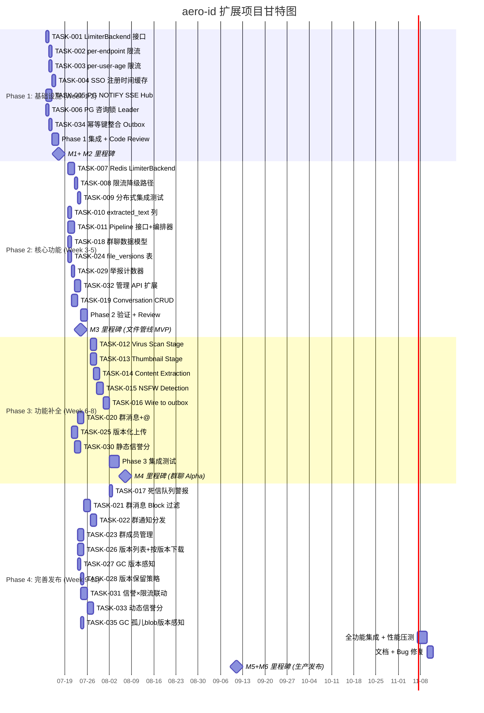

Now I have a thorough understanding of the codebase. Let me produce the full analysis.

---

# Tech Lead 分析报告：aero-id 扩展方向实施计划

## 1. 任务分解

以下将五个方向（含方向 0 "分层限流" Quick Win）拆解为 35 个可独立完成的任务，每个 2-6 小时。

### 方向 0：分层限流（Quick Win）

| 任务 ID | 标题 | 涉及文件 | 前置 | 工时 |
|---------|------|---------|------|------|
| TASK-001 | **定义 `LimiterBackend` 接口 + 本地实现重构** | `internal/pkg/ratelimit/ratelimit.go`, `internal/pkg/ratelimit/backend.go`, `internal/middleware/ratelimit.go`, `internal/config/config.go` | 无 | 4h |
| TASK-002 | **per-endpoint 限流配置** — 路由组粒度的 RPS/Burst 覆盖 | `internal/config/config.go`, `internal/middleware/ratelimit.go`, `internal/handler/http/router.go`, `internal/handler/grpc/server.go` | TASK-001 | 4h |
| TASK-003 | **per-user-age 限流倍数** — 根据账号注册时间动态缩放宽限 | `internal/config/config.go`, `internal/middleware/ratelimit.go`, `internal/service/service.go`（新增 ActorAgeResolver 接口） | TASK-001 | 3h |
| TASK-004 | **SSO 注册时间缓存** — 从 SSO 获取 `created_at` 并本地 TTL 缓存 | `internal/sso/client.go`, `internal/sso/user_cache.go`, `internal/sso/ssopb/sso.proto` | TASK-003 | 3h |

### 方向 1：水平扩展与分布式状态

| 任务 ID | 标题 | 涉及文件 | 前置 | 工时 |
|---------|------|---------|------|------|
| TASK-005 | **PG LISTEN/NOTIFY SSE Hub 跨实例中继** | `internal/hub/hub.go`, `internal/hub/pgrelay.go`, `internal/app/app.go` | 无 | 6h |
| TASK-006 | **PG 咨询锁 Outbox Leader Election** | `internal/outbox/relay.go`, `internal/outbox/leader.go`, `internal/outbox/repository.go`, `internal/app/app.go` | 无 | 4h |
| TASK-007 | **Redis `LimiterBackend` 实现** — sliding-window + Lua | `internal/pkg/ratelimit/redis.go`, `internal/pkg/ratelimit/backend.go`（扩展）, `internal/config/config.go` | TASK-001 | 5h |
| TASK-008 | **限流降级路径** — Redis 不可用时 fallback 到本地 | `internal/pkg/ratelimit/ratelimit.go`（NewFallbackLimiter）, `internal/middleware/ratelimit.go` | TASK-007 | 3h |
| TASK-009 | **分布式模式集成测试 + 配置** | `internal/app/app.go`, `configs/config.yaml`, 集成测试 | TASK-005, TASK-006, TASK-008 | 4h |

### 方向 2：文件后处理管线

| 任务 ID | 标题 | 涉及文件 | 前置 | 工时 |
|---------|------|---------|------|------|
| TASK-010 | **`files.extracted_text` 列迁移** — 新增 TEXT 列 + FTS 重建 | `migrations/000024_extracted_text.{up,down}.sql` | 无 | 1h |
| TASK-011 | **Pipeline Stage 接口 + 编排器** | `internal/file/processor/pipeline.go`, `internal/file/processor/stage.go` | 无 | 4h |
| TASK-012 | **Virus Scan Stage** — ClamAV 集成 | `internal/file/processor/scan.go`, `internal/config/config.go` | TASK-011 | 4h |
| TASK-013 | **Thumbnail Stage** — 图片缩略图 | `internal/file/processor/thumbnail.go` | TASK-011 | 4h |
| TASK-014 | **Content Extraction Stage** — 文本提取 | `internal/file/processor/extract.go` | TASK-011, TASK-010 | 5h |
| TASK-015 | **NSFW Detection Stage** | `internal/file/processor/nsfw.go` | TASK-011 | 4h |
| TASK-016 | **Wire pipeline to outbox `file.uploaded`** — 在 outbox relay 侧订阅 | `internal/outbox/relay.go`, `internal/file/processor/processor.go`, `internal/app/app.go` | TASK-012~TASK-015, TASK-006 | 4h |
| TASK-017 | **死信队列警报** — 处理失败的 event 通知 ops | `internal/outbox/deadletter.go`, `internal/notification/dispatcher.go`（新增告警通知类型） | TASK-016 | 2h |

### 方向 3：多人群组会话

| 任务 ID | 标题 | 涉及文件 | 前置 | 工时 |
|---------|------|---------|------|------|
| TASK-018 | **群聊数据模型 + 迁移** — conversations + conversation_members + conversation_messages 表 | `migrations/...,` `internal/domain/conversation.go`, `internal/conversation/conversation.go` | 无 | 3h |
| TASK-019 | **Conversation CRUD** — 建群、查群、用户群列表 | `internal/conversation/repository.go`, `internal/conversation/service.go`, `internal/conversation/handler_http.go`, `internal/conversation/handler_grpc.go` | TASK-018 | 5h |
| TASK-020 | **群聊消息发送 + @mention** | `internal/conversation/service.go`, `internal/conversation/repository.go` | TASK-019 | 5h |
| TASK-021 | **群聊消息列表 + Block 过滤** — 屏蔽者消息隐藏 | `internal/conversation/repository.go`, `internal/conversation/service.go` | TASK-020 | 4h |
| TASK-022 | **群聊通知分发** — 含 @mention 高优 / 屏蔽感知 | `internal/service/notification.go`（扩展 dispatcher）、`internal/outbox/outbox.go`（新增 event 类型） | TASK-021 | 5h |
| TASK-023 | **群成员管理** — 加入/离开/踢出/转让 | `internal/conversation/repository.go`, `internal/conversation/service.go`, `internal/conversation/handler_http.go` | TASK-019 | 4h |

### 方向 4：文件版本控制

| 任务 ID | 标题 | 涉及文件 | 前置 | 工时 |
|---------|------|---------|------|------|
| TASK-024 | **`file_versions` 表迁移** | `migrations/000025_file_versions.{up,down}.sql` | 无 | 1h |
| TASK-025 | **版本化上传** — 上传新版本时插入 file_versions + 更新 files | `internal/file/service_crud.go`, `internal/file/service_upload.go`, `internal/file/repository.go` | TASK-024 | 6h |
| TASK-026 | **版本列表 + 按版本下载** — `?version=N` 查询参数 | `internal/file/service_share.go`, `internal/file/service_crud.go`, `internal/file/handler_http.go` | TASK-025 | 4h |
| TASK-027 | **GC 版本感知** — 清理时检查 file_versions 引用 | `internal/storage/gc/sweeper.go`, `internal/repository/storage_ref.go` | TASK-025 | 3h |
| TASK-028 | **版本保留策略** — 定时任务删除旧版本 | `internal/file/service_crud.go`, `internal/config/config.go`, `internal/app/app.go` | TASK-025 | 3h |

### 方向 5：滥用防护与信誉系统

| 任务 ID | 标题 | 涉及文件 | 前置 | 工时 |
|---------|------|---------|------|------|
| TASK-029 | **举报计数器** — users.report_count + users.resolved_report_count | `migrations/...,` `internal/repository/admin.go`（扩展）, `internal/domain/user.go` | 无 | 3h |
| TASK-030 | **静态信誉分（每日批量）** — 加权公式 | `internal/service/reputation.go`, `internal/repository/reputation.go`, `internal/domain/reputation.go` | TASK-029 | 5h |
| TASK-031 | **信誉分 × 限流联动** — 低信誉用户更严格 | `internal/pkg/ratelimit/ratelimit.go`, `internal/middleware/ratelimit.go`, `internal/service/reputation.go` | TASK-030, TASK-002 | 4h |
| TASK-032 | **管理 API 扩展** — 举报队列、用户冻结、限流白名单 | `internal/handler/http/admin.go`, `internal/service/admin.go`, `internal/domain/admin.go` | TASK-029 | 5h |
| TASK-033 | **动态信誉分** — 实时更新 + 影响举报权重 | `internal/service/reputation.go`, `internal/repository/reputation.go` | TASK-031 | 5h |

### 跨方向

| 任务 ID | 标题 | 涉及文件 | 前置 | 工时 |
|---------|------|---------|------|------|
| TASK-034 | **幂等键整合 Outbox** — outbox 写入时去重 | `internal/outbox/outbox.go`, `internal/outbox/repository.go`, `internal/middleware/idempotency.go` | 无 | 3h |
| TASK-035 | **GC 孤儿 blob 版本感知** — 区分版本引用 vs 原始引用 | `internal/storage/gc/sweeper.go`, `internal/repository/storage_ref.go` | TASK-027 | 2h |

---

## 2. 执行顺序

```mermaid
graph TD
    %% Direction 0 - Quick Win
    T001[TASK-001: LimiterBackend 接口] --> T002[TASK-002: per-endpoint 限流]
    T001 --> T003[TASK-003: per-user-age 限流]
    T003 --> T004[TASK-004: SSO 注册时间缓存]

    %% Direction 1 - Horizontal Scaling
    T005[TASK-005: PG NOTIFY SSE Hub] 
    T006[TASK-006: PG Advisory Lock Leader Election]
    T001 --> T007[TASK-007: Redis LimiterBackend]
    T007 --> T008[TASK-008: 限流降级路径]
    T005 --> T009[TASK-009: 分布式集成测试]
    T006 --> T009
    T008 --> T009

    %% Direction 2 - File Post-Processing
    T010[TASK-010: extracted_text 列迁移]
    T011[TASK-011: Stage 接口 + 编排器]
    T011 --> T012[TASK-012: Virus Scan Stage]
    T011 --> T013[TASK-013: Thumbnail Stage]
    T011 --> T014[TASK-014: Content Extraction]
    T011 --> T015[TASK-015: NSFW Detection]
    T010 --> T014
    T012 --> T016[TASK-016: Wire to outbox]
    T013 --> T016
    T014 --> T016
    T015 --> T016
    T006 --> T016
    T016 --> T017[TASK-017: 死信队列警报]

    %% Direction 3 - Group Chat
    T018[TASK-018: 群聊数据模型] --> T019[TASK-019: Conversation CRUD]
    T019 --> T020[TASK-020: 群消息发送+@]
    T020 --> T021[TASK-021: 消息列表+Block过滤]
    T021 --> T022[TASK-022: 群通知分发]
    T019 --> T023[TASK-023: 群成员管理]

    %% Direction 4 - File Versioning
    T024[TASK-024: file_versions 表] --> T025[TASK-025: 版本化上传]
    T025 --> T026[TASK-026: 版本列+按版本下载]
    T025 --> T027[TASK-027: GC 版本感知]
    T027 --> T028[TASK-028: 版本保留策略]

    %% Direction 5 - Abuse Prevention
    T029[TASK-029: 举报计数器] --> T030[TASK-030: 静态信誉分]
    T030 --> T031[TASK-031: 信誉×限流联动]
    T002 --> T031
    T029 --> T032[TASK-032: 管理 API 扩展]
    T031 --> T033[TASK-033: 动态信誉分]

    %% Cross-cutting
    T034[TASK-034: 幂等键整合 Outbox]
    T027 --> T035[TASK-035: GC 孤儿blob版本感知]

    %% Phase grouping (via subgraph styling)
    subgraph Phase1[Phase 1: Foundation - Week 1-2]
        T001; T002; T003; T004; T005; T006; T034
    end
    subgraph Phase2[Phase 2: Core Features - Week 3-5]
        T007; T008; T009; T010; T011; T018; T024; T029; T032
    end
    subgraph Phase3[Phase 3: Feature Completion - Week 6-8]
        T012; T013; T014; T015; T016; T019; T020; T025; T030
    end
    subgraph Phase4[Phase 4: Polish - Week 9-11]
        T017; T021; T022; T023; T026; T027; T028; T031; T033; T035
    end
```

### 可并行执行的任务组

| 组 | 任务 | 可并行原因 |
|----|------|-----------|
| **Group A** | TASK-001, TASK-005, TASK-006, TASK-034 | 互不依赖，修改不同包 |
| **Group B** | TASK-002, TASK-003, TASK-011, TASK-018, TASK-024, TASK-029 | TASK-001 完成后可并行推进所有方向的独立工作 |
| **Group C** | TASK-007+TASK-008, TASK-012~TASK-015, TASK-019, TASK-025, TASK-030 | 方向 1 限流后端 vs 方向 2 Stage vs 方向 3 CRUD vs 方向 4 版本 vs 方向 5 信誉 |
| **Group D** | TASK-021~TASK-023, TASK-026~TASK-028, TASK-031, TASK-035 | 各方向收尾工作可并行 |

---

## 3. 技术风险

### 高风险 🚨

| 风险 | 方向 | 描述 | 缓解策略 |
|------|------|------|---------|
| **PG NOTIFY 消息大小限制 (~8KB)** | 1 | SSE payload 可能超过 8KB（长文本通知、评论正文）导致消息截断 | 1) 事件 payload 只发 ID，客户端通过 API 拉取详情；2) 超过阈值自动降级到客户端轮询的 `_poll` 事件类型 |
| **ClamAV 时延影响 outbox relay** | 2 | 病毒扫描阻塞 relay 循环（病毒扫描单文件可能数秒），导致 outbox 延迟 | 独立的 processor goroutine pool（worker 池），relay 只 fan-out 不等待；使用 `os.Pipe` 流式扫描避免完整下载 |
| **群聊 10K+ 大群的扇出性能** | 3 | 一条群消息产生 N 个通知行 + N 个 SSE push，10000 人群 = 10000 行插入 | 1) 通知表批量插入；2) SSE push 用 fan-out goroutine 并发；3) 考虑大群降级到"提到才通知" |
| **文件去重 + 版本控制 + GC 的三体问题** | 4 | 去重上传引用同一 blob，版本链也引用同一 blob，GC 需要精确引用计数 | 扩展 `storage_refs` 表支持多类型引用（owner+已删除的版本），RefCounter 接口增加 `RefType` 字段 |

### 中风险 ⚠️

| 风险 | 方向 | 描述 | 缓解策略 |
|------|------|------|---------|
| **PG 咨询锁在连接池耗尽时行为** | 1 | `pg_try_advisory_lock` 的持有者连接被池回收或关闭 | 锁获取后使用专用的 `*sql.Conn`（非 `*sql.DB`），确保连接生命周期内锁有效；healthy check 周期重置 |
| **@mention 解析歧义** | 3 | `@[uid:xxx]` 格式在前端渲染和后端解析的一致性 | 在 domain 层定义 Mention 类型和验证器；发送时 service 校验所有 mentioned_uid 为群成员 |
| **内容提取的内存压力** | 2 | 大文件（100MB+）文本提取时的内存消耗 | 强制 streaming 处理（`io.Copy` 到临时文件）；per-processor semaphore 控制并发；context deadline |
| **SSO `created_at` 兼容性** | 0 | SSO gRPC 接口可能不返回 `created_at` 字段 | 增加 `UserRegisteredAtResolver` 接口的 fallback 路径：1) 从 SSO 获取；2) 本地缓存第一次交互时间；3) 新用户默认"< 1h" |

### 低风险 ✅

| 风险 | 方向 | 描述 | 缓解策略 |
|------|------|------|---------|
| **Redis 不可用时限流降级** | 1 | `Allow()` error → fallback 到本地 token bucket，宽松但正确 | 已有 fallback 设计；metrics 记录降级次数以便告警 |
| **版本保留策略误删** | 4 | 定时任务删除旧版本时判断错误 | 删除前验证 + audit log；删除操作使用软删除加 GC 的二次确认 |

---

## 4. 资源评估

### 开发人员配置

| 角色 | 人数 | 技能要求 | 负责方向 |
|------|------|---------|---------|
| **Staff Backend (Tech Lead)** | 1 | Go, PostgreSQL, 分布式系统设计, 架构评审 | 整体架构把关、TASK-005/006/009/034（基础设施类）、代码审查 |
| **Backend Engineer A** | 1 | Go, PostgreSQL, 中间件开发 | 方向 0 + 方向 1（限流）、方向 5 |
| **Backend Engineer B** | 1 | Go, 存储系统, 图片处理 | 方向 2（文件管线）、方向 4（版本控制） |
| **Backend Engineer C** | 1 | Go, 消息系统, 权限模型 | 方向 3（群聊）、方向 5 管理 API |

### 关键里程碑

| 里程碑 | 时间 | 交付物 | 验收标准 |
|--------|------|--------|---------|
| **M1: Quick Win 上线** | Week 1 | 分层限流（方向 0） | `make test && make lint` 通过；per-endpoint 限流在生产生效 |
| **M2: 架构基础就绪** | Week 2 | PG NOTIFY hub + Outbox leader election + 幂等整合 Outbox | 双实例可同时运行，SSE 推送跨实例可达；outbox 写入幂等 |
| **M3: 文件管线 MVP** | Week 4 | Virus Scan + Thumbnail stage 就绪；版本表迁移完成 | 文件上传后自动扫描+缩略图；version 表有数据 |
| **M4: 群聊 Alpha** | Week 6 | 群聊 CRUD + 消息发送 + @mention | 可创建群、发消息、收通知（含屏蔽感知） |
| **M5: 完整功能** | Week 9 | 文件版本控制 + 信誉系统 + 管理后台 | 版本上传/列表/GC 正确；信誉分影响限流 |
| **M6: 生产发布** | Week 11 | 全功能集成测试 + 性能压测 + 文档 | p99 < 200ms under 5K RPM；全部测试通过 |

### 阻塞点与解决策略

| 阻塞点 | 影响 | 解决策略 |
|--------|------|---------|
| SSO gRPC 接口不返回 `created_at` | 阻挡 TASK-004 | 与 SSO 团队协商 `UserRegisteredAt` RPC；作为 fallback，aero-id 在首次用户交互时缓存注册时间 |
| ClamAV 不可用 / 无容器化 | 阻挡 TASK-012 | 先实现接口桩（`always pass`），ClamAV 作为可选 Stage；使用 testcontainers 在 CI 中启动 ClamAV |
| protobuf 生成工具版本不匹配 | 阻碍 .proto 修改 | 锁定 `protoc-gen-go@v1.34.1` 和 `protoc-gen-go-grpc@v1.5.1`；在 Makefile 中 `make proto` 前自动校验 |
| 大群性能压力测试需要 10K+ 模拟用户 | 阻碍群聊上线 | 编写独立压测工具（`cmd/benchconv/`）；CI 中仅跑 100 并发，nightly 跑 10K |

---

## 5. 质量保证

### 5.1 单元测试覆盖要求

| 组件 | 包 | 覆盖率目标 | 重点测试 |
|------|-----|----------|---------|
| 限流 | `internal/pkg/ratelimit` | 95%+ | `Allow()` 并发安全、backend 切换、fallback 行为、per-endpoint 覆盖 |
| SSE Hub | `internal/hub` | 90%+ | 跨实例订阅/发布（mock PG connection）、关闭清理 |
| Leader Election | `internal/outbox` | 90%+ | 锁竞争、连接断开自动释放、双实例交替 |
| Pipeline | `internal/file/processor` | 85%+ | 每个 Stage 的 `Process()` 错误处理、semaphore 控制、超时 |
| 群聊 | `internal/conversation` | 85%+ | Block 过滤、@mention 解析、成员权限、通知扇出 |
| 版本 | `internal/file` | 85%+ | 版本回滚、GC 跨版本引用计数、保留策略 |
| 信誉 | `internal/service/reputation.go` | 80%+ | 加权公式正确性、与限流联动 |

### 5.2 集成测试策略

| 场景 | 测试类型 | 工具 | 通过条件 |
|------|---------|------|---------|
| **分布式 SSE** | integration | PG LISTEN/NOTIFY + 两个 goroutine hub | 实例 A publish → 实例 B subscribe 收到 |
| **Outbox leader 竞争** | integration | 两个 relay goroutine + `pg_try_advisory_lock` | 只有一个 drain，另一个 sleep-retry |
| **文件管线端到端** | integration | testcontainers Postgres + MinIO + ClamAV | 上传图片 → 缩略图生成 → 病毒扫描通过 |
| **群聊屏蔽场景** | integration | Postgres + block 数据 | A 屏蔽 B，A 看群消息中 B 的消息标记 deleted |
| **版本 + GC 交互** | integration | Postgres + MinIO | 上传 v1 → 上传 v2 → 软删文件 → GC 跑 → v1 blob 仍被版本引用不删除 |
| **信誉分 × 限流** | integration | Postgres + 模拟 SSO | 低信誉用户 over rate limit → 403；高信誉用户通过 |

### 5.3 代码审查要点

| 审查维度 | 检查项 |
|---------|--------|
| **架构合规** | 方向依赖是否严格单向（handler→service→repository）；新包是否在 `internal/` 内 |
| **错误处理** | 所有 repository 返回 raw error 是否在 service 层用 `.Wrap()` 转换；AppError 是否含正确 HTTP/gRPC code |
| **并发安全** | hub、limiter、pipeline processor 是否有 race condition（`go test -race`） |
| **文件大小** | 新文件是否 ≤ 500 行；函数长度 ≤ 50 行；complexity ≤ 10 |
| **迁移文件** | 每个 `*.up.sql` 是否有对应 `*.down.sql`；数据回滚方案 |
| **配置安全** | 密码/密钥是否通过 env 传入而不是硬编码；新配置项是否在 `config.go` 的 `validate()` 中校验 |

### 5.4 性能测试需求

| 场景 | 目标 SLO | 工具 | 频率 |
|------|---------|------|------|
| 限流 middleware 延迟 | p99 < 1ms overhead | `go test -bench` | 每次 CI |
| SSE 1000 并发连接 | 推送延迟 p99 < 50ms | 自定义压测客户端 | 每次 Phase 合并前 |
| 群聊消息扇出 1000 人 | p99 写入延迟 < 500ms | `cmd/benchconv/` | Nightly |
| 文件版本上传 (1MB) | p99 < 2s (含 checksum) | `go test -bench` | Nightly |
| 信誉分批量计算 (100K 用户) | < 5 min | SQL 单独 profiling | 每次变更 |

---

## 6. 实施计划

### 阶段开合检查清单

#### Phase 1 结束（Week 2）—— Gate: `make test && make lint`

- [ ] 分层限流可配置 per-endpoint + per-user-age
- [ ] `ratelimit.LimiterBackend` 接口定义+内存实现
- [ ] 双实例 SSE 推送通过 PG NOTIFY 跨实例可达
- [ ] Outbox relay 使用 PG 咨询锁防双实例重复消费
- [ ] 幂等键在 outbox 写入路径中做去重
- [ ] 全部迁移文件有 `down.sql`
- [ ] 集成测试覆盖分布式模式基础场景

#### Phase 2 结束（Week 5）—— Gate: `make test-integration`

- [ ] Redis `LimiterBackend` 实现 + 降级路径 + 集成测试
- [ ] Pipeline Stage 接口 + 编排器单元测试
- [ ] `files.extracted_text` 列迁移 + FTS 重建
- [ ] 群聊表迁移 + Conversation CRUD 端到端测试
- [ ] `file_versions` 表迁移完成
- [ ] 举报计数器 + 管理 API 端点
- [ ] 所有新增代码不违反 `make check-file-sizes` 和 `make lint-strict`

#### Phase 3 结束（Week 8）—— Gate: full integration suite

- [ ] 文件上传 → Virus Scan → Thumbnail → 入库 end-to-end
- [ ] 群聊消息发送含 @mention 解析
- [ ] 版本化上传 + 版本列表 API
- [ ] 静态信誉分批量计算可定时运行
- [ ] 性能 SLO 达标记（见 5.4）

#### Phase 4 结束（Week 11）—— Gate: production readiness

- [ ] Block 感知群聊消息列表正确
- [ ] 版本感知 GC 通过引用计数正确清理
- [ ] 信誉分 × 限流联动端到端测试
- [ ] 管理后台可查看/处理举报
- [ ] p99 延迟在 5K RPM 下 < 200ms
- [ ] 全部文档更新（API 表格 + 配置说明）

---

## 总结

这份任务的工程核心原则：

1. **先基础设施，后业务功能** — Phase 1 解决分布式状态（方向 1）和限流治理（方向 0），为后续所有方向提供可靠底座
2. **高价值低风险优先** — 分层限流（TASK-001~004）和幂等整合（TASK-034）是改动最小、收益最大的 Quick Win，适合作为团队的磨合任务
3. **并行最大化** — Phase 2-3 中，群聊（工程师 C）、文件管线+版本（工程师 B）、信誉系统（工程师 A）可完全并行
4. **工程纪律不可妥协** — 每次 PR 前 `make check-file-sizes && make lint && make test`；文件拆分以 400 行为警告线、500 行为硬限制
5. **增量交付** — 每个 Phase 以可发布的中间状态结束，不追求"一次上线全部功能"
