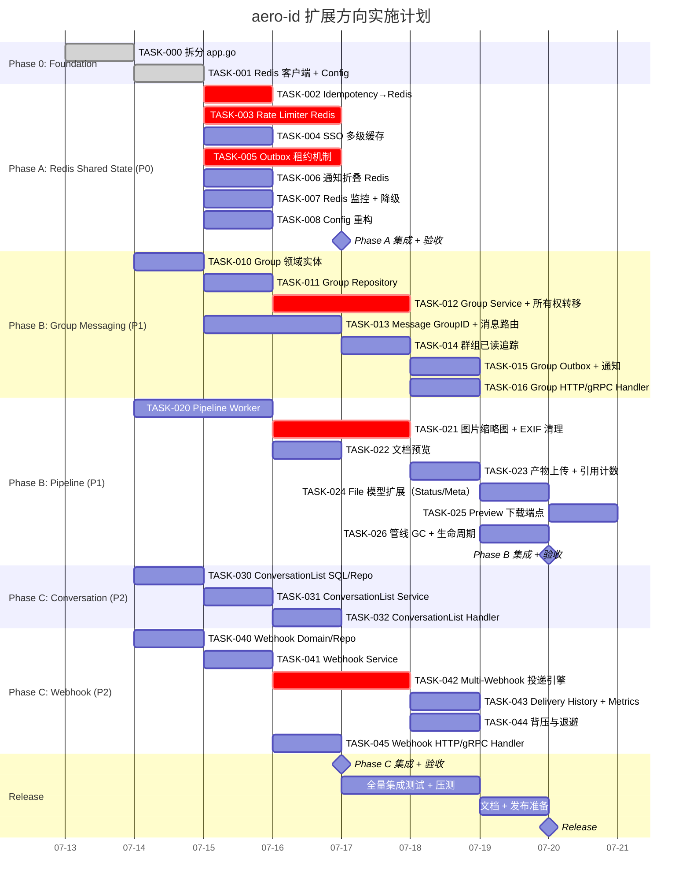

# Tech Lead 分析报告

> 基于 `docs/requirements/2026-07-12-aero-id-high-level-extension-directions.md`
> 日期: 2026-07-12 | 分析人: Tech Lead

---

## 0. 现场紧急项：app.go 已超限

⚠️ **`internal/app/app.go` 当前 516 行**，已突破 AGENTS.md 规定的 500 行硬限制。这是**架构坏味道**——组合根正在积累启动逻辑、中间件注册、服务依赖注入。

**立即行动**：在开始任何扩展方向之前，必须先拆分 `app.go`。这是 `make check-file-sizes` 会直接拦截的。

---

## 1. 任务分解

### 1.1 基础设施先决条件（必须先完成）

| 任务 ID | 任务标题 | 涉及文件 | 前置 | 工时 | 验收标准 |
|---------|---------|---------|------|------|---------|
| **TASK-000** | 拆分 app.go 组合根 | `internal/app/app.go` → `internal/app/{app.go,wire.go,startup.go}` | 无 | 4h | `app.go` ≤ 400 行；`make check-file-sizes` 通过；所有服务正常启动 |
| **TASK-001** | 新增 Redis 客户端依赖 + 配置 | `internal/config/config.go`, `internal/pkg/redis/redis.go`, `configs/config.yaml` | TASK-000 | 3h | 启动时连接 Redis，健康检查 `/readyz` 反映 Redis 状态；无 Redis 时优雅降级或明确报错 |
| **TASK-002** | Idempotency 迁移到 Redis（L2） | `internal/idempotency/store.go`, `internal/pkg/redis/` | TASK-001 | 4h | `SET NX EX TTL` 为主路径，GORM fallback 保留；双写一致；现有 idempotency 测试通过 |

### 1.2 方向二：Redis 共享状态（P0）

| 任务 ID | 任务标题 | 涉及文件 | 前置 | 工时 | 验收标准 |
|---------|---------|---------|------|------|---------|
| **TASK-003** | Rate limiter Redis 后端（GCRA） | `internal/pkg/ratelimit/ratelimit.go`, `internal/pkg/ratelimit/redis.go` | TASK-001 | 5h | 支持 `NewRedisBackend`；配置切换 `rate_limit.backend: "redis"`；内存模式保持为降级项 |
| **TASK-004** | SSO 缓存多级缓存（L1 内存 + L2 Redis） | `internal/sso/token_cache.go`, `internal/sso/user_cache.go` | TASK-001 | 4h | 内存缓存作为 L1（TTL 缩短至 1/3）；Redis 作为 L2；滚动部署后缓存命中率 > 80% |
| **TASK-005** | Outbox relay 引入租约机制 | `internal/outbox/relay.go`, `internal/outbox/repository.go` | TASK-001 | 6h | 多实例并行轮询使用 `SELECT ... FOR UPDATE SKIP LOCKED` 或 Redis 租约；无重复投递；集成测试验证 3 实例并行 |
| **TASK-006** | 通知折叠迁移到 Redis | `internal/service/notification.go`, `internal/notification/dispatcher.go` | TASK-001 | 3h | `FindRecentByTypeAndActor` 改为 Redis ZSET 按时间窗口查询；跨实例折叠窗口有效 |
| **TASK-007** | Redis 连接池 + 断路器 + 监控 | `internal/pkg/redis/pool.go`, `internal/pkg/metrics/` | TASK-001 | 3h | 最大连接数限制；Redis 不可用时的降级策略（限流退化为内存模式 / 缓存走 L1）；Prometheus `redis_*` metrics |
| **TASK-008** | Config 全量重构，支持 Redis 块 | `internal/config/config.go`, `configs/config.yaml` | TASK-001 | 2h | 新增 `RedisConfig` 结构体；所有 `mapstructure` 标签加上；AERO_ID_REDIS_* 环境变量覆盖 |

### 1.3 方向一：群组消息（P1）

| 任务 ID | 任务标题 | 涉及文件 | 前置 | 工时 | 验收标准 |
|---------|---------|---------|------|------|---------|
| **TASK-010** | 新增 Group / GroupMember 领域实体 | `internal/domain/group.go`, `internal/domain/shared.go`(新增枚举) | TASK-000 | 3h | `Group` 含 ID, Name, OwnerUID, timestamps, DeletedAt；`GroupRole` 枚举（Owner/Admin/Member）；`MessageKindGroup` 枚举扩展 |
| **TASK-011** | Group repository（CRUD + 成员管理） | `internal/repository/group.go`, `internal/repository/db.go`(迁移注册) | TASK-010 | 4h | GORM 模型 + migration SQL；`Create`/`Get`/`Update`/`SoftDelete`；成员增删查；`ListByMember` cursor 分页 |
| **TASK-012** | Group 服务层 + 所有权转移逻辑 | `internal/service/group.go`, `internal/service/service.go`(注册) | TASK-011 | 6h | 群组创建/更新/删除/转让；所有权转移实现（原 Owner → 指定 Admin）；block 成员过滤 |
| **TASK-013** | Message 支持 GroupID（消息路由） | `internal/domain/message.go`, `internal/message/repository.go`, `internal/message/service.go` | TASK-010 | 5h | `Message.GroupID` 可空字段；发送群组消息；群组消息列表（成员可读）；非成员返回 404 |
| **TASK-014** | 群组消息的已读追踪 | `internal/message/repository.go`, `internal/repository/unread.go`(可能新增) | TASK-013 | 4h | `group_read_progress` 表（group_id, member_uid, last_read_message_id, updated_at）；`MarkGroupRead` 方法；未读计数 |
| **TASK-015** | 群组 Outbox 事件 + 通知 | `internal/outbox/outbox.go`(事件类型扩展), `internal/service/group.go` | TASK-012, TASK-006 | 3h | `group.member_added`/`group.renamed`/`group.message` 事件；SSE 推送群组消息；通知类型注册 |
| **TASK-016** | 群组 HTTP + gRPC handler | `internal/handler/http/group.go`, `internal/handler/grpc/group.go` | TASK-012 | 4h | RESTful CRUD endpoints；gRPC parity（38+ RPCs）；权限检查在前置中间件 |

### 1.4 方向三：文件后处理管线（P1）

| 任务 ID | 任务标题 | 涉及文件 | 前置 | 工时 | 验收标准 |
|---------|---------|---------|------|------|---------|
| **TASK-020** | Pipeline worker 基础设施 | `internal/pipeline/worker.go`, `internal/pipeline/pipeline.go` | TASK-000 | 5h | Worker 订阅 outbox `file.uploaded` 事件；超时控制（`max_processing_time`）；重试/死信复用 outbox 机制 |
| **TASK-021** | 图片缩略图生成 + webp 转码 | `internal/pipeline/image.go`, `internal/pipeline/processors.go` | TASK-020 | 5h | 使用 `imaging`/`libvips` 生成缩略图（256/512/1024px）；WebP 转码；EXIF 剥离（GPS 坐标清理） |
| **TASK-022** | 文档预览（PDF 转换） | `internal/pipeline/document.go` | TASK-020 | 4h | 使用 `unoconv`/`libreoffice` 或 Go 原生 PDF 库；支持 Office 文档 → PDF 预览；文本提取 |
| **TASK-023** | 管线产物上传 + 引用计数 | `internal/pipeline/uploader.go`, `internal/repository/storage_ref.go` | TASK-021, TASK-022 | 3h | 缩略图/预览文件上传到 storage；`storage_refs` 引用计数跟踪；产物与原文件可独立 GC |
| **TASK-024** | File 模型扩展（status + preview meta） | `internal/domain/file.go`, `internal/file/service_crud.go` | TASK-020 | 2h | `File.Status` 枚举（pending/processing/ready/failed/unsupported）；`Meta` 写回 `preview_url`/`thumbnail_url`/`processing_error` |
| **TASK-025** | 前端兼容的预览下载端点 | `internal/handler/http/file.go`, `internal/handler/grpc/file.go` | TASK-024 | 3h | 新增 `GET /v1/files/:id/preview` 端点；支持 `?size=256`；返回 404 当 preview 不可用 |
| **TASK-026** | 管线 GC + 生命周期策略 | `internal/pipeline/gc.go`, `internal/storage/gc/sweeper.go`(扩展) | TASK-023 | 3h | 预览产物 TTL 配置；GC 阶段可单独清理过期预览产物；StorageGCConfig 扩展 |

### 1.5 方向四：对话聚合列表（P2）

| 任务 ID | 任务标题 | 涉及文件 | 前置 | 工时 | 验收标准 |
|---------|---------|---------|------|------|---------|
| **TASK-030** | ConversationList SQL 查询 + Repository | `internal/message/repository.go`(新增方法) | TASK-000 | 3h | `DISTINCT ON (least, greatest)` 聚合查询；cursor 分页；`ConversationSummary` 结构体（contact_uid, last_message, last_created_at, unread_count） |
| **TASK-031** | 对话列表服务层 + 联系人过滤 | `internal/message/service.go`(新增 `ConversationList`) | TASK-030 | 3h | block 联系人过滤；自消息排除；系统消息单独归类为"系统通知"；`enrichUsers` 集成 |
| **TASK-032** | 对话列表 HTTP + gRPC handler | `internal/handler/http/message.go`, `internal/handler/grpc/message.go` | TASK-031 | 2h | `GET /v1/conversations` endpoint；gRPC `ConversationList` RPC；OpenAPI spec 更新 |

### 1.6 方向五：Webhook 平台（P2）

| 任务 ID | 任务标题 | 涉及文件 | 前置 | 工时 | 验收标准 |
|---------|---------|---------|------|------|---------|
| **TASK-040** | webhook_subscriptions 表 + domain | `internal/domain/webhook.go`, `internal/repository/webhook.go` | TASK-000 | 3h | `WebhookSubscription` entity；CRUD repository；migration SQL |
| **TASK-041** | 订阅管理服务层 | `internal/service/webhook.go` | TASK-040 | 4h | 订阅 CRUD；密钥轮换（双窗口过渡期）；测试投递（dry-run）；`webhook.manage` 权限检查 |
| **TASK-042** | 多订阅者投递引擎 | `internal/outbox/multi_webhook.go`（重构现有 WebhookHandler） | TASK-041, TASK-005 | 5h | 支持 N 个订阅者并行投递；每个订阅者独立重试/退避；幂等投递（event_id + subscription_id 唯一性） |
| **TASK-043** | 投递历史查询 + 仪表板 metrics | `internal/repository/webhook_delivery.go`, `internal/pkg/metrics/` | TASK-042 | 3h | `webhook_deliveries` 表记录每次投递状态/延迟；Prometheus 暴露每个订阅者的投递成功率 / P99 延迟 / dead-letter 计数 |
| **TASK-044** | 背压与退避机制 | `internal/outbox/multi_webhook.go` | TASK-042 | 3h | 连续 5xx 自动减速（指数退避→暂停→告警）；恢复后自动恢复；单个订阅者故障不影响其他 |
| **TASK-045** | 订阅管理 HTTP + gRPC API | `internal/handler/http/webhook.go`, `internal/handler/grpc/webhook.go` | TASK-041 | 3h | REST + gRPC 完整的订阅 CRUD；secret 轮换；测试投递 |

---

## 2. 执行顺序

```mermaid
graph TD
    subgraph "Phase 0: Foundation"
        TASK000["TASK-000<br/>拆分 app.go<br/>4h"] --> TASK001["TASK-001<br/>Redis 客户端<br/>3h"]
    end

    subgraph "Phase A: Redis Shared State (P0)"
        TASK001 --> TASK002["TASK-002<br/>Idempotency→Redis<br/>4h"]
        TASK001 --> TASK003["TASK-003<br/>RateLimiter Redis<br/>5h"]
        TASK001 --> TASK004["TASK-004<br/>SSO 多级缓存<br/>4h"]
        TASK001 --> TASK005["TASK-005<br/>Outbox 租约<br/>6h"]
        TASK001 --> TASK006["TASK-006<br/>通知折叠 Redis<br/>3h"]
        TASK001 --> TASK007["TASK-007<br/>Redis 监控/降级<br/>3h"]
        TASK001 --> TASK008["TASK-008<br/>Config 重构<br/>2h"]
    end

    subgraph "Phase B: Group Messaging (P1)"
        TASK000 --> TASK010["TASK-010<br/>Group 领域实体<br/>3h"]
        TASK010 --> TASK011["TASK-011<br/>Group Repository<br/>4h"]
        TASK011 --> TASK012["TASK-012<br/>Group Service<br/>6h"]
        TASK010 --> TASK013["TASK-013<br/>Message GroupID<br/>5h"]
        TASK013 --> TASK014["TASK-014<br/>Group Read Tracking<br/>4h"]
        TASK012 --> TASK015["TASK-015<br/>Group Outbox/Notif<br/>3h"]
        TASK012 --> TASK016["TASK-016<br/>Group Handler<br/>4h"]
        TASK006 -.-> TASK015
    end

    subgraph "Phase B: Pipeline (P1)"
        TASK000 --> TASK020["TASK-020<br/>Pipeline Worker<br/>5h"]
        TASK020 --> TASK021["TASK-021<br/>Image Thumbnail<br/>5h"]
        TASK020 --> TASK022["TASK-022<br/>Document Preview<br/>4h"]
        TASK021 --> TASK023["TASK-023<br/>Upload + Ref Count<br/>3h"]
        TASK022 --> TASK023
        TASK023 --> TASK024["TASK-024<br/>File Model Ext<br/>2h"]
        TASK024 --> TASK025["TASK-025<br/>Preview Endpoint<br/>3h"]
        TASK023 --> TASK026["TASK-026<br/>Pipeline GC<br/>3h"]
    end

    subgraph "Phase C: Conversation (P2)"
        TASK000 --> TASK030["TASK-030<br/>ConvList SQL<br/>3h"]
        TASK030 --> TASK031["TASK-031<br/>ConvList Service<br/>3h"]
        TASK031 --> TASK032["TASK-032<br/>ConvList Handler<br/>2h"]
    end

    subgraph "Phase C: Webhook (P2)"
        TASK000 --> TASK040["TASK-040<br/>Webhook Domain/Repo<br/>3h"]
        TASK040 --> TASK041["TASK-041<br/>Webhook Service<br/>4h"]
        TASK005 --> TASK042["TASK-042<br/>Multi-Webhook Engine<br/>5h"]
        TASK041 --> TASK042
        TASK042 --> TASK043["TASK-043<br/>Delivery History<br/>3h"]
        TASK042 --> TASK044["TASK-044<br/>Backpressure<br/>3h"]
        TASK041 --> TASK045["TASK-045<br/>Webhook Handler<br/>3h"]
    end

    %% Styling
    classDef p0 fill:#e74c3c,color:#fff,stroke:#c0392b
    classDef p1 fill:#f39c12,color:#fff,stroke:#e67e22
    classDef p2 fill:#3498db,color:#fff,stroke:#2980b9
    classDef foundation fill:#95a5a6,color:#fff,stroke:#7f8c8d
    
    class TASK001,TASK002,TASK003,TASK004,TASK005,TASK006,TASK007,TASK008 p0
    class TASK010,TASK011,TASK012,TASK013,TASK014,TASK015,TASK016,TASK020,TASK021,TASK022,TASK023,TASK024,TASK025,TASK026 p1
    class TASK030,TASK031,TASK032,TASK040,TASK041,TASK042,TASK043,TASK044,TASK045 p2
    class TASK000 foundation
```



### 可并行执行的任务组

| 并行组 | 任务 | 条件 |
|--------|------|------|
| **组 1** | TASK-002, TASK-003, TASK-004 | 全部依赖 TASK-001，互不依赖 |
| **组 2** | TASK-005, TASK-006, TASK-007, TASK-008 | 全部依赖 TASK-001，互不依赖 |
| **组 3** | TASK-010～TASK-016（群组）vs TASK-020～TASK-026（管线）| 都依赖 TASK-000，互不依赖 |
| **组 4** | TASK-030～TASK-032（对话）vs TASK-040～TASK-045（Webhook）| 都依赖 TASK-000，互不依赖 |

---

## 3. 技术风险

### 3.1 高优先级风险

| 风险 | 方向 | 等级 | 详情 | 缓解策略 |
|------|------|------|------|---------|
| **Redis 引入破坏现有降级路径** | 方向二 | 🔴 | 当前无 Redis 依赖，生产环境需要额外运维。如果 Redis 不可用，关键路径（idempotency/rate-limit/cache）必须有同步降级 | 所有 Redis 组件均实现"本地降级"（内存备用）；`/readyz` 反映 Redis 状态但不阻断请求；提供 `REDIS_REQUIRED=false` 配置 |
| **多实例 outbox 重复投递** | 方向二 | 🔴 | `SELECT ... FOR UPDATE SKIP LOCKED` 在 Postgres 上解决竞争，但遗留 outbox 事件（旧格式）可能被重复处理 | Phase D 之前保持单实例模式；迁移期间写迁移兼容层；集成测试用 3 实例并行验证 |
| **群组消息的已读追踪性能** | 方向一 | 🟡 | 1000+ 成员群组，每次读取更新 `last_read_message_id` 有写放大 | 批量更新接口（`MarkGroupReadBatch`）；考虑写操作异步化；使用 Redis ZSET 暂存阅读进度 |
| **图片缩略图 EXIF/GPS 泄露** | 方向三 | 🟡 | 用户上传的照片可能包含 GPS 坐标；缩略图处理库可能有安全漏洞 | 缩略图生成时强制剥离 EXIF（`exif` pkg 清理所有标签）；使用 `libvips` 沙箱或进程隔离 |
| **群组所有权转移的数据一致性** | 方向一 | 🟡 | 原 Owner 账号删除时，群组转移涉及多个表的写操作（group row + outbox event + notifications） | 使用事务 + outbox 保证最终一致性；增加 `transfer_expires_at` 窗口期（原 Owner 可在 7 天内撤销） |
| **Webhook 密钥轮换的双窗口** | 方向五 | 🟡 | 轮换时新旧密钥同时有效，新订阅者使用新密钥签名但投递旧事件可能签错 | 实现 `active_key` / `previous_key` 双字段；签名验证时尝试两个密钥；旧密钥保留 2× 最大投递延迟时间 |

### 3.2 依赖外部系统

| 方向 | 外部依赖 | 引入风险 | 替代方案 |
|------|---------|---------|---------|
| 方向二 | **Redis** ≥ 6.2 (支持 `ZADD NX`) | 现存无 Redis 环境；需要运维 SOP | 用 Postgres advisory lock 做租约（降级） |
| 方向三 | **libvips** 或 **golang/image** | 原生库依赖；容器镜像膨胀 | 纯 Go `golang.org/x/image/draw` 够用（慢 2x 但无 CGO） |
| 方向三 | **LibreOffice** (文档→PDF) | 进程管理复杂；启动慢；安全风险 | 先支持图片预览；文档预览推迟到 P2 |
| 方向一 | 群组 1000+ 成员，无外部依赖 | 仅 Postgres + Redis | 可行 |

### 3.3 性能瓶颈

| 场景 | 瓶颈点 | 估算 | 优化策略 |
|------|--------|------|---------|
| 群组消息列表（1000 人群组读 20 条） | `WHERE group_id = ? ORDER BY id DESC LIMIT 21` | < 5ms at 1000 条/群 | 复合索引 `(group_id, id DESC)` |
| 已读追踪写入（1000 人群组每人读一次） | 1000 行 `UPDATE` | 50ms/批 | 写操作批量合并（每 5s flush） |
| 缩略图生成（5MB 图片） | `libvips` resize + WebP encode | 200-500ms/图 | 限制并发（`max_concurrent=4`）；超时后降级原图 |
| SSE 群组推送（1000 成员在线 100） | hub 广播 | < 10ms/消息 | goroutine-per-member (已实现) |

---

## 4. 资源评估

### 4.1 团队配置

| 角色 | 数量 | 主要职责 |
|------|------|---------|
| **SDE III+** (Go 后端) | 2 人 | 方向二（Redis）+ 方向一（群组消息）核心逻辑；系统架构决策 |
| **SDE II** (Go 后端) | 2 人 | 方向三（管线）+ 方向五（Webhook）实现；测试覆盖 |
| **SDE I/实习生** (Go 后端) | 1 人 | 方向四（对话列表）+ 辅助 TASK-XXX 的单元测试/文档 |

**最小可行团队**：2 名后端 + 1 名兼职 DevOps（Redis 运维）。

### 4.2 关键里程碑

| 里程碑 | 时间 | 交付物 | 决策门 |
|--------|------|--------|--------|
| **M0** | Day 0-1 | TASK-000（app.go 拆分）+ TASK-001（Redis 客户端）| `make check-file-sizes && make test && make lint` |
| **M1 (Phase A)** | Day 2-5 | Redis 共享状态全部上线；灰度切换 | Redis 集成测试通过；蓝绿部署验证无重复投递 |
| **M2 (Phase B)** | Day 6-15 | 群组消息 MVP（创建群组、发送消息、已读追踪）+ 图片缩略图管线 | E2E 测试覆盖群组 CRUD + 缩略图预览 |
| **M3 (Phase B+)** | Day 16-20 | 群组消息文档预览 + 所有权转移 | 边界情况（账号删除、block 成员）测试通过 |
| **M4 (Phase C)** | Day 21-25 | 对话聚合列表 + Webhook 平台 | 性能测试（1000 群组对话列表 < 50ms）|
| **M5** | Day 26-30 | 集成测试 + 文档 + 压测 + 发布 | `make test && make lint && make test-integration` |

### 4.3 阻塞点与解决策略

| 阻塞点 | 阻碍任务 | 策略 |
|--------|---------|------|
| **无 Redis 生产环境** | TASK-002～TASK-008 | 在 Phase A 开始前向 DevOps 申请 Redis 实例（或使用 ElastiCache/Memorystore）；开发/CI 使用 `testcontainers` 模拟 |
| **app.go 超限** | 所有方向 | **立即拆分**（TASK-000），这是硬 blockers。4 小时内必须解决 |
| **libvips CGO 依赖** | TASK-021 | 决策：使用纯 Go `golang.org/x/image` 替代（慢但无 CGO）；如果性能不达标，再引入 `libvips` 并通过 build tags 控制 |
| **已读追踪的写放大** | TASK-014 | 先使用 Postgres `INSERT ... ON CONFLICT DO UPDATE`；如果性能瓶颈出现，迁移到 Redis HASH/Stream |

---

## 5. 质量保证

### 5.1 测试覆盖要求

| 层级 | 覆盖率目标 | 关键路径 |
|------|-----------|---------|
| **Domain** | > 95% | `MessageKindGroup.IsValid()` / `GroupRole` 校验 / 所有权转移状态机 |
| **Service** | > 85% | 群组 CRUD 权限检查 / block 过滤 / 管线状态转换 / webhook 订阅 CRUD |
| **Repository** | > 90% (integration) | 群组的 GORM 迁移 / 聚合 SQL / `FOR UPDATE SKIP LOCKED` / Redis 操作 |
| **Handler** | > 80% | HTTP status codes / 输入验证 / 404 vs 403 区分 / gRPC error codes parity |

### 5.2 集成测试策略

| 测试类型 | 工具 | 覆盖场景 | CI 触发 |
|---------|------|---------|---------|
| **Postgres + Redis** | `testcontainers` (Docker) | 群组 CRUD + 已读追踪 / Redis idempotency / outbox 租约 | `make test-integration` |
| **Pipeline 管线** | mock storage + temp dir | 缩略图生成 / EXIF 剥离 / 上传产物 / 超时处理 | `make test-integration` |
| **多实例竞争** | `testcontainers` 3 conns | Outbox 重复投递检查 / Redis 原子操作 | 手动（每周） |
| **蓝绿部署模拟** | 起两个实例共享 Redis | Idempotency 跨实例生效 / SSE 跨实例推送 | 手动（发布前） |

### 5.3 代码审查要点

| 关注领域 | 审查重点 |
|---------|---------|
| **Redis 操作** | 是否使用 `EX`/`PX` 设置 TTL？Pipeline/MULTI 事务边界是否正确？降级路径是否测试？ |
| **群组权限** | 非成员获取群组消息返回 404 还是 403？Owner 转让后旧 token 是否立即失效？ |
| **EXIF 剥离** | 缩略图生成后是否确认 GPS + 设备信息已全部清除？是否留有 fallback 日志？ |
| **Webhook 签名** | 双密钥窗口验证逻辑？幂等键冲突时是否返回 409？ |
| **并发安全** | Rate limiter Redis 操作是否是原子的（`INCR` + `EXPIRE` LUA 脚本）？outbox 租约是否防重入？ |
| **app.go 拆分** | 拆分后 `wire.go` 中的注入顺序是否正确？是否引入了循环依赖？ |

### 5.4 性能测试需求

| 测试场景 | 指标 | 目标 | 工具 |
|---------|------|------|------|
| Redis 限流（1000 并发）| P99 延迟 | < 5ms | `ghz` gRPC load test |
| 群组消息列表（1000 人群组）| 响应时间 | < 50ms P99 | `k6` HTTP test |
| 缩略图生成（5MB JPEG → 256px WebP）| 吞吐量 | > 5 张/s/worker | `benchstat` |
| Webhook 投递（10 订阅者并行）| 端到端延迟 | < 2s P99 | 集成测试计时 |
| 对话聚合列表（10000 条消息）| 响应时间 | < 100ms P50 | `go test -bench` |

---

## 6. 实施计划

### 甘特图



### 各阶段时间表

| 阶段 | 日历日 | 总工时 | 说明 |
|------|--------|--------|------|
| **阶段 0: 基础设施** | Day 1-2 | 7h | 拆分 app.go + Redis 客户端。不可跳过。 |
| **阶段 A (P0): Redis 共享状态** | Day 3-7 | 27h | 最关键阶段。**所有 5 人投入**。idempotency + rate-limiter 优先迁移，之后是 SSO 缓存和 outbox 租约。 |
| **阶段 B (P1): 群组 + 管线** | Day 8-18 | 87h | 两小组并行：2 人群组(39h) + 2 人管线(34h)。Day 15 第一次集成 checkpoint。 |
| **阶段 C (P2): 对话 + Webhook** | Day 19-25 | 33h | 对话列表 2 人 2 天；Webhook 平台 2 人 5 天。 |
| **发布** | Day 26-28 | 24h | 全量集成测试 + 压测 + 文档 + SOP 编写。 |

### 总工时估算

| 方向 | 总工时 | 人力配置 | 日历日 |
|------|--------|---------|-------|
| 基础设施 (Phase 0) | 7h | 1 人 | 1-2 |
| Redis 共享状态 (Phase A) | 27h | 2-3 人并行 | 5 |
| 群组消息 (Phase B P1-1) | 29h | 2 人并行 | 8 |
| 文件后处理 (Phase B P1-2) | 25h | 2 人并行 | 8 |
| 对话聚合 (Phase C P2-1) | 8h | 2 人并行 | 2 |
| Webhook 平台 (Phase C P2-2) | 21h | 2 人并行 | 5 |
| 发布 | 24h | 全队 | 3 |
| **合计** | **~141h** | **5 人** | **28 天** |

---

## 7. 关键架构决策（建议立即确认）

基于当前代码的现实约束，以下决策应在 Phase 0 期间敲定：

### 决策 1: Redis 版本与部署模式
- **选项 A**: Elasticache / Memorystore（托管，无运维负担）
- **选项 B**: 自建 Redis（需要运维 SOP + 备份策略）
- **建议**: 如果有 K8s 环境，使用 Operator 自建；否则托管服务

### 决策 2: 缩略图生成引擎
- **选项 A**: 纯 Go `golang.org/x/image`（无 CGO，安全，慢 2x）
- **选项 B**: `libvips` via CGO（快，但需要 CGO 工具链 + 容器基础镜像）
- **建议**: 先用纯 Go 实现，上线后如果压力测试验证瓶颈，再引入 `libvips` 通过 build tag 切换

### 决策 3: 群组消息的已读追踪模型
- **选项 A**: 全量 Postgres (`group_read_progress` 表 + `ON CONFLICT DO UPDATE`)
- **选项 B**: Redis HASH（`HSET group:read:{group_id} {member_uid} {message_id}`）
- **建议**: Postgres 方案起步，1000+ 人群组写放大出现时迁移到 Redis

### 决策 4: 管线的异步 worker 运行模式
- **选项 A**: 内嵌在 aero-id 进程中（goroutine pool）
- **选项 B**: 独立 deployment（消费 outbox 事件）
- **建议**: 内嵌模式起步（利用现有 outbox relay 机制）；如果处理密集型任务导致 aero-id 主进程 CPU 飙升，再拆为独立 worker

---

## 8. 风险雷达（总结）

```
风险强度:    🔴 高   🟡 中   🟢 低

1.  app.go 500 行超限                         🔴 [立即修复]
2.  无 Redis，迁移所有共享状态的回归风险       🔴 [Phase A 必须充分测试]
3.  多实例 outbox 重复投递风险                 🔴 [Phase A 必须通过 3-instance 集成测试]
4.  图片缩略图 EXIF 泄露                       🟡 [TASK-021 必须包含 EXIF 剥离测试]
5.  群组 1000+ 成员推送可靠性                 🟡 [Phase B 压测验证 SSE 广播]
6.  Webhook 密钥轮换双窗口签名验证复杂度       🟡 [代码审查重点]
7.  对话聚合 SQL 在千万级消息时的性能          🟢 [现有复合索引够用，可后续优化]
8.  管线 LibreOffice 进程管理                  🟢 [推迟到 P3，先用图片预览]
```

---

## 9. 一句话总结

> **"先修路（app.go 拆分 + Redis），后造车（群组 + 管线），再装修（对话列表 + Webhook）。"**

Phase 0 (2 天) 是强制的架构债偿还，不可跳过。Phase A (5 天) 是扩容前的安全保险——建议**整个团队优先投入**。Phase B (10 天) 是产品价值核心，两小组并行。Phase C (7 天) 是体验打磨层，交付弹性最大。总工期 28 天，141 工时，5 人团队可完成。
