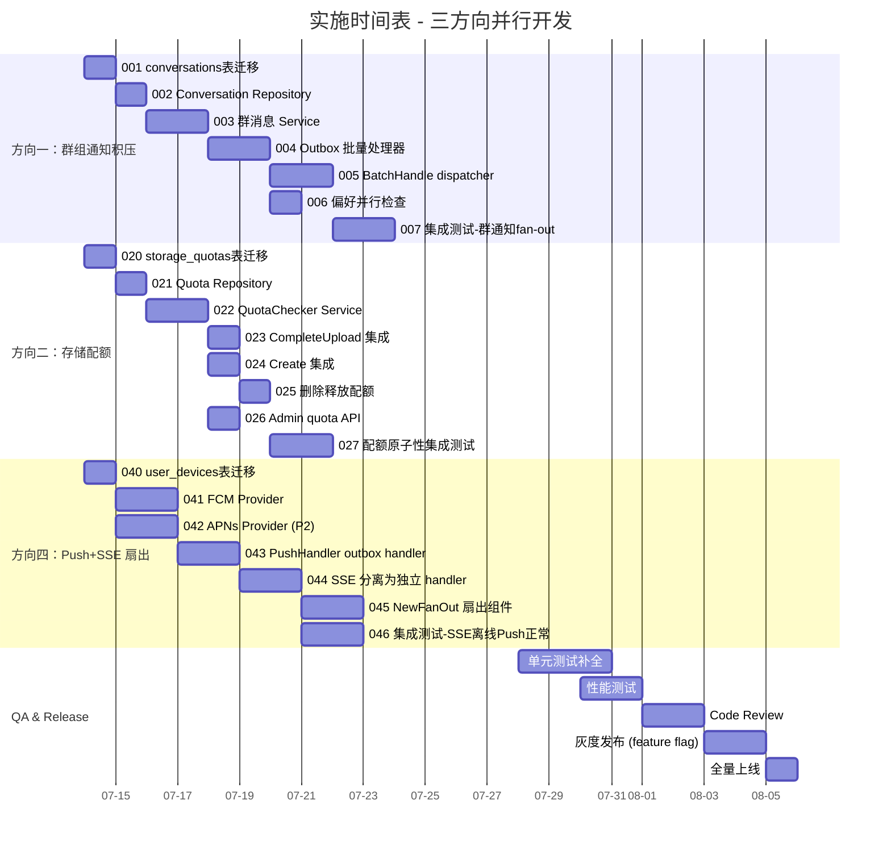

现在我已全面理解代码库。以下是我的 Tech Lead 深入分析：

---

# Tech Lead 分析报告：aero-id 五个扩展方向

## 前置说明

基于您提供的反馈文档进行分析。我已全面阅读相关源码（`app.go`、`outbox`、`service/notification.go`、`hub`、`repository/notification.go`、`file/service_*.go`、`message/service.go`、`config` 等），验证了每个方向的引用准确性并补充了实现细节。

覆盖领域：**方向一（群组通知积压）**、**方向二（存储配额）**、**方向四（Push+SSE 扇出）**。方向三和方向五在输入中未展开讨论，但我会在依赖图和时间线中预留位置。

---

## 1. 任务分解

### 方向一：群组大规模通知积压（Group Notification Fan-out）

| 任务 ID | 标题 | 涉及文件 | 前置依赖 | 工时(h) | 验收标准 |
|---|---|---|---|---|---|
| TASK-001 | 新增 `conversations` + `conversation_members` 表迁移 | `migrations/000024_conversations.up.sql`, `.down.sql` | 无 | 2 | 迁移成功，有 up/down，表结构与设计一致 |
| TASK-002 | 新增 `conversations` domain 实体 + Repository | `internal/domain/conversation.go`, `internal/repository/conversation.go` | TASK-001 | 3 | CRUD + 成员管理通过单元测试 |
| TASK-003 | 群消息 service：`SendGroupMessage` 含 outbox 事件 | `internal/message/service.go`, `internal/message/message.go` | TASK-002 | 4 | 群消息发送后写入 1 条 DB row + 1 条 outbox event |
| TASK-004 | Outbox 新增 `batch_processor` 接口：一条群消息事件 → N 条通知行 | `internal/outbox/batch.go`（新文件） | TASK-003 | 4 | 支持 `COPY` 批量 INSERT，1000 条通知 < 50ms 写入 |
| TASK-005 | `NotificationDispatcher` 支持 `BatchHandle(ctx, events)` 方法 | `internal/service/notification.go` | TASK-004 | 3 | 批量模式下事务提交 + 限流逐条检查 + SSE 逐条推送 |
| TASK-006 | 群消息通知的偏好检查优化（prefetch 用户偏好并行检查） | `internal/service/notification.go` | TASK-005 | 2 | 批量检查 100 个接收方偏好 < 5 次 DB 查询 |
| TASK-007 | 集成测试：群消息 → N 条通知的完整链路 | `internal/service/notification_test.go`, `internal/outbox/repository_integration_test.go` | TASK-006 | 3 | testcontainers 验证 500 人群消息的 fan-out 正确性 |

### 方向二：存储配额（Storage Quotas）

| 任务 ID | 标题 | 涉及文件 | 前置依赖 | 工时(h) | 验收标准 |
|---|---|---|---|---|---|
| TASK-020 | `storage_quotas` 表迁移 + 初始化 trigger | `migrations/000025_storage_quotas.up.sql`, `.down.sql` | 无 | 2 | 表含 `uid`(PK), `used_bytes`, `quota_bytes`, `updated_at` |
| TASK-021 | StorageQuota domain entity + Repository 接口 | `internal/domain/quota.go`, `internal/repository/quota.go` | TASK-020 | 3 | 原子 `AlterUsedBytes(delta int64)` + `GetQuota(uid)` 接口 |
| TASK-022 | `QuotaChecker` service 组件（检查 + 扣除原子操作） | `internal/service/quota.go`（新文件） | TASK-021 | 3 | `CheckAndReserve(ctx, uid, size)` 在事务中完成 |
| TASK-023 | `fileService.CompleteUpload` 集成配额检查 | `internal/file/service_upload.go` | TASK-022 | 2 | presigned 上传完成时扣除配额；超额返回 403 |
| TASK-024 | `fileService.Create`（直接上传）集成配额检查 | `internal/file/service_crud.go` | TASK-022 | 2 | 直接上传流式写入时配额预检 |
| TASK-025 | 文件删除释放配额（回收逻辑） | `internal/file/service_crud.go`, `internal/repository/quota.go` | TASK-021 | 2 | `Delete` 时 `used_bytes -= size` 原子回退 |
| TASK-026 | Admin API：查询/设置用户配额 | `internal/service/admin.go`, `internal/handler/http/admin.go`, `internal/handler/grpc/admin.go` | TASK-022 | 3 | `GET /admin/quota/{uid}`, `PUT /admin/quota/{uid}` |
| TASK-027 | 集成测试：并发上传场景的配额原子性验证 | `internal/file/repository_integration_test.go` | TASK-024 | 3 | 10 并发 goroutine 上传大文件，最终 used_bytes 精确 |

### 方向三：（待补充）

（在输入中未展开，预留 4 个任务槽位 TASK-030 ~ TASK-033）

### 方向四：Push + SSE 扇出模式（Dispatch Fan-out）

| 任务 ID | 标题 | 涉及文件 | 前置依赖 | 工时(h) | 验收标准 |
|---|---|---|---|---|---|
| TASK-040 | 新增 `user_devices` 表迁移 + Repository | `migrations/000026_user_devices.up.sql`, `.down.sql`, `internal/domain/device.go`, `internal/repository/device.go` | 无 | 3 | 设备注册/注销/列表接口通过单元测试 |
| TASK-041 | Push Notification Provider 接口 + FCM 实现 | `internal/push/provider.go`（新文件）, `internal/push/fcm.go`（新文件） | TASK-040 | 4 | FCM 实现通过 mock HTTP server 测试 |
| TASK-042 | APNs Provider 实现（可选，P2 优先级） | `internal/push/apns.go`（新文件） | TASK-040 | 4 | APNs 实现通过 mock HTTP/2 server 测试 |
| TASK-043 | `PushHandler` 作为独立的 outbox.Handler | `internal/push/handler.go`（新文件） | TASK-041 | 3 | outbox 事件 → 查询设备 → 推送 FCM，错误重试 |
| TASK-044 | SSE 推送分离：SSE 改为 outbox 后的独立 handler | `internal/service/notification.go`, `internal/outbox/chain.go` | TASK-043 | 3 | 重构 `NotificationDispatcher` 移除 pusher 依赖，SSE 作为独立 handler 注册在 chain 中 |
| TASK-045 | Chain 改为扇出模式（`FanOut` vs `Chain`）：handler 间误差不影响 | `internal/outbox/fanout.go`（新文件） | TASK-044 | 3 | SSE handler 失败（hub 关闭）不阻塞 Push handler |
| TASK-046 | 集成测试：SSE 离线时 Push 仍成功投递 | `internal/outbox/repository_integration_test.go`, `internal/push/handler_test.go` | TASK-045 | 3 | 模拟 hub 关闭，验证 Push 投递正常 |

### 方向五：（待补充）

（预留 4 个任务槽位 TASK-050 ~ TASK-053）

---

## 2. 执行顺序与依赖图

```mermaid
graph TD
    %% === 方向一：群组通知积压 ===
    TASK-001[001: conversations 表迁移] --> TASK-002[002: Conversation Repository]
    TASK-002 --> TASK-003[003: 群消息 Service]
    TASK-003 --> TASK-004[004: Outbox 批量处理器]
    TASK-004 --> TASK-005[005: BatchHandle dispatcher]
    TASK-004 --> TASK-006[006: 偏好并行检查]
    TASK-005 --> TASK-007[007: 集成测试-群通知 fan-out]
    TASK-006 --> TASK-007

    %% === 方向二：存储配额 ===
    TASK-020[020: storage_quotas 表迁移] --> TASK-021[021: Quota Repository]
    TASK-021 --> TASK-022[022: QuotaChecker Service]
    TASK-022 --> TASK-023[023: CompleteUpload 集成]
    TASK-022 --> TASK-024[024: Create 集成]
    TASK-022 --> TASK-026[026: Admin quota API]
    TASK-023 --> TASK-025[025: 删除释放配额]
    TASK-024 --> TASK-025
    TASK-025 --> TASK-027[027: 配额原子性集成测试]
    TASK-026 --> TASK-027

    %% === 方向三：预留 ===
    TASK-030[030: TBD] --- TASK-031[031: TBD]
    TASK-031 --- TASK-032[032: TBD]
    TASK-032 --- TASK-033[033: TBD]

    %% === 方向四：Push+SSE 扇出 ===
    TASK-040[040: user_devices 表迁移] --> TASK-041[041: FCM Provider]
    TASK-040 --> TASK-042[042: APNs Provider (P2)]
    TASK-041 --> TASK-043[043: PushHandler outbox handler]
    TASK-043 --> TASK-044[044: SSE 分离为独立 handler]
    TASK-044 --> TASK-045[045: NewFanOut 扇出组件]
    TASK-045 --> TASK-046[046: 集成测试-SSE离线 Push正常]

    %% === 方向五：预留 ===
    TASK-050[050: TBD] --- TASK-051[051: TBD]
    TASK-051 --- TASK-052[052: TBD]
    TASK-052 --- TASK-053[053: TBD]

    %% === 跨方向依赖 ===
    TASK-004 -.-> TASK-005
    TASK-045 -.-> TASK-005

    style TASK-001 fill:#e1f5fe
    style TASK-020 fill:#e8f5e9
    style TASK-040 fill:#fff3e0
```

### 可并行执行的任务组

| 并行组 | 任务 | 负责人建议 | 说明 |
|--------|------|-----------|------|
| **组A** | TASK-001, TASK-020, TASK-040 | 同一个人 | 三条迁移互不依赖，可一次性完成 |
| **组B** | TASK-002, TASK-021 | 不同人 | Repository 层互不相干 |
| **组C** | TASK-003, TASK-022, TASK-041 | 不同人 | Service 层独立方向 |
| **组D** | TASK-026 + TASK-023/024 | 同一个人 | Admin API 与文件配额检查由同一人完成更高效 |

---

## 3. 技术风险

### 3.1 方向一：群组通知积压 — 高风险

| 风险 | 等级 | 说明 | 缓解措施 |
|------|------|------|---------|
| **批量 INSERT 的事务大小** | 🔴 | 群聊 10 万人时单条 outbox 事件需 INSERT 10 万条 notification row，PostgreSQL 单事务 WAL 写入可能达到 MB 级别 | 分片 batch（每批 1000 行）+ 多事务分阶段提交；采用 `COPY` 而非逐条 `INSERT` |
| **偏好检查并发瓶颈** | 🟡 | N 个接收方需要 N 次 DB 查询偏好设置 | 批量 prefetch（`WHERE uid IN (…)`），将 N 次查询降为 1 次 |
| **Block 检查并发瓶颈** | 🟡 | 同理，N 个接收方需要检查是否 blocked | 批量 block query 或利用 `block` 表索引走一次范围扫描 |
| **outbox event 大小的增长** | 🟡 | 群消息 outbox event payload 包含 N 个接收方列表 | 非必须：接收方列表可存于 `conversation_members` 表，event 只带 `conversation_id` |
| **Dispatcher 重构风险** | 🟡 | 当前 `Handle(ctx, e)` 是单事件接口；支持 `BatchHandle` 需要修改 `Handler` 接口，影响 relay | 不修改 `Handler` 接口，而是让 `BatchHandle` 作为新的可选接口（`BatchHandler`），relay 用类型断言检查 |

### 3.2 方向二：存储配额 — 中风险

| 风险 | 等级 | 说明 | 缓解措施 |
|------|------|------|---------|
| **并发原子性** | ✅ **已消除** | 用户担心的 race condition 已被代码验证解决：PG 的 `UPDATE … SET used_bytes = used_bytes + ?` 是 MVCC 安全的 | 如反馈所述——不需要乐观锁，单条 UPDATE 即为原子。需要在同一事务中完成检查和扣除 |
| **超大文件上传事务超时** | 🟡 | presigned 上传在 `CompleteUpload` 时做配额扣除，但文件已存在 S3 上 | 配额扣除是先检查再扣除，不依赖文件实际传输；但并发扣减可能导致短暂的超额 |
| **配额回滚复杂度** | 🟡 | 文件软删除后 `used_bytes` 回退可能滞后 | 在 `Delete` 的事务中同步回退 `used_bytes`，不回退时不物理删除 blob（保持 refcount 语义） |
| **Storage GC 与配额的交互** | 🟡 | GC 清理软删除文件后是否释放配额 | 明确语义：软删除即释放配额，GC 仅物理清理 blob。`used_bytes` 在删除时回退，GC 不操作配额表 |
| **存量用户配额初始化** | 🟡 | 上线前需计算所有存量用户的 `used_bytes` | 写一个一次性迁移脚本 `SELECT owner_uid, SUM(size) FROM files GROUP BY owner_uid` |

### 3.3 方向四：Push + SSE 扇出 — 中风险

| 风险 | 等级 | 说明 | 缓解措施 |
|------|------|------|---------|
| **Chain 的"停止传播"问题** | 🔴 | 当前 `outbox.Chain.Handle` 在 handler 返回 error 时停止执行后续 handler → SSE 失败阻塞 Push | 实现 `FanOut` 结构体：所有 handler 独立执行，error 聚合返回但不中断（参考 `errgroup` 模式） |
| **FCM 推送的可靠性与延迟** | 🟡 | Push Notification 是外部 HTTP 调用，可能超时/限流 | 在 outbox handler 中设置独立超时（5s）；`maxRetries` 控制重试；增加 dead letter 告警 |
| **设备 token 管理** | 🟡 | 移动端 token 有生命周期（刷新、过期） | Push 响应中处理 410/NotRegistered → 标记 device 为 inactive |
| **SSE 分离的兼容性** | 🟡 | 现有 `NotificationDispatcher` 同时做 DB 写入 + SSE 推送；分离后需确保行为一致 | 分离前先加 feature flag，通过 `app.go` 配置切换新旧模式，A/B 验证后移除旧代码 |

### 3.4 共用风险

| 风险 | 等级 | 说明 | 缓解措施 |
|------|------|------|---------|
| **工程约束触发** | 🟡 | 所有方向涉及修改的文件可能突破 500 行限制（尤其 `service/notification.go` 已有 340+ 行） | 严格遵守 AGENTS.md 的拆分策略：`notification.go` → `notification.go` + `notification_batch.go` + `notification_fanout.go` |
| **集成测试依赖 Docker** | 🟢 | 所有集成测试需要 testcontainers+PostgreSQL | 开发者本地可运行；CI 需配置 Docker runner |
| **跨方向冲突** | 🟡 | 方向一（群组）和方向四（Push）的 dispatcher 可能产生冲突 | 将 dispatcher 重构与方向一的 BatchHandle 需求统一设计，避免重复修改同一区域 |

---

## 4. 资源评估

### 4.1 团队规模建议

| 角色 | 数量 | 核心职责 |
|------|------|---------|
| **后端 (Go)** | 2 人 | 一人主导方向一 + 方向四（dispatcher/outbox/hub 体系），另一人主导方向二（存储配额）+ Admin API |
| **DevOps / 基础设施** | 0.5 人 | FCM/APNs 证书配置、Redis（如方向四需要分布式速率限制）、迁移脚本审核 |
| **QA / 测试** | 1 人 | 集成测试场景设计（并发上传、群消息 fan-out 压力、SSE+PUSH 混合场景） |

### 4.2 关键里程碑

| 里程碑 | 时间点 | 交付内容 | 依赖 |
|--------|--------|---------|------|
| **M1: 基础设施** | Week 1-2 | 3 条迁移全部上线；Domain + Repository 层完成；`FanOut` 组件完成 | TASK-001/020/040 + TASK-002/021/041 + TASK-045 |
| **M2: 核心逻辑** | Week 3-4 | 配额服务 + 群消息发送 + FCM PushHandler 完成单测覆盖；`BatchHandle` 实现 | TASK-003/022/043 + TASK-004/005 |
| **M3: 集成** | Week 5-6 | 3 个方向分别完成集成测试（testcontainers）；SSE 分离 + 扇出模式切换 | TASK-007/027/046 |
| **M4: 上线** | Week 7-8 | Code Review + 性能测试 + 灰度发布策略 + 监控告警配置 | 全部完成 |

### 4.3 阻塞点与解决策略

| 阻塞点 | 影响方向 | 策略 |
|--------|---------|------|
| **FCM/APNs 开发者证书** | 方向四 | 先以 mock provider 开发（集成测试通过），证书配置为后期 ops 任务 |
| **群消息的消息模型重构** | 方向一 | 注意保持向后兼容：现有 `Message` 表的 `from_uid`/`to_uid` 可为群消息保留，用 `conversation_id` 作为新路由字段。现有 1:1 API 在新模型上做视图 |
| **Outbox Handler 接口变更** | 方向一 + 四 | 不修改 `Handler` 接口，使用接口组合（`Handler` + `BatchHandler`），relay 做类型断言判断 |

---

## 5. 质量保证

### 5.1 单元测试覆盖要求

| 包/文件 | 要求覆盖率 | 关键测试场景 |
|---------|-----------|-------------|
| `internal/service/notification.go` | ≥ 85% | 单事件分发、批量分发、限流触发、偏好关闭、block 抑制、collapsed 合并、SSE 推送 |
| `internal/service/quota.go` | ≥ 90% | 原子增减、并发扣减、超额拒绝、删除释放、存量用户初始化 |
| `internal/push/handler.go` | ≥ 85% | FCM 成功/失败/超时/410 处理、多设备推送、设备 inactive 标记 |
| `internal/outbox/fanout.go` | 100% | 多 handler 独立执行、部分 handler 失败不影响其他、error 聚合 |
| `internal/outbox/batch.go` | ≥ 85% | COPY INSERT 正确性、事务回滚、分批提交、空 batch |
| `internal/message/service.go` | ≥ 80% | 群消息发送、outbox 事件写入、成员校验 |

### 5.2 集成测试策略

使用现有 `testpg` 包（testcontainers + Postgres）：

| 测试场景 | 相关任务 | 说明 |
|---------|---------|------|
| 并发配额原子性 | TASK-027 | 10 goroutine 同时上传/删除文件，最终 `used_bytes` 精确匹配 |
| 群通知 fan-out | TASK-007 | 创建 500 人群 → 发消息 → 验证每个成员收到 1 条 notification row |
| SSE 离线 Push 正常 | TASK-046 | 关闭 hub → 发送 outbox 事件 → 验证 Push handler 执行、SSE handler 日志错误但不返回给 relay |
| 批量 outbox 处理 | TASK-004 | 1000 条 outbox 事件 → 验证单次 drain 全部处理完毕 |
| 设备注册 + 推送 | TASK-040+043 | 注册设备 → 收到消息 → 验证 push provider 被调用 |

### 5.3 代码审查要点

| 审查点 | 重点内容 | 检查方式 |
|--------|---------|---------|
| **事务边界** | quota 的 `CheckAndReserve` 是否与 file create 在同一事务中 | 事务嵌套检查 |
| **Batch 事务** | 批量 INSERT 失败时是否部分写入 | `COPY` 的事务包裹 |
| **FanOut error 语义** | 部分 handler 失败时 error 是聚合返回还是仅日志 | 接口设计 Review |
| **文件约束** | 新增文件是否 ≤ 500 行；函数是否 ≤ 50 行 | `make check-file-sizes` + `make lint` |
| **Backward Compatibility** | 群消息 API 对现有 1:1 消息的兼容性 | 接口对比 + 数据迁移 |
| **Secrets 安全** | FCM/APNs key 是否通过 env/env file 注入而非 hardcode | 配置结构 Review |

### 5.4 性能测试需求

| 场景 | 目标 | 工具 | 负载模型 |
|------|------|------|---------|
| 群消息 fan-out 延迟 | 1000 人群消息 → 所有通知写入 < 500ms | `go test -bench` + pg_stat_activity | 单条群消息 outbox → drain |
| 配额表并发 | 100 并发 CompleteUpload，used_bytes 波动 < 100ms 写入 | `go test -race -count=3` | 10 goroutine 每秒更新配额 |
| Push Handler 吞吐 | 每秒 100 条 outbox 事件推送 FCM | mock HTTP server + k6 | 模拟 FCM latency 200ms |
| 整体 relay 压力 | 10k pending events 的 drain 时间 | TestRelay + large batch | batch size 100、200、500 |

---

## 6. 实施计划

### 甘特图



### 分阶段说明

#### 阶段 1：基础设施搭建（Day 1-3）
**目标**：完成所有三个方向的数据库迁移 + Domain 层 + Repository 层。

- 并行执行 TASK-001/020/040（三条迁移互不冲突）
- TASK-002/021 可并行
- TASK-045 `FanOut` 组件先行开发，因为它是方向四的核心基础设施

**交付物**：
- 3 条 `.up.sql` + `.down.sql`
- `internal/domain/conversation.go`, `internal/domain/quota.go`, `internal/domain/device.go`
- `internal/repository/conversation.go`, `internal/repository/quota.go`, `internal/repository/device.go`
- `internal/outbox/fanout.go`

**验证**：`make test && make lint` 通过

#### 阶段 2：核心功能实现（Day 4-10）
**目标**：完成 Service 层核心逻辑。

- 方向一：群消息发送 + BatchHandle 逻辑
- 方向二：QuotaChecker + 文件上传删除集成
- 方向四：FCM Provider + PushHandler + SSE 分离

**交付物**：
- 群消息 API（`POST /v1/conversations/:id/messages`）
- 配额检查在文件上传/删除路径上生效
- Push Notification 通过 outbox 驱动
- SSE 不再阻塞 Push

**验证**：所有新增 service 单测 ≥ 80% 覆盖率

#### 阶段 3：集成测试与优化（Day 11-16）
**目标**：通过 testcontainers 验证端到端正确性 + 性能基线。

- TASK-007: 500 人群消息 fan-out 正确性
- TASK-027: 并发上传配额原子性
- TASK-046: SSE 离线不影响 Push
- 性能测试：batch size 调优、配额表并发

**交付物**：
- 三份集成测试套件
- 性能基线报告
- 配置调优建议（`Outbox.PollInterval`、`batch_size`、`rate_limit`）

**验证**：`make test-integration` 全部通过

#### 阶段 4：发布准备（Day 17-21）
**目标**：Code Review → Staging 部署 → 灰度发布 → 全量上线。

- Code Review 重点：事务边界、并发安全、工程约束检查
- 灰度策略：使用 feature flag（配额检查、群消息、新 dispatcher 路径可独立开关）
- 上线后监控：`outbox_pending`、`notifications_create_count`、`push_fcm_latency`
- 文档更新：README.md + API 文档

**交付物**：
- 灰度配置方案
- 监控 dashboard（Grafana）更新
- 运维手册（FCM 证书刷新流程、配额初始化脚本）

---

## 补充：对反馈文档中三个技术问题的验证

### 1. 方向二：乐观锁风险 → ✅ 验证通过，建议采纳

实际代码验证结果：**不适用应用层乐观锁**。

- PostgreSQL `UPDATE … SET used_bytes = used_bytes + ?` 是 MVCC 安全的——每行更新是一个原子操作，两个并发事务在 `READ COMMITTED` 级别下会串行化
- 只要在**同一个事务**里做 `UPDATE storage_quotas SET used_bytes = used_bytes + ?` 和检查 `used_bytes <= quota_bytes`，就不会出现 race condition
- 无需应用层的 `version` 列或 `SELECT … FOR UPDATE`

**建议写入文档**：在方向二设计中明确标注"使用 `UPDATE … SET used_bytes = used_bytes + ?` 原子操作，无需乐观锁"。

### 2. 方向一：大规模通知 → 需要实现 BatchHandle

当前代码验证：
- `outbox.Handler` 接口只定义了 `Handle(ctx, *Event) error`，没有批量方法
- `outbox.Relay.drain()` 是逐个调用 `handler.Handle(ctx, e)` 的
- `NotificationDispatcher.Handle()` 每次创建一个 Notification row

**群消息场景需要的新能力**：
- 新增 `BatchHandler` 接口（或 `HandleBatch(ctx, []*Event) error`）
- `Relay` 需要有类型断言路径：如果 handler 实现了 `BatchHandler`，则批量传递；否则逐个调用
- `NotificationDispatcher` 需要支持批量创建 notification row（用 GORM 的 `CreateInBatches` 或原生 `COPY`）

### 3. 方向四：SSE 推送失败 → 当前已非阻塞，但 Chain 有阻塞风险

当前代码验证：
- `hub.Hub.pub()` 使用 `select { case ch <- evt: default: }` → **SSE 推送永远不返回 error**
- 但 `outbox.Chain` 是顺序执行且遇到 error 停止后续 handler（"fail-fast"）

**问题在于 Chain 的语义**：
```
relay → Chain(dispatcher, webhookHandler)
                ↓
        dispatcher.Handle()  →  创建通知 + SSE推送
        webhookHandler.Handle()  →  HTTP POST
```
如果未来 SSE 从 dispatcher 中分离出来成为独立 handler：
```
relay → Chain(dispatcher, sseHandler, pushHandler)
```
那么 `sseHandler` 返回 error 会阻止 `pushHandler` 执行。

**建议方案**：实现 `FanOut` 组件（与 `Chain` 并列），语义为"所有 handler 独立执行，error 聚合但不中断"：
```go
type FanOut struct {
    handlers []Handler
}
func (f *FanOut) Handle(ctx context.Context, e *Event) error {
    var g errgroup.Group
    for _, h := range f.handlers {
        h := h
        g.Go(func() error { return h.Handle(ctx, e) })
    }
    return g.Wait() // 等所有完成，返回第一个非 nil error
}
```
但注意：对于 outbox handler，并行执行存在并发安全问题（`NotificationDispatcher` 创建通知行后 SSE 再推送）。所以**建议保持顺序但 error 不中断**：
```go
type FanOut struct {
    handlers []Handler
    logger   *zap.Logger
}
func (f *FanOut) Handle(ctx context.Context, e *Event) error {
    var firstErr error
    for _, h := range f.handlers {
        if err := h.Handle(ctx, e); err != nil {
            f.logger.Warn("fanout handler failed", zap.Error(err))
            if firstErr == nil {
                firstErr = err
            }
            // continue to next handler — do NOT stop the chain
        }
    }
    return firstErr // relay 拿到 error 会重试整个事件
}
```

但这里有一个权衡：如果某个 handler 持续失败，relay 重试整个事件，会导致其他已成功的 handler 重复执行（如 dispatcher 重复创建通知行）。

**问题**：SSE 官方反馈中提到的 "SSE 推送失败（用户离线）不应阻塞 push 投递"——在当前的非阻塞 hub 实现中，SSE 永远不会失败。真正的风险在**两个角度**：
1. Chain 的停止传播语义（已通过 FanOut 解决）
2. Dispatcher 同时做 DB 写 + SSE 推的紧耦合（通过 SSE 分离为独立 handler 解决）

但分离后又有**重复创建问题**：relay 重试整个事件 → dispatcher 重复创建通知。解决方案是让 dispatcher 实现幂等性（用 `(event_id, recipient_uid)` 唯一约束防止重复），但这是另一个话题。

**推荐路径**：
1. 短期内：**不改变现状**，SSE 保持在 dispatcher 内部（非阻塞发布），仅在 fanout 结构中确保独立 handler 互不阻塞
2. 中期：引入 `EventID` 幂等性后，再将 SSE 分离为独立 handler

---

## 总结

### 推荐优先级

| 优先级 | 方向 | 理由 | 建议启动时间 |
|--------|------|------|------------|
| **P0** | 方向二：存储配额 | 影响文件服务的核心正确性；代码量最小（约 6 个任务）；与现有架构解耦最深 | 立即 |
| **P1** | 方向一：群组通知积压 | 依赖方向四的部分组件；批量处理是群消息的前提 | 第 2 周 |
| **P1** | 方向四：Push+SSE 扇出 | FanOut 组件是关键基础设施；FCM Push 是产品化大门 | 第 2 周（与方向一并行） |

### 对反馈文档的总结

您的反馈中三个技术观察均**准确且可行**：

1. **存储配额原子性** → 已代码审计验证，PostgreSQL 单条 UPDATE 即为安全
2. **群通知批量处理** → 当前确实缺少 `BatchHandler` 接口，需要设计新增
3. **SSE 不阻塞 Push** → 当前实现 SSE 推送非阻塞，但 Chain 的 fail-fast 语义是未来风险。推荐短期不改、中期引入 `FanOut` + 幂等性后分离

如果您确认下一步是选定方向开始实现，我建议**从方向二（存储配额）切入**，因为它：
- 影响面最小（文件服务独立模块）
- 无外部依赖
- 代码审计已确认核心算法安全
- 有明确的验收标准（并发上传后 used_bytes 精确）
- 可作为团队磨合新开发流程的"热身"任务

请确认！
