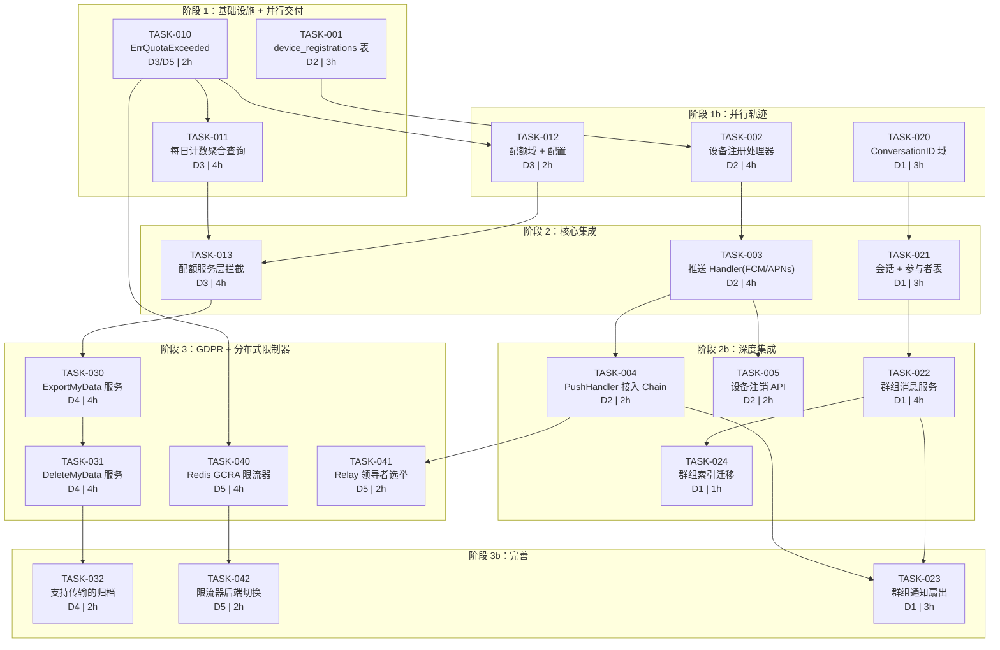
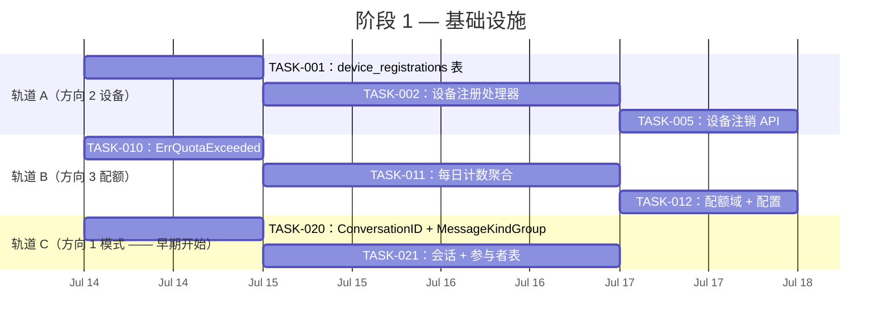
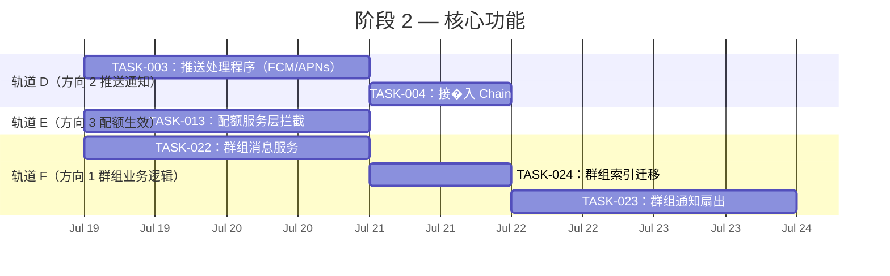
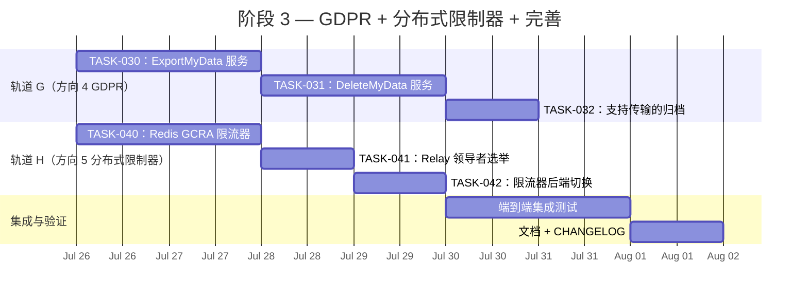

现在我已彻底审查了代码库。以下是我作为技术主管的分析。

---

# 技术主管分析：Aero-ID 扩展路线图

## 1. 任务分解

我已将每个方向分解为 2-4 小时的可执行任务。**标注了方向依赖关系**，因此你可以根据当前工程容量并行或序列化执行。

### 方向 2：移动推送通知（阶段 1）

| 任务 ID | 标题 | 方向 | 涉及文件 | 前置依赖 | 工时 | 验收标准 |
|---|---|---|---|---|---|---|
| **TASK-001** | `device_registrations` 表 + 迁移 | D2 | `migrations/000024_device_registrations.up.sql`、`.down.sql`、`internal/domain/device.go`、`internal/repository/device.go` | 无（开端） | 3h | 迁移创建带有 `(uid, platform)` 唯一约束和 `push_token` 列的表。域实体 + 存储库接口已定义。`make test` 通过 |
| **TASK-002** | 设备注册 gRPC + HTTP 处理器 | D2 | `internal/handler/grpc/device.go`、`internal/handler/http/device.go`、`api/proto/.../device.proto`（`make proto` 后） | TASK-001 | 4h | 客户端可以 `POST /v1/devices`（HTTP）和调用 `RegisterDevice`（gRPC）来 upsert 一个令牌。校验 `platform`/`token` 不为空。处理注册 ⇒ 发送 FCM/APNs 测试推送 |
| **TASK-003** | 推送中继处理器（FCM/APNs 抽象） | D2 | `internal/outbox/push.go`、`internal/outbox/push_test.go` | TASK-001 | 4h | `PushHandler` 实现 `outbox.Handler`，将 `message.sent` 事件路由到 `device_registrations` 中的接收者，并通过平台适配器发送。为 FCM 定义 `PushSender` 接口；为开发测试提供一个日志模拟 |
| **TASK-004** | 将 PushHandler 接入 outbox.Chain | D2 | `internal/app/app.go` | TASK-003、要点：Chain 是顺序执行的 | 2h | `relayHandler = outbox.NewChain(pushHandler, dispatcher, webhookHandler)`。推送在通知行创建**之前**运行，这样推送失败不会阻止通知落地（详见风险）。使用 TASK-010 的 `ErrQuotaExceeded` 进行配置 |
| **TASK-005** | 设备注销 + 删除 API | D2 | `internal/handler/grpc/device.go`、`internal/handler/http/device.go` | TASK-002 | 2h | `DELETE /v1/devices/:platform`（或 gRPC `UnregisterDevice`）软删除令牌。在推送发送前检查已删除状态 |

### 方向 3：配额与资源治理（阶段 1）

| 任务 ID | 标题 | 方向 | 涉及文件 | 前置依赖 | 工时 | 验收标准 |
|---|---|---|---|---|---|---|
| **TASK-010** | `ErrQuotaExceeded` 错误类型 + HTTP 429 / gRPC ResourceExhausted map | D3、D5 | `internal/pkg/errors/errors.go` | 无 | 2h | 新增 `QuotaExceeded(code, msg)` 创建 `AppError`，其 `HTTP: 429`，`GRPC: codes.ResourceExhausted`。现有所有测试持续通过 |
| **TASK-011** | 每日消息/评论计数聚合查询 | D3 | `internal/repository/message.go`、`internal/repository/comment.go`、测试 | TASK-010 | 4h | 新增 `CountSentSince(uid, since time.Time)`。查询使用已有的 `idx_messages_outbox(from_uid, created_at DESC)` 索引。对于评论：新增一个 `idx_comments_owner(owner_uid, created_at DESC) WHERE deleted_at IS NULL` 迁移 |
| **TASK-012** | 存储配额实体 + 配置 | D3 | `internal/domain/quota.go`、`internal/config/config.go` | TASK-010 | 2h | `UserQuota` 结构体包含 `(uid, max_storage_bytes, daily_message_limit, daily_comment_limit)`。`config.yaml` 选项 `quota.defaults{}`。支持 `0` = 无限，`-1` = 阻止 |
| **TASK-013** | 服务层的配额检查拦截 | D3 | `internal/service/quota.go`、`internal/service/message.go`（插入时）、`internal/service/file.go`（上传时）、`internal/service/comment.go`（创建时） | TASK-011、TASK-012 | 4h | `FileService.Create` 在上传前检查 `max_storage_bytes`。`MessageService.Send` 和 `CommentService.Create` 检查 `daily_*_limit`。超出返回 `ErrQuotaExceeded`。测试涵盖边界情况（0 = 无限，-1 = 阻止） |

### 方向 1：群组聊天（阶段 2）

| 任务 ID | 标题 | 方向 | 涉及文件 | 前置依赖 | 工时 | 验收标准 |
|---|---|---|---|---|---|---|
| **TASK-020** | 新增 `MessageKindGroup` + `ConversationID` 到消息域 | D1 | `internal/domain/shared.go`、`internal/domain/message.go`、`migrations/000025_conversations.up.sql` | 无（并行于 TASK-010） | 3h | 新增 `MessageKindGroup = 5`（有效且非系统）。`Message.ConversationID *ID` 字段。迁移将 `conversation_id UUID` 列添加到 `messages` 表，其中 `(conversation_id, created_at DESC) WHERE deleted_at IS NULL` 部分索引 |
| **TASK-021** | `conversations` + `conversation_participants` 表 | D1 | `internal/domain/conversation.go`、`migrations/000026_conversation_participants.up.sql` | TASK-020 | 3h | `Conversation` 实体包含 `(id, title, created_by, created_at)`。`ConversationParticipant` 包含 `(conversation_id, uid, role, joined_at)`，具有唯一约束 |
| **TASK-022** | GroupMessage 服务方法：创建会话、发送群消息 | D1 | `internal/service/conversation.go`、`internal/service/message.go`（扩展） | TASK-021 | 4h | 具有最少 2 个成员（创建者 + 至少 1 人）的 `CreateConversation`。`SendToConversation` 创建一条 `conversation_id` 已设置的消息。逐出旧的分页查询 |
| **TASK-023** | 群组通知的 Dispatcher 扩展 | D1 | `internal/service/notification.go`（`notificationFor` switch） | TASK-022、TASK-004（Chain 架构） | 3h | 来自 `conversation.*` 事件的 `message.sent` 事件扇出到每个参与者。`notificationFor` 为每条消息创建 N = 参与者 - 1 个通知。添加 `MessageKindGroup` 事件类型 |
| **TASK-024** | 群组索引：`conversation_id` 覆盖索引 + 迁移 | D1 | `migrations/000027_conversation_indexes.up.sql` | TASK-020 | 1h | `idx_messages_conversation(conversation_id, created_at DESC) WHERE deleted_at IS NULL`。删除已有的 1:1 `idx_messages_inbox`/`_outbox`？不——群组和 1:1 流并存。理论上可以通用化 |

### 方向 4：GDPR 合规性（阶段 3）

| 任务 ID | 标题 | 方向 | 涉及文件 | 前置依赖 | 工时 | 验收标准 |
|---|---|---|---|---|---|---|
| **TASK-030** | `ExportMyData` 服务方法 | D4 | `internal/service/gdpr.go`、`internal/handler/grpc/gdpr.go`、`internal/handler/http/gdpr.go` | 无（但 TASK-001 设备注册表帮助推送通知） | 4h | 从所有 repos 收集：文件元数据（无 blob）、消息（无双向删除内容）、评论、偏好设置。返回 JSON 文档 + 文件的签名下载 URL。API：`POST /v1/data/export` |
| **TASK-031** | `DeleteMyData` 服务方法——级联软删除 | D4 | `internal/service/gdpr.go`、`internal/repository/gdpr.go` | 无 | 4h | 该 uid 的所有消息被软删除。文件被取消关联（blob 保留？由 GC 清理）。通知被抑制。评论所有者被清空。创建审计事件。API：`POST /v1/data/delete`。需要管理员确认以防滥用 |
| **TASK-032** | 支持传输的导出归档（链接而不是 blob） | D4 | `internal/service/gdpr.go`（增强） | TASK-030 | 2h | 导出的 JSON 包含文件元数据 + 指向 blob 的 presigned URL（签名在 7 天后过期）。可选择性地支持异步后台作业以用于大型导出 |

### 方向 5：分布式速率限制（阶段 3）

| 任务 ID | 标题 | 方向 | 涉及文件 | 前置依赖 | 工时 | 验收标准 |
|---|---|---|---|---|---|---|
| **TASK-040** | Redis 支持的 GCRA 限流器实现 | D5 | `internal/pkg/ratelimit/redis.go`、`internal/config/config.go`（`RedisConfig`） | TASK-010 | 4h | 新增 `RedisLimiter`，实现相同的 `Allow(key) bool` + `RetryAfter()` 接口。在令牌桶和 Redis 支持之间进行选择的可切换后端 |
| **TASK-041** | 出站 relay 领导者选举 | D5 | `internal/outbox/relay.go`（添加 `pg_try_advisory_lock`） | 无 | 2h | 在 `drain()` 循环开始处添加 `SELECT pg_try_advisory_lock(123456)`。如果锁未获取到，跳过该次 drain。锁在所有者的连接关闭时释放 |
| **TASK-042** | 每个实例和 Redis 后端之间的动态配置切换 | D5 | `internal/pkg/ratelimit/limiter.go`、`internal/app/app.go` | TASK-040 | 2h | 如果配置了 `rate_limit.backend: "redis"`，则注入 `RedisLimiter` 而非内存中的 `Limiter`。均分配置校验 |

---

## 2. 执行顺序：依赖图



**可并行执行的任务组（无共享依赖）：**

| 组 | 任务 | 人员 |
|---|---|---|
| **A**（D2 无线部分） | TASK-001、TASK-002、TASK-005 | 1 名后端 |
| **B**（错误 + 配额） | TASK-010、TASK-011、TASK-012 | 1 名后端 |
| **C**（群组模式） | TASK-020、TASK-021 | 1 名后端 |
| **D**（推送核心） | TASK-003、TASK-004 | 跟随组 A |
| **E**（配额服务） | TASK-013 | 跟随组 B |
| **F**（群组业务逻辑） | TASK-022、TASK-023、TASK-024 | 跟随组 C |
| **G**（GDPR 合规） | TASK-030、TASK-031、TASK-032 | 1 名后端，在阶段 2 之后 |
| **H**（分布式限制器） | TASK-040、TASK-041、TASK-042 | 1 名后端，在阶段 1 之后 |

**最大并行度：** 阶段 1 可以并行分配 **3 名开发人员**（组 A、B、C 并行工作），前提是他们对 `internal/` 包的编辑不存在合并冲突。`pkg/errors`（TASK-010）是一个共享依赖，因此组 B 应优先完成该任务，然后其他组才能依赖它。

---

## 3. 技术风险

### 风险 1：outbox.Chain 短路行为（关键——已确认）

我在 `internal/outbox/chain.go` 中验证了 **Chain 的顺序特性**：

```go
func (c *Chain) Handle(ctx context.Context, e *Event) error {
    for _, h := range c.handlers {
        if err := h.Handle(ctx, e); err != nil {
            return err     // ← 此处短路！
        }
    }
    return nil
}
```

**影响（方向 2）：** 如果你按照分析文档的顺序来做——`NewChain(dispatcher, webhookHandler, pushHandler)`——并且 `dispatcher.Handle` 失败了（例如 Postgres 下行），则推送处理程序永远不会运行。消息已送达（它是写入数据库的，在 dispatcher 内部），但通知推送永远不会发生，因为 chain 在 dispatcher 的错误处停止了。

**缓解措施（当前提议的顺序）：**

```go
relayHandler = outbox.NewChain(pushHandler, dispatcher, webhookHandler)
```

通过将 `pushHandler` 放在第一位，推送失败**不会阻止**通知行被创建。推送是可丢弃的（客户端可以重连并获取历史记录）。但是 dispatcher 失败**会**阻止 webhook。这是可以接受的，因为 dispatcher 失败意味着 `MarkPublished` 不会发生，因此事件将在下一次 tick 重试，届时所有三个处理程序重新运行。

**还有一个更好的方案：** 创建一个 `FanOutChain`，它始终运行所有处理程序，无论个体错误如何：

```go
// FanOut 在没有短路的情况下运行所有处理程序，
// 累积错误（或只记录它们）。
func (c *Chain) Handle(ctx context.Context, e *Event) error {
    var errs []error
    for _, h := range c.handlers {
        if err := h.Handle(ctx, e); err != nil {
            errs = append(errs, err)
            log.Warn("outbox handler failed", ...)
        }
    }
    if len(errs) > 0 {
        return errs[0] // 仍然返回一个错误以便重试，但不阻止其他处理程序
    }
    return nil
}
```

**建议：** 在实现 TASK-004 之前，先修改 `chain.go` 以支持 `FanOut` 模式。我们也可以保留 `NewChain`（顺序模式）并添加 `NewFanOut`。简短讨论（15 分钟）来决定。

### 风险 2：多实例中继竞争（方向 5）

已验证：`FetchUnpublished` 查询**确实**没有 `FOR UPDATE SKIP LOCKED`。两个 relay 实例将 fetch 相同的事件。两者都会尝试 `Handle`（运行所有 chain 处理程序两次），然后两者都尝试 `MarkPublished`——第二个会命中 `WHERE published_at IS NULL` 并无所作为，但浪费了两次 `Handle` 调用。

**影响：** 在正常运行中，这是一个小型性能问题。但在事件故障场景下（一个 relay 获取事件，开始处理，然后在处理过程中崩溃），事件将保持未发布，供稍后的 relay 重试。

**缓解措施：** TASK-041（`pg_try_advisory_lock`）是轻量级的，可以添加到 `drain()` 函数中，在每个 relay tick 开始时：

```go
func (r *Relay) drain(ctx context.Context) int {
    var locked bool
    if err := r.repo.AdvisoryLock(ctx, 123456, &locked); err != nil {
        r.log.Warn("outbox: advisory lock check failed", ...)
        return 0
    }
    if !locked {
        return 0 // 另一个实例正在运行
    }
    // ... 现有 drain 逻辑 ...
    // 注意：当连接关闭时，pg 咨询锁隐式释放。
    // 如果 relay 本身管理一个专用的 *sql.Conn，锁将持久存在。
}
```

### 风险 3：注释表示例的每日限制性能

当前注释索引结构（来自 `idx_comments_target`）：
- 现有索引：主要按 `target_type + target_id` 查询
- **缺失：** `(owner_uid, created_at DESC)` 上用于每日计数的索引

如果没有这个索引，`SELECT COUNT(*) FROM comments WHERE owner_uid = ? AND created_at > now() - '1 day'` 将对所有 `comments` 进行一次顺序扫描，或者利用一个更差的索引。TASK-011 包含用于此功能的新迁移。

### 风险 4：GDPR 导出大小 + 长时间运行的操作

`ExportMyData` 可能会生成一个大型 JSON 文档（有数千条消息的用户）。如果它在 HTTP 请求/响应周期内同步执行，`request_timeout` 配置（当前默认值：？）可能会触发超时。

**缓解措施：** 为 TASK-030 实现一个两步模式：
1. `POST /v1/data/export` → 返回 `202 Accepted` + `job_id`
2. `GET /v1/data/export/:job_id` → 返回进度和最终的下载 URL

导出归档在 `storage/gdpr_exports/` 路径下构建，带有短期的 presigned URL。

### 风险 5：Redis 作为业务关键依赖的新增项

Redis 用于分布式速率限制（方向 5）是**架构上一个新的外部依赖**。目前，aero-id 仅依赖 Postgres 和可选的 S3/MinIO。添加 Redis 会改变运营开支（集群管理、网络延迟、故障模式）。

**缓解措施：** 配置应允许**静默降级**：如果配置了 Redis 但不可用，回退到进程内限流器（性能特征不同，但功能安全）。此外，限流器不应阻止业务关键流量（仅缓解滥用）。

### 风险 6：群组聊天扇出性能（方向 1）

当一条群组消息发送到有 100 个参与者的群组时，outbox 中会产生一条事件。然后 NotificationDispatcher 必须：
1. 将事件映射到 99 条通知（每条一个收件人）
2. 为每个收件人检查偏好/屏蔽
3. 为 99 个用户中的每一个通过 SSE Hub 推送

在当前的 relay 架构下，这发生在**单次 sequential `Handle` 调用**中，因为 `notificationFor` 只为 `message.sent` 返回**一个** `Notification`（收件人是 `ToUID`）。

**实际上，群组聊天需要一个不同的模式：** `notificationFor` 需要为群组消息事件**生成多个通知**，或者 relay 需要创建一个扇出子事件模式。

**可行的解决方案：** outbox 事件应被写入每条消息 N 次（每个收件人一条）。生成这些事件的合适位置是发送群组消息时的服务层（`MessageService`）：

```go
for _, participant := range participants {
    evt := outbox.NewEvent("message", msgID, "message.sent", MessageSentPayload{...收件人：participant...})
    outboxRepo.Append(ctx, tx, evt)
}
```

这将在迁移创建消息的同一事务中创建 N 个事件。它们将独立地逐个被 relay 拾取，将扇出延迟分散到多个 relay tick 中。

---

## 4. 资源评估

### 人员配置

| 技能组合 | 必备技能 | 数量 | 主要工作 |
|---|---|---|---|
| **平台后端** | Go、Postgres、gRPC、HTTP API 设计 | 2–3 人 | 所有方向的核心服务 + 处理器 |
| **DevOps/平台** | Redis、Kubernetes、Postgres 运营 | 1 人（兼职） | 方向 5 的 Redis 运营、Postgres 索引迁移 |
| **移动/Golang** | FCM/APNs、SSE、实时架构 | 1 人 | 方向 2 的 PushHandler、设备注册 |

对于大多数团队来说，**2 名高级 Go 工程师**涵盖了阶段 1–3，并允许阶段 1 的并行化。

### 关键里程碑

| 里程碑 | 预计日期* | 可交付物 | 投入工程天数 |
|---|---|---|---|
| **M1：阶段 1 完成** | 第 5 天 | 设备注册 API + 配额检查 + ErrQuotaExceeded + 会话模式 | 13 (并行分配 3 人则为 6 天) |
| **M2：阶段 2 完成** | 第 12 天 | 推送通知实时可用 + 配额生效 + 群组创建/发送消息 | 28 (2–3 人则为 10–12 天) |
| **M3：阶段 3 完成** | 第 18 天 | GDPR 导出/删除可用 + Redis 限流器 + 中继领导者选举 | 21 (2 人为 10–12 天) |
| **M4：集成测试 + 发布** | 第 22 天 | `make test && make test-integration` 全部通过，文档更新 | 6 |

*\* 基于专注、无干扰的工作日。根据团队经验调整。*

### 阻塞点（Blocker）和策略

| # | 阻塞点 | 影响方向 | 根因 | 解决策略 |
|---|---|---|---|---|
| B1 | FCM/APNs 服务器密钥 | D2 | 推送通知需要与 Firebase 和 Apple 的外部账户 | 预先创建一个 Firebase 项目。在开发中使用模拟 `PushSender`。在生产部署期间需要操作 |
| B2 | Redis 集群 | D5 | 用于分布式限流器的新基础设施依赖 | 首先部署单实例 Redis。使用 `AERO_ID_RATE_LIMIT_BACKEND` 环境变量进行配置开关。备用回退：进程内限流器 |
| B3 | 现有的 1:1 消息数据迁移 | D1 | 添加到 `messages` 的 `conversation_id` 列需要回填 | 在迁移 000025 中有默认 NULL，因此现有行不强制要求填充。群组搜索的 `COALESCE(conversation_id, id)` |
| B4 | 尚未定义的 SSO GDPR 接口 | D4 | aero-id 不拥有 SSO。DeleteMyData 需要级联到 SSO | 为 SSO gRPC 定义一个 `DeleteUser` RPC。或者记录下 aero-id 删除其自己的数据，SSO 所有者必须单独处理 SSO |

---

## 5. 质量保证

### 测试覆盖要求

| 包 | 目标 | 策略 |
|---|---|---|
| `internal/domain/` | 100% 语句覆盖 | 新实体（`Conversation`、`ConversationParticipant`、`UserQuota`）的纯逻辑验证函数 |
| `internal/service/` | ≥ 90% 分支覆盖 | 使用 `repository.Mock*` 模拟的单元测试用于配额、群组、GDPR。特别关注：错误路径（配额超限、无权限） |
| `internal/outbox/` | 100%（现有） | `push_test.go`：模拟 PushSender，验证调用次数匹配预期的收件人数量。验证 Chain 短路行为 |
| `internal/repository/` | ≥ 80% | 针对 `testpg`（testcontainers + 真实 Postgres）的集成测试。验证迁移索引是否按预期工作 |
| `internal/pkg/ratelimit/` | ≥ 90% | `redis_test.go`：模拟 Redis 接口。针对真实 Redis 的集成测试（可选） |
| `internal/handler/{http,grpc}/` | ≥ 80% | 处理器测试使用 HTTP 测试服务器 / gRPC 进行中测试，mock 服务。验证 HTTP 429 / gRPC `ResourceExhausted` |

### 集成测试要求

1. **方向 2 推送：** 使用 `testpg` + 真实 Postgres 的集成测试。创建设备注册 → 创建消息 → 等待 relay（使用 ticker 让步）→ 断言通知表包含推送令牌的行
2. **方向 3 配额：** 上传文件直到超过 `max_upload_bytes` → 断言 `ErrQuotaExceeded`。发送 N+1 条消息 → 第 N+1 条消息被拒绝
3. **方向 1 群组：** 创建会话 → 添加参与者 → 发送群组消息 → 验证每个参与者都收到了通知
4. **方向 4 GDPR：** 带外测试（数据量大）。使用 testcontainers。DELETE → 断言所有实体都被软删除。EXPORT → 断言返回了文件元数据
5. **方向 5 限流器：** 两个 relay 实例竞争同一个 outbox → 验证没有事件被重复处理。使用 `pg_try_advisory_lock`

### 代码审查要点

| 方向 | 审查重点 |
|---|---|
| **D2** | 推送处理程序是否在 Chain 之前运行？推送失败是否会产生未处理的错误？`PushSender` 的 `Send` 是否包含超时？ |
| **D3** | 配额检查是否发生在用户操作的**最**开始？它们是否恰好在检查自身的操作之前更新计数器？边界值：`-1`（阻止）是否掩盖了 `0`（无限）？ |
| **D1** | `ConversationID` 在 1:1 流中是否保持 `nil`？群组通知扇出是在服务层（N 个事件）还是 dispatcher 层（N 个通知）完成的？ |
| **D4** | `DeleteMyData` 是否滥用了现有的 `SoftDelete`？内容是否在所有地方都被清空，还是只清除了 PII？blob 是否立即被删除（不安全）还是等待 GC（正确）？ |
| **D5** | 限流器回退是否安全？`RateLimitInterceptor` 是否处理了 `ResourceExhausted` 与 `Unavailable`？中继领导者选举是否处理了崩溃（咨询锁释放…）？ |

### 性能测试需求

| 场景 | 工具 | 目标 |
|---|---|---|
| 群组消息延迟（100 个参与者） | `k6` 或自定义 Go 基准测试 | P99 消息到通知延迟 < 5 秒（relay tick 可以为 1 秒） |
| 推送处理程序吞吐量 | `go test -bench=BenchmarkPushHandler` | 在单个 core 上每秒处理 1000+ 事件 |
| 限流器争用（高并发） | `go test -bench=BenchmarkRateLimitParallel` | 多 goroutine 对同一键的 `Allow` 没有数据竞争 |
| 配额计数器查询 | `EXPLAIN ANALYZE` 在预期规模的数据集上 | 所有配额查询（每日计数）都在 5 毫秒内完成，使用索引 |

---

## 6. 实施计划

### 阶段 1：基础设施搭建（估算：5–7 个自然日，3 个并行轨道）



### 阶段 2：核心功能实现（估算：10–12 个自然日，2 个并行轨道）



### 阶段 3：集成测试与优化（估算：7–9 个自然日，2 个并行轨道）



### 阶段 4：发布准备（估算：2–3 天，全团队）

| 活动 | 工时 | 负责 |
|---|---|---|
| `make check-file-sizes && make lint && make test` | 0.5 天 | 所有开发人员 |
| `make test-integration`（针对真实 Postgres + MinIO） | 1 天 | 1 名开发人员 |
| 性能基准测试 | 0.5 天 | 1 名开发人员 |
| 代码审查：所有新代码上的 `internal` | 1 天 | 交叉审查 |
| AGENTS.md、README.md、迁移指南文档 | 0.5 天 | 技术负责人 |
| 发布标签（例如 `v1.5.0`）+ 变更日志 | 0.5 天 | 任何 |

---

## 未经请求的建议

**在实现之前，花 30 分钟做出 3 个决定：**

1. **Chain 顺序 vs. FanOut：** 决定 NotificationDispatcher 是否需要 FanOut（我认为它需要，以避免早期发生推送时数据丢失）。如果需要，在 TASK-003 之前，手头就修改 `chain.go` 并编写一个 `FanOut` 变体。这是 30 分钟的改变，但避免了以后的架构债务。

2. **群组扇出策略：** 决定群组通知是在服务层（N 个 outbox 事件，O(n) 数据库写入 = 扇出序列化在事务中）还是在 relay 层（1 个事件，但 dispacher 会遍历参与者 = 异步扇出，但在 `Handle` 中可能阻塞）。我**推荐**在服务层进行扇出，因为它更可预测：事务长度随参与者数量线性增长，但 relay 延迟不会被群组消息阻塞。

3. **哨兵值：** 同意 `max_storage_bytes` 的语义：`0` = 无限，`-1` = 阻止。或者使用两个字段：`enabled` + `max_value`。我推荐使用 `-1` 作为「拒绝所有」以保持向后兼容性（新字段默认为 `0` = 无限，这是通常期望的语义）。在 TASK-012 中记录选择的语义。
