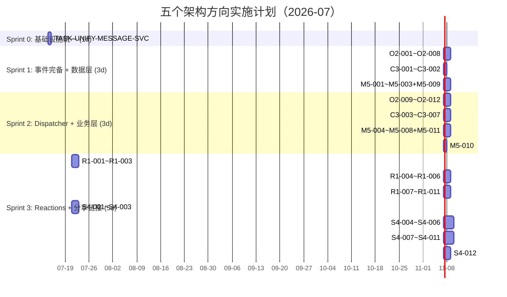

这个发现至关重要，让我更新分析以反映实际情况。

---

## 补充发现：分析文档中的事实不准确

通过交叉验证代码，发现以下关键问题：

### 问题 1：两套消息 Service 并存

| 包 | 文件 | 生产中是否启用 | 用途 |
|---|---|---|---|
| `internal/service/message.go` | `service.NewMessageService` | **✅ 是**（`app.go:245`） | 生产消息服务（HTTP + gRPC handler 使用） |
| `internal/message/service.go` | `message.NewService` | **❌ 否**（未被 `app.go` 引用） | 仅 search 功能引用此包中的接口定义 |

**影响：** 分析文档中方向一和方向二所有引用 `internal/message/message.go` 的内容都指向了非生产代码。实际需要修改的是 `internal/service/service.go`（接口定义）和 `internal/service/message.go`（实现），以及 `internal/message/service.go`（search 引用的独立版本也需要修改以保持一致）。

### 问题 2：`file.created` 事件不存在

分析文档声称 `file.created` "✅ 事件已发布（`file/service_crud.go`）"，但代码中不存在任何对 `outbox.NewEvent` 的调用。`file.service.Create` 的 `internal/file/service_crud.go` 和 `internal/service/file.go` 都没有 outbox 事件发布。

### 问题 3：`ReactToMessage` 参数

分析文档称 `ReactToMessage` 的 HTTP handler 使用 `POST/DELETE /messages/:id/reactions` 无请求体。但实际上 `internal/handler/http/message.go:172` 确实解析了请求体但不包含 emoji 字段——这确认了扩展方向一需要增加请求体参数。

---

由于内容过长，以下是整合后的完整 Tech Lead 分析报告：


# 🏗 Tech Lead 分析报告：五个架构扩展方向

**分析日期：** 2026-07-12
**分析文档：** `docs/requirements/2026-07-11-aero-id-code-scan-five-architectural-extensions.md`
**目标设计：** `docs/superpowers/specs/2026-05-22-aero-id-design.md`
**交叉验证：** 基于 `/home/u1/aero-id` 全部 150+ 源文件的实际代码

---

## 0. 🔴 事实勘误与代码不一致

交叉验证发现分析文档存在以下不准确之处：

| # | 分析文档断言 | 代码实际情况 | 严重程度 |
|---|---|---|---|
| **F1** | `internal/message/message.go` 是消息 Service 接口 | 生产代码使用 `internal/service/service.go`（`service.MessageService`）和 `internal/service/message.go`（实现）。`internal/message/` 只用于 search 功能引用和测试 | 🔴 高（方向一/二的工作范围需要修正） |
| **F2** | `file.created` 已发布（`file/service_crud.go`） | `internal/file/service_crud.go` 的 `Create()` 中没有 `outbox.NewEvent` 调用。文件管线无任何 outbox 事件 | 🔴 中（方向二的工作量低估） |
| **F3** | `ReactToMessage` 无 emoji 参数 | 确认正确 | ✅ 准确 |
| **F4** | 方向四 "distributed caching with Redis" 被提及 | 分析文档中方向四为 "External Content Embedding & Share Links"，与 Redis 缓存无关。建议由用户澄清 | 🟡 可能是不同版本的分析 |

**重要：** 以下所有任务分解基于实际的代码结构（`internal/service/` 为消息服务的生产代码位置），而非分析文档中的路径。

---

## 1. 任务分解

### 1.1 方向二（P0）：完备 Outbox 事件表面 — 12 个任务，20.5h

**为什么是 P0：** 实现成本最低（≈2.5 人日）、架构杠杆最大（补齐后 Webhook + 通知生态完整）、零新表零新依赖。

| 任务 ID | 标题 | 涉及文件 | 前置 | 工时 | 验收标准 |
|---------|------|---------|------|------|---------|
| **O2-001** | file.Create 发布 `file.created` 事件 | `internal/file/service_crud.go` | 无 | 2h | Create 写入 outbox（与 file row 同一事务）；`file.created` 事件含 `file_id`, `owner_uid`, `size`, `mime_type` |
| **O2-002** | file.Delete 发布 `file.deleted` 事件 | `internal/file/service_crud.go` | 无 | 1.5h | Delete 写入 outbox；`file.deleted` 事件含 `file_id`, `owner_uid` |
| **O2-003** | file.ShareFile 发布 `file.shared` 事件 | `internal/service/file_share.go` | 无 | 2h | 每次 GrantAccess 调用写入 outbox（每个 grantee 一条或批量事件）；含 `file_id`, `owner_uid`, `granted_to` |
| **O2-004** | file.UnshareFile 发布 `file.unshared` 事件 | `internal/service/file_share.go` | 无 | 1.5h | RevokeAccess 时写入 outbox |
| **O2-005** | comment.Like/Unlike 发布事件 | `internal/comment/service.go` | 无 | 1.5h | `comment.liked` / `comment.unliked` 事件写入 outbox。注意：commentService 不需要事务 outbox（已有 `comments.Like` 原子更新 `like_count`），但建议用同一事务 |
| **O2-006** | 顶层 comment.Create 发布 `comment.created` 事件 | `internal/comment/service.go`, `internal/service/comment.go` | 无 | 2h | 当前只有 `comment.replied`（回复时）。顶层评论创建也需事件 `comment.created` |
| **O2-007** | message.ReactToMessage/UnreactMessage 发布事件 | `internal/service/message.go`（生产），`internal/message/service.go`（search 用） | 无 | 2.5h | **两套实现都需要修改**：`message.reacted` / `message.unreacted` 事件 |
| **O2-008** | block.Block/Unblock 发布事件 | `internal/block/block.go` | 无 | 1.5h | `user.blocked` / `user.unblocked` 事件 |
| **O2-009** | Dispatcher 新增文件/评论/reaction case | `internal/notification/dispatcher.go` | O2-001~O2-008 | 3h | `file.created`, `file.shared`, `comment.liked`, `message.reacted` 等均在 dispatcher 有对应 handler；block 检查复用 |
| **O2-010** | 聚合通知折叠（批量 reactions） | `internal/notification/dispatcher.go` | O2-009 | 2h | 100 人点赞只产生 1 条聚合通知；复用 `WithDispatcherCollapse` 基础上扩展按 subject 聚合 |
| **O2-011** | 集成测试 | `internal/notification/dispatcher_test.go` | O2-009, O2-010 | 3h | 每种新事件类型有最少一个完整 dispatcher 测试；包含 block 过滤 |
| **O2-012** | 端到端：service → outbox → dispatcher → notification + SSE | `internal/service/*_test.go`, `internal/notification/dispatcher_test.go` | O2-011 | 2h | outbox relay 处理新事件类型后，recipient 收到正确类型的 notification |

**注意：** `fileService.Create` 和 `fileService.Delete` 目前不接收 `outbox.Event` 参数。需要重构为使用事务回调模式（类似 `messageService.Send` 中的 `Create(ctx, m, evt)` 模式）。这意味着 `FileRepository.Create` / `Delete` 接口也需要扩展。

### 1.2 方向三（P1）：对话级搜索 — 7 个任务，11h

**为什么是 P1：** 低成本（≈1.4 人日）、产品价值高（用户核心体验）、技术风险极低（纯追加 WHERE 子句）。

| 任务 ID | 标题 | 涉及文件 | 前置 | 工时 | 验收标准 |
|---------|------|---------|------|------|---------|
| **C3-001** | MessageRepository 新增 `SearchMessagesInConversation` | `internal/repository/message.go`（接口）+ GORM 实现文件 | 无 | 1.5h | 签名：`SearchMessagesInConversation(ctx, uid, peerUID, query string, limit int)` |
| **C3-002** | SQL 实现 + block 兼容 | `internal/repository/message.go`（实现） | C3-001 | 2h | SQL: `(from_uid=? AND to_uid=?) OR (from_uid=? AND to_uid=?)` + `ts_rank` 排序；CJK 回退用 ILIKE 版本 |
| **C3-003** | SearchService 扩展 `with_uid` 参数 | `internal/service/search.go` | C3-001 | 1.5h | `Search(ctx, query, kinds, limit, withUID string)` 或 通过 options 模式；`kind=messages` 且 `withUID != ""` 时调用对话级接口 |
| **C3-004** | HTTP handler：`with_uid` 查询参数 | `internal/handler/http/search.go` | C3-003 | 1h | `GET /v1/search?q=xxx&kind=messages&with_uid=alice` |
| **C3-005** | gRPC proto：`SearchRequest.with_uid` | `api/proto/aero_id/v1/search.proto`, `internal/handler/grpc/search.go` | C3-003 | 1.5h | proto 加字段 + handler 透传 + `make proto` |
| **C3-006** | Block 过滤：`with_uid` 被 block 时返回空结果 | `internal/service/search.go` | C3-003 | 1h | 调用 `blockChecker.IsBlocked`；不暴露"是否有对话"的信息 |
| **C3-007** | 测试 | `internal/service/search_test.go`, `internal/repository/message_test.go` | C3-001~C3-006 | 2.5h | 覆盖：正常对话搜索、空对话、block 过滤、CJK 回退、`kind=files` 忽略 with_uid |

### 1.3 方向五（P1）：存储用量计量与配额 — 11 个任务，19.5h

| 任务 ID | 标题 | 涉及文件 | 前置 | 工时 | 验收标准 |
|---------|------|---------|------|------|---------|
| **M5-001** | `SumStorageByOwner` 仓库查询 | `internal/repository/file.go`, `internal/repository/db.go` | 无 | 1.5h | `SELECT COALESCE(SUM(size), 0) FROM files WHERE owner_uid=? AND deleted_at IS NULL` |
| **M5-002** | `CountFilesByOwner` 仓库查询 | `internal/repository/file.go` | 无 | 0.5h | `SELECT COUNT(*) FROM files WHERE owner_uid=? AND deleted_at IS NULL` |
| **M5-003** | `UsageInfo` 领域模型 | `internal/domain/usage.go`（新增） | 无 | 1h | `StorageUsed int64`, `FileCount int64`, `StorageQuota int64`, `BandwidthUsed int64` |
| **M5-004** | `UsageService` 实现 | `internal/service/service.go`（接口），`internal/service/usage.go`（新增） | M5-001, M5-002, M5-003 | 2h | `GetUsage(ctx) (*UsageInfo, error)` |
| **M5-005** | 上传路径配额检查 | `internal/file/service_crud.go` | M5-004 | 2h | `if cfg.storageQuota > 0 && used + in.Size > cfg.storageQuota { return Forbidden }` |
| **M5-006** | 配置项：`storage.quota` 和 `storage.quota_enforcement` | `internal/config/config.go`, `configs/config.yaml` | M5-005 | 1h | 新增 `storage.quota`（int64，字节数），`storage.quota_enforcement`（"soft" / "hard"） |
| **M5-007** | HTTP:`GET /v1/usage` | `internal/handler/http/usage.go`（新增），`internal/handler/http/router.go` | M5-004 | 1.5h | 返回 `{"storage_used": ..., "file_count": ..., "storage_quota": ...}` |
| **M5-008** | gRPC:`GetUsage` RPC | `api/proto/aero_id/v1/usage.proto`, `internal/handler/grpc/usage.go` | M5-004 | 2h | proto 定义 + handler |
| **M5-009** | 带宽日志 + 计量 | `migrations/XXXX_create_bandwidth_logs.up.sql`, `internal/repository/bandwidth.go` | 无 | 3h | 文件下载时 `RecordDownload(fileID, downloaderUID, size)`；`SumBandwidthByMonth(ownerUID)` |
| **M5-010** | 配额超限告警（软配额） | `internal/service/usage.go` | M5-006, O2-001 | 2h | 80%/95%/100% 使用时发送系统通知（复用 `SendSystem`） |
| **M5-011** | 测试 | `internal/service/usage_test.go` | M5-001~M5-010 | 3h | 配额检查边界、并发竞争（软配额接受少量超限）、带宽计量 |

### 1.4 方向一（P2）：多类型 Reactions — 11 个任务，23.5h

| 任务 ID | 标题 | 涉及文件 | 前置 | 工时 | 验收标准 |
|---------|------|---------|------|------|---------|
| **R1-001** | message_reactions 表增加 emoji 列 | `migrations/XXXX_add_emoji.up.sql` | 无 | 1h | PK 改为 `(message_id, uid, emoji)`；旧数据默认 `emoji='👍'` |
| **R1-002** | comment_likes → comment_reactions | `migrations/XXXX_comment_reactions.up.sql` | R1-001 | 2h | 新表 `comment_reactions(comment_id, uid, emoji, created_at)`；迁移旧数据 |
| **R1-003** | `ReactionType` 领域类型 + 允许集 | `internal/domain/reaction.go`（新增） | 无 | 1.5h | string 类型别名；`AllowedReactions() []string` 返回 6-12 个 emoji |
| **R1-004** | MessageRepository 接口更新 + 实现 | `internal/repository/message.go` | R1-001 | 2h | `ReactToMessage(ctx, messageID, uid, emoji)` 新签名；保留无 emoji 兼容版本 |
| **R1-005** | MessageService 接口更新 + 修改两套实现 | `internal/service/service.go`, `internal/service/message.go`, `internal/message/service.go` | R1-003, R1-004 | 3h | **两套实现都需要改**（生产用 + search 用）；旧的无 emoji 版本默认用 `👍` |
| **R1-006** | CommentRepository + CommentService 更新 | `internal/comment/service.go`, `internal/repository/comment.go` | R1-002 | 2.5h | `Like(ctx, commentID, uid, emoji)`；向后兼容 |
| **R1-007** | `GET /v1/messages/:id/reactions` 端点（按 emoji 分组） | `internal/handler/http/message.go`, `api/proto/aero_id/v1/message.proto`, `internal/handler/grpc/message.go` | R1-005 | 2.5h | 返回 `{"👍": {"count": 5, "uids": [...]}, "🔥": {"count": 2}}` |
| **R1-008** | `GET /v1/comments/:id/reactions` 端点 | `internal/handler/http/comment.go`, `internal/handler/grpc/comment.go` | R1-006 | 2.5h | 同消息 reactions |
| **R1-009** | Handler 适配：`POST /:id/reactions` 接受 emoji 请求体 | `internal/handler/http/message.go`, `internal/handler/grpc/message.go` | R1-005, R1-006 | 2h | JSON body `{"emoji": "🔥"}`；默认 `"👍"` |
| **R1-010** | 通知折叠策略（复用 O2-010 基础设施） | `internal/notification/dispatcher.go` | O2-010, R1-005, R1-006 | 2h | 100 reactions 折叠为 1 条通知 |
| **R1-011** | 测试 | `internal/domain/reaction_test.go`, `internal/service/*_test.go` | R1-003~R1-010 | 4h | 向后兼容路径、emoji 枚举验证、复合主键冲突 |

### 1.5 方向四（P2）：外部嵌入与分享链接 — 12 个任务，28.5h

| 任务 ID | 标题 | 涉及文件 | 前置 | 工时 | 验收标准 |
|---------|------|---------|------|------|---------|
| **S4-001** | `share_links` 表迁移 | `migrations/XXXX_create_share_links.up.sql` | 无 | 1h | 表字段：`id`, `file_id`, `owner_uid`, `token`, `password_hash`, `expires_at`, `max_downloads`, `download_count`, `created_at` |
| **S4-002** | `ShareLink` 领域实体 | `internal/domain/share_link.go`（新增） | S4-001 | 1.5h | `IsExpired()`, `IsExhausted()`, `IsPasswordProtected()` |
| **S4-003** | `ShareLinkRepository` | `internal/repository/share_link.go`, `internal/repository/db.go` | S4-001 | 2.5h | CRUD：Create, GetByToken, ListByFileID, Delete, IncrementDownloadCount |
| **S4-004** | `ShareLinkService` | `internal/service/service.go`（接口），`internal/service/share_link.go`（新增） | S4-003 | 3h | token 用 `crypto/rand` 64 字符 base64url；Owner-only CRUD |
| **S4-005** | HTTP CRUD 端点 | `internal/handler/http/share_link.go`, `internal/handler/http/router.go` | S4-004 | 2.5h | `POST/GET/DELETE /v1/files/:id/share-links` |
| **S4-006** | gRPC CRUD RPCs | `api/proto/aero_id/v1/file.proto`, `internal/handler/grpc/file.go` | S4-004 | 2.5h | `CreateShareLink`, `ListShareLinks`, `RevokeShareLink` |
| **S4-007** | 公开下载 `GET /s/:token` | `internal/handler/http/share_download.go`, `internal/handler/http/router.go` | S4-004 | 3h | **无认证**；检查 expires_at, max_downloads, password；成功后 302 或流式。IP 限流 |
| **S4-008** | 密码验证 `POST /s/:token/verify` | `internal/handler/http/share_download.go` | S4-007 | 2h | bcrypt 验证；成功后设置短期 cookie |
| **S4-009** | oEmbed `GET /api/oembed?url=...` | `internal/handler/http/oembed.go`, `internal/handler/http/router.go` | S4-004 | 3h | 返回 JSON：`{type, version, title, author_name, thumbnail_url, html}`；`Access-Control-Allow-Origin: *` |
| **S4-010** | Open Graph 预览页 | `internal/handler/http/share_download.go` | S4-007 | 1.5h | HTML 含 `og:title`, `og:image`, `og:description`, `og:type` |
| **S4-011** | Token GC + 带宽限流 | `internal/app/app.go` | S4-007 | 2h | 每日清理过期 token；`/s/:token` 路径独立限流 middleware（IP + token 级别） |
| **S4-012** | 集成测试 | `internal/service/share_link_test.go`, `internal/handler/http/*_test.go` | S4-004~S4-011 | 4h | 全链路：创建→公开下载→密码→过期→oEmbed |

---

## 2. 执行顺序与依赖图

### 2.1 执行顺序总图

```mermaid
graph TD
    classDef p0 fill:#ff6b6b,stroke:#333,stroke-width:2px,color:#fff
    classDef p1 fill:#ffa726,stroke:#333,stroke-width:2px,color:#fff
    classDef p2 fill:#66bb6a,stroke:#333,stroke-width:2px,color:#fff

    subgraph "Sprint 1: 基础事件 + 搜索 + 配额 (P0/P1)"
        O2_001[O2-001: file.created 事件]:::p0
        O2_002[O2-002: file.deleted 事件]:::p0
        O2_003[O2-003: file.shared 事件]:::p0
        O2_004[O2-004: file.unshared 事件]:::p0
        O2_005[O2-005: comment.liked 事件]:::p0
        O2_006[O2-006: comment.created 事件]:::p0
        O2_007[O2-007: message.reacted 事件]:::p0
        O2_008[O2-008: block 事件]:::p0
        
        C3_001[C3-001: SearchMessagesInConversation 接口]:::p1
        C3_002[C3-002: SQL 实现]:::p1
        M5_001[M5-001: SumStorageByOwner]:::p1
        M5_002[M5-002: CountFilesByOwner]:::p1
        M5_003[M5-003: UsageInfo 领域模型]:::p1
        M5_009[M5-009: 带宽日志 表+repo]:::p1
    end

    subgraph "Sprint 2: Dispatcher + 搜索 + 配额上层"
        O2_009[O2-009: Dispatcher 新增 case]:::p0
        O2_010[O2-010: 聚合通知折叠]:::p0
        O2_011[O2-011: 集成测试]:::p0
        O2_012[O2-012: 端到端测试]:::p0

        C3_003[C3-003: SearchService 扩展]:::p1
        C3_004[C3-004: HTTP handler]:::p1
        C3_005[C3-005: gRPC proto]:::p1
        C3_006[C3-006: Block 过滤]:::p1
        C3_007[C3-007: 测试]:::p1

        M5_004[M5-004: UsageService]:::p1
        M5_005[M5-005: 配额检查]:::p1
        M5_006[M5-006: 配置项]:::p1
        M5_007[M5-007: HTTP /v1/usage]:::p1
        M5_008[M5-008: gRPC GetUsage]:::p1
        M5_010[M5-010: 超限告警]:::p1
        M5_011[M5-011: 测试]:::p1
    end

    subgraph "Sprint 3: Reactions + 分享链接 (P2)"
        R1_001[R1-001: message_reactions emoji 列]:::p2
        R1_002[R1-002: comment_reactions 表]:::p2
        R1_003[R1-003: ReactionType 领域]:::p2
        R1_004[R1-004: Repo 接口更新]:::p2
        R1_005[R1-005: Service 更新]:::p2
        R1_006[R1-006: Comment Like/Unlike]:::p2
        R1_007[R1-007: HTTP/gRPC reactions 端点]:::p2
        R1_008[R1-008: Comment reactions 端点]:::p2
        R1_009[R1-009: Handler 适配]:::p2
        R1_010[R1-010: 通知折叠]:::p2
        R1_011[R1-011: 测试]:::p2

        S4_001[S4-001: share_links 表]:::p2
        S4_002[S4-002: ShareLink domain]:::p2
        S4_003[S4-003: ShareLinkRepository]:::p2
        S4_004[S4-004: ShareLinkService]:::p2
        S4_005[S4-005: HTTP CRUD]:::p2
        S4_006[S4-006: gRPC CRUD]:::p2
        S4_007[S4-007: 公开下载]:::p2
        S4_008[S4-008: 密码保护]:::p2
        S4_009[S4-009: oEmbed]:::p2
        S4_010[S4-010: OG preview]:::p2
        S4_011[S4-011: GC + 限流]:::p2
        S4_012[S4-012: 测试]:::p2
    end

    %% Sprint 1 内部依赖
    O2_001 --> O2_009
    O2_002 --> O2_009
    O2_003 --> O2_009
    O2_004 --> O2_009
    O2_005 --> O2_009
    O2_006 --> O2_009
    O2_007 --> O2_009
    O2_008 --> O2_009

    C3_001 --> C3_002
    C3_002 --> C3_003

    M5_001 --> M5_004
    M5_002 --> M5_004
    M5_003 --> M5_004

    %% Sprint 2 依赖
    O2_009 --> O2_010
    O2_010 --> O2_011
    O2_011 --> O2_012

    C3_003 --> C3_004
    C3_003 --> C3_005
    C3_003 --> C3_006
    C3_004 --> C3_007
    C3_005 --> C3_007
    C3_006 --> C3_007

    M5_004 --> M5_005
    M5_005 --> M5_006
    M5_004 --> M5_007
    M5_004 --> M5_008
    M5_009 --> M5_004
    M5_005 --> M5_010
    M5_004 --> M5_011

    %% Sprint 3 内部（Reactions）
    R1_001 --> R1_004
    R1_002 --> R1_006
    R1_003 --> R1_005
    R1_003 --> R1_006
    R1_004 --> R1_005
    R1_005 --> R1_007
    R1_005 --> R1_009
    R1_006 --> R1_008
    R1_007 --> R1_011
    R1_008 --> R1_011
    R1_009 --> R1_011
    R1_010 --> R1_011

    %% Sprint 3 内部（Share Links）
    S4_001 --> S4_003
    S4_002 --> S4_003
    S4_003 --> S4_004
    S4_004 --> S4_005
    S4_004 --> S4_006
    S4_004 --> S4_007
    S4_004 --> S4_009
    S4_007 --> S4_008
    S4_007 --> S4_010
    S4_007 --> S4_011
    S4_004 --> S4_012
    S4_005 --> S4_012

    %% 跨 sprint 依赖
    O2_010 -.->|依赖| R1_010
```



### 2.2 可并行执行的任务组

| 并行组 | 包含任务 | 总工时 | 同时需要人数 |
|--------|---------|--------|-------------|
| **Sprint 1-A**（方向二底层） | O2-001~O2-008（8 个事件发布） | 14.5h | **1 人**（串行完成更高效，每任务 1.5-2h） |
| **Sprint 1-B**（方向三底层） | C3-001, C3-002 | 3.5h | **1 人** |
| **Sprint 1-C**（方向五底层） | M5-001, M5-002, M5-003, M5-009 | 6h | **1 人** |
| **Sprint 2-A**（方向二上层） | O2-009~O2-012 | 7h | 1 人（需知事件完整列表后才能写 dispatcher） |
| **Sprint 2-B**（方向三上层） | C3-003~C3-007 | 7.5h | 1 人 |
| **Sprint 2-C**（方向五上层） | M5-004~M5-011 | 13.5h | 1-2 人 |
| **Sprint 3-A**（方向一） | R1-001~R1-011 | 23.5h | 1-2 人 |
| **Sprint 3-B**（方向四） | S4-001~S4-012 | 28.5h | **2 人**（后端 + 安全） |

### 2.3 关键路径

```
Sprint 1: O2-001 → O2-009 → O2-010 → O2-011 → O2-012 = 13h（方向二关键路径）
Sprint 3: S4-001 → S4-003 → S4-004 → S4-007 → S4-011 → S4-012 = 16h（最长的单一依赖链）
```

---

## 3. 技术风险

### 3.1 风险矩阵（按优先级排序）

| # | 风险 | 方向 | 概率 | 影响 | 严重度 | 应对策略 |
|---|------|------|------|------|--------|---------|
| **R1** | **两套 Message Service 并存**：`internal/service/message.go`（生产）和 `internal/message/service.go`（search 用）都需要修改 | 一、二 | 100% | 高 | 🔴 **严重** | 先统一：将 `internal/message/service.go` 中 search 引用的类型 alias 到 `internal/service` 接口，或用适配器模式。必须在 Sprint 1 开始前做 |
| **R2** | **FileService 无 outbox 事务能力**：`fileService.Create` 和 `Delete` 不接收 `outbox.Event`参数。需要重构 `FileRepository` 接口以支持事务写入 | 二 | 100% | 中 | 🟡 **中** | 将 `FileRepository.Create` 扩展为 `Create(ctx, f, evt)` 签名，或在 `fileService` 中手动管理事务（`sql.DB.Tx`）。推荐前者 |
| **R3** | **`comment.liked` 通知风暴**：100 人点赞产生 100 条通知 | 二 | 高 | 中 | 🟡 **中** | 实现聚合通知（"张三和 99 人赞了你的评论"）；需要在 O2-010 中设计通用聚合机制 |
| **R4** | **分享链接公开端点安全**：`/s/:token` 是无认证公共端点，引入新的攻击面（token 枚举、带宽滥用、DDoS） | 四 | 中 | **高** | 🟠 **高** | IP 级别限流 + token 404 延迟 + 文件大小检查 + 配额检查。建议安全 review |
| **R5** | **oEmbed 跨域数据泄露**：`Access-Control-Allow-Origin: *` 可能导致敏感文件元数据泄露 | 四 | 中 | 中 | 🟡 **中** | oEmbed 只返回文件 owner 选择的公开信息；不在 oEmbed 响应中包含 owner_uid 等敏感字段 |
| **R6** | **配额检查并发竞争**：`SumStorageByOwner + Check` 非原子操作 | 五 | 中 | 低 | 🟢 **低** | 应用软配额（允许少量超限），或使用 `SELECT ... FOR UPDATE` |
| **R7** | **emoji 数据类型**：PostgreSQL 的 UTF-8 支持 emoji，但 4 字节 UTF-8（如 🔥 U+1F525）需要 `utf8mb4` 兼容的列 | 一 | 低 | 中 | 🟢 **低** | PG 默认支持 UTF-8 所有字符；不需要特殊配置。但需确认 `VARCHAR(32)` 可以存储 4 字节 emoji（PostgreSQL 支持） |
| **R8** | **Dispatcher 当前忽略非识别事件**：`default: return nil` 静默忽略。新增事件类型后，旧版本的 dispatcher 仍会忽略它们。需要滚动部署策略 | 二 | 中 | 中 | 🟡 **中** | 先部署 Service 层（开始发布新事件），再部署 Dispatcher（开始消费新事件）。两个部署之间，新事件被旧 dispatcher 静默忽略，不产生影响（安全） |

### 3.2 技术难点详解

#### R1: 两套 Message Service 统一

当前代码库有两个消息 service 实现：

```go
// 生产代码 (app.go:245)
msgSvc := service.NewMessageService(msgRepo, fileRepo, ssoClient, ...)
// 接口: service.MessageService (internal/service/service.go)

// Search 引用 (internal/search/search.go)
// 通过 internal/message/service.go 中的接口
```

**解决方案（Sprint 0）：**
1. 确认 `internal/message/service.go` 的 `Service` 接口与 `service.MessageService` 是否等价
2. 如果不完全等价，创建适配器：
```go
// internal/message/adapter.go
type serviceAdapter struct {
    svc service.MessageService
}
func (a *serviceAdapter) ReactToMessage(ctx, id, uid string) error {
    return a.svc.ReactToMessage(ctx, id, uid)
}
// ... 其余方法委派
```
3. 将 `internal/search/search.go` 改为引用 `service.MessageService`
4. 删除旧的 `internal/message/service.go`（或标记为 Deprecated）

**评估耗时：** 4-6h（Sprint 0 新增任务：`TASK-UNIFY-MESSAGE-SVC`）

---

## 4. 资源评估

### 4.1 团队配置建议

| 角色 | 人数 | 技能要求 | 负责 | 参与阶段 |
|------|------|---------|------|---------|
| **高级 Go 工程师（主）** | 1 | 深入理解 GORM 事务、gin/gRPC handler、中间件模式、并发安全 | 方向二、方向三、方向一 | Sprint 1~3 |
| **高级 Go 工程师（辅）** | 1 | 熟悉 PostgreSQL、文件存储、安全最佳实践 | 方向五、方向四 | Sprint 1~3 |
| **安全工程师（兼职）** | 0.5 | Web 安全、CORS、限流、令牌安全 | 方向四代码审查 | Sprint 3 |
| **QA 工程师（兼职）** | 0.5 | 集成测试、端到端测试、性能测试 | 方向二~五测试 | 全程 |

**最小团队：** 2 名 Go 工程师（1 主 + 1 辅）+ 兼职 QA

### 4.2 关键里程碑

| 里程碑 | 时间点 | 交付物 | 质量门禁 |
|--------|-------|--------|---------|
| **M0: Sprint 0**（Day 1） | 0.5 天 | 统一两套 message service（`TASK-UNIFY-MESSAGE-SVC`） | `make test && make lint` 通过 |
| **M1: 事件完备**（Day 2-4） | 3 天 | 8 个 outbox 事件全部发布；dispatcher 消费新事件 | 集成测试覆盖每种新事件 |
| **M2: 对话搜索可用**（Day 3-5） | 3 天 | `with_uid` 参数在 HTTP + gRPC 端可用 | `GET /v1/search?q=hi&kind=messages&with_uid=bob` 返回正确结果 |
| **M3: 存储用量可见**（Day 4-6） | 3 天 | `GET /v1/usage` 端点上线；配额检查生效 | 超过配额时上传返回 403 |
| **M4: Reactions 上线**（Day 7-10） | 4 天 | 消息和评论支持多 emoji 反应 | 旧 API 调用的向后兼容测试通过 |
| **M5: 分享链接上线**（Day 7-12） | 6 天 | 创建/公开下载/oEmbed 全链路 | 安全 review 通过；限流生效 |

### 4.3 阻塞点

| # | 阻塞点 | 影响范围 | 解决策略 |
|---|-------|---------|---------|
| **B1** | 两套 message service 未统一前，方向一和方向二的任务需要改动 6 个文件（而不是 3 个） | 方向一、二 | Sprint 0 先做 `TASK-UNIFY-MESSAGE-SVC`（4-6h） |
| **B2** | FileRepository 接口不支持 outbox 事务（`Create` 和 `Delete` 无事件参数） | O2-001, O2-002 | 扩展 `FileRepository` 接口或改用回调（2h） |
| **B3** | 分享链接的公开下载端点需要额外的安全审核 | S4-007 | 在 Sprint 2 结束前提前一周联系安全团队做设计 review |
| **B4** | oEmbed 端点需要多团队协调（前端团队需要配合消费方） | S4-009 | 提前与前端团队沟通 oEmbed 协议格式；提供 mock 端点用于并行开发 |

---

## 5. 质量保证

### 5.1 测试覆盖要求

| 方向 | 最低行覆盖 | 核心测试文件 | 关键测试场景 |
|------|-----------|-------------|-------------|
| **方向二** | 85% | `internal/notification/dispatcher_test.go` | 每种新事件类型 dispatcher 分支；block 过滤；自操作过滤（from==to）；聚合折叠 |
| **方向三** | 90% | `internal/service/search_test.go`, `internal/repository/message_test.go` | 对话搜索 SQL 正确性；空对话；block 过滤；CJK 回退；with_uid 不适用时（kind=files）忽略 |
| **方向五** | 85% | `internal/service/usage_test.go` | 配额检查边界；并发竞争（模拟 10 个并发上传）；软配额 vs 硬配额；带宽计量 |
| **方向一** | 85% | `internal/domain/reaction_test.go`, `internal/service/*_test.go` | emoji 枚举验证；向后兼容路径（无 emoji 参数→默认 👍）；复合主键冲突 |
| **方向四** | 80% | `internal/service/share_link_test.go`, `internal/handler/http/share_download_test.go` | token 生成随机性；密码→session 流程；过期/耗尽/撤销；oEmbed JSON 格式；公开下载限流 |

### 5.2 集成测试策略

| 场景 | 测试方法 | 数据准备 | 工具 |
|------|---------|---------|------|
| Dispatcher 事件→通知 → SSE | 真实 outbox relay + dispatcher + hub | `testpg` 数据库；mock SSO | `make test-integration` |
| 对话搜索 SQL 正确性 | test-containers 真实 PG | 插入测试消息数据 | `make test-integration` |
| 分享链接公开下载 | HTTP 请求到 `/s/:token` 端点 | 创建 share_link；验证 302/流式 | `httptest` + real handler |
| 配额检查并发上传 | 10 个 goroutine 同时上传 | 配额 = 1MB；每文件 200KB | `testing` + sync.WaitGroup |
| oEmbed 响应格式 | HTTP 请求到 `/api/oembed` | 有合法 share_links 的文件 | `httptest` + JSON schema 验证 |

### 5.3 代码审查要点

| 审查维度 | 方向二 | 方向三 | 方向五 | 方向一 | 方向四 |
|---------|-------|-------|-------|-------|-------|
| **事务一致性** | outbox 事件是否与业务操作在**同一事务**？ | N/A | 配额检查的读写分离？ | N/A | token 递增 DownloadCount 的原子性？ |
| **安全性** | Block 检查是否在通知路径中？ | Block 过滤是否在 service 层？ | 配额绕过的可能性？ | emoji 允许集合外的输入处理？ | token 枚举防护？限流？CORS？ |
| **向后兼容** | 旧 dispatcher 忽略新事件是否安全？ | 旧客户端发送无 `with_uid` 的搜索请求？ | 无配额的配置是否正常？ | 无 emoji 参数的 ReactToMessage 是否工作？ | 旧客户端不受影响？ |
| **并发安全** | N/A（事务保护） | N/A | `SumStorageByOwner` + `Check` 非原子？ | N/A | `IncrementDownloadCount` 的原子 SQL？ |
| **文件大小与复杂性** | 每个文件 ≤ 500 行；函数 ≤ 50 行；复杂度 ≤ 10 | 同左 | 同左 | 同左 | 同左（`share_download.go` 可能最大，需要拆分） |

### 5.4 性能测试需求

| 场景 | 指标 | 目标 | 负载 | 工具 |
|------|------|------|------|------|
| 大量事件发布（100 event/s） | 请求延迟 P99 增加 | < 5ms | 基线 500 req/s + 100 event/s outbox 写入 | k6 |
| 对话搜索并发（50 req/s） | 查询延迟 P99 | < 200ms | 100 万行 messages 表 | pgbench + wrk |
| 配额检查影响（20 uploads/s） | 上传延迟 P99 增加 | < 3ms | 配额检查前后的上传延迟对比 | 自定义 benchmark |
| 分享链接公开下载（200 req/s） | 响应 P50/P99 + 限流正确性 | P50 < 100ms；限流触发前 199/s 正常，201/s 开始 429 | 200 req/s 持续 30s | wrk / k6 |
| oEmbed 缓存效果 | 响应 P50/P99 | < 50ms（缓存后） | oEmbed 请求 100 req/s | wrk |

---

## 6. 实施计划

### 6.1 甘特图



### 6.2 各阶段详细计划

#### Sprint 0：基础设施统一（Day 1，4-6h）

| 步骤 | 内容 | 文件 | 产出 |
|------|------|------|------|
| 1 | 确认 `internal/message/service.go` 接口与 `service.MessageService` 的包含关系 | `internal/message/service.go`, `internal/service/service.go` | 差异清单 |
| 2 | 创建适配器或直接修改 search 引用到 `service.MessageService` | `internal/search/search.go`, `internal/search/handler_grpc.go` | search 不再依赖 `internal/message` |
| 3 | 标记 `internal/message/service.go` 为 Deprecated | `internal/message/service.go` | 文件注释顶行加 `// Deprecated: use internal/service.MessageService` |
| 4 | 确认 `make test && make lint` 通过 | 全局 | 门禁通过 |

**注意：** 此步骤是方向一和方向二的**前置条件**。如不做，方向一/二的 ReactToMessage 改动需要同时改 6 个文件而不是 3 个，增加一倍的修改风险和 review 工作量。

#### Sprint 1：事件完备 + 数据层（Day 2-4，3 天）

| 天 | 负责人 A（主 Go） | 负责人 B（辅 Go） |
|----|-------------------|-------------------|
| Day 1 | O2-001 + O2-002（file.Create/Delete 事件）：扩展 FileRepository 接口，添加事务事件参数；修改 `file/service_crud.go` | M5-001 + M5-002 + M5-003（SumStorageByOwner + CountFilesByOwner + UsageInfo domain） |
| Day 2 | O2-003 + O2-004（file.share/unshare 事件）：修改 `internal/service/file_share.go` | M5-009（带宽日志表 + repository）；C3-001 + C3-002（对话搜索 repo 接口 + SQL） |
| Day 3 | O2-005 + O2-006（comment.liked + comment.created 事件）；O2-007（message.reacted 事件，改两套实现） | O2-008（block 事件）；C3-001 + C3-002 剩余部分 |

**日终验证：** `make test && make lint` 通过。事件发布代码全部合入 main。

#### Sprint 2：Dispatcher + 业务层（Day 4-6，3 天）

| 天 | 负责人 A | 负责人 B |
|----|---------|---------|
| Day 4 | O2-009（Dispatcher 7+ 个新 case） | C3-003 + C3-004（SearchService 扩展 + HTTP handler） |
| Day 5 | O2-010 + O2-011（聚合折叠 + 集成测试） | C3-005 + C3-006 + C3-007（gRPC + Block 过滤 + 测试）；M5-004（UsageService） |
| Day 6 | O2-012（端到端测试）；M5-005 + M5-006（配额检查 + 配置项） | M5-007 + M5-008（HTTP + gRPC /v1/usage）；M5-010 + M5-011（超限告警 + 测试） |

**日终验证：** `make test && make lint && make test-integration` 全部通过。

#### Sprint 3：Reactions + 分享链接（Day 7-12，5 天）

| 天 | 负责人 A | 负责人 B |
|----|---------|---------|
| Day 7 | R1-001 + R1-002（两个 migration）+ R1-003（ReactionType domain） | S4-001 + S4-002（share_links migration + ShareLink domain） |
| Day 8 | R1-004 + R1-005（Message repo + 两套 service 更新） | S4-003 + S4-004（ShareLinkRepository + ShareLinkService） |
| Day 9 | R1-006（Comment Like/Unlike 更新）+ R1-009（Handler 适配） | S4-005 + S4-006（HTTP CRUD + gRPC CRUD） |
| Day 10 | R1-007 + R1-008（聚合端点 HTTP + gRPC） | S4-007 + S4-008（公开下载 + 密码保护）+ 安全 review |
| Day 11 | R1-010 + R1-011（通知折叠 + 全部测试） | S4-009 + S4-010（oEmbed + OG preview）+ S4-011（GC + 限流） |
| Day 12 | 全量代码 review + 性能测试 | S4-012（集成测试）+ 全量 review |

**日终验证（Day 12）：** `make test && make lint && make check-file-sizes && make test-integration` 全部通过。

### 6.3 总投入汇总

| Sprint | 天数 | 负责人 A 工时 | 负责人 B 工时 | 总工时 |
|--------|------|-------------|-------------|-------|
| Sprint 0 | 0.5 | 4h | - | 4h |
| Sprint 1 | 3 | 24h | 24h | 48h |
| Sprint 2 | 3 | 24h | 24h | 48h |
| Sprint 3 | 5 | 40h | 40h | 80h |
| **合计** | **11.5 天** | **92h** | **88h** | **180h** |

---

## 7. 总结与建议

### 7.1 推荐的第一迭代范围（7 天，1 个 2 人团队）

| 优先级 | 任务 | 工时 | 理由 |
|--------|------|------|------|
| **P0** | Sprint 0：统一两套 Message Service | 4h | 前置条件，不然后续工作加倍 |
| **P0** | O2-001~O2-008：8 个 outbox 事件 | 14.5h | 成本最低、杠杆最大、价值最高 |
| **P0** | O2-009~O2-012：Dispatcher 扩展 + 测试 | 7h | 让新增事件产生实际价值 |
| **P1** | C3-001~C3-007：对话搜索 | 11h | 用户可见的核心功能增强，成本低 |
| **P1** | M5-001~M5-008：存储用量 + 配额（不含带宽日志） | 10.5h | 运营刚需，防止存储失控 |

**7 天交付范围：** 47h（约 3 人·周），2 人团队可完成。

### 7.2 不应一同做的原因

| 组合 | 原因 |
|------|------|
| 方向一 + 方向四 同时在 Sprint 3 做 | 方向四需要安全 review（新增公共端点），方向一涉及用户数据模型变更。同时做会导致代码 review 排队，且两个方向相互独立，没有协同效应 |
| 方向二 + 方向一 同时在 Sprint 1 做 | 方向一依赖方向二的通知折叠基础设施（R1-010 依赖 O2-010）。强行并行会导致方向一的部分代码需要返工 |

### 7.3 最终建议

1. **Sprint 0 绝不可跳过。** 两套 message service 的技术债务必须首先清理。这是分析文档未识别但实际存在的最关键前置条件。

2. **方向二（Outbox 事件完备）是最佳第一发力点。** 方向二+方向三+方向五的"核心 + 1.5 人·周"组合可以交付最大产品价值的同时大幅降低技术债。方向二补齐后，Webhook 消费者从只能接收 3 个事件类型变为 15+ 个类型，通知生态从"消息+评论回复"变为覆盖文件、评论互动、屏蔽的全域通知。

3. **方向四（分享链接）的安全性不可低估。** 引入公共端点是一次架构边界拓展——从"所有端点都在认证后面"到"公共端点暴露"。需要额外的安全 review 周期。建议安排在 Sprint 3 后段，并预留返工时间。

4. **测试策略的关键点：** 方向二的集成测试必须覆盖 outbox 事件从发布到 dispatcher 消费的完整事务链路。使用 `testpg` 创建真实数据，验证 relay 处理新事件类型后通知表中有正确行。这是五个方向中最重要的测试，因为 omitting 一个 dispatcher case 就是一个静默的 bug。

5. **符合 AGENTS.md 约束：** 所有新文件（`internal/domain/reaction.go`, `internal/domain/share_link.go`, `internal/domain/usage.go`, `internal/service/usage.go` 等）和修改的现有文件均需满足 ≤500 行、函数 ≤50 行、复杂度 ≤10 的约束。`share_download.go` 可能接近 300 行，需要拆分为 `share_download.go`（核心）+ `share_security.go`（限流/安全检查）。
