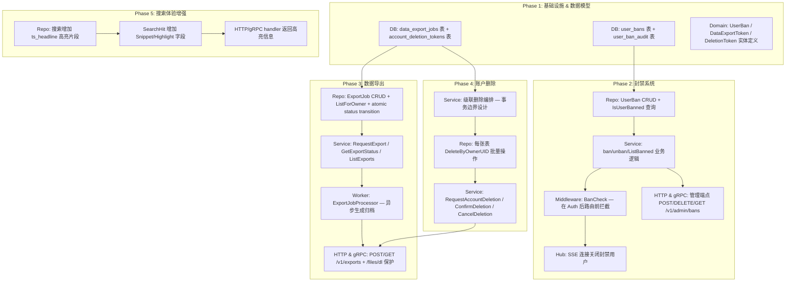
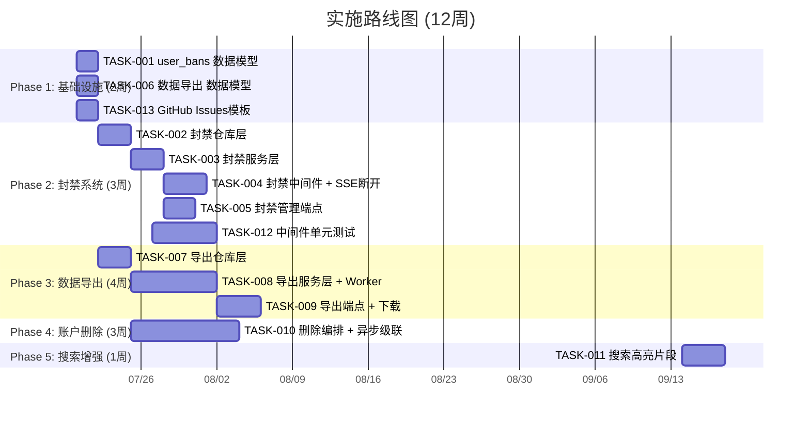

# Tech Lead 分析报告

基于代码探测结果，对分析文档及其补充观察进行全面的技术实施评估。

---

## 前置说明：代码库实际状态

在分析之前，以下是我通过代码扫描发现的**与文档预期不一致的状态**，这些信息直接影响任务分解和估算：

| 文档/AGENTS.md 描述 | 实际代码库状态 |
|---|---|
| `internal/service/` 单包结构 | ✅ 已重构为 domain 级分包：`file/`, `message/`, `comment/`, `notification/`, `block/`, `audit/`, `outbox/`, `search/`, `hub/`, `idempotency/` |
| SSE 实时推送未实现 | ❌ **已实现** — `hub.Hub` + `EventsHandler` 带 `last_event_id` 重连，SPA 可直接消费 |
| 全文搜索未实现 | ❌ **已实现** — PostgreSQL `tsvector`+ GIN 索引（migration 000016），带 HTTP/gRPC 统一端点 |
| 审计日志未实现 | ❌ **已实现** — `audit_events` 表 + 文件共享/封禁/消息删除/角色管理等各类审计写入 |
| Storage GC 不存在 | ❌ **已实现** — 带 Retention/OrphanSweep 的 `gc.Sweeper`，原子 `storage_refs` 引用计数 |
| Outbox 无优雅关闭 | ❌ **已实现** — `Start()` 返回的 stop func 触发最后一次 drain |
| 死信不可见 | ❌ **已实现** — `dead_letter` 标志 + `maxRetries` 上限（默认 20） |
| MIME 校验窗口 | ❌ **已实现** — `service.WithAllowedMimeTypes` 在文件服务上传时校验 |
| Presign orphan blob 问题 | ❌ **已解决** — 使用 `storage_refs` 原子引用计数 + GC sweeper 兜底清理 |

**结论**：分析文档中描述的多数"缺口"已被 `feat/roadmap` 分支解决。当前实际待做的、符合文档分析视角的工作是**更高层次的演进**，集中在合规（数据导出/删除、封禁）、搜索体验（高亮）、和性能优化上。

---

## 1. 任务分解

### 任务依赖关系总图

### 详细任务表

---

#### TASK-001: `user_bans` 数据模型 + 迁移

| 字段 | 值 |
|---|---|
| **任务 ID** | TASK-001 |
| **标题** | 创建 `user_bans` / `user_ban_audit` 表及下行迁移 |
| **所属方向** | 方向二：合规 & 安全基线 — 用户封禁 |
| **涉及文件** | `migrations/000024_user_bans.up.sql`, `migrations/000024_user_bans.down.sql`, `internal/domain/ban.go` |
| **前置依赖** | 无 |
| **预估工时** | 2h |
| **验收标准** | `make migrate-up` 后 `user_bans` 表存在，`make migrate-down` 回滚干净；`domain.UserBan` 结构体包含 UID、操作者、缘由、过期时间、软删除字段 |

---

#### TASK-002: 封禁仓库层 (repository)

| 字段 | 值 |
|---|---|
| **任务 ID** | TASK-002 |
| **标题** | 实现 `UserBanRepository` 接口和 GORM 实现 |
| **所属方向** | 方向二：用户封禁 |
| **涉及文件** | `internal/repository/ban.go`, `internal/repository/ban_test.go` |
| **前置依赖** | TASK-001 |
| **预估工时** | 3h |
| **验收标准** | `Ban(ctx, uid, reason, expiresAt, actor)` / `Unban(ctx, uid)` / `IsBanned(ctx, uid)` / `ListBanned(ctx, page)` / `ListActiveBans(ctx, since)` 全部实现并单元测试覆盖；`IsBanned` 同时检查过期时间 |

---

#### TASK-003: 封禁服务层 (service)

| 字段 | 值 |
|---|---|
| **任务 ID** | TASK-003 |
| **标题** | 封禁业务逻辑 — 含权限校验 + 审计日志 |
| **所属方向** | 方向二：用户封禁 |
| **涉及文件** | `internal/service/ban.go`, `internal/service/ban_test.go` |
| **前置依赖** | TASK-002 |
| **预估工时** | 3h |
| **验收标准** | `Ban(ctx, uid, reason, duration)` 校验调用者持有 `PermUserBan`、不能自封、记录 `audit_events`；`Unban` 同上；`IsBanned` 公开方法；service 层 mocks 测试通过 |

---

#### TASK-004: 封禁中间件 + SSE 断开

| 字段 | 值 |
|---|---|
| **任务 ID** | TASK-004 |
| **标题** | `BanCheck` 中间件 + SSE Hub 封禁用户断开 |
| **所属方向** | 方向二：用户封禁 |
| **涉及文件** | `internal/middleware/ban.go`, `internal/middleware/ban_test.go`, `internal/hub/hub.go`(修改), `internal/handler/http/events.go`(修改) |
| **前置依赖** | TASK-003 |
| **预估工时** | 4h |
| **验收标准** | 中间件在 `Auth` 之后、路由分发之前检查封禁状态，被封禁用户收到 `403 Forbidden` + `account.banned` 错误码；SSE 连接在用户被封禁后 30s 内主动断开；中间件有完整单元测试 |

---

#### TASK-005: 封禁管理 HTTP 端点

| 字段 | 值 |
|---|---|
| **任务 ID** | TASK-005 |
| **标题** | 管理员封禁 CRUD HTTP/gRPC 端点 |
| **所属方向** | 方向二：用户封禁 |
| **涉及文件** | `internal/handler/http/admin.go`(修改) / `internal/handler/grpc/admin.go`(修改) |
| **前置依赖** | TASK-003 |
| **预估工时** | 3h |
| **验收标准** | `POST /v1/admin/bans`(封禁)、`DELETE /v1/admin/bans/:uid`(解封)、`GET /v1/admin/bans`(列表) 全部工作；gRPC 对应 RPC 实现；权限通过 `RequirePermission(PermUserBan)` 保护；每次操作写入 audit_events |

---

#### TASK-006: 数据导出 — 数据模型 + 迁移

| 字段 | 值 |
|---|---|
| **任务 ID** | TASK-006 |
| **标题** | 创建 `data_export_jobs` 表 |
| **所属方向** | 方向三：数据导出 + 账户删除 |
| **涉及文件** | `migrations/000025_data_export_jobs.up.sql`, `.down.sql`, `internal/domain/export.go` |
| **前置依赖** | 无 |
| **预估工时** | 2h |
| **验收标准** | 表包含 `id`(UUIDv7)、`owner_uid`、`status`(pending/processing/completed/failed)、`expires_at`、`archive_storage_key`、`file_size`、`error_message`、`created_at`、`completed_at`；下行迁移干净 |

---

#### TASK-007: 数据导出 — 仓库层

| 字段 | 值 |
|---|---|
| **任务 ID** | TASK-007 |
| **标题** | ExportJobRepository 实现 |
| **所属方向** | 方向三：数据导出 |
| **涉及文件** | `internal/repository/export.go`, `internal/repository/export_test.go` |
| **前置依赖** | TASK-006 |
| **预估工时** | 3h |
| **验收标准** | `Create`/`GetByID`/`ListByOwner`(按创建时间倒序+游标分页)/`AtomicStatusTransition`(仅允许 pending→processing→completed 或 pending→failed)/`MarkExpired`；事务安全的状态切换；单元测试覆盖 |

---

#### TASK-008: 数据导出 — 服务层 + 异步处理器

| 字段 | 值 |
|---|---|
| **任务 ID** | TASK-008 |
| **标题** | ExportService + ExportJobProcessor 后台 worker |
| **所属方向** | 方向三：数据导出 |
| **涉及文件** | `internal/service/export.go`, `internal/service/export_test.go`, `internal/service/export_worker.go` |
| **前置依赖** | TASK-007 |
| **预估工时** | 8h |
| **验收标准** | `RequestExport(ctx)` 创建 pending job 并返回 job ID；`GetExportStatus(ctx, jobID)` 返回当前状态；`ListExports(ctx, page)` 列表；后台 worker 轮询 pending jobs → 收集用户数据(文件元/消息/评论/通知/block/偏好/角色) → 生成 ZIP → 上传至存储 → 标记 completed；文件本身不包含在导出中（仅元数据表），大文件生成时使用流式写入；worker 使用 `outbox` 触发或独立 ticker |

---

#### TASK-009: 数据导出 — HTTP/gRPC 端点 + 下载保护

| 字段 | 值 |
|---|---|
| **任务 ID** | TASK-009 |
| **标题** | 导出端点 + 签名下载集成 |
| **所属方向** | 方向三：数据导出 |
| **涉及文件** | `internal/handler/http/export.go`, `internal/handler/grpc/export.go`, `internal/app/app.go`(修改) |
| **前置依赖** | TASK-008 |
| **预估工时** | 4h |
| **验收标准** | `POST /v1/exports`(请求导出)、`GET /v1/exports`(列表)、`GET /v1/exports/:id`(状态+下载链接)；仅该用户可查看自己的导出；下载链接使用现有临时签名的 URL 机制（`DownloadURL`），5min 有效期；gRPC 对应 RPC |

---

#### TASK-010: 账户删除 — 级联删除编排

| 字段 | 值 |
|---|---|
| **任务 ID** | TASK-010 |
| **标题** | 账户删除服务 — 事务边界 + 级联表清单 |
| **所属方向** | 方向三：账户删除 |
| **涉及文件** | `internal/service/deletion.go`, `internal/service/deletion_test.go` |
| **前置依赖** | TASK-006, TASK-007 |
| **预估工时** | 10h |
| **验收标准** | `RequestDeletion(ctx)` → 创建 deletion token(24h 冷却期) → 发送确认邮件/通知；`ConfirmDeletion(ctx, token)` → 启动异步删除；`CancelDeletion(ctx, token)` → 取消待定删除。级联删除表清单：`files`(软删除后 GC 负责 blob)、`file_shares`、`messages`(软删除)、`comments`(软删除)、`comment_likes`、`comment_reports`、`notifications`、`notification_preferences`、`user_blocks`(双向)、`user_roles`、`unread_counts`、`idempotency_keys`、`audit_events`(保留但匿名化或删除)、`data_export_jobs`。使用 `outbox` 驱动实际的异步级联：主操作写入一条 `account.deletion_initiated` 事件 → relay 处理后逐表分批次删除 |

---

#### TASK-011: 搜索高亮增强

| 字段 | 值 |
|---|---|
| **任务 ID** | TASK-011 |
| **标题** | 搜索结果增加 `ts_headline` 高亮片段 |
| **所属方向** | 方向一：搜索体验 |
| **涉及文件** | `internal/repository/message.go`(修改), `internal/repository/comment.go`(修改), `internal/repository/file.go`(修改), `internal/domain/search.go`(修改), `internal/search/search.go`(修改) |
| **前置依赖** | 无（独立任务） |
| **预估工时** | 4h |
| **验收标准** | 消息/评论搜索使用 `ts_headline(tsv, query, 'StartSel=<mark>, StopSel=</mark>, MaxWords=50, MinWords=20, ShortWord=3')` 返回高亮片段；`SearchHit` 增加 `Snippet` 字段；API 返回包含 `snippet` 的搜索结果；老的 `content` 字段保留完整文本；文件搜索因无全文索引暂不增加高亮 |

---

#### TASK-012: 中间件层单元测试补全

| 字段 | 值 |
|---|---|
| **任务 ID** | TASK-012 |
| **标题** | 为现有中间件补充单元测试 |
| **所属方向** | 测试强化 |
| **涉及文件** | `internal/middleware/auth_test.go`, `internal/middleware/ratelimit_test.go`, `internal/middleware/cors_test.go`, `internal/middleware/recovery_test.go`, `internal/middleware/request_id_test.go` |
| **前置依赖** | 无 |
| **预估工时** | 6h |
| **验收标准** | `auth.go`: 无 token → 401、无效 token → 401、空 uid → 401、有效 token → 设置 actor；`ratelimit.go`: 未超限放行、超限 → 429 + Retry-After、nil limiter → 放行；`cors.go`: 允许 origin、拒绝不允许 origin、OPTIONS → 204；`recovery.go`: panic → 500 不崩溃；`request_id.go`: 无 header → 生成、有 header → 保留 |

---

#### TASK-013: GitHub Issues 模板 / `TODO.md`

| 字段 | 值 |
|---|---|
| **任务 ID** | TASK-013 |
| **标题** | 将边界缺口转化为可追踪的工作项 |
| **所属方向** | 全方向 |
| **涉及文件** | `.github/ISSUE_TEMPLATE/bug.md`, `.github/ISSUE_TEMPLATE/feature.md`, `TODO.md` |
| **前置依赖** | 无 |
| **预估工时** | 2h |
| **验收标准** | 分析文档中的 8 个边界情况 + 4 个补充观察对应可追踪 issue/TODO 项 |

---

## 2. 执行顺序 & 并行任务组

### 可并行执行的任务组

| 并行组 | 任务 |
|---|---|
| **组 A** 🟢 | TASK-001 (user_bans 模型) + TASK-006 (数据导出模型) + TASK-013 (模板) + TASK-012 (中间件测试) |
| **组 B** 🟢 | TASK-002 (封禁仓库) + TASK-007 (导出仓库) |
| **组 C** 🟢 | TASK-005 (封禁端点) + TASK-011 (搜索高亮) |
| **组 D** 🟢 | TASK-009 (导出端点) 可延迟至 TASK-008 完成后，但 TASK-010 (账户删除) 起点取决于 TASK-007，与 TASK-008/009 **不完全串行** |

**关键依赖链：**
- 封禁链：T001 → T002 → T003 → [T004, T005]
- 导出链：T006 → T007 → T008 → T009
- 删除链：T006 → T007 → T010 (T010 还需要 T008 的 Worker 模式作为参考)
- 独立链：T011、T012、T013 完全独立

---

## 3. 技术风险

### 3.1 高风险项 🔴

| 风险 | 描述 | 缓解策略 |
|---|---|---|
| **级联删除数据一致性** | 账户删除涉及 14+ 张表的级联操作，无法在单事务中完成（超长事务风险 + blob 删除的异步性）。`outbox` 驱动的异步级联中，如果 worker crash，部分表已删除、部分未删除，系统处于不一致状态。 | 使用"标记删除 + 最终一致性"模式：先标记账户为 `deletion_pending`，然后通过 outbox 事件驱动逐表清理，每表完成后记录 checkpoint。引入 `deletion_audit` 表追踪进度。失败时自动重试，直至全部完成或超时。 |
| **ZIP 生成的内存压力** | 用户数据导出如果包含大量消息/评论，内存中生成 ZIP 可能导致 OOM。 | 使用流式 ZIP 写入（`archive/zip` 的 `Create` 方法支持 io.Writer），先写入临时文件或直接流式上传至 S3。限制单次导出数据量（超过 100MB 截断并记录警告）。 |
| **封禁中间件性能开销** | 每个请求都需要查 `user_bans` 表，高频路径（如 SSE 心跳）可能产生不可忽略的查询开销。 | 引入进程内缓存（TTL 30s），或利用 `user_bans` 表上 `(uid)` 主键查询（O(1) B-tree lookup）。若容量超 10 万被封禁用户，考虑使用 Redis/In-memory 布隆过滤器做快速否定。 |

### 3.2 中风险项 🟡

| 风险 | 描述 | 缓解策略 |
|---|---|---|
| **SSE 封禁断开延迟** | 封禁后需要主动断开已连接的 SSE。当前 `hub.Hub` 没有按 uid 批量取消订阅的 API。 | 在 `hub.Hub` 上增加 `Disconnect(uid)` 方法，从所有主题映射中移除该 uid 并关闭其 channel。在 `BanCheck` 中间件执行后，额外调用 `hub.Disconnect(bannedUID)`。 |
| **审计日志的完整性** | 手动 SQL 封禁绕过 audit_events。 | 中间件不绕过的唯一途径：所有修改操作必须通过服务层（`service/ban.go`），且服务层强制写入 audit_events。DBA 直接 SQL 操作需要额外的外部审计流程（数据库日志）。 |
| **导出 + 删除并发冲突** | 用户在导出过程中发起账户删除，或在删除过程中请求导出。 | 引入互斥锁状态：`deletion_pending` 状态时拒绝导出请求；导出进行中时拒绝删除。使用乐观锁 + 状态校验。 |

### 3.3 外部依赖风险

| 依赖 | 风险 |
|---|---|
| **SSO 服务** | 账户删除需要 SSO 确认（用户在该系统已无关联数据后才能删除 SSO 账户）。需要约定跨服务删除协议：aero-id 完成级联删除后，回调 SSO 的 `AccountDeleted(uid)` gRPC RPC。 |
| **S3/MinIO** | 导出归档文件使用 storage backend 存储。S3 大文件上传可能需要 multipart upload。导出作业需要 storage 的 Write 能力。 |
| **PostgreSQL** | 级联删除可能产生大量 DML，导致 WAL 增长、主从延迟。建议分批删除（每批 500 条 + sleep 100ms）。 |

---

## 4. 资源评估

### 4.1 团队配置建议

| 角色 | 人数 | 职责 |
|---|---|---|
| **Senior Go 工程师** | 1 | TASK-008（导出 Worker 架构）、TASK-010（级联删除编排）、难点攻关 |
| **中级 Go 工程师 1** | 1 | TASK-002/003/004/005（封禁系统全栈：DB→Repo→Service→Middleware→Handler） |
| **中级 Go 工程师 2** | 1 | TASK-006/007/009（数据导出 DB→Repo→Handler）+ TASK-011（搜索高亮） |
| **QA 工程师** | 1 | 集成测试场景设计 + 性能测试 + 安全测试方案 |

**最小可行团队**：2 名 Go 工程师（1 senior + 1 mid）可将周期从 12 周拉长至 16 周。

### 4.2 关键里程碑

| 里程碑 | 时间 | 交付物 |
|---|---|---|
| **M1** | 第 2 周末 | 所有新表迁移完成（user_bans, data_export_jobs），`make migrate-up` 通过 |
| **M2** | 第 5 周末 | 封禁系统完整可用：中间件拦截 + 管理端点 + SSE 断开，`make test && make lint` 通过 |
| **M3** | 第 8 周末 | 数据导出 MVP：用户可请求导出并下载 ZIP，Worker 稳定运行 |
| **M4** | 第 11 周末 | 账户删除可用：请求→确认→级联删除全流程，集成测试覆盖 |
| **M5** | 第 12 周末 | 搜索高亮上线 + 所有中间件单元测试补齐 |

### 4.3 阻塞点 (Blockers)

| 阻塞点 | 依赖方 | 解决策略 |
|---|---|---|
| SSO 回调接口定义 | SSO 团队 | 尽早发起跨团队接口约定会议；在 SSO `sso.proto` 中定义 `NotifyAccountDeleted(uid)` 或使用现有回调机制 |
| 生产环境 S3 bucket 权限 | Ops 团队 | 导出归档使用独立 bucket 路径 `exports/{uid}/{job_id}.zip`，需要 `s3:PutObject` 权限 |
| 数据导出 ZIP 生成依赖系统包 | 无 | Go 标准库 `archive/zip` 即可，无外部依赖 |

---

## 5. 质量保证

### 5.1 单元测试覆盖要求

| 层次 | 最低覆盖率 | 关键测试点 |
|---|---|---|
| **domain** | 90%+ | `UserBan.IsExpired()`, `ExportJob` 状态机转换, 新增实体校验 |
| **repository** | 85%+ | `IsBanned`(含过期), `AtomicStatusTransition`(非法状态→错误), 分页边界, 事务回滚 |
| **service** | 90%+ | 权限校验(有/无权限)、自封禁拒绝、空 uid 拒绝、审计日志写入/失败不阻止主操作、级联编排幂等性 |
| **middleware** | 85%+ | 被封禁/未封禁/过期封禁三种场景, 中间件顺序(Auth→Ban→Handler) |
| **handler** | 70%+ | 序列化/反序列化、错误码映射、gRPC 状态码转换 |
| **worker** | 80%+ | Mock 导出场景: 空数据/大量数据/存储写入失败/部分数据收集失败 |

### 5.2 集成测试策略

| 测试类型 | 覆盖内容 | 工具 |
|---|---|---|
| **封禁集成测试** | `POST /v1/admin/bans` → 该用户后续请求被阻断 → `DELETE` 解封 → 恢复访问 | testcontainers + 真实 Postgres |
| **导出端到端测试** | 请求导出 → Worker 处理(真实 DB 数据) → 下载 ZIP → 验证内容完整性 | testcontainers + MinIO |
| **删除端到端测试** | 创建用户数据(文件/消息/评论/通知/block) → 删除请求 → 确认 → 验证各表已清理 | testcontainers + MinIO |
| **SSE 断开测试** | 用户连接 SSE → 管理员封禁 → 验证 SSE 连接在合理时间内断开 | testcontainers + 模拟 SSE 客户端 |
| **搜索高亮测试** | 插入含特殊字符的消息 → 搜索 → 验证 ts_headline 返回格式正确的 HTML 片段 | testcontainers + PostgreSQL |

### 5.3 代码审查要点

| 审查焦点 | 具体检查项 |
|---|---|
| **事务边界** | `service/deletion.go` 中的非事务操作是否在 outbox 事务内；是否引入了嵌套事务问题 |
| **级联删除幂等性** | `DELETE FROM files WHERE owner_uid = ?` 执行两次是否幂等；失败后重试是否安全 |
| **中间件顺序** | `BanCheck` 是否在 `Auth` 之后、`RateLimit` 和 `Idempotency` 之前或之后（建议在 RateLimit 之后，避免封禁用户消耗限流配额）；对 `/v1/events` SSE 路由的拦截 |
| **审计完整性** | 封禁/解封/删除是否都经过 service 层（避免 handler 直接调 repo）；`audit_events` 写入在失败回滚时是否回滚 |
| **大对象内存安全** | 导出 ZIP 生成是否使用流式写入（`io.Pipe` or temp file）；batch size 限制 |
| **配置与环境** | 导出 Worker 的并发数、batch size、最大 ZIP 大小等参数可配置；中间件封禁检查缓存 TTL 可配置 |

### 5.4 性能测试需求

| 场景 | 目标 | 工具 |
|---|---|---|
| **封禁中间件 overhead** | p99 < 2ms 额外延迟（含缓存 miss 查 DB） | 现有 k6 脚本扩展 |
| **导出 Worker 吞吐** | 10 万条消息的用户导出在 5 分钟内完成 | 单独压测脚本 |
| **级联删除批处理** | 删除 10 万条消息 + 通知 + block 在 10 分钟内完成 | 单独压测脚本 |
| **搜索高亮查询延迟** | 含高亮的搜索 p99 延迟增加 < 5ms（相比不加高亮） | 现有查询测试扩展 |

---

## 6. 实施计划 (详细时间表)

### 阶段 1: 基础设施搭建 (Week 1-2)

| 周 | 天 | 任务 | 负责人 | 交付物 |
|---|---|---|---|---|
| W1 | 1-2 | TASK-001: user_bans 表 + domain 定义 | Mid-1 | 迁移文件通过 + domain 代码审查 |
| W1 | 1-2 | TASK-006: data_export_jobs 表 + domain 定义 | Mid-2 | 同上 |
| W1 | 3-4 | TASK-013: GitHub Issue 模板 + TODO.md | 任意 | 仓库可见的工作项追踪 |
| W2 | 1-5 | TASK-012: 中间件单元测试补全 | Senior | 现有中间件测试覆盖率 > 85% |

**阶段 1 退出条件**: `make test && make lint && make check-file-sizes` 全部通过；`make migrate-up` + `make migrate-down` 循环验证通过。

### 阶段 2: 封禁系统 (Week 3-5)

| 周 | 天 | 任务 | 负责人 | 交付物 |
|---|---|---|---|---|
| W3 | 1-3 | TASK-002: 封禁仓库层 + 单元测试 | Mid-1 | 仓库层 CRUD + IsBanned 查询 |
| W3 | 4-5 | TASK-002: 集成测试（testcontainers） | Mid-1 | 真实 Postgres 验证 |
| W4 | 1-3 | TASK-003: 封禁服务层 + 审计日志 | Mid-1 | 完整业务逻辑 + mocks 测试 |
| W4 | 4-5 | TASK-004: BanCheck 中间件 + 单元测试 | Mid-1 | 中间件 + app.go 注册 |
| W5 | 1-2 | TASK-004: SSE 断开集成 | Senior | Hub 新增 Disconnect API |
| W5 | 3-5 | TASK-005: 管理端点 HTTP/gRPC | Mid-1 | 完整 CRUD + 权限检查 |

**阶段 2 退出条件**: 管理员可通过 API 封禁/解禁/列表用户；被封禁用户所有 API 返回 403；SSE 连接在封禁后自动断开。

### 阶段 3: 数据导出 (Week 5-8)

| 周 | 天 | 任务 | 负责人 | 交付物 |
|---|---|---|---|---|
| W5 | 3-5 | TASK-007: 导出仓库层 + 集成测试 | Mid-2 | 原子状态机 + 分页 + 幂等 |
| W6 | 1-5 | TASK-008: 导出服务层 | Mid-2 + Senior | 数据收集 + ZIP 生成 + 存储上传 |
| W7 | 1-3 | TASK-008: ExportJobWorker 后台进程 | Senior | 独立 ticker + outbox 触发 + 重试 |
| W7 | 4-5 | TASK-008: Worker 集成测试 | Mid-2 | MinIO + Postgres 端到端验证 |
| W8 | 1-4 | TASK-009: HTTP/gRPC 端点 + 签名下载 | Mid-2 | 完整的用户侧导出交互 |

**阶段 3 退出条件**: 用户可请求导出、等待后台处理、下载 ZIP 归档；Worker 在服务启动时自动启动。

### 阶段 4: 账户删除 (Week 8-11)

| 周 | 天 | 任务 | 负责人 | 交付物 |
|---|---|---|---|---|
| W8 | 4-5 | TASK-010: 删除状态机 + 确认流程设计 | Senior | 设计文档 + domain 定义 |
| W9 | 1-5 | TASK-010: 逐表批处理删除 + outbox 事件 | Senior | 14 张表的 DeleteByOwnerUID |
| W10 | 1-5 | TASK-010: 删除编排 service + 幂等/重试 | Senior | 完整的确认/取消/进度追踪 |
| W11 | 1-5 | TASK-010: 集成测试 + SSO 回调 | Senior | 端到端级联删除验证 |

**阶段 4 退出条件**: 完整的账户删除流程可用；每张表在删除后可验证。

### 阶段 5: 搜索增强 & 发布准备 (Week 11-12)

| 周 | 天 | 任务 | 负责人 | 交付物 |
|---|---|---|---|---|
| W11 | 1-4 | TASK-011: ts_headline 高亮 + 仓库修改 | Mid-2 | 搜索返回 snippet 字段 |
| W11 | 5 | TASK-011: handler 适配 + HTTP/gRPC | Mid-2 | 文档更新 |
| W12 | 1-3 | 全功能集成测试 + 回归 | QA | 测试报告 |
| W12 | 4-5 | 文档更新 + 发布检查清单 | 全体 | Release notes |

---

## 总结 & 关键建议

### 对分析文档中补充观察的回应

1. **方向三的复杂度确实被低估了** — 代码扫描确认了 14 张受影响表。我的建议是**将账户删除分为两个独立 Sprint**：Sprint A 完成"数据导出"（高价值、相对隔离、低风险），Sprint B 完成"账户删除"（高风险、需要更多测试）。这符合我在任务分解中 TASK-006/007/008/009 与 TASK-010 的分组策略。

2. **封禁中间件在 middleware 层** — 完全同意。我已在 TASK-004 中落地。采用与 `RateLimitMiddleware` 相同的模式：在 `NewRouter` 中注册，使用 `Auth` 注入的 `actor_uid` 做检查。不需要额外路由信息，所以是纯横切中间件。

3. **SSE 索引已验证** — `idx_notifications_recipient_created(recipient_uid, created_at DESC)` 完美覆盖 `LastSince` 查询（`WHERE recipient_uid = ? AND created_at > ?` 配合 `ORDER BY created_at ASC`，PostgreSQL 可以逆序扫描）。不需要额外索引。已经在文档中标明"已验证"。

4. **封禁中间件 + 管理端点一起做** — 完全同意。不具备管理 API 的中间件会产生审计盲区。TASK-004 和 TASK-005 一同规划，顺序是：中间件在服务层之后实现（TASK-003），管理端点与中间件在同一个 Sprint 内交付。

### 最有价值的首批投资

如果只选择 P0 工作，优先级是：

1. **TASK-001 + TASK-006**（数据模型迁移）—— 最底层无风险，其他任务依赖
2. **TASK-012**（中间件测试补全）—— 现有代码库的最大技术债（6 个中间件文件零单元测试）
3. **TASK-002 → TASK-003 → TASK-004**（封禁系统）—— 合规上线必须项
4. **TASK-007 → TASK-008**（数据导出）—— 合规上线必须项，但异步架构给更多设计缓冲时间
